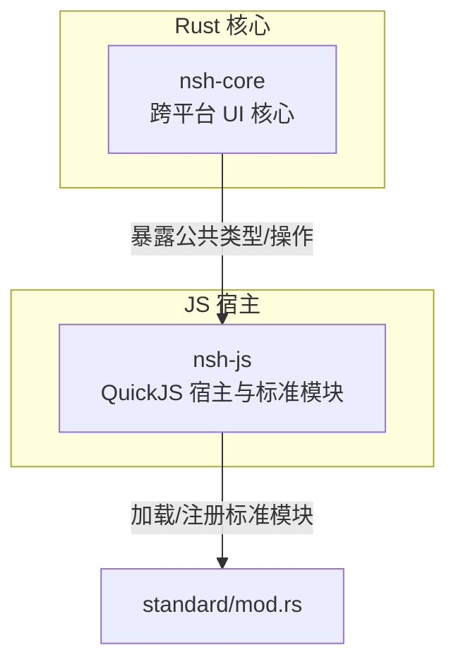
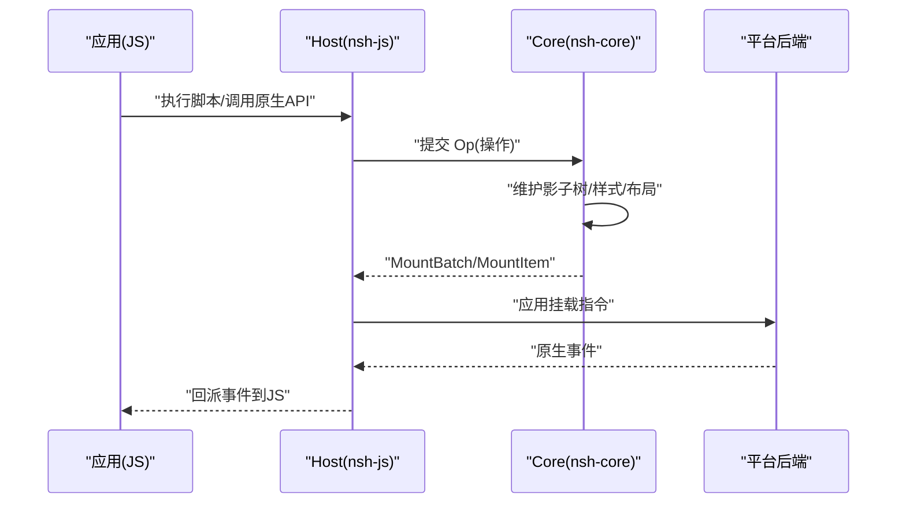
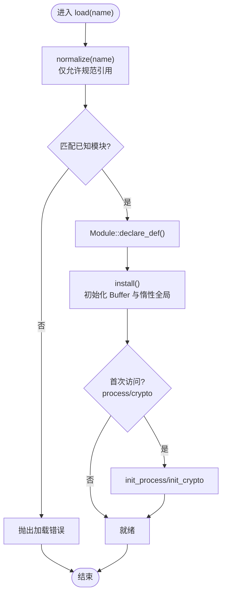
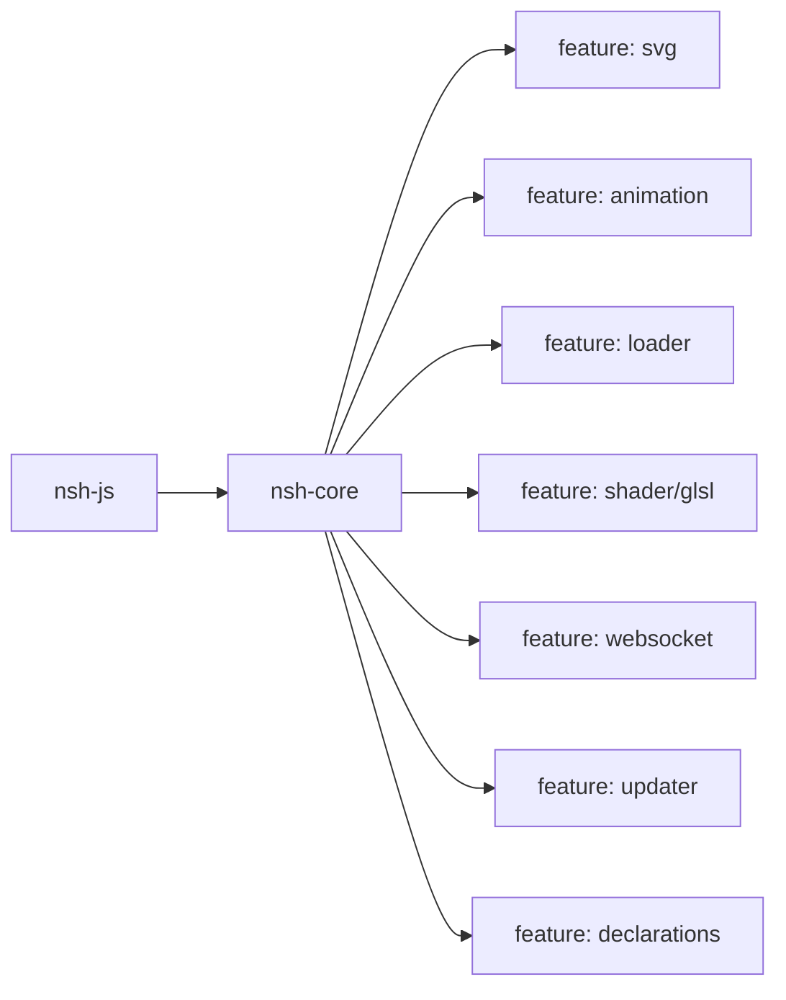

# API参考

<cite>
**本文引用的文件**   
- [crates/nsh-core/src/lib.rs](file://crates/nsh-core/src/lib.rs)
- [crates/nsh-core/Cargo.toml](file://crates/nsh-core/Cargo.toml)
- [crates/nsh-js/src/lib.rs](file://crates/nsh-js/src/lib.rs)
- [crates/nsh-js/src/standard/mod.rs](file://crates/nsh-js/src/standard/mod.rs)
</cite>

## 目录
1. [简介](#简介)
2. [项目结构](#项目结构)
3. [核心组件](#核心组件)
4. [架构总览](#架构总览)
5. [详细组件分析](#详细组件分析)
6. [依赖关系分析](#依赖关系分析)
7. [性能考虑](#性能考虑)
8. [故障排查指南](#故障排查指南)
9. [结论](#结论)
10. [附录](#附录)

## 简介
本文件为 NSH 框架的完整 API 参考，覆盖 Rust API、TypeScript API 与平台特定 API。文档聚焦以下目标：
- 梳理 Rust 公共接口（结构体、枚举、函数与方法）的职责边界、参数与返回语义、错误处理策略。
- 整理 TypeScript 模块导出、类型定义、接口规范与使用方式。
- 解释版本兼容策略与迁移建议。
- 给出类型约束、泛型与生命周期说明。
- 提供最佳实践与常见陷阱。
- 说明自动生成与手动维护的 API 文档一致性保证机制。

NSH 的核心由两部分组成：
- nsh-core：跨平台的 UI 运行时核心，负责接收 JS 渲染器产生的操作、维护影子树、样式到布局转换、文本合并、布局计算，并输出挂载指令给平台后端。
- nsh-js：QuickJS 宿主层，管理 VM 上下文、全局对象、标准模块、原生模块（nsh、nsh:rt、nsh/*），并将应用变更转换为 nsh_core::Op，同时将原生事件回派到 JS。

## 项目结构
下图展示与 API 直接相关的顶层模块组织与职责划分。

图表来源
- [crates/nsh-core/src/lib.rs:1-175](file://crates/nsh-core/src/lib.rs#L1-L175)
- [crates/nsh-js/src/lib.rs:1-87](file://crates/nsh-js/src/lib.rs#L1-L87)
- [crates/nsh-js/src/standard/mod.rs:1-297](file://crates/nsh-js/src/standard/mod.rs#L1-L297)

章节来源
- [crates/nsh-core/src/lib.rs:1-175](file://crates/nsh-core/src/lib.rs#L1-L175)
- [crates/nsh-js/src/lib.rs:1-87](file://crates/nsh-js/src/lib.rs#L1-L87)

## 核心组件
本节概述 Rust API 与 TypeScript API 的关键入口与职责。

- Rust API（nsh-core）
  - 公共模块：color、geometry、style、text、mount、ops、props、reactive、runtime、platform、desktop、mobile、canvas、image、websocket、webview、i18n、storage、navigation、animation、transition、effects、svg、tailwind 等。
  - 关键类型：Core、Op、MountBatch/MountItem、Style/ViewStyle、AttributedText、Transform、Bounds/Size/Point、JsonValue 等。
  - 特性开关：svg、animation、loader、shader、glsl、declarations、websocket、updater 等，影响可用 API 集合。

- JS 宿主（nsh-js）
  - Host：单线程 QuickJS 宿主，持有运行期与上下文，安装全局对象与原生模块，派发事件。
  - 标准模块：buffer、crypto、path、url、zlib、console、process 等，按平台与特性启用。
  - 导出：字节码编译、类型声明生成、网络请求抽象、错误类型等。

章节来源
- [crates/nsh-core/src/lib.rs:11-175](file://crates/nsh-core/src/lib.rs#L11-L175)
- [crates/nsh-js/src/lib.rs:1-87](file://crates/nsh-js/src/lib.rs#L1-L87)

## 架构总览
下图展示从 JS 应用到 Rust 核心的数据流与调用链。

图表来源
- [crates/nsh-js/src/lib.rs:1-87](file://crates/nsh-js/src/lib.rs#L1-L87)
- [crates/nsh-core/src/lib.rs:1-10](file://crates/nsh-core/src/lib.rs#L1-L10)

## 详细组件分析

### Rust API（nsh-core）概览
- 公共入口
  - 通过 crate 根 re-export 暴露大量类型，包括颜色、几何、样式、文本、挂载、操作、属性、响应式、运行时、平台信息等。
  - JsonValue 别名 serde_json::Value，作为原生组件与 JS 之间的 JSON 数据载体。
- 关键子系统
  - ops：UI 操作与事件模型（如 EventKind、MouseEvent、WheelEvent、WebInput、WebKey、WebSource、WebLoad 等）。
  - mount：挂载指令与视图元信息（MountBatch、MountItem、ViewKind、NativeProps、ImageOptions、VideoProps、WebProps、ScreenConfig、ModalConfig、ScrollBehavior 等）。
  - style：样式体系（Style、ViewStyle、TextStyle、Color、FontFamily、GridTemplateValue、EnvVar 等）。
  - text：富文本与排版（AttributedText、TextLayout、TextLine、TextSpan、TextPosition、Attachment 等）。
  - geometry：几何类型（Bounds、Size、Point、Edges、Corners 等）。
  - effects：动画与过渡（Keyframes、Transition、BackdropMaterial、GlassEffect、WindowsBackdrop、MacOsBackdrop 等）。
  - transform：变换矩阵与操作（Matrix、Transform、TransformOp、translation 等）。
  - platform/desktop/mobile：平台与环境能力（Environment、Idiom、Os、ColorScheme 等）。
  - runtime/reactive：运行时与响应式图（状态、订阅、更新调度）。
  - canvas/svg/image/websocket/webview：图形、媒体与网络能力。

- 特性开关对 API 的影响
  - svg：是否包含 SVG 渲染；关闭时仍识别但不绘制。
  - animation：是否支持 GIF/WebP 动画解码。
  - loader：是否支持远程图片下载。
  - shader/glsl：是否支持着色器编译与 GLSL ES 输出。
  - websocket：是否内置 WebSocket 客户端（原生实现）。
  - updater：是否支持应用自更新。
  - declarations：是否包含声明文本（供 .nsh/types 使用）。

- 错误处理
  - ApplyError：核心应用错误。
  - StyleError：样式解析/应用错误。
  - JsError：JS 宿主侧错误（在 nsh-js 中导出）。

章节来源
- [crates/nsh-core/src/lib.rs:11-175](file://crates/nsh-core/src/lib.rs#L11-L175)
- [crates/nsh-core/Cargo.toml:49-81](file://crates/nsh-core/Cargo.toml#L49-L81)

### TypeScript API（nsh-js）概览
- 宿主与运行时
  - Host：单线程 QuickJS 宿主，拥有运行期与上下文，安装全局对象与原生模块，将应用变更转为 nsh_core::Op，并将原生事件回派到 JS。
  - HostOptions：宿主配置项（例如沙箱、硬加固、日志等）。
  - ErrorHandler：JS 错误回调。
  - TextMeasurer：文本测量回调（用于高性能文本布局）。
- 标准模块
  - buffer、crypto、path、url、zlib、console、process 等，按平台与特性启用。
  - 标准模块通过 standard/mod.rs 统一加载与初始化，部分全局对象采用惰性安装以减少启动开销。
- 导出
  - 字节码编译：compile_bytecode、compile_chunk_bytecode、Strip、BUNDLE_NAME、BYTECODE_VERSION。
  - 类型声明：type_definitions（供工具链生成 TS 类型）。
  - 网络：HttpRequest、HttpHead、HttpBody、FetchEvent、NetworkQueue、RequestId。
  - 错误：JsError。
  - 平台信息：ColorScheme、Environment、Idiom、Os（来自 nsh-core）。

- 模块命名空间
  - native_module_exports：根据 specifier 与 ui_sets 返回原生模块导出的名称列表，供打包器校验命名导入。

章节来源
- [crates/nsh-js/src/lib.rs:1-87](file://crates/nsh-js/src/lib.rs#L1-L87)
- [crates/nsh-js/src/standard/mod.rs:1-297](file://crates/nsh-js/src/standard/mod.rs#L1-L297)

### 标准模块加载流程（TypeScript/JS 侧）
下图展示标准模块的规范化、加载与惰性初始化过程。

图表来源
- [crates/nsh-js/src/standard/mod.rs:23-57](file://crates/nsh-js/src/standard/mod.rs#L23-L57)
- [crates/nsh-js/src/standard/mod.rs:76-104](file://crates/nsh-js/src/standard/mod.rs#L76-L104)
- [crates/nsh-js/src/standard/mod.rs:226-242](file://crates/nsh-js/src/standard/mod.rs#L226-L242)

章节来源
- [crates/nsh-js/src/standard/mod.rs:1-297](file://crates/nsh-js/src/standard/mod.rs#L1-L297)

### 类型系统与约束
- Rust 类型
  - 几何：Bounds、Size、Point、Edges、Corners 提供二维几何运算与布局基础。
  - 样式：Style/ViewStyle/TextStyle 组合 CSS-like 样式，支持 EnvVar、GridTemplateValue、FontFamily 等。
  - 文本：AttributedText、TextLayout、TextLine、TextSpan、TextPosition 描述富文本结构与布局结果。
  - 变换：Matrix、Transform、TransformOp、translation 描述 2D/3D 变换。
  - 挂载：MountBatch/MountItem 描述一次批量挂载指令；ViewKind/NativeProps/ImageOptions/VideoProps/WebProps 描述不同视图的属性。
  - 操作：Op 是 JS 到核心的最小操作单元；EventKind/EventPayload/PayloadValue 描述事件模型。
- TypeScript 类型
  - 通过 type_definitions 生成 TS 类型，保持与 Rust 端一致。
  - 标准模块类型遵循 WHATWG/Node.js 风格（Buffer、URL、Crypto、Process 等）。

章节来源
- [crates/nsh-core/src/lib.rs:117-175](file://crates/nsh-core/src/lib.rs#L117-L175)
- [crates/nsh-js/src/lib.rs:62-86](file://crates/nsh-js/src/lib.rs#L62-L86)

### 生命周期与并发模型
- 单线程核心
  - nsh-core 与 nsh-js 的 Host 均为单线程设计，运行于引擎线程，避免锁竞争与分配热点。
- 资源与内存
  - 核心强调分配意识，尽量复用数据结构，减少临时分配。
- 异步与事件
  - 网络、WebSocket、定时器、I/O 等通过事件驱动模型与队列调度，避免阻塞主循环。

章节来源
- [crates/nsh-core/src/lib.rs:1-10](file://crates/nsh-core/src/lib.rs#L1-L10)
- [crates/nsh-js/src/lib.rs:1-11](file://crates/nsh-js/src/lib.rs#L1-L11)

### 错误处理与诊断
- Rust 侧
  - ApplyError：核心应用错误（样式/布局/挂载阶段）。
  - StyleError：样式解析与应用错误。
- JS 侧
  - JsError：JS 执行错误封装，便于上层捕获与上报。
- 调试与日志
  - console 标准模块提供日志能力；Host 可注入 ErrorHandler 进行错误回调。

章节来源
- [crates/nsh-core/src/lib.rs:117-126](file://crates/nsh-core/src/lib.rs#L117-L126)
- [crates/nsh-js/src/lib.rs:67-76](file://crates/nsh-js/src/lib.rs#L67-L76)

## 依赖关系分析
下图展示 nsh-core 与 nsh-js 的依赖关系以及特性开关对可用 API 的影响。

图表来源
- [crates/nsh-core/Cargo.toml:49-81](file://crates/nsh-core/Cargo.toml#L49-L81)
- [crates/nsh-js/src/lib.rs:62-86](file://crates/nsh-js/src/lib.rs#L62-L86)

章节来源
- [crates/nsh-core/Cargo.toml:49-81](file://crates/nsh-core/Cargo.toml#L49-L81)
- [crates/nsh-js/src/lib.rs:62-86](file://crates/nsh-js/src/lib.rs#L62-L86)

## 性能考虑
- 单线程与分配敏感
  - 核心与宿主均单线程运行，减少同步开销；数据结构设计注重复用与低分配。
- 惰性初始化
  - 标准模块的全局对象（process、crypto 等）采用惰性安装，降低启动成本。
- 特性裁剪
  - 按需启用 svg、animation、loader、shader、websocket、updater 等特性，减少二进制体积与运行时开销。
- 布局与文本
  - 样式到 Taffy 布局转换、文本合并与近似预计算，提升渲染路径效率。

[本节为通用指导，不直接分析具体文件]

## 故障排查指南
- 无法使用某项功能
  - 检查 Cargo 特性开关是否启用（如 svg、websocket、shader 等）。
  - 确认平台后端是否支持该能力（某些能力仅在特定平台或构建目标下可用）。
- JS 执行错误
  - 使用 Host 的 ErrorHandler 捕获 JsError，定位问题栈与消息。
- 样式/布局异常
  - 关注 StyleError 与 ApplyError，检查样式键值与布局约束是否符合预期。
- 标准模块不可用
  - 确认模块是否在 standard/mod.rs 的 NAMES 列表中，且当前平台/特性允许加载。

章节来源
- [crates/nsh-core/Cargo.toml:49-81](file://crates/nsh-core/Cargo.toml#L49-L81)
- [crates/nsh-js/src/lib.rs:67-86](file://crates/nsh-js/src/lib.rs#L67-L86)
- [crates/nsh-js/src/standard/mod.rs:23-57](file://crates/nsh-js/src/standard/mod.rs#L23-L57)

## 结论
NSH 的 API 以 nsh-core 为核心，nsh-js 为桥接层，共同提供跨平台的 UI 运行时与 JS 宿主能力。Rust 侧暴露丰富的类型与操作模型，TS 侧通过标准模块与原生模块提供一致的编程体验。通过特性开关与惰性初始化，系统在功能完备性与性能之间取得平衡。建议在集成时：
- 明确所需特性并最小化启用范围。
- 使用 Host 的错误处理与日志能力进行诊断。
- 遵循样式与布局约束，避免无效或冲突的样式组合。
- 利用 type_definitions 保持 TS 类型与 Rust 实现的一致性。

[本节为总结性内容，不直接分析具体文件]

## 附录

### 版本兼容策略与迁移指南
- 向后兼容
  - 公共 API 变更遵循渐进式演进，优先保留旧接口并提供弃用提示。
- 特性开关
  - 新增能力通常以特性开关形式引入，默认开启或按需启用，避免破坏现有构建。
- 迁移建议
  - 逐步替换已弃用的 API，优先采用新类型与新方法。
  - 针对平台差异，使用 platform/desktop/mobile 提供的能力判断与适配逻辑。
  - 对于标准模块行为变化，参考 standard/mod.rs 的加载与初始化逻辑进行对齐。

[本节为通用指导，不直接分析具体文件]

### 自动生成与手动维护的一致性保证
- 类型声明生成
  - nsh-js 提供 type_definitions，自动从 Rust 侧生成 TS 类型，确保两端类型一致。
- 单元测试
  - nsh-js 包含 public_api_is_typed 测试，结合 unit_scan 扫描确保公共 API 的类型完整性。
- 文档与代码同步
  - 建议在新增或修改公共 API 时，同步更新相关文档与示例，并通过 CI 验证类型与导出一致性。

章节来源
- [crates/nsh-js/src/lib.rs:50-60](file://crates/nsh-js/src/lib.rs#L50-L60)
- [crates/nsh-js/src/lib.rs:67-76](file://crates/nsh-js/src/lib.rs#L67-L76)