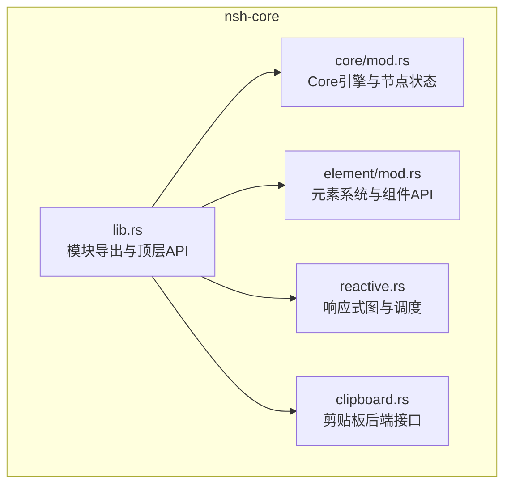
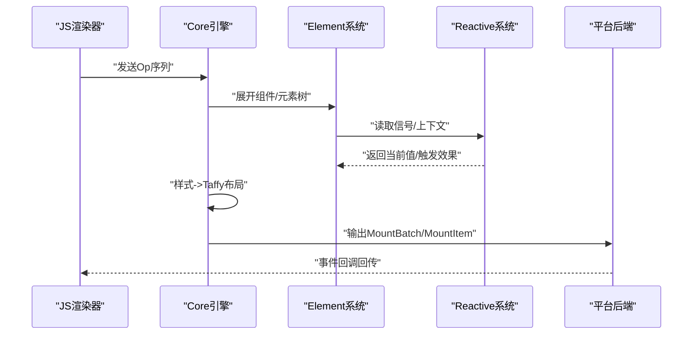
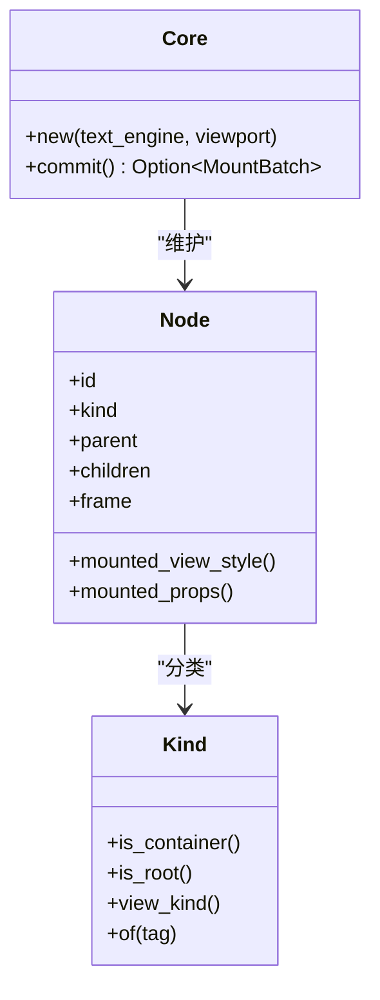
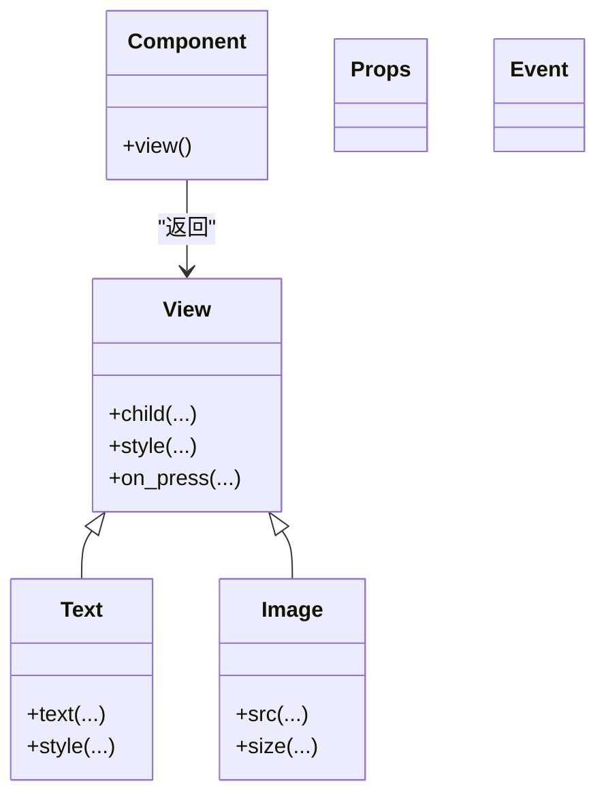
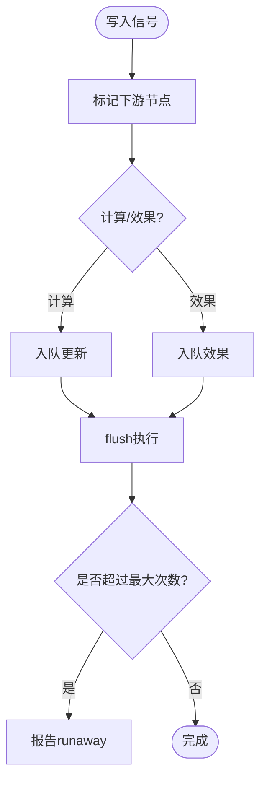
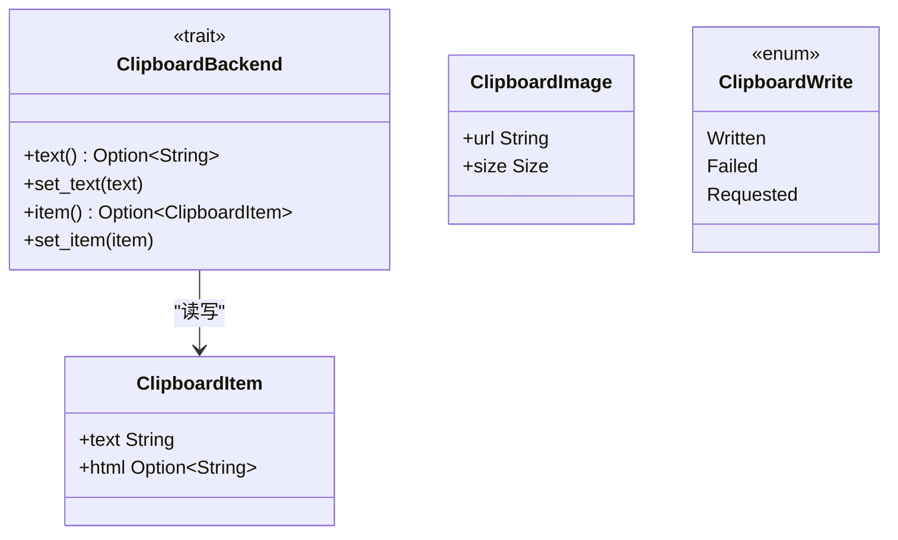
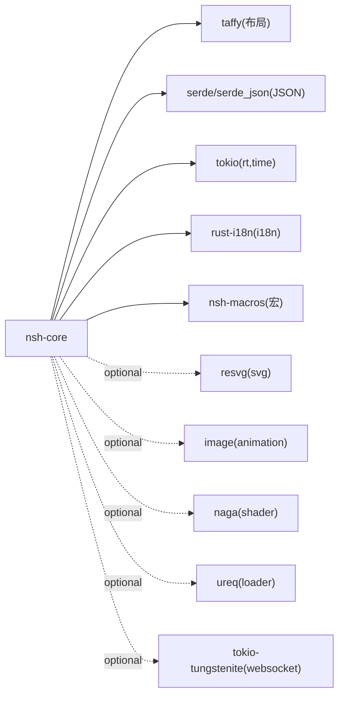

# Rust核心API

<cite>
**本文引用的文件**   
- [lib.rs](file://crates/nsh-core/src/lib.rs)
- [core/mod.rs](file://crates/nsh-core/src/core/mod.rs)
- [element/mod.rs](file://crates/nsh-core/src/element/mod.rs)
- [reactive.rs](file://crates/nsh-core/src/reactive.rs)
- [clipboard.rs](file://crates/nsh-core/src/clipboard.rs)
- [Cargo.toml](file://crates/nsh-core/Cargo.toml)
</cite>

## 目录
1. [简介](#简介)
2. [项目结构](#项目结构)
3. [核心组件](#核心组件)
4. [架构总览](#架构总览)
5. [详细组件分析](#详细组件分析)
6. [依赖关系分析](#依赖关系分析)
7. [性能与内存安全](#性能与内存安全)
8. [故障排查指南](#故障排查指南)
9. [结论](#结论)
10. [附录：关键API参考](#附录关键api参考)

## 简介
本文件为 NSH 框架的 Rust 核心 API 参考文档，聚焦 nsh-core 库中的公共接口与关键实现。内容覆盖：
- Core 核心引擎：接收 JS 渲染器产生的操作，维护影子树、样式解析、布局计算与挂载指令生成。
- Element 元素系统：Rust 侧 UI 原语、组件模型、构建器与事件绑定。
- Reactive 响应式系统：信号、记忆值、效果、所有者与上下文，基于 Solid 调度策略。
- 生命周期管理、内存安全保证与性能优化策略。
- 类型约束、泛型参数与生命周期的使用方式说明。
- 错误处理与最佳实践示例（以路径引用形式给出）。

## 项目结构
nsh-core 是平台无关的核心库，负责：
- 从 JS 渲染器接收 Op 序列
- 维护影子树与样式
- 将样式转换为 Taffy 布局
- 合并内联文本到 AttributedText
- 执行布局并输出 MountBatch/MountItem 供平台后端应用

图表来源
- [lib.rs:1-175](file://crates/nsh-core/src/lib.rs#L1-L175)
- [core/mod.rs:1-135](file://crates/nsh-core/src/core/mod.rs#L1-L135)
- [element/mod.rs:1-120](file://crates/nsh-core/src/element/mod.rs#L1-L120)
- [reactive.rs:1-136](file://crates/nsh-core/src/reactive.rs#L1-L136)
- [clipboard.rs:12-29](file://crates/nsh-core/src/clipboard.rs#L12-L29)

章节来源
- [lib.rs:1-175](file://crates/nsh-core/src/lib.rs#L1-L175)

## 核心组件
本节概述三大核心模块的职责与对外暴露的关键类型。

- Core 核心引擎
  - 职责：接收 Op、维护 Node 树、样式与布局、生成 MountBatch。
  - 关键类型：Core<M: TextEngine>、Node、Kind、MountBatch、MountItem 等。
  - 入口方法：new(text_engine, viewport)、commit() -> Option<MountBatch>。

- Element 元素系统
  - 职责：提供 view/text/image 等原语、组件宏、构建器 FluentBuilder、事件与属性系统。
  - 关键类型：View/Text/Image、Component、Props、Event、ElementRef、Style 等。
  - 扩展点：#[component]、#[derive(Props)]、#[derive(Event)]、native_module/native_components。

- Reactive 响应式系统
  - 职责：信号、记忆值、效果、所有者、上下文；支持 JS 与 Rust 共享调度。
  - 关键类型：Graph<H: Host>、Signal、Memo、Effect、Owner、Frame、Host。
  - 关键方法：signal/owned_signal、computation、root、provide、queue_effect、compact 等。

- 剪贴板后端接口
  - 职责：定义跨平台的剪贴板读写能力抽象。
  - 关键类型：ClipboardBackend trait、ClipboardItem、ClipboardImage、ClipboardWrite。

章节来源
- [core/mod.rs:1293-1300](file://crates/nsh-core/src/core/mod.rs#L1293-L1300)
- [core/mod.rs:1680-1690](file://crates/nsh-core/src/core/mod.rs#L1680-L1690)
- [core/mod.rs:3384-3390](file://crates/nsh-core/src/core/mod.rs#L3384-L3390)
- [element/mod.rs:103-213](file://crates/nsh-core/src/element/mod.rs#L103-L213)
- [reactive.rs:75-136](file://crates/nsh-core/src/reactive.rs#L75-L136)
- [clipboard.rs:12-29](file://crates/nsh-core/src/clipboard.rs#L12-L29)

## 架构总览
下图展示从 JS 渲染器到平台后端的整体数据流，以及各模块之间的交互。

图表来源
- [lib.rs:1-10](file://crates/nsh-core/src/lib.rs#L1-L10)
- [core/mod.rs:1-135](file://crates/nsh-core/src/core/mod.rs#L1-L135)
- [element/mod.rs:1-32](file://crates/nsh-core/src/element/mod.rs#L1-L32)
- [reactive.rs:1-17](file://crates/nsh-core/src/reactive.rs#L1-L17)

## 详细组件分析

### Core 核心引擎
- 设计要点
  - 单线程、分配敏感：在引擎线程上运行，避免跨线程持有图引用。
  - 节点分类：Kind 枚举区分 View/Text/Image/Scroll/List/Input/Screen/Modal/Overlay/Shader 等。
  - 脏标记与批量提交：通过 dirty 位标志减少不必要的重算，commit 时统一输出 MountBatch。
  - 文本与图像：维护 AttributedText、ImageState 等子状态，结合 TextEngine 进行排版与缓存。
  - 滚动与粘性：ScrollState/ListState/StickyCell 等处理复杂滚动与粘性布局。

- 关键类型与方法
  - Core<M: TextEngine>
    - new(text_engine: M, viewport: Size<Points>) -> Self
    - commit(&mut self) -> Option<MountBatch>
  - Node
    - 内部状态：kind、parent/children、layout、view_style/text_style、image/scroll/list/input/root/control/component 等。
    - mounted_view_style()/mounted_props()：向平台输出最终样式与可访问性属性。
  - Kind
    - is_container/is_root/view_kind/of/tag 派生逻辑。

- 错误处理
  - ApplyError：应用于平台时的错误类型（由 lib.rs 重新导出）。
  - SOURCE_NOT_GRANTED：能力未授予的网络/文件系统资源拒绝提示。

- 生命周期
  - Node::created 表示原生视图已创建；culled/spare/left_behind 控制可见性与辅助技术隐藏。
  - emitted 记录最后帧，避免重复派发。

图表来源
- [core/mod.rs:1293-1300](file://crates/nsh-core/src/core/mod.rs#L1293-L1300)
- [core/mod.rs:214-324](file://crates/nsh-core/src/core/mod.rs#L214-L324)
- [core/mod.rs:596-812](file://crates/nsh-core/src/core/mod.rs#L596-L812)
- [core/mod.rs:814-967](file://crates/nsh-core/src/core/mod.rs#L814-L967)

章节来源
- [core/mod.rs:1-135](file://crates/nsh-core/src/core/mod.rs#L1-L135)
- [core/mod.rs:596-1072](file://crates/nsh-core/src/core/mod.rs#L596-L1072)
- [core/mod.rs:1293-1300](file://crates/nsh-core/src/core/mod.rs#L1293-L1300)
- [core/mod.rs:1680-1690](file://crates/nsh-core/src/core/mod.rs#L1680-L1690)
- [core/mod.rs:3384-3390](file://crates/nsh-core/src/core/mod.rs#L3384-L3390)

### Element 元素系统
- 设计要点
  - 组件即函数：Component::view 仅运行一次，构建元素树；样式通过 Styled 链式调用。
  - 构建器：FluentBuilder/ParentElement/Child 等提供流畅 API。
  - 事件与属性：#[derive(Event)] 与 #[derive(Props)] 生成 JS 面与 TS 声明。
  - 宿主集成：native_module/native_components 注册原生组件与模块。

- 关键类型与方法
  - View/Text/Image：基础元素构造与组合。
  - Component/Props/Event：组件与属性/事件声明。
  - ElementRef：获取元素引用，用于定位、跟随、滚动目标等。
  - Style/Styled：Tailwind 风格映射到内部规则。

- 生命周期与错误
  - 组件错误捕获：caught/panic_message 等。
  - 环境上下文：provide_context/use_context 传递主题、窗口信息等。

图表来源
- [element/mod.rs:103-213](file://crates/nsh-core/src/element/mod.rs#L103-L213)

章节来源
- [element/mod.rs:1-120](file://crates/nsh-core/src/element/mod.rs#L1-L120)
- [element/mod.rs:103-213](file://crates/nsh-core/src/element/mod.rs#L103-L213)

### Reactive 响应式系统
- 设计要点
  - 通用 Host：允许 JS 与 Rust 共享同一调度算法。
  - 节点类型：Signal/Memo/Effect/UserEffect/Root/Free。
  - 比较策略：Equals::Default/Never/Truthiness/Custom。
  - 调度：Updates/Effects 队列，runTop 顺序更新，防止无限循环（MAX_RUNS）。

- 关键类型与方法
  - Graph<H: Host>
    - signal/owned_signal/computation/root/provide
    - queue_effect/mark_downstream/compact/free_all
  - Host trait
    - graph/dup/free/call/same/truthy/custom_changed/run_cleanup/free_cleanup/runaway

- 生命周期与错误
  - owner/disposed/disposing 控制清理与释放。
  - runaway 检测无限刷新。

图表来源
- [reactive.rs:42-73](file://crates/nsh-core/src/reactive.rs#L42-L73)
- [reactive.rs:241-277](file://crates/nsh-core/src/reactive.rs#L241-L277)
- [reactive.rs:645-674](file://crates/nsh-core/src/reactive.rs#L645-L674)

章节来源
- [reactive.rs:1-136](file://crates/nsh-core/src/reactive.rs#L1-L136)
- [reactive.rs:241-277](file://crates/nsh-core/src/reactive.rs#L241-L277)
- [reactive.rs:645-674](file://crates/nsh-core/src/reactive.rs#L645-L674)

### 剪贴板后端接口
- 设计要点
  - ClipboardBackend trait 定义文本/项读写能力，默认实现基于文本。
  - ClipboardItem/ClipboardImage/ClipboardWrite 描述剪贴板内容与结果。

- 关键类型与方法
  - ClipboardBackend
    - text()/set_text()
    - item()/set_item()
  - ClipboardItem
    - text/html
  - ClipboardImage
    - url/size
  - ClipboardWrite
    - Written/Failed/Requested

图表来源
- [clipboard.rs:12-29](file://crates/nsh-core/src/clipboard.rs#L12-L29)

章节来源
- [clipboard.rs:12-29](file://crates/nsh-core/src/clipboard.rs#L12-L29)

## 依赖关系分析
nsh-core 的 Cargo 配置展示了可选特性与平台相关依赖，影响功能开关与二进制体积。

图表来源
- [Cargo.toml:15-48](file://crates/nsh-core/Cargo.toml#L15-L48)
- [Cargo.toml:49-81](file://crates/nsh-core/Cargo.toml#L49-L81)
- [Cargo.toml:83-130](file://crates/nsh-core/Cargo.toml#L83-L130)

章节来源
- [Cargo.toml:1-130](file://crates/nsh-core/Cargo.toml#L1-L130)

## 性能与内存安全
- 单线程与分配敏感
  - Core 在引擎线程运行，避免跨线程持有图引用，减少锁竞争与拷贝。
- 节点与状态优化
  - Sparse<T> 仅在非默认值时分配 Box，减少常见场景的内存占用。
  - dirty 位标志批量处理变更，减少不必要的重排与重绘。
- 文本与图像缓存
  - TextContext 缓存测量结果与基线，避免重复排版；ImageState 缓存源与选项。
- 响应式图压缩
  - Graph::compact 在空闲时回收连续空闲槽，降低 Vec 容量膨胀。
- 内存安全保证
  - Host trait 要求所有对图的访问通过短借用，避免悬垂引用。
  - Node 的 handle/generation/disposed 机制确保句柄失效与节点复用安全。

[本节为通用指导，不直接分析具体文件]

## 故障排查指南
- 运行时异常与错误
  - ApplyError：Core 应用到平台时的错误类型（请检查日志与错误码）。
  - SOURCE_NOT_GRANTED：网络或文件系统资源未被能力授予，需检查权限配置。
  - Runaway：响应式刷新超过 MAX_RUNS，检查是否存在无限依赖环。
- 常见问题定位
  - 组件未渲染：确认 #[component]/#[derive(Props)]/#[derive(Event)] 是否正确声明。
  - 样式无效：检查 Tailwind 类与 Styled 链式调用是否匹配。
  - 剪贴板失败：检查 ClipboardWrite 返回值与平台限制（Requested/Failed/Written）。
- 调试建议
  - 启用 declarations 特性以生成 TS 声明，便于前端对齐。
  - 使用 element_ref 与 overlay 定位问题区域。
  - 通过 reactive 的 compact 与 free_all 观察内存增长。

章节来源
- [lib.rs:117-175](file://crates/nsh-core/src/lib.rs#L117-L175)
- [core/mod.rs:29-35](file://crates/nsh-core/src/core/mod.rs#L29-L35)
- [reactive.rs:42-43](file://crates/nsh-core/src/reactive.rs#L42-L43)

## 结论
nsh-core 提供了高性能、内存安全的跨平台 UI 核心：
- Core 引擎负责影子树、样式与布局，输出平台可应用的挂载指令。
- Element 系统提供直观的组件与构建器 API，支持强类型属性与事件。
- Reactive 系统实现高效的信号驱动更新，兼容 JS 与 Rust。
- 通过可选特性与平台相关依赖，灵活裁剪功能与体积。
建议在开发中遵循最佳实践：合理使用信号与上下文、避免无限刷新、利用缓存与批量提交提升性能。

[本节为总结性内容，不直接分析具体文件]

## 附录：关键API参考

### Core 核心引擎
- Core<M: TextEngine>
  - new(text_engine: M, viewport: Size<Points>) -> Self
  - commit(&mut self) -> Option<MountBatch>
- Node
  - mounted_view_style() -> Box<ViewStyle>
  - mounted_props() -> Box<ViewProps>
- Kind
  - is_container() -> bool
  - is_root() -> bool
  - view_kind() -> ViewKind
  - of(tag: Tag) -> Self

章节来源
- [core/mod.rs:1293-1300](file://crates/nsh-core/src/core/mod.rs#L1293-L1300)
- [core/mod.rs:1680-1690](file://crates/nsh-core/src/core/mod.rs#L1680-L1690)
- [core/mod.rs:3384-3390](file://crates/nsh-core/src/core/mod.rs#L3384-L3390)
- [core/mod.rs:214-324](file://crates/nsh-core/src/core/mod.rs#L214-L324)
- [core/mod.rs:814-967](file://crates/nsh-core/src/core/mod.rs#L814-L967)

### Element 元素系统
- 组件与属性
  - #[component] 宏
  - #[derive(Props)] 属性结构体
  - #[derive(Event)] 事件枚举
- 构建器
  - View/Text/Image 的原语与 FluentBuilder
- 引用与环境
  - ElementRef、provide_context/use_context

章节来源
- [element/mod.rs:103-213](file://crates/nsh-core/src/element/mod.rs#L103-L213)

### Reactive 响应式系统
- Graph<H: Host>
  - signal/owned_signal/computation/root/provide
  - queue_effect/mark_downstream/compact/free_all
- Host trait
  - graph/dup/free/call/same/truthy/custom_changed/run_cleanup/free_cleanup/runaway

章节来源
- [reactive.rs:75-136](file://crates/nsh-core/src/reactive.rs#L75-L136)
- [reactive.rs:241-277](file://crates/nsh-core/src/reactive.rs#L241-L277)
- [reactive.rs:645-674](file://crates/nsh-core/src/reactive.rs#L645-L674)

### 剪贴板后端接口
- ClipboardBackend trait
  - text()/set_text()
  - item()/set_item()
- ClipboardItem/ClipboardImage/ClipboardWrite

章节来源
- [clipboard.rs:12-29](file://crates/nsh-core/src/clipboard.rs#L12-L29)