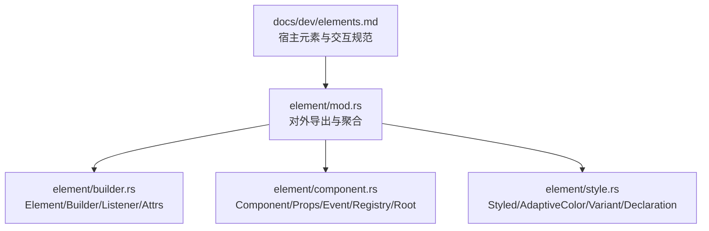
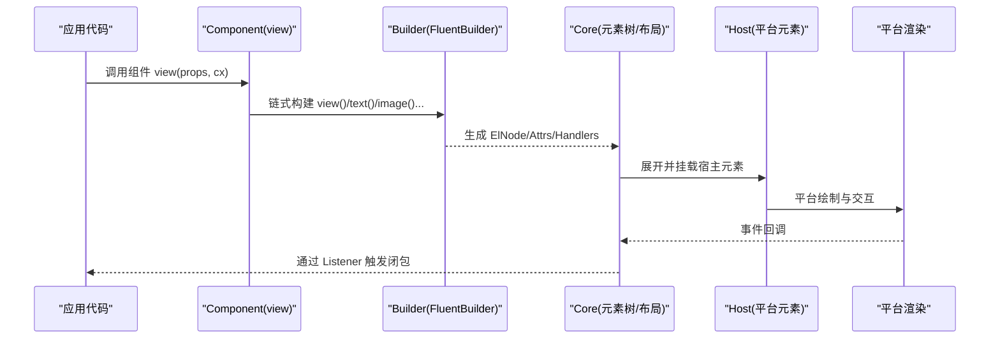
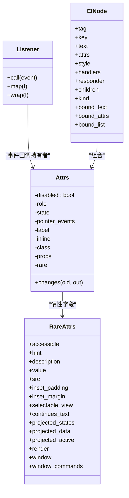
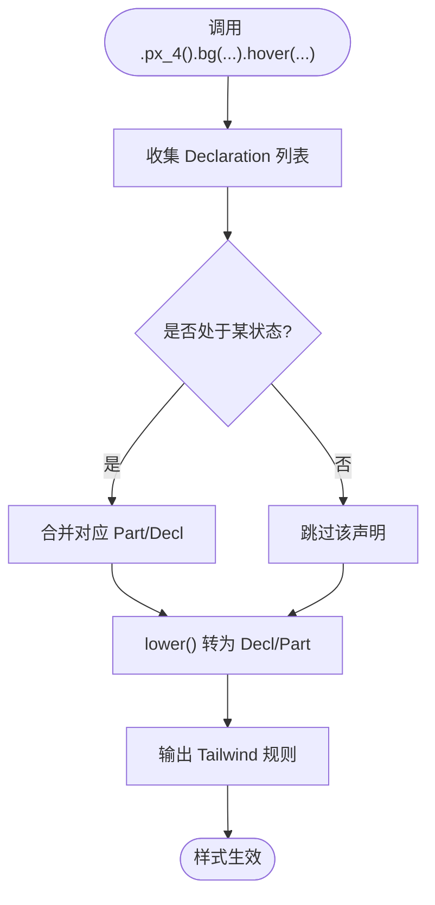
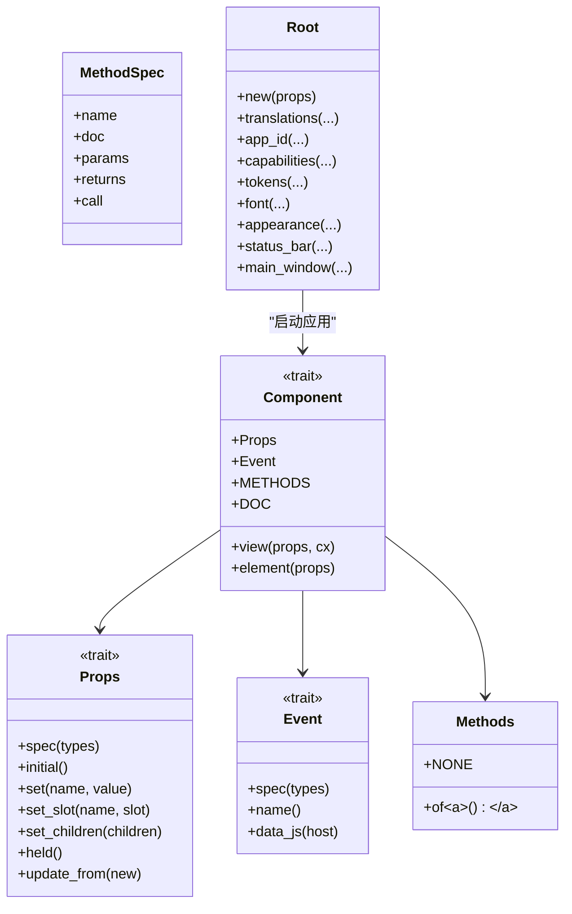
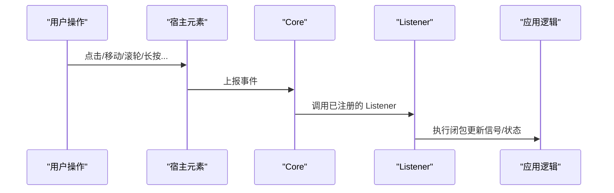
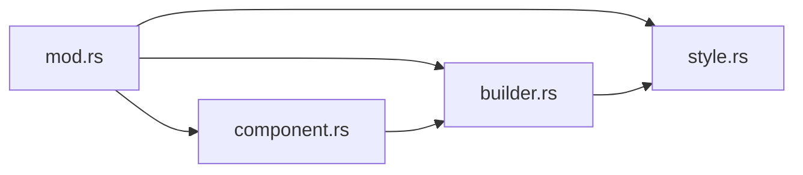
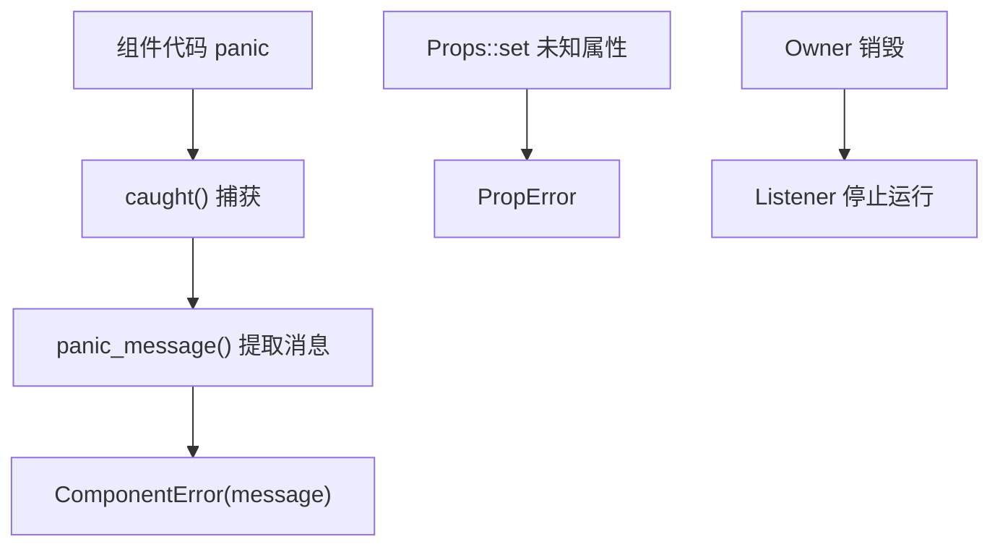

# 元素系统API

<cite>
**本文引用的文件**   
- [crates/nsh-core/src/element/mod.rs](file://crates/nsh-core/src/element/mod.rs)
- [crates/nsh-core/src/element/builder.rs](file://crates/nsh-core/src/element/builder.rs)
- [crates/nsh-core/src/element/component.rs](file://crates/nsh-core/src/element/component.rs)
- [crates/nsh-core/src/element/style.rs](file://crates/nsh-core/src/element/style.rs)
- [docs/dev/elements.md](file://docs/dev/elements.md)
</cite>

## 目录
1. [简介](#简介)
2. [项目结构](#项目结构)
3. [核心组件](#核心组件)
4. [架构总览](#架构总览)
5. [详细组件分析](#详细组件分析)
6. [依赖关系分析](#依赖关系分析)
7. [性能考量](#性能考量)
8. [故障排查指南](#故障排查指南)
9. [结论](#结论)
10. [附录](#附录)

## 简介
本文件为 NSH 框架“元素系统”的 API 文档，聚焦于 Element 类型及其 Builder 模式、样式系统、事件处理与组件系统的实现机制。内容覆盖：
- 元素的创建、配置、样式设置与事件处理
- Builder 模式与属性链式调用的语法糖
- 组件注册、实例化与生命周期钩子
- 自定义元素示例（以代码片段路径形式给出）
- 样式继承与覆盖机制

## 项目结构
NSH 的元素系统位于 nsh-core 的 element 模块中，围绕以下关键文件组织：
- mod.rs：对外导出 Element、Builder、Style、Component、Host 等公共能力
- builder.rs：Element 树构建、Listener、Attrs、ElNode、FluentBuilder 等
- component.rs：Component trait、Props、Event、Registry、Root 等
- style.rs：Typed Style、AdaptiveColor、Variant、Declaration 等
- docs/dev/elements.md：宿主元素与交互行为说明

**图示来源**
- [crates/nsh-core/src/element/mod.rs:1-351](file://crates/nsh-core/src/element/mod.rs#L1-L351)
- [crates/nsh-core/src/element/builder.rs:1-800](file://crates/nsh-core/src/element/builder.rs#L1-L800)
- [crates/nsh-core/src/element/component.rs:1-800](file://crates/nsh-core/src/element/component.rs#L1-L800)
- [crates/nsh-core/src/element/style.rs:1-800](file://crates/nsh-core/src/element/style.rs#L1-L800)
- [docs/dev/elements.md:1-800](file://docs/dev/elements.md#L1-L800)

**章节来源**
- [crates/nsh-core/src/element/mod.rs:1-351](file://crates/nsh-core/src/element/mod.rs#L1-L351)

## 核心组件
本节概述 Element 体系的核心抽象与职责边界：
- Element 与 FluentBuilder：提供 view/text/image 等基础元素与链式 API
- Listener 与 IntoListener：统一事件监听器封装与转换
- Attrs/RareAttrs：元素属性集合与惰性分配
- ElNode：元素节点在核心中的表示
- Component/Props/Event：Rust 组件模型与 JS 绑定
- Root：应用根入口与初始化
- Styled/AdaptiveColor/Variant/Declaration：样式声明与变体系统

**章节来源**
- [crates/nsh-core/src/element/builder.rs:1-800](file://crates/nsh-core/src/element/builder.rs#L1-L800)
- [crates/nsh-core/src/element/component.rs:1-800](file://crates/nsh-core/src/element/component.rs#L1-L800)
- [crates/nsh-core/src/element/style.rs:1-800](file://crates/nsh-core/src/element/style.rs#L1-L800)

## 架构总览
下图展示从 Rust 组件到宿主元素、再到平台渲染的关键流程与数据流。

**图示来源**
- [crates/nsh-core/src/element/component.rs:22-73](file://crates/nsh-core/src/element/component.rs#L22-L73)
- [crates/nsh-core/src/element/builder.rs:21-188](file://crates/nsh-core/src/element/builder.rs#L21-L188)
- [crates/nsh-core/src/element/mod.rs:134-213](file://crates/nsh-core/src/element/mod.rs#L134-L213)

## 详细组件分析

### Element 与 Builder 模式
- 基础元素构造：view/text/image 等由 builder 暴露，返回可链式调用的 FluentBuilder
- 事件监听：Listener 包装闭包，IntoListener 支持多种签名（含无参、Press 省略参数等）
- 属性管理：Attrs 保存 disabled/role/state/pointer_events/class/props/rare；RareAttrs 惰性分配
- 节点表示：ElNode 包含 tag/key/text/attrs/style/handlers/responder/children/kind/bound_text/bound_attrs/bound_list

**图示来源**
- [crates/nsh-core/src/element/builder.rs:21-188](file://crates/nsh-core/src/element/builder.rs#L21-L188)
- [crates/nsh-core/src/element/builder.rs:212-469](file://crates/nsh-core/src/element/builder.rs#L212-L469)
- [crates/nsh-core/src/element/builder.rs:702-800](file://crates/nsh-core/src/element/builder.rs#L702-L800)

**章节来源**
- [crates/nsh-core/src/element/builder.rs:1-800](file://crates/nsh-core/src/element/builder.rs#L1-L800)

### 样式系统（Typed Style）
- AdaptiveColor：按外观（light/dark）切换颜色
- Variant：声明式状态条件（hover/focus/active/disabled/group/dark 等）
- Declaration：将 typed style 方法降维为 Tailwind 规则（阴影、渐变、变换、动画、过渡等）
- 继承与覆盖：样式通过 Decl/Part 顺序合并，后者优先；状态类与 group_* 组合决定最终优先级

**图示来源**
- [crates/nsh-core/src/element/style.rs:69-134](file://crates/nsh-core/src/element/style.rs#L69-L134)
- [crates/nsh-core/src/element/style.rs:154-259](file://crates/nsh-core/src/element/style.rs#L154-L259)
- [crates/nsh-core/src/element/style.rs:421-759](file://crates/nsh-core/src/element/style.rs#L421-L759)

**章节来源**
- [crates/nsh-core/src/element/style.rs:1-800](file://crates/nsh-core/src/element/style.rs#L1-L800)

### 组件系统（Component/Props/Event/Registry/Root）
- Component：定义 Props、Event、METHODS、DOC、view
- Props：声明属性、槽位、children、items，并提供 spec/initial/set/set_slot/set_children/update_from
- Event：声明事件及 TS 类型映射
- Registry：JS 侧注册与调用（由宏生成）
- Root：应用根入口，配置 tokens/fonts/appearance/status_bar/main_window/capabilities 等

**图示来源**
- [crates/nsh-core/src/element/component.rs:22-73](file://crates/nsh-core/src/element/component.rs#L22-L73)
- [crates/nsh-core/src/element/component.rs:107-211](file://crates/nsh-core/src/element/component.rs#L107-L211)
- [crates/nsh-core/src/element/component.rs:269-320](file://crates/nsh-core/src/element/component.rs#L269-L320)
- [crates/nsh-core/src/element/component.rs:343-376](file://crates/nsh-core/src/element/component.rs#L343-L376)
- [crates/nsh-core/src/element/component.rs:570-800](file://crates/nsh-core/src/element/component.rs#L570-L800)

**章节来源**
- [crates/nsh-core/src/element/component.rs:1-800](file://crates/nsh-core/src/element/component.rs#L1-L800)

### 事件处理与交互
- 事件监听器：Listener 包装闭包，IntoListener 支持多种签名
- 宿主元素与交互：View/Text/Image/Scroll/Input/Overlay/List/Canvas/Shader/WebView/Video 等
- 鼠标/滚轮/捏合/右键菜单/键盘焦点/触摸与响应者协议/环境信息/无障碍等详见开发文档

**图示来源**
- [crates/nsh-core/src/element/builder.rs:21-188](file://crates/nsh-core/src/element/builder.rs#L21-L188)
- [docs/dev/elements.md:141-692](file://docs/dev/elements.md#L141-L692)

**章节来源**
- [crates/nsh-core/src/element/builder.rs:1-800](file://crates/nsh-core/src/element/builder.rs#L1-L800)
- [docs/dev/elements.md:141-692](file://docs/dev/elements.md#L141-L692)

### 代码示例（以路径引用代替具体代码）
- 创建自定义元素（Rust 组件）
  - 参考：[crates/nsh-core/src/element/component.rs:22-73](file://crates/nsh-core/src/element/component.rs#L22-L73)
- 使用 Builder 链式 API 设置样式与事件
  - 参考：[crates/nsh-core/src/element/builder.rs:21-188](file://crates/nsh-core/src/element/builder.rs#L21-L188)
- 处理用户交互（鼠标/滚轮/捏合/右键菜单/键盘焦点）
  - 参考：[docs/dev/elements.md:141-692](file://docs/dev/elements.md#L141-L692)
- 响应状态变化（样式变体与自适应颜色）
  - 参考：[crates/nsh-core/src/element/style.rs:154-259](file://crates/nsh-core/src/element/style.rs#L154-L259)
  - 参考：[crates/nsh-core/src/element/style.rs:69-134](file://crates/nsh-core/src/element/style.rs#L69-L134)

## 依赖关系分析
- element/mod.rs 聚合导出 builder/component/style 等模块，形成对外 API 面
- builder.rs 依赖 style.rs（Styled）、component.rs（AnyInstance/ComponentSpec）
- component.rs 依赖 builder.rs（ComponentElement/ElNode）、module/class/call 等
- style.rs 依赖 tailwind/effects/geometry 等子系统

**图示来源**
- [crates/nsh-core/src/element/mod.rs:33-77](file://crates/nsh-core/src/element/mod.rs#L33-L77)
- [crates/nsh-core/src/element/builder.rs:1-20](file://crates/nsh-core/src/element/builder.rs#L1-L20)
- [crates/nsh-core/src/element/component.rs:1-20](file://crates/nsh-core/src/element/component.rs#L1-L20)

**章节来源**
- [crates/nsh-core/src/element/mod.rs:1-351](file://crates/nsh-core/src/element/mod.rs#L1-L351)

## 性能考量
- 惰性分配：RareAttrs 仅在首次非默认写入时分配，减少内存占用
- 差异比较：Attrs::changes 仅输出变更字段，降低宿主端传输开销
- 样式缓存：Entries/Variant/Declaration 设计利于哈希与比较，避免重复计算
- 事件批处理：事件在引擎回合内合并与分发，减少抖动

**章节来源**
- [crates/nsh-core/src/element/builder.rs:212-469](file://crates/nsh-core/src/element/builder.rs#L212-L469)
- [crates/nsh-core/src/element/style.rs:762-800](file://crates/nsh-core/src/element/style.rs#L762-L800)

## 故障排查指南
- 组件崩溃捕获：ComponentError 与 caught/panic_message 用于捕获 panic 并转换为错误消息
- 未知 prop 报错：Props::set 对未知属性返回 PropError
- 事件监听器生命周期：Listener 基于 Owner 的生命周期，Owner 销毁后不再运行

**图示来源**
- [crates/nsh-core/src/element/component.rs:75-105](file://crates/nsh-core/src/element/component.rs#L75-L105)
- [crates/nsh-core/src/element/component.rs:323-341](file://crates/nsh-core/src/element/component.rs#L323-L341)
- [crates/nsh-core/src/element/builder.rs:21-63](file://crates/nsh-core/src/element/builder.rs#L21-L63)

**章节来源**
- [crates/nsh-core/src/element/component.rs:75-105](file://crates/nsh-core/src/element/component.rs#L75-L105)
- [crates/nsh-core/src/element/component.rs:323-341](file://crates/nsh-core/src/element/component.rs#L323-L341)
- [crates/nsh-core/src/element/builder.rs:21-63](file://crates/nsh-core/src/element/builder.rs#L21-L63)

## 结论
NSH 的元素系统通过 Element/Builder 提供直观的链式 API，结合 Typed Style 与 Variant 实现强大的样式系统；组件模型 Component/Props/Event 打通 Rust 与 JS 的双向绑定；事件与宿主元素交互遵循跨平台一致语义。整体设计强调：
- 低开销的属性与样式表达
- 清晰的组件生命周期与错误处理
- 一致的交互与无障碍支持

## 附录
- 宿主元素与交互规范详见开发文档
  - 参考：[docs/dev/elements.md:1-800](file://docs/dev/elements.md#L1-L800)