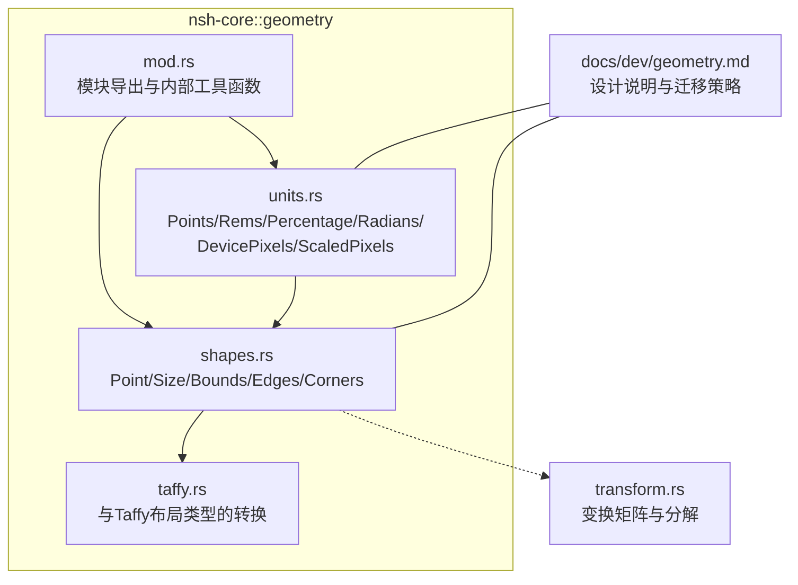
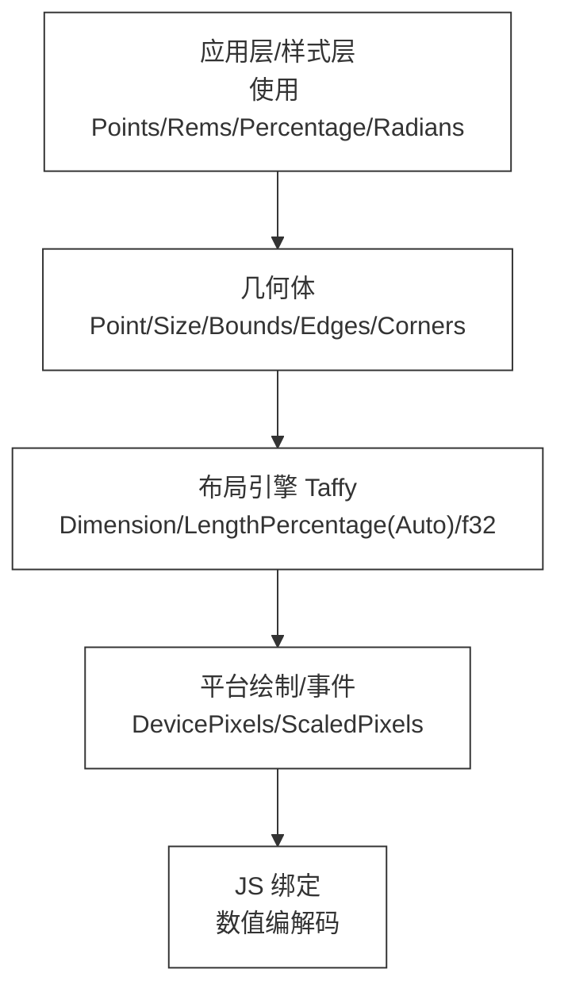
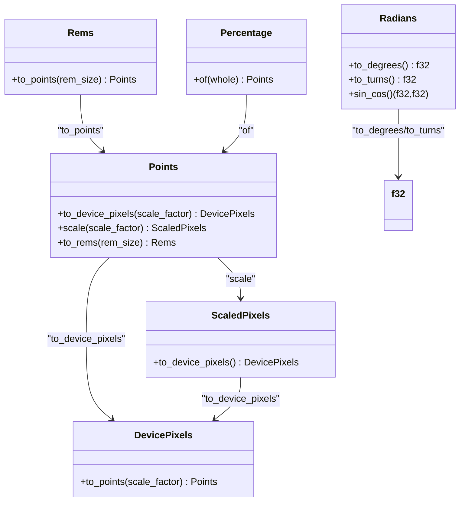
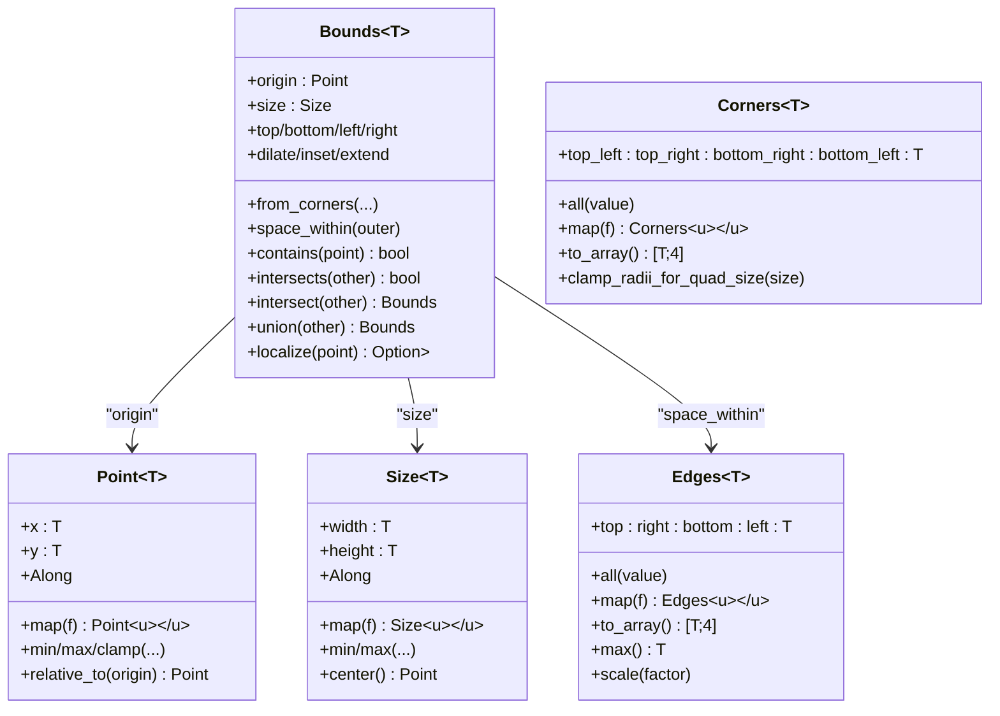
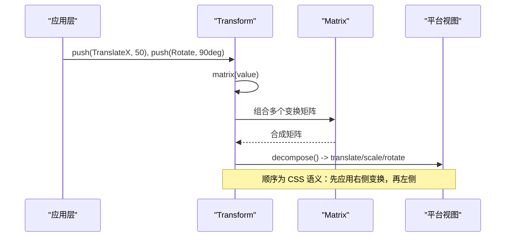
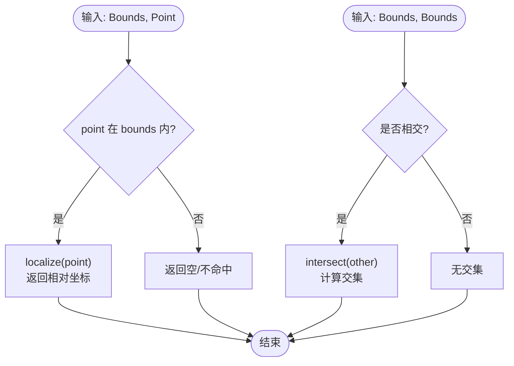
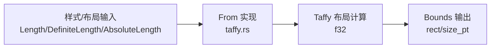
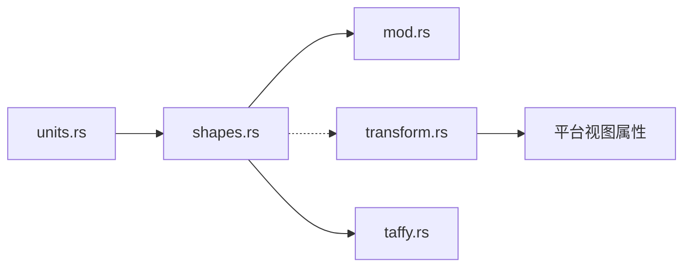

# 几何类型API

<cite>
**本文引用的文件**   
- [geometry/mod.rs](file://crates/nsh-core/src/geometry/mod.rs)
- [geometry/shapes.rs](file://crates/nsh-core/src/geometry/shapes.rs)
- [geometry/units.rs](file://crates/nsh-core/src/geometry/units.rs)
- [geometry/taffy.rs](file://crates/nsh-core/src/geometry/taffy.rs)
- [transform.rs](file://crates/nsh-core/src/transform.rs)
- [dev/geometry.md](file://docs/dev/geometry.md)
</cite>

## 目录
1. [简介](#简介)
2. [项目结构](#项目结构)
3. [核心组件](#核心组件)
4. [架构总览](#架构总览)
5. [详细组件分析](#详细组件分析)
6. [依赖关系分析](#依赖关系分析)
7. [性能考虑](#性能考虑)
8. [故障排查指南](#故障排查指南)
9. [结论](#结论)
10. [附录](#附录)

## 简介
本文件为 NSH 框架的几何类型 API 提供系统化文档，覆盖 Point、Size、Bounds、Edges、Corners 等几何结构的定义与常用方法；说明坐标系统、单位体系（Points、Rems、Percentage、Radians、DevicePixels/ScaledPixels）以及布局引擎 Taffy 的转换边界；解释形状检测、碰撞检测与命中测试的实现思路；给出几何计算、坐标变换与空间关系判断的实践要点；并说明与布局引擎和平台绘制边界的集成方式与性能注意事项。

## 项目结构
NSH 的核心几何类型位于 nsh-core 的 geometry 模块，采用“类型化单位 + 泛型几何体”的设计：所有长度、角度、百分比都使用强类型包装，避免裸 f32/f64 混用；几何体（Point/Size/Bounds/Edges/Corners）对单位进行泛型参数化，从而在布局、样式、渲染等不同阶段复用同一套数据结构。

图表来源
- [geometry/mod.rs:1-32](file://crates/nsh-core/src/geometry/mod.rs#L1-L32)
- [geometry/shapes.rs:1-10](file://crates/nsh-core/src/geometry/shapes.rs#L1-L10)
- [geometry/units.rs:1-3](file://crates/nsh-core/src/geometry/units.rs#L1-L3)
- [geometry/taffy.rs:104-104](file://crates/nsh-core/src/geometry/taffy.rs#L104-L104)
- [transform.rs:1-8](file://crates/nsh-core/src/transform.rs#L1-L8)
- [dev/geometry.md:1-8](file://docs/dev/geometry.md#L1-L8)

章节来源
- [geometry/mod.rs:1-32](file://crates/nsh-core/src/geometry/mod.rs#L1-L32)
- [dev/geometry.md:1-8](file://docs/dev/geometry.md#L1-L8)

## 核心组件
- 单位类型
  - Points：布局主单位（iOS/macOS points、Android dp、Web CSS px、Windows DIP）。提供 to_device_pixels/scale/to_rems 等转换。
  - Rems：根字体大小的倍数，默认 REM_SIZE=16pt。
  - Percentage：比例值（0..=1），允许超出范围以支持负偏移或越界渐变。
  - Radians：弧度角，并提供 deg/turn/grad 构造器。
  - DevicePixels/ScaledPixels：物理像素与缩放后的非整像素，仅在平台绘制/上报处出现。
- 几何体
  - Point<T>：二维点，x向右、y向下。
  - Size<T>：宽高，支持 center()、scale()、to_device_pixels() 等。
  - Bounds<T>：矩形（origin+size），提供 contains/intersects/intersect/union/localize/dilate/inset/extend/space_within 等。
  - Edges<T>：四边值（top/right/bottom/left），支持 all/map/to_array/max/scale 等。
  - Corners<T>：四角半径，支持 clamp_radii_for_quad_size 等。
- 变换
  - Transform：CSS风格的变换列表，可解析 translate/scale/rotate/skew/perspective 等，组合为 4×4 矩阵，并可分解为 Android/iOS等平台所需的独立属性。

章节来源
- [geometry/units.rs:258-311](file://crates/nsh-core/src/geometry/units.rs#L258-L311)
- [geometry/units.rs:347-455](file://crates/nsh-core/src/geometry/units.rs#L347-L455)
- [geometry/units.rs:457-544](file://crates/nsh-core/src/geometry/units.rs#L457-L544)
- [geometry/shapes.rs:44-131](file://crates/nsh-core/src/geometry/shapes.rs#L44-L131)
- [geometry/shapes.rs:224-350](file://crates/nsh-core/src/geometry/shapes.rs#L224-L350)
- [geometry/shapes.rs:406-676](file://crates/nsh-core/src/geometry/shapes.rs#L406-L676)
- [geometry/shapes.rs:738-856](file://crates/nsh-core/src/geometry/shapes.rs#L738-L856)
- [geometry/shapes.rs:858-986](file://crates/nsh-core/src/geometry/shapes.rs#L858-L986)
- [transform.rs:17-48](file://crates/nsh-core/src/transform.rs#L17-L48)
- [transform.rs:86-185](file://crates/nsh-core/src/transform.rs#L86-L185)

## 架构总览
NSH 的几何体系遵循“内部保持类型化，边界处转换”的原则：
- 内部：所有几何值均为带单位的类型（如 Bounds<Points>），避免误用裸浮点数。
- 布局边界：与 Taffy 的 Dimension/LengthPercentage(Auto)/f32 之间通过 From 实现转换，布局计算在 taffy 的 f32 中进行，结果再封装回 Bounds<Points>。
- 平台边界：将 Bounds<Points>/Size<Points>/Edges<Points> 等转换为平台工具包所需类型（读取 .0 或 as_f32()），并将平台返回的物理像素转为 Points。
- JS 边界：JS 数字进入 core 时解码为类型化值，离开 core 时编码为 JS 数字。

图表来源
- [dev/geometry.md:94-118](file://docs/dev/geometry.md#L94-L118)
- [geometry/taffy.rs:104-104](file://crates/nsh-core/src/geometry/taffy.rs#L104-L104)

章节来源
- [dev/geometry.md:94-118](file://docs/dev/geometry.md#L94-L118)

## 详细组件分析

### 坐标系统与单位
- 坐标系：x 向右，y 向下；原点相对其父容器或参考系。
- 单位：
  - Points：布局主单位，提供 to_device_pixels(scale_factor)、scale(scale_factor)、to_rems(rem_size)。
  - Rems：乘以 REM_SIZE 得到 Points。
  - Percentage：比例值，允许越界。
  - Radians：弧度，提供 deg/turn/grad 构造器，支持 sin_cos、to_degrees、to_turns。
  - DevicePixels/ScaledPixels：物理像素与缩放后非整像素，用于平台绘制与事件上报。

图表来源
- [geometry/units.rs:258-311](file://crates/nsh-core/src/geometry/units.rs#L258-L311)
- [geometry/units.rs:347-455](file://crates/nsh-core/src/geometry/units.rs#L347-L455)
- [geometry/units.rs:457-544](file://crates/nsh-core/src/geometry/units.rs#L457-L544)

章节来源
- [geometry/units.rs:258-311](file://crates/nsh-core/src/geometry/units.rs#L258-L311)
- [geometry/units.rs:347-455](file://crates/nsh-core/src/geometry/units.rs#L347-L455)
- [geometry/units.rs:457-544](file://crates/nsh-core/src/geometry/units.rs#L457-L544)

### 几何体：Point、Size、Bounds、Edges、Corners
- Point<T>
  - 基本操作：new/map/min/max/clamp/relative_to/Along。
  - 针对 Points：scale(factor) -> Point<ScaledPixels>，magnitude() 计算模长。
- Size<T>
  - 基本操作：new/map/min/max/Along/center()。
  - 针对 Points/DevicePixels：scale()/to_device_pixels()/to_points()。
- Bounds<T>
  - 基本操作：from_corners/top/bottom/left/right/corners/dilate/extend/space_within。
  - 包含/相交：contains(point)/is_contained_within(other)/intersects(other)/intersect(other)/union(other)。
  - 局部化：localize(point) 返回相对于 origin 的点（若点在内部）。
  - 针对 Points/DevicePixels：scale()/to_device_pixels()/to_points()。
- Edges<T>
  - 基本操作：all/map/to_array/any/max/scale。
  - 从 f32/Points 构造全等边。
- Corners<T>
  - 基本操作：all/map/to_array/any/max/scale/clamp_radii_for_quad_size(size)。

图表来源
- [geometry/shapes.rs:44-131](file://crates/nsh-core/src/geometry/shapes.rs#L44-L131)
- [geometry/shapes.rs:224-350](file://crates/nsh-core/src/geometry/shapes.rs#L224-L350)
- [geometry/shapes.rs:406-676](file://crates/nsh-core/src/geometry/shapes.rs#L406-L676)
- [geometry/shapes.rs:738-856](file://crates/nsh-core/src/geometry/shapes.rs#L738-L856)
- [geometry/shapes.rs:858-986](file://crates/nsh-core/src/geometry/shapes.rs#L858-L986)

章节来源
- [geometry/shapes.rs:44-131](file://crates/nsh-core/src/geometry/shapes.rs#L44-L131)
- [geometry/shapes.rs:224-350](file://crates/nsh-core/src/geometry/shapes.rs#L224-L350)
- [geometry/shapes.rs:406-676](file://crates/nsh-core/src/geometry/shapes.rs#L406-L676)
- [geometry/shapes.rs:738-856](file://crates/nsh-core/src/geometry/shapes.rs#L738-L856)
- [geometry/shapes.rs:858-986](file://crates/nsh-core/src/geometry/shapes.rs#L858-L986)

### 变换矩阵与坐标变换
- Transform：CSS 风格变换列表，支持 translate/scale/rotate/skew/perspective 等，按 CSS 语义右到左组合。
- Matrix：4×4 行向量矩阵（Core Animation 布局），支持 of/mul/is_2d/decompose。
- Decomposed：分解为 translate/scale/rotate/perspective，便于平台视图属性设置。
- 分数平移：TranslateXFraction/TranslateYFraction 在 resolve_fractions(size) 中根据视图尺寸解析为具体 Points。

图表来源
- [transform.rs:17-48](file://crates/nsh-core/src/transform.rs#L17-L48)
- [transform.rs:86-185](file://crates/nsh-core/src/transform.rs#L86-L185)
- [transform.rs:193-276](file://crates/nsh-core/src/transform.rs#L193-L276)
- [transform.rs:278-385](file://crates/nsh-core/src/transform.rs#L278-L385)

章节来源
- [transform.rs:17-48](file://crates/nsh-core/src/transform.rs#L17-L48)
- [transform.rs:86-185](file://crates/nsh-core/src/transform.rs#L86-L185)
- [transform.rs:193-276](file://crates/nsh-core/src/transform.rs#L193-L276)
- [transform.rs:278-385](file://crates/nsh-core/src/transform.rs#L278-L385)

### 形状检测、碰撞检测与命中测试
- 点是否在矩形内：Bounds::contains(point) 基于 left<=x<right 且 top<=y<bottom。
- 两矩形是否相交：Bounds::intersects(other) 基于左右上下边的相对位置。
- 交集/并集：Bounds::intersect(other)/union(other) 返回新的 Bounds。
- 局部化：Bounds::localize(point) 将全局点转换为相对于 origin 的局部点（仅当点在内部）。
- 扩展/收缩：Bounds::dilate(amount)/inset(amount)/extend(Edges) 用于扩大/缩小包围盒。

图表来源
- [geometry/shapes.rs:578-630](file://crates/nsh-core/src/geometry/shapes.rs#L578-L630)

章节来源
- [geometry/shapes.rs:578-630](file://crates/nsh-core/src/geometry/shapes.rs#L578-L630)

### 与布局引擎（Taffy）的集成
- 转换边界：geometry/taffy.rs 提供 Length/DefiniteLength/AbsoluteLength 与 Taffy 的 Dimension/LengthPercentage(Auto) 之间的 From 实现，以及 Size<Points> 与 taffy::Size<f32>、Layout 与 Bounds<Points> 的转换。
- 布局计算：核心布局代码在 taffy 的 f32 中计算，再通过 crate-private 工具函数（rect/size_pt）封装回 Bounds<Points>。

图表来源
- [geometry/taffy.rs:104-104](file://crates/nsh-core/src/geometry/taffy.rs#L104-L104)
- [geometry/mod.rs:34-48](file://crates/nsh-core/src/geometry/mod.rs#L34-L48)

章节来源
- [geometry/taffy.rs:104-104](file://crates/nsh-core/src/geometry/taffy.rs#L104-L104)
- [geometry/mod.rs:34-48](file://crates/nsh-core/src/geometry/mod.rs#L34-L48)

## 依赖关系分析
- 模块内依赖
  - shapes.rs 依赖 units.rs 中的 Points/DevicePixels/ScaledPixels/Half/IsZero。
  - mod.rs 导出 units 与 shapes 的全部公共类型，并提供 rect/size_pt 内部工具。
  - transform.rs 依赖 geometry 中的 Points/Radians/Size，用于变换与矩阵运算。
- 外部依赖
  - Taffy：布局引擎，通过 From 实现与 geometry 类型互转。
  - 平台工具包：UIKit/AppKit/GTK/Direct2D/DOM 等，在平台侧读取 .0 或 as_f32() 并包装返回值。

图表来源
- [geometry/shapes.rs:1-10](file://crates/nsh-core/src/geometry/shapes.rs#L1-L10)
- [geometry/mod.rs:22-32](file://crates/nsh-core/src/geometry/mod.rs#L22-L32)
- [transform.rs:1-8](file://crates/nsh-core/src/transform.rs#L1-L8)

章节来源
- [geometry/shapes.rs:1-10](file://crates/nsh-core/src/geometry/shapes.rs#L1-L10)
- [geometry/mod.rs:22-32](file://crates/nsh-core/src/geometry/mod.rs#L22-L32)
- [transform.rs:1-8](file://crates/nsh-core/src/transform.rs#L1-L8)

## 性能考虑
- 零成本抽象：单位类型为 #[repr(transparent)] 的新类型，几何体为 #[repr(C)] 的结构体，热路径上无额外开销。
- 比较与哈希：使用 IEEE 浮点比较（PartialOrd），-0.0==0.0，NaN 不等于自身；Eq/Hash 基于位表示，使长度可用于哈希声明与键。
- 布局与绘制边界最小化：仅在 Taffy 与平台边界进行单位转换，内部保持类型化，减少运行时分支与装箱。
- 变换优化：Transform 使用固定容量数组存储操作，避免动态分配；矩阵乘法与分解在必要时执行。

章节来源
- [dev/geometry.md:24-28](file://docs/dev/geometry.md#L24-L28)
- [dev/geometry.md:75-93](file://docs/dev/geometry.md#L75-L93)
- [transform.rs:95-100](file://crates/nsh-core/src/transform.rs#L95-L100)

## 故障排查指南
- 单位混用报错
  - 现象：编译期类型错误，例如将 Points 与 Percentage 直接相加。
  - 处理：使用 relative()、percentage()、rems()、deg() 等构造器显式转换。
- 平台像素与逻辑像素混淆
  - 现象：在高 DPI 设备上尺寸异常或抖动。
  - 处理：在平台绘制边界使用 scale_factor 进行 to_device_pixels()/to_points() 转换；避免在布局阶段直接使用 DevicePixels。
- 变换顺序不符合预期
  - 现象：旋转与平移组合效果异常。
  - 处理：确认 CSS 语义（右到左），必要时调整 Transform 操作顺序或使用 resolve_fractions(size) 解析百分比平移。
- 命中测试边界
  - 现象：边缘命中不一致。
  - 处理：理解 contains 的半开区间约定（left/top 包含，right/bottom 不包含），必要时对 hit test 区域做微小扩张（如 slop）。

章节来源
- [dev/geometry.md:94-118](file://docs/dev/geometry.md#L94-L118)
- [geometry/shapes.rs:578-587](file://crates/nsh-core/src/geometry/shapes.rs#L578-L587)
- [transform.rs:145-167](file://crates/nsh-core/src/transform.rs#L145-L167)

## 结论
NSH 的几何类型 API 通过强类型单位与泛型几何体，确保布局、样式与渲染各阶段的类型安全与一致性；借助 Taffy 与平台边界的明确转换点，兼顾了跨平台的精度与性能。Point/Size/Bounds/Edges/Corners 提供了丰富的几何运算能力，配合 Transform 的矩阵与分解机制，能够支撑复杂的坐标变换与空间关系判断。在实际使用中，应严格区分逻辑单位与物理像素，并在平台边界完成转换，以获得稳定且高性能的几何计算体验。

## 附录
- 常用 API 速查
  - 单位：px()/rems()/percentage()/radians()/deg()/turn()/grad()
  - 几何：point()/size()/bounds()
  - 几何运算：contains/intersects/intersect/union/localize/dilate/inset/extend/space_within
  - 变换：Transform::push/matrix/resolve_fractions/is_identity，Matrix::of/mul/decompose
- 示例路径（不含代码内容）
  - 几何计算与空间关系判断：[geometry/shapes.rs:578-630](file://crates/nsh-core/src/geometry/shapes.rs#L578-L630)
  - 单位转换与显示：[geometry/units.rs:258-311](file://crates/nsh-core/src/geometry/units.rs#L258-L311)
  - 变换解析与矩阵组合：[transform.rs:449-508](file://crates/nsh-core/src/transform.rs#L449-L508)
  - 与 Taffy 的转换：[geometry/taffy.rs:104-104](file://crates/nsh-core/src/geometry/taffy.rs#L104-L104)