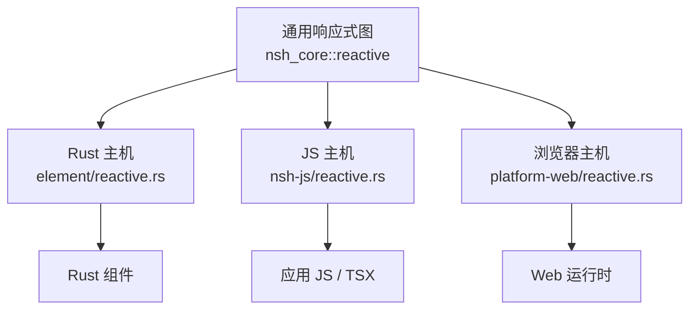
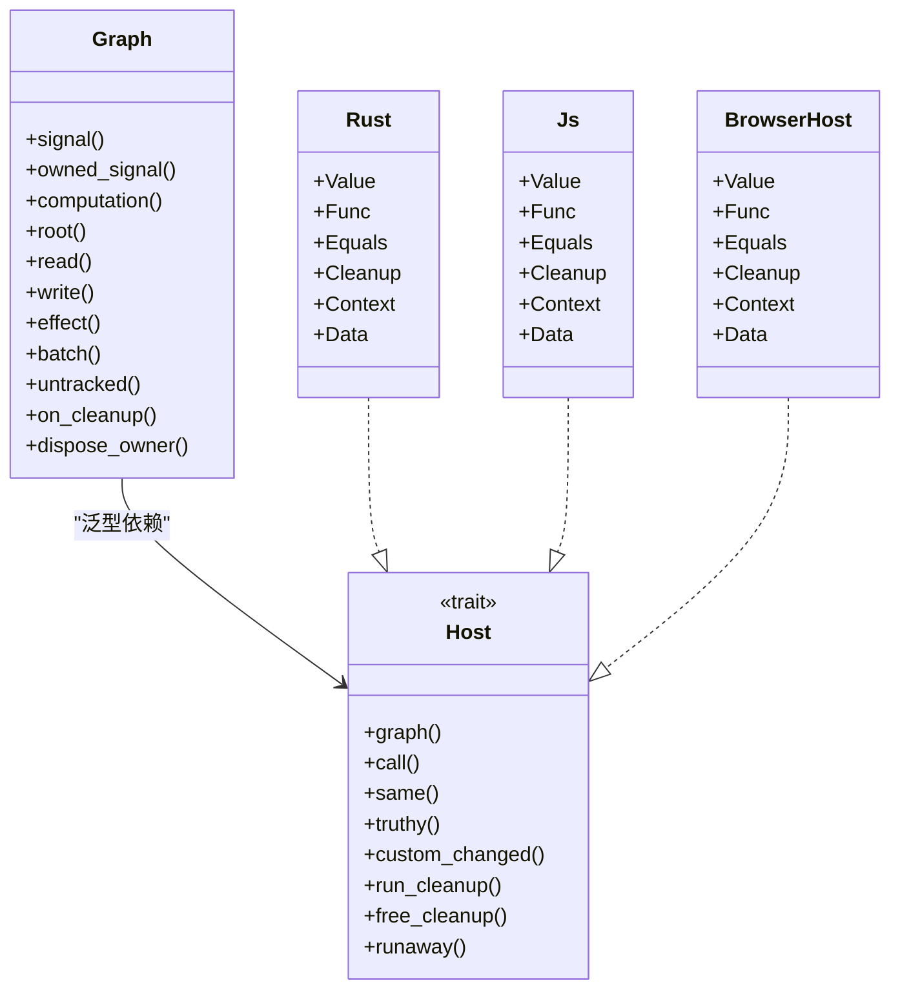
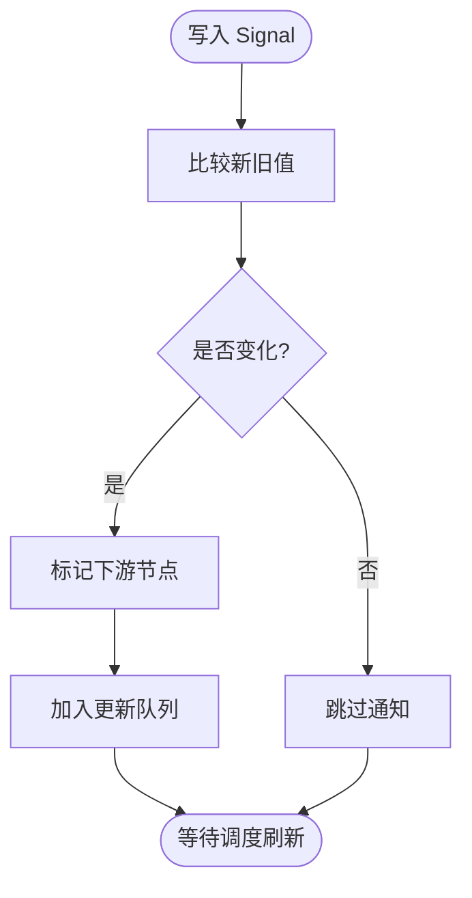
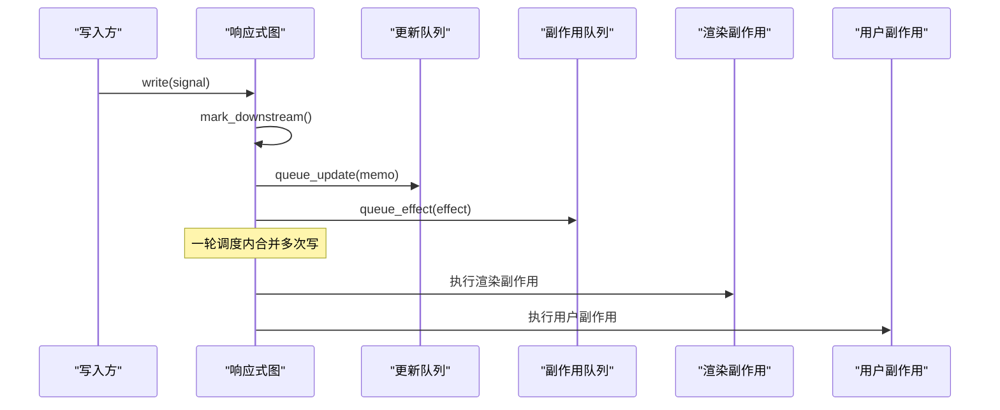
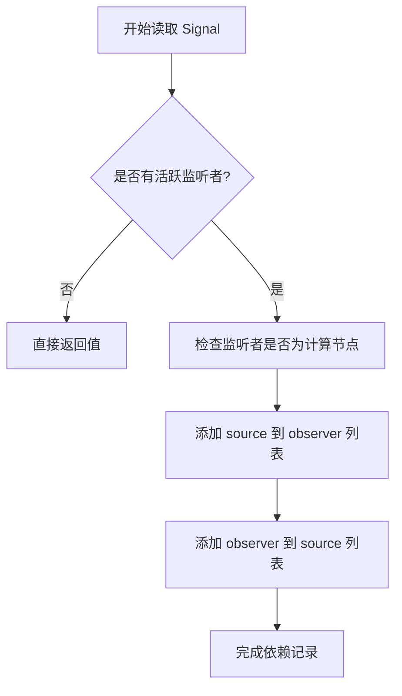
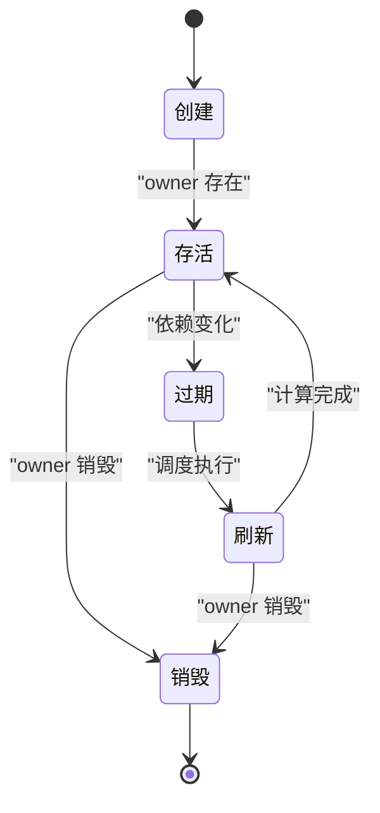
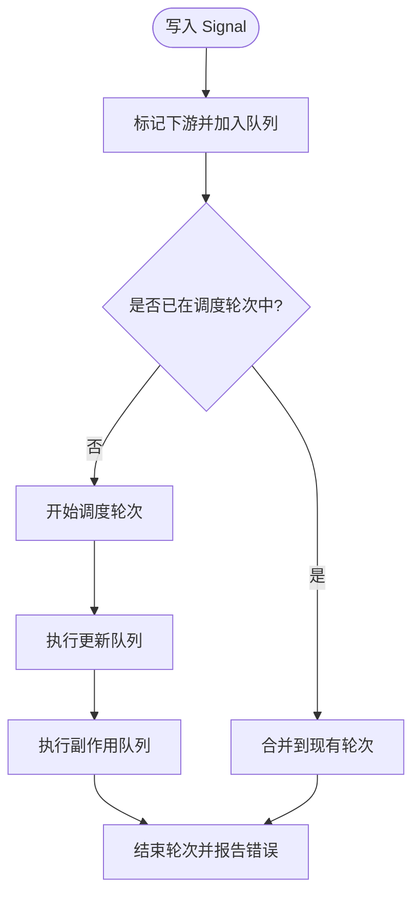
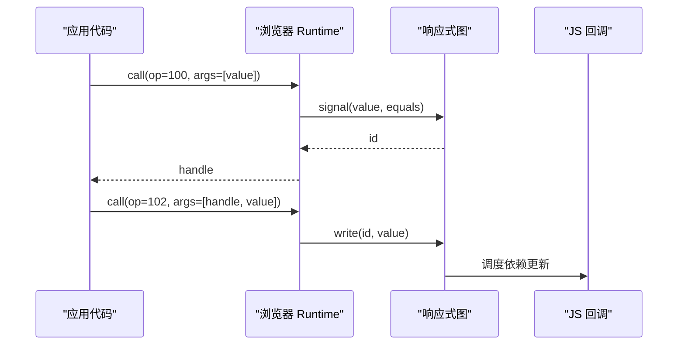

# 响应式系统API

<cite>
**本文引用的文件**   
- [reactive.rs](file://crates/nsh-core/src/reactive.rs)
- [element/reactive.rs](file://crates/nsh-core/src/element/reactive.rs)
- [js/reactive.rs](file://crates/nsh-js/src/reactive.rs)
- [browser/reactive.rs](file://crates/nsh-platform-web/src/browser/reactive.rs)
- [reactive-components.md](file://docs/dev/reactive-components.md)
</cite>

## 目录

1. [引言](#引言)
2. [项目结构与定位](#项目结构与定位)
3. [核心概念总览](#核心概念总览)
4. [架构总览](#架构总览)
5. [Signal：响应式数据模型与读写语义](#signal响应式数据模型与读写语义)
6. [Effect 与 Memo：计算、副作用与执行时机](#effect-与-memo计算副作用与执行时机)
7. [Watch 语义与依赖追踪机制](#watch-语义与依赖追踪机制)
8. [清理机制、错误边界与生命周期](#清理机制错误边界与生命周期)
9. [批量更新与调度策略](#批量更新与调度策略)
10. [平台后端集成与数据同步](#平台后端集成与数据同步)
11. [性能特性与优化建议](#性能特性与优化建议)
12. [使用示例与最佳实践](#使用示例与最佳实践)
13. [故障排查指南](#故障排查指南)
14. [结论](#结论)

## 引言

NSH 的响应式系统以“信号图”为核心：`Signal` 表示可写状态，`Memo` 表示缓存计算结果，`Effect` 表示副作用。读操作会建立依赖边，写操作会标记下游节点并触发调度；渲染绑定、用户侧副作用和平台更新都基于同一套调度算法。

该文档聚焦以下目标：

- 解释 `Signal`、`Effect`、`Memo` 以及类 `Watch` 的依赖追踪语义。
- 说明响应式数据的创建、读取、更新、比较和清理机制。
- 明确渲染副作用与用户副作用的执行顺序。
- 解释批量更新、调度轮次、无限循环保护。
- 说明 JS 运行时、浏览器宿主与 Rust 组件如何共享同一张响应式图。
- 给出构建动态 UI 的实践模式与常见问题排查方法。

## 项目结构与定位

NSH 的响应式能力由四层组成：

| 层次 | 主要职责 | 关键文件 |
|---|---|---|
| 通用响应式图 | 定义节点类型、所有权、依赖边、调度队列、清理和资源释放 | [reactive.rs](file://crates/nsh-core/src/reactive.rs) |
| Rust 组件层 API | 为 Rust 组件提供 `Signal`、`Stored`、`Kept`、错误边界、事件等高层封装 | [element/reactive.rs](file://crates/nsh-core/src/element/reactive.rs) |
| JS 运行时桥接 | 将 QuickJS 值、函数、对象与响应式图连接，暴露 `createSignal`、`createMemo`、`createEffect` 等 | [js/reactive.rs](file://crates/nsh-js/src/reactive.rs) |
| 浏览器平台桥接 | 在浏览器环境中实现回调、清理、上下文、所有者句柄和批量调用 | [browser/reactive.rs](file://crates/nsh-platform-web/src/browser/reactive.rs) |

**图表来源**
- [reactive.rs:1-17](file://crates/nsh-core/src/reactive.rs#L1-L17)
- [element/reactive.rs:1-16](file://crates/nsh-core/src/element/reactive.rs#L1-L16)
- [js/reactive.rs:1-19](file://crates/nsh-js/src/reactive.rs#L1-L19)
- [browser/reactive.rs:1-15](file://crates/nsh-platform-web/src/browser/reactive.rs#L1-L15)

**章节来源**
- [reactive.rs:1-17](file://crates/nsh-core/src/reactive.rs#L1-L17)
- [element/reactive.rs:1-16](file://crates/nsh-core/src/element/reactive.rs#L1-L16)
- [js/reactive.rs:1-19](file://crates/nsh-js/src/reactive.rs#L1-L19)
- [browser/reactive.rs:1-15](file://crates/nsh-platform-web/src/browser/reactive.rs#L1-L15)

## 核心概念总览

### Signal

`Signal<T>` 是响应式值的句柄。它本身很小且可复制，内部指向响应式图中的节点；真正值保存在图中。典型语义包括：

- 通过 `get` 或 `with` 读取时，如果当前有活跃监听者，则建立依赖边。
- 通过 `set`、`try_set`、`update` 写入时，若新值被认为不同，则通知依赖者。
- 支持只读视图 `ReadSignal`，用于跨边界传递不可变引用。
- 支持未追踪读取 `get_untracked` / `with_untracked`，避免意外订阅。

### Memo

`Memo` 是带缓存的计算结果。它会在依赖变化时重新运行计算函数，并将结果缓存；只有当结果变化时才通知下游。

### Effect

`Effect` 是副作用执行单元。NSH 区分两类：

- **渲染副作用**：优先执行，通常用于驱动 UI 相关副作用。
- **用户副作用**：在渲染副作用之后执行，适合网络请求、日志、订阅等。

### Watch 语义

仓库中没有名为 `watch` 的独立顶层 API；但“观察某个信号变化并执行副作用”的模式由 `Effect` 表达。常见写法是创建一个 effect，并在其中读取需要观察的信号。这样，effect 会自动订阅这些信号，并在它们变化后重新执行。

### Owner 与生命周期

每个节点都有所有者。组件体、effect、条件分支、列表行等都可以成为 owner。owner 被销毁时，其创建的 signal、memo、effect、任务、定时器、清理函数都会按规则释放。

**章节来源**
- [element/reactive.rs:496-532](file://crates/nsh-core/src/element/reactive.rs#L496-L532)
- [element/reactive.rs:684-775](file://crates/nsh-core/src/element/reactive.rs#L684-L775)
- [reactive.rs:45-73](file://crates/nsh-core/src/reactive.rs#L45-L73)
- [reactive-components.md:85-113](file://docs/dev/reactive-components.md#L85-L113)

## 架构总览

NSH 的响应式系统采用“通用图 + 多主机”设计：

1. `nsh_core::reactive` 定义图结构、节点、边、调度器、所有权、清理和错误检测。
2. `Host` trait 抽象不同环境中的值、函数、比较函数、清理函数和上下文。
3. Rust 组件通过 `Rust` 主机实例化图。
4. JS 应用通过 `Js` 主机实例化图。
5. 浏览器平台通过 `Host` 在浏览器回调中安全地调用 JS 函数。

**图表来源**
- [reactive.rs:75-136](file://crates/nsh-core/src/reactive.rs#L75-L136)
- [reactive.rs:242-260](file://crates/nsh-core/src/reactive.rs#L242-L260)
- [element/reactive.rs:153-261](file://crates/nsh-core/src/element/reactive.rs#L153-L261)
- [js/reactive.rs:83-212](file://crates/nsh-js/src/reactive.rs#L83-L212)
- [browser/reactive.rs:29-106](file://crates/nsh-platform-web/src/browser/reactive.rs#L29-L106)

**章节来源**
- [reactive.rs:1-17](file://crates/nsh-core/src/reactive.rs#L1-L17)
- [reactive.rs:75-136](file://crates/nsh-core/src/reactive.rs#L75-L136)
- [reactive.rs:242-260](file://crates/nsh-core/src/reactive.rs#L242-L260)

## 架构总览

NSH 的响应式系统采用“通用图 + 多主机”设计：

1. `nsh_core::reactive` 定义图结构、节点、边、调度器、所有权、清理和错误检测。
2. `Host` trait 抽象不同环境中的值、函数、比较函数、清理函数和上下文。
3. Rust 组件通过 `Rust` 主机实例化图。
4. JS 应用通过 `Js` 主机实例化图。
5. 浏览器平台通过 `Host` 在浏览器回调中安全地调用 JS 函数。

**图表来源**
- [reactive.rs:75-136](file://crates/nsh-core/src/reactive.rs#L75-L136)
- [reactive.rs:242-260](file://crates/nsh-core/src/reactive.rs#L242-L260)
- [element/reactive.rs:153-261](file://crates/nsh-core/src/element/reactive.rs#L153-L261)
- [js/reactive.rs:83-212](file://crates/nsh-js/src/reactive.rs#L83-L212)
- [browser/reactive.rs:29-106](file://crates/nsh-platform-web/src/browser/reactive.rs#L29-L106)

**章节来源**
- [reactive.rs:1-17](file://crates/nsh-core/src/reactive.rs#L1-L17)
- [reactive.rs:75-136](file://crates/nsh-core/src/reactive.rs#L75-L136)
- [reactive.rs:242-260](file://crates/nsh-core/src/reactive.rs#L242-L260)

## Signal：响应式数据模型与读写语义

### 数据结构与复杂度

`Signal<T>` 是一个轻量句柄，包含节点 ID 和代际信息。它不直接持有值，而是通过图访问真实值。

| 操作 | 时间复杂度 | 空间复杂度 | 行为 |
|---|---:|---:|---|
| 创建 signal | O(1) | O(1) | 分配节点，设置初始值和比较策略 |
| 读取 get / with | O(1) | O(1) | 可能建立依赖边 |
| 未追踪读取 | O(1) | O(1) | 不建立依赖 |
| 写入 set | O(1) | O(1) | 比较值，必要时标记下游 |
| 原地 update | O(1) 额外分配 | 取决于 T | 先取旧值，修改后再写回 |
| 只读 read_only | O(1) | O(1) | 返回不可写视图 |

### 创建方式

- `signal(value)`：默认启用相等比较，跳过无变化的写。
- `signal_with(value, equals)`：允许禁用相等比较，每次写都通知。
- `stored(value)`：非响应式状态，适合任务句柄、缓存等不需要 UI 订阅的值。
- `OwnedSignal` 对应底层图的 owned 版本，随 owner 生命周期管理。

### 读取语义

- `get()`：克隆值并订阅。
- `with(f)`：借用值并订阅。
- `get_untracked()` / `with_untracked()`：不订阅，适合初始化、事件回调中仅消费状态的场景。
- `try_get()`：owner 已销毁时返回空值，不会 panic。

### 写入语义

- `set(value)`：写入新值，若不等则通知依赖。
- `try_set(value)`：owner 已销毁时返回失败。
- `update(f)`：原地修改值，保证每次写都通知，适合可变结构。
- `read_only()`：导出只读句柄，常用于跨组件或跨语言边界。

**图表来源**
- [reactive.rs:746-764](file://crates/nsh-core/src/reactive.rs#L746-L764)
- [reactive.rs:669-674](file://crates/nsh-core/src/reactive.rs#L669-L674)
- [element/reactive.rs:728-761](file://crates/nsh-core/src/element/reactive.rs#L728-L761)

**章节来源**
- [element/reactive.rs:496-532](file://crates/nsh-core/src/element/reactive.rs#L496-L532)
- [element/reactive.rs:684-775](file://crates/nsh-core/src/element/reactive.rs#L684-L775)
- [reactive.rs:317-346](file://crates/nsh-core/src/reactive.rs#L317-L346)
- [reactive.rs:746-764](file://crates/nsh-core/src/reactive.rs#L746-L764)

## Effect 与 Memo：计算、副作用与执行时机

### Memo：缓存计算

Memo 是派生值。它保存计算函数和上一次结果，并在依赖变化时重新计算。

- 首次创建时处于“陈旧”状态，等待第一次运行。
- 依赖变化后进入待更新状态。
- 结果变化才通知下游。
- 可用于派生 UI 文本、过滤列表、格式化值等。

### Effect：副作用执行

Effect 分为两类：

| 类型 | 执行时机 | 用途 |
|---|---|---|
| 渲染副作用 | 本轮调度中较早执行 | 驱动 UI、DOM、动画、平台属性 |
| 用户副作用 | 渲染副作用之后执行 | 网络请求、日志、第三方 SDK、订阅 |

**图表来源**
- [reactive.rs:661-674](file://crates/nsh-core/src/reactive.rs#L661-L674)
- [reactive.rs:746-764](file://crates/nsh-core/src/reactive.rs#L746-L764)
- [js/reactive.rs:653-683](file://crates/nsh-js/src/reactive.rs#L653-L683)

**章节来源**
- [reactive.rs:45-60](file://crates/nsh-core/src/reactive.rs#L45-L60)
- [reactive.rs:348-366](file://crates/nsh-core/src/reactive.rs#L348-L366)
- [reactive.rs:661-674](file://crates/nsh-core/src/reactive.rs#L661-L674)
- [js/reactive.rs:653-683](file://crates/nsh-js/src/reactive.rs#L653-L683)

## Watch 语义与依赖追踪机制

虽然 NSH 没有名为 `watch` 的独立 API，但“观察信号变化并执行副作用”的行为完全由 `Effect` 表达。

### 依赖追踪流程

1. 在 effect 或 memo 中读取 signal。
2. 当前监听者为有效计算节点时，建立 source → observer 的双向边。
3. 重复读取同一 source 只保留一条边。
4. 写入 signal 时，沿 observer 链标记下游。
5. memo 进入更新队列，effect 进入副作用队列。

**图表来源**
- [reactive.rs:676-702](file://crates/nsh-core/src/reactive.rs#L676-L702)

### 未追踪读取

`untracked` 或 `get_untracked` / `with_untracked` 可以绕过依赖追踪。典型场景：

- 初始化时读取外部状态。
- 事件回调中消费最新值但不订阅。
- 清理逻辑中读取状态以避免循环依赖。

**章节来源**
- [reactive.rs:676-702](file://crates/nsh-core/src/reactive.rs#L676-L702)
- [element/reactive.rs:700-713](file://crates/nsh-core/src/element/reactive.rs#L700-L713)
- [js/reactive.rs:775-785](file://crates/nsh-js/src/reactive.rs#L775-L785)

## 清理机制、错误边界与生命周期

### 清理函数

每个 owner 维护清理函数列表。当 owner 再次运行或被销毁时，清理函数会被执行。

- Rust 主机通过 `run_cleanup` 执行清理。
- JS 主机通过 QuickJS 调用清理函数。
- 浏览器主机支持浏览器回调和 Rust 清理闭包。

### 错误边界

错误可以在 computation、cleanup、listener 中发生。NSH 会将错误交给最近的错误边界：

- Rust 侧收集 panic 消息。
- JS 侧捕获异常并通过 error boundary signal 展示 fallback。
- 浏览器侧记录错误消息并阻止无效回调。

### 生命周期关系

**图表来源**
- [reactive.rs:146-179](file://crates/nsh-core/src/reactive.rs#L146-L179)
- [reactive.rs:614-637](file://crates/nsh-core/src/reactive.rs#L614-L637)
- [element/reactive.rs:69-89](file://crates/nsh-core/src/element/reactive.rs#L69-L89)
- [js/reactive.rs:297-317](file://crates/nsh-js/src/reactive.rs#L297-L317)

**章节来源**
- [reactive.rs:614-637](file://crates/nsh-core/src/reactive.rs#L614-L637)
- [element/reactive.rs:69-89](file://crates/nsh-core/src/element/reactive.rs#L69-L89)
- [element/reactive.rs:153-261](file://crates/nsh-core/src/element/reactive.rs#L153-L261)
- [js/reactive.rs:185-212](file://crates/nsh-js/src/reactive.rs#L185-L212)
- [browser/reactive.rs:87-106](file://crates/nsh-platform-web/src/browser/reactive.rs#L87-L106)

## 批量更新与调度策略

NSH 使用 Solid 1.9 风格的调度：

- 一次写可能触发多个 memo 和 effect。
- 更新队列负责重新计算 memo。
- 副作用队列负责执行 effect。
- 一轮调度结束后统一处理错误和边界。
- 多次写在同一轮中被合并，避免中间状态频繁刷新。

**图表来源**
- [reactive.rs:247-259](file://crates/nsh-core/src/reactive.rs#L247-L259)
- [reactive.rs:645-674](file://crates/nsh-core/src/reactive.rs#L645-L674)
- [js/reactive.rs:495-516](file://crates/nsh-js/src/reactive.rs#L495-L516)
- [browser/reactive.rs:217-278](file://crates/nsh-platform-web/src/browser/reactive.rs#L217-L278)

**章节来源**
- [reactive.rs:247-259](file://crates/nsh-core/src/reactive.rs#L247-L259)
- [reactive.rs:645-674](file://crates/nsh-core/src/reactive.rs#L645-L674)
- [js/reactive.rs:495-516](file://crates/nsh-js/src/reactive.rs#L495-L516)
- [browser/reactive.rs:217-278](file://crates/nsh-platform-web/src/browser/reactive.rs#L217-L278)

## 平台后端集成与数据同步

### JS 运行时

JS 运行时将 QuickJS 值作为响应式值，将 JS 函数作为计算函数。它暴露：

- `createSignal`
- `createMemo`
- `createRenderEffect`
- `createEffect`
- `batch`
- `untrack`
- `createRoot`
- `onCleanup`

JS 侧的 signal 对象是可调用对象：调用即读取，赋值即写入。

### 浏览器平台

浏览器平台通过统一的 `Runtime::call` 分发操作：

| 操作编号 | 含义 |
|---|---|
| 100 | 创建 signal |
| 101 | 读取 signal |
| 102 | 写入 signal |
| 103 | 创建 memo |
| 104 | 创建 effect |
| 105 | 创建 root |
| 106 | 销毁 owner |
| 107 | batch |
| 108 | untracked |
| 109 | onCleanup |
| 110 | 获取 owner |
| 111 | runWithOwner |
| 112 | getContext |
| 113 | provideContext |
| 114 | dropHandle |

**图表来源**
- [browser/reactive.rs:217-351](file://crates/nsh-platform-web/src/browser/reactive.rs#L217-L351)
- [js/reactive.rs:609-683](file://crates/nsh-js/src/reactive.rs#L609-L683)

**章节来源**
- [js/reactive.rs:609-683](file://crates/nsh-js/src/reactive.rs#L609-L683)
- [browser/reactive.rs:19-106](file://crates/nsh-platform-web/src/browser/reactive.rs#L19-L106)
- [browser/reactive.rs:217-351](file://crates/nsh-platform-web/src/browser/reactive.rs#L217-L351)

## 性能特性与优化建议

### 已知性能特征

- 句柄是 Copy 类型，闭包捕获零拷贝。
- 相等比较可跳过无变化写。
- 依赖边双向存储，unlink 使用 swap-remove。
- 调度轮次合并多次写。
- 内存池复用节点槽位。
- 空闲时可压缩 arena。

### 优化建议

| 场景 | 建议 |
|---|---|
| 大对象频繁更新 | 使用 `signal_with` 配合自定义比较，或使用 `update` 原地修改 |
| 初始化读取外部状态 | 使用 `get_untracked` 或 `untracked` |
| 多次连续写 | 使用 `batch` 包裹 |
| 昂贵计算 | 使用 `Memo` 缓存 |
| 副作用中不应订阅 | 使用 `untracked` 读取 |
| 大型组件频繁局部更新 | 拆分为细粒度绑定，让最小范围重算 |
| 清理逻辑复杂 | 使用 `onCleanup` 显式释放资源 |

**章节来源**
- [reactive.rs:11-16](file://crates/nsh-core/src/reactive.rs#L11-L16)
- [reactive.rs:279-315](file://crates/nsh-core/src/reactive.rs#L279-L315)
- [reactive.rs:791-796](file://crates/nsh-core/src/reactive.rs#L791-L796)
- [reactive-components.md:39-55](file://docs/dev/reactive-components.md#L39-L55)

## 使用示例与最佳实践

### 创建响应式状态

- 用 `signal` 创建普通响应式状态。
- 用 `signal_with` 创建总是通知的状态。
- 用 `stored` 创建非响应式共享状态。
- 用 `read_only` 导出只读视图。

### 构建动态 UI

- 组件体只运行一次。
- 将 UI 中变化的部分写成 binding。
- 将派生值放入 `Memo`。
- 将副作用放入 `Effect`。
- 将批量写放入 `batch`。
- 将不订阅的读取放入 `untracked`。

### 与平台后端同步

- 在 effect 中发起网络请求或调用平台 API。
- 使用 cleanup 取消未完成的任务。
- 使用 owner 生命周期自动释放资源。
- 在浏览器平台通过 `Runtime::call` 统一调度响应式操作。

**章节来源**
- [element/reactive.rs:496-584](file://crates/nsh-core/src/element/reactive.rs#L496-L584)
- [element/reactive.rs:684-775](file://crates/nsh-core/src/element/reactive.rs#L684-L775)
- [reactive-components.md:85-113](file://docs/dev/reactive-components.md#L85-L113)
- [reactive-components.md:183-231](file://docs/dev/reactive-components.md#L183-L231)
- [browser/reactive.rs:217-351](file://crates/nsh-platform-web/src/browser/reactive.rs#L217-L351)

## 故障排查指南

### 常见错误

| 现象 | 可能原因 | 处理方式 |
|---|---|---|
| 读取已销毁 signal 后 panic | 在 owner 销毁后仍调用 `get` | 改用 `try_get` 或确保生命周期 |
| 无限循环警告 | effect 每次运行都改变它读取的值 | 拆分副作用，避免在 effect 中直接写自身依赖 |
| 多次渲染 | 缺少 `batch` 或比较策略不当 | 使用 `batch` 包裹批量写，或调整 `equals` |
| 副作用未执行 | 未在 effect 中读取信号 | 确认 effect 确实订阅了所需信号 |
| 清理未执行 | owner 未被正确销毁 | 检查 owner 生命周期和 cleanup 注册位置 |
| JS 侧抛出异常 | computation 或回调中抛错 | 使用 error boundary 捕获并展示 fallback |

### 调试建议

- 使用 `try_get` / `try_set` 判断 owner 是否存活。
- 使用 `untracked` 排除意外订阅。
- 使用 `batch` 减少中间刷新。
- 使用 `Memo` 缓存昂贵计算。
- 在浏览器平台关注 `Runtime::call` 的错误返回。
- 在 JS 平台关注 round 结束时抛出的错误。

**章节来源**
- [element/reactive.rs:720-743](file://crates/nsh-core/src/element/reactive.rs#L720-L743)
- [element/reactive.rs:255-260](file://crates/nsh-core/src/element/reactive.rs#L255-L260)
- [js/reactive.rs:196-212](file://crates/nsh-js/src/reactive.rs#L196-L212)
- [js/reactive.rs:495-516](file://crates/nsh-js/src/reactive.rs#L495-L516)
- [browser/reactive.rs:103-106](file://crates/nsh-platform-web/src/browser/reactive.rs#L103-L106)
- [browser/reactive.rs:346-351](file://crates/nsh-platform-web/src/browser/reactive.rs#L346-L351)

## 结论

NSH 的响应式系统以一张通用响应式图为核心，同时服务 Rust 组件和 JS 应用。它通过 `Signal`、`Memo`、`Effect` 表达状态、派生值和副作用，并通过 owner、清理、错误边界和调度轮次保证生命周期安全和性能可控。

对于开发者而言，最重要的实践原则是：

- 把 UI 中变化的部分写成 binding。
- 把派生值放入 `Memo`。
- 把副作用放入 `Effect`。
- 用 `batch` 合并批量写。
- 用 `untracked` 避免意外订阅。
- 用 owner 和 cleanup 管理资源。
- 用 error boundary 处理异常。

这套模型让 NSH 的响应式编程既接近现代前端框架的使用习惯，又在底层具备确定性的调度、清晰的依赖图和良好的性能边界。