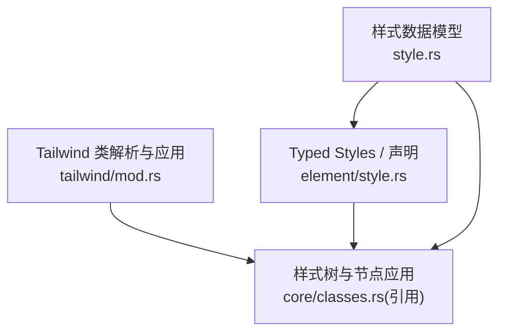
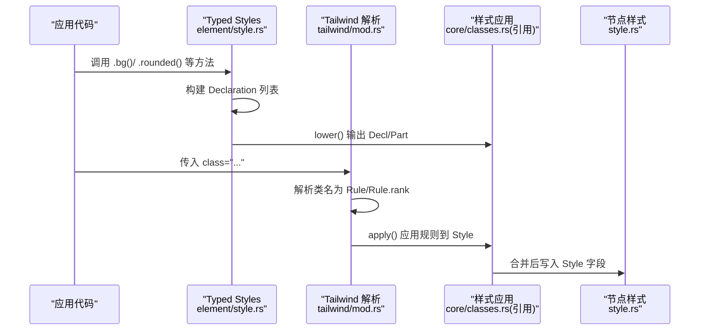
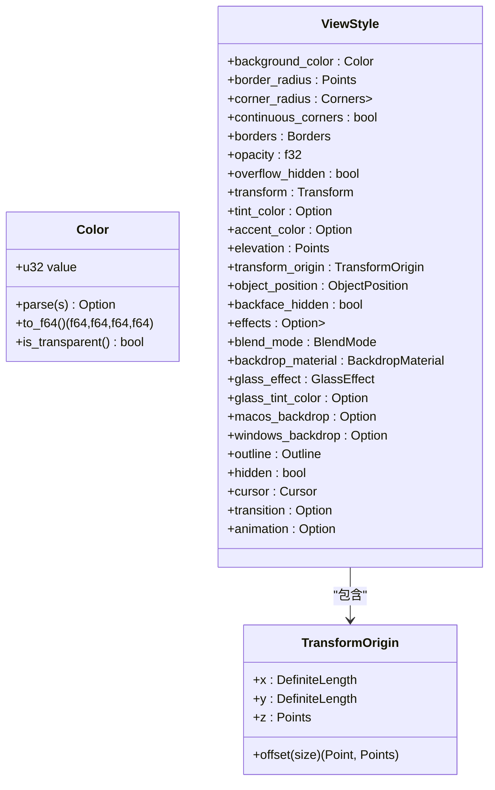
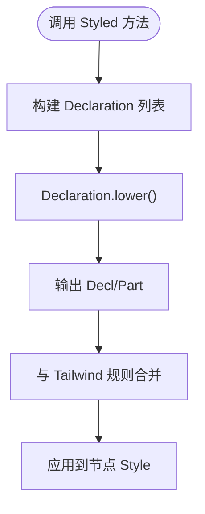
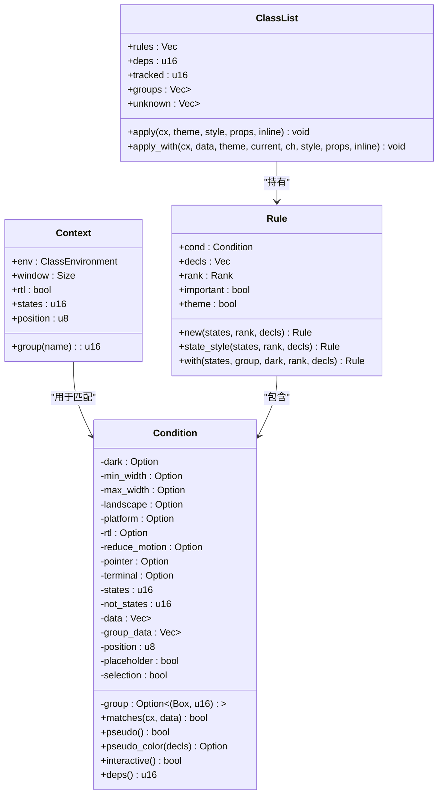
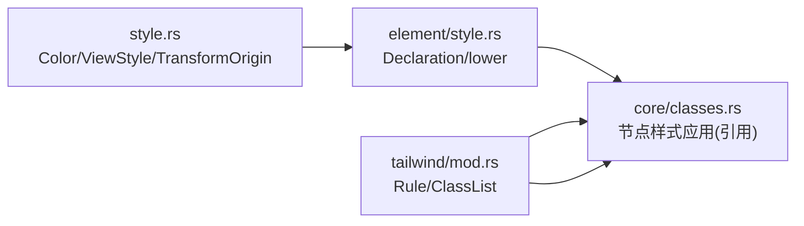

# 样式系统API

<cite>
**本文引用的文件**   
- [crates/nsh-core/src/style.rs](file://crates/nsh-core/src/style.rs)
- [crates/nsh-core/src/element/style.rs](file://crates/nsh-core/src/element/style.rs)
- [crates/nsh-core/src/tailwind/mod.rs](file://crates/nsh-core/src/tailwind/mod.rs)
- [docs/dev/styles.md](file://docs/dev/styles.md)
- [website/docs/styling.md](file://website/docs/styling.md)
- [website/docs/tailwind.md](file://website/docs/tailwind.md)
</cite>

## 目录
1. [简介](#简介)
2. [项目结构](#项目结构)
3. [核心组件](#核心组件)
4. [架构总览](#架构总览)
5. [详细组件分析](#详细组件分析)
6. [依赖关系分析](#依赖关系分析)
7. [性能考量](#性能考量)
8. [故障排查指南](#故障排查指南)
9. [结论](#结论)
10. [附录](#附录)

## 简介
本文件为 NSH 框架的样式系统 API 文档，聚焦以下目标：
- 记录 Style、StyleDecl、StyleValue 的定义与用法（以 Rust 侧类型与声明为中心）。
- 说明 CSS 样式的解析、验证与应用机制。
- 解释 Tailwind CSS 集成的工作原理与自定义扩展方式。
- 提供编程式设置样式、动态修改外观与处理样式继承的具体示例路径。
- 说明动画效果、过渡效果与视觉效果的实现机制。

NSH 的样式体系遵循“一套属性，三种写法”的原则：Rust 的 Styled 链式方法、TSX 的 style 键值对、以及 Tailwind 类名，最终都落到同一组原生样式规则上。长度单位采用点（pt），默认值面向原生平台；变化中的值使用数值或结构化形式（如 translate: [x, y]、transform 步骤列表、阴影层），以便在平台上进行原生动画。

## 项目结构
样式系统的核心位于 nsh-core 包中，围绕三个层次组织：
- 样式数据模型与颜色/几何等基础类型：style.rs
- Rust 组件的 Typed Styles（Styled）与声明到规则的转换：element/style.rs
- Tailwind 类名的解析、规则排序与运行时应用：tailwind/mod.rs

图表来源
- [crates/nsh-core/src/style.rs:25-64](file://crates/nsh-core/src/style.rs#L25-L64)
- [crates/nsh-core/src/element/style.rs:1-13](file://crates/nsh-core/src/element/style.rs#L1-L13)
- [crates/nsh-core/src/tailwind/mod.rs:1-23](file://crates/nsh-core/src/tailwind/mod.rs#L1-L23)

章节来源
- [crates/nsh-core/src/style.rs:25-64](file://crates/nsh-core/src/style.rs#L25-L64)
- [crates/nsh-core/src/element/style.rs:1-13](file://crates/nsh-core/src/element/style.rs#L1-L13)
- [crates/nsh-core/src/tailwind/mod.rs:1-23](file://crates/nsh-core/src/tailwind/mod.rs#L1-L23)

## 核心组件
本节概述样式系统的核心数据结构与职责：
- Color：sRGB 打包颜色（0xRRGGBBAA），提供解析与基本操作。
- ViewStyle：视图的非布局视觉属性集合（背景、边框、圆角、阴影、滤镜、变换、混合模式、玻璃效果等）。
- TransformOrigin：变换原点（支持百分比/绝对长度）。
- Declaration：Typed Styles 的内部声明枚举，负责将 Rust 方法调用转换为 Tailwind 风格的 Decl/Part。
- Rule/Rank/Condition：Tailwind 规则、优先级与条件匹配（暗色、断点、状态、group、data-* 等）。
- ClassList：类名解析结果与应用入口。

这些类型共同构成从“用户输入（Rust 方法/TSX style/Tailwind 类）→ 声明 → 规则 → 应用到节点样式”的完整链路。

章节来源
- [crates/nsh-core/src/style.rs:25-64](file://crates/nsh-core/src/style.rs#L25-L64)
- [crates/nsh-core/src/style.rs:704-763](file://crates/nsh-core/src/style.rs#L704-L763)
- [crates/nsh-core/src/style.rs:765-800](file://crates/nsh-core/src/style.rs#L765-L800)
- [crates/nsh-core/src/element/style.rs:421-500](file://crates/nsh-core/src/element/style.rs#L421-L500)
- [crates/nsh-core/src/tailwind/mod.rs:363-373](file://crates/nsh-core/src/tailwind/mod.rs#L363-L373)
- [crates/nsh-core/src/tailwind/mod.rs:659-671](file://crates/nsh-core/src/tailwind/mod.rs#L659-L671)

## 架构总览
下图展示样式从输入到应用的总体流程：Rust 组件通过 Styled 生成 Declaration；Declaration.lower 输出 Decl/Part；Tailwind 类由 ClassList 解析为 Rule；两者最终合并并应用到节点的 Style。

图表来源
- [crates/nsh-core/src/element/style.rs:544-759](file://crates/nsh-core/src/element/style.rs#L544-L759)
- [crates/nsh-core/src/tailwind/mod.rs:701-800](file://crates/nsh-core/src/tailwind/mod.rs#L701-L800)
- [crates/nsh-core/src/style.rs:704-763](file://crates/nsh-core/src/style.rs#L704-L763)

## 详细组件分析

### 样式数据模型：Color、ViewStyle、TransformOrigin
- Color：sRGB 打包存储，提供 parse、to_f64、is_transparent 等方法，是样式管线中 diff 与缓存的最小单元。
- ViewStyle：承载非布局视觉属性，包括背景、边框、圆角、阴影、滤镜、变换、混合模式、玻璃效果、轮廓、可见性、光标、过渡与关键帧动画等。
- TransformOrigin：定义变换中心点，支持分数与绝对长度。

图表来源
- [crates/nsh-core/src/style.rs:25-64](file://crates/nsh-core/src/style.rs#L25-L64)
- [crates/nsh-core/src/style.rs:704-763](file://crates/nsh-core/src/style.rs#L704-L763)
- [crates/nsh-core/src/style.rs:765-800](file://crates/nsh-core/src/style.rs#L765-L800)

章节来源
- [crates/nsh-core/src/style.rs:25-64](file://crates/nsh-core/src/style.rs#L25-L64)
- [crates/nsh-core/src/style.rs:704-763](file://crates/nsh-core/src/style.rs#L704-L763)
- [crates/nsh-core/src/style.rs:765-800](file://crates/nsh-core/src/style.rs#L765-L800)

### Typed Styles 与声明：Declaration 与 lower
Typed Styles 将 Rust 方法调用转化为内部 Declaration，再由 lower 输出 Decl/Part，供 Tailwind 风格规则消费。Declaration 覆盖文本预设、阴影、渐变、滤镜、变换、过渡、动画、网格轨道等。

图表来源
- [crates/nsh-core/src/element/style.rs:421-500](file://crates/nsh-core/src/element/style.rs#L421-L500)
- [crates/nsh-core/src/element/style.rs:544-759](file://crates/nsh-core/src/element/style.rs#L544-L759)

章节来源
- [crates/nsh-core/src/element/style.rs:421-500](file://crates/nsh-core/src/element/style.rs#L421-L500)
- [crates/nsh-core/src/element/style.rs:544-759](file://crates/nsh-core/src/element/style.rs#L544-L759)

### Tailwind 集成：解析、排序与应用
Tailwind 类在 Rust 侧解析为 Rule，每个 Rule 包含 Condition（暗色、断点、平台、指针精度、终端、RTL、交互状态、group、data-*、伪元素 placeholder/selection 等）、Decl 列表、Rank（变体优先级）与 important 标记。ClassList.apply 按顺序应用规则，并在交互状态下正确处理背景与渐变覆盖。

图表来源
- [crates/nsh-core/src/tailwind/mod.rs:203-226](file://crates/nsh-core/src/tailwind/mod.rs#L203-L226)
- [crates/nsh-core/src/tailwind/mod.rs:233-361](file://crates/nsh-core/src/tailwind/mod.rs#L233-L361)
- [crates/nsh-core/src/tailwind/mod.rs:363-373](file://crates/nsh-core/src/tailwind/mod.rs#L363-L373)
- [crates/nsh-core/src/tailwind/mod.rs:659-800](file://crates/nsh-core/src/tailwind/mod.rs#L659-L800)

章节来源
- [crates/nsh-core/src/tailwind/mod.rs:203-226](file://crates/nsh-core/src/tailwind/mod.rs#L203-L226)
- [crates/nsh-core/src/tailwind/mod.rs:233-361](file://crates/nsh-core/src/tailwind/mod.rs#L233-L361)
- [crates/nsh-core/src/tailwind/mod.rs:363-373](file://crates/nsh-core/src/tailwind/mod.rs#L363-L373)
- [crates/nsh-core/src/tailwind/mod.rs:659-800](file://crates/nsh-core/src/tailwind/mod.rs#L659-L800)

### CSS 解析、验证与应用机制
- 颜色解析：Color.parse 支持 hex、rgb/rgba、hsl/hsla、oklch/oklab 与命名色，统一转为 sRGB 打包存储。
- 值形式：静态值可为 CSS-like 字符串（Rust 侧解析一次），变化值使用数值或结构化形式（translate、scale、transform 步骤、阴影层）。
- 应用顺序：默认值 → 类规则 → 内联 style（key 精确替换，undefined 不设置，null 设为默认）。
- 继承：文本属性（color、font、size、alignment 等）从父视图继承；whitespace/text-wrap/select 等也按 CSS 语义继承。
- currentColor：边框/描边/环未设颜色时取文本颜色；阴影层未设颜色同理。

章节来源
- [crates/nsh-core/src/style.rs:25-64](file://crates/nsh-core/src/style.rs#L25-L64)
- [docs/dev/styles.md:44-52](file://docs/dev/styles.md#L44-L52)
- [docs/dev/styles.md:202-216](file://docs/dev/styles.md#L202-L216)
- [docs/dev/styles.md:236-242](file://docs/dev/styles.md#L236-L242)
- [website/docs/styling.md:97-119](file://website/docs/styling.md#L97-L119)

### Tailwind 主题与自定义扩展
- 主题扩展：nsh.json 的 tailwind 配置可添加 colors、spacing、breakpoints、fontSize、radius、shadow、blur、perspective、ease 等。
- Token 系统：app 的 theme 设计令牌（primary、card、radius 等）可通过类名 bg-primary、rounded-(--radius) 或 token() 读取。
- 未知类检查：构建期与运行时报错/警告，避免无意义的类名。
- 自定义扩展：通过 Tailwind 的 utilities/theme 扩展新增类名；Rust 组件的 Styled 方法与 Tailwind 默认刻度保持一致，同时读取 app 的设计令牌。

章节来源
- [website/docs/tailwind.md:174-213](file://website/docs/tailwind.md#L174-L213)
- [website/docs/tailwind.md:217-270](file://website/docs/tailwind.md#L217-L270)
- [website/docs/tailwind.md:294-302](file://website/docs/tailwind.md#L294-L302)

### 编程式设置样式、动态修改与继承示例路径
- Rust 编程式样式：使用 Styled 链式方法（.p_4()、.rounded(px(12.0))、.bg(color)、.shadow([...])），详见示例路径。
- TSX 动态样式：style 接受对象或数组，支持信号表达式与条件合并；key 为 undefined 不设置，null 设为默认。
- 样式继承：父视图 text-*、font-*、whitespace-*、select-* 等会向下传递至子文本与输入。

示例路径（不含具体代码内容）：
- Rust 样式示例：[website/docs/styling.md:15-34](file://website/docs/styling.md#L15-L34)
- TSX 样式示例：[website/docs/styling.md:36-49](file://website/docs/styling.md#L36-L49)
- 组合样式与信号绑定：[website/docs/styling.md:53-96](file://website/docs/styling.md#L53-L96)
- 文本与选择行为继承：[docs/dev/styles.md:236-242](file://docs/dev/styles.md#L236-L242)

章节来源
- [website/docs/styling.md:15-34](file://website/docs/styling.md#L15-L34)
- [website/docs/styling.md:36-49](file://website/docs/styling.md#L36-L49)
- [website/docs/styling.md:53-96](file://website/docs/styling.md#L53-L96)
- [docs/dev/styles.md:236-242](file://docs/dev/styles.md#L236-L242)

### 动画、过渡与视觉效果
- 过渡（transition*）：支持 all/colors/opacity/transform/boxShadow/borderRadius/clip-path，时长、延迟、缓动（含 spring）。
- 关键帧动画（animation*）：内置 spin/ping/pulse/bounce，也可自定义 KeyframeAnimation。
- 视觉效果：boxShadow、backgroundImage（线性/径向/圆锥渐变）、filter（brightness/contrast/grayscale/hue-rotate/invert/saturate/sepia/opacity/blur/drop-shadow）、backdropFilter、glassEffect、glassTintColor、maskImage、mixBlendMode、outline、visibility、cursor。
- 平台差异：iOS/macOS 使用 Core Animation；Android 使用 RenderEffect/ValueAnimator；Web/Windows/Linux/GPUI 各有支持范围与限制。

章节来源
- [website/docs/styling.md:447-522](file://website/docs/styling.md#L447-L522)
- [docs/dev/styles.md:243-340](file://docs/dev/styles.md#L243-L340)

## 依赖关系分析
样式系统的关键依赖如下：
- style.rs 提供 Color、ViewStyle、TransformOrigin 等基础类型。
- element/style.rs 将 Rust 方法映射为 Declaration，再 lower 为 Decl/Part。
- tailwind/mod.rs 解析类名为 Rule，维护 Rank/Condition，并通过 ClassList.apply 应用。
- core/classes.rs（引用）负责将样式应用到节点，并与环境（appearance、窗口尺寸、方向、状态）联动。

图表来源
- [crates/nsh-core/src/style.rs:25-64](file://crates/nsh-core/src/style.rs#L25-L64)
- [crates/nsh-core/src/element/style.rs:544-759](file://crates/nsh-core/src/element/style.rs#L544-L759)
- [crates/nsh-core/src/tailwind/mod.rs:701-800](file://crates/nsh-core/src/tailwind/mod.rs#L701-L800)

章节来源
- [crates/nsh-core/src/style.rs:25-64](file://crates/nsh-core/src/style.rs#L25-L64)
- [crates/nsh-core/src/element/style.rs:544-759](file://crates/nsh-core/src/element/style.rs#L544-L759)
- [crates/nsh-core/src/tailwind/mod.rs:701-800](file://crates/nsh-core/src/tailwind/mod.rs#L701-L800)

## 性能考量
- 类名解析缓存：ClassList 对 distinct 类名进行 LRU 缓存（最多 4096 条），仅当依赖项（appearance、窗口尺寸、方向、状态、group、data-*、current color、ch、设备特性）变化时重新解析。
- 最小化变更：只发送变化的属性到原生视图；Rust 侧使用 Bits/Hash 比较减少重绘。
- 原生动画：过渡与关键帧动画在原生侧执行，无需 JS 每帧回调。
- 渐变与滤镜：复杂效果（重复渐变、多滤镜组合）在各平台有优化路径与限制，需关注平台差异。

章节来源
- [crates/nsh-core/src/tailwind/mod.rs:1-23](file://crates/nsh-core/src/tailwind/mod.rs#L1-L23)
- [crates/nsh-core/src/element/style.rs:136-152](file://crates/nsh-core/src/element/style.rs#L136-L152)
- [website/docs/styling.md:447-522](file://website/docs/styling.md#L447-L522)

## 故障排查指南
- 未知类名：构建期与运行时报警；检查是否拼写错误或使用了不支持的 Tailwind 工具类。
- currentColor 未解析：若边框/描边/环未显式设置颜色，且父级文本颜色未正确继承，可能导致渲染异常；确保父级 color 已设置或使用显式颜色。
- 渐变与交互状态：active:bg-* 等交互状态背景会覆盖渐变，除非该状态自身设置了渐变；如需保留渐变，请在交互状态中显式设置背景图。
- 平台限制：某些滤镜/模糊/混合模式在不同平台支持不同，参考平台差异表与文档。

章节来源
- [website/docs/tailwind.md:294-302](file://website/docs/tailwind.md#L294-L302)
- [docs/dev/styles.md:202-216](file://docs/dev/styles.md#L202-L216)
- [website/docs/styling.md:294-303](file://website/docs/styling.md#L294-L303)

## 结论
NSH 的样式系统以统一的属性模型为核心，兼容 Rust Typed Styles、TSX style 与 Tailwind 类名三类输入，通过声明与规则机制在原生侧高效应用。其优势在于：
- 一致的语义与默认值，跨平台一致的外观。
- 高性能的类名解析与缓存，最小化原生更新。
- 丰富的视觉效果与动画能力，兼顾各平台差异。
- 可扩展的主题与 Token 系统，便于品牌与设计系统集成。

## 附录
- 样式参考与 Tailwind 参考：参见网站文档中的 style-reference 与 tailwind-reference。
- 布局与文本：布局属性与文本属性的详细说明请参考 Layout 与 Text 文档。