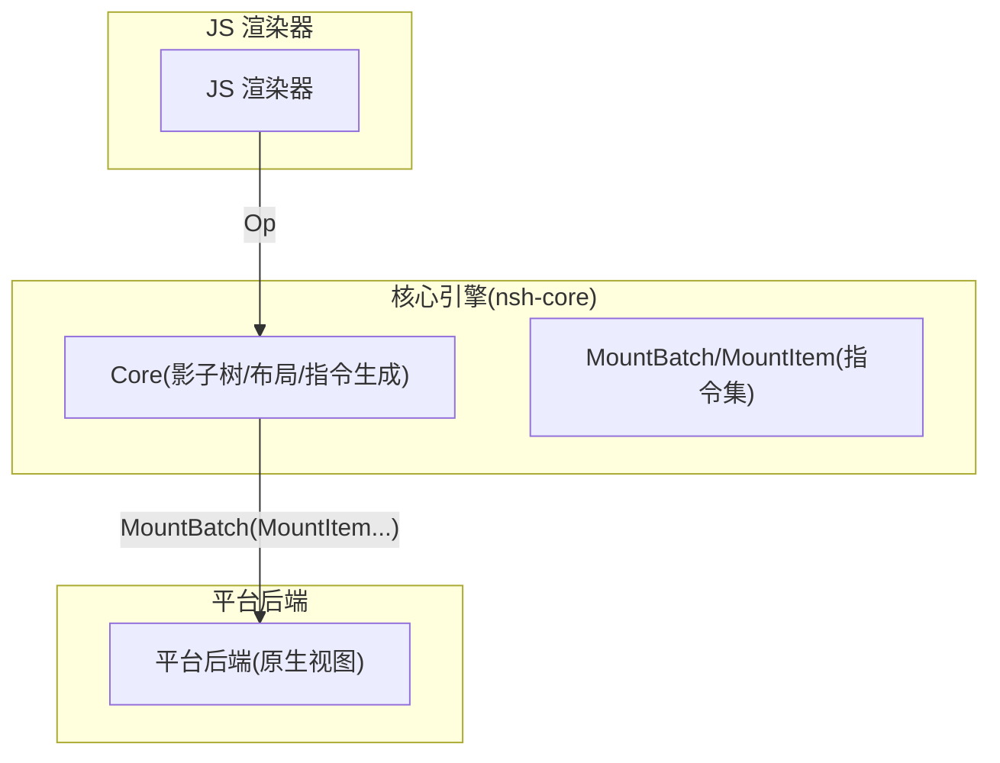
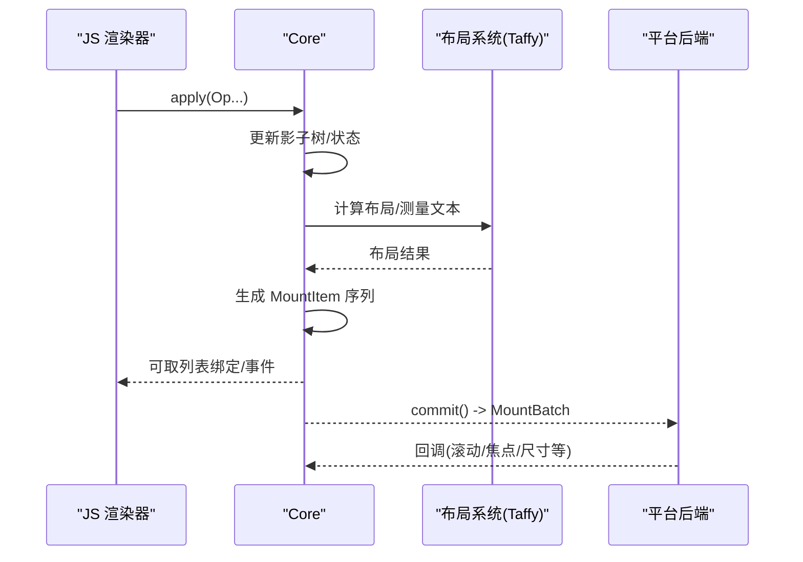
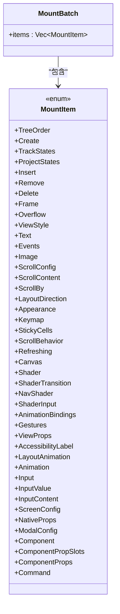
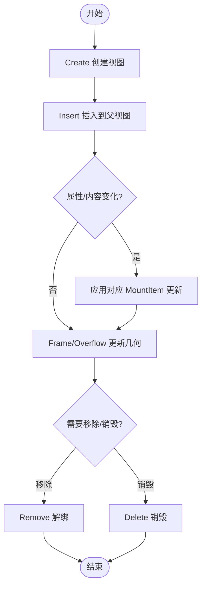
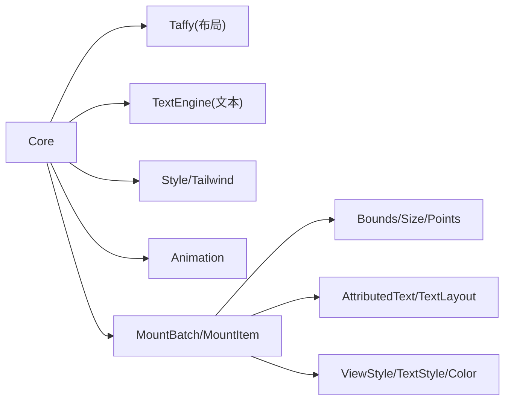

# 核心引擎API

<cite>
**本文引用的文件**   
- [lib.rs](file://crates/nsh-core/src/lib.rs)
- [mod.rs（Core）](file://crates/nsh-core/src/core/mod.rs)
- [mount.rs](file://crates/nsh-core/src/mount.rs)
</cite>

## 目录
1. [简介](#简介)
2. [项目结构](#项目结构)
3. [核心组件](#核心组件)
4. [架构总览](#架构总览)
5. [详细组件分析](#详细组件分析)
6. [依赖关系分析](#依赖关系分析)
7. [性能考量](#性能考量)
8. [故障排查指南](#故障排查指南)
9. [结论](#结论)

## 简介
本文件为 NSH 框架的核心引擎 API 文档，聚焦于 nsh-core 中的 Core 结构与 MountBatch/MountItem 体系。内容涵盖：
- Core 的公共方法族：应用生命周期、视图树操作、布局计算与渲染指令生成
- MountBatch 的构建过程与 MountItem 的类型和处理机制
- 视图注册、更新与销毁的生命周期管理
- 初始化引擎、处理视图更新与管理内存的实践示例路径
- 错误处理机制与性能优化策略

## 项目结构
nsh-core 是平台无关的核心层，负责接收 JS 渲染器产生的 Op，维护影子树，将样式转换为 Taffy 布局，合并内联文本，执行布局并输出由平台后端应用的 MountBatch 与 MountItem。

图表来源
- [lib.rs:1-10](file://crates/nsh-core/src/lib.rs#L1-L10)
- [mod.rs（Core）:1287-1293](file://crates/nsh-core/src/core/mod.rs#L1287-L1293)
- [mount.rs:1176-1181](file://crates/nsh-core/src/mount.rs#L1176-L1181)

章节来源
- [lib.rs:1-10](file://crates/nsh-core/src/lib.rs#L1-L10)

## 核心组件
- Core：单线程、分配敏感的核心引擎，持有影子树、布局树、状态机与待提交指令缓冲，对外暴露生命周期与环境配置、视图树操作、布局与渲染控制等公共 API。
- MountBatch：一次 commit 产出的所有 MountItem 集合，按顺序在单个 UI 帧内应用。
- MountItem：对平台后端的原子指令，包括创建/插入/移除/删除视图、设置样式/事件/文本/图片/滚动/输入/屏幕/模态/组件/动画/命令等。

章节来源
- [lib.rs:117-134](file://crates/nsh-core/src/lib.rs#L117-L134)
- [mod.rs（Core）:1287-1293](file://crates/nsh-core/src/core/mod.rs#L1287-L1293)
- [mount.rs:748-1125](file://crates/nsh-core/src/mount.rs#L748-L1125)
- [mount.rs:1176-1181](file://crates/nsh-core/src/mount.rs#L1176-L1181)

## 架构总览
Core 的工作流：
1. 通过 apply(Op) 消费 JS 渲染器的变更，更新影子树与内部状态。
2. 在 commit() 中完成布局计算、差异比较、指令生成，产出 MountBatch。
3. 平台后端按序应用 MountItem，驱动原生视图的创建、更新与销毁。

图表来源
- [lib.rs:1-10](file://crates/nsh-core/src/lib.rs#L1-L10)
- [mod.rs（Core）:1287-1293](file://crates/nsh-core/src/core/mod.rs#L1287-L1293)
- [mount.rs:748-1125](file://crates/nsh-core/src/mount.rs#L748-L1125)

## 详细组件分析

### Core 公共方法与职责
- 生命周期与环境
  - new(text_engine, viewport)：创建核心，初始化根节点与布局树。
  - set_viewport(size)：设置根视图尺寸，触发重排与组件视口同步。
  - set_header_heights(normal, large)：设置平台标题栏高度，触发重排。
  - set_safe_area(insets)：设置安全区域，触发重排。
  - set_overlay_area(area)：设置锚定覆盖层的放置区域，必要时触发重排。
  - set_root_size(id, size, insets)：设置根级视图尺寸与安全区，触发重排。
  - set_screen_header(id, height)：设置页面头部高度，触发重排。
  - set_font_scale(scale)：设置用户字体缩放，重新布局文本。
  - set_default_font(family)：设置默认字体族，重新布局文本。
  - set_access(access)、set_base_url(url)、set_media_files(files)：设置访问策略与资源基址，影响网络/本地资源解析。
  - set_image_context(context)：设置图像加载上下文（非 wasm）。
  - set_clipboard/picker/window_backend/speech/audio/login_item/storage/data_dir/app_info/updater：注入平台能力后端或运行时环境。
  - set_quit_mode(mode)、set_main_window(options)：桌面端退出模式与主窗口启动选项。
  - set_max_nodes(max)：限制最大节点数，防止内存膨胀。
  - set_resizing(resizing)：标记窗口调整大小阶段，优化远屏文本测量。

- 视图树与交互
  - node_count()/node_id_room()：查询节点数量与 ID 表容量。
  - set_scroll_offset(id, offset, applied)：上报滚动偏移与应用计数，联动虚拟列表与跟随元素。
  - key_scrolled(id, move)：键盘滚动控制（如列表跟随底部）。
  - set_kept(nodes)：保持指定行渲染，避免回收导致的状态丢失。

- 渲染与布局控制
  - relayout_text()：强制重新布局所有文本与输入。
  - repick_images(old, new)：根据像素密度变化重新选择图片变体。
  - mark_near_screen()：仅测量屏幕附近文本，提升调整大小时性能。

- 其他
  - set_tree_order_tracking()/set_projected_state_mounting()：开启树序跟踪与投影状态挂载（用于调试/无障碍）。
  - set_builtin_scrollbars(...)：启用内置滚动条。
  - set_content_culling(bool)：启用滚动内容裁剪。

章节来源
- [mod.rs（Core）:1678-1691](file://crates/nsh-core/src/core/mod.rs#L1678-L1691)
- [mod.rs（Core）:1862-1952](file://crates/nsh-core/src/core/mod.rs#L1862-L1952)
- [mod.rs（Core）:1994-2004](file://crates/nsh-core/src/core/mod.rs#L1994-L2004)
- [mod.rs（Core）:2006-2166](file://crates/nsh-core/src/core/mod.rs#L2006-L2166)
- [mod.rs（Core）:2173-2255](file://crates/nsh-core/src/core/mod.rs#L2173-L2255)
- [mod.rs（Core）:2257-2341](file://crates/nsh-core/src/core/mod.rs#L2257-L2341)
- [mod.rs（Core）:2343-2399](file://crates/nsh-core/src/core/mod.rs#L2343-L2399)

### MountBatch 与 MountItem
- MountBatch：保存一次 commit 生成的全部指令，保证在同一 UI 帧内有序应用。
- MountItem 关键类型与语义
  - 结构类：Create/Insert/Remove/Delete/Frame/Overflow
  - 样式与属性：ViewStyle/ViewProps/AccessibilityLabel/Events
  - 内容类：Text/Image/Canvas/Shader/NavShader/Component(ComponentPropSlots/ComponentProps)
  - 滚动类：ScrollConfig/ScrollContent/ScrollBy/ScrollBehavior/StickyCells/Refreshing
  - 输入类：Input/InputValue/InputContent
  - 导航与模态：ScreenConfig/ModalConfig/NativeProps
  - 动画与手势：AnimationBindings/Gestures/LayoutAnimation/Animation
  - 命令：Command（如 focus/scrollTo 等）

- 指令顺序约束
  - 必须按顺序应用，因为后续指令可能引用前面 Create 创建的视图 id。

图表来源
- [mount.rs:748-1125](file://crates/nsh-core/src/mount.rs#L748-L1125)
- [mount.rs:1176-1181](file://crates/nsh-core/src/mount.rs#L1176-L1181)

章节来源
- [mount.rs:748-1125](file://crates/nsh-core/src/mount.rs#L748-L1125)
- [mount.rs:1176-1181](file://crates/nsh-core/src/mount.rs#L1176-L1181)

### 视图生命周期管理（注册/更新/销毁）
- 注册（创建）
  - 通过 Create 指令创建原生视图，随后 Insert 将其挂入父视图。
  - 对于特殊容器（WebView/Video/Native），会附带 NativeProps 进行配置。
- 更新
  - 样式/属性：ViewStyle/ViewProps/AccessibilityLabel/Events
  - 内容：Text/Image/Canvas/Shader/ComponentProps
  - 滚动：ScrollConfig/ScrollContent/ScrollBehavior/StickyCells/Refreshing
  - 输入：Input/InputValue/InputContent
  - 导航/模态：ScreenConfig/ModalConfig
  - 动画：AnimationBindings/Gestures/LayoutAnimation/Animation
  - 命令：Command
- 销毁
  - Remove 从父视图解绑但保留实例；Delete 彻底销毁视图。

图表来源
- [mount.rs:748-1125](file://crates/nsh-core/src/mount.rs#L748-L1125)

章节来源
- [mount.rs:748-1125](file://crates/nsh-core/src/mount.rs#L748-L1125)

### 布局计算与渲染指令生成
- 布局计算
  - Core 使用 Taffy 进行布局，结合 Tailwind 类与样式推导，支持固定定位、粘性定位、滚动视口、列表虚拟滚动等复杂场景。
  - 文本测量与排版由 TextEngine 提供，支持自适应字号、基线、附件对齐等。
- 指令生成
  - 在 commit 过程中，Core 对比新旧状态，生成最小化的 MountItem 序列，确保平台侧增量更新。
  - 针对滚动、列表、输入、动画、着色器等子系统，分别生成专用指令以优化平台实现。

章节来源
- [lib.rs:1-10](file://crates/nsh-core/src/lib.rs#L1-L10)
- [mod.rs（Core）:1287-1293](file://crates/nsh-core/src/core/mod.rs#L1287-L1293)

### 代码示例路径（初始化/更新/内存管理）
- 初始化引擎
  - 参考：[new:1678-1691](file://crates/nsh-core/src/core/mod.rs#L1678-L1691)
  - 说明：传入 TextEngine 与初始 viewport，自动创建根节点与布局树。
- 设置环境与平台能力
  - 参考：[set_access/set_base_url/set_media_files:2006-2037](file://crates/nsh-core/src/core/mod.rs#L2006-L2037)
  - 参考：[set_clipboard/set_picker/set_window_backend:2048-2100](file://crates/nsh-core/src/core/mod.rs#L2048-L2100)
  - 参考：[set_speech/set_audio/set_login_item:2102-2122](file://crates/nsh-core/src/core/mod.rs#L2102-L2122)
  - 参考：[set_storage/set_data_dir/set_app_info/set_updater:2124-2153](file://crates/nsh-core/src/core/mod.rs#L2124-L2153)
- 处理视图更新
  - 参考：[MountItem 枚举定义:748-1125](file://crates/nsh-core/src/mount.rs#L748-L1125)
  - 说明：根据业务变更生成对应的 MountItem，由平台后端应用。
- 管理内存与节点配额
  - 参考：[set_max_nodes:2162-2166](file://crates/nsh-core/src/core/mod.rs#L2162-L2166)
  - 参考：[ApplyError::TooManyNodes/TooDeep/IdOutOfRange:1239-1272](file://crates/nsh-core/src/core/mod.rs#L1239-L1272)

章节来源
- [mod.rs（Core）:1678-1691](file://crates/nsh-core/src/core/mod.rs#L1678-L1691)
- [mod.rs（Core）:2006-2166](file://crates/nsh-core/src/core/mod.rs#L2006-L2166)
- [mount.rs:748-1125](file://crates/nsh-core/src/mount.rs#L748-L1125)

## 依赖关系分析
- Core 依赖
  - 布局：Taffy（外部 crate）
  - 文本：TextEngine（抽象接口，具体实现由宿主提供）
  - 样式：Tailwind 类解析与 StylePatch
  - 动画：AnimationProp/NodeId
  - 平台后端：通过 MountBatch/MountItem 协议通信
- MountBatch/MountItem 依赖
  - 几何：Bounds/Size/Points
  - 文本：AttributedText/TextLayout
  - 样式：ViewStyle/TextStyle/Color
  - 平台特性：WebProps/VideoProps/ScreenConfig/ModalConfig 等

图表来源
- [lib.rs:117-134](file://crates/nsh-core/src/lib.rs#L117-L134)
- [mount.rs:1-17](file://crates/nsh-core/src/mount.rs#L1-L17)
- [mount.rs:748-1125](file://crates/nsh-core/src/mount.rs#L748-L1125)

章节来源
- [lib.rs:117-134](file://crates/nsh-core/src/lib.rs#L117-L134)
- [mount.rs:1-17](file://crates/nsh-core/src/mount.rs#L1-L17)

## 性能考量
- 节点配额与深度限制
  - set_max_nodes 限制最大节点数，防止原生视图过多导致内存压力。
  - MAX_TREE_DEPTH 限制视图嵌套深度，避免栈溢出。
- 文本测量优化
  - set_resizing 在窗口调整期间仅测量屏幕附近文本，减少重排成本。
  - repick_images 仅在像素密度变化时重新选择图片变体。
- 滚动与列表优化
  - cull 机制裁剪不可见内容，减少绘制与布局开销。
  - StickyCells/StickyCell 原生粘性单元格，避免频繁重绘。
- 指令批处理
  - MountBatch 将多次变更合并为一次批量提交，降低平台调用次数。
- 动画与手势
  - AnimationBindings/Gestures 将动画值与手势驱动绑定到原生节点，减少 JS 与平台的往返。

章节来源
- [mod.rs（Core）:1230-1237](file://crates/nsh-core/src/core/mod.rs#L1230-L1237)
- [mod.rs（Core）:2162-2166](file://crates/nsh-core/src/core/mod.rs#L2162-L2166)
- [mod.rs（Core）:2173-2255](file://crates/nsh-core/src/core/mod.rs#L2173-L2255)
- [mount.rs:748-1125](file://crates/nsh-core/src/mount.rs#L748-L1125)

## 故障排查指南
- 常见错误类型
  - UnknownNode/DuplicateNode：节点 ID 无效或重复。
  - NotAChild/BadAnchor/Cycle：父子关系或锚点非法，或插入形成环。
  - TooManyNodes/TooDeep/IdOutOfRange：超过节点配额、嵌套过深或 ID 超出范围。
- 诊断建议
  - 检查节点创建/插入顺序，确保先 Create 再 Insert。
  - 校验 before 锚点是否属于同一父节点。
  - 使用 set_max_nodes 限制节点规模，避免内存泄漏。
  - 关注 ApplyError::is_fatal 判断是否为致命错误，及时中止流程。

章节来源
- [mod.rs（Core）:1239-1272](file://crates/nsh-core/src/core/mod.rs#L1239-L1272)

## 结论
Core 作为 NSH 的核心引擎，提供了完整的视图树管理、布局计算与渲染指令生成能力。通过 MountBatch/MountItem 的细粒度指令模型，平台后端可以高效地驱动原生视图。合理设置环境参数、启用性能优化开关、遵循节点配额与深度限制，是构建高性能 NSH 应用的关键。