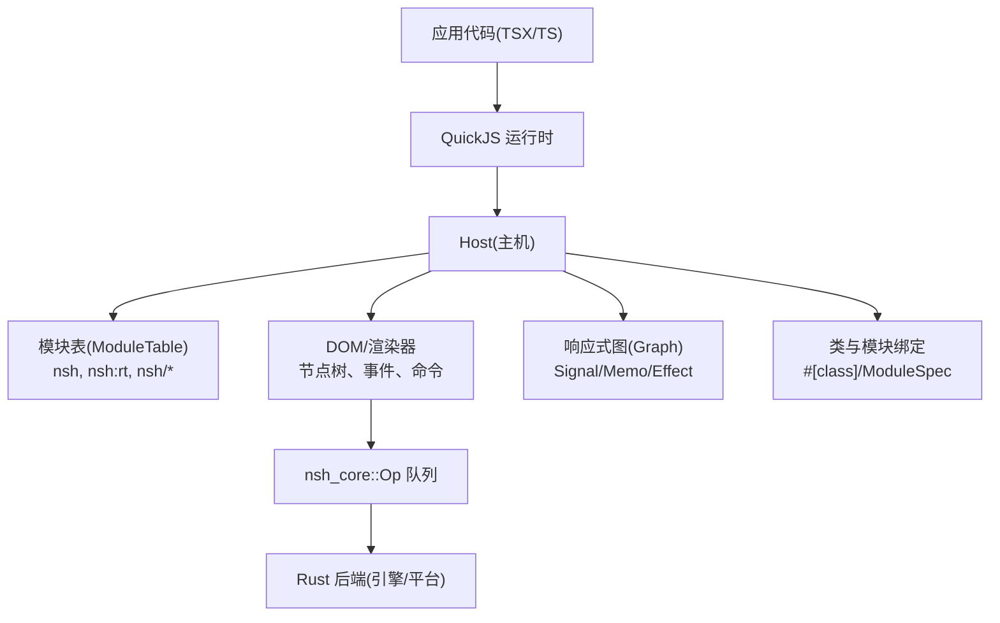
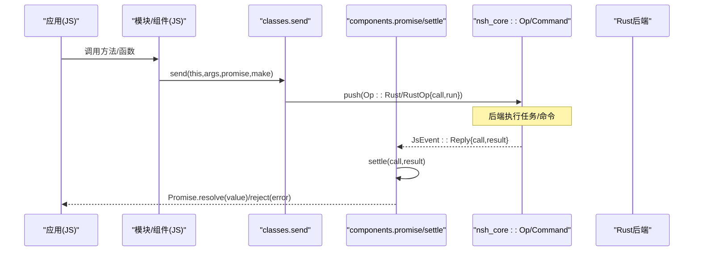
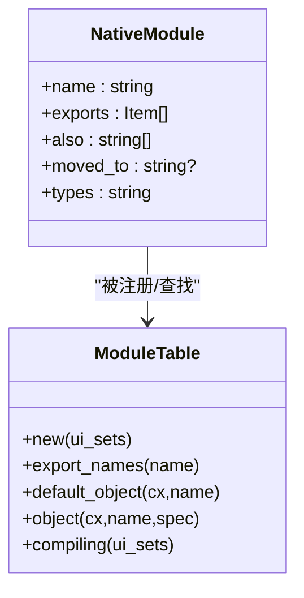
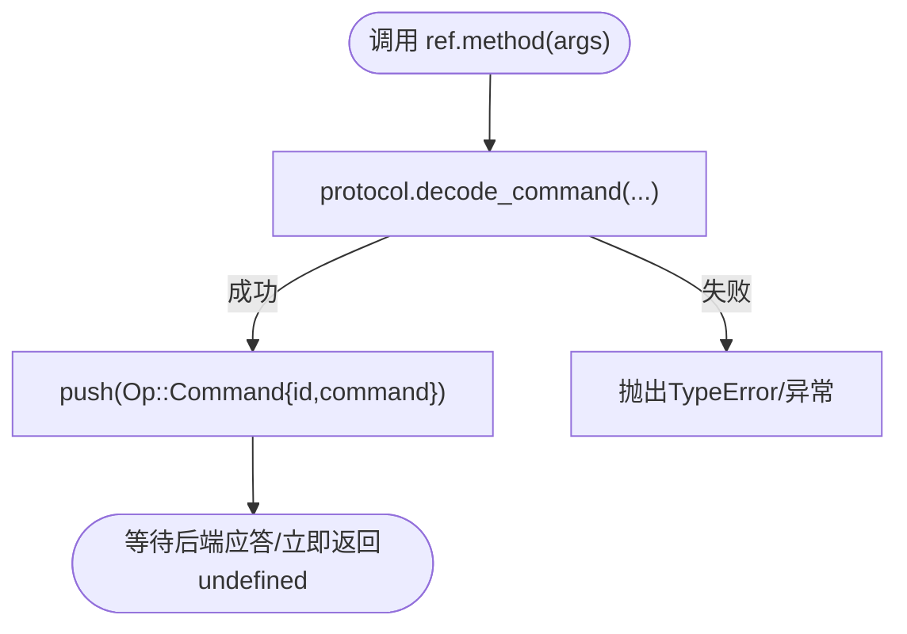
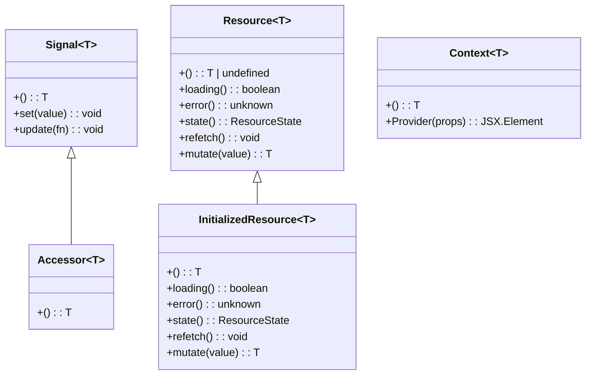
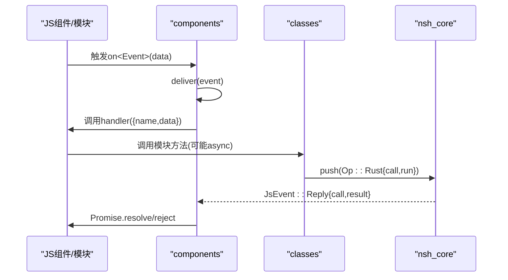
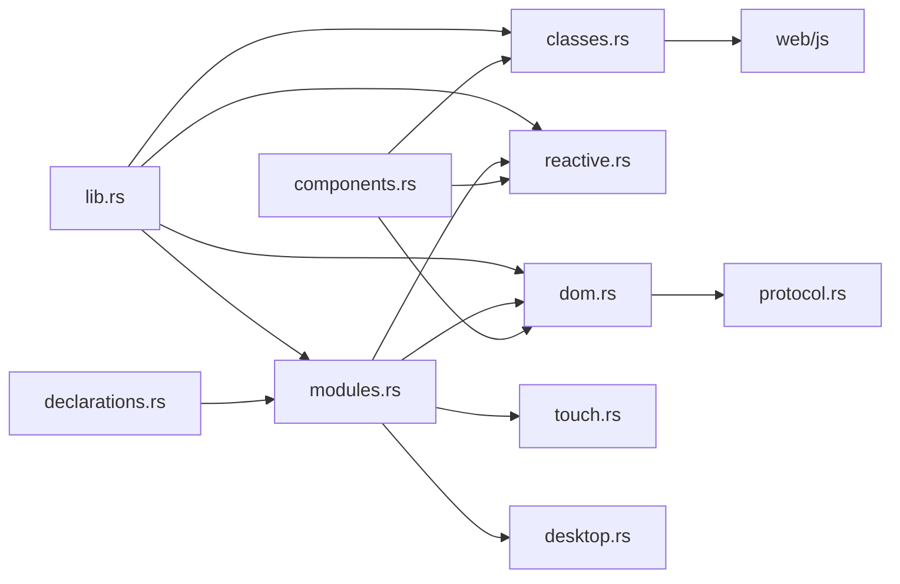

# TypeScript前端API

<cite>
**本文引用的文件**   
- [README.md](file://README.md)
- [lib.rs](file://crates/nsh-js/src/lib.rs)
- [modules.rs](file://crates/nsh-js/src/modules.rs)
- [declarations.rs](file://crates/nsh-js/src/declarations.rs)
- [components.rs](file://crates/nsh-js/src/components.rs)
- [dom.rs](file://crates/nsh-js/src/dom.rs)
- [reactive.rs](file://crates/nsh-js/src/reactive.rs)
- [classes.rs](file://crates/nsh-js/src/classes.rs)
- [web_page.rs](file://crates/nsh-js/src/web_page.rs)
</cite>

## 目录
1. [简介](#简介)
2. [项目结构](#项目结构)
3. [核心组件](#核心组件)
4. [架构总览](#架构总览)
5. [详细组件分析](#详细组件分析)
6. [依赖关系分析](#依赖关系分析)
7. [性能与限制](#性能与限制)
8. [故障排查指南](#故障排查指南)
9. [结论](#结论)
10. [附录：模块导出与类型定义索引](#附录模块导出与类型定义索引)

## 简介
本文件为 NSH 框架的 TypeScript 前端 API 参考文档，聚焦于 nsh-js 运行时对外暴露的模块、类型、接口与组件 API。内容涵盖 UI 组件库（View、Text、Scroll、Overlay、Shader 等）、状态管理（signal/computed/effect/resource/context）、事件处理、类与模块互操作、以及与 Rust 后端的调用通道和错误传播机制。同时提供常见使用模式与最佳实践建议，帮助开发者在 TSX/Rust 混合项目中高效构建跨平台应用。

## 项目结构
nsh-js 是 QuickJS 宿主层，负责：
- 安装全局 API（console、定时器、网络 fetch 等）
- 注册并加载原生模块（nsh、nsh:rt、nsh/*）
- 将 JS 变更转换为 nsh_core::Op 队列
- 把原生事件派发回 JS
- 生成 .nsh/types 下的 TypeScript 声明

图表来源
- [lib.rs:1-10](file://crates/nsh-js/src/lib.rs#L1-L10)
- [modules.rs:1-16](file://crates/nsh-js/src/modules.rs#L1-L16)
- [dom.rs:1-23](file://crates/nsh-js/src/dom.rs#L1-L23)
- [reactive.rs:1-19](file://crates/nsh-js/src/reactive.rs#L1-L19)
- [classes.rs:1-20](file://crates/nsh-js/src/classes.rs#L1-L20)

章节来源
- [README.md:1-40](file://README.md#L1-L40)
- [lib.rs:1-87](file://crates/nsh-js/src/lib.rs#L1-L87)

## 核心组件
- 模块系统
  - 原生模块表 MODULES 维护 nsh、nsh:rt、nsh/device、nsh/desktop、nsh/web、nsh/webview、nsh/video、nsh/native、nsh/gesture、nsh/animated、nsh/canvas、nsh/list、nsh/image、nsh/host、nsh/keymap 等模块及其导出与类型。
  - ModuleTable 负责按 specifier 解析模块对象、共享导出、以及分块代码加载。
- DOM/渲染器
  - Dom 维护节点树、根视图、平台信息、布局方向、对话框计数、懒加载行占位等；所有变更通过 Op 入队。
  - 节点 ref 方法（focus/blur/scrollTo/measure/reveal/animateLayout 等）统一经 protocol 解码为 Command 下发。
- 响应式系统
  - Js 实现 nsh_core::reactive::Host，封装 Signal/Memo/Effect/Resource 的 JS 对象与原生回调，支持 equals 自定义比较、错误边界、owner 生命周期。
- 类与模块绑定
  - classes.rs 将 Rust #[class] 与 ModuleSpec 函数映射到 JS 原型/构造器，支持同步/异步成员、属性访问器、dispose、Symbol.dispose。
  - components.rs 将 Rust 组件与模块函数桥接到 JS，处理 on<Event> 事件、children/render/unrender、Promise 结果投递。
- 类型声明生成
  - declarations.rs 从模块导出与 core 表格生成 .nsh/types 下 d.ts 文件，包含元素 props、样式、ref 类型、JSX 类型等。

章节来源
- [modules.rs:115-563](file://crates/nsh-js/src/modules.rs#L115-L563)
- [dom.rs:65-107](file://crates/nsh-js/src/dom.rs#L65-L107)
- [reactive.rs:38-61](file://crates/nsh-js/src/reactive.rs#L38-L61)
- [classes.rs:1-20](file://crates/nsh-js/src/classes.rs#L1-L20)
- [declarations.rs:1-12](file://crates/nsh-js/src/declarations.rs#L1-L12)

## 架构总览
下图展示一次典型“JS 调用 Rust 组件方法”的端到端流程：JS 侧通过模块或组件方法发起调用，进入 classes/components 转换与入队，Rust 后端执行后以事件形式返回结果，最终由 components.settle 兑现 Promise。

图表来源
- [classes.rs:453-467](file://crates/nsh-js/src/classes.rs#L453-L467)
- [components.rs:220-243](file://crates/nsh-js/src/components.rs#L220-L243)
- [components.rs:633-674](file://crates/nsh-js/src/components.rs#L633-L674)
- [dom.rs:609-721](file://crates/nsh-js/src/dom.rs#L609-L721)

## 详细组件分析

### 模块系统与导出
- 模块清单
  - nsh：信号、计算值、副作用、资源、上下文、mount/split/ErrorBoundary、基础组件 View/Text/Scroll/Overlay/Shader* 等。
  - nsh:rt：运行时内部能力（供 bundler JSX 输出导入）。
  - nsh/device、nsh/accessibility、nsh/desktop、nsh/web、nsh/webview、nsh/video、nsh/native、nsh/gesture、nsh/animated、nsh/canvas、nsh/list、nsh/image、nsh/host、nsh/keymap。
- 导出类型
  - Ts 枚举描述导出为函数/常量/类/内部项，配合 declarations 生成 d.ts。
  - NativeModule 记录 name、exports、also（被其他模块转发的导出）、moved_to（迁移目标）、types（模块自有类型）。

图表来源
- [modules.rs:99-113](file://crates/nsh-js/src/modules.rs#L99-L113)
- [modules.rs:604-623](file://crates/nsh-js/src/modules.rs#L604-L623)
- [modules.rs:649-790](file://crates/nsh-js/src/modules.rs#L649-L790)

章节来源
- [modules.rs:115-563](file://crates/nsh-js/src/modules.rs#L115-L563)
- [modules.rs:604-790](file://crates/nsh-js/src/modules.rs#L604-L790)

### DOM 与节点 Ref API
- 节点 ref 方法（部分）
  - focus/blur/clearSelection
  - setSelection(start,end?)
  - insertText(text)
  - command(name,args)
  - scrollTo(options), zoomTo(options), scrollToOffset(options), scrollToIndex(options), scrollToEnd(options)
  - measure(): Promise<{bounds,pagePosition}|null>
  - measureScrollPosition(): Promise<{index,offset}|null>
  - animateLayout(transition?)
  - reveal(options?)
  - WebView: reload/goBack/goForward/stopLoading/evaluate/injectJavaScript/postMessage/sendInput/load
  - Video: seek(seconds)
- 行为说明
  - 所有方法通过 protocol 解码为 Command，再推入 Op 队列，保证与同帧变更有序执行。
  - 数组长度读取有预算保护（MAX_ARRAY_ITEMS），避免超长数组阻塞主线程。

图表来源
- [dom.rs:420-606](file://crates/nsh-js/src/dom.rs#L420-L606)
- [dom.rs:609-721](file://crates/nsh-js/src/dom.rs#L609-L721)

章节来源
- [dom.rs:420-606](file://crates/nsh-js/src/dom.rs#L420-L606)
- [dom.rs:609-721](file://crates/nsh-js/src/dom.rs#L609-L721)

### 响应式系统（Signal/Memo/Effect/Resource/Context）
- 关键 API（nsh 模块导出）
  - signal(value?, options?): Signal<T>
  - computed(fn, options?): Accessor<T>
  - effect(fn): void
  - batch(fn): T
  - untrack(fn): T
  - cleanup(fn): void
  - resource(fetcher, options?): Resource<T>/InitializedResource<T>
  - context(defaultValue): Context<T>
- 语义要点
  - Signal 可读写，setter 支持更新函数；equals 可自定义相等性。
  - Effect 在渲染后运行，依赖变化时再次执行，支持清理函数。
  - Resource 异步数据源，支持 initialValue、refetch、mutate、loading/error/state。
  - Context 提供 Provider 与消费方 Accessor。

图表来源
- [modules.rs:116-292](file://crates/nsh-js/src/modules.rs#L116-L292)
- [modules.rs:294-400](file://crates/nsh-js/src/modules.rs#L294-L400)
- [reactive.rs:439-516](file://crates/nsh-js/src/reactive.rs#L439-L516)

章节来源
- [modules.rs:116-292](file://crates/nsh-js/src/modules.rs#L116-L292)
- [modules.rs:294-400](file://crates/nsh-js/src/modules.rs#L294-L400)
- [reactive.rs:439-516](file://crates/nsh-js/src/reactive.rs#L439-L516)

### 组件与模块绑定（Rust ↔ JS）
- 组件
  - 通过 dom::host_component 创建宿主组件（如 View/Text/Scroll/Overlay/Shader*），并在 modules.rs 中注入运行时函数（例如 Image.getSize/prefetch）。
  - 组件事件 on<Event> 由 components.deliver 分发，未监听的事件不会进行昂贵转换。
  - 子节点渲染支持 render/unrender 回调，便于动态插槽与函数式子树。
- 模块函数
  - ModuleSpec.functions 支持 Sync/Op/Async/Start 四种调用方式；classes.components.module_function 包装为 JS 闭包。
  - 异步/Op 调用通过 components.promise/settle 兑现 Promise。

图表来源
- [components.rs:372-469](file://crates/nsh-js/src/components.rs#L372-L469)
- [components.rs:676-781](file://crates/nsh-js/src/components.rs#L676-L781)
- [classes.rs:453-467](file://crates/nsh-js/src/classes.rs#L453-L467)

章节来源
- [components.rs:372-469](file://crates/nsh-js/src/components.rs#L372-L469)
- [components.rs:676-781](file://crates/nsh-js/src/components.rs#L676-L781)
- [classes.rs:453-467](file://crates/nsh-js/src/classes.rs#L453-L467)

### Web 页面元数据（Head）
- nsh/web 提供 Head 组件，用于设置 title/description/canonical/lang/meta/jsonLd。
- 在非 Web 宿主上 Head 不渲染任何内容，仅作为类型与约定存在。

章节来源
- [web_page.rs:1-61](file://crates/nsh-js/src/web_page.rs#L1-L61)

## 依赖关系分析
- lib.rs 聚合各子系统（modules/dom/reactive/classes 等），并导出 Host、Limits、JsError、网络相关类型等。
- modules.rs 依赖 reactive/dom/touch/desktop/i18n 等模块，组装原生模块导出。
- declarations.rs 依赖 modules.rs 与 nsh_core::js 表格，生成 d.ts。
- components.rs 依赖 dom/reactive/classes，负责事件与 Promise 投递。
- dom.rs 依赖 protocol 解码命令，并与 shared ops 队列交互。
- reactive.rs 实现 Graph Host，与 classes/dom 协作。
- classes.rs 依赖 web/js 与 protocol，负责类实例、回调与异步调用。

图表来源
- [lib.rs:12-48](file://crates/nsh-js/src/lib.rs#L12-L48)
- [modules.rs:31-35](file://crates/nsh-js/src/modules.rs#L31-L35)
- [declarations.rs:1-12](file://crates/nsh-js/src/declarations.rs#L1-L12)
- [components.rs:20-42](file://crates/nsh-js/src/components.rs#L20-L42)
- [dom.rs:31-39](file://crates/nsh-js/src/dom.rs#L31-L39)
- [classes.rs:38-52](file://crates/nsh-js/src/classes.rs#L38-L52)

章节来源
- [lib.rs:12-48](file://crates/nsh-js/src/lib.rs#L12-L48)
- [modules.rs:31-35](file://crates/nsh-js/src/modules.rs#L31-L35)
- [declarations.rs:1-12](file://crates/nsh-js/src/declarations.rs#L1-L12)
- [components.rs:20-42](file://crates/nsh-js/src/components.rs#L20-L42)
- [dom.rs:31-39](file://crates/nsh-js/src/dom.rs#L31-L39)
- [classes.rs:38-52](file://crates/nsh-js/src/classes.rs#L38-L52)

## 性能与限制
- 数组长度预算
  - checked_len/take_len 限制单次读取的数组项总数（MAX_ARRAY_ITEMS），防止超大数组阻塞主线程。
- Op 队列上限
  - Dom.push 在超过 max_op_values 时停止引擎并抛出 RangeError，避免无限变更循环。
- 响应式调度
  - 基于 Solid 风格的调度，仅在用户闭包中执行 JS，Rust 侧批量调度，减少解释器开销。
- 类/模块调用
  - 同步调用直接执行；异步/Op 调用走 Promise，避免阻塞；回调在 GC 安全路径中避免 JS 重入。

章节来源
- [dom.rs:209-240](file://crates/nsh-js/src/dom.rs#L209-L240)
- [dom.rs:391-409](file://crates/nsh-js/src/dom.rs#L391-L409)
- [reactive.rs:1-19](file://crates/nsh-js/src/reactive.rs#L1-L19)
- [classes.rs:21-30](file://crates/nsh-js/src/classes.rs#L21-L30)

## 故障排查指南
- Promise 拒绝原因
  - 参数校验失败（类型/范围错误）会直接 reject。
  - 评估脚本超时（WebView.evaluate）返回 ETIMEDOUT。
  - 页面导航或 WebView 销毁导致请求中止 ERR_NSH_WEBVIEW_ABORTED。
- 错误边界
  - ErrorBoundary 捕获其子树抛出的异常，显示 fallback，并提供 reset 恢复。
  - 响应式图内异常会被收集，在轮次结束时投递给最近的 ErrorBoundary。
- 日志与警告
  - 组件事件转换失败或 panic 会记录日志，不影响主流程。
  - Dom.warn/merge_warnings 汇总警告并通过 Host 上报。

章节来源
- [components.rs:245-299](file://crates/nsh-js/src/components.rs#L245-L299)
- [components.rs:372-469](file://crates/nsh-js/src/components.rs#L372-L469)
- [reactive.rs:278-317](file://crates/nsh-js/src/reactive.rs#L278-L317)
- [dom.rs:765-773](file://crates/nsh-js/src/dom.rs#L765-L773)

## 结论
nsh-js 将 TSX/JS 与 Rust 后端无缝衔接：通过模块表与组件绑定暴露一致的 API，借助响应式图驱动 UI 更新，并以 Op/Command 协议保障跨语言调用的有序与可靠。类型声明自动生成确保编辑器体验与类型安全。遵循本文档的 API 规范与最佳实践，可在多平台上构建高性能、可维护的原生界面。

## 附录：模块导出与类型定义索引
- nsh
  - 状态与副作用：signal、computed、effect、batch、untracked、cleanup
  - 数据加载：resource
  - 上下文：context
  - 挂载与工具：mount、split、ErrorBoundary
  - 基础组件：View、Text、Scroll、Overlay、Shader、ShaderEffect、ShaderTransition、ScreenEffect、ScreenTransition
  - 类型：Accessor、Signal、Resource、Context、Component、Theme、AppInfo 等
- nsh:rt
  - 运行时内部能力（仅供 bundler JSX 输出导入）
- nsh/device、nsh/accessibility、nsh/desktop、nsh/web、nsh/webview、nsh/video、nsh/native、nsh/gesture、nsh/animated、nsh/canvas、nsh/list、nsh/image、nsh/host、nsh/keymap
  - 各自模块导出与其类型定义由 modules.rs 与 declarations.rs 共同生成

章节来源
- [modules.rs:115-563](file://crates/nsh-js/src/modules.rs#L115-L563)
- [declarations.rs:22-223](file://crates/nsh-js/src/declarations.rs#L22-L223)
- [declarations.rs:279-340](file://crates/nsh-js/src/declarations.rs#L279-L340)
- [declarations.rs:342-381](file://crates/nsh-js/src/declarations.rs#L342-L381)