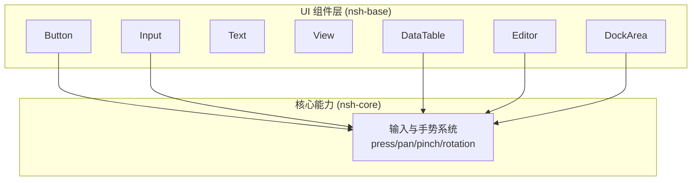
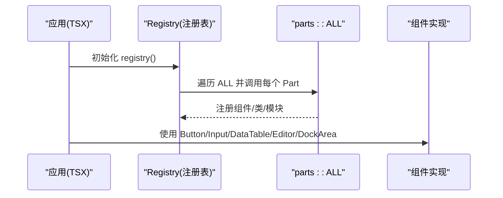
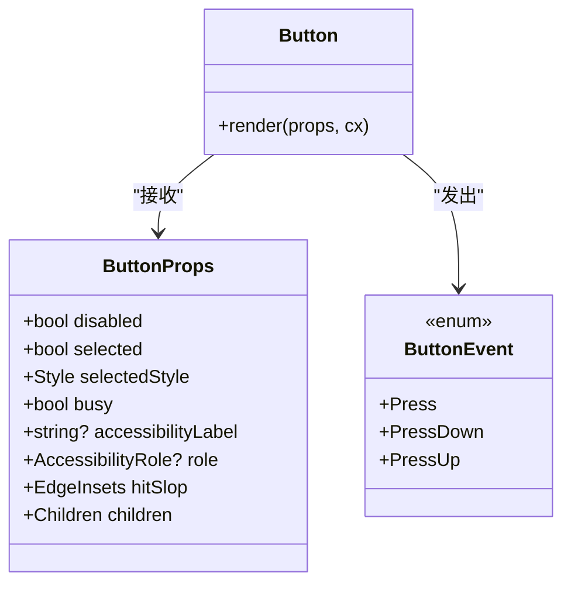
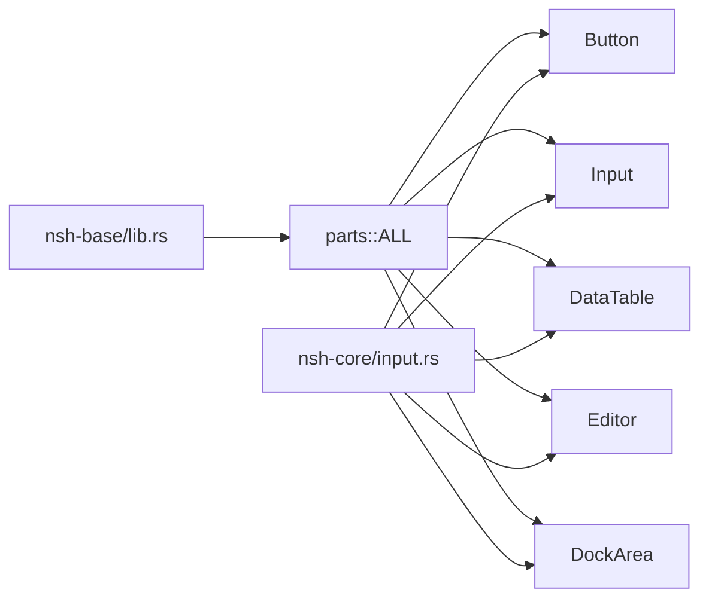

# UI组件API

<cite>
**本文引用的文件**   
- [lib.rs](file://crates/nsh-base/src/lib.rs)
- [button.rs](file://crates/nsh-base/src/button.rs)
- [input.rs](file://crates/nsh-core/src/input.rs)
</cite>

## 目录
1. [简介](#简介)
2. [项目结构](#项目结构)
3. [核心组件](#核心组件)
4. [架构总览](#架构总览)
5. [详细组件分析](#详细组件分析)
6. [依赖关系分析](#依赖关系分析)
7. [性能与可访问性](#性能与可访问性)
8. [故障排查指南](#故障排查指南)
9. [结论](#结论)
10. [附录：常用组合模式与主题定制](#附录常用组合模式与主题定制)

## 简介
本文件为 NSH 框架 UI 组件库的 TypeScript API 文档，聚焦基础 UI 组件（Button、Input、Text、View 等）与复合组件（DataTable、Editor、Dock 等）的属性、事件与方法。文档基于 Rust 实现层导出的类型与行为进行说明，帮助你在 TS/TSX 中正确使用这些组件，包括 Props 类型定义、事件回调签名、自定义样式接口、组合模式、插槽使用、主题定制方法，以及响应式布局、无障碍访问和性能优化的最佳实践。

## 项目结构
NSH 的 UI 组件由 Rust 模块提供，并通过注册表机制暴露给 JS/TS 运行时。nsh-base 作为 UI 行为与基础设施层，负责导出所有组件与模块；nsh-core 提供输入、手势、命中测试等底层能力。

图表来源
- [lib.rs:19-103](file://crates/nsh-base/src/lib.rs#L19-L103)
- [input.rs:1-50](file://crates/nsh-core/src/input.rs#L1-L50)

章节来源
- [lib.rs:1-18](file://crates/nsh-base/src/lib.rs#L1-L18)
- [lib.rs:19-103](file://crates/nsh-base/src/lib.rs#L19-L103)

## 核心组件
本节概述基础与复合组件在 NSH 中的职责与导出方式。

- 基础组件
  - Button：无外观的按压目标，负责状态与可访问性，样式由应用决定。
  - Input：原生文本输入宿主元素，由核心创建并暴露给 JS。
  - Text/View：通过 nsh-base 导出的基础元素（具体实现位于 core 与 element 层）。
- 复合组件
  - DataTable：跨行列的数据表格，支持排序、选择、上下文菜单等。
  - Editor：代码编辑器，具备命令、装饰、诊断、搜索等能力。
  - DockArea：可停靠的工作区容器，配合 SplitView 构建复杂布局。

章节来源
- [lib.rs:108-110](file://crates/nsh-base/src/lib.rs#L108-L110)
- [lib.rs:169-176](file://crates/nsh-base/src/lib.rs#L169-L176)
- [lib.rs:283-292](file://crates/nsh-base/src/lib.rs#L283-L292)
- [lib.rs:181-181](file://crates/nsh-base/src/lib.rs#L181-L181)

## 架构总览
nsh-base 通过 parts 将组件按功能分组注册到 Registry，JS 侧通过 nsh/base 导入。按钮、输入、数据表、编辑器、停靠区等均由对应模块注册并提供类、模块与样式钩子。

图表来源
- [lib.rs:299-318](file://crates/nsh-base/src/lib.rs#L299-L318)
- [lib.rs:354-384](file://crates/nsh-base/src/lib.rs#L354-L384)

章节来源
- [lib.rs:299-318](file://crates/nsh-base/src/lib.rs#L299-L318)
- [lib.rs:354-384](file://crates/nsh-base/src/lib.rs#L354-L384)

## 详细组件分析

### Button 组件
- 角色与职责
  - 提供按压交互、禁用/选中/忙碌状态、可访问性标签与角色、点击区域扩展（hitSlop），并将样式完全交由应用控制。
- Props
  - disabled: 布尔值，禁用时仍可应用样式，屏幕阅读器会提示禁用。
  - selected: 布尔值，表示选中态（如切换触发器或当前 Tab），由应用维护并设置样式。
  - selectedStyle: 选中时的样式对象。
  - busy: 布尔值，表示操作进行中，屏幕阅读器会播报忙碌状态。
  - accessibilityLabel: 可选的可访问性标签。
  - role: 可选的可访问性角色（默认 button）。
  - hitSlop: 点击区域扩展（EdgeInsets）。
  - children: 子节点内容。
- 事件
  - Press：按下完成。
  - PressDown：按下开始。
  - PressUp：按下结束（释放、移出或取消）。
- 样式与可访问性
  - 通过 active/hover/focus-visible/selected/disabled 等类名或对应 style 属性进行样式定制。
  - 在 Toolbar/ToggleGroup 中作为焦点项参与键盘导航。

图表来源
- [button.rs:7-41](file://crates/nsh-base/src/button.rs#L7-L41)
- [button.rs:43-52](file://crates/nsh-base/src/button.rs#L43-L52)
- [button.rs:65-82](file://crates/nsh-base/src/button.rs#L65-L82)

章节来源
- [button.rs:7-41](file://crates/nsh-base/src/button.rs#L7-L41)
- [button.rs:43-52](file://crates/nsh-base/src/button.rs#L43-L52)
- [button.rs:65-82](file://crates/nsh-base/src/button.rs#L65-L82)

### Input 组件（原生文本输入）
- 角色与职责
  - 作为宿主元素，桥接平台原生输入控件（如 UITextField/EditText），由核心创建并在 JS 侧可用。
- 使用要点
  - 在 TSX 中以 <Input /> 形式使用，结合表单与键盘处理逻辑。
  - 与 nsh-core 的输入与手势系统协作，确保正确的焦点与事件流。

章节来源
- [lib.rs:108-110](file://crates/nsh-base/src/lib.rs#L108-L110)

### 复合组件概览（DataTable / Editor / DockArea）
- DataTable
  - 提供列定义、对齐、排序、选择、上下文菜单、转储调试等能力，适用于大量数据的展示与交互。
- Editor
  - 提供编辑命令、装饰、诊断、折叠范围、搜索、滚动策略等，适合代码编辑场景。
- DockArea
  - 提供可停靠工作区，配合 SplitView 构建多面板布局。

章节来源
- [lib.rs:169-176](file://crates/nsh-base/src/lib.rs#L169-L176)
- [lib.rs:283-292](file://crates/nsh-base/src/lib.rs#L283-L292)
- [lib.rs:181-181](file://crates/nsh-base/src/lib.rs#L181-L181)

## 依赖关系分析
- 组件注册
  - nsh-base 通过 parts::ALL 顺序注册各组件与模块，确保 JS 侧可按需加载。
- 输入与手势
  - nsh-core 的 input.rs 提供统一的指针输入决策、拖拽候选、长按判定、命中区域计算等，被 Button 等组件复用。

图表来源
- [lib.rs:354-384](file://crates/nsh-base/src/lib.rs#L354-L384)
- [input.rs:1-50](file://crates/nsh-core/src/input.rs#L1-L50)

章节来源
- [lib.rs:354-384](file://crates/nsh-base/src/lib.rs#L354-L384)
- [input.rs:1-50](file://crates/nsh-core/src/input.rs#L1-L50)

## 性能与可访问性
- 性能
  - 组件渲染与布局分离：nsh-base 负责行为与布局，不直接承担样式绘制，减少不必要的重绘。
  - 按需注册：通过 parts 拆分，仅打包使用的组件，减小二进制体积。
  - 输入优化：nsh-core 对滚轮、缩放、长按、速度估算等进行统一优化，避免重复计算。
- 可访问性
  - Button 支持 role、accessibilityLabel、selected/busy 状态，便于屏幕阅读器正确播报。
  - 组件遵循 focus-visible 等标准，保证键盘可达性与视觉反馈一致性。

章节来源
- [lib.rs:1-18](file://crates/nsh-base/src/lib.rs#L1-L18)
- [lib.rs:354-384](file://crates/nsh-base/src/lib.rs#L354-L384)
- [button.rs:7-41](file://crates/nsh-base/src/button.rs#L7-L41)
- [input.rs:41-49](file://crates/nsh-core/src/input.rs#L41-L49)

## 故障排查指南
- 按钮无响应
  - 检查 disabled/busy 状态是否意外开启。
  - 确认 hitSlop 未导致命中区域异常。
  - 验证 onPress/onPressDown/onPressUp 是否正确绑定。
- 输入框无法聚焦
  - 检查父级是否拦截了焦点或阻止了默认行为。
  - 确认 Input 宿主元素已正确挂载。
- 表格/编辑器卡顿
  - 评估数据量与渲染频率，考虑分页、虚拟化或增量更新。
  - 避免在高频回调中进行昂贵计算。

章节来源
- [button.rs:65-82](file://crates/nsh-base/src/button.rs#L65-L82)
- [lib.rs:108-110](file://crates/nsh-base/src/lib.rs#L108-L110)

## 结论
NSH 的 UI 组件库以 Rust 为核心实现，通过清晰的注册与导出机制向 TS/TSX 暴露稳定 API。Button 等基础组件强调行为与样式解耦，DataTable/Editor/DockArea 等复合组件提供丰富的业务场景能力。借助 nsh-core 的输入与手势系统，组件在性能与可访问性方面具备良好的基础。建议在实际项目中采用按需注册、合理的事件处理与样式定制策略，以获得更好的用户体验与维护性。

## 附录：常用组合模式与主题定制
- 组合模式
  - 将多个基础组件组合为业务组件（例如：带图标与状态的 Button、带校验的 Input 包装器）。
  - 使用 DataTable 的列定义与选择/排序回调构建数据管理界面。
  - 使用 DockArea 与 SplitView 搭建多面板工作区。
- 插槽与内容注入
  - 通过 children 与组件内部提供的部分（如 TableHeader/TableBody）插入自定义内容。
- 主题定制
  - 利用 active/hover/focus-visible/selected/disabled 等类名与对应 style 属性覆盖默认样式。
  - 通过 theme 相关 API 配置语义化 token，统一全局风格。

[本节为概念性指导，不直接分析具体文件]