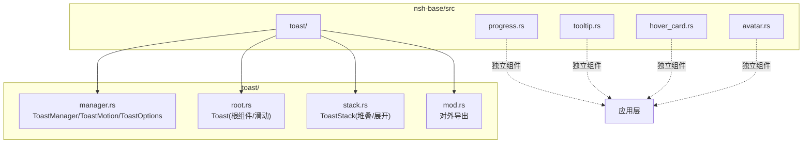
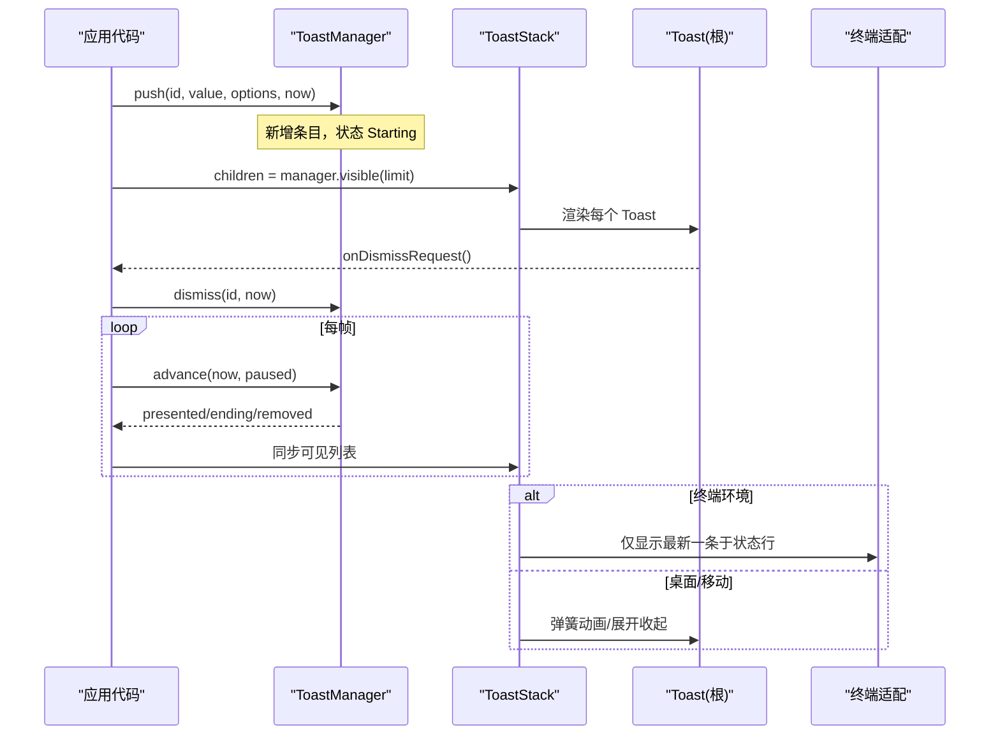
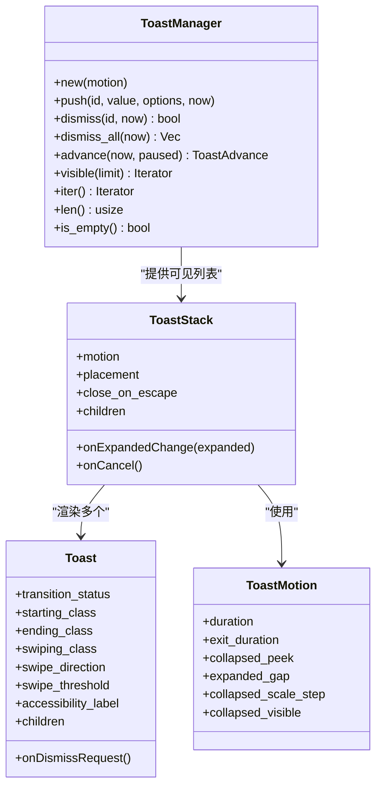
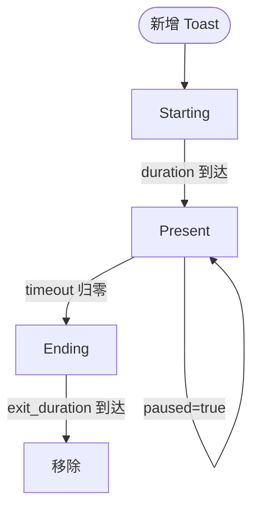
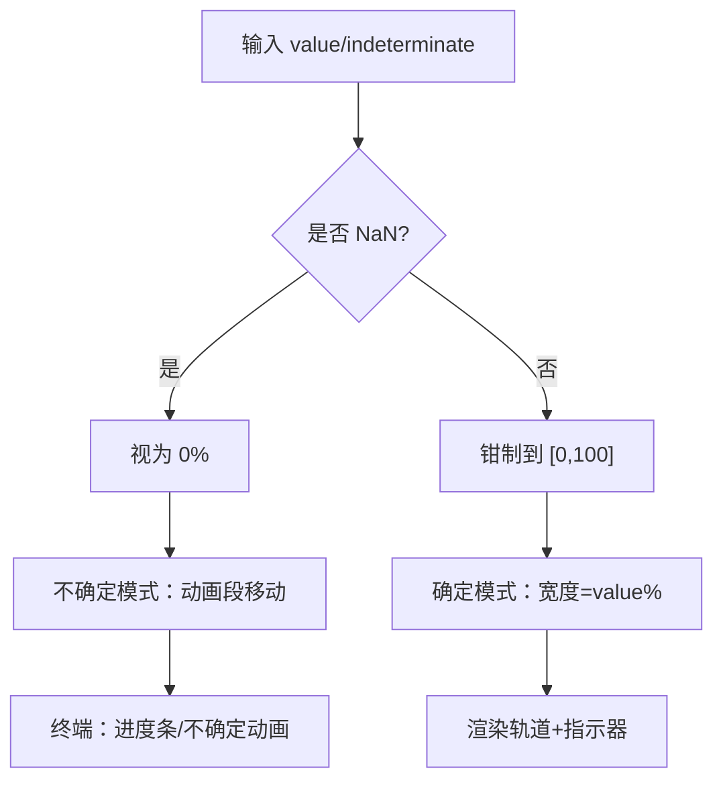
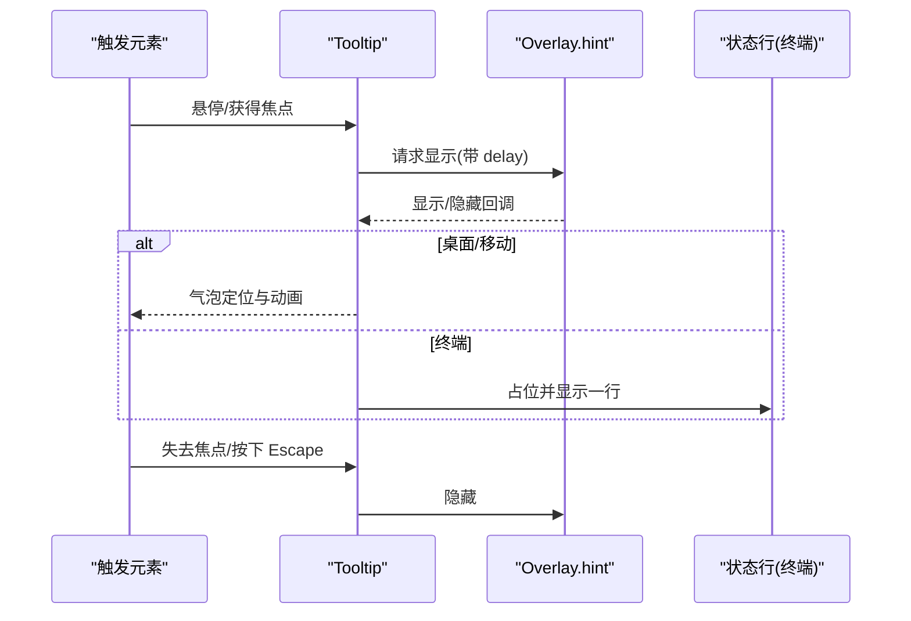
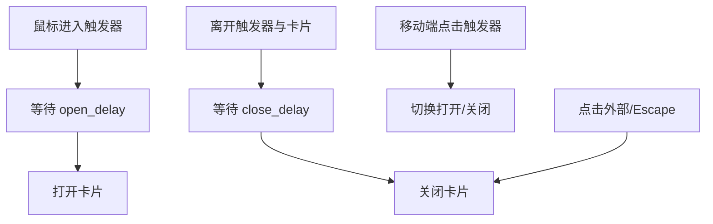
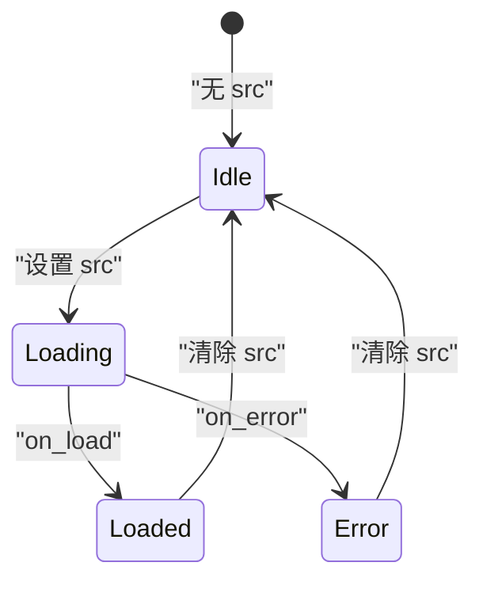
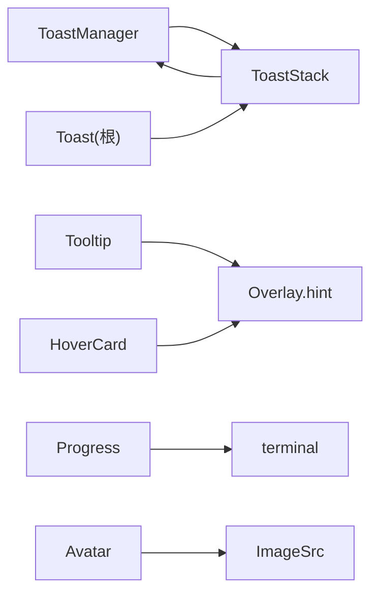

# 反馈组件

<cite>
**本文引用的文件**   
- [crates/nsh-base/src/toast/mod.rs](file://crates/nsh-base/src/toast/mod.rs)
- [crates/nsh-base/src/toast/manager.rs](file://crates/nsh-base/src/toast/manager.rs)
- [crates/nsh-base/src/toast/root.rs](file://crates/nsh-base/src/toast/root.rs)
- [crates/nsh-base/src/toast/stack.rs](file://crates/nsh-base/src/toast/stack.rs)
- [crates/nsh-base/src/progress.rs](file://crates/nsh-base/src/progress.rs)
- [crates/nsh-base/src/tooltip.rs](file://crates/nsh-base/src/tooltip.rs)
- [crates/nsh-base/src/hover_card.rs](file://crates/nsh-base/src/hover_card.rs)
- [crates/nsh-base/src/avatar.rs](file://crates/nsh-base/src/avatar.rs)
</cite>

## 目录
1. [简介](#简介)
2. [项目结构](#项目结构)
3. [核心组件](#核心组件)
4. [架构总览](#架构总览)
5. [详细组件分析](#详细组件分析)
6. [依赖关系分析](#依赖关系分析)
7. [性能与体验优化](#性能与体验优化)
8. [故障排查指南](#故障排查指南)
9. [结论](#结论)
10. [附录：使用场景与示例路径](#附录使用场景与示例路径)

## 简介
本文件为 NSH 框架中“用户反馈”相关组件的 TypeScript API 文档，覆盖以下能力：
- Toast 消息通知系统：无样式语义根、堆叠布局、生命周期管理、手势滑动关闭、终端适配。
- Progress 进度指示器：确定性/不确定性进度、无障碍值、终端适配。
- Tooltip 工具提示：悬停/焦点触发、延迟控制、状态类与动画、终端状态行显示。
- HoverCard 悬浮卡片：悬停预览、打开/关闭延迟、定位事件、移动端点击交互。
- Avatar 头像与头像组：图片加载状态、首字母回退、分组溢出展示。

文档同时给出用户体验优化策略、动画效果配置方法、国际化支持建议，以及批量操作反馈、异步任务状态和用户引导提示等实际使用场景的代码片段路径（以源码位置引用形式提供）。

## 项目结构
反馈组件主要位于 nsh-base 包中，按功能拆分：
- toast：消息通知子系统，包含管理器、根组件、堆叠容器与 JS 绑定导出。
- progress：线性进度条。
- tooltip：工具提示。
- hover_card：悬浮卡片。
- avatar：头像与头像组。

图表来源
- [crates/nsh-base/src/toast/mod.rs:1-36](file://crates/nsh-base/src/toast/mod.rs#L1-L36)
- [crates/nsh-base/src/toast/manager.rs:1-118](file://crates/nsh-base/src/toast/manager.rs#L1-L118)
- [crates/nsh-base/src/toast/root.rs:1-86](file://crates/nsh-base/src/toast/root.rs#L1-L86)
- [crates/nsh-base/src/toast/stack.rs:1-58](file://crates/nsh-base/src/toast/stack.rs#L1-L58)

章节来源
- [crates/nsh-base/src/toast/mod.rs:1-36](file://crates/nsh-base/src/toast/mod.rs#L1-L36)

## 核心组件
本节概述各组件的职责与关键属性，便于快速查阅。

- Toast 消息通知
  - 根组件 Toast：负责可访问性标签、进入/退出/滑动状态类、滑动方向与阈值、DismissRequest 事件。
  - 堆叠容器 ToastStack：锚点放置、展开/收起、Escape/返回键处理、弹簧动画。
  - 管理器 ToastManager：有序存储、生命周期推进（Starting/Present/Ending）、超时暂停与移除、可见数量限制。
  - 运动参数 ToastMotion：入场时长、退出时长、折叠间距、展开间距、缩放步长、可见层数。
  - 选项 ToastOptions：自动隐藏超时。

- Progress 进度条
  - 属性：value、indeterminate、accessibility_label、track_class/style、indicator_class/style、children。
  - 行为：数值钳制到 0~100；无障碍 role=progressbar；终端下渲染终端进度条。

- Tooltip 工具提示
  - 属性：open/default_open、placement/align/offset/margin、delay、disabled、starting_class/style、ending_class/style、children。
  - 行为：指针悬停与键盘焦点触发、Escape 隐藏、终端状态行显示、延迟计算与无限延迟。

- HoverCard 悬浮卡片
  - 属性：open/default_open、open_delay/close_delay、placement/align/offset/margin、popup_* 系列样式类与样式、trigger、children。
  - 行为：桌面端悬停打开/离开关闭、移动端点击切换、定位事件 Position、Escape/外部点击关闭。

- Avatar 头像与 AvatarGroup 头像组
  - Avatar 属性：src、name、accessibility_label、fallback_delay、image_class/style、fallback_class/style、fallback、children。
  - 事件：StatusChange(AvatarStatus)。
  - AvatarGroup 属性：limit、total、accessibility_label、overflow_class/style、overflow_accessibility_label、overflow、children。

章节来源
- [crates/nsh-base/src/toast/root.rs:36-86](file://crates/nsh-base/src/toast/root.rs#L36-L86)
- [crates/nsh-base/src/toast/stack.rs:41-58](file://crates/nsh-base/src/toast/stack.rs#L41-L58)
- [crates/nsh-base/src/toast/manager.rs:10-118](file://crates/nsh-base/src/toast/manager.rs#L10-L118)
- [crates/nsh-base/src/progress.rs:12-44](file://crates/nsh-base/src/progress.rs#L12-L44)
- [crates/nsh-base/src/tooltip.rs:26-77](file://crates/nsh-base/src/tooltip.rs#L26-L77)
- [crates/nsh-base/src/hover_card.rs:22-84](file://crates/nsh-base/src/hover_card.rs#L22-L84)
- [crates/nsh-base/src/avatar.rs:27-76](file://crates/nsh-base/src/avatar.rs#L27-L76)
- [crates/nsh-base/src/avatar.rs:236-266](file://crates/nsh-base/src/avatar.rs#L236-L266)

## 架构总览
Toast 子系统采用“无样式语义根 + 堆叠布局 + 头式管理器”的分层设计：
- 管理器负责数据与生命周期，不关心 UI。
- 根组件负责单条通知的可访问性与手势。
- 堆叠容器负责测量、布局与动画。

图表来源
- [crates/nsh-base/src/toast/manager.rs:171-270](file://crates/nsh-base/src/toast/manager.rs#L171-L270)
- [crates/nsh-base/src/toast/stack.rs:167-325](file://crates/nsh-base/src/toast/stack.rs#L167-L325)
- [crates/nsh-base/src/toast/root.rs:87-226](file://crates/nsh-base/src/toast/root.rs#L87-L226)

## 详细组件分析

### Toast 消息通知系统

#### 组件职责与关系
- ToastManager：有序队列、生命周期推进、超时倒计时、去重替换、可见项筛选。
- Toast：单条通知的语义根、滑动交互、状态类选择、无障碍播报。
- ToastStack：测量子项高度、折叠/展开布局、弹簧过渡、Escape/返回键监听。
- ToastMotion：统一动画与视觉节奏参数。

图表来源
- [crates/nsh-base/src/toast/manager.rs:100-118](file://crates/nsh-base/src/toast/manager.rs#L100-L118)
- [crates/nsh-base/src/toast/root.rs:36-86](file://crates/nsh-base/src/toast/root.rs#L36-L86)
- [crates/nsh-base/src/toast/stack.rs:41-58](file://crates/nsh-base/src/toast/stack.rs#L41-L58)
- [crates/nsh-base/src/toast/manager.rs:23-40](file://crates/nsh-base/src/toast/manager.rs#L23-L40)

#### 生命周期与时间线
- 新增：Starting → 经过 duration 后 Present。
- 在 Present 且未暂停时递减 timeout；归零则进入 Ending。
- Ending 持续 exit_duration 后从队列移除。
- 展开状态下暂停超时计时。

图表来源
- [crates/nsh-base/src/toast/manager.rs:220-270](file://crates/nsh-base/src/toast/manager.rs#L220-L270)

#### 关键 API 与属性说明
- ToastManager
  - new(motion)：创建管理器，继承 motion.duration/exit_duration。
  - push(id, value, options, now)：入队或替换同 id 的旧值。
  - dismiss/dismiss_all：开始退出流程。
  - advance(now, paused)：推进生命周期，返回变更集合。
  - visible(limit)：返回非 Ending 的前 N 项与所有 Ending 项。
- ToastProps
  - transition_status：受控的生命周期阶段。
  - starting_class/ending_class/swiping_class：状态类，用于动画。
  - swipe_direction/swipe_threshold：滑动方向与阈值。
  - accessibility_label：屏幕阅读器朗读文本。
- ToastStackProps
  - motion：动画与布局参数。
  - placement：锚点（TopLeft/TopCenter/TopRight/BottomLeft/BottomCenter/BottomRight/LeftCenter/RightCenter）。
  - close_on_escape：是否监听 Escape/返回键。
- ToastMotion
  - duration/exit_duration：入场/退出时长。
  - collapsed_peek/expansion_gap：折叠间距/展开间距。
  - collapsed_scale_step/collapsed_visible：折叠缩放步长与可见层数。
- ToastOptions
  - timeout：自动隐藏超时（None 表示永不自动隐藏）。

章节来源
- [crates/nsh-base/src/toast/manager.rs:10-118](file://crates/nsh-base/src/toast/manager.rs#L10-L118)
- [crates/nsh-base/src/toast/manager.rs:171-270](file://crates/nsh-base/src/toast/manager.rs#L171-L270)
- [crates/nsh-base/src/toast/root.rs:36-86](file://crates/nsh-base/src/toast/root.rs#L36-L86)
- [crates/nsh-base/src/toast/stack.rs:41-58](file://crates/nsh-base/src/toast/stack.rs#L41-L58)

#### 交互与手势
- 滑动方向：Right/Left/Up/Down。
- 滑动判定：超过阈值或速度达到“甩动”阈值即触发 DismissRequest。
- 首次帧检测：避免在无显示帧时误判已入场。

章节来源
- [crates/nsh-base/src/toast/root.rs:10-21](file://crates/nsh-base/src/toast/root.rs#L10-L21)
- [crates/nsh-base/src/toast/root.rs:140-161](file://crates/nsh-base/src/toast/root.rs#L140-L161)
- [crates/nsh-base/src/toast/root.rs:93-105](file://crates/nsh-base/src/toast/root.rs#L93-L105)

#### 终端适配
- 栈仅在状态行显示最新一条，不展开、不动画。
- 工具提示也占用状态行，二者共享同一区域。

章节来源
- [crates/nsh-base/src/toast/stack.rs:327-367](file://crates/nsh-base/src/toast/stack.rs#L327-L367)
- [crates/nsh-base/src/toast/mod.rs:15-18](file://crates/nsh-base/src/toast/mod.rs#L15-L18)

### Progress 进度指示器

#### 组件职责
- 提供线性进度条，外观完全由应用控制（track/indicator 的 Tailwind 类与内联样式）。
- 在终端环境下渲染终端进度条。
- 暴露无障碍值（最小值、最大值、当前值）。

图表来源
- [crates/nsh-base/src/progress.rs:62-99](file://crates/nsh-base/src/progress.rs#L62-L99)
- [crates/nsh-base/src/progress.rs:102-134](file://crates/nsh-base/src/progress.rs#L102-L134)

#### 关键 API 与属性
- ProgressProps
  - value：百分比（NaN 表示尚未开始）。
  - indeterminate：不确定模式开关。
  - accessibility_label：无障碍标签。
  - track_class/track_style：轨道样式。
  - indicator_class/indicator_style：指示器样式。
  - children：轨道后的内容（如百分比文本）。

章节来源
- [crates/nsh-base/src/progress.rs:12-44](file://crates/nsh-base/src/progress.rs#L12-L44)
- [crates/nsh-base/src/progress.rs:62-99](file://crates/nsh-base/src/progress.rs#L62-L99)

### Tooltip 工具提示

#### 组件职责
- 基于核心 Overlay.hint 实现，提供悬停/焦点触发的提示气泡。
- 支持受控 open、默认打开、延迟、禁用、起始/结束样式类。
- 终端下将提示内容渲染到状态行。

图表来源
- [crates/nsh-base/src/tooltip.rs:131-188](file://crates/nsh-base/src/tooltip.rs#L131-L188)
- [crates/nsh-base/src/tooltip.rs:195-227](file://crates/nsh-base/src/tooltip.rs#L195-L227)

#### 关键 API 与属性
- TooltipProps
  - open/default_open：受控/默认打开。
  - placement/align/offset/margin：定位与边距。
  - delay：毫秒；Infinity 表示永不自动显示。
  - disabled：禁用。
  - starting_class/style、ending_class/style：入场/出场样式。
  - children：提示内容。
- 事件
  - OpenChange(open, reason)：打开/关闭原因（Hover/Focus/Cancel）。
  - Open/Close：生命周期回调。

章节来源
- [crates/nsh-base/src/tooltip.rs:26-77](file://crates/nsh-base/src/tooltip.rs#L26-L77)
- [crates/nsh-base/src/tooltip.rs:79-92](file://crates/nsh-base/src/tooltip.rs#L79-L92)
- [crates/nsh-base/src/tooltip.rs:131-188](file://crates/nsh-base/src/tooltip.rs#L131-L188)

### HoverCard 悬浮卡片

#### 组件职责
- 在指针悬停时预览目标信息（个人资料、链接、引用等）。
- 桌面端遵循悬停打开/离开关闭；移动端通过点击切换。
- 提供定位结果事件，便于自定义布局。

图表来源
- [crates/nsh-base/src/hover_card.rs:148-195](file://crates/nsh-base/src/hover_card.rs#L148-L195)
- [crates/nsh-base/src/hover_card.rs:214-291](file://crates/nsh-base/src/hover_card.rs#L214-L291)

#### 关键 API 与属性
- HoverCardProps
  - open/default_open：受控/默认打开。
  - open_delay/close_delay：打开/关闭延迟；Infinity 表示永不自动关闭。
  - placement/align/offset/margin：定位与边距。
  - popup_class/style、popup_starting_*、popup_ending_*：弹出层样式与动画。
  - trigger：触发器插槽。
  - children：卡片内容（惰性生成）。
- 事件
  - OpenChange(open, reason)：原因包括 Hover/TriggerPress/PressOutside/Cancel。
  - Open/Close：生命周期回调。
  - Position(placement, bounds, available)：定位完成回调。

章节来源
- [crates/nsh-base/src/hover_card.rs:22-84](file://crates/nsh-base/src/hover_card.rs#L22-L84)
- [crates/nsh-base/src/hover_card.rs:86-103](file://crates/nsh-base/src/hover_card.rs#L86-L103)
- [crates/nsh-base/src/hover_card.rs:148-195](file://crates/nsh-base/src/hover_card.rs#L148-L195)
- [crates/nsh-base/src/hover_card.rs:214-291](file://crates/nsh-base/src/hover_card.rs#L214-L291)

### Avatar 头像与 AvatarGroup 头像组

#### 组件职责
- Avatar：头像图片加载状态管理，失败或无图时显示首字母或自定义 fallback。
- AvatarGroup：头像堆叠展示，支持限制显示数量与溢出部分。

图表来源
- [crates/nsh-base/src/avatar.rs:101-201](file://crates/nsh-base/src/avatar.rs#L101-L201)

#### 关键 API 与属性
- AvatarProps
  - src：图片源（URL/asset:/data:/导入图片）。
  - name：可读名称（用于首字母与无障碍）。
  - accessibility_label：覆盖 name 的无障碍标签。
  - fallback_delay：加载中回退延迟；Infinity 表示不显示回退。
  - image_class/style、fallback_class/style：图片与回退样式。
  - fallback：自定义回退内容。
  - children：叠加在图片上的徽章/状态点。
- 事件
  - StatusChange(AvatarStatus)：Idle/Loading/Loaded/Error。
- AvatarGroupProps
  - limit：最多显示的头像数。
  - total：总人数（可选，用于溢出计数）。
  - overflow_class/style、overflow_accessibility_label、overflow：溢出部分样式与内容。
  - accessibility_label：群组无障碍标签。
  - children：头像序列。

章节来源
- [crates/nsh-base/src/avatar.rs:27-76](file://crates/nsh-base/src/avatar.rs#L27-L76)
- [crates/nsh-base/src/avatar.rs:78-85](file://crates/nsh-base/src/avatar.rs#L78-L85)
- [crates/nsh-base/src/avatar.rs:101-201](file://crates/nsh-base/src/avatar.rs#L101-L201)
- [crates/nsh-base/src/avatar.rs:236-266](file://crates/nsh-base/src/avatar.rs#L236-L266)

## 依赖关系分析
- Toast 子系统内部耦合：
  - ToastStack 依赖 ToastMotion 控制动画与布局。
  - Toast 根组件依赖无障碍与手势系统。
  - ToastManager 与 UI 解耦，仅通过迭代器与可见列表暴露数据。
- 跨组件依赖：
  - Tooltip 依赖核心 Overlay.hint 与 PopupPresence 生命周期。
  - HoverCard 依赖 PopupPresence 与 roving 键盘导航辅助。
  - Progress 依赖 terminal 模块进行终端渲染。
  - Avatar 依赖 ImageSrc 与基础视图体系。

图表来源
- [crates/nsh-base/src/toast/manager.rs:100-118](file://crates/nsh-base/src/toast/manager.rs#L100-L118)
- [crates/nsh-base/src/toast/stack.rs:167-325](file://crates/nsh-base/src/toast/stack.rs#L167-L325)
- [crates/nsh-base/src/tooltip.rs:131-188](file://crates/nsh-base/src/tooltip.rs#L131-L188)
- [crates/nsh-base/src/hover_card.rs:148-195](file://crates/nsh-base/src/hover_card.rs#L148-L195)
- [crates/nsh-base/src/progress.rs:82-99](file://crates/nsh-base/src/progress.rs#L82-L99)
- [crates/nsh-base/src/avatar.rs:176-199](file://crates/nsh-base/src/avatar.rs#L176-L199)

章节来源
- [crates/nsh-base/src/toast/mod.rs:1-36](file://crates/nsh-base/src/toast/mod.rs#L1-L36)
- [crates/nsh-base/src/tooltip.rs:1-25](file://crates/nsh-base/src/tooltip.rs#L1-L25)
- [crates/nsh-base/src/hover_card.rs:1-20](file://crates/nsh-base/src/hover_card.rs#L1-L20)
- [crates/nsh-base/src/progress.rs:1-8](file://crates/nsh-base/src/progress.rs#L1-L8)
- [crates/nsh-base/src/avatar.rs:1-11](file://crates/nsh-base/src/avatar.rs#L1-L11)

## 性能与体验优化
- 动画与可访问性
  - 尊重 reduce_motion：进度条在终端不确定模式下减少动画；Toast 根组件在进入前检测首次帧以避免闪烁。
  - 使用弹簧动画：ToastStack 使用临界阻尼弹簧，避免过冲导致的视觉抖动。
- 渲染与内存
  - Avatar 为每个新 src 创建独立 image 节点，避免复用导致的事件错乱。
  - ToastManager 维护有序队列，visible(limit) 仅返回必要项，降低 UI 树规模。
- 交互流畅度
  - Tooltip/HoverCard 使用定时器与状态机，避免频繁重排；HoverCard 在移动端区分点击与悬停逻辑。
  - Toast 滑动阈值与速度判断结合，提升手势识别准确率。
- 终端体验
  - Progress/Tooltip/Toast 在终端下分别采用终端进度条、状态行一行显示与仅最新一条的策略，保证一致性与简洁性。

章节来源
- [crates/nsh-base/src/progress.rs:102-134](file://crates/nsh-base/src/progress.rs#L102-L134)
- [crates/nsh-base/src/toast/root.rs:93-105](file://crates/nsh-base/src/toast/root.rs#L93-L105)
- [crates/nsh-base/src/toast/stack.rs:145-149](file://crates/nsh-base/src/toast/stack.rs#L145-L149)
- [crates/nsh-base/src/avatar.rs:176-199](file://crates/nsh-base/src/avatar.rs#L176-L199)
- [crates/nsh-base/src/toast/manager.rs:137-155](file://crates/nsh-base/src/toast/manager.rs#L137-L155)
- [crates/nsh-base/src/tooltip.rs:131-188](file://crates/nsh-base/src/tooltip.rs#L131-L188)
- [crates/nsh-base/src/hover_card.rs:214-291](file://crates/nsh-base/src/hover_card.rs#L214-L291)
- [crates/nsh-base/src/toast/stack.rs:327-367](file://crates/nsh-base/src/toast/stack.rs#L327-L367)

## 故障排查指南
- Toast 不消失或堆积异常
  - 检查是否在展开状态传入了 paused=true，导致超时暂停。
  - 确认每次渲染都调用 manager.advance(now, state.is_expanded()) 推进生命周期。
  - 若重复 id 被替换，注意旧值返回与可见列表更新。
- Tooltip 不显示或一直显示
  - 检查 delay 是否为 Infinity 或负数/NaN；Infinity 表示永不自动显示。
  - 确认 disabled 未启用；终端环境下不会显示气泡，而是状态行。
- HoverCard 无法关闭
  - 检查 close_delay 是否为 Infinity；外部点击与 Escape 会立即关闭。
  - 移动端需点击触发器切换，而非悬停。
- Progress 宽度异常
  - 确保 value 为数字；NaN 会被视为 0%。
  - 不确定模式下 width 由应用控制，应提供合适的 indicatorClass。
- Avatar 图片闪烁或状态不更新
  - 检查 fallback_delay 是否为 0 或 Infinity；0 可能产生短暂闪烁，Infinity 不显示回退。
  - 确认 on_load/on_error 事件未被其他节点拦截。

章节来源
- [crates/nsh-base/src/toast/manager.rs:220-270](file://crates/nsh-base/src/toast/manager.rs#L220-L270)
- [crates/nsh-base/src/toast/mod.rs:50-75](file://crates/nsh-base/src/toast/mod.rs#L50-L75)
- [crates/nsh-base/src/tooltip.rs:94-109](file://crates/nsh-base/src/tooltip.rs#L94-L109)
- [crates/nsh-base/src/hover_card.rs:105-116](file://crates/nsh-base/src/hover_card.rs#L105-L116)
- [crates/nsh-base/src/progress.rs:62-99](file://crates/nsh-base/src/progress.rs#L62-L99)
- [crates/nsh-base/src/avatar.rs:124-150](file://crates/nsh-base/src/avatar.rs#L124-L150)

## 结论
NSH 反馈组件以清晰的分层与可控的状态机为核心，提供跨平台一致的交互体验。Toast 子系统通过无样式根与头式管理器实现高扩展性；Progress/Tooltip/HoverCard/Avatar 均提供完善的属性与事件接口，并在终端环境下做了专门适配。借助这些组件，开发者可以构建丰富的用户反馈场景，兼顾性能、可访问性与国际化需求。

## 附录：使用场景与示例路径
- 批量操作反馈（如批量删除/导出）
  - 使用 ToastManager.push 推送多条通知，配合 ToastStackState 控制展开与暂停。
  - 参考示例路径：[crates/nsh-base/src/toast/mod.rs:50-75](file://crates/nsh-base/src/toast/mod.rs#L50-L75)
- 异步任务状态（下载/上传/编译）
  - 使用 Progress 显示确定性进度；不确定模式用于连接/准备阶段。
  - 参考路径：[crates/nsh-base/src/progress.rs:62-99](file://crates/nsh-base/src/progress.rs#L62-L99)
- 用户引导提示（工具提示与悬浮卡片）
  - 使用 Tooltip 为按钮/菜单项提供上下文帮助；HoverCard 用于预览详情。
  - 参考路径：[crates/nsh-base/src/tooltip.rs:131-188](file://crates/nsh-base/src/tooltip.rs#L131-L188)、[crates/nsh-base/src/hover_card.rs:148-195](file://crates/nsh-base/src/hover_card.rs#L148-L195)
- 头像与团队展示
  - 使用 Avatar 展示用户头像与状态；AvatarGroup 展示团队成员与溢出计数。
  - 参考路径：[crates/nsh-base/src/avatar.rs:101-201](file://crates/nsh-base/src/avatar.rs#L101-L201)、[crates/nsh-base/src/avatar.rs:278-313](file://crates/nsh-base/src/avatar.rs#L278-L313)