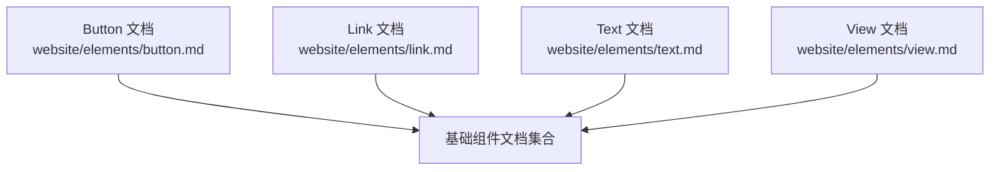
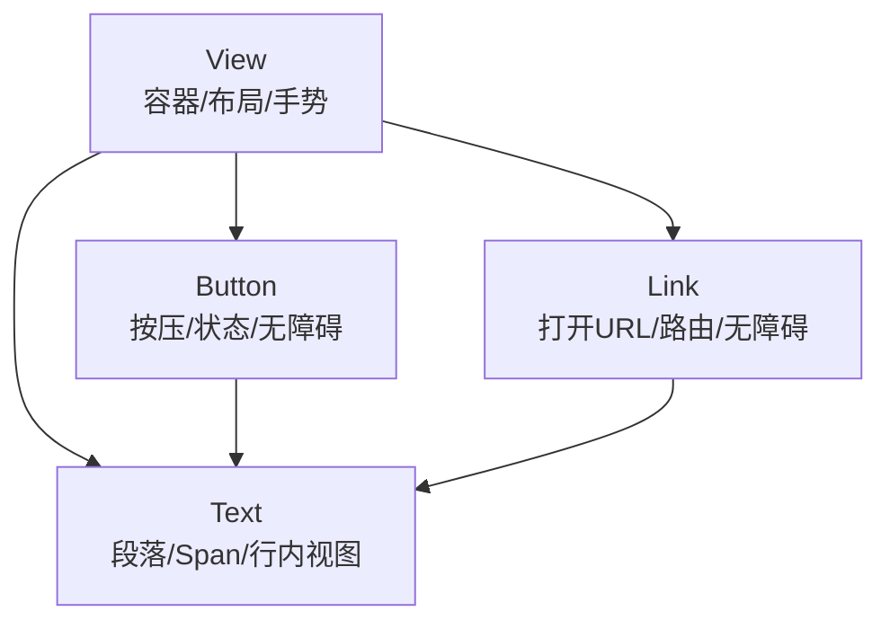
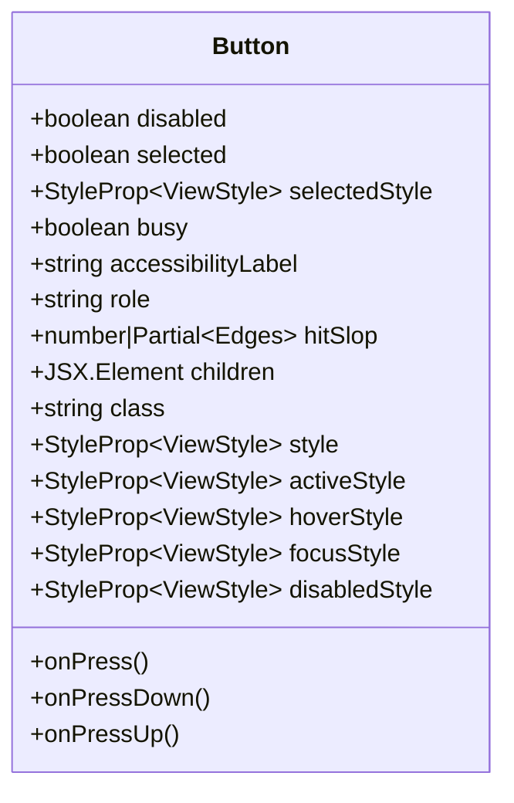
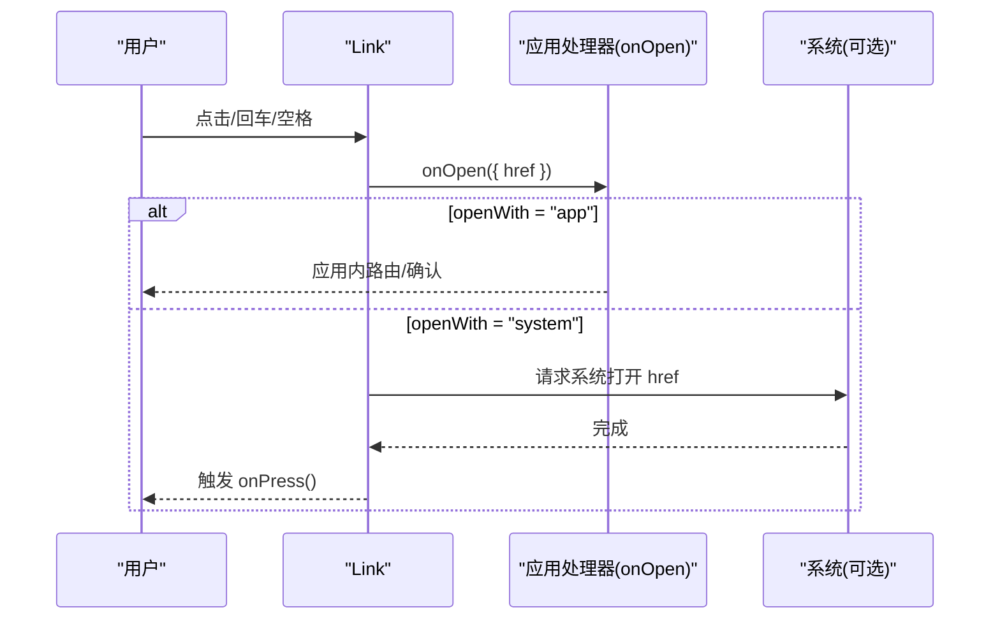
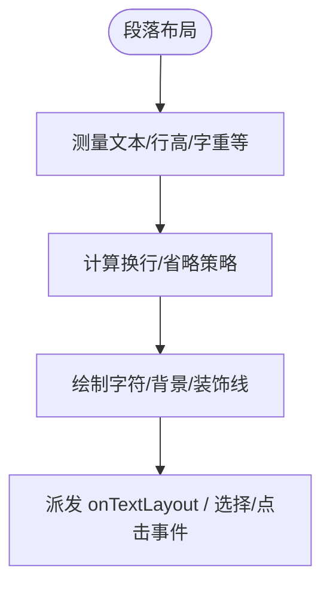
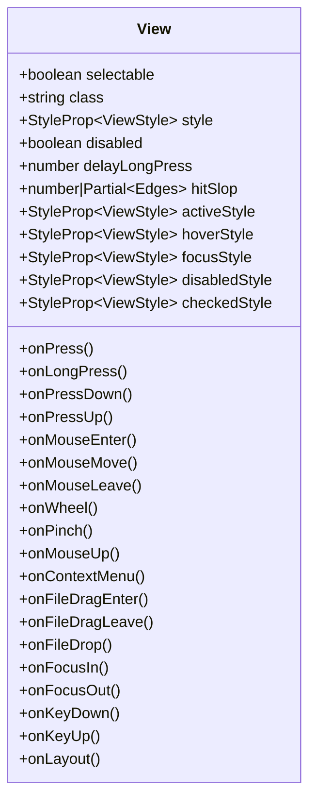
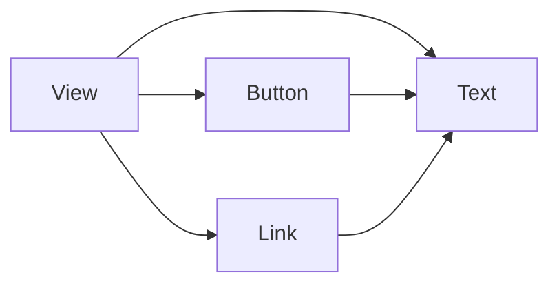

# 基础组件

<cite>
**本文引用的文件**   
- [website/elements/button.md](file://website/elements/button.md)
- [website/elements/link.md](file://website/elements/link.md)
- [website/elements/text.md](file://website/elements/text.md)
- [website/elements/view.md](file://website/elements/view.md)
</cite>

## 目录
1. [简介](#简介)
2. [项目结构](#项目结构)
3. [核心组件](#核心组件)
4. [架构总览](#架构总览)
5. [详细组件分析](#详细组件分析)
6. [依赖关系分析](#依赖关系分析)
7. [性能考虑](#性能考虑)
8. [故障排查指南](#故障排查指南)
9. [结论](#结论)
10. [附录](#附录)

## 简介
本文件为 NSH 框架的基础 UI 组件提供 TypeScript API 文档，聚焦 Button、Link、Text、View 四个核心基础组件。内容涵盖：
- Props 类型定义与默认值
- 事件回调签名与触发时机
- 自定义样式接口（含状态变体）
- 组合模式与插槽使用
- 主题定制方法
- 响应式布局与无障碍访问最佳实践
- 多平台差异与示例指引

## 项目结构
NSH 的官方元素文档位于 website/elements 目录下，每个基础组件对应一个 Markdown 文档，包含属性、事件、样式与平台说明。本文档基于这些文档进行提炼与结构化整理，便于在 TSX/Rust 中快速查阅与复用。

图表来源
- [website/elements/button.md:1-278](file://website/elements/button.md#L1-L278)
- [website/elements/link.md:1-218](file://website/elements/link.md#L1-L218)
- [website/elements/text.md:1-297](file://website/elements/text.md#L1-L297)
- [website/elements/view.md:1-290](file://website/elements/view.md#L1-L290)

章节来源
- [website/elements/button.md:1-278](file://website/elements/button.md#L1-L278)
- [website/elements/link.md:1-218](file://website/elements/link.md#L1-L218)
- [website/elements/text.md:1-297](file://website/elements/text.md#L1-L297)
- [website/elements/view.md:1-290](file://website/elements/view.md#L1-L290)

## 核心组件
本节概述四大基础组件的职责与边界：
- View：容器与布局基元，负责 Flex/Grid 布局、背景/边框/阴影、手势与焦点管理。
- Text：文本段落渲染，支持嵌套 Span、链接、行内视图、选择与排版事件。
- Button：可按压目标，拥有按下反馈、禁用/选中状态、键盘焦点与屏幕阅读器角色。
- Link：导航型可点击元素，负责打开 URL/应用路由、禁用态、当前页标识与屏幕阅读器角色。

章节来源
- [website/elements/view.md:1-290](file://website/elements/view.md#L1-L290)
- [website/elements/text.md:1-297](file://website/elements/text.md#L1-L297)
- [website/elements/button.md:1-278](file://website/elements/button.md#L1-L278)
- [website/elements/link.md:1-218](file://website/elements/link.md#L1-L218)

## 架构总览
以下图展示基础组件之间的协作关系：View 作为容器承载 Text；Button 与 Link 作为交互控件，内部通常包含 Text 或图标等子元素；所有组件共享通用样式与无障碍能力。

图表来源
- [website/elements/view.md:1-290](file://website/elements/view.md#L1-L290)
- [website/elements/text.md:1-297](file://website/elements/text.md#L1-L297)
- [website/elements/button.md:1-278](file://website/elements/button.md#L1-L278)
- [website/elements/link.md:1-218](file://website/elements/link.md#L1-L218)

## 详细组件分析

### Button 组件
- 职责
  - 作为可按压目标，统一管理按下反馈、禁用/选中状态、键盘焦点与屏幕阅读器角色。
  - 外观完全由应用决定，通过 class/style 与状态变体控制。
- Props（TSX）
  - disabled: boolean | false
  - selected: boolean | false
  - selectedStyle: StyleProp<ViewStyle>
  - busy: boolean | false
  - accessibilityLabel: string
  - role: "button" | "link" | ...
  - hitSlop: number | Partial<Edges>
  - children: JSX.Element
  - class, style: string | StyleProp<ViewStyle>
  - activeStyle, hoverStyle, focusStyle, disabledStyle: StyleProp<ViewStyle>
- 事件
  - onPress(): void
  - onPressDown(): void
  - onPressUp(): void
- 样式与主题
  - 使用 Tailwind 类名或 style props；状态变体包括 active:, hover:, focus-visible:, selected:, disabled:。
  - 推荐将“主按钮/次按钮”等样式封装为小型组合组件，集中维护设计决策。
- 无障碍
  - 默认 role="button"；disabled/selected/busy 会被读屏器正确播报。
  - macOS/web 上可作为 Tab 焦点停靠点，Return/Space 激活。
- 平台差异
  - iOS/Android/Mac Catalyst：按下需在目标内结束；桌面端与 Web：点击、Return/Space 激活；hover 仅在指针设备有效。
- 组合与插槽
  - 通过 children 注入任意布局/文本/图标；可用 group + group-active 对子元素施加按下效果。

图表来源
- [website/elements/button.md:67-100](file://website/elements/button.md#L67-L100)
- [website/elements/button.md:101-171](file://website/elements/button.md#L101-L171)
- [website/elements/button.md:260-278](file://website/elements/button.md#L260-L278)

章节来源
- [website/elements/button.md:67-100](file://website/elements/button.md#L67-L100)
- [website/elements/button.md:101-171](file://website/elements/button.md#L101-L171)
- [website/elements/button.md:260-278](file://website/elements/button.md#L260-L278)

### Link 组件
- 职责
  - 用户点击后前往某处：网页、外部应用协议、应用内路由。
  - 管理按下行为、键盘激活、禁用态与 link 角色。
- Props（TSX）
  - href: string
  - title: string
  - openWith: "system" | "app"
  - disabled: boolean | false
  - current: boolean | false
  - accessibilityLabel: string
  - hitSlop: number | Partial<Edges>
  - children: JSX.Element
  - class, style: string | StyleProp<ViewStyle>
  - activeStyle, hoverStyle, focusStyle, disabledStyle: StyleProp<ViewStyle>
- 事件
  - onOpen({ href }): void
  - onPress(): void
- 打开流程
  - openWith="system"：系统处理 URL；openWith="app"：交由应用 onOpen 处理。
  - 桌面/Web 悬停显示目的地提示，帮助用户确认跳转目标。
- 样式与主题
  - 颜色、下划线、间距等均由应用定义；可使用 visited 状态自行记录已访问链接并差异化样式。
- 无障碍
  - role="link"；current 表示当前页面；disabled 被读屏器播报为不可用。
- 平台差异
  - iOS/Android/Mac Catalyst：按下需在目标内结束；桌面端与 Web：点击、Return/Space 激活；Web 原生 <a> 行为保留。
- 组合与插槽
  - 可置于 Text 内作为行内链接；也可独立使用。

图表来源
- [website/elements/link.md:58-82](file://website/elements/link.md#L58-L82)
- [website/elements/link.md:112-134](file://website/elements/link.md#L112-L134)

章节来源
- [website/elements/link.md:58-82](file://website/elements/link.md#L58-L82)
- [website/elements/link.md:112-134](file://website/elements/link.md#L112-L134)
- [website/elements/link.md:194-218](file://website/elements/link.md#L194-L218)

### Text 组件
- 职责
  - 绘制段落，支持嵌套 Span、链接、行内视图与图片，以及文本选择与排版事件。
- Props（TSX）
  - numberOfLines: number | 0（全部显示）
  - textOverflow: "ellipsis" | "clip" | "ellipsis-start" | "ellipsis-middle"
  - allowFontScaling: boolean | true
  - maxFontSizeMultiplier: number | 0
  - adjustsFontSizeToFit: boolean | false
  - minimumFontScale: number
  - userSelect: "auto" | "none" | "text"
  - selectionColor: ColorValue
  - onTextLayout(e): void
  - 其他通用样式（color, fontSize, fontWeight, lineHeight, textAlign 等）
- 事件
  - onTextLayout({ lines }): void
  - onPress/onLongPress 等（继承自通用事件）
  - onLayout({ bounds }): void
- 样式与主题
  - 支持 Tailwind 类名与 style props；字体族可为系统字体或应用资源。
- 组合与插槽
  - 嵌套 Text 形成 Span；可在段落内放置行内视图/图片；隐藏 Span 保持布局但不可见。
- 无障碍
  - 选择范围保持在单个 Text 块内；iOS 显示编辑菜单，Android 浮动工具栏。
- 平台差异
  - 装饰线、背景与阴影在不同平台实现略有差异；系统字体缩放可通过 fontScale() 获取。

图表来源
- [website/elements/text.md:220-248](file://website/elements/text.md#L220-L248)
- [website/elements/text.md:268-287](file://website/elements/text.md#L268-L287)

章节来源
- [website/elements/text.md:220-248](file://website/elements/text.md#L220-L248)
- [website/elements/text.md:268-287](file://website/elements/text.md#L268-L287)
- [website/elements/text.md:289-297](file://website/elements/text.md#L289-L297)

### View 组件
- 职责
  - 基础容器：Flex/Grid 布局、背景/边框/阴影/渐变、按压反馈与手势。
- Props（TSX）
  - selectable: boolean（跨多个 Text/TextView 的统一选择）
  - 通用样式：style, class, classList
  - 通用交互：disabled, onPress, onLongPress, onPressDown, onPressUp, delayLongPress, hitSlop
  - 状态样式：activeStyle, hoverStyle, focusStyle, disabledStyle, checkedStyle
  - 鼠标/滚轮/捏合/旋转：onMouseEnter/Move/Leave, onWheel, onPinch, onMouseUp, onContextMenu
  - 文件拖放：onFileDragEnter/Leave/Drop
  - 焦点/键盘：focusable, captureKeys, onKeyDown/KeyUp, onFocusIn/Out
  - 布局事件：onLayout
  - 无障碍：accessibility* 相关属性
  - 平台扩展：ios/android/desktop 配置
- 事件
  - 覆盖触摸、鼠标、滚轮、捏合、旋转、上下文菜单、文件拖放、布局变化等。
- 样式与主题
  - 按压反馈由应用样式驱动；Android 可启用 Material Ripple。
- 组合与插槽
  - 作为所有 UI 的容器；可组合 Text、Button、Link 等构建复杂界面。
- 无障碍
  - 支持自定义无障碍动作与焦点管理。
- 平台差异
  - 阴影、滤镜、变换、光标等在多平台存在差异；borderCurve 支持连续圆角。

图表来源
- [website/elements/view.md:93-103](file://website/elements/view.md#L93-L103)
- [website/elements/view.md:117-166](file://website/elements/view.md#L117-L166)
- [website/elements/view.md:168-190](file://website/elements/view.md#L168-L190)
- [website/elements/view.md:279-290](file://website/elements/view.md#L279-L290)

章节来源
- [website/elements/view.md:93-103](file://website/elements/view.md#L93-L103)
- [website/elements/view.md:117-166](file://website/elements/view.md#L117-L166)
- [website/elements/view.md:168-190](file://website/elements/view.md#L168-L190)
- [website/elements/view.md:279-290](file://website/elements/view.md#L279-L290)

## 依赖关系分析
- 组件耦合
  - Button/Link 通常包含 Text 作为内容载体；View 作为最外层容器组织布局。
- 外部依赖
  - 样式系统：Tailwind 类名与 style props 贯穿所有组件。
  - 无障碍：各组件均暴露 accessibilityLabel/role 等属性，配合平台读屏器。
- 潜在循环依赖
  - 基础组件之间无直接代码级循环依赖，主要通过组合与事件通信。

图表来源
- [website/elements/view.md:1-290](file://website/elements/view.md#L1-L290)
- [website/elements/text.md:1-297](file://website/elements/text.md#L1-L297)
- [website/elements/button.md:1-278](file://website/elements/button.md#L1-L278)
- [website/elements/link.md:1-218](file://website/elements/link.md#L1-L218)

章节来源
- [website/elements/view.md:1-290](file://website/elements/view.md#L1-L290)
- [website/elements/text.md:1-297](file://website/elements/text.md#L1-L297)
- [website/elements/button.md:1-278](file://website/elements/button.md#L1-L278)
- [website/elements/link.md:1-218](file://website/elements/link.md#L1-L218)

## 性能考虑
- 文本排版
  - Text 在引擎线程测量，主线程仅绘制；合理使用 numberOfLines 与 textOverflow 避免过度换行与重排。
- 样式更新
  - 使用 Tailwind 类名或 style props 时，尽量合并状态类，减少频繁切换导致的重绘。
- 事件处理
  - 避免在高频事件（如 onMouseMove/onWheel）中进行昂贵计算；必要时节流或委托给动画帧。
- 列表与长文本
  - 结合 TextView 与分页/懒加载策略，降低首屏压力。

[本节为通用指导，不直接分析具体文件]

## 故障排查指南
- 无法点击/无反馈
  - 检查 disabled 是否意外开启；确认 hitSlop 设置合理；确保父容器未拦截事件。
- 文本截断异常
  - 核对 numberOfLines 与 textOverflow 的组合；确认父容器尺寸约束。
- 链接未跳转
  - 确认 openWith 与 onOpen 处理逻辑；检查权限（如 openUrl）。
- 无障碍读屏不正确
  - 为图标或简短内容设置 accessibilityLabel；校验 role 是否符合语义。
- 平台差异导致表现不一致
  - 针对 iOS/Android/Desktop/Web 的差异进行条件样式或行为分支。

章节来源
- [website/elements/button.md:173-197](file://website/elements/button.md#L173-L197)
- [website/elements/link.md:80-108](file://website/elements/link.md#L80-L108)
- [website/elements/text.md:289-297](file://website/elements/text.md#L289-L297)
- [website/elements/view.md:279-290](file://website/elements/view.md#L279-L290)

## 结论
Button、Link、Text、View 构成了 NSH 基础 UI 的四根支柱：View 提供布局与容器能力，Text 负责高质量文本渲染，Button 与 Link 提供交互与导航语义。通过统一的样式系统与无障碍支持，开发者可以在不同平台上以一致的 API 构建复杂界面。建议将样式与交互细节下沉到小型组合组件中，提升可维护性与一致性。

[本节为总结性内容，不直接分析具体文件]

## 附录
- 组合模式示例
  - 卡片：View 容器 + Text 标题/描述 + Button 操作
  - 导航条：View 容器 + Link 项 + Text 标签
  - 富文本段落：Text 段落 + 行内 Link/View 附件
- 主题定制方法
  - 使用 Tailwind 类名（如 bg-primary, text-accent）与 style props 统一风格
  - 通过 selectedStyle/disabledStyle 等状态样式细化交互反馈
- 响应式布局最佳实践
  - 使用 flex/grid 与 gap/padding 构建弹性布局
  - 在小屏设备上优先保证触控区域与可读性
- 无障碍访问最佳实践
  - 为交互元素提供语义化 role 与 accessibilityLabel
  - 确保键盘可达与焦点可见（focus-visible）

[本节为概念性内容，不直接分析具体文件]