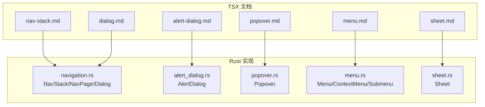
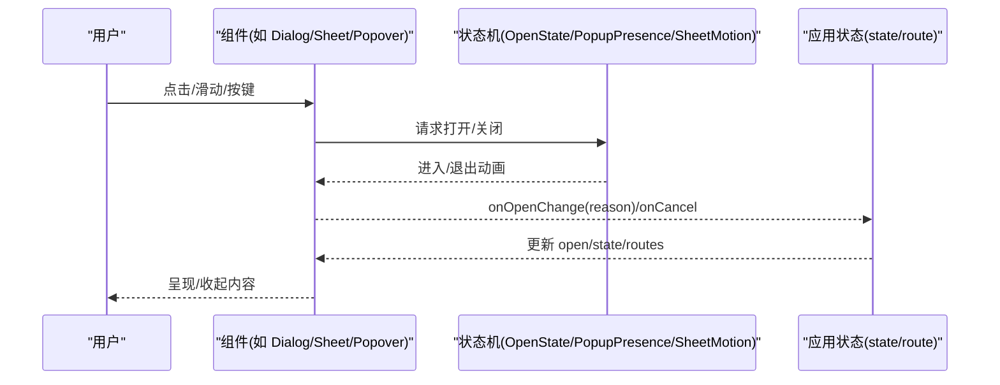
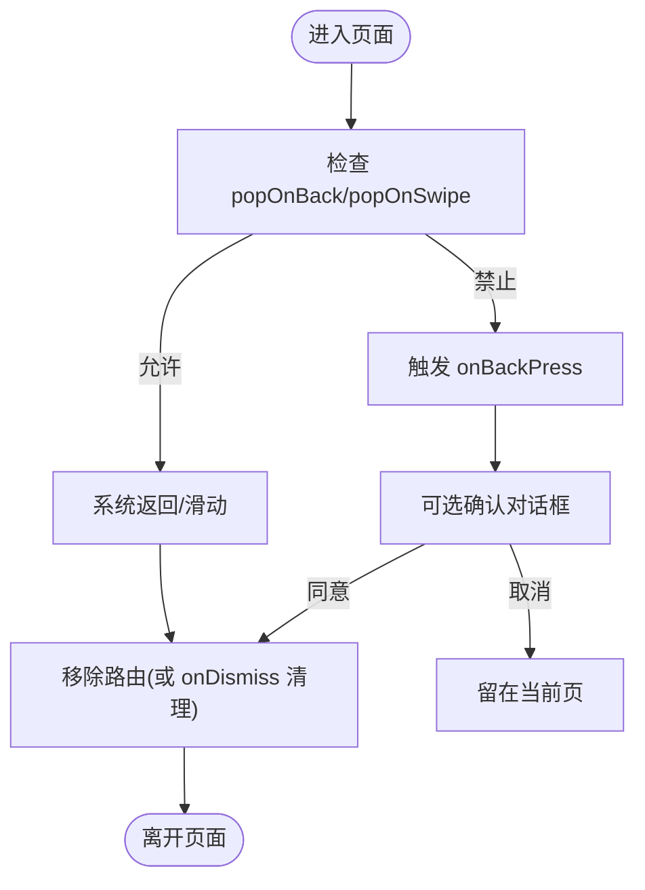
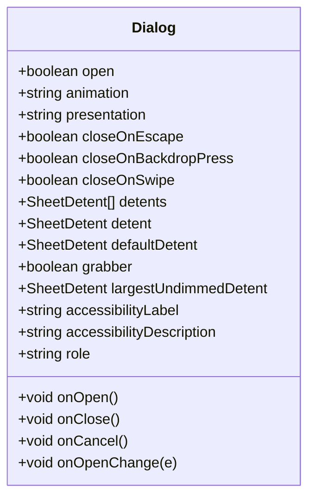
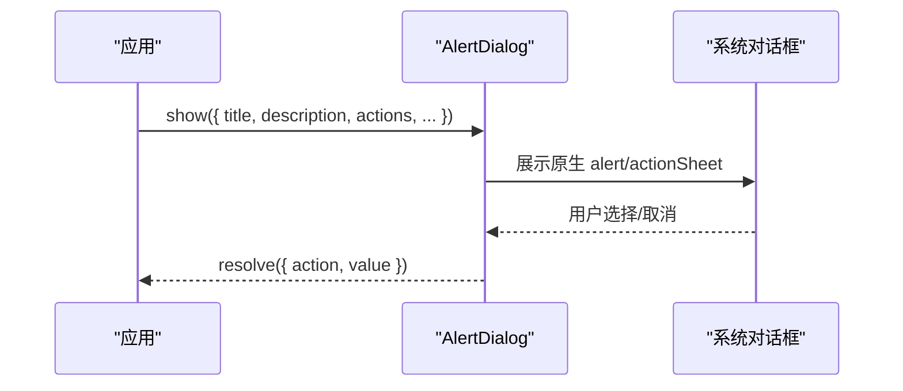
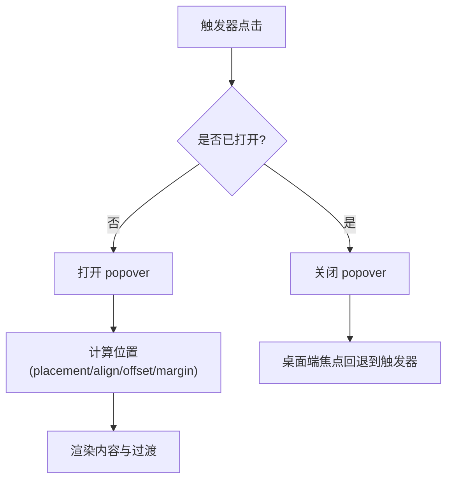
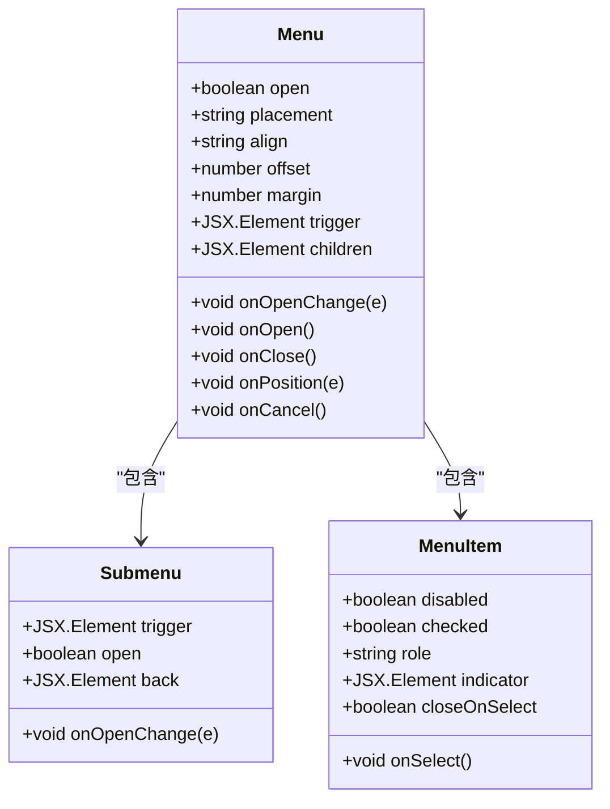
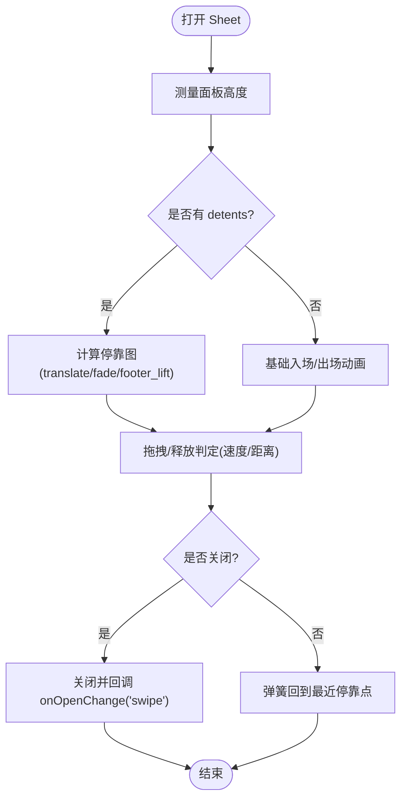
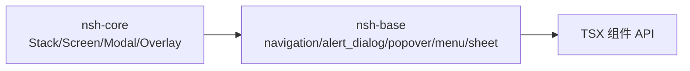

# 导航组件

<cite>
**本文引用的文件**   
- [website/elements/nav-stack.md](file://website/elements/nav-stack.md)
- [website/elements/dialog.md](file://website/elements/dialog.md)
- [website/elements/alert-dialog.md](file://website/elements/alert-dialog.md)
- [website/elements/popover.md](file://website/elements/popover.md)
- [website/elements/menu.md](file://website/elements/menu.md)
- [website/elements/sheet.md](file://website/elements/sheet.md)
- [crates/nsh-base/src/navigation.rs](file://crates/nsh-base/src/navigation.rs)
- [crates/nsh-base/src/alert_dialog.rs](file://crates/nsh-base/src/alert_dialog.rs)
- [crates/nsh-base/src/popover.rs](file://crates/nsh-base/src/popover.rs)
- [crates/nsh-base/src/menu.rs](file://crates/nsh-base/src/menu.rs)
- [crates/nsh-base/src/sheet.rs](file://crates/nsh-base/src/sheet.rs)
</cite>

## 目录
1. [简介](#简介)
2. [项目结构](#项目结构)
3. [核心组件](#核心组件)
4. [架构总览](#架构总览)
5. [详细组件分析](#详细组件分析)
6. [依赖关系分析](#依赖关系分析)
7. [性能与动画](#性能与动画)
8. [故障排查指南](#故障排查指南)
9. [结论](#结论)
10. [附录：跨平台与手势要点](#附录跨平台与手势要点)

## 简介
本文件为 NSH 框架的导航与弹窗组件提供 TypeScript API 文档，覆盖 NavStack、Dialog、AlertDialog、Popover、Menu、Sheet 等组件的属性、路由管理与生命周期控制。重点说明页面栈管理、模态框交互、菜单系统与侧边栏的实现机制，并给出跨平台导航适配、手势支持与动画过渡的技术细节，帮助构建专业的多页面应用体验。

## 项目结构
NSH 的导航与弹窗能力由两层组成：
- TSX 文档层：面向用户的 API 说明与示例（website/elements/*.md）。
- Rust 实现层：nsh-base 中对应组件的构建器与状态机（crates/nsh-base/src/*.rs），并通过 nsh-core 的底层元素（Stack、Screen、Modal、Overlay）完成渲染与交互。

图表来源
- [website/elements/nav-stack.md:1-403](file://website/elements/nav-stack.md#L1-L403)
- [website/elements/dialog.md:1-334](file://website/elements/dialog.md#L1-L334)
- [website/elements/alert-dialog.md:1-193](file://website/elements/alert-dialog.md#L1-L193)
- [website/elements/popover.md:1-182](file://website/elements/popover.md#L1-L182)
- [website/elements/menu.md:1-572](file://website/elements/menu.md#L1-L572)
- [website/elements/sheet.md:1-208](file://website/elements/sheet.md#L1-L208)
- [crates/nsh-base/src/navigation.rs:1-41](file://crates/nsh-base/src/navigation.rs#L1-L41)
- [crates/nsh-base/src/alert_dialog.rs:1-431](file://crates/nsh-base/src/alert_dialog.rs#L1-L431)
- [crates/nsh-base/src/popover.rs:1-239](file://crates/nsh-base/src/popover.rs#L1-L239)
- [crates/nsh-base/src/menu.rs:1-800](file://crates/nsh-base/src/menu.rs#L1-L800)
- [crates/nsh-base/src/sheet.rs:1-800](file://crates/nsh-base/src/sheet.rs#L1-L800)

章节来源
- [website/elements/nav-stack.md:1-403](file://website/elements/nav-stack.md#L1-L403)
- [website/elements/dialog.md:1-334](file://website/elements/dialog.md#L1-L334)
- [website/elements/alert-dialog.md:1-193](file://website/elements/alert-dialog.md#L1-L193)
- [website/elements/popover.md:1-182](file://website/elements/popover.md#L1-L182)
- [website/elements/menu.md:1-572](file://website/elements/menu.md#L1-L572)
- [website/elements/sheet.md:1-208](file://website/elements/sheet.md#L1-L208)
- [crates/nsh-base/src/navigation.rs:1-41](file://crates/nsh-base/src/navigation.rs#L1-L41)

## 核心组件
本节汇总各组件在 TSX 中的关键属性与方法，以及对应的 Rust 构建器入口。

- NavStack / NavPage
  - TSX：createNavStack(routes)、NavStack(state, children)、NavPage(标题、header、系统头选项、手势与动画等)。
  - Rust：nav_stack()、nav_page()。
  - 路由管理：routes 信号、push/pop/popToRoot/replace/setRoutes/remove。
  - 生命周期：onBackPress、onDismiss；onChange 监听路由变化。

- Dialog
  - TSX：open、animation、presentation、detents/detent/defaultDetent、closeOnEscape/closeOnBackdropPress/closeOnSwipe、accessibility*、onOpen/onClose/onCancel/onOpenChange 等。
  - Rust：dialog()。

- AlertDialog
  - TSX：AlertDialog.show({ title, description, actions, presentation, closeOnEscape, closeOnBackdropPress, input })。
  - Rust：alert_dialog().title()/description()/action()/cancel()/destructive()/action_sheet()/input()/show()。

- Popover
  - TSX：open/defaultOpen、placement/align/offset/margin、closeOnEscape/closeOnPressOutside、popupClass/popupStyle、trigger、children、onOpenChange/onOpen/onClose/onCancel/onPosition。
  - Rust：popover()。

- Menu / ContextMenu / Submenu / MenuItem
  - TSX：Menu(open/defaultOpen/placement/align/offset/margin/popupClass/backdropClass/trigger/children)，Submenu(trigger/back/open)，MenuItem(disabled/checked/role/indicator/closeOnSelect/accessibility*)，ContextMenu(items/title/preview)。
  - Rust：menu()/menu_item()/menu_separator()/submenu()/menu_list()。

- Sheet
  - TSX：open/defaultOpen、side、closeOnEscape/closeOnBackdropPress/closeOnSwipe、detents/detent/defaultDetent、grabber/footer、popupClass/backdropClass、accessibilityLabel、onOpenChange/onOpen/onClose/onCancel/onDetentChange。
  - Rust：sheet()。

章节来源
- [website/elements/nav-stack.md:172-260](file://website/elements/nav-stack.md#L172-L260)
- [website/elements/dialog.md:107-143](file://website/elements/dialog.md#L107-L143)
- [website/elements/alert-dialog.md:89-176](file://website/elements/alert-dialog.md#L89-L176)
- [website/elements/popover.md:69-182](file://website/elements/popover.md#L69-L182)
- [website/elements/menu.md:482-572](file://website/elements/menu.md#L482-L572)
- [website/elements/sheet.md:173-204](file://website/elements/sheet.md#L173-L204)
- [crates/nsh-base/src/navigation.rs:1-41](file://crates/nsh-base/src/navigation.rs#L1-L41)
- [crates/nsh-base/src/alert_dialog.rs:150-297](file://crates/nsh-base/src/alert_dialog.rs#L150-L297)
- [crates/nsh-base/src/popover.rs:10-92](file://crates/nsh-base/src/popover.rs#L10-L92)
- [crates/nsh-base/src/menu.rs:1-800](file://crates/nsh-base/src/menu.rs#L1-L800)
- [crates/nsh-base/src/sheet.rs:29-138](file://crates/nsh-base/src/sheet.rs#L29-L138)

## 架构总览
导航与弹窗的整体数据流如下：用户操作触发 UI 事件，组件内部通过 OpenState/PopupPresence/SheetMotion 等状态机驱动显示与关闭，同时向应用层回调 onOpenChange/onCancel 等事件，应用层更新 state 以维持受控状态。

图表来源
- [website/elements/dialog.md:176-213](file://website/elements/dialog.md#L176-L213)
- [website/elements/sheet.md:68-90](file://website/elements/sheet.md#L68-L90)
- [website/elements/popover.md:69-94](file://website/elements/popover.md#L69-L94)
- [crates/nsh-base/src/popover.rs:105-165](file://crates/nsh-base/src/popover.rs#L105-L165)
- [crates/nsh-base/src/sheet.rs:208-253](file://crates/nsh-base/src/sheet.rs#L208-L253)

## 详细组件分析

### NavStack 与 NavPage
- 路由模型
  - TSX：createNavStack<R>(routes: R[]) 返回 NavStackState<R>，包含 routes、push、pop、popToRoot、replace、setRoutes、remove。
  - Rust：通过信号维护 routes 向量，push/pop/truncate/set 等同步栈行为。
- 页面生命周期
  - onBackPress：拦截返回键/手势，配合 popOnBack=false 可阻止自动弹出。
  - onDismiss：原生返回后清理路由（TSX 从 routes 移除，Rust 在回调中截断）。
- 头部与系统头
  - desktop/web：使用 header 插槽；iOS/Android：title/headerVisible/headerTransparent/headerShadowVisible/headerTitleAlign/headerBackgroundOnScroll/hidesBottomBarWhenPushed/headerLargeTitle/headerBackTitle/headerBackVisible/headerLeft/headerRight/headerTitle/headerStyle/headerClass。
- 手势与动画
  - popOnBack/popOnSwipe 控制返回与滑动手势；animation 支持 default/slide/fade/none；transitionShader 支持自定义着色器过渡。
- 平台差异
  - iOS：UINavigationController + 系统头 + 滑动手势；Android：工具栏 + 预测性返回；desktop/web：应用自绘 header。

图表来源
- [website/elements/nav-stack.md:314-388](file://website/elements/nav-stack.md#L314-L388)

章节来源
- [website/elements/nav-stack.md:152-260](file://website/elements/nav-stack.md#L152-L260)
- [website/elements/nav-stack.md:314-403](file://website/elements/nav-stack.md#L314-L403)
- [crates/nsh-base/src/navigation.rs:8-25](file://crates/nsh-base/src/navigation.rs#L8-L25)

### Dialog
- 展示形式
  - presentation：fullScreen/pageSheet/formSheet；pageSheet/formSheet 支持 detents/detent/defaultDetent/grabber/largestUndimmedDetent。
- 关闭策略
  - closeOnEscape/closeOnBackdropPress/closeOnSwipe；onCancel 统一捕获关闭尝试；onOpenChange 同步 open。
- 无障碍
  - accessibilityLabel/accessibilityDescription/role(alertdialog)。
- 平台差异
  - iOS/macOS：系统 presented view controller；Android：Dialog；desktop/web：透明顶层层。

图表来源
- [website/elements/dialog.md:107-143](file://website/elements/dialog.md#L107-L143)

章节来源
- [website/elements/dialog.md:1-334](file://website/elements/dialog.md#L1-L334)
- [crates/nsh-base/src/navigation.rs:27-40](file://crates/nsh-base/src/navigation.rs#L27-L40)

### AlertDialog
- 调用方式
  - TSX：AlertDialog.show(options) 返回 Promise<{ action }>。
  - Rust：alert_dialog().show() 返回 Future<Result<AlertDialogResult, String>>。
- 选项
  - title/description/actions/presentation(closeOnEscape/closeOnBackdropPress/input)。
- 结果
  - AlertDialogResult：{ action, value }。
- 错误处理
  - 无 actions 或 actionSheet 中使用 input 会报错。

图表来源
- [website/elements/alert-dialog.md:89-176](file://website/elements/alert-dialog.md#L89-L176)
- [crates/nsh-base/src/alert_dialog.rs:150-297](file://crates/nsh-base/src/alert_dialog.rs#L150-L297)

章节来源
- [website/elements/alert-dialog.md:1-193](file://website/elements/alert-dialog.md#L1-L193)
- [crates/nsh-base/src/alert_dialog.rs:1-431](file://crates/nsh-base/src/alert_dialog.rs#L1-L431)

### Popover
- 定位与锚点
  - placement/align/offset/margin；onPosition 报告 placement/bounds/available。
- 打开状态
  - 受控 open 或非受控 defaultOpen；onOpenChange 携带 reason("triggerPress"/"pressOutside"/"cancel")。
- 键盘与焦点
  - 打开时不改变焦点；可在 onOpen 中 focus 子视图；桌面端关闭时焦点回退到 trigger。
- 外观与过渡
  - popupClass/popupStyle/popupStartingClass/popupEndingClass 控制入场/出场过渡。

图表来源
- [website/elements/popover.md:69-182](file://website/elements/popover.md#L69-L182)
- [crates/nsh-base/src/popover.rs:105-239](file://crates/nsh-base/src/popover.rs#L105-L239)

章节来源
- [website/elements/popover.md:1-182](file://website/elements/popover.md#L1-L182)
- [crates/nsh-base/src/popover.rs:1-239](file://crates/nsh-base/src/popover.rs#L1-L239)

### Menu / ContextMenu / Submenu / MenuItem
- 展示形态
  - desktop/iPad 常规宽度：弹出式菜单；phone/compact iPad：底部面板（sheet）+ 子菜单替换项。
- 键盘与无障碍
  - 完整的键盘导航（Up/Down/Home/End/PageUp/PageDown）、类型首字母匹配、ARIA 语义。
- 可控子菜单
  - Submenu.open 由应用控制，onOpenChange 报告原因("hover"/"focus"/"triggerPress"/"cancel"/... )。
- 长列表
  - MenuList 虚拟化行，结合滚动与键盘分页。

图表来源
- [website/elements/menu.md:482-572](file://website/elements/menu.md#L482-L572)

章节来源
- [website/elements/menu.md:1-572](file://website/elements/menu.md#L1-L572)
- [crates/nsh-base/src/menu.rs:1-800](file://crates/nsh-base/src/menu.rs#L1-L800)

### Sheet
- 边缘面板
  - side：bottom/top/left/right；backdrop 覆盖其余区域。
- 拖拽与停靠
  - closeOnSwipe 启用底部下拉关闭；detents 定义停靠高度；grabber 提供无障碍调整；footer 随面板移动。
- 键盘与无障碍
  - 作为模态对话框；键盘焦点进出；屏幕阅读器命名。
- 受控模式
  - open/detent 由应用控制，onOpenChange/onDetentChange 同步。

图表来源
- [website/elements/sheet.md:77-144](file://website/elements/sheet.md#L77-L144)
- [crates/nsh-base/src/sheet.rs:140-178](file://crates/nsh-base/src/sheet.rs#L140-L178)
- [crates/nsh-base/src/sheet.rs:580-627](file://crates/nsh-base/src/sheet.rs#L580-L627)

章节来源
- [website/elements/sheet.md:1-208](file://website/elements/sheet.md#L1-L208)
- [crates/nsh-base/src/sheet.rs:1-800](file://crates/nsh-base/src/sheet.rs#L1-L800)

## 依赖关系分析
- 组件与底层元素
  - NavStack/NavPage/Dialog 基于 Stack/Screen/Modal。
  - Popover/Menu/Sheet 基于 Overlay 与 PopupPresence/SheetMotion 等状态机。
- 外部依赖
  - nsh-core 提供几何、动画、平台信息、无障碍、键盘与手势等能力。
- 耦合与内聚
  - 每个组件封装自身状态机与生命周期，通过 props/events 与应用解耦；菜单系统内部通过上下文共享层级状态。

图表来源
- [crates/nsh-base/src/navigation.rs:1-41](file://crates/nsh-base/src/navigation.rs#L1-L41)
- [crates/nsh-base/src/popover.rs:1-239](file://crates/nsh-base/src/popover.rs#L1-L239)
- [crates/nsh-base/src/menu.rs:1-800](file://crates/nsh-base/src/menu.rs#L1-L800)
- [crates/nsh-base/src/sheet.rs:1-800](file://crates/nsh-base/src/sheet.rs#L1-L800)

章节来源
- [crates/nsh-base/src/navigation.rs:1-41](file://crates/nsh-base/src/navigation.rs#L1-L41)
- [crates/nsh-base/src/popover.rs:1-239](file://crates/nsh-base/src/popover.rs#L1-L239)
- [crates/nsh-base/src/menu.rs:1-800](file://crates/nsh-base/src/menu.rs#L1-L800)
- [crates/nsh-base/src/sheet.rs:1-800](file://crates/nsh-base/src/sheet.rs#L1-L800)

## 性能与动画
- 动画与过渡
  - NavStack/Dialog 支持 transitionShader 自定义着色器过渡；Menu/Popover 使用 Tailwind 类进行入场/出场过渡。
- 手势优化
  - Sheet 的 drag_y/fade 由原生值驱动，避免等待 JS/Rust 主线程；减少运动模式下直接跳转。
- 列表与虚拟化
  - MenuList 仅渲染视口附近行，提升大数据量场景性能。
- 建议
  - 优先使用内置 animation/transition；复杂过渡用 transitionShader；长列表务必使用 MenuList。

章节来源
- [website/elements/nav-stack.md:246-247](file://website/elements/nav-stack.md#L246-L247)
- [website/elements/dialog.md:112-113](file://website/elements/dialog.md#L112-L113)
- [website/elements/popover.md:125-147](file://website/elements/popover.md#L125-L147)
- [website/elements/menu.md:326-354](file://website/elements/menu.md#L326-L354)
- [crates/nsh-base/src/sheet.rs:217-233](file://crates/nsh-base/src/sheet.rs#L217-L233)

## 故障排查指南
- NavStack 返回键无效
  - 检查 popOnBack=false 是否正确设置；onBackPress 中是否手动 pop。
- AlertDialog 报错
  - 确保 actions 非空；actionSheet 不可带 input。
- Sheet 无法下拉关闭
  - 确认 closeOnSwipe=true 且 side=bottom；检测 detents 配置是否导致无法到达最小停靠点。
- Popover 焦点异常
  - 桌面端关闭时焦点回退逻辑；如需聚焦子视图，在 onOpen 中 focus。
- Menu 键盘导航不生效
  - 确保触发器可聚焦；检查 Submenu.open 受控逻辑是否与 onOpenChange 同步。

章节来源
- [website/elements/nav-stack.md:314-388](file://website/elements/nav-stack.md#L314-L388)
- [website/elements/alert-dialog.md:148-176](file://website/elements/alert-dialog.md#L148-L176)
- [website/elements/sheet.md:77-144](file://website/elements/sheet.md#L77-L144)
- [website/elements/popover.md:86-112](file://website/elements/popover.md#L86-L112)
- [website/elements/menu.md:282-324](file://website/elements/menu.md#L282-L324)

## 结论
NSH 的导航与弹窗组件以统一的 TSX API 暴露跨平台能力，并在 Rust 层通过状态机与底层元素实现一致的行为与动画。NavStack 负责页面栈与路由，Dialog/AlertDialog 提供系统级与自定义模态，Popover/Menu/Sheet 覆盖弹出、菜单与侧边栏场景。借助其手势、无障碍与动画能力，开发者可以构建专业、一致的多页面应用体验。

## 附录：跨平台与手势要点
- 平台差异
  - iOS：系统头、滑动手势、large title、orientation 控制。
  - Android：predictive back、toolbar、status bar translucent。
  - Desktop/Web：应用自绘 header，键盘快捷键（Esc/Alt+Left/鼠标后退）。
- 手势与键盘
  - NavStack：popOnBack/popOnSwipe；Dialog：closeOn*；Sheet：closeOnSwipe + detents；Popover：press outside/escape；Menu：完整键盘导航与类型匹配。
- 最佳实践
  - 使用 createNavStack 集中管理路由；Dialog/Sheet 使用受控 open；AlertDialog 用于系统级确认；Menu 使用 MenuList 承载大数据；Popover 用于轻量提示与表单。

章节来源
- [website/elements/nav-stack.md:390-403](file://website/elements/nav-stack.md#L390-L403)
- [website/elements/dialog.md:320-334](file://website/elements/dialog.md#L320-L334)
- [website/elements/sheet.md:146-171](file://website/elements/sheet.md#L146-L171)
- [website/elements/popover.md:114-147](file://website/elements/popover.md#L114-L147)
- [website/elements/menu.md:26-37](file://website/elements/menu.md#L26-L37)