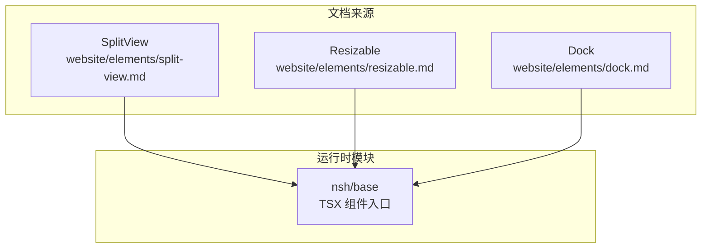
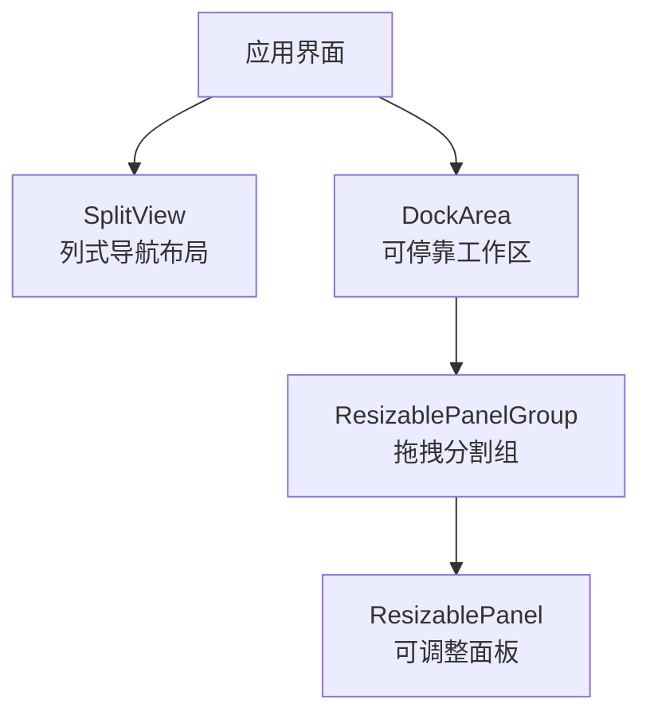
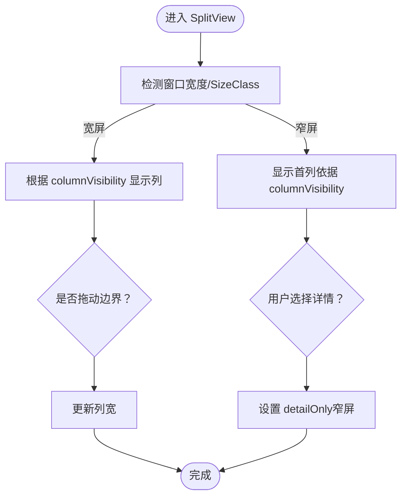
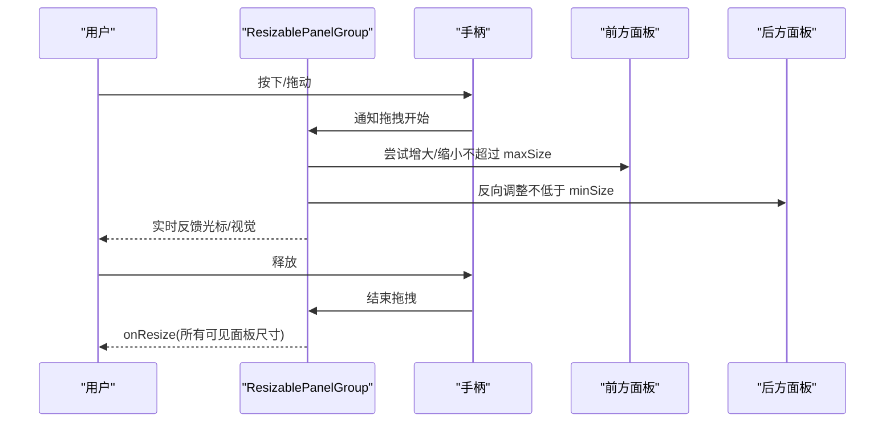
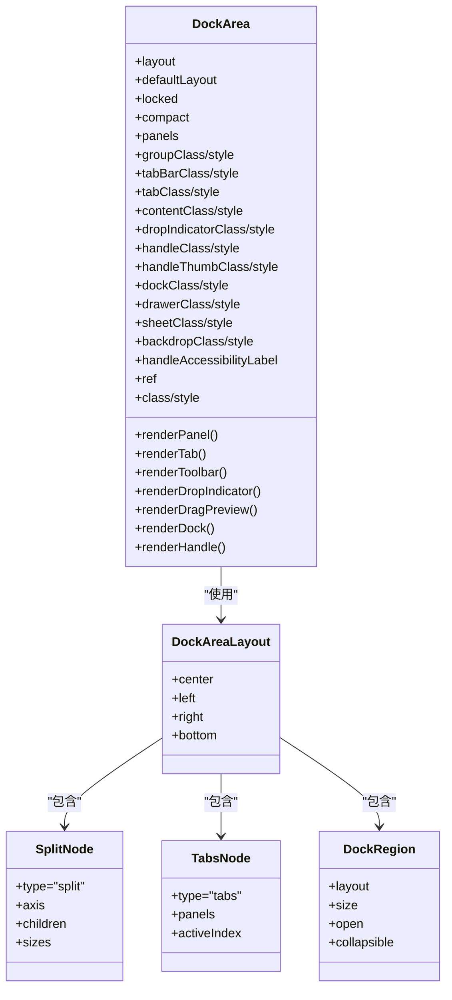
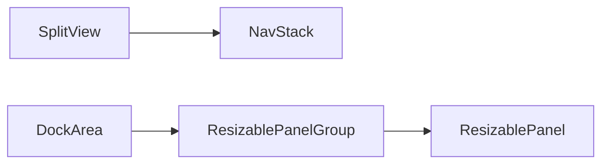

# 布局组件

<cite>
**本文引用的文件**   
- [split-view.md](file://website/elements/split-view.md)
- [resizable.md](file://website/elements/resizable.md)
- [dock.md](file://website/elements/dock.md)
</cite>

## 目录
1. [简介](#简介)
2. [项目结构](#项目结构)
3. [核心组件](#核心组件)
4. [架构总览](#架构总览)
5. [详细组件分析](#详细组件分析)
6. [依赖关系分析](#依赖关系分析)
7. [性能考虑](#性能考虑)
8. [故障排查指南](#故障排查指南)
9. [结论](#结论)
10. [附录](#附录)

## 简介
本章节面向 NSH 框架的布局容器组件，聚焦 SplitView、ResizablePanelGroup/ResizablePanel、DockArea 等组件的 TypeScript API、尺寸管理、交互行为与跨平台适配。文档从系统架构、组件关系、数据流、处理逻辑、集成点、错误处理与性能特性等维度展开，并提供复杂应用界面的布局设计模式与实践示例路径，帮助构建专业的桌面级用户界面。

## 项目结构
- 文档来源为网站元素文档：SplitView、Resizable（包含 ResizablePanelGroup/ResizablePanel）、Dock（DockArea）。
- 这些组件统一来自 nsh/base（Rust 侧 nsh-base crate），在 TSX 中以 React 风格组件暴露。

**图示来源**
- [split-view.md:120-122](file://website/elements/split-view.md#L120-L122)
- [resizable.md:71-75](file://website/elements/resizable.md#L71-L75)
- [dock.md:91-94](file://website/elements/dock.md#L91-L94)

**章节来源**
- [split-view.md:1-204](file://website/elements/split-view.md#L1-L204)
- [resizable.md:1-208](file://website/elements/resizable.md#L1-L208)
- [dock.md:1-435](file://website/elements/dock.md#L1-L435)

## 核心组件
- SplitView：两列或三列导航栈并列展示，窄屏时折叠为单列；由应用控制显示列。
- ResizablePanelGroup/ResizablePanel：面板并排或堆叠，边界拖拽调整大小；组负责拖拽、共享空间、光标与无障碍。
- DockArea：可停靠工作区，支持分组、拆分、侧边栏与底部停靠、缩放、锁定；布局为受控数据模型。

**章节来源**
- [split-view.md:10-16](file://website/elements/split-view.md#L10-L16)
- [resizable.md:10-15](file://website/elements/resizable.md#L10-L15)
- [dock.md:10-15](file://website/elements/dock.md#L10-L15)

## 架构总览
以下图展示了三大布局组件在应用中的协作关系与职责边界：SplitView 用于导航式多列布局；Resizable 系列提供通用面板分割能力；DockArea 作为顶层工作区组合多种布局单元。

**图示来源**
- [split-view.md:120-122](file://website/elements/split-view.md#L120-L122)
- [resizable.md:71-75](file://website/elements/resizable.md#L71-L75)
- [dock.md:91-94](file://website/elements/dock.md#L91-L94)

## 详细组件分析

### SplitView
- 用途：以列展示导航栈（侧边栏、可选内容列、详情列），每列独立维护页面栈。
- 响应式策略：宽屏并列，窄屏（水平紧凑）仅显示一列；可通过 columnVisibility 控制显示列。
- 交互行为：拖动边界调整列宽；在 iOS/iPadOS/Mac Catalyst 使用系统 SplitViewController 行为。
- 属性要点：
  - sidebar/content/detail：各列为 NavStack。
  - columnVisibility：自动/全部/双列/仅详情。
  - onColumnVisibilityChange：监听列显示变化。
- 无障碍：按列顺序朗读；窄屏仅当前列可见。
- 平台差异：iOS/iPadOS/Mac Catalyst 使用系统控件；其他平台侧边栏与内容列默认宽度 320pt，其余为详情列。

**图示来源**
- [split-view.md:136-150](file://website/elements/split-view.md#L136-L150)
- [split-view.md:152-170](file://website/elements/split-view.md#L152-L170)

**章节来源**
- [split-view.md:10-16](file://website/elements/split-view.md#L10-L16)
- [split-view.md:124-150](file://website/elements/split-view.md#L124-L150)
- [split-view.md:152-170](file://website/elements/split-view.md#L152-L170)
- [split-view.md:172-186](file://website/elements/split-view.md#L172-L186)
- [split-view.md:188-204](file://website/elements/split-view.md#L188-L204)

### ResizablePanelGroup / ResizablePanel
- 用途：将多个面板沿水平或垂直轴排列，并在相邻面板之间提供拖拽手柄调整尺寸。
- 尺寸管理：
  - 未指定 size 的面板平分剩余空间；已指定 size 的面板按比例分配剩余空间。
  - 拖拽过程中，靠近手柄的前后面板依次增减尺寸，遵守 min/max 限制。
  - 窗口缩放时，固定面板保持尺寸，其他面板收缩/恢复。
- 交互行为：原生帧级拖拽；触摸设备扩大触控区域；禁用模式下锁定布局。
- 属性要点：
  - axis：horizontal/vertical。
  - handleClass/handleStyle/renderHandle：自定义手柄外观与状态。
  - handleAccessibilityLabel：屏幕阅读器标签。
  - panel.size/minSize/maxSize/fixed/visible：面板尺寸与可见性。
- 事件：onResize（组/面板）报告最终尺寸变化。
- 无障碍：手柄为可调元素，支持键盘/辅助功能步进调整。

**图示来源**
- [resizable.md:77-99](file://website/elements/resizable.md#L77-L99)
- [resizable.md:111-136](file://website/elements/resizable.md#L111-L136)
- [resizable.md:173-178](file://website/elements/resizable.md#L173-L178)

**章节来源**
- [resizable.md:10-15](file://website/elements/resizable.md#L10-L15)
- [resizable.md:77-99](file://website/elements/resizable.md#L77-L99)
- [resizable.md:111-136](file://website/elements/resizable.md#L111-L136)
- [resizable.md:138-178](file://website/elements/resizable.md#L138-L178)
- [resizable.md:189-208](file://website/elements/resizable.md#L189-L208)

### DockArea
- 用途：可停靠工作区，中心区域与左/右/下停靠区组合，支持分组、拆分、缩放、锁定。
- 布局模型：DockAreaLayout 为中心与停靠区的树形结构，节点类型为 split/tabs，面板通过 key 唯一标识。
- 交互行为：
  - 拖放：将标签页拖到目标组加入或拆分。
  - 停靠区：打开/关闭/调整大小，最小 100pt，可折叠。
  - 缩放：整组放大至全屏，再次切换还原。
  - 锁定：禁止拖放与关闭，保留基本交互。
- 属性要点：
  - layout/defaultLayout：受控/非受控布局。
  - panels：面板选项（closable/zoomable/visible）。
  - renderTab/renderPanel/renderToolbar/renderDropIndicator/renderDragPreview/renderDock：渲染钩子。
  - 样式类：tabBar/tab/content/handle/thumb/dock/drawer/sheet/backdrop 等。
- 事件：onLayoutChange/onPanelActiveChange/onPanelRemove/onZoomChange/onDockOpenChange。
- 手机与窄窗：小于 600pt 时采用紧凑模式（抽屉/底部表单），布局不变但呈现不同。

**图示来源**
- [dock.md:96-121](file://website/elements/dock.md#L96-L121)
- [dock.md:353-383](file://website/elements/dock.md#L353-L383)

**章节来源**
- [dock.md:10-15](file://website/elements/dock.md#L10-L15)
- [dock.md:96-121](file://website/elements/dock.md#L96-L121)
- [dock.md:123-149](file://website/elements/dock.md#L123-L149)
- [dock.md:150-175](file://website/elements/dock.md#L150-L175)
- [dock.md:213-229](file://website/elements/dock.md#L213-L229)
- [dock.md:231-246](file://website/elements/dock.md#L231-L246)
- [dock.md:264-274](file://website/elements/dock.md#L264-L274)
- [dock.md:276-299](file://website/elements/dock.md#L276-L299)
- [dock.md:301-308](file://website/elements/dock.md#L301-L308)
- [dock.md:310-339](file://website/elements/dock.md#L310-L339)
- [dock.md:353-435](file://website/elements/dock.md#L353-L435)

## 依赖关系分析
- SplitView 与 NavStack：每列是独立的 NavStack，各自维护页面栈与状态。
- ResizablePanelGroup 与 ResizablePanel：组管理拖拽与尺寸分配，面板提供内容与尺寸约束。
- DockArea 与 Resizable：Dock 的拆分区域本质上是可调整大小的分组，复用相同的拖拽与样式机制。

**图示来源**
- [split-view.md:120-122](file://website/elements/split-view.md#L120-L122)
- [resizable.md:71-75](file://website/elements/resizable.md#L71-L75)
- [dock.md:91-94](file://website/elements/dock.md#L91-L94)

**章节来源**
- [split-view.md:120-122](file://website/elements/split-view.md#L120-L122)
- [resizable.md:71-75](file://website/elements/resizable.md#L71-L75)
- [dock.md:91-94](file://website/elements/dock.md#L91-L94)

## 性能考虑
- 拖拽性能：Resizable 与 Dock 的拖拽运行于原生层，避免 JS 阻塞，保证帧级流畅。
- 渲染优化：Dock 对面板仅首次渲染一次，移动时复用内容实例，离开布局时释放资源。
- 尺寸计算：Resizable 在拖拽中直接调整核心布局，减少重绘次数；窗口缩放时按需收缩/恢复面板。
- 存储与恢复：Dock 布局可序列化保存，避免重复计算初始布局。

[本节为通用指导，不直接分析具体文件]

## 故障排查指南
- SplitView 列显示异常：
  - 检查 columnVisibility 是否为受控值，并确保在 onColumnVisibilityChange 中同步状态。
  - 窄屏场景需显式切换到 detailOnly 以显示详情。
- Resizable 拖拽无响应：
  - 确认 disabled 未启用；检查面板 visible 与 fixed 配置。
  - 若 onResize 未触发，确认拖拽确实改变了尺寸（仅隐藏/显示不报告）。
- DockArea 布局不一致：
  - 确保 layout 与 onLayoutChange 形成受控闭环。
  - 检查 panels 配置（closable/zoomable/visible）是否符合预期。
  - 紧凑模式下 drawer/sheet/backdrop 样式是否正确。

**章节来源**
- [split-view.md:136-150](file://website/elements/split-view.md#L136-L150)
- [resizable.md:88-99](file://website/elements/resizable.md#L88-L99)
- [dock.md:117-121](file://website/elements/dock.md#L117-L121)
- [dock.md:310-339](file://website/elements/dock.md#L310-L339)

## 结论
SplitView、ResizablePanelGroup/ResizablePanel 与 DockArea 共同构成 NSH 的布局体系：SplitView 专注导航式多列布局，Resizable 提供通用的面板分割能力，DockArea 则整合分组、拆分、停靠与缩放，形成专业桌面级工作区。三者均强调受控数据模型、跨平台适配与无障碍支持，并通过原生拖拽与渲染优化保障性能。

[本节为总结性内容，不直接分析具体文件]

## 附录
- 常用布局模式：
  - 编辑器+控制台：使用 ResizablePanelGroup 垂直分割，控制台可固定高度。
  - 文件浏览器+文档编辑：使用 ResizablePanelGroup 水平分割，侧边栏固定宽度。
  - IDE 工作区：使用 DockArea 组合中心编辑区与左右停靠区，支持缩放与锁定。
- 代码示例路径：
  - SplitView 示例：见 split-view.md 中的 Rust/TSX 示例段落。
  - Resizable 示例：见 resizable.md 中的 Rust/TSX 示例段落。
  - DockArea 示例：见 dock.md 中的 Rust/TSX 示例段落。

**章节来源**
- [split-view.md:18-61](file://website/elements/split-view.md#L18-L61)
- [split-view.md:63-118](file://website/elements/split-view.md#L63-L118)
- [resizable.md:17-39](file://website/elements/resizable.md#L17-L39)
- [resizable.md:41-69](file://website/elements/resizable.md#L41-L69)
- [dock.md:17-45](file://website/elements/dock.md#L17-L45)
- [dock.md:47-89](file://website/elements/dock.md#L47-L89)