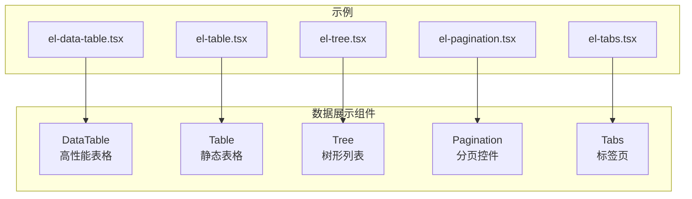
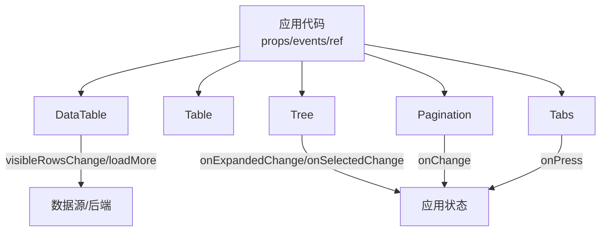
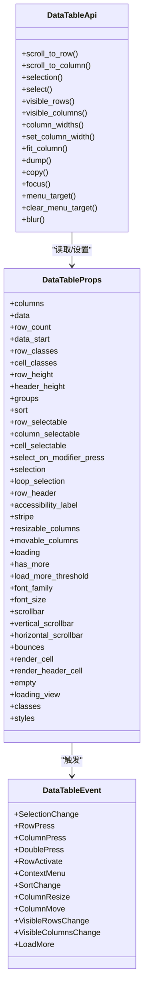
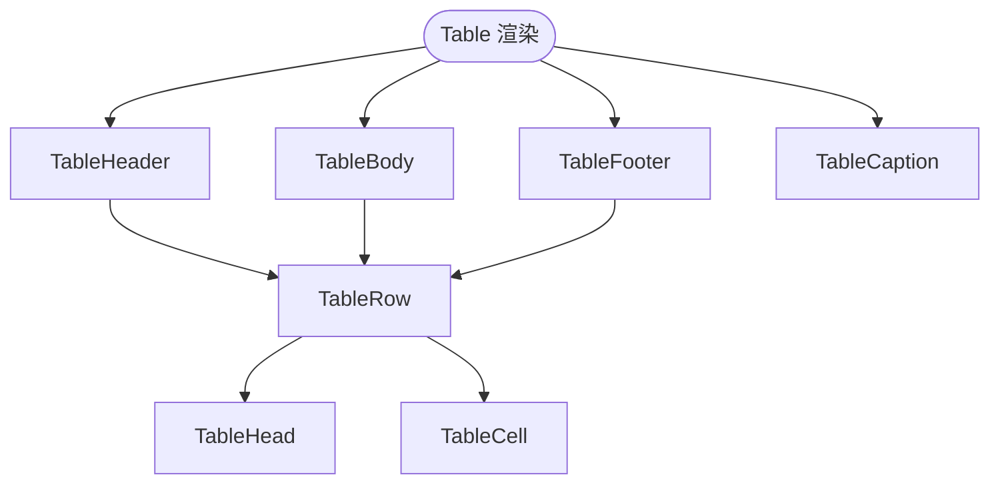
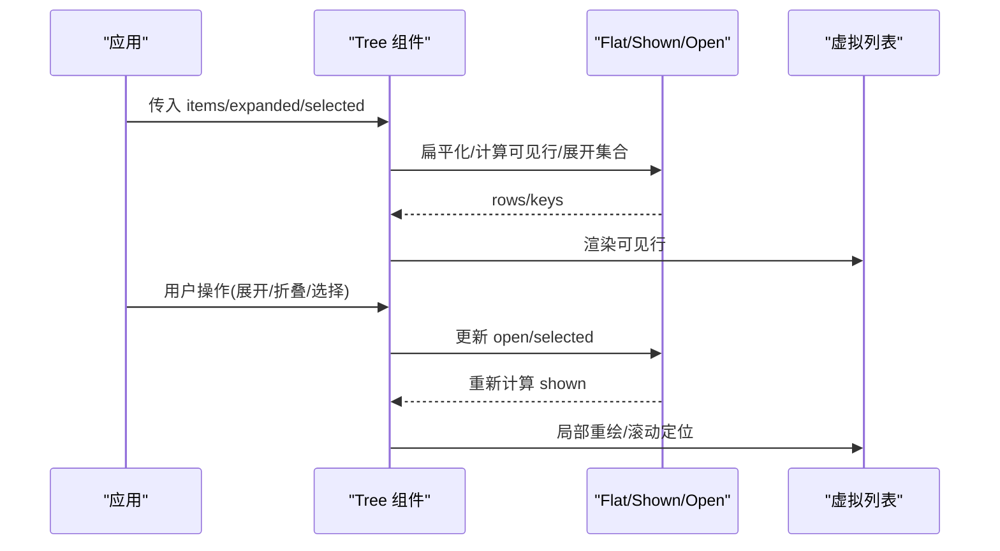
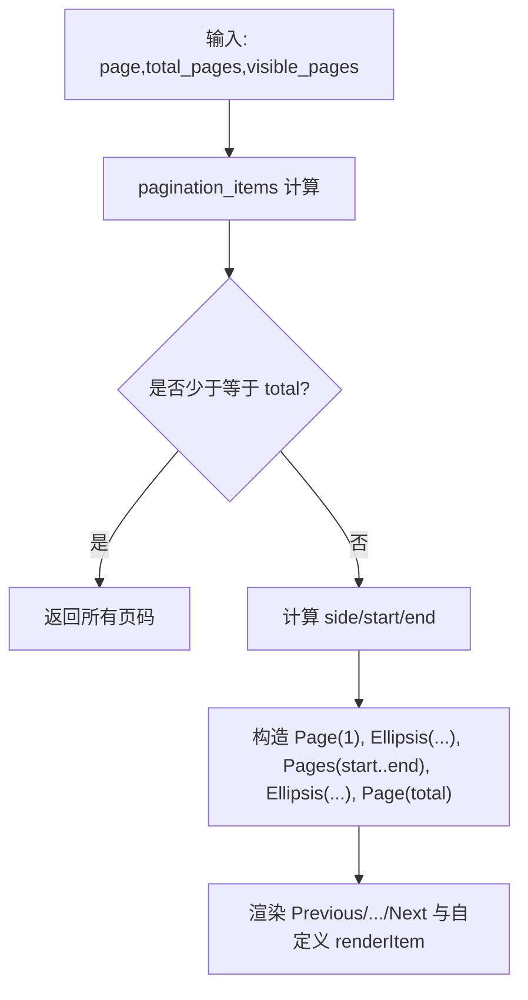
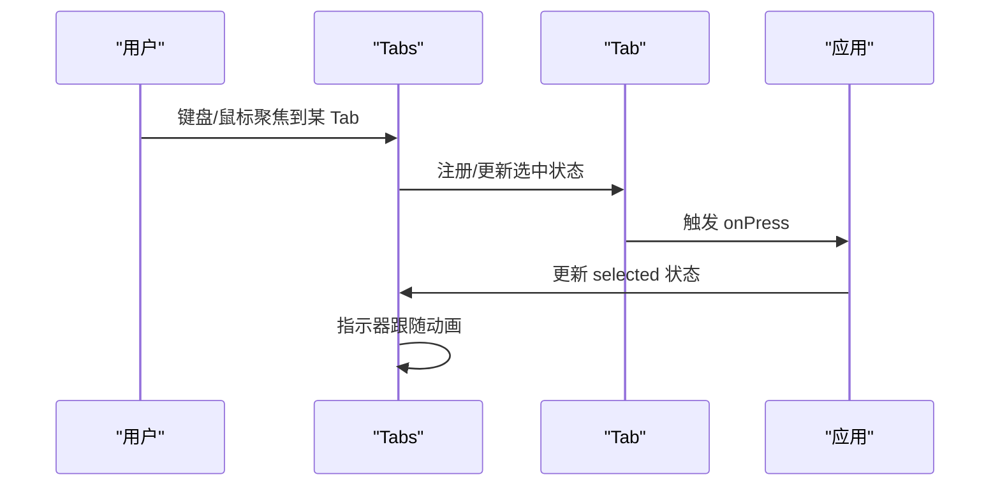
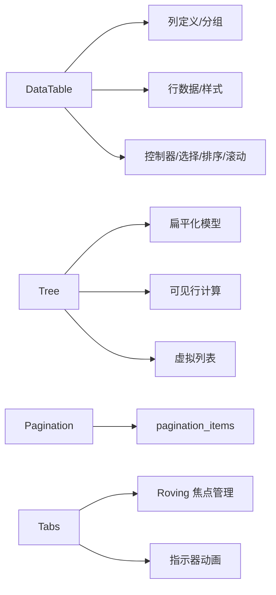

# 数据展示组件

<cite>
**本文引用的文件**   
- [crates/nsh-base/src/data_table/mod.rs](file://crates/nsh-base/src/data_table/mod.rs)
- [crates/nsh-base/src/table.rs](file://crates/nsh-base/src/table.rs)
- [crates/nsh-base/src/tree.rs](file://crates/nsh-base/src/tree.rs)
- [crates/nsh-base/src/pagination.rs](file://crates/nsh-base/src/pagination.rs)
- [crates/nsh-base/src/tabs.rs](file://crates/nsh-base/src/tabs.rs)
- [website/demos/el-data-table.tsx](file://website/demos/el-data-table.tsx)
- [website/demos/el-table.tsx](file://website/demos/el-table.tsx)
- [website/demos/el-tree.tsx](file://website/demos/el-tree.tsx)
- [website/demos/el-pagination.tsx](file://website/demos/el-pagination.tsx)
- [website/demos/el-tabs.tsx](file://website/demos/el-tabs.tsx)
</cite>

## 目录
1. [简介](#简介)
2. [项目结构](#项目结构)
3. [核心组件](#核心组件)
4. [架构总览](#架构总览)
5. [详细组件分析](#详细组件分析)
6. [依赖关系分析](#依赖关系分析)
7. [性能考虑](#性能考虑)
8. [故障排查指南](#故障排查指南)
9. [结论](#结论)
10. [附录：示例与最佳实践](#附录示例与最佳实践)

## 简介
本文件为 NSH 框架的数据展示类组件提供完整的 TypeScript API 文档，覆盖 DataTable、Table、Tree、Pagination、Tabs 等组件的属性、数据绑定与交互能力。重点说明大数据集处理（虚拟滚动/仅渲染可见项）、排序筛选、分页加载与图表渲染的技术实现路径，并提供可视化最佳实践、性能优化策略和无障碍访问支持。文末给出复杂数据界面的实际示例参考，包括实时数据更新、交互式图表和数据导出功能。

## 项目结构
- 组件源码位于 crates/nsh-base/src 下，分别对应不同数据展示能力：
  - data_table: 高性能双向滚动表格，支持列固定、排序、选择、虚拟滚动、导出等
  - table: 轻量静态表格语义与无障碍标签
  - tree: 树形列表，虚拟滚动、展开/折叠、键盘导航、类型前进
  - pagination: 分页控件，计算可见页码、省略号、紧凑模式
  - tabs: 标签页容器与指示器跟随动画
- 示例位于 website/demos，演示各组件在真实场景中的用法

**图示来源**
- [crates/nsh-base/src/data_table/mod.rs:1-20](file://crates/nsh-base/src/data_table/mod.rs#L1-L20)
- [crates/nsh-base/src/table.rs:1-10](file://crates/nsh-base/src/table.rs#L1-L10)
- [crates/nsh-base/src/tree.rs:1-40](file://crates/nsh-base/src/tree.rs#L1-L40)
- [crates/nsh-base/src/pagination.rs:1-20](file://crates/nsh-base/src/pagination.rs#L1-L20)
- [crates/nsh-base/src/tabs.rs:1-10](file://crates/nsh-base/src/tabs.rs#L1-L10)
- [website/demos/el-data-table.tsx:1-10](file://website/demos/el-data-table.tsx#L1-L10)
- [website/demos/el-table.tsx:1-10](file://website/demos/el-table.tsx#L1-L10)
- [website/demos/el-tree.tsx:1-10](file://website/demos/el-tree.tsx#L1-L10)
- [website/demos/el-pagination.tsx:1-10](file://website/demos/el-pagination.tsx#L1-L10)
- [website/demos/el-tabs.tsx:1-10](file://website/demos/el-tabs.tsx#L1-L10)

**章节来源**
- [crates/nsh-base/src/data_table/mod.rs:1-20](file://crates/nsh-base/src/data_table/mod.rs#L1-L20)
- [crates/nsh-base/src/table.rs:1-10](file://crates/nsh-base/src/table.rs#L1-L10)
- [crates/nsh-base/src/tree.rs:1-40](file://crates/nsh-base/src/tree.rs#L1-L40)
- [crates/nsh-base/src/pagination.rs:1-20](file://crates/nsh-base/src/pagination.rs#L1-L20)
- [crates/nsh-base/src/tabs.rs:1-10](file://crates/nsh-base/src/tabs.rs#L1-L10)

## 核心组件
本节概述各组件的职责与关键能力，便于快速定位所需 API。

- DataTable
  - 双向滚动、仅渲染可见行列；支持列固定、排序、选择（行/列/单元格）、拖拽调整列宽、移动列、分组标题、自定义单元格与表头、空态与加载态、导出与复制、滚动到指定行列、可见范围事件、加载更多等
- Table
  - 轻量静态表格，提供无障碍角色与标签，适合少量手动编写的行与单元格
- Tree
  - 树形列表，虚拟滚动、展开/折叠、键盘导航、类型前进、选中控制、自定义行渲染、无障碍标签
- Pagination
  - 分页控件，计算可见页码与省略号，支持 Previous/Next、紧凑模式、自定义项渲染、无障碍标签
- Tabs
  - 标签页容器与 Tab 子项，支持方向性键盘导航、指示器跟随动画、无障碍标签

**章节来源**
- [crates/nsh-base/src/data_table/mod.rs:361-513](file://crates/nsh-base/src/data_table/mod.rs#L361-L513)
- [crates/nsh-base/src/table.rs:10-30](file://crates/nsh-base/src/table.rs#L10-L30)
- [crates/nsh-base/src/tree.rs:430-495](file://crates/nsh-base/src/tree.rs#L430-L495)
- [crates/nsh-base/src/pagination.rs:141-188](file://crates/nsh-base/src/pagination.rs#L141-L188)
- [crates/nsh-base/src/tabs.rs:26-51](file://crates/nsh-base/src/tabs.rs#L26-L51)

## 架构总览
下图展示了数据展示组件的层次与职责划分：应用层通过 props 与 events 驱动 UI；组件内部维护状态（如选中、排序、展开）并暴露 ref API 供程序化调用。

**图示来源**
- [crates/nsh-base/src/data_table/mod.rs:515-570](file://crates/nsh-base/src/data_table/mod.rs#L515-L570)
- [crates/nsh-base/src/tree.rs:497-525](file://crates/nsh-base/src/tree.rs#L497-L525)
- [crates/nsh-base/src/pagination.rs:190-197](file://crates/nsh-base/src/pagination.rs#L190-L197)
- [crates/nsh-base/src/tabs.rs:53-62](file://crates/nsh-base/src/tabs.rs#L53-L62)

## 详细组件分析

### DataTable（高性能表格）
- 属性概览
  - 数据与布局
    - columns: 列定义（key/title/width/min_width/max_width/align/sortable/fixed/grow/auto_fit/resizable/movable/selectable/cell_class/header_class/positive_class/negative_class）
    - data: 行数据（对象或数组），rowCount/rowClasses/cell_classes 用于批量样式
    - row_height/header_height/groups: 行高、分组标题
    - font_family/font_size/scrollbar/bounces: 字体与滚动行为
  - 选择与交互
    - row_selectable/column_selectable/cell_selectable/select_on_modifier_press/loop_selection/selection: 选择模式与控制
    - onRowPress/onColumnPress/onDoublePress/onContextMenu: 点击、双击、上下文菜单
    - resizable_columns/movable_columns: 列宽拖拽与列移动
  - 排序与加载
    - sort/onSortChange: 排序状态与回调
    - loading/has_more/load_more_threshold/onLoadMore: 加载态与增量加载
    - visibleRowsChange/visibleColumnsChange: 可见范围变化
  - 渲染与样式
    - render_cell/render_header_cell: 自定义单元格与表头
    - empty/loading_view/classes/styles: 空态、加载视图、部件样式
  - 无障碍
    - accessibility_label: 屏幕阅读器名称
- 事件
  - SelectionChange、RowPress、ColumnPress、DoublePress、RowActivate、ContextMenu、SortChange、ColumnResize、ColumnMove、VisibleRowsChange、VisibleColumnsChange、LoadMore
- Ref API
  - scroll_to_row/scroll_to_column/selection/select/visible_rows/visible_columns/column_widths/set_column_width/fit_column/dump/copy/focus/blur/menu_target/clear_menu_target
- 大数据与虚拟化
  - 仅渲染可见行列，支持百万级数据滚动；列宽自适应与自动拟合
- 数据导出
  - dump 返回显示文本（headers/rows），copy 将选中内容复制到剪贴板

**图示来源**
- [crates/nsh-base/src/data_table/mod.rs:95-169](file://crates/nsh-base/src/data_table/mod.rs#L95-L169)
- [crates/nsh-base/src/data_table/mod.rs:378-513](file://crates/nsh-base/src/data_table/mod.rs#L378-L513)
- [crates/nsh-base/src/data_table/mod.rs:515-570](file://crates/nsh-base/src/data_table/mod.rs#L515-L570)
- [crates/nsh-base/src/data_table/mod.rs:572-665](file://crates/nsh-base/src/data_table/mod.rs#L572-L665)

**章节来源**
- [crates/nsh-base/src/data_table/mod.rs:95-169](file://crates/nsh-base/src/data_table/mod.rs#L95-L169)
- [crates/nsh-base/src/data_table/mod.rs:378-513](file://crates/nsh-base/src/data_table/mod.rs#L378-L513)
- [crates/nsh-base/src/data_table/mod.rs:515-570](file://crates/nsh-base/src/data_table/mod.rs#L515-L570)
- [crates/nsh-base/src/data_table/mod.rs:572-665](file://crates/nsh-base/src/data_table/mod.rs#L572-L665)

### Table（静态表格）
- 属性
  - accessibility_label: 屏幕阅读器名称
  - children: 由 TableHeader/TableBody/TableFooter/TableRow/TableHead/TableCell/TableCaption 组成
- 无障碍
  - 使用表格语义角色，便于辅助技术识别
- 适用场景
  - 少量手动编写的行与单元格，强调结构与可读性

**图示来源**
- [crates/nsh-base/src/table.rs:10-30](file://crates/nsh-base/src/table.rs#L10-L30)
- [crates/nsh-base/src/table.rs:41-93](file://crates/nsh-base/src/table.rs#L41-L93)

**章节来源**
- [crates/nsh-base/src/table.rs:10-30](file://crates/nsh-base/src/table.rs#L10-L30)
- [crates/nsh-base/src/table.rs:41-93](file://crates/nsh-base/src/table.rs#L41-L93)

### Tree（树形列表）
- 属性
  - items: 树节点（id/label/children/disabled）
  - expanded/default_expanded: 受控/非受控展开集合
  - selected/default_selected: 受控/非受控选中项
  - disabled: 禁用整棵树
  - reveal: 展开/折叠时带动画
  - accessibility_label/list_class/list_style/item_class/item_style: 无障碍与样式
  - render_item/header/empty: 自定义行渲染、头部与空态
- 事件
  - ExpandedChange/SelectedChange/Expand/Collapse/Action
- Ref API
  - focus/reveal_item
- 虚拟化与性能
  - 仅渲染可见行；展开/折叠只影响可见区域；选择变更通过信号细粒度通知
- 键盘与无障碍
  - 方向键、Home/End、Return/Space、类型前进；ARIA 树视图模式

**图示来源**
- [crates/nsh-base/src/tree.rs:171-279](file://crates/nsh-base/src/tree.rs#L171-L279)
- [crates/nsh-base/src/tree.rs:317-428](file://crates/nsh-base/src/tree.rs#L317-L428)
- [crates/nsh-base/src/tree.rs:703-793](file://crates/nsh-base/src/tree.rs#L703-L793)

**章节来源**
- [crates/nsh-base/src/tree.rs:77-126](file://crates/nsh-base/src/tree.rs#L77-L126)
- [crates/nsh-base/src/tree.rs:430-495](file://crates/nsh-base/src/tree.rs#L430-L495)
- [crates/nsh-base/src/tree.rs:497-525](file://crates/nsh-base/src/tree.rs#L497-L525)
- [crates/nsh-base/src/tree.rs:527-551](file://crates/nsh-base/src/tree.rs#L527-L551)
- [crates/nsh-base/src/tree.rs:703-793](file://crates/nsh-base/src/tree.rs#L703-L793)

### Pagination（分页控件）
- 属性
  - page/total_pages/visible_pages/compact/disabled/accessibility_label
  - previous_accessibility_label/next_accessibility_label
  - item_class/item_style/render_item/children
- 事件
  - Change(page)
- 算法
  - pagination_items 计算可见页码与省略号区间，保证至少 5 个可见页
- 键盘与无障碍
  - 每个页码、Previous/Next 均为焦点停点；当前页标记为 current

**图示来源**
- [crates/nsh-base/src/pagination.rs:60-95](file://crates/nsh-base/src/pagination.rs#L60-L95)
- [crates/nsh-base/src/pagination.rs:141-188](file://crates/nsh-base/src/pagination.rs#L141-L188)
- [crates/nsh-base/src/pagination.rs:487-534](file://crates/nsh-base/src/pagination.rs#L487-L534)

**章节来源**
- [crates/nsh-base/src/pagination.rs:60-95](file://crates/nsh-base/src/pagination.rs#L60-L95)
- [crates/nsh-base/src/pagination.rs:141-188](file://crates/nsh-base/src/pagination.rs#L141-L188)
- [crates/nsh-base/src/pagination.rs:487-534](file://crates/nsh-base/src/pagination.rs#L487-L534)

### Tabs（标签页）
- 属性
  - Tab: selected/disabled/selected_style/accessibility_label/accessibility_description/children
  - Tabs: orientation/indicator_class/indicator_style/accessibility_label/children
- 事件
  - Tab.Press
- 行为
  - 键盘导航（方向键/Home/End/Enter/Space），指示器跟随选中标签，终端环境特殊渲染

**图示来源**
- [crates/nsh-base/src/tabs.rs:26-51](file://crates/nsh-base/src/tabs.rs#L26-L51)
- [crates/nsh-base/src/tabs.rs:74-94](file://crates/nsh-base/src/tabs.rs#L74-L94)
- [crates/nsh-base/src/tabs.rs:166-201](file://crates/nsh-base/src/tabs.rs#L166-L201)

**章节来源**
- [crates/nsh-base/src/tabs.rs:26-51](file://crates/nsh-base/src/tabs.rs#L26-L51)
- [crates/nsh-base/src/tabs.rs:74-94](file://crates/nsh-base/src/tabs.rs#L74-L94)
- [crates/nsh-base/src/tabs.rs:166-201](file://crates/nsh-base/src/tabs.rs#L166-L201)

## 依赖关系分析
- DataTable 依赖列定义、数据模型与控制器逻辑，对外暴露丰富的事件与 ref API
- Tree 依赖扁平化模型与可见行计算，结合虚拟列表进行高效渲染
- Pagination 依赖页码计算函数，输出可渲染项集合
- Tabs 依赖 roving 焦点管理，Tab 通过 context 与 Tabs 协作

**图示来源**
- [crates/nsh-base/src/data_table/mod.rs:378-513](file://crates/nsh-base/src/data_table/mod.rs#L378-L513)
- [crates/nsh-base/src/tree.rs:171-279](file://crates/nsh-base/src/tree.rs#L171-L279)
- [crates/nsh-base/src/tree.rs:317-428](file://crates/nsh-base/src/tree.rs#L317-L428)
- [crates/nsh-base/src/pagination.rs:60-95](file://crates/nsh-base/src/pagination.rs#L60-L95)
- [crates/nsh-base/src/tabs.rs:166-201](file://crates/nsh-base/src/tabs.rs#L166-L201)

**章节来源**
- [crates/nsh-base/src/data_table/mod.rs:378-513](file://crates/nsh-base/src/data_table/mod.rs#L378-L513)
- [crates/nsh-base/src/tree.rs:171-279](file://crates/nsh-base/src/tree.rs#L171-L279)
- [crates/nsh-base/src/pagination.rs:60-95](file://crates/nsh-base/src/pagination.rs#L60-L95)
- [crates/nsh-base/src/tabs.rs:166-201](file://crates/nsh-base/src/tabs.rs#L166-L201)

## 性能考虑
- 大数据集
  - DataTable 仅渲染可见行列，避免全量 DOM 创建；列宽测量与自动拟合仅在必要时执行
  - Tree 使用虚拟列表，展开/折叠仅影响可见区域；选择变更通过细粒度信号减少重绘
- 分页与懒加载
  - Pagination 通过 pagination_items 限制渲染项数量；DataTable 的 has_more/load_more_threshold 支持滚动到底部前预取
- 动画与过渡
  - Tree 的 reveal 与 Tabs 的指示器动画使用原生过渡，减少 JS 开销
- 无障碍与可访问性
  - 所有组件均提供合适的 role/aria-* 属性，确保屏幕阅读器正确朗读

[本节为通用指导，不直接分析具体文件]

## 故障排查指南
- DataTable
  - 现象：排序无效
    - 检查：是否正确设置 sort 并在 onSortChange 中更新数据
    - 参考：[crates/nsh-base/src/data_table/mod.rs:515-570](file://crates/nsh-base/src/data_table/mod.rs#L515-L570)
  - 现象：加载更多未触发
    - 检查：has_more 与 loading 状态、load_more_threshold 阈值
    - 参考：[crates/nsh-base/src/data_table/mod.rs:468-477](file://crates/nsh-base/src/data_table/mod.rs#L468-L477)
  - 现象：导出为空
    - 检查：dump 的 start/end 参数与可见行范围
    - 参考：[crates/nsh-base/src/data_table/mod.rs:629-634](file://crates/nsh-base/src/data_table/mod.rs#L629-L634)
- Tree
  - 现象：revealItem 无效
    - 检查：目标 id 是否存在于 items 且父级已展开
    - 参考：[crates/nsh-base/src/tree.rs:527-551](file://crates/nsh-base/src/tree.rs#L527-L551)
  - 现象：键盘导航异常
    - 检查：disabled 状态与焦点管理
    - 参考：[crates/nsh-base/src/tree.rs:430-495](file://crates/nsh-base/src/tree.rs#L430-L495)
- Pagination
  - 现象：页码显示不正确
    - 检查：page 是否在 1..=total_pages 范围内，visible_pages 最小值
    - 参考：[crates/nsh-base/src/pagination.rs:60-95](file://crates/nsh-base/src/pagination.rs#L60-L95)
- Tabs
  - 现象：指示器不跟随
    - 检查：indicator_class/indicator_style 是否配置，selected 状态是否正确
    - 参考：[crates/nsh-base/src/tabs.rs:166-201](file://crates/nsh-base/src/tabs.rs#L166-L201)

**章节来源**
- [crates/nsh-base/src/data_table/mod.rs:468-477](file://crates/nsh-base/src/data_table/mod.rs#L468-L477)
- [crates/nsh-base/src/data_table/mod.rs:515-570](file://crates/nsh-base/src/data_table/mod.rs#L515-L570)
- [crates/nsh-base/src/data_table/mod.rs:629-634](file://crates/nsh-base/src/data_table/mod.rs#L629-L634)
- [crates/nsh-base/src/tree.rs:430-495](file://crates/nsh-base/src/tree.rs#L430-L495)
- [crates/nsh-base/src/tree.rs:527-551](file://crates/nsh-base/src/tree.rs#L527-L551)
- [crates/nsh-base/src/pagination.rs:60-95](file://crates/nsh-base/src/pagination.rs#L60-L95)
- [crates/nsh-base/src/tabs.rs:166-201](file://crates/nsh-base/src/tabs.rs#L166-L201)

## 结论
NSH 的数据展示组件以高性能与无障碍为核心设计目标：DataTable 面向海量数据的双向滚动与丰富交互；Tree 提供高效的树形浏览与键盘导航；Pagination 简化分页逻辑；Tabs 提供优雅的标签页体验。通过 props/events/ref 的组合，开发者可以灵活构建复杂数据界面，并结合示例与最佳实践实现实时数据更新、交互式图表与数据导出。

[本节为总结性内容，不直接分析具体文件]

## 附录：示例与最佳实践

### 示例参考
- DataTable 示例：包含列定义、排序、选择（行/单元格）、事件日志
  - 参考：[website/demos/el-data-table.tsx:1-206](file://website/demos/el-data-table.tsx#L1-L206)
- Table 示例：静态发票表格，展示 Table 及其部件的使用
  - 参考：[website/demos/el-table.tsx:1-69](file://website/demos/el-table.tsx#L1-L69)
- Tree 示例：项目文件树，展示展开/折叠、选中、revealItem、自定义行渲染
  - 参考：[website/demos/el-tree.tsx:1-135](file://website/demos/el-tree.tsx#L1-L135)
- Pagination 示例：搜索结果分页与紧凑模式，展示 renderItem 与 accessibleLabel
  - 参考：[website/demos/el-pagination.tsx:1-94](file://website/demos/el-pagination.tsx#L1-L94)
- Tabs 示例：胶囊条与下划线指示器，展示 Tabs/Tab 组合与指示器动画
  - 参考：[website/demos/el-tabs.tsx:1-118](file://website/demos/el-tabs.tsx#L1-L118)

**章节来源**
- [website/demos/el-data-table.tsx:1-206](file://website/demos/el-data-table.tsx#L1-L206)
- [website/demos/el-table.tsx:1-69](file://website/demos/el-table.tsx#L1-L69)
- [website/demos/el-tree.tsx:1-135](file://website/demos/el-tree.tsx#L1-L135)
- [website/demos/el-pagination.tsx:1-94](file://website/demos/el-pagination.tsx#L1-L94)
- [website/demos/el-tabs.tsx:1-118](file://website/demos/el-tabs.tsx#L1-L118)

### 数据可视化与图表渲染建议
- 使用 DataTable 展示结构化数据，配合 render_cell 渲染迷你图表或状态徽章
- 使用 Tree 展示层级数据（如分类、指标维度），结合 renderItem 添加图标与计数
- 使用 Pagination 控制分页加载，结合 DataTable 的 visibleRowsChange 做增量拉取
- 使用 Tabs 组织多视图（如概览/明细/设置），通过 indicatorStyle 定制指示器

[本节为通用指导，不直接分析具体文件]

### 性能优化策略
- 大数据集
  - 优先使用 DataTable 的虚拟滚动与仅渲染可见行列
  - 使用 row_classes/cell_classes 批量样式，避免逐行 JS 调用
  - 使用 fit_column 按需计算列宽，避免频繁测量
- 树形结构
  - 合理设置 default_expanded，避免一次性展开大量节点
  - 使用 reveal=false 关闭动画以提升性能
- 分页
  - 根据屏幕宽度调整 visible_pages，减少渲染项
  - 使用 compact 模式适配窄屏
- 标签页
  - 仅在需要时使用 indicatorClass/indicatorStyle，减少额外布局

[本节为通用指导，不直接分析具体文件]

### 无障碍访问支持
- 所有组件均提供 accessibility_label 或等效无障碍属性
- DataTable 支持 RowActivate、ContextMenu 等键盘交互
- Tree 遵循 WAI-ARIA 树视图模式，支持方向键与类型前进
- Pagination 将当前页标记为 current，Previous/Next 具备可访问标签
- Tabs 提供 Tablist 与 Tab 语义，支持方向键导航

[本节为通用指导，不直接分析具体文件]