# 表单组件

<cite>
**本文引用的文件**   
- [website/elements/input.md](file://website/elements/input.md)
- [website/elements/checkbox.md](file://website/elements/checkbox.md)
- [website/elements/radio.md](file://website/elements/radio.md)
- [website/elements/select.md](file://website/elements/select.md)
- [website/elements/combobox.md](file://website/elements/combobox.md)
- [website/elements/slider.md](file://website/elements/slider.md)
- [website/elements/number-input.md](file://website/elements/number-input.md)
- [website/elements/otp-input.md](file://website/elements/otp-input.md)
- [crates/nsh-base/src/checkbox.rs](file://crates/nsh-base/src/checkbox.rs)
- [crates/nsh-base/src/radio.rs](file://crates/nsh-base/src/radio.rs)
- [crates/nsh-base/src/select.rs](file://crates/nsh-base/src/select.rs)
- [crates/nsh-base/src/combobox.rs](file://crates/nsh-base/src/combobox.rs)
- [crates/nsh-base/src/slider.rs](file://crates/nsh-base/src/slider.rs)
- [crates/nsh-base/src/number_input.rs](file://crates/nsh-base/src/number_input.rs)
- [crates/nsh-base/src/otp_input.rs](file://crates/nsh-base/src/otp_input.rs)
</cite>

## 目录
1. [简介](#简介)
2. [项目结构](#项目结构)
3. [核心组件](#核心组件)
4. [架构总览](#架构总览)
5. [详细组件分析](#详细组件分析)
6. [依赖关系分析](#依赖关系分析)
7. [性能与可访问性](#性能与可访问性)
8. [故障排查指南](#故障排查指南)
9. [结论](#结论)
10. [附录：复杂表单实战](#附录复杂表单实战)

## 简介
本文件为 NSH 框架的表单输入组件提供完整的 TypeScript API 文档，覆盖 Input、Checkbox、Radio、Select、Combobox、Slider、NumberInput、OtpInput 等组件的属性、验证规则与交互行为。文档同时总结表单状态管理、数据绑定、键盘导航和无障碍访问的实现细节，并给出表单组合模式、自定义验证与错误处理的最佳实践，以及动态表单生成、条件渲染和批量操作的复杂场景示例。

## 项目结构
NSH 的表单组件位于 nsh-base 包中，以 Rust 实现核心逻辑，并通过 TSX 暴露给前端使用；配套的文档在 website/elements 下，提供属性表、事件说明、平台差异与无障碍要点。

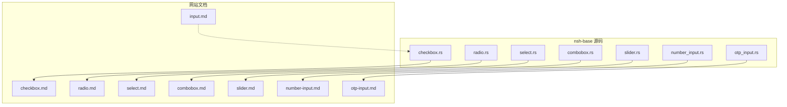

**图示来源**
- [crates/nsh-base/src/checkbox.rs:1-138](file://crates/nsh-base/src/checkbox.rs#L1-L138)
- [crates/nsh-base/src/radio.rs:1-150](file://crates/nsh-base/src/radio.rs#L1-L150)
- [crates/nsh-base/src/select.rs:1-800](file://crates/nsh-base/src/select.rs#L1-L800)
- [crates/nsh-base/src/combobox.rs:1-766](file://crates/nsh-base/src/combobox.rs#L1-L766)
- [crates/nsh-base/src/slider.rs:1-800](file://crates/nsh-base/src/slider.rs#L1-L800)
- [crates/nsh-base/src/number_input.rs:1-523](file://crates/nsh-base/src/number_input.rs#L1-L523)
- [crates/nsh-base/src/otp_input.rs:1-701](file://crates/nsh-base/src/otp_input.rs#L1-L701)
- [website/elements/checkbox.md:1-197](file://website/elements/checkbox.md#L1-L197)
- [website/elements/radio.md:1-213](file://website/elements/radio.md#L1-L213)
- [website/elements/select.md:1-398](file://website/elements/select.md#L1-L398)
- [website/elements/combobox.md:1-278](file://website/elements/combobox.md#L1-L278)
- [website/elements/slider.md:1-232](file://website/elements/slider.md#L1-L232)
- [website/elements/number-input.md:1-209](file://website/elements/number-input.md#L1-L209)
- [website/elements/otp-input.md:1-174](file://website/elements/otp-input.md#L1-L174)
- [website/elements/input.md:1-232](file://website/elements/input.md#L1-L232)

**章节来源**
- [website/elements/input.md:1-232](file://website/elements/input.md#L1-L232)
- [website/elements/checkbox.md:1-197](file://website/elements/checkbox.md#L1-L197)
- [website/elements/radio.md:1-213](file://website/elements/radio.md#L1-L213)
- [website/elements/select.md:1-398](file://website/elements/select.md#L1-L398)
- [website/elements/combobox.md:1-278](file://website/elements/combobox.md#L1-L278)
- [website/elements/slider.md:1-232](file://website/elements/slider.md#L1-L232)
- [website/elements/number-input.md:1-209](file://website/elements/number-input.md#L1-L209)
- [website/elements/otp-input.md:1-174](file://website/elements/otp-input.md#L1-L174)

## 核心组件
本节汇总各组件的 TypeScript 属性、事件与关键行为，便于快速查阅。

- Input（原生文本输入）
  - 受控/非受控：value/defaultValue + onChange/onSubmit
  - 键盘与输入法：keyboardType、returnKeyType、autoCapitalize、autoCorrect、autoComplete、pasteBehavior、submitBehavior
  - 选择与光标：selectedRange、caret、onSelectionChange、onCaretMove
  - 多行与滚动：multiline、scrollbar、onContentSizeChange
  - 颜色样式：placeholderColor、caretColor、selectionColor
  - iOS 扩展：textContentType、inputAccessoryViewID、keyboardAppearance
  - 事件：onChange、onSubmit、onFocus/onBlur、onSelectionChange、onPaste、onCaretMove、onKeyPress、onContentSizeChange、onCompositionChange
  - Ref 方法：focus、blur、setSelection、insertText

- Checkbox（复选框）
  - 属性：checked、indeterminate、disabled、checkedStyle、indeterminateStyle、accessibilityLabel、invalid、accessibilityDescribedBy、role、indicatorClass/indicatorStyle、indicator、hitSlop、children、class/style、activeStyle/hoverStyle/focusStyle/disabledStyle
  - 事件：onChange(checked)
  - 无障碍：role="checkbox"，支持 mixed 状态，禁用时读屏提示

- Radio/RadioGroup（单选按钮组）
  - Radio 属性：checked、disabled、checkedStyle、accessibilityLabel、hitSlop、children、class/style、activeStyle/hoverStyle/focusStyle/disabledStyle
  - RadioGroup 属性：accessibilityLabel、children、class/style
  - 事件：onChange(true)（仅未选中时触发）
  - 键盘：WAI-ARIA 单选组模式，方向键切换并选中

- Select（下拉选择）
  - 属性：items、value/null、defaultValue、open/defaultOpen、placeholder、searchable/searchPlaceholder/searchAccessibilityLabel/searchTestID、cleanable/clearButton*、disabled、accessibilityLabel、placement/align/offset/margin、cover、popupClass/Style、popupStartingClass/Style、popupEndingClass/Style、backdropClass/Style、listClass/Style、itemClass/Style、groupClass/Style、searchClass/Style、trigger、empty、renderItem、renderGroup、class/style
  - 事件：onChange(value|null)、onOpenChange(open, reason)、onOpen、onClose、onCancel
  - 类型：SelectItem、SelectEntry、SelectGroup
  - 键盘：typeahead、上下翻页、回车选择、Esc 取消、Tab 关闭

- Combobox（带输入的可选列表）
  - 属性：items、multiple、value[]、defaultValue[]、open/defaultOpen、placeholder、query/defaultQuery、cleanable/clearButton*、disabled、accessibilityLabel、placement/align/offset/margin、popupClass/Style、popupStartingClass/Style、popupEndingClass/Style、backdropClass/Style、listClass/Style、itemClass/Style、groupClass/Style、inputClass/Style、inputTestID、footerClass/Style、clearButton、triggerButton、prefix/suffix、empty、footer、renderItem、renderGroup、class/style
  - 事件：onChange(value[])、onConfirm(value[])、onQueryChange(query)、onOpenChange、onOpen、onClose、onCancel
  - 键盘：输入过滤、Down/Up 打开、Return 多选切换并保持打开、Cmd/Ctrl+Enter 确认关闭

- Slider（滑块）
  - 值类型：SliderValue = number | [start, end]
  - 属性：value/defaultValue、min/max/step、scale("linear"|"logarithmic")、axis("horizontal"|"vertical")、disabled、accessibilityLabel/startAccessibilityLabel、trackClass/Style、indicatorClass/Style、rangeClass/Style、thumbClass/Style、children、class/style
  - 事件：onChange(value)、onChangeEnd(value)
  - 键盘：WAI-ARIA 滑块键（Right/Up 升、Left/Down 降、PageUp/PageDown 大步、Home/End 极值）

- NumberInput（数字输入）
  - 属性：value/null、defaultValue、min/max/step、disabled、readonly、placeholder、accessibilityLabel、controlsRight、inputClass/Style、decrement/increment buttonClass/Style/button、controlsClass/Style、prefix/suffix、class/style
  - 事件：onChange(value|null)、onSubmit(value|null)、onFocus、onBlur
  - 键盘：WAI-ARIA 微调器键（Up/Down、PageUp/PageDown），Home/End 保留为光标移动

- OtpInput（一次性验证码）
  - 属性：length、value、defaultValue、masked、disabled、groups、accessibilityLabel、cellClass/Style、groupClass/Style、caretClass/Style、class/style
  - 事件：onChange(value)、onComplete({ value })、onFocus、onBlur
  - Ref：focus()
  - 行为：只接受数字，粘贴/自动填充截取前 length 位，完成时触发 onComplete

**章节来源**
- [website/elements/input.md:67-232](file://website/elements/input.md#L67-L232)
- [website/elements/checkbox.md:78-197](file://website/elements/checkbox.md#L78-L197)
- [website/elements/radio.md:95-213](file://website/elements/radio.md#L95-L213)
- [website/elements/select.md:141-398](file://website/elements/select.md#L141-L398)
- [website/elements/combobox.md:128-278](file://website/elements/combobox.md#L128-L278)
- [website/elements/slider.md:98-232](file://website/elements/slider.md#L98-L232)
- [website/elements/number-input.md:78-209](file://website/elements/number-input.md#L78-L209)
- [website/elements/otp-input.md:86-174](file://website/elements/otp-input.md#L86-L174)

## 架构总览
所有表单组件遵循“无外观”的设计原则：行为由组件内部维护，外观完全由应用通过 class/style 或 slot 定制。列表类组件（Select、Combobox）共享 listbox 能力（虚拟化、分组、搜索、高亮、键盘导航），弹窗/面板由 popup 层统一处理。

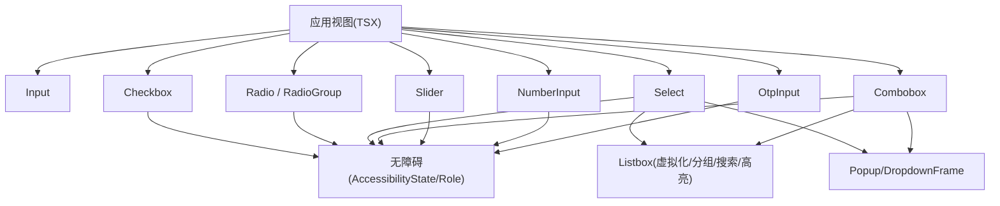

**图示来源**
- [crates/nsh-base/src/select.rs:1-800](file://crates/nsh-base/src/select.rs#L1-L800)
- [crates/nsh-base/src/combobox.rs:1-766](file://crates/nsh-base/src/combobox.rs#L1-L766)
- [crates/nsh-base/src/checkbox.rs:1-138](file://crates/nsh-base/src/checkbox.rs#L1-L138)
- [crates/nsh-base/src/radio.rs:1-150](file://crates/nsh-base/src/radio.rs#L1-L150)
- [crates/nsh-base/src/slider.rs:1-800](file://crates/nsh-base/src/slider.rs#L1-L800)
- [crates/nsh-base/src/number_input.rs:1-523](file://crates/nsh-base/src/number_input.rs#L1-L523)
- [crates/nsh-base/src/otp_input.rs:1-701](file://crates/nsh-base/src/otp_input.rs#L1-L701)

## 详细组件分析

### Input（原生文本输入）
- 受控与非受控
  - 受控：传入 value，并在 onChange 中更新；应用可重写用户输入（如格式化）。
  - 非受控：传入 defaultValue 或不传，从 onChange/onSubmit 读取。
- 键盘与提交
  - keyboardType、returnKeyType、autoCapitalize、autoCorrect、autoComplete、pasteBehavior、submitBehavior
  - submitBehavior 控制 Return 行为："submit"/"blurAndSubmit"/"newline"
- 选择与光标
  - selectedRange（UTF-16）、caret、onSelectionChange、onCaretMove
- 多行与滚动
  - multiline、scrollbar、onContentSizeChange
- 颜色与样式
  - placeholderColor、caretColor、selectionColor
- iOS 扩展
  - textContentType、inputAccessoryViewID、keyboardAppearance
- 事件
  - onChange、onSubmit、onFocus/onBlur、onSelectionChange、onPaste、onCaretMove、onKeyPress、onContentSizeChange、onCompositionChange
- Ref 方法
  - focus、blur、setSelection、insertText

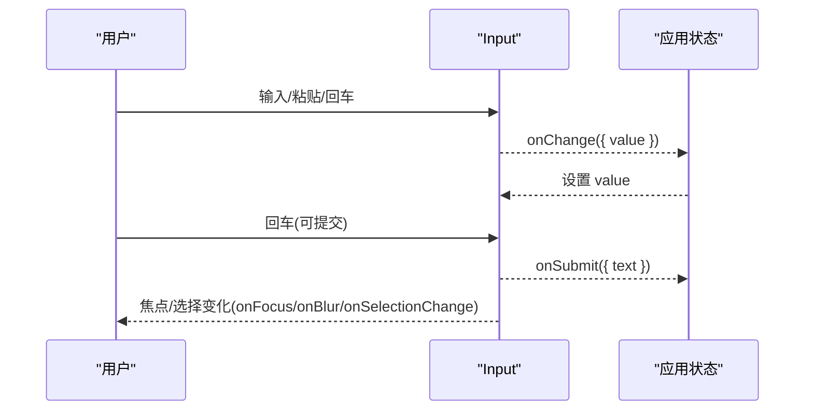

**图示来源**
- [website/elements/input.md:55-166](file://website/elements/input.md#L55-L166)
- [website/elements/input.md:192-232](file://website/elements/input.md#L192-L232)

**章节来源**
- [website/elements/input.md:55-232](file://website/elements/input.md#L55-L232)

### Checkbox（复选框）
- 状态
  - checked、indeterminate（优先于 checked）、disabled
- 样式与部件
  - indicatorClass/indicatorStyle、indicator、checkedStyle、indeterminateStyle、disabledStyle
  - children 作为标签
- 无障碍
  - role="checkbox"，mixed 状态，invalid 标记
- 事件
  - onChange(checked)：从 unchecked/indeterminate 变为 true，从 checked 变为 false

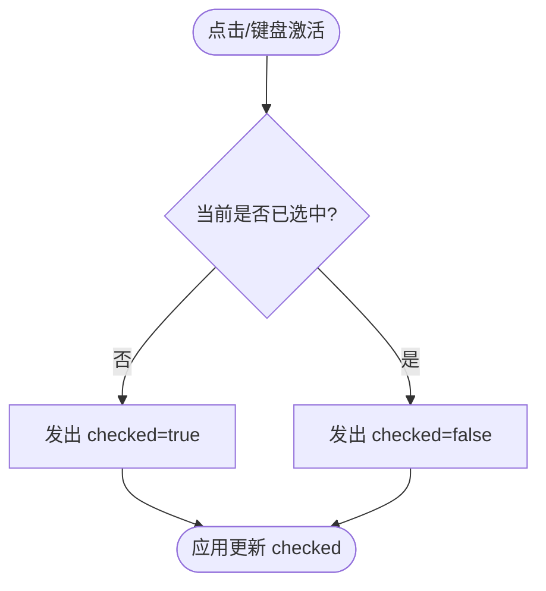

**图示来源**
- [website/elements/checkbox.md:78-114](file://website/elements/checkbox.md#L78-L114)
- [crates/nsh-base/src/checkbox.rs:1-138](file://crates/nsh-base/src/checkbox.rs#L1-L138)

**章节来源**
- [website/elements/checkbox.md:78-197](file://website/elements/checkbox.md#L78-L197)
- [crates/nsh-base/src/checkbox.rs:1-138](file://crates/nsh-base/src/checkbox.rs#L1-L138)

### Radio / RadioGroup（单选按钮组）
- Radio
  - checked、disabled、checkedStyle、accessibilityLabel、hitSlop、children、class/style、activeStyle/hoverStyle/focusStyle/disabledStyle
- RadioGroup
  - accessibilityLabel、children、class/style
- 键盘
  - Tab 进入组，方向键在选项间移动并选中，Space 选中当前项
- 事件
  - onChange(true)：仅当未选中时触发

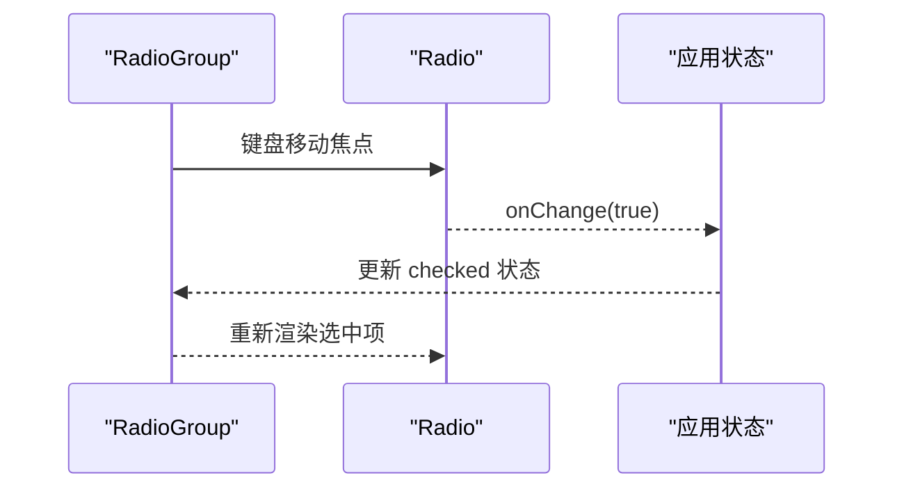

**图示来源**
- [website/elements/radio.md:175-205](file://website/elements/radio.md#L175-L205)
- [crates/nsh-base/src/radio.rs:1-150](file://crates/nsh-base/src/radio.rs#L1-L150)

**章节来源**
- [website/elements/radio.md:95-213](file://website/elements/radio.md#L95-L213)
- [crates/nsh-base/src/radio.rs:1-150](file://crates/nsh-base/src/radio.rs#L1-L150)

### Select（下拉选择）
- 数据模型
  - items: SelectItem[]（value/title/disabled/group）
  - renderItem/renderGroup 自定义行与分组头
- 值与清空
  - value=null 表示未选择；cleanable 显示清除按钮
- 打开状态
  - open/defaultOpen；onOpenChange(reason)；onOpen/onClose；onCancel
- 搜索与键盘
  - searchable；typeahead；上下翻页；回车选择；Esc 取消；Tab 关闭
- 布局
  - placement/align/offset/margin；cover（macOS 默认覆盖触发器）
- 无障碍
  - trigger 为 combobox；列表为 listbox；行 option；分组 header

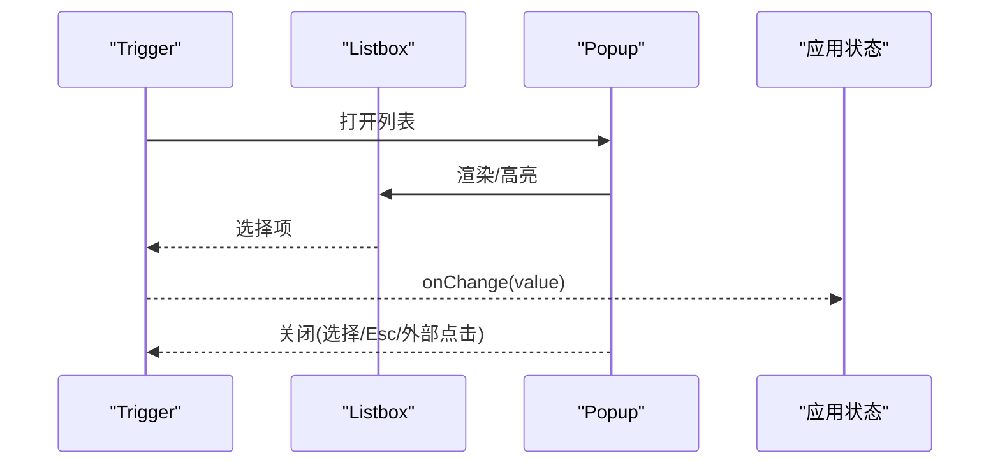

**图示来源**
- [website/elements/select.md:219-398](file://website/elements/select.md#L219-L398)
- [crates/nsh-base/src/select.rs:1-800](file://crates/nsh-base/src/select.rs#L1-L800)

**章节来源**
- [website/elements/select.md:141-398](file://website/elements/select.md#L141-L398)
- [crates/nsh-base/src/select.rs:1-800](file://crates/nsh-base/src/select.rs#L1-L800)

### Combobox（带输入的可选列表）
- 值与多选
  - value[]；multiple 时 Toggle 保持列表打开
- 查询
  - query/defaultQuery；onQueryChange；输入即过滤
- 确认
  - onConfirm(value[])：每次打开关闭一次
- 布局与部件
  - inputClass/Style、triggerButton、prefix/suffix、footer、empty
- 键盘
  - 输入过滤；Down/Up 打开；Return 多选切换；Cmd/Ctrl+Enter 确认关闭

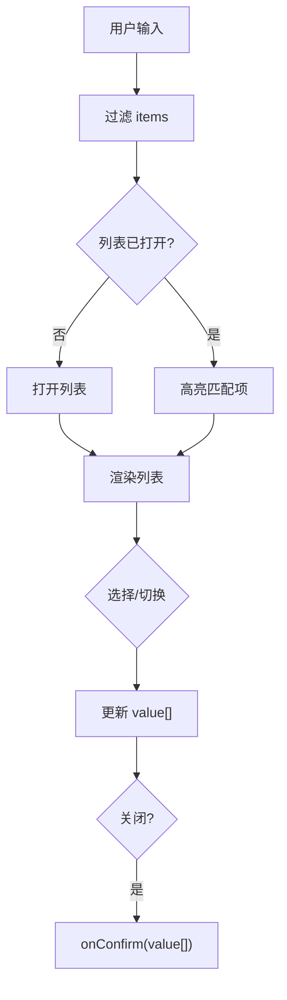

**图示来源**
- [website/elements/combobox.md:128-278](file://website/elements/combobox.md#L128-L278)
- [crates/nsh-base/src/combobox.rs:1-766](file://crates/nsh-base/src/combobox.rs#L1-L766)

**章节来源**
- [website/elements/combobox.md:128-278](file://website/elements/combobox.md#L128-L278)
- [crates/nsh-base/src/combobox.rs:1-766](file://crates/nsh-base/src/combobox.rs#L1-L766)

### Slider（滑块）
- 值与范围
  - SliderValue：number 或 [start, end]；step 对齐；scale 线性/对数
- 交互
  - 轨道点击移动到最近拇指；拖拽实时更新；onChange 实时上报；onChangeEnd 结束上报
- 键盘
  - WAI-ARIA 滑块键；RTL 布局反转左右键语义
- 无障碍
  - 每个拇指为 adjustable，报告 min/max/now/text

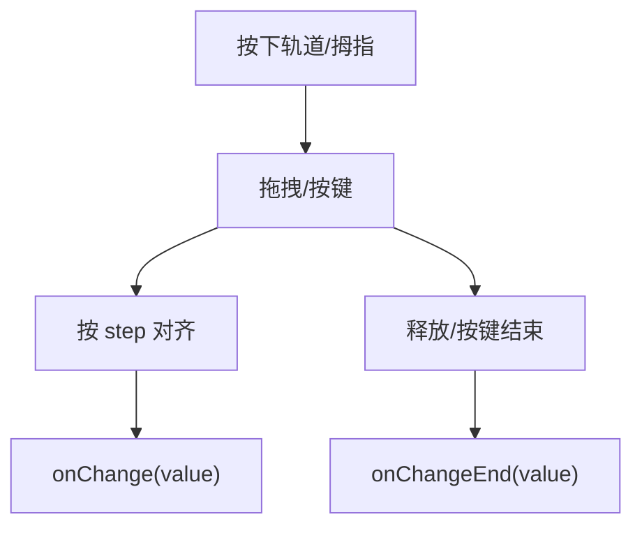

**图示来源**
- [website/elements/slider.md:98-232](file://website/elements/slider.md#L98-L232)
- [crates/nsh-base/src/slider.rs:1-800](file://crates/nsh-base/src/slider.rs#L1-L800)

**章节来源**
- [website/elements/slider.md:98-232](file://website/elements/slider.md#L98-L232)
- [crates/nsh-base/src/slider.rs:1-800](file://crates/nsh-base/src/slider.rs#L1-L800)

### NumberInput（数字输入）
- 数值规则
  - 只接受数字与符号；小数点与逗号兼容；保留 step 的小数位
- 边界与步进
  - min/max 约束；step 步进；PageUp/PageDown 十步
- 事件
  - onChange(value|null)：编辑过程中可能越界，离开或回车时归一化
  - onSubmit(value|null)：提交时归一化到[min,max]
- 无障碍
  - role="spinbutton"；increment/decrement 动作

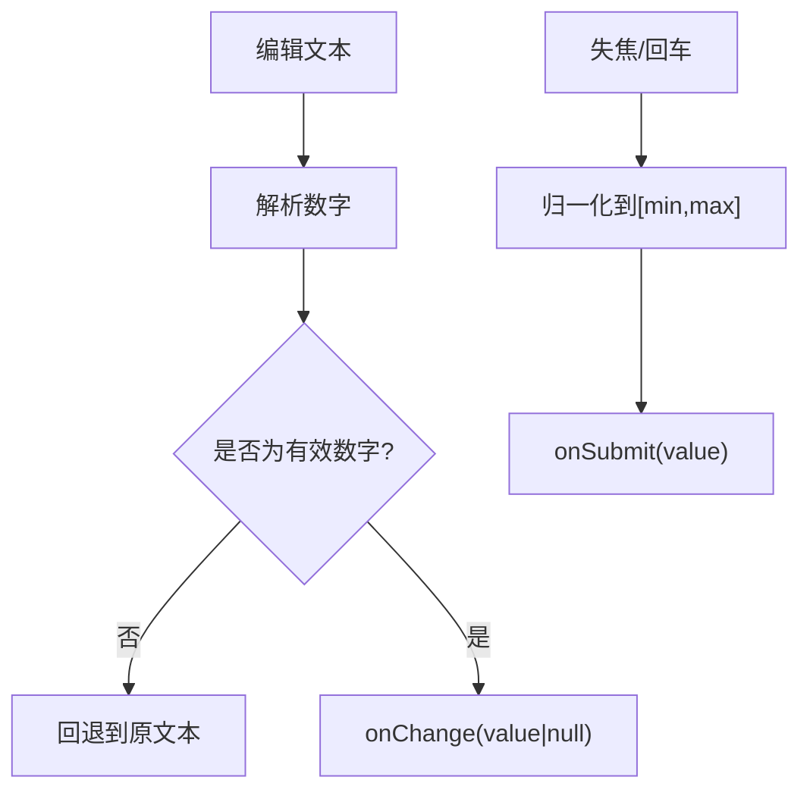

**图示来源**
- [website/elements/number-input.md:78-209](file://website/elements/number-input.md#L78-L209)
- [crates/nsh-base/src/number_input.rs:1-523](file://crates/nsh-base/src/number_input.rs#L1-L523)

**章节来源**
- [website/elements/number-input.md:78-209](file://website/elements/number-input.md#L78-L209)
- [crates/nsh-base/src/number_input.rs:1-523](file://crates/nsh-base/src/number_input.rs#L1-L523)

### OtpInput（一次性验证码）
- 行为
  - 固定长度 digits；Backspace 删除末位；粘贴/自动填充截取前 length 位
  - 完成时触发 onComplete
- 样式
  - cellClass/Style、groupClass/Style、caretClass/Style；data-filled 状态
- 无障碍
  - 单一文本字段；masked 时不朗读代码；系统自动填充支持

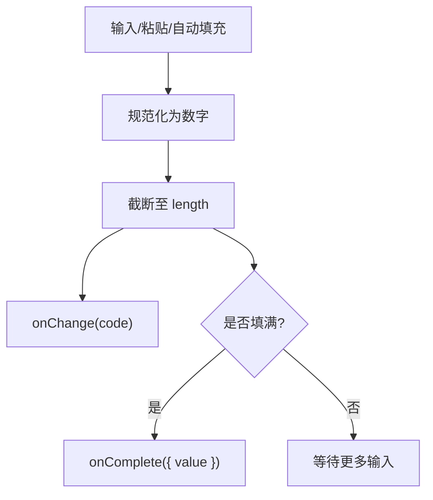

**图示来源**
- [website/elements/otp-input.md:86-174](file://website/elements/otp-input.md#L86-L174)
- [crates/nsh-base/src/otp_input.rs:1-701](file://crates/nsh-base/src/otp_input.rs#L1-L701)

**章节来源**
- [website/elements/otp-input.md:86-174](file://website/elements/otp-input.md#L86-L174)
- [crates/nsh-base/src/otp_input.rs:1-701](file://crates/nsh-base/src/otp_input.rs#L1-L701)

## 依赖关系分析
- Select 与 Combobox 共享 Listbox 能力（虚拟化、分组、搜索、高亮、键盘导航）
- 列表弹出层由 Popup/DropdownFrame 统一管理
- 所有组件均通过 AccessibilityState/Role 暴露无障碍信息
- 键盘导航在各组件内分别实现，部分复用 keys 工具函数

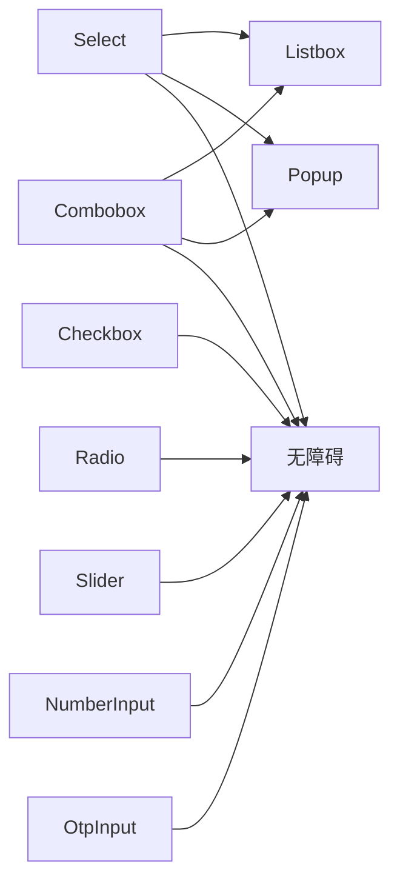

**图示来源**
- [crates/nsh-base/src/select.rs:1-800](file://crates/nsh-base/src/select.rs#L1-L800)
- [crates/nsh-base/src/combobox.rs:1-766](file://crates/nsh-base/src/combobox.rs#L1-L766)
- [crates/nsh-base/src/checkbox.rs:1-138](file://crates/nsh-base/src/checkbox.rs#L1-L138)
- [crates/nsh-base/src/radio.rs:1-150](file://crates/nsh-base/src/radio.rs#L1-L150)
- [crates/nsh-base/src/slider.rs:1-800](file://crates/nsh-base/src/slider.rs#L1-L800)
- [crates/nsh-base/src/number_input.rs:1-523](file://crates/nsh-base/src/number_input.rs#L1-L523)
- [crates/nsh-base/src/otp_input.rs:1-701](file://crates/nsh-base/src/otp_input.rs#L1-L701)

**章节来源**
- [crates/nsh-base/src/select.rs:1-800](file://crates/nsh-base/src/select.rs#L1-L800)
- [crates/nsh-base/src/combobox.rs:1-766](file://crates/nsh-base/src/combobox.rs#L1-L766)

## 性能与可访问性
- 性能
  - Select/Combobox 使用虚拟化列表，仅渲染可视区域行
  - Slider 在拖拽期间本地更新 pending 值，避免频繁跨层同步
  - OtpInput 使用原生动画 BlinkCursor，减少重绘开销
- 可访问性
  - 所有组件暴露正确的 role 与 state（checked/expanded/has_popup/adjustable/spinbutton）
  - 键盘导航遵循 WAI-ARIA 模式（单选组、滑块、微调器、组合框）
  - 屏幕阅读器可读 label/value/range，禁用状态有明确提示

[无需章节来源：本节为通用指导]

## 故障排查指南
- Input
  - 问题：多行输入高度异常
    - 检查：是否监听 onContentSizeChange 并限制最大高度
    - 参考：[website/elements/input.md:168-190](file://website/elements/input.md#L168-L190)
  - 问题：粘贴图片/文件行为不符合预期
    - 检查：pasteBehavior 与 onPaste 处理
    - 参考：[website/elements/input.md:91-96](file://website/elements/input.md#L91-L96)
- Checkbox/Radio
  - 问题：不可点击或样式不生效
    - 检查：disabled 与 hitSlop；确保 group-checked 等状态类正确
    - 参考：[website/elements/checkbox.md:146-177](file://website/elements/checkbox.md#L146-L177), [website/elements/radio.md:138-173](file://website/elements/radio.md#L138-L173)
- Select/Combobox
  - 问题：列表位置被遮挡
    - 检查：placement/align/offset/margin；必要时设置 max-h 限制
    - 参考：[website/elements/select.md:344-349](file://website/elements/select.md#L344-L349)
  - 问题：搜索无效
    - 检查：searchable 与 searchPlaceholder；确认 items.title 包含匹配词
    - 参考：[website/elements/select.md:219-239](file://website/elements/select.md#L219-L239)
- Slider
  - 问题：拖拽卡顿或值不同步
    - 检查：是否在 onChange 中做昂贵计算；考虑在 onChangeEnd 持久化
    - 参考：[website/elements/slider.md:122-133](file://website/elements/slider.md#L122-L133)
- NumberInput
  - 问题：输入后值被重置
    - 检查：controlled 模式下，应用是否正确回写 value
    - 参考：[website/elements/number-input.md:84-98](file://website/elements/number-input.md#L84-L98)
- OtpInput
  - 问题：粘贴后位数不正确
    - 检查：length 与 masked；确认系统自动填充行为
    - 参考：[website/elements/otp-input.md:100-103](file://website/elements/otp-input.md#L100-L103)

**章节来源**
- [website/elements/input.md:168-190](file://website/elements/input.md#L168-L190)
- [website/elements/checkbox.md:146-177](file://website/elements/checkbox.md#L146-L177)
- [website/elements/radio.md:138-173](file://website/elements/radio.md#L138-L173)
- [website/elements/select.md:344-349](file://website/elements/select.md#L344-L349)
- [website/elements/select.md:219-239](file://website/elements/select.md#L219-L239)
- [website/elements/slider.md:122-133](file://website/elements/slider.md#L122-L133)
- [website/elements/number-input.md:84-98](file://website/elements/number-input.md#L84-L98)
- [website/elements/otp-input.md:100-103](file://website/elements/otp-input.md#L100-L103)

## 结论
NSH 表单组件以“行为与外观解耦”为核心，提供一致的受控/非受控数据绑定、完善的键盘导航与无障碍支持。列表类组件共享强大的 Listbox 能力，弹窗与遮罩由 Popup 层统一管理。通过合理的状态管理与事件处理，可在复杂表单场景中实现动态生成、条件渲染与批量操作。

[无需章节来源：本节为总结性内容]

## 附录：复杂表单实战
以下示例展示如何组合多个表单组件，实现动态表单、条件渲染与批量操作。为避免泄露具体代码，仅提供结构与路径指引。

- 动态表单生成
  - 使用数组驱动渲染多个 Input/NumberInput/Checkbox/Radio
  - 将每项绑定到统一的 formState，onChange 中合并更新
  - 参考：[website/elements/input.md:55-66](file://website/elements/input.md#L55-L66), [website/elements/number-input.md:78-98](file://website/elements/number-input.md#L78-L98)

- 条件渲染
  - 根据 Checkbox/Radio 的值显示不同字段（如邮箱 vs 电话）
  - 使用 Select/Combobox 切换字段类型
  - 参考：[website/elements/checkbox.md:119-144](file://website/elements/checkbox.md#L119-L144), [website/elements/select.md:141-158](file://website/elements/select.md#L141-L158)

- 批量操作
  - 使用 Checkbox 的 indeterminate 实现全选/半选
  - 使用 RadioGroup 切换排序/筛选策略
  - 参考：[website/elements/checkbox.md:119-144](file://website/elements/checkbox.md#L119-L144), [website/elements/radio.md:175-205](file://website/elements/radio.md#L175-L205)

- 自定义验证与错误处理
  - 在 onBlur/onSubmit 中对 Input/NumberInput 进行校验，结合 invalid/accessibilityDescribedBy 提示
  - 对 Select/Combobox 的 value 进行存在性校验
  - 参考：[website/elements/input.md:154-166](file://website/elements/input.md#L154-L166), [website/elements/number-input.md:145-153](file://website/elements/number-input.md#L145-L153)

- 无障碍与键盘体验
  - 为所有控件提供 accessibilityLabel
  - 使用 WAI-ARIA 键盘模式（单选组、滑块、微调器、组合框）
  - 参考：[website/elements/radio.md:175-205](file://website/elements/radio.md#L175-L205), [website/elements/slider.md:194-223](file://website/elements/slider.md#L194-L223), [website/elements/number-input.md:178-201](file://website/elements/number-input.md#L178-L201), [website/elements/combobox.md:259-277](file://website/elements/combobox.md#L259-L277)

**章节来源**
- [website/elements/input.md:55-66](file://website/elements/input.md#L55-L66)
- [website/elements/number-input.md:78-98](file://website/elements/number-input.md#L78-L98)
- [website/elements/checkbox.md:119-144](file://website/elements/checkbox.md#L119-L144)
- [website/elements/select.md:141-158](file://website/elements/select.md#L141-L158)
- [website/elements/radio.md:175-205](file://website/elements/radio.md#L175-L205)
- [website/elements/input.md:154-166](file://website/elements/input.md#L154-L166)
- [website/elements/number-input.md:145-153](file://website/elements/number-input.md#L145-L153)
- [website/elements/slider.md:194-223](file://website/elements/slider.md#L194-L223)
- [website/elements/number-input.md:178-201](file://website/elements/number-input.md#L178-L201)
- [website/elements/combobox.md:259-277](file://website/elements/combobox.md#L259-L277)