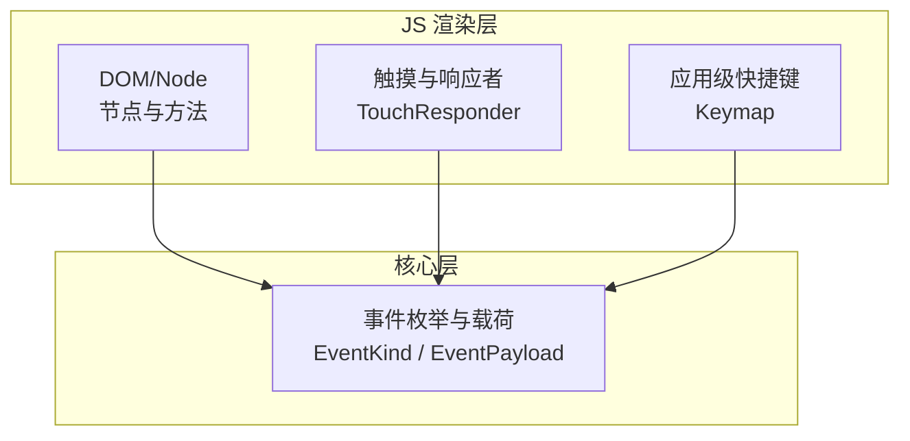
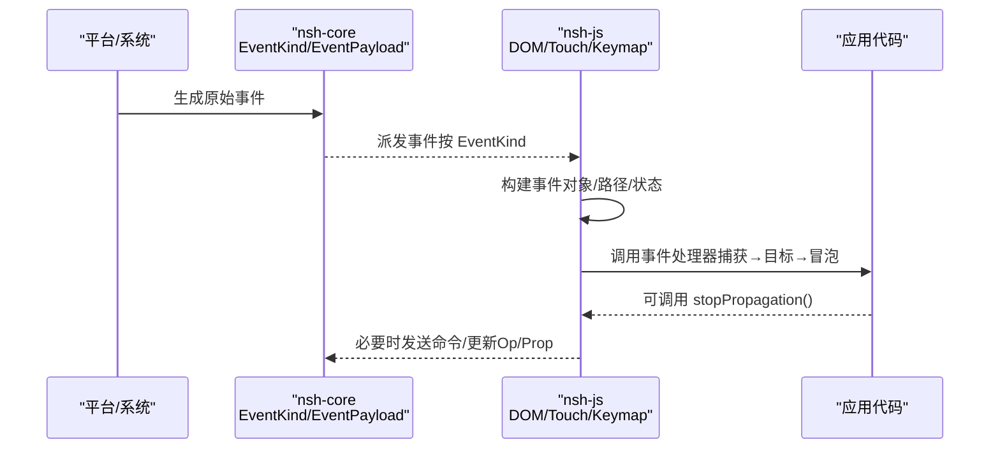
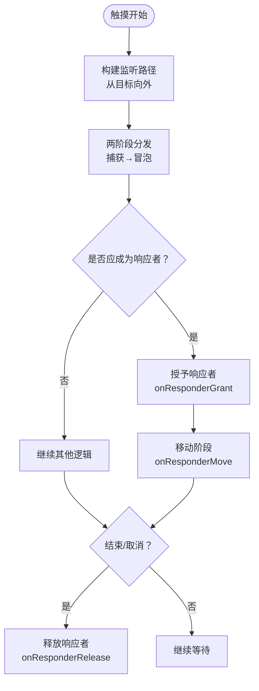
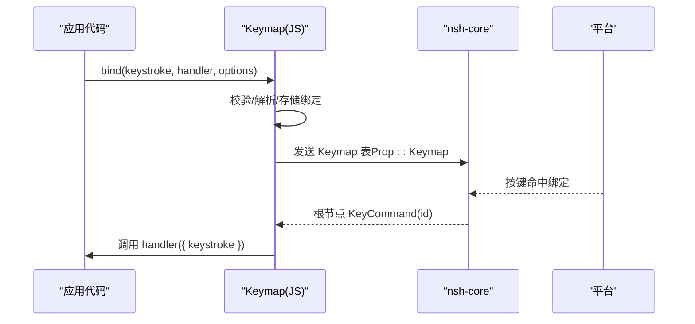
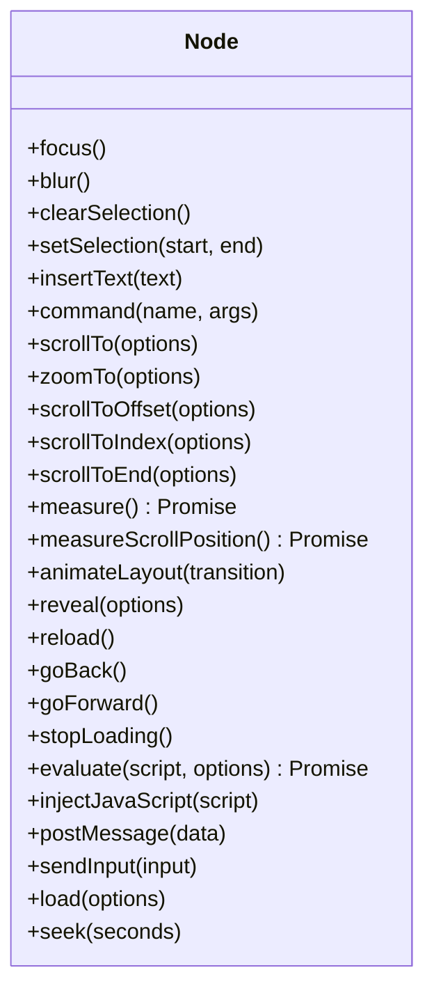
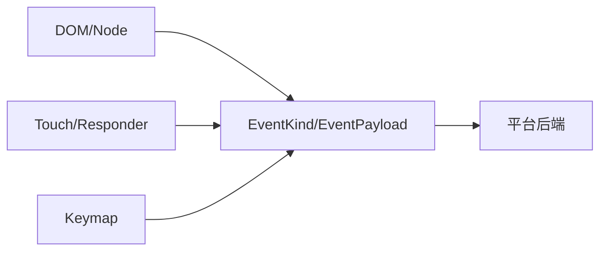

# 事件系统API

<cite>
**本文引用的文件**   
- [dom.rs](file://crates/nsh-js/src/dom.rs)
- [touch.rs](file://crates/nsh-js/src/touch.rs)
- [keymap.rs](file://crates/nsh-js/src/keymap.rs)
- [ops.rs](file://crates/nsh-core/src/ops.rs)
</cite>

## 目录
1. [简介](#简介)
2. [项目结构](#项目结构)
3. [核心组件](#核心组件)
4. [架构总览](#架构总览)
5. [详细组件分析](#详细组件分析)
6. [依赖关系分析](#依赖关系分析)
7. [性能考量](#性能考量)
8. [故障排查指南](#故障排查指南)
9. [结论](#结论)
10. [附录](#附录)

## 简介
本文件为 NSH 框架的事件系统提供 TypeScript API 文档，覆盖用户交互事件、手势识别、键盘输入与触摸事件的接口规范；说明事件冒泡、捕获、阻止默认行为等传播机制；给出自定义事件、事件委托与事件聚合的实现方法；并总结跨平台兼容性与差异处理、复杂交互场景的处理模式与性能优化策略。

## 项目结构
NSH 事件系统由 JS 渲染层（nsh-js）与平台无关的核心（nsh-core）共同实现：
- nsh-js 负责将 DOM/视图节点与 JS 回调绑定，分发触摸、键盘、鼠标等事件，维护响应者协商与手势状态。
- nsh-core 定义统一的事件类型、载荷与协议名称，供各平台后端与 JS 渲染层对齐。

**图示来源** 
- [dom.rs:420-606](file://crates/nsh-js/src/dom.rs#L420-L606)
- [touch.rs:39-144](file://crates/nsh-js/src/touch.rs#L39-L144)
- [keymap.rs:352-430](file://crates/nsh-js/src/keymap.rs#L352-L430)
- [ops.rs:118-282](file://crates/nsh-core/src/ops.rs#L118-L282)

**章节来源**
- [dom.rs:1-107](file://crates/nsh-js/src/dom.rs#L1-L107)
- [ops.rs:118-282](file://crates/nsh-core/src/ops.rs#L118-L282)

## 核心组件
- 节点与事件绑定（DOM/Node）
  - 暴露节点方法（如 focus、blur、measure、scrollTo 等），并通过命令通道将操作下发到核心。
  - 维护节点树、事件处理器、触摸相关属性与保留值。
- 触摸与手势（Touch/Responder/PanResponder）
  - 提供 on*Touch* 与 onResponder* 系列回调，支持捕获与冒泡两阶段。
  - 维护响应者协商流程与 PanResponder 手势状态（位移、速度、活动触点数量等）。
- 应用级键盘快捷键（Keymap）
  - 提供 keymap.bind(label, handler, options?) 与 label(keystroke)。
  - 将按键映射表发送到平台，平台匹配后通过根节点的 KeyCommand 事件回调 JS。

**章节来源**
- [dom.rs:420-606](file://crates/nsh-js/src/dom.rs#L420-L606)
- [touch.rs:39-144](file://crates/nsh-js/src/touch.rs#L39-L144)
- [keymap.rs:94-165](file://crates/nsh-js/src/keymap.rs#L94-L165)

## 架构总览
事件从平台或 JS 侧产生，经 nsh-js 解析与分发，最终落到对应节点的事件处理器；同时，关键事件在 nsh-core 中以统一的 EventKind 与 EventPayload 表达，保证跨平台一致性。

**图示来源**
- [ops.rs:118-282](file://crates/nsh-core/src/ops.rs#L118-L282)
- [dom.rs:420-606](file://crates/nsh-js/src/dom.rs#L420-L606)
- [touch.rs:256-372](file://crates/nsh-js/src/touch.rs#L256-L372)
- [keymap.rs:323-350](file://crates/nsh-js/src/keymap.rs#L323-L350)

## 详细组件分析

### 触摸与手势（Touch/Responder/PanResponder）
- 事件与回调
  - 触摸事件：onTouchStart/onTouchMove/onTouchEnd/onTouchCancel 及其 Capture 版本。
  - 响应者协商：onStartShouldSetResponder/onMoveShouldSetResponder 及其 Capture 版本。
  - 响应者生命周期：onResponderGrant/onResponderReject/onResponderStart/onResponderMove/onResponderEnd/onResponderRelease/onResponderTerminate/onResponderTerminationRequest。
- 事件对象
  - 包含 identifier、locationX/Y、pageX/Y、target、timestamp、modifiers、touches、changedTouches、nativeEvent 等字段。
  - 提供 stopPropagation() 以停止后续捕获/冒泡。
- 传播机制
  - 两阶段：先捕获（从外到内），再冒泡（从内到外）。
  - 响应者在 Start/Move 阶段通过 ShouldSetResponder 协商获得触控权。
  - 当平台激活某个 pan 时，若该节点具备 panActivation 且未持有响应者，则直接接管。
- PanResponder
  - 提供 panHandlers，内部维护手势状态（moveX/moveY/x0/y0/dx/dy/vx/vy/numberActiveTouches）。
  - 自动计算质心、速度与平滑增量，便于实现拖拽、缩放、旋转等手势。

**图示来源**
- [touch.rs:256-372](file://crates/nsh-js/src/touch.rs#L256-L372)
- [touch.rs:427-512](file://crates/nsh-js/src/touch.rs#L427-L512)
- [touch.rs:514-605](file://crates/nsh-js/src/touch.rs#L514-L605)

**章节来源**
- [touch.rs:39-144](file://crates/nsh-js/src/touch.rs#L39-L144)
- [touch.rs:256-372](file://crates/nsh-js/src/touch.rs#L256-L372)
- [touch.rs:427-512](file://crates/nsh-js/src/touch.rs#L427-L512)
- [touch.rs:514-605](file://crates/nsh-js/src/touch.rs#L514-L605)
- [touch.rs:607-800](file://crates/nsh-js/src/touch.rs#L607-L800)

### 键盘输入与应用级快捷键（Keymap）
- API
  - keymap.bind(keystroke, handler, options?) 或 keymap.bind({ keystrokes: handlers }, options?)
  - keymap.label(keystroke) 返回平台友好的显示文本。
- 选项
  - when: "always" | "notEditing"
  - repeat: boolean（长按重复触发）
  - passThrough: boolean（允许键继续传递）
  - forFocus: boolean（优先给有焦点的视图）
  - overFocused: boolean（优先于聚焦视图的绑定）
  - scope: "app" | "window"（作用域）
- 工作流程
  - 解析并校验快捷键与选项，注册到本地绑定表。
  - 首次注册时将完整映射表发送至平台（Prop::Keymap）。
  - 平台匹配后，通过根节点的 KeyCommand 事件回调 JS，传入 { keystroke }。

**图示来源**
- [keymap.rs:167-263](file://crates/nsh-js/src/keymap.rs#L167-L263)
- [keymap.rs:299-321](file://crates/nsh-js/src/keymap.rs#L299-L321)
- [keymap.rs:323-350](file://crates/nsh-js/src/keymap.rs#L323-L350)

**章节来源**
- [keymap.rs:94-165](file://crates/nsh-js/src/keymap.rs#L94-L165)
- [keymap.rs:167-263](file://crates/nsh-js/src/keymap.rs#L167-L263)
- [keymap.rs:299-350](file://crates/nsh-js/src/keymap.rs#L299-L350)
- [keymap.rs:352-430](file://crates/nsh-js/src/keymap.rs#L352-L430)

### 节点方法与通用事件（DOM/Node）
- 节点方法
  - 包括 focus/blur/clearSelection/setSelection/insertText/command/scrollTo/zoomTo/scrollToOffset/scrollToIndex/scrollToEnd/measure/measureScrollPosition/animateLayout/reveal/reload/goBack/goForward/stopLoading/evaluate/injectJavaScript/postMessage/sendInput/load/seek 等。
  - 这些方法通过命令通道（Op::Command）下发到核心，再由平台执行具体动作。
- 事件分发
  - 所有事件在 nsh-core 中统一定义为 EventKind，附带相应 EventPayload。
  - 平台与 JS 渲染层通过统一的协议名（如 onPress、onChangeText、onScroll 等）对齐。

**图示来源**
- [dom.rs:420-606](file://crates/nsh-js/src/dom.rs#L420-L606)

**章节来源**
- [dom.rs:420-606](file://crates/nsh-js/src/dom.rs#L420-L606)
- [ops.rs:118-282](file://crates/nsh-core/src/ops.rs#L118-L282)

## 依赖关系分析
- nsh-js 依赖 nsh-core 的 EventKind/EventPayload 进行事件建模与协议命名。
- DOM/Node 通过 Op::Command 与核心通信；Touch/Keymap 通过 Prop/Op 与核心同步状态。
- 平台后端根据 EventKind 将原生事件转换为 JS 可消费的对象。

**图示来源**
- [dom.rs:420-606](file://crates/nsh-js/src/dom.rs#L420-L606)
- [touch.rs:39-144](file://crates/nsh-js/src/touch.rs#L39-L144)
- [keymap.rs:299-321](file://crates/nsh-js/src/keymap.rs#L299-L321)
- [ops.rs:118-282](file://crates/nsh-core/src/ops.rs#L118-L282)

**章节来源**
- [dom.rs:420-606](file://crates/nsh-js/src/dom.rs#L420-L606)
- [touch.rs:39-144](file://crates/nsh-js/src/touch.rs#L39-L144)
- [keymap.rs:299-321](file://crates/nsh-js/src/keymap.rs#L299-L321)
- [ops.rs:118-282](file://crates/nsh-core/src/ops.rs#L118-L282)

## 性能考量
- 数组长度保护：避免超大数组导致引擎线程长时间阻塞（MAX_ARRAY_ITEMS）。
- 事件对象复用与最小化分配：减少 GC 压力，尤其在高频移动事件中。
- 两阶段分发短路：一旦调用 stopPropagation()，立即终止后续捕获/冒泡。
- 响应者协商优化：仅在必要范围内询问 ShouldSetResponder，跳过无监听器的节点。
- 手势状态增量更新：PanResponder 使用平滑速度与最近样本，降低抖动与计算开销。

[本节为通用指导，不直接分析具体文件]

## 故障排查指南
- 事件未触发
  - 检查节点是否正确挂载，事件处理器是否已设置。
  - 确认事件名称与 EventKind.handler_name 一致。
- 阻止传播无效
  - 确保在正确的阶段调用 stopPropagation()，并在同一事件对象上多次调用不会恢复传播。
- 响应者冲突
  - 审查 onStartShouldSetResponder/onMoveShouldSetResponder 返回值；必要时使用 onResponderTerminationRequest 控制让渡。
- 快捷键不生效
  - 校验快捷键字符串与修饰键组合；确认 scope 与作用窗口正确；检查 when/passThrough/forFocus/overFocused 配置。
- 性能问题
  - 避免在高频回调中进行昂贵计算；使用节流/防抖；减少不必要的状态更新。

**章节来源**
- [touch.rs:256-372](file://crates/nsh-js/src/touch.rs#L256-L372)
- [keymap.rs:167-263](file://crates/nsh-js/src/keymap.rs#L167-L263)

## 结论
NSH 事件系统通过 nsh-core 的统一事件模型与 nsh-js 的高效分发机制，提供了跨平台的用户交互能力。触摸与手势采用响应者协商与两阶段传播，键盘快捷键通过平台侧匹配与根事件回调，节点方法通过命令通道驱动平台行为。遵循本文档的接口规范与最佳实践，可在复杂交互场景中实现稳定、高性能的事件处理。

[本节为总结性内容，不直接分析具体文件]

## 附录

### TypeScript API 速览（基于源码导出与声明）
- 触摸与手势
  - 回调：onTouchStart/onTouchMove/onTouchEnd/onTouchCancel 及其 Capture 版本
  - 响应者：onStartShouldSetResponder/onMoveShouldSetResponder 及其 Capture 版本；onResponderGrant/onResponderReject/onResponderStart/onResponderMove/onResponderEnd/onResponderRelease/onResponderTerminate/onResponderTerminationRequest
  - 事件对象字段：identifier、locationX/Y、pageX/Y、target、timestamp、modifiers、touches、changedTouches、nativeEvent；方法：stopPropagation()
- 应用级快捷键
  - keymap.bind(keystroke, handler, options?) 或 keymap.bind({ keystrokes: handlers }, options?)
  - keymap.label(keystroke)
  - 选项：when、repeat、passThrough、forFocus、overFocused、scope
- 节点方法
  - focus/blur/clearSelection/setSelection/insertText/command/scrollTo/zoomTo/scrollToOffset/scrollToIndex/scrollToEnd/measure/measureScrollPosition/animateLayout/reveal/reload/goBack/goForward/stopLoading/evaluate/injectJavaScript/postMessage/sendInput/load/seek

**章节来源**
- [touch.rs:39-144](file://crates/nsh-js/src/touch.rs#L39-L144)
- [keymap.rs:352-430](file://crates/nsh-js/src/keymap.rs#L352-L430)
- [dom.rs:420-606](file://crates/nsh-js/src/dom.rs#L420-L606)