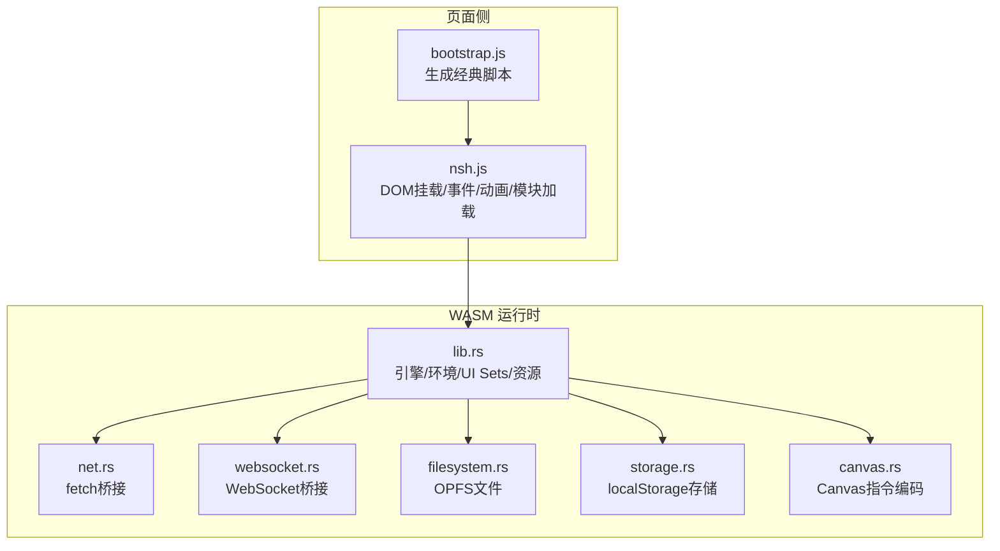
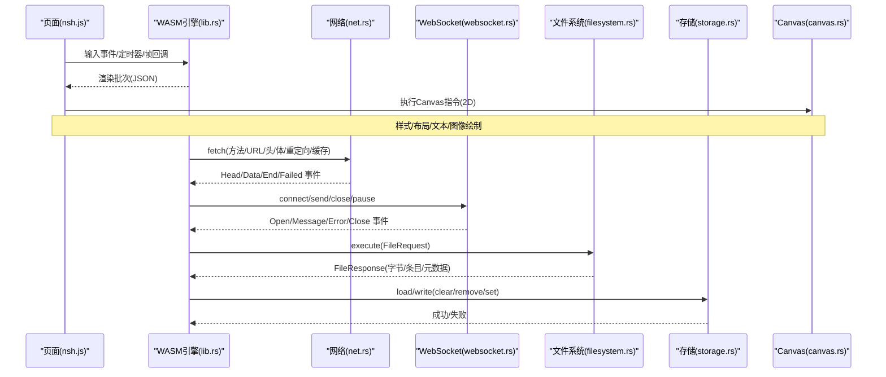
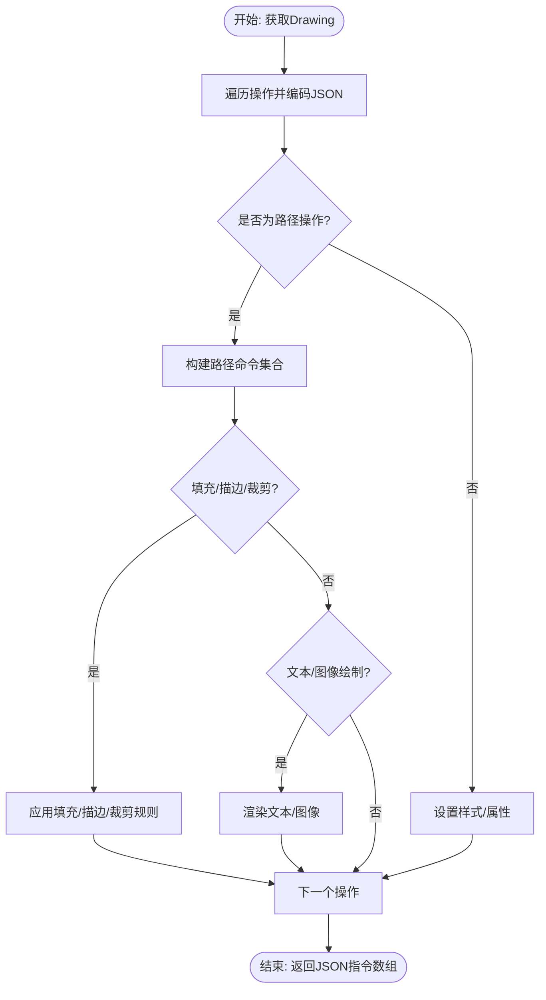
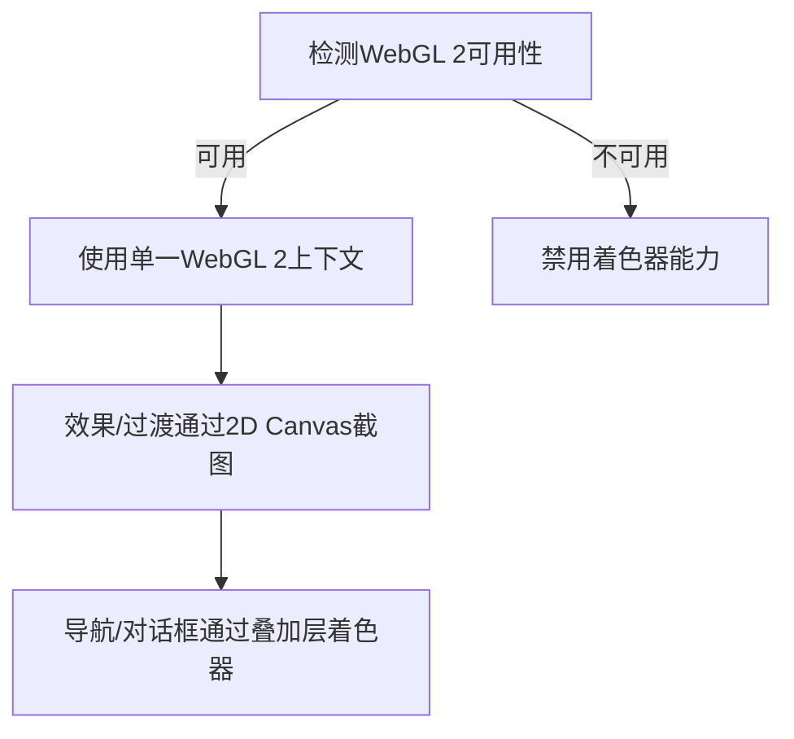
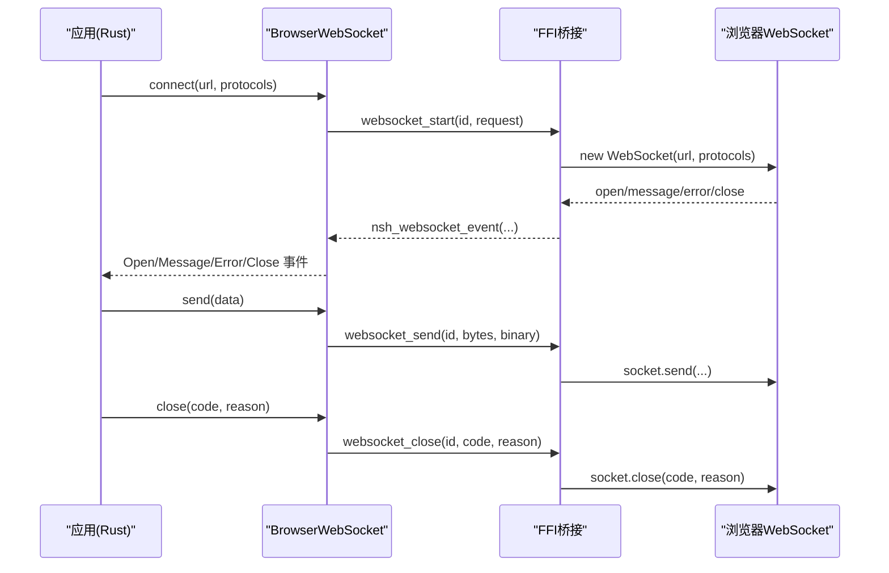
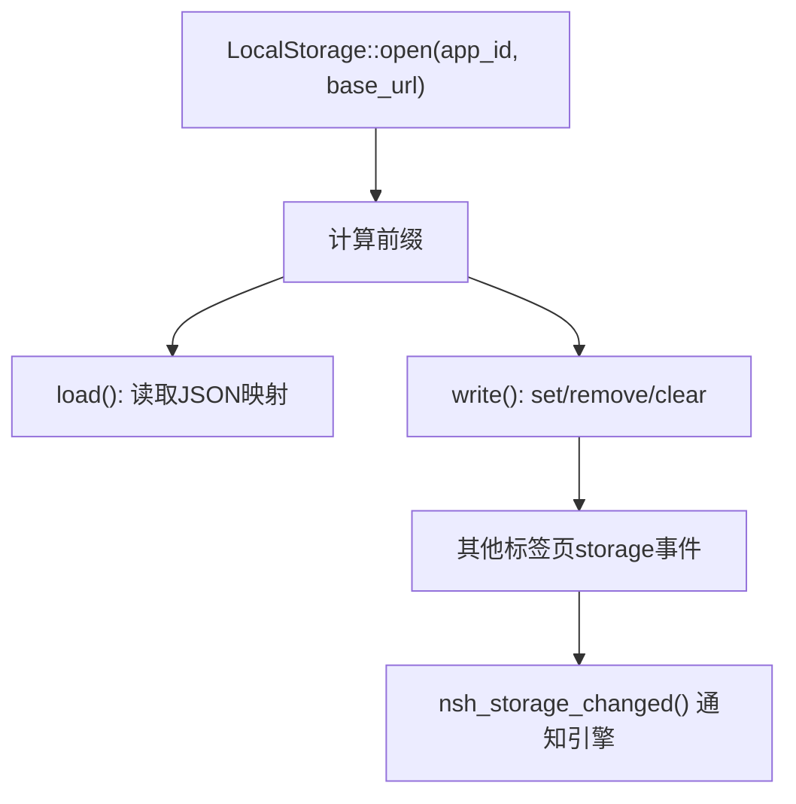
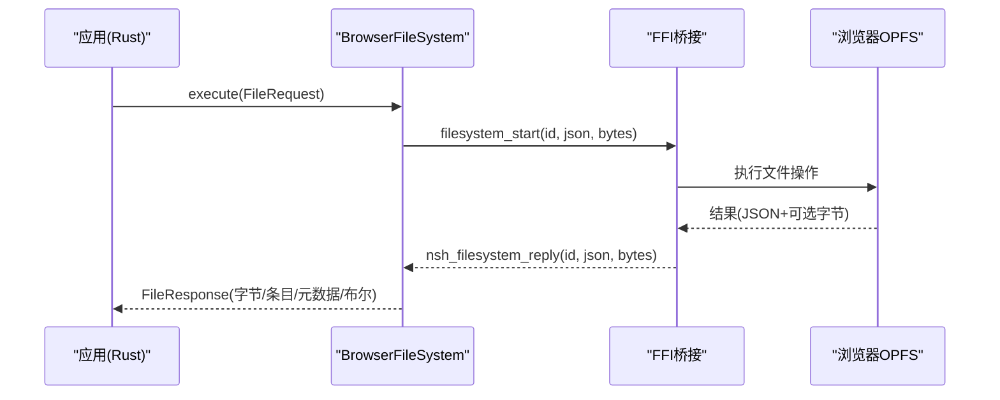
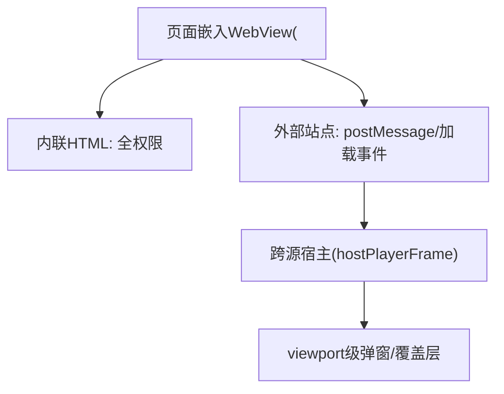
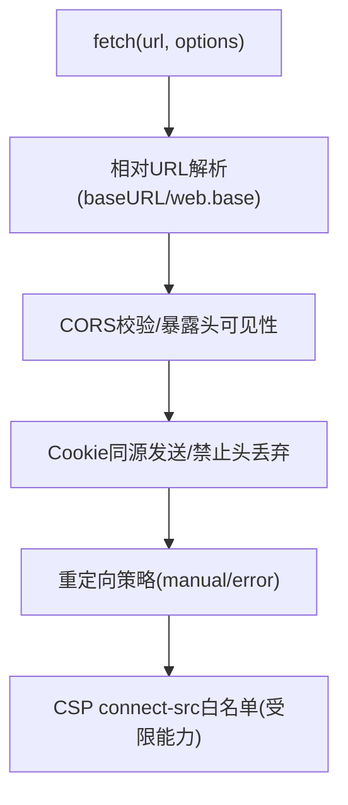
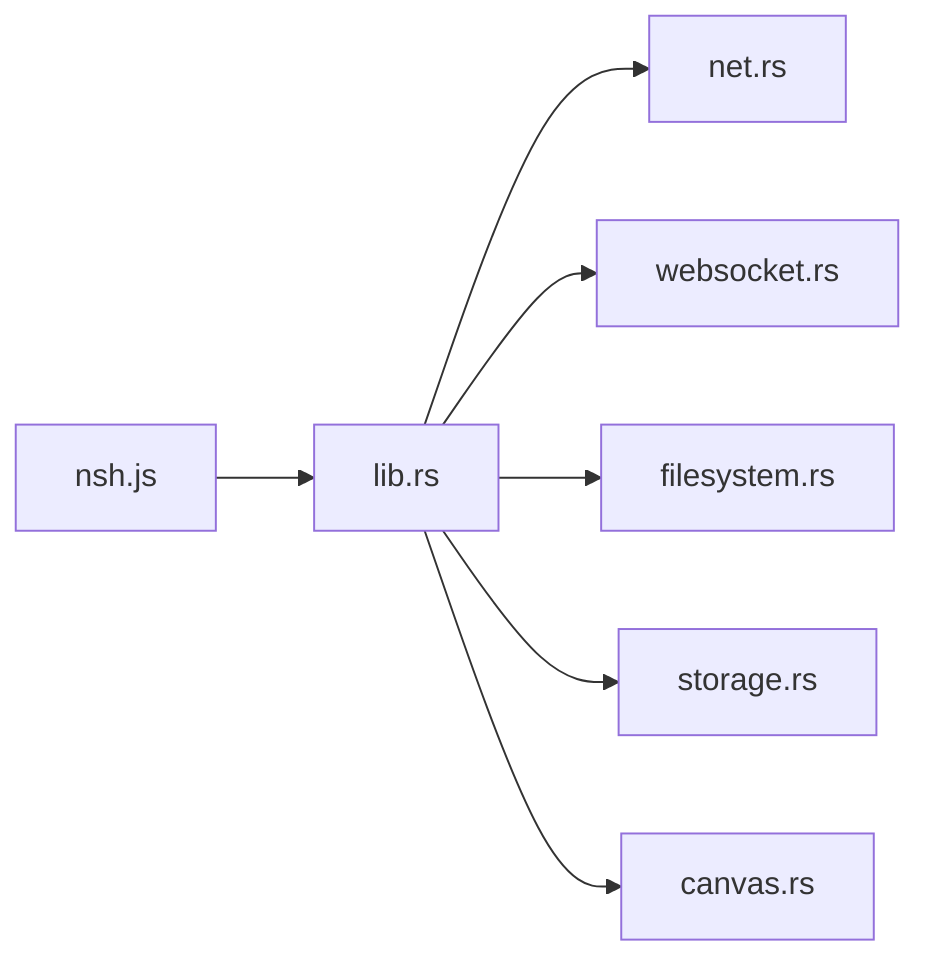

# Web平台API

<cite>
**本文引用的文件**   
- [lib.rs](file://crates/nsh-platform-web/src/lib.rs)
- [canvas.rs](file://crates/nsh-platform-web/src/canvas.rs)
- [websocket.rs](file://crates/nsh-platform-web/src/websocket.rs)
- [storage.rs](file://crates/nsh-platform-web/src/storage.rs)
- [filesystem.rs](file://crates/nsh-platform-web/src/filesystem.rs)
- [net.rs](file://crates/nsh-platform-web/src/net.rs)
- [web.md（开发文档）](file://docs/dev/web.md)
- [web.md（网站文档）](file://website/docs/web.md)
</cite>

## 目录
1. [简介](#简介)
2. [项目结构](#项目结构)
3. [核心组件](#核心组件)
4. [架构总览](#架构总览)
5. [详细组件分析](#详细组件分析)
6. [依赖关系分析](#依赖关系分析)
7. [性能与体积优化](#性能与体积优化)
8. [安全策略与跨域处理](#安全策略与跨域处理)
9. [浏览器兼容性与移动端特性](#浏览器兼容性与移动端特性)
10. [调试与测试](#调试与测试)
11. [故障排查](#故障排查)
12. [结论](#结论)

## 简介
本文件为 NSH 框架在 Web 平台的 TypeScript/JS 侧 API 与运行时行为提供系统化技术文档，聚焦浏览器专属能力：Canvas 绘图、WebGL 支持、WebSocket 通信、本地存储、Origin Private File System（OPFS）文件读写、网络请求、WebView 集成、跨域与安全策略、响应式与移动端适配、PWA 基础以及调试技巧。文档同时给出架构图、时序图与流程图，帮助读者快速理解数据流与控制流，并提供可操作的排错建议。

## 项目结构
Web 平台后端位于 `crates/nsh-platform-web`，以 Rust 实现浏览器桥接与渲染管线；页面侧由 `nsh.js` 与生成的 bootstrap 脚本驱动 DOM、事件、动画与模块加载。关键职责划分如下：
- 引擎与生命周期：`lib.rs` 暴露 `nsh_*` 导出，驱动 `LocalEngine`，管理环境、UI Sets、文本引擎、文件系统、存储、网络与 WebSocket。
- Canvas 绘制：`canvas.rs` 将 NSH 的 Drawing 编码为 JSON，供 JS 调用 `CanvasRenderingContext2D` 执行。
- 网络：`net.rs` 通过浏览器 `fetch` 发起请求，按事件回调驱动 Rust 端任务。
- WebSocket：`websocket.rs` 封装浏览器 WebSocket，处理连接、消息、关闭与背压暂停。
- 存储：`storage.rs` 基于 `localStorage` 提供键值存储，并同步多标签页变更。
- 文件系统：`filesystem.rs` 基于 OPFS 提供持久化文件操作。
- 文档：`docs/dev/web.md` 与 `website/docs/web.md` 描述构建、打包、运行、CSP、尺寸与兼容性等。

**图示来源** 
- [lib.rs:1-28](file://crates/nsh-platform-web/src/lib.rs#L1-L28)
- [web.md（开发文档）:1-23](file://docs/dev/web.md#L1-L23)

**章节来源**
- [lib.rs:1-28](file://crates/nsh-platform-web/src/lib.rs#L1-L28)
- [web.md（开发文档）:1-23](file://docs/dev/web.md#L1-L23)

## 核心组件
- 引擎与页面环境
  - 通过 `nsh_environment` 接收页面环境 JSON（设备类型、语言、时区、像素比、安全区域、键盘高度、网络状态、是否减少动效等），更新 `Environment` 并通知引擎。
  - 使用 `LocalEngine` 在主线程泵循环中推进引擎，提交批渲染批次，绑定 `requestAnimationFrame` 与定时器。
- Canvas 绘制
  - 将 NSH 的 `Drawing` 编码为 JSON 数组，JS 侧逐条调用 `CanvasRenderingContext2D` 方法，支持路径、渐变、阴影、字体、文本、图像绘制。
- 网络
  - 通过浏览器 `fetch` 发起请求，支持流式响应体、头信息、重定向控制、缓存策略；Rust 端通过事件回调消费数据。
- WebSocket
  - 封装浏览器 WebSocket，支持连接、发送文本/二进制、缓冲大小查询、关闭、错误与背压暂停；消息大小限制为 8 MiB。
- 存储
  - 基于 `localStorage`，按应用前缀隔离键空间，支持读取、写入、删除、清空，并通过 `storage` 事件同步其他标签页变更。
- 文件系统
  - 基于 OPFS，支持读、写、列举、存在性检查、创建目录、删除、重命名、读取元数据；异步 Future 驱动引擎恢复。

**章节来源**
- [lib.rs:478-655](file://crates/nsh-platform-web/src/lib.rs#L478-L655)
- [canvas.rs:202-327](file://crates/nsh-platform-web/src/canvas.rs#L202-L327)
- [net.rs:30-55](file://crates/nsh-platform-web/src/net.rs#L30-L55)
- [websocket.rs:25-53](file://crates/nsh-platform-web/src/websocket.rs#L25-L53)
- [storage.rs:100-130](file://crates/nsh-platform-web/src/storage.rs#L100-L130)
- [filesystem.rs:29-75](file://crates/nsh-platform-web/src/filesystem.rs#L29-L75)

## 架构总览
下图展示 Web 平台的关键交互：页面事件进入 `nsh.js`，触发 WASM 引擎泵循环；引擎产出渲染批次，JS 应用至 DOM；Canvas/WebGL/网络/WebSocket/存储/文件系统通过各自桥接与页面 API 协作。

**图示来源** 
- [lib.rs:715-800](file://crates/nsh-platform-web/src/lib.rs#L715-L800)
- [net.rs:30-55](file://crates/nsh-platform-web/src/net.rs#L30-L55)
- [websocket.rs:25-53](file://crates/nsh-platform-web/src/websocket.rs#L25-L53)
- [filesystem.rs:33-75](file://crates/nsh-platform-web/src/filesystem.rs#L33-L75)
- [storage.rs:117-130](file://crates/nsh-platform-web/src/storage.rs#L117-L130)
- [canvas.rs:202-327](file://crates/nsh-platform-web/src/canvas.rs#L202-L327)

## 详细组件分析

### Canvas 绘图（2D）
- 功能要点
  - 将 NSH 的 `Drawing` 编码为 JSON 指令序列，JS 侧逐条调用 `CanvasRenderingContext2D`。
  - 支持路径（moveTo/lineTo/quadraticCurveTo/bezierCurveTo/arc/arcTo/ellipse/rect/roundRect/closePath）、填充/描边/裁剪、矩形操作、样式（fillStyle/strokeStyle/lineWidth/lineCap/lineJoin/miterLimit/dash/alpha/composite/shadow/font/textAlign/textBaseline）、文本绘制、图像绘制。
  - 数值支持常量或槽位（动画输出），渐变支持线性/径向/圆锥形与色标。
- 复杂度与性能
  - 编码为字符串拼接，避免每帧解析重复样式；动画槽位减少 JS 参与。
- 错误处理
  - 非有限数值转为 0；缺失尺寸用 null 交由播放器决定尺寸。

**图示来源** 
- [canvas.rs:70-122](file://crates/nsh-platform-web/src/canvas.rs#L70-L122)
- [canvas.rs:202-327](file://crates/nsh-platform-web/src/canvas.rs#L202-L327)

**章节来源**
- [canvas.rs:1-17](file://crates/nsh-platform-web/src/canvas.rs#L1-L17)
- [canvas.rs:70-122](file://crates/nsh-platform-web/src/canvas.rs#L70-L122)
- [canvas.rs:202-327](file://crates/nsh-platform-web/src/canvas.rs#L202-L327)

### WebGL 支持
- 行为说明
  - 着色器视图使用一个 WebGL 2 上下文；效果与过渡通过 2D Canvas 截图合成；导航与对话框通过叠加层上的着色器驱动。
- 兼容性
  - 若未检测到 WebGL 2，则禁用着色器能力；页面环境会报告 `shaders` 标志。

**图示来源** 
- [web.md（开发文档）:545-547](file://docs/dev/web.md#L545-L547)
- [lib.rs:491-501](file://crates/nsh-platform-web/src/lib.rs#L491-L501)

**章节来源**
- [web.md（开发文档）:545-547](file://docs/dev/web.md#L545-L547)
- [lib.rs:491-501](file://crates/nsh-platform-web/src/lib.rs#L491-L501)

### WebSocket 通信
- 功能要点
  - 封装浏览器 WebSocket，支持连接、发送文本/二进制、缓冲大小查询、关闭、错误与背压暂停。
  - 不支持自定义握手头；消息大小限制为 8 MiB，超限则报错并关闭连接。
  - 当应用侧队列满时，页面侧持有事件并按序投递，实现背压。
- 流程时序

**图示来源** 
- [websocket.rs:25-53](file://crates/nsh-platform-web/src/websocket.rs#L25-L53)
- [websocket.rs:106-164](file://crates/nsh-platform-web/src/websocket.rs#L106-L164)

**章节来源**
- [websocket.rs:1-5](file://crates/nsh-platform-web/src/websocket.rs#L1-L5)
- [websocket.rs:25-53](file://crates/nsh-platform-web/src/websocket.rs#L25-L53)
- [websocket.rs:106-164](file://crates/nsh-platform-web/src/websocket.rs#L106-L164)

### 本地存储（localStorage）
- 功能要点
  - 按应用 ID 与页面 base URL 计算前缀，隔离不同应用的键空间。
  - 支持 load/write（set/remove/clear），并在其他标签页修改时通过 `storage` 事件同步。
- 数据流

**图示来源** 
- [storage.rs:100-130](file://crates/nsh-platform-web/src/storage.rs#L100-L130)
- [storage.rs:65-96](file://crates/nsh-platform-web/src/storage.rs#L65-L96)

**章节来源**
- [storage.rs:1-18](file://crates/nsh-platform-web/src/storage.rs#L1-L18)
- [storage.rs:65-96](file://crates/nsh-platform-web/src/storage.rs#L65-L96)
- [storage.rs:100-130](file://crates/nsh-platform-web/src/storage.rs#L100-L130)

### 文件读写（OPFS）
- 功能要点
  - 基于 Origin Private File System，支持 read/write/entries/exists/mkdir/unlink/rmdir/stat/rename/readlink。
  - 异步 Future 驱动引擎恢复；结果通过 `nsh_filesystem_reply` 回传。
- 流程时序

**图示来源** 
- [filesystem.rs:33-75](file://crates/nsh-platform-web/src/filesystem.rs#L33-L75)
- [filesystem.rs:103-162](file://crates/nsh-platform-web/src/filesystem.rs#L103-L162)

**章节来源**
- [filesystem.rs:1-18](file://crates/nsh-platform-web/src/filesystem.rs#L1-L18)
- [filesystem.rs:33-75](file://crates/nsh-platform-web/src/filesystem.rs#L33-L75)
- [filesystem.rs:103-162](file://crates/nsh-platform-web/src/filesystem.rs#L103-L162)

### WebView 集成
- 行为说明
  - 在 Web 平台，WebView 表现为 `<iframe>`；内联 HTML 拥有完整权限，外部站点仅允许 `postMessage` 与加载事件。
  - 支持 viewport 级弹窗与覆盖层，跨源 iframe 需宿主配合注册 host 以启用窗口级弹窗。
- 嵌入方式
  - 通过 `<iframe src="...">` 嵌入；或使用 `hostPlayerFrame(frame)` 建立跨源宿主通道。

**图示来源** 
- [web.md（网站文档）:586-589](file://website/docs/web.md#L586-L589)
- [web.md（网站文档）:372-389](file://website/docs/web.md#L372-L389)

**章节来源**
- [web.md（网站文档）:586-589](file://website/docs/web.md#L586-L589)
- [web.md（网站文档）:372-389](file://website/docs/web.md#L372-L389)

### 跨域请求处理与 CSP
- 行为说明
  - 所有网络请求走浏览器 `fetch`，遵循 CORS、Cookie、禁止请求头、重定向策略。
  - 发布站点可配置 CSP；当能力限制 `network` 时，页面携带 `connect-src` 白名单。
- 关键点
  - 相对 URL 解析基于页面 base URL 或站点 `web.base`。
  - 重定向不可跟随的请求在跳转时会失败。

**图示来源** 
- [net.rs:1-14](file://crates/nsh-platform-web/src/net.rs#L1-L14)
- [web.md（网站文档）:478-486](file://website/docs/web.md#L478-L486)
- [web.md（网站文档）:247-251](file://website/docs/web.md#L247-L251)

**章节来源**
- [net.rs:1-14](file://crates/nsh-platform-web/src/net.rs#L1-L14)
- [web.md（网站文档）:478-486](file://website/docs/web.md#L478-L486)
- [web.md（网站文档）:247-251](file://website/docs/web.md#L247-L251)

## 依赖关系分析
- 组件耦合
  - `lib.rs` 作为中枢，组合网络、WebSocket、文件系统、存储、Canvas 与文本引擎。
  - `nsh.js` 负责 DOM 挂载、事件分发、动画与模块加载，与 WASM 通过 `nsh_*` 导出交互。
- 外部依赖
  - 浏览器原生 API：`fetch`、`WebSocket`、`localStorage`、`OPFS`、`CanvasRenderingContext2D`、`WebGL 2`。
  - 构建产物：`nsh.wasm`、`nsh.js`、bootstrap 脚本、wasm-bindgen glue（如需）。

**图示来源** 
- [lib.rs:31-44](file://crates/nsh-platform-web/src/lib.rs#L31-L44)
- [web.md（开发文档）:1-23](file://docs/dev/web.md#L1-L23)

**章节来源**
- [lib.rs:31-44](file://crates/nsh-platform-web/src/lib.rs#L31-L44)
- [web.md（开发文档）:1-23](file://docs/dev/web.md#L1-L23)

## 性能与体积优化
- 渲染与样式
  - 样式以 CSS 类为主，减少内联样式解析开销；动画绑定值仅在变化时输出。
- 字体与文本
  - 字体测量缓存，emoji 随像素比变化清理缓存并重绘。
- 网络与流
  - 响应体流式传输，请求体收集后一次性发送（HTTP/2 上传流式受限于浏览器）。
- 体积控制
  - 发布包按内容哈希命名，CDN 可长期缓存；预压缩 Brotli/gzip；按需分块加载。
- 动画与帧
  - 无帧场景下通过定时器保证动画结束按时触发；减少动效模式关闭布局动画与关键帧。

**章节来源**
- [web.md（开发文档）:549-614](file://docs/dev/web.md#L549-L614)
- [web.md（网站文档）:201-227](file://website/docs/web.md#L201-L227)
- [lib.rs:649-654](file://crates/nsh-platform-web/src/lib.rs#L649-L654)

## 安全策略与跨域处理
- CSP
  - 页面无内联脚本/样式；运行时动态插入样式表；图片使用 `blob:`/`data:` URL。
  - 受限能力时注入 `connect-src` 白名单。
- CORS
  - 跨域请求需服务器允许页面 origin；仅暴露头可见。
- Cookie 与认证
  - 仅同源发送 Cookie；禁止请求头被丢弃。
- 重定向
  - 不可跟随重定向的请求在跳转时失败；引擎自身检查每个跳转是否符合能力。

**章节来源**
- [web.md（网站文档）:253-275](file://website/docs/web.md#L253-L275)
- [web.md（网站文档）:478-486](file://website/docs/web.md#L478-L486)
- [net.rs:1-14](file://crates/nsh-platform-web/src/net.rs#L1-L14)

## 浏览器兼容性与移动端特性
- 支持浏览器
  - Safari 16.4+、Chrome/Edge 97+、Firefox 108+；不内置 polyfill。
- 设备类型与交互
  - 桌面/平板/手机三种 idiom；鼠标滚轮与触摸板滚动、键盘快捷键、手势缩放与平移。
- PWA
  - 发布包含 `manifest.webmanifest`，图标与颜色用于安装。
- 移动端特性
  - 安全区域、键盘遮挡、减少动效、屏幕方向与像素比。

**章节来源**
- [web.md（网站文档）:193-200](file://website/docs/web.md#L193-L200)
- [web.md（网站文档）:453-476](file://website/docs/web.md#L453-L476)
- [web.md（网站文档）:147-163](file://website/docs/web.md#L147-L163)

## 调试与测试
- 开发主机
  - `nsh run --target web` 启动开发服务器，页面运行 TSX/Rust 应用，支持热更新与错误覆盖显示。
- 测试
  - `nsh test --target web` 在无头 Chromium 中运行，通过 DevTools 协议驱动页面，模拟输入与断言。
- 浏览器回归测试
  - 使用 Playwright 在多引擎（Chromium/Firefox/WebKit）上验证生命周期与交互。

**章节来源**
- [web.md（开发文档）:55-145](file://docs/dev/web.md#L55-L145)
- [web.md（网站文档）:286-298](file://website/docs/web.md#L286-L298)

## 故障排查
- Canvas 绘制异常
  - 检查非有限数值与缺失尺寸；确认渐变参数与复合模式正确。
- WebSocket 连接失败
  - 确认不支持自定义握手头；检查消息大小限制（8 MiB）；查看错误事件与关闭码。
- localStorage 写入失败
  - 检查浏览器配额与存储限制；确认前缀隔离与键名合法。
- OPFS 操作失败
  - 检查权限与安全上下文；核对路径与操作类型；查看错误码与 syscall。
- 网络请求失败
  - 检查 CORS 响应头、Cookie 同源策略、禁止请求头；确认重定向策略与 CSP。

**章节来源**
- [canvas.rs:202-327](file://crates/nsh-platform-web/src/canvas.rs#L202-L327)
- [websocket.rs:106-164](file://crates/nsh-platform-web/src/websocket.rs#L106-L164)
- [storage.rs:10-18](file://crates/nsh-platform-web/src/storage.rs#L10-L18)
- [filesystem.rs:103-162](file://crates/nsh-platform-web/src/filesystem.rs#L103-L162)
- [net.rs:1-14](file://crates/nsh-platform-web/src/net.rs#L1-L14)

## 结论
NSH 的 Web 平台通过 Rust WASM 与浏览器原生 API 的深度整合，提供了完整的 Canvas/WebGL、WebSocket、本地存储、OPFS 文件、网络请求与 WebView 集成能力。其架构清晰、性能优化到位，并严格遵循浏览器安全策略与 CSP。开发者可在现代浏览器中构建高性能、跨设备的 Web 应用，并利用开发主机与测试工具进行高效调试与回归验证。