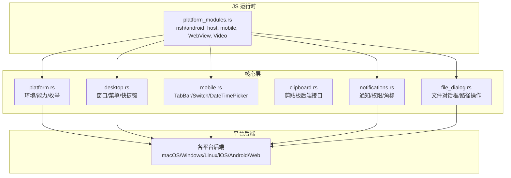
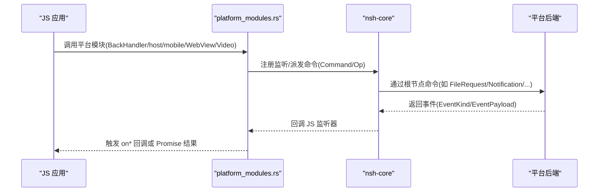
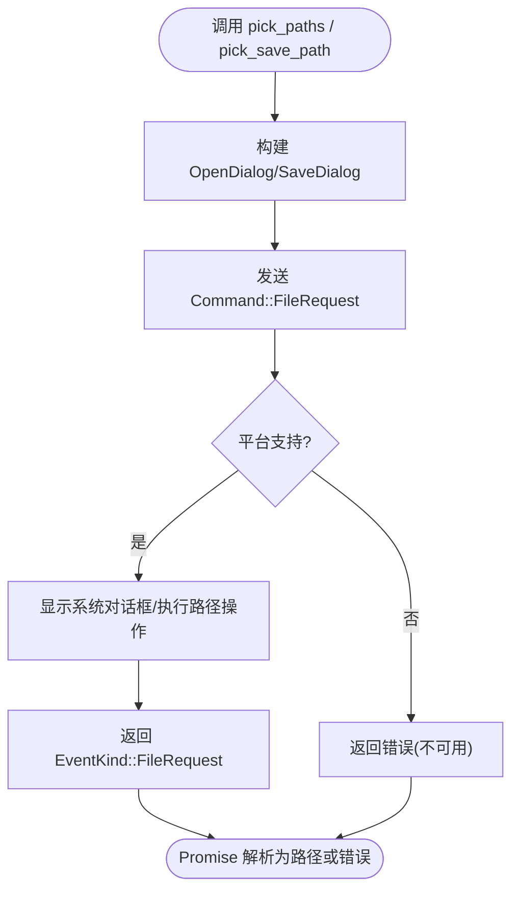
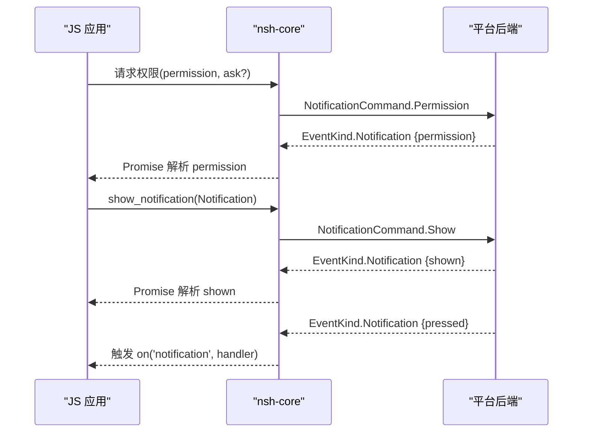
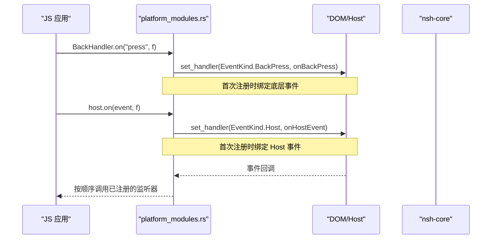

# 平台API

<cite>
**本文引用的文件**   
- [platform.rs](file://crates/nsh-core/src/platform.rs)
- [desktop.rs](file://crates/nsh-core/src/desktop.rs)
- [mobile.rs](file://crates/nsh-core/src/mobile.rs)
- [clipboard.rs](file://crates/nsh-core/src/clipboard.rs)
- [notifications.rs](file://crates/nsh-core/src/notifications.rs)
- [file_dialog.rs](file://crates/nsh-core/src/file_dialog.rs)
- [platform_modules.rs](file://crates/nsh-js/src/platform_modules.rs)
</cite>

## 目录
1. [简介](#简介)
2. [项目结构](#项目结构)
3. [核心组件](#核心组件)
4. [架构总览](#架构总览)
5. [详细组件分析](#详细组件分析)
6. [依赖关系分析](#依赖关系分析)
7. [性能与兼容性](#性能与兼容性)
8. [故障排查指南](#故障排查指南)
9. [结论](#结论)

## 简介
本文件为 NSH 框架的平台特定 API 提供 TypeScript 视角的详细文档，覆盖桌面端（macOS、Windows、Linux）、移动端（iOS、Android）和 Web 平台的专属能力。重点包括：
- 文件系统访问：打开/保存对话框、路径操作、回收站等
- 窗口管理：窗口属性、菜单、快捷键、工作区等
- 通知系统：权限、展示、角标、点击事件
- 剪贴板：文本与富文本项、图片支持、沙箱内剪贴板
- 平台检测与条件编译：Os、Idiom、Environment 字段与 TS 侧分支
- 平台能力开关：Environment 中的布尔位标志控制功能可用性
- 安全与沙箱：权限模型、能力声明、错误码与不可用处理

## 项目结构
NSH 将“平台抽象”与“具体后端”解耦：
- nsh-core 定义跨平台的数据类型、命令、事件与环境信息
- nsh-js 在 JS 运行时暴露平台模块（如 nsh/android、nsh/host、nsh/mobile、WebView、Video 等）
- 各平台后端（macOS、Windows、Linux、iOS、Android、Web）实现具体能力并填充 Environment 的能力位

图表来源
- [platform.rs:100-147](file://crates/nsh-core/src/platform.rs#L100-L147)
- [desktop.rs:1-36](file://crates/nsh-core/src/desktop.rs#L1-L36)
- [mobile.rs:1-26](file://crates/nsh-core/src/mobile.rs#L1-L26)
- [platform_modules.rs:1-11](file://crates/nsh-js/src/platform_modules.rs#L1-L11)

章节来源
- [platform.rs:100-147](file://crates/nsh-core/src/platform.rs#L100-L147)
- [desktop.rs:1-36](file://crates/nsh-core/src/desktop.rs#L1-L36)
- [mobile.rs:1-26](file://crates/nsh-core/src/mobile.rs#L1-L26)
- [platform_modules.rs:1-11](file://crates/nsh-js/src/platform_modules.rs#L1-L11)

## 核心组件
- 环境与平台检测
  - Os：ios/android/macos/windows/linux/web
  - Idiom：phone/pad/mac/tv/desktop/terminal
  - Environment：包含 window/safe_area/os/idiom/locale/network/feature flags 等大量能力位
- 桌面能力
  - 窗口：WindowOptions/WindowFrame/WindowState/Display/QuitMode/TitleBarStyle/MenuBarMode
  - 菜单与快捷键：MenuRole/Shortcut/Key
- 移动能力
  - TabBar、SegmentedControl、Switch、DateTimePicker
  - AppSettings.open/available
- 剪贴板
  - ClipboardBackend/MemoryClipboard
- 通知
  - NotificationPermission/Notification/NotificationCommand/NotificationEvent
- 文件对话框
  - OpenDialog/SaveDialog/FileFilter/FileRequest

章节来源
- [platform.rs:100-147](file://crates/nsh-core/src/platform.rs#L100-L147)
- [platform.rs:417-620](file://crates/nsh-core/src/platform.rs#L417-L620)
- [desktop.rs:139-189](file://crates/nsh-core/src/desktop.rs#L139-L189)
- [desktop.rs:294-481](file://crates/nsh-core/src/desktop.rs#L294-L481)
- [desktop.rs:651-783](file://crates/nsh-core/src/desktop.rs#L651-L783)
- [mobile.rs:39-145](file://crates/nsh-core/src/mobile.rs#L39-L145)
- [mobile.rs:165-358](file://crates/nsh-core/src/mobile.rs#L165-L358)
- [mobile.rs:360-612](file://crates/nsh-core/src/mobile.rs#L360-L612)
- [mobile.rs:614-682](file://crates/nsh-core/src/mobile.rs#L614-L682)
- [clipboard.rs:1-63](file://crates/nsh-core/src/clipboard.rs#L1-L63)
- [notifications.rs:25-151](file://crates/nsh-core/src/notifications.rs#L25-L151)
- [notifications.rs:153-205](file://crates/nsh-core/src/notifications.rs#L153-L205)
- [file_dialog.rs:39-123](file://crates/nsh-core/src/file_dialog.rs#L39-L123)
- [file_dialog.rs:190-251](file://crates/nsh-core/src/file_dialog.rs#L190-L251)
- [file_dialog.rs:265-285](file://crates/nsh-core/src/file_dialog.rs#L265-L285)

## 架构总览
下图展示了从 JS 到核心再到平台后端的调用链，以及关键数据流。

图表来源
- [platform_modules.rs:110-261](file://crates/nsh-js/src/platform_modules.rs#L110-L261)
- [platform_modules.rs:275-459](file://crates/nsh-js/src/platform_modules.rs#L275-L459)
- [file_dialog.rs:1-34](file://crates/nsh-core/src/file_dialog.rs#L1-L34)
- [notifications.rs:1-22](file://crates/nsh-core/src/notifications.rs#L1-L22)

## 详细组件分析

### 环境与平台检测（TypeScript 使用要点）
- 平台标识
  - platform.os：'ios'|'android'|'macos'|'windows'|'linux'|'web'
  - platform.idiom：'phone'|'pad'|'mac'|'tv'|'desktop'|'terminal'
  - platform.desktop：是否启用桌面行为（macOS/Windows/Linux，或浏览器 desktop idiom，或终端）
- 设备与环境
  - safe_area、window、pixel_ratio、font_scale、locale、locale_settings
  - lifecycle、wake_count、network(kind/expensive/constrained/cellularData)
- 能力位（Environment 布尔字段）
  - clipboard_write_result、canvas_render、share、app_settings、auth_session、scheme_links
  - file_requests、speech、notifications、audio、tab_bar、clipboard_images
  - web_input、web_evaluate、web_views、webview_requests、shaders

TS 侧建议
- 使用 platform.select({ ios, android, desktop, web }) 进行条件渲染
- 对能力位做防御性判断，避免在未支持平台上调用受限 API
- 对 network.online() 与 cellularData 做降级策略（例如低带宽模式）

章节来源
- [platform.rs:100-147](file://crates/nsh-core/src/platform.rs#L100-L147)
- [platform.rs:161-210](file://crates/nsh-core/src/platform.rs#L161-L210)
- [platform.rs:239-386](file://crates/nsh-core/src/platform.rs#L239-L386)
- [platform.rs:417-620](file://crates/nsh-core/src/platform.rs#L417-L620)
- [platform.rs:622-661](file://crates/nsh-core/src/platform.rs#L622-L661)

### 文件系统访问（文件对话框与路径操作）
- 能力要求：Environment.file_requests 为 true（桌面端完整支持；移动端仅部分支持）
- 主要对象
  - OpenDialog：kind(multiple/filters/title/button_label/directory)
  - SaveDialog：file_name/filters/title/button_label/directory
  - FileFilter：name/extensions
  - FileRequest：OpenDialog/SaveDialog/OpenPath/RevealPath/MoveToTrash
- 交互流程

图表来源
- [file_dialog.rs:1-34](file://crates/nsh-core/src/file_dialog.rs#L1-L34)
- [file_dialog.rs:39-123](file://crates/nsh-core/src/file_dialog.rs#L39-L123)
- [file_dialog.rs:190-251](file://crates/nsh-core/src/file_dialog.rs#L190-L251)
- [file_dialog.rs:265-285](file://crates/nsh-core/src/file_dialog.rs#L265-L285)

章节来源
- [file_dialog.rs:1-34](file://crates/nsh-core/src/file_dialog.rs#L1-L34)
- [file_dialog.rs:39-123](file://crates/nsh-core/src/file_dialog.rs#L39-L123)
- [file_dialog.rs:190-251](file://crates/nsh-core/src/file_dialog.rs#L190-L251)
- [file_dialog.rs:265-285](file://crates/nsh-core/src/file_dialog.rs#L265-L285)

### 窗口管理与桌面特性
- 窗口
  - WindowOptions/WindowFrame/WindowState/Display/QuitMode/TitleBarStyle/MenuBarMode
  - 桌面行为由 Idiom.desktop_on(os) 决定，Environment.desktop() 暴露给上层
- 菜单与快捷键
  - MenuRole：标准角色（About/Hide/Quit/Undo/Copy/Paste/Zoom/ToggleFullScreen/Close 等）
  - Shortcut：解析 mod+shift+n 等组合键，label_for(os) 输出平台化标签
  - Key：字符键/功能键/方向键等

TS 侧建议
- 使用 platform.desktop 分支渲染自定义标题栏或隐藏系统标题栏
- 使用 MenuRole.label()/shortcut(mac?) 生成跨平台一致的菜单文案与快捷键提示

章节来源
- [desktop.rs:1-36](file://crates/nsh-core/src/desktop.rs#L1-L36)
- [desktop.rs:139-189](file://crates/nsh-core/src/desktop.rs#L139-L189)
- [desktop.rs:294-481](file://crates/nsh-core/src/desktop.rs#L294-L481)
- [desktop.rs:651-783](file://crates/nsh-core/src/desktop.rs#L651-L783)

### 移动平台专属组件
- TabBar：items/selectedIndex/hidden/onChange
- SegmentedControl：items/selectedIndex/disabled/onChange（iOS）
- Switch：checked/disabled/accessibilityLabel/onChange（iOS/Android）
- DateTimePicker：mode/value/min/max/minuteInterval/disabled/accessibilityLabel/onChange（iOS/Android）
- AppSettings：open()/available()（需要 application 能力）

TS 侧建议
- 使用 platform.select({ ios, android }) 选择原生控件，否则回退到 nsh/base 的 Tabs/ToggleGroup/DatePicker/TimeField
- 对 AppSettings.open 的错误码进行区分：ERR_FEATURE_UNAVAILABLE_ON_PLATFORM 与 ERR_ACCESS_DENIED

章节来源
- [mobile.rs:39-145](file://crates/nsh-core/src/mobile.rs#L39-L145)
- [mobile.rs:165-358](file://crates/nsh-core/src/mobile.rs#L165-L358)
- [mobile.rs:360-612](file://crates/nsh-core/src/mobile.rs#L360-L612)
- [mobile.rs:614-682](file://crates/nsh-core/src/mobile.rs#L614-L682)

### 通知系统
- 权限：NotificationPermission（default/granted/denied/unavailable）
- 通知体：Notification{id,title,body,silent,sound}
- 命令：NotificationCommand{Permission/Show/Close/CloseAll/Listen/SetBadge}
- 事件：NotificationEvent{permission/shown/pressed}

图表来源
- [notifications.rs:1-22](file://crates/nsh-core/src/notifications.rs#L1-L22)
- [notifications.rs:25-151](file://crates/nsh-core/src/notifications.rs#L25-L151)
- [notifications.rs:153-205](file://crates/nsh-core/src/notifications.rs#L153-L205)

章节来源
- [notifications.rs:25-151](file://crates/nsh-core/src/notifications.rs#L25-L151)
- [notifications.rs:153-205](file://crates/nsh-core/src/notifications.rs#L153-L205)

### 剪贴板
- 能力位：Environment.clipboard_write_result、Environment.clipboard_images
- 后端接口：ClipboardBackend（text/item/set_text/set_item）
- 内存实现：MemoryClipboard（用于测试或宿主自定义）

TS 侧建议
- 写剪贴板前检查 clipboard_write_result；读图前检查 clipboard_images
- 在测试环境中注入 MemoryClipboard 以隔离系统剪贴板

章节来源
- [clipboard.rs:1-63](file://crates/nsh-core/src/clipboard.rs#L1-L63)
- [platform.rs:514-584](file://crates/nsh-core/src/platform.rs#L514-L584)

### JS 运行时平台模块
- nsh/android：BackHandler.on("press", f) 返回移除监听函数
- nsh/host：host.available()、host.on(event, listener)
- nsh/mobile：isAvailable（iOS/Android 且 tab_bar 可用）
- nsh：WebView/Video（宿主元素组件，ref 方法由运行时模块补充）

图表来源
- [platform_modules.rs:110-261](file://crates/nsh-js/src/platform_modules.rs#L110-L261)
- [platform_modules.rs:275-459](file://crates/nsh-js/src/platform_modules.rs#L275-L459)

章节来源
- [platform_modules.rs:110-261](file://crates/nsh-js/src/platform_modules.rs#L110-L261)
- [platform_modules.rs:275-459](file://crates/nsh-js/src/platform_modules.rs#L275-L459)
- [platform_modules.rs:461-548](file://crates/nsh-js/src/platform_modules.rs#L461-L548)

## 依赖关系分析
- 耦合与内聚
  - nsh-core 负责统一抽象与数据结构，保持高内聚
  - nsh-js 仅桥接 JS 与核心，避免业务逻辑下沉至运行时
  - 平台后端通过 Environment 能力位与命令/事件机制接入
- 外部依赖
  - 平台 SDK（AppKit/GTK/Win32/WebKit/Android/iOS）
  - 系统服务（通知中心、剪贴板、文件系统、窗口管理器）

图表来源
- [platform_modules.rs:1-11](file://crates/nsh-js/src/platform_modules.rs#L1-L11)
- [platform.rs:417-620](file://crates/nsh-core/src/platform.rs#L417-L620)

章节来源
- [platform_modules.rs:1-11](file://crates/nsh-js/src/platform_modules.rs#L1-L11)
- [platform.rs:417-620](file://crates/nsh-core/src/platform.rs#L417-L620)

## 性能与兼容性
- 性能
  - 剪贴板写结果回调仅在 Environment.clipboard_write_result 开启时生效，避免无谓开销
  - Canvas 离屏渲染受 Environment.canvas_render 控制，未启用时直接失败
  - 网络状态变化通过 Environment.network 推送，应用可据此调整带宽策略
- 兼容性
  - 所有平台相关 UI 组件在非目标平台均返回空视图（不占空间），需显式回退到 nsh/base
  - 能力位缺失时，对应 API 立即返回 unavailable 或 access denied，便于统一错误处理

[本节为通用指导，无需代码引用]

## 故障排查指南
- 常见错误码
  - ERR_FEATURE_UNAVAILABLE_ON_PLATFORM：功能在当前平台不可用（如 AppSettings.open 在非 iOS/Android）
  - ERR_ACCESS_DENIED：缺少能力声明（如 capabilities.application 未开启）
- 排查步骤
  - 检查 Environment 中对应能力位是否为 true
  - 确认 nsh.json 中 capabilities 配置正确
  - 针对文件对话框，确认 Environment.file_requests 为 true
  - 针对通知，先查询 Permission，再 Show，最后 Listen 点击事件
  - 针对剪贴板，检查 clipboard_write_result 与 clipboard_images

章节来源
- [mobile.rs:614-682](file://crates/nsh-core/src/mobile.rs#L614-L682)
- [file_dialog.rs:1-34](file://crates/nsh-core/src/file_dialog.rs#L1-L34)
- [notifications.rs:1-22](file://crates/nsh-core/src/notifications.rs#L1-L22)
- [clipboard.rs:1-63](file://crates/nsh-core/src/clipboard.rs#L1-L63)

## 结论
NSH 通过 Environment 能力位与命令/事件通道，将桌面、移动与 Web 的差异收敛到统一的抽象层。开发者在 TS 侧应优先基于 platform.os/idiom/desktop 与能力位进行条件渲染与降级处理，确保在各平台获得一致体验与安全边界。对于平台专属能力（窗口、菜单、通知、剪贴板、文件对话框、原生控件），遵循本文提供的接口与流程图，结合错误码与能力检测，即可稳健地实现跨平台应用。