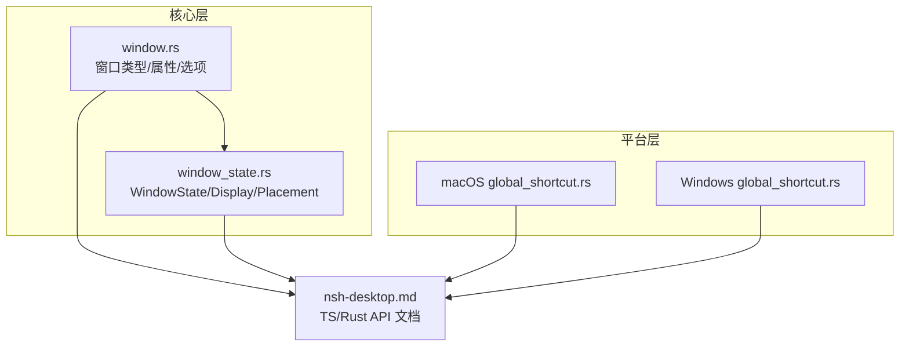
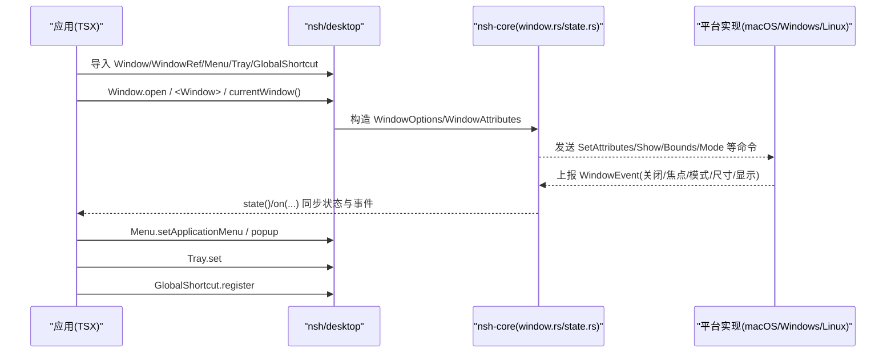
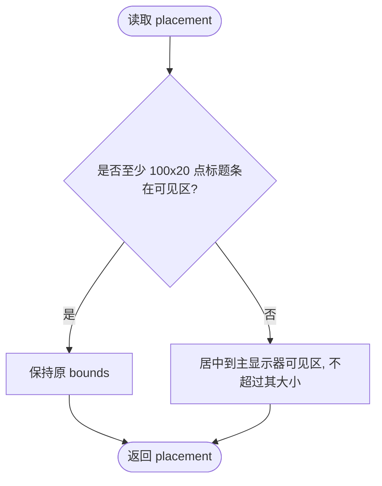
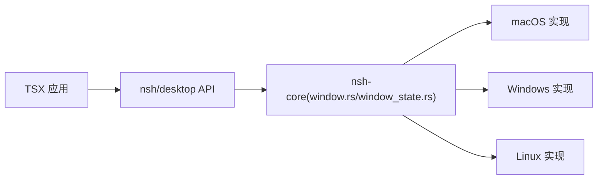

# 桌面平台API

<cite>
**本文引用的文件**   
- [crates/nsh-core/src/desktop/window.rs](file://crates/nsh-core/src/desktop/window.rs)
- [crates/nsh-core/src/desktop/window_state.rs](file://crates/nsh-core/src/desktop/window_state.rs)
- [website/modules/nsh-desktop.md](file://website/modules/nsh-desktop.md)
- [crates/nsh-platform-macos/src/global_shortcut.rs](file://crates/nsh-platform-macos/src/global_shortcut.rs)
- [crates/nsh-platform-windows/src/global_shortcut.rs](file://crates/nsh-platform-windows/src/global_shortcut.rs)
</cite>

## 目录
1. [简介](#简介)
2. [项目结构](#项目结构)
3. [核心组件](#核心组件)
4. [架构总览](#架构总览)
5. [详细组件分析](#详细组件分析)
6. [依赖关系分析](#依赖关系分析)
7. [性能与兼容性](#性能与兼容性)
8. [故障排查](#故障排查)
9. [结论](#结论)
10. [附录：示例与最佳实践](#附录示例与最佳实践)

## 简介
本文件为 NSH 框架在桌面平台的 TypeScript API 文档，聚焦 macOS、Windows、Linux 的专属能力：窗口管理（Window/WindowRef/属性）、应用菜单、系统托盘、全局快捷键、多显示器支持、窗口状态监听、自定义标题栏、平台检测与安全权限模型等。文档同时给出跨平台差异说明与常见用法的代码路径指引。

## 项目结构
NSH 的桌面 API 由核心类型定义与平台实现组成：
- 核心层（nsh-core）：定义窗口类型、属性、状态、显示设备、生命周期事件等公共接口。
- 平台层（macOS/Windows/Linux）：实现具体行为（如全局快捷键、托盘、菜单、窗口装饰）。
- 文档层（website/modules/nsh-desktop.md）：面向 TSX/Rust 使用者的完整 API 说明与示例。

图示来源
- [crates/nsh-core/src/desktop/window.rs:1-120](file://crates/nsh-core/src/desktop/window.rs#L1-L120)
- [crates/nsh-core/src/desktop/window_state.rs:1-85](file://crates/nsh-core/src/desktop/window_state.rs#L1-L85)
- [website/modules/nsh-desktop.md:1-10](file://website/modules/nsh-desktop.md#L1-L10)

章节来源
- [crates/nsh-core/src/desktop/window.rs:1-120](file://crates/nsh-core/src/desktop/window.rs#L1-L120)
- [crates/nsh-core/src/desktop/window_state.rs:1-85](file://crates/nsh-core/src/desktop/window_state.rs#L1-L85)
- [website/modules/nsh-desktop.md:1-10](file://website/modules/nsh-desktop.md#L1-L10)

## 核心组件
- Window/WindowRef：声明式与命令式创建窗口、控制显示/隐藏/焦点/模式/尺寸/层级/进度等。
- WindowAttributes/WindowOptions/MainWindowOptions：窗口外观、行为与启动默认值。
- WindowState/Display/WindowPlacement：窗口运行时状态、显示器信息与可恢复布局。
- 应用菜单/上下文菜单：setApplicationMenu/popup。
- 系统托盘：Tray.set 配置图标、提示、标题、菜单与点击回调。
- 全局快捷键：register/unregister 注册系统级快捷键。
- 平台检测：isAvailable、platform.desktop 用于条件渲染与功能门控。

章节来源
- [website/modules/nsh-desktop.md:39-48](file://website/modules/nsh-desktop.md#L39-L48)
- [website/modules/nsh-desktop.md:61-176](file://website/modules/nsh-desktop.md#L61-L176)
- [website/modules/nsh-desktop.md:177-218](file://website/modules/nsh-desktop.md#L177-L218)
- [website/modules/nsh-desktop.md:220-302](file://website/modules/nsh-desktop.md#L220-L302)
- [website/modules/nsh-desktop.md:368-370](file://website/modules/nsh-desktop.md#L368-L370)
- [website/modules/nsh-desktop.md:863-950](file://website/modules/nsh-desktop.md#L863-L950)
- [website/modules/nsh-desktop.md:1074-1176](file://website/modules/nsh-desktop.md#L1074-L1176)
- [website/modules/nsh-desktop.md:1200-1242](file://website/modules/nsh-desktop.md#L1200-L1242)

## 架构总览
下图展示从 TSX 调用到核心类型与平台实现的交互流程。

图示来源
- [website/modules/nsh-desktop.md:61-176](file://website/modules/nsh-desktop.md#L61-L176)
- [website/modules/nsh-desktop.md:220-302](file://website/modules/nsh-desktop.md#L220-L302)
- [website/modules/nsh-desktop.md:863-950](file://website/modules/nsh-desktop.md#L863-L950)
- [website/modules/nsh-desktop.md:1074-1176](file://website/modules/nsh-desktop.md#L1074-L1176)
- [website/modules/nsh-desktop.md:1200-1242](file://website/modules/nsh-desktop.md#L1200-L1242)

## 详细组件分析

### 窗口与 WindowRef
- 窗口种类（WindowKind）：normal/dialog/panel/popup/overlay，决定默认属性与行为。
- 窗口模式（WindowMode）：normal/maximized/fullScreen。
- 关闭原因（CloseReason/WindowCloseCause）：closeButton/shortcut/menu/taskbar/system 与应用侧 close/escape/blur/parentClose/close。
- 工作区（Workspaces）：current/all；指针穿透（pointerEvents:none）需 overlay 能力。
- 背景材质（Backdrop）：none/window/sidebar/popover/hud。
- 任务栏进度（WindowProgress）：value(0..1)/state(normal/indeterminate/paused/error)。
- 标题栏（TitleBarOptions）：style(default/hidden)、height、controls_offset。
- 自适应尺寸（SizeToContent）：off/both/width/height。
- 初始位置（WindowPosition）：At(point)/center/parentCenter。
- 自定义按钮与边缘（WindowControl/ResizeEdge）：minimize/maximize/close 与 top/bottom/left/right/corners。
- 属性合并与校验（WindowAttributes.merge/diff/sanitize）：按 kind 计算默认值，diff 增量更新，sanitize 规范化尺寸/进度/标题栏高度。
- 窗口选项（WindowOptions）：id/kind/parent/modal/default_size/default_position/display/default_mode/restore_bounds/attributes。
- 主窗口选项（MainWindowOptions）：解析 nsh.json 的 window 字段，提供 kept_placement 以恢复上次布局。

```mermaid
classDiagram
class WindowKind { +Normal +Dialog +Panel +Popup +Overlay }
class WindowMode { +Normal +Maximized +FullScreen }
class CloseReason { +CloseButton +Shortcut +Menu +Taskbar +System }
class WindowCloseCause { +ClosePress +Escape +Blur +ParentClose +Close }
class Workspaces { +Current +All }
class WindowPointerEvents { +Auto +None }
class Backdrop { +None +Window +Sidebar +Popover +Hud }
class WindowProgress { +value : Percentage? +state : ProgressState }
class TitleBarOptions { +style : TitleBarStyle +height : Points? +controls_offset : Point? }
class SizeToContent { +Off +Both +Width +Height }
class WindowPosition { +At(Point) +Center +ParentCenter }
class WindowControl { +Minimize +Maximize +Close }
class ResizeEdge { +Top +Bottom +Left +Right +TopLeft +TopRight +BottomLeft +BottomRight }
class WindowAttributes { +merge() +diff() +sanitize() +for_kind() +resolve() }
class WindowOptions { +id +kind +parent +modal +default_size +default_position +display +default_mode +restore_bounds +attributes }
class MainWindowOptions { +kept_placement() +from_json() }
WindowAttributes --> WindowKind : "默认值"
WindowOptions --> WindowAttributes : "包含"
MainWindowOptions --> WindowAttributes : "继承"
```

图示来源
- [crates/nsh-core/src/desktop/window.rs:22-150](file://crates/nsh-core/src/desktop/window.rs#L22-L150)
- [crates/nsh-core/src/desktop/window.rs:163-293](file://crates/nsh-core/src/desktop/window.rs#L163-L293)
- [crates/nsh-core/src/desktop/window.rs:295-499](file://crates/nsh-core/src/desktop/window.rs#L295-L499)
- [crates/nsh-core/src/desktop/window.rs:504-629](file://crates/nsh-core/src/desktop/window.rs#L504-L629)
- [crates/nsh-core/src/desktop/window.rs:631-798](file://crates/nsh-core/src/desktop/window.rs#L631-L798)

章节来源
- [crates/nsh-core/src/desktop/window.rs:22-150](file://crates/nsh-core/src/desktop/window.rs#L22-L150)
- [crates/nsh-core/src/desktop/window.rs:163-293](file://crates/nsh-core/src/desktop/window.rs#L163-L293)
- [crates/nsh-core/src/desktop/window.rs:295-499](file://crates/nsh-core/src/desktop/window.rs#L295-L499)
- [crates/nsh-core/src/desktop/window.rs:504-629](file://crates/nsh-core/src/desktop/window.rs#L504-L629)
- [crates/nsh-core/src/desktop/window.rs:631-798](file://crates/nsh-core/src/desktop/window.rs#L631-L798)

### 窗口状态与显示器
- DisplayId：稳定标识（哈希），跨进程一致。
- Display：bounds/visible_bounds/primary/name/scale_factor/refresh_rate/cutouts（刘海区域）。
- WindowPlacement：mode+bounds，用于保存/恢复窗口布局；fit_on_displays 将越界或不可抓取的窗口适配到当前显示器可见区域。
- WindowState：mode/minimized/visible/focused/bounds/content_bounds/placement/display/scale_factor。

图示来源
- [crates/nsh-core/src/desktop/window_state.rs:18-84](file://crates/nsh-core/src/desktop/window_state.rs#L18-L84)
- [crates/nsh-core/src/desktop/window_state.rs:148-219](file://crates/nsh-core/src/desktop/window_state.rs#L148-L219)
- [crates/nsh-core/src/desktop/window_state.rs:238-285](file://crates/nsh-core/src/desktop/window_state.rs#L238-L285)

章节来源
- [crates/nsh-core/src/desktop/window_state.rs:18-84](file://crates/nsh-core/src/desktop/window_state.rs#L18-L84)
- [crates/nsh-core/src/desktop/window_state.rs:148-219](file://crates/nsh-core/src/desktop/window_state.rs#L148-L219)
- [crates/nsh-core/src/desktop/window_state.rs:238-285](file://crates/nsh-core/src/desktop/window_state.rs#L238-L285)

### 应用菜单与上下文菜单
- setApplicationMenu：设置应用菜单（macOS 菜单栏，Windows/Linux 在 GPUI 应用中作为窗口菜单栏）。
- setMenuBar：GPUI 应用中菜单栏显示策略（shown/autoHide）。
- popup：弹出上下文菜单，Promise 在菜单关闭时 resolve。
- MenuItem：label/role/shortcut/when/disabled/checked/icon/symbol/destructive/submenu/inline。
- 角色（Role）：about/hide/hideOthers/showAll/quit/undo/redo/cut/copy/paste/selectAll/minimize/zoom/toggleFullScreen/close。

章节来源
- [website/modules/nsh-desktop.md:863-950](file://website/modules/nsh-desktop.md#L863-L950)

### 系统托盘
- Tray.set：设置图标、tooltip、title/titlePlacement、menu、onClick（含 bounds）。
- Linux Wayland/GNOME/Plasma/Waybar 等平台差异：部分面板显示标签，部分仅图标。
- 在 onClick 中打开/聚焦窗口，Wayland 下通过激活令牌提升窗口。

章节来源
- [website/modules/nsh-desktop.md:1074-1176](file://website/modules/nsh-desktop.md#L1074-L1176)

### 全局快捷键
- register/unregister/unregisterAll：注册系统级快捷键，返回是否成功。
- macOS：无需用户授权；字母键随键盘布局变化。
- Windows：独占性，若被其他应用或系统占用则失败。
- Linux：通过桌面门户（org.freedesktop.portal.GlobalShortcuts），Wayland 唯一方式；可能需要用户在桌面确认；Hyprland 可通过 id+keystroke 绑定。

章节来源
- [website/modules/nsh-desktop.md:1200-1242](file://website/modules/nsh-desktop.md#L1200-L1242)
- [crates/nsh-platform-macos/src/global_shortcut.rs](file://crates/nsh-platform-macos/src/global_shortcut.rs)
- [crates/nsh-platform-windows/src/global_shortcut.rs](file://crates/nsh-platform-windows/src/global_shortcut.rs)

### 自定义标题栏与窗口控件
- titleBar.style=hidden：隐藏系统标题栏，应用绘制自己的标题栏。
- titleBar.height/controls_offset：自定义高度与 macOS traffic lights 偏移。
- windowDrag：拖动区域；双击执行系统标题栏动作（最大化等）。
- windowControl/windowResize：自定义最小化/最大化/关闭按钮与拖拽缩放边缘。

章节来源
- [website/modules/nsh-desktop.md:673-778](file://website/modules/nsh-desktop.md#L673-L778)

### 生命周期与退出机制
- Application.quit/restart：退出/重启应用。
- quitRequest/quit：拦截退出并清理；lastWindowClosed 监听最后一个窗口关闭。
- reopen：Dock/Finder 重新打开或后续启动。
- 退出模式（quitMode）：platform/lastWindowClosed/explicit。

章节来源
- [website/modules/nsh-desktop.md:372-527](file://website/modules/nsh-desktop.md#L372-L527)

### 权限模型与安全限制
- capabilities.windows：允许打开窗口；overlay 与 pointerEvents:none 需要额外授予。
- 未授权时 Window.open/<Window> 抛出 ERR_ACCESS_DENIED；set() 未授权属性保留原值并警告。
- application 能力：应用菜单、托盘、全局快捷键、quit/restart、登录项等需要 "application": true。

章节来源
- [website/modules/nsh-desktop.md:368-370](file://website/modules/nsh-desktop.md#L368-L370)
- [website/modules/nsh-desktop.md:1-10](file://website/modules/nsh-desktop.md#L1-L10)

## 依赖关系分析
- 核心类型（window.rs/window_state.rs）为 TSX/Rust 统一抽象，平台实现负责具体行为。
- 文档（nsh-desktop.md）对 TSX/Rust 使用者暴露一致的 API 语义，屏蔽平台差异。
- 平台模块（macOS/Windows/Linux）分别实现全局快捷键、托盘、菜单等特性。

图示来源
- [website/modules/nsh-desktop.md:1-10](file://website/modules/nsh-desktop.md#L1-L10)
- [crates/nsh-core/src/desktop/window.rs:1-120](file://crates/nsh-core/src/desktop/window.rs#L1-L120)
- [crates/nsh-core/src/desktop/window_state.rs:1-85](file://crates/nsh-core/src/desktop/window_state.rs#L1-L85)

## 性能与兼容性
- 窗口移动/调整大小事件节流：仅在停止后上报一次，避免频繁重绘。
- 多显示器适配：placement.fit_on_displays 保证窗口始终可抓取或居中于主显示器可见区。
- 平台差异：
  - macOS：菜单栏原生、Dock 交互、Space/Spaces 工作区、刘海 cutouts。
  - Windows：任务栏进度、Snap Layouts、Mica/Acrylic 背景材质映射。
  - Linux：WM 自主放置/堆叠，位置/层级/任务栏受 WM 影响；Wayland 下托盘/全局快捷键通过门户。
- 能力门控：capabilities 控制 overlay、application 相关能力，避免未授权访问。

章节来源
- [website/modules/nsh-desktop.md:291-302](file://website/modules/nsh-desktop.md#L291-L302)
- [website/modules/nsh-desktop.md:779-861](file://website/modules/nsh-desktop.md#L779-L861)
- [website/modules/nsh-desktop.md:1074-1176](file://website/modules/nsh-desktop.md#L1074-L1176)
- [website/modules/nsh-desktop.md:1200-1242](file://website/modules/nsh-desktop.md#L1200-L1242)

## 故障排查
- 窗口无法打开：检查 capabilities.windows 与 overlay 权限；确认 isAvailable 为 true。
- 属性未生效：set() 中未授权属性会被忽略并告警；核对 attributes 字段名与取值范围（sanitize）。
- 快捷键冲突：Windows 上可能被系统或其他应用占用；Linux 需在桌面门户或窗口管理器中确认。
- 托盘标题不显示：Linux 某些面板不支持标题；确保使用兼容的面板或扩展。
- 退出流程异常：使用 quitRequest 拦截并保存数据；quit 会直接结束应用，不在窗口 onOpenChange 中处理。

章节来源
- [website/modules/nsh-desktop.md:368-370](file://website/modules/nsh-desktop.md#L368-L370)
- [website/modules/nsh-desktop.md:1200-1242](file://website/modules/nsh-desktop.md#L1200-L1242)
- [website/modules/nsh-desktop.md:1074-1176](file://website/modules/nsh-desktop.md#L1074-L1176)
- [website/modules/nsh-desktop.md:372-527](file://website/modules/nsh-desktop.md#L372-L527)

## 结论
NSH 的桌面 API 通过核心类型与平台实现分离，为 TSX/Rust 提供一致的窗口、菜单、托盘与全局快捷键能力。开发者可在不同平台上获得相近的体验，同时利用平台特性（如 macOS 刘海、Windows Snap Layouts、Linux 门户）增强体验。通过 capabilities 与 sanitize 机制保障安全与健壮性，借助 placement 与事件模型实现可靠的窗口状态同步与恢复。

## 附录：示例与最佳实践
- 窗口创建与事件处理
  - 参考：[website/modules/nsh-desktop.md:61-176](file://website/modules/nsh-desktop.md#L61-L176)
- 自定义标题栏与窗口控件
  - 参考：[website/modules/nsh-desktop.md:673-778](file://website/modules/nsh-desktop.md#L673-L778)
- 窗口状态与显示器
  - 参考：[website/modules/nsh-desktop.md:779-861](file://website/modules/nsh-desktop.md#L779-L861)
- 应用菜单与上下文菜单
  - 参考：[website/modules/nsh-desktop.md:863-950](file://website/modules/nsh-desktop.md#L863-L950)
- 系统托盘
  - 参考：[website/modules/nsh-desktop.md:1074-1176](file://website/modules/nsh-desktop.md#L1074-L1176)
- 全局快捷键
  - 参考：[website/modules/nsh-desktop.md:1200-1242](file://website/modules/nsh-desktop.md#L1200-L1242)
- 生命周期与退出
  - 参考：[website/modules/nsh-desktop.md:372-527](file://website/modules/nsh-desktop.md#L372-L527)