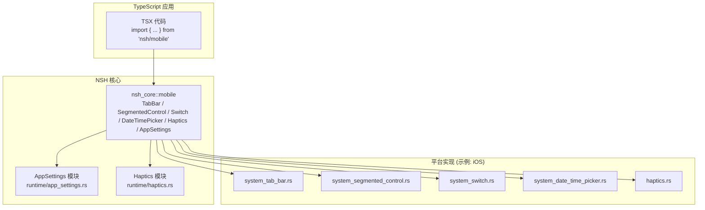
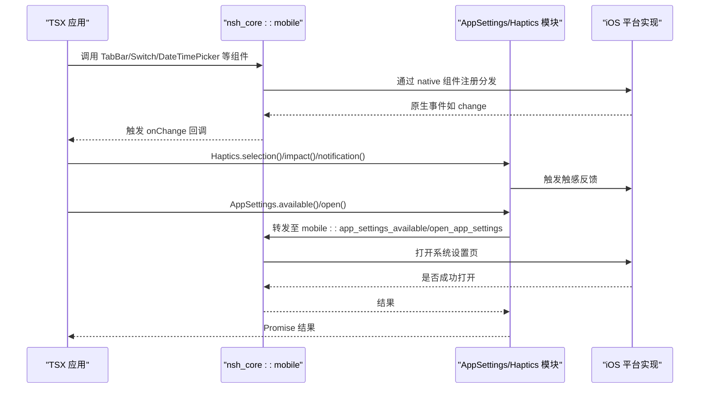
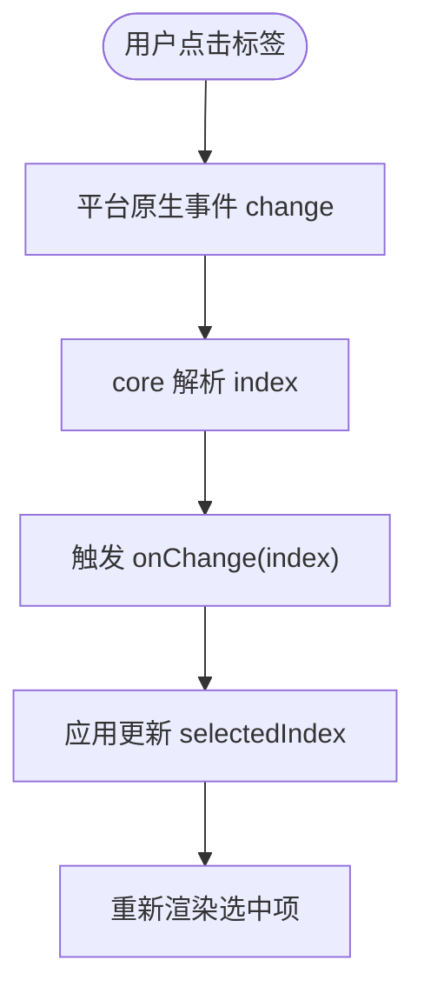
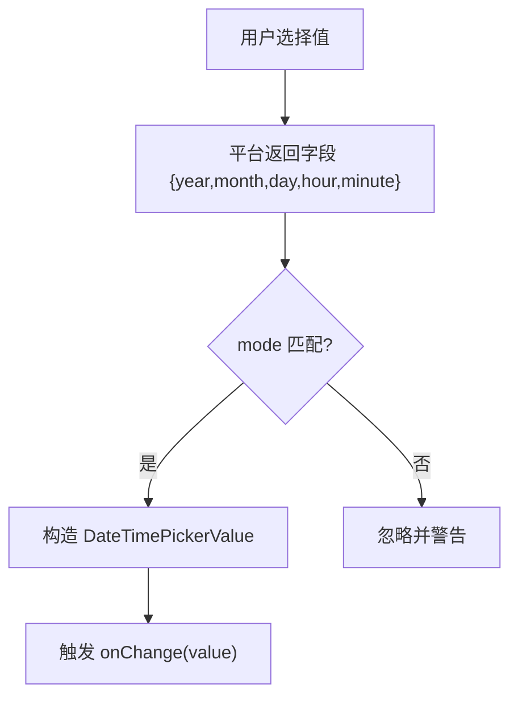
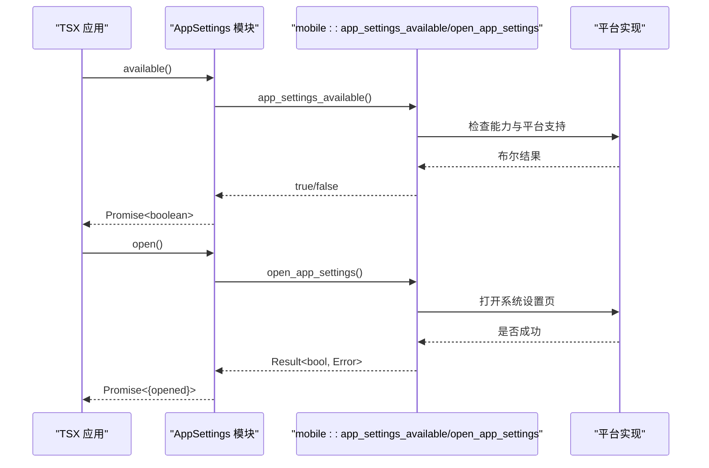
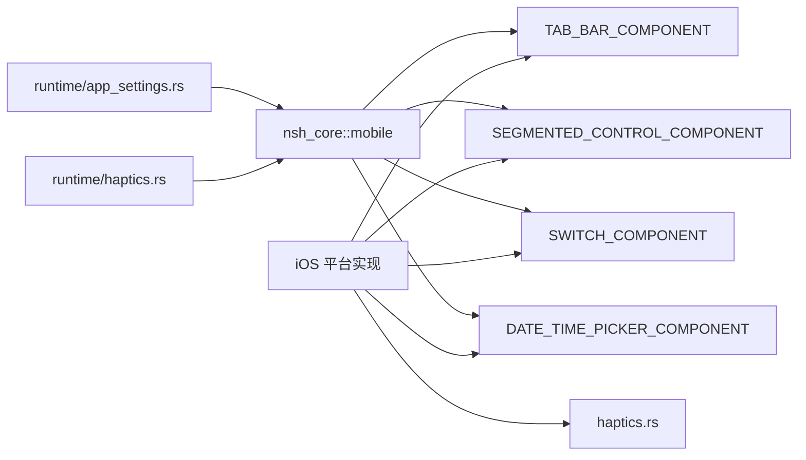

# 移动平台API

<cite>
**本文引用的文件**   
- [crates/nsh-core/src/mobile.rs](file://crates/nsh-core/src/mobile.rs)
- [website/modules/nsh-mobile.md](file://website/modules/nsh-mobile.md)
- [crates/nsh-core/src/runtime/app_settings.rs](file://crates/nsh-core/src/runtime/app_settings.rs)
- [crates/nsh-core/src/runtime/haptics.rs](file://crates/nsh-core/src/runtime/haptics.rs)
- [crates/nsh-platform-ios/src/system_tab_bar.rs](file://crates/nsh-platform-ios/src/system_tab_bar.rs)
- [crates/nsh-platform-ios/src/system_segmented_control.rs](file://crates/nsh-platform-ios/src/system_segmented_control.rs)
- [crates/nsh-platform-ios/src/system_switch.rs](file://crates/nsh-platform-ios/src/system_switch.rs)
- [crates/nsh-platform-ios/src/system_date_time_picker.rs](file://crates/nsh-platform-ios/src/system_date_time_picker.rs)
- [crates/nsh-platform-ios/src/haptics.rs](file://crates/nsh-platform-ios/src/haptics.rs)
</cite>

## 目录
1. [简介](#简介)
2. [项目结构](#项目结构)
3. [核心组件](#核心组件)
4. [架构总览](#架构总览)
5. [详细组件分析](#详细组件分析)
6. [依赖分析](#依赖分析)
7. [性能考虑](#性能考虑)
8. [故障排查指南](#故障排查指南)
9. [结论](#结论)
10. [附录](#附录)

## 简介
本文件为 NSH 框架在移动平台（iOS、Android）的 TypeScript API 文档，聚焦于 nsh/mobile 模块提供的系统级能力与原生控件。内容涵盖：
- 系统标签栏 TabBar、分段选择器 SegmentedControl（iOS）、开关 Switch、日期时间选择器 DateTimePicker
- 触感反馈 Haptics、应用设置 AppSettings、iOS 键盘附件 InputAccessoryView、Android 返回键 BackHandler
- isAvailable 可用性检测与跨平台差异处理
- 沙箱权限模型（application 能力）、安全限制与性能注意事项
- 面向 TSX 的使用方式、Rust 侧实现要点与平台差异说明

## 项目结构
nsh/mobile 的能力由 Rust 核心层暴露给 JS/TS 运行时，再由各平台后端实现具体行为。核心定义位于 nsh-core，TS 文档位于 website/modules/nsh-mobile.md，平台实现位于 nsh-platform-ios 等子模块。

图表来源
- [crates/nsh-core/src/mobile.rs:1-12](file://crates/nsh-core/src/mobile.rs#L1-L12)
- [website/modules/nsh-mobile.md:1-18](file://website/modules/nsh-mobile.md#L1-L18)
- [crates/nsh-core/src/runtime/app_settings.rs:1-48](file://crates/nsh-core/src/runtime/app_settings.rs#L1-L48)
- [crates/nsh-core/src/runtime/haptics.rs:1-37](file://crates/nsh-core/src/runtime/haptics.rs#L1-L37)
- [crates/nsh-platform-ios/src/system_tab_bar.rs](file://crates/nsh-platform-ios/src/system_tab_bar.rs)
- [crates/nsh-platform-ios/src/system_segmented_control.rs](file://crates/nsh-platform-ios/src/system_segmented_control.rs)
- [crates/nsh-platform-ios/src/system_switch.rs](file://crates/nsh-platform-ios/src/system_switch.rs)
- [crates/nsh-platform-ios/src/system_date_time_picker.rs](file://crates/nsh-platform-ios/src/system_date_time_picker.rs)
- [crates/nsh-platform-ios/src/haptics.rs](file://crates/nsh-platform-ios/src/haptics.rs)

章节来源
- [website/modules/nsh-mobile.md:1-18](file://website/modules/nsh-mobile.md#L1-L18)
- [crates/nsh-core/src/mobile.rs:1-26](file://crates/nsh-core/src/mobile.rs#L1-L26)

## 核心组件
- isAvailable：标识当前是否为 iOS/Android（含模拟器/Catalyst）。用于条件渲染或能力探测。
- TabBar：系统级底部标签栏，支持 items、selectedIndex、hidden、onChange。
- SegmentedControl：iOS 系统分段控件，支持 items、selectedIndex、disabled、onChange。
- Switch：系统开关，支持 checked、disabled、accessibilityLabel、onChange。
- DateTimePicker：系统日期/时间选择器，支持 mode、value、min、max、minuteInterval、disabled、accessibilityLabel、onChange。
- InputAccessoryView：iOS 键盘上方附加栏，通过 nativeID 与输入框关联。
- BackHandler：Android 返回键处理，on("press", listener)、exitApp()。
- Haptics：触感反馈，selection()/impact()/notification()。
- AppSettings：打开系统设置中本应用的页面，open()/available()。

章节来源
- [website/modules/nsh-mobile.md:54-62](file://website/modules/nsh-mobile.md#L54-L62)
- [website/modules/nsh-mobile.md:64-181](file://website/modules/nsh-mobile.md#L64-L181)
- [website/modules/nsh-mobile.md:183-240](file://website/modules/nsh-mobile.md#L183-L240)
- [website/modules/nsh-mobile.md:242-287](file://website/modules/nsh-mobile.md#L242-L287)
- [website/modules/nsh-mobile.md:288-349](file://website/modules/nsh-mobile.md#L288-L349)
- [website/modules/nsh-mobile.md:350-437](file://website/modules/nsh-mobile.md#L350-L437)
- [website/modules/nsh-mobile.md:439-502](file://website/modules/nsh-mobile.md#L439-L502)
- [website/modules/nsh-mobile.md:560-617](file://website/modules/nsh-mobile.md#L560-L617)
- [website/modules/nsh-mobile.md:503-558](file://website/modules/nsh-mobile.md#L503-L558)

## 架构总览
下图展示从 TSX 到 Rust 核心再到平台实现的调用链，以及事件回传路径。

图表来源
- [crates/nsh-core/src/mobile.rs:119-145](file://crates/nsh-core/src/mobile.rs#L119-L145)
- [crates/nsh-core/src/mobile.rs:242-265](file://crates/nsh-core/src/mobile.rs#L242-L265)
- [crates/nsh-core/src/mobile.rs:323-358](file://crates/nsh-core/src/mobile.rs#L323-L358)
- [crates/nsh-core/src/mobile.rs:556-612](file://crates/nsh-core/src/mobile.rs#L556-L612)
- [crates/nsh-core/src/runtime/app_settings.rs:21-46](file://crates/nsh-core/src/runtime/app_settings.rs#L21-L46)
- [crates/nsh-core/src/runtime/haptics.rs:15-35](file://crates/nsh-core/src/runtime/haptics.rs#L15-L35)

## 详细组件分析

### TabBar（系统标签栏）
- 作用：提供系统级底部标签栏，适配 iOS UITabBar 与 Android Material 3 导航栏。
- 关键属性：items、selectedIndex、hidden、class/style、testID。
- 事件：onChange(index)。
- 平台差异：
  - iOS/Mac Catalyst：使用系统外观（含 Liquid Glass），主题 primary 作为选中态颜色；badge 支持文本或空字符串。
  - Android：Material 3 导航栏，动态色与基础色，支持小/大 badge；TalkBack 语义。
  - 桌面/Web：不占位，需使用 nsh/base Tabs。

图表来源
- [crates/nsh-core/src/mobile.rs:119-145](file://crates/nsh-core/src/mobile.rs#L119-L145)

章节来源
- [website/modules/nsh-mobile.md:64-181](file://website/modules/nsh-mobile.md#L64-L181)
- [crates/nsh-core/src/mobile.rs:39-163](file://crates/nsh-core/src/mobile.rs#L39-L163)

### SegmentedControl（iOS 分段控件）
- 作用：系统 UISegmentedControl，提供紧凑的多选一交互。
- 关键属性：items、selectedIndex、disabled、class/style、testID。
- 事件：onChange(index)。
- 平台差异：仅 iOS/Mac Catalyst 有效；其他平台不占位，建议使用 ToggleGroup/RadioGroup。

章节来源
- [website/modules/nsh-mobile.md:183-240](file://website/modules/nsh-mobile.md#L183-L240)
- [crates/nsh-core/src/mobile.rs:165-283](file://crates/nsh-core/src/mobile.rs#L165-L283)

### Switch（系统开关）
- 作用：系统 UISwitch（iOS）/ Material 3 Switch（Android）。
- 关键属性：checked、disabled、accessibilityLabel、class/style、testID。
- 事件：onChange(checked)。
- 平台差异：桌面/Web 不占位，使用 nsh/base Switch。

章节来源
- [website/modules/nsh-mobile.md:242-287](file://website/modules/nsh-mobile.md#L242-L287)
- [crates/nsh-core/src/mobile.rs:285-358](file://crates/nsh-core/src/mobile.rs#L285-L358)

### DateTimePicker（系统日期/时间选择器）
- 作用：系统 UIDatePicker（iOS 紧凑样式）/ 系统日期时间对话框（Android）。
- 关键属性：mode、value、min、max、minuteInterval、disabled、accessibilityLabel、class/style、testID。
- 事件：onChange(value)，value 为 ISO 字符串（date/time/dateTime）。
- 平台差异：桌面/Web 不占位，使用 DatePicker/TimeField。

图表来源
- [crates/nsh-core/src/mobile.rs:506-612](file://crates/nsh-core/src/mobile.rs#L506-L612)

章节来源
- [website/modules/nsh-mobile.md:288-349](file://website/modules/nsh-mobile.md#L288-L349)
- [crates/nsh-core/src/mobile.rs:360-504](file://crates/nsh-core/src/mobile.rs#L360-L504)

### InputAccessoryView（iOS 键盘附件）
- 作用：在键盘上方显示自定义工具条，通过 nativeID 与输入框 inputAccessoryViewID 绑定。
- 关键属性：nativeID、style、class、children。
- 平台差异：Android 为空隐藏视图；iOS/Mac Catalyst 生效。

章节来源
- [website/modules/nsh-mobile.md:350-437](file://website/modules/nsh-mobile.md#L350-L437)

### BackHandler（Android 返回键）
- 作用：拦截系统返回键与手势，支持 on("press", listener) 与 exitApp()。
- 行为：先由对话框处理，再按添加顺序倒序执行监听器；未处理则栈后退或退出应用。
- 平台差异：iOS 保留监听但不会触发，exitApp() 直接返回。

章节来源
- [website/modules/nsh-mobile.md:439-502](file://website/modules/nsh-mobile.md#L439-L502)

### Haptics（触感反馈）
- 作用：在用户手指下提供触感反馈，包括 selection/impact/notification。
- 平台差异：iOS 使用反馈生成器；Android 使用视图触感反馈；无触感设备或关闭时静默。

章节来源
- [website/modules/nsh-mobile.md:560-617](file://website/modules/nsh-mobile.md#L560-L617)
- [crates/nsh-core/src/runtime/haptics.rs:1-37](file://crates/nsh-core/src/runtime/haptics.rs#L1-L37)

### AppSettings（系统设置）
- 作用：打开系统设置中本应用的页面，用于恢复被拒绝的权限。
- 方法：available() 判断是否可用；open() 打开页面并返回 opened。
- 权限要求：若应用声明了 capabilities，需要 application:true，否则 open() 拒绝 ERR_ACCESS_DENIED。
- 平台差异：macOS、Windows、Linux、Web、终端、测试环境不可用；iOS 打开 Settings 应用中的应用页，Android 打开“应用信息”。

图表来源
- [crates/nsh-core/src/runtime/app_settings.rs:21-46](file://crates/nsh-core/src/runtime/app_settings.rs#L21-L46)
- [crates/nsh-core/src/mobile.rs:614-682](file://crates/nsh-core/src/mobile.rs#L614-L682)

章节来源
- [website/modules/nsh-mobile.md:503-558](file://website/modules/nsh-mobile.md#L503-L558)
- [crates/nsh-core/src/runtime/app_settings.rs:1-48](file://crates/nsh-core/src/runtime/app_settings.rs#L1-L48)
- [crates/nsh-core/src/mobile.rs:614-682](file://crates/nsh-core/src/mobile.rs#L614-L682)

## 依赖分析
- nsh/mobile 在 Rust 侧由 nsh_core::mobile 暴露，并通过 platform 常量（TAB_BAR_COMPONENT、SEGMENTED_CONTROL_COMPONENT、SWITCH_COMPONENT、DATE_TIME_PICKER_COMPONENT）将原生组件注册到平台后端。
- AppSettings 与 Haptics 以模块形式暴露给 TS，内部委托 core 层的 mobile 函数与操作。
- iOS 平台实现分别对应 system_tab_bar.rs、system_segmented_control.rs、system_switch.rs、system_date_time_picker.rs、haptics.rs。

图表来源
- [crates/nsh-core/src/mobile.rs:29-37](file://crates/nsh-core/src/mobile.rs#L29-L37)
- [crates/nsh-core/src/runtime/app_settings.rs:1-48](file://crates/nsh-core/src/runtime/app_settings.rs#L1-L48)
- [crates/nsh-core/src/runtime/haptics.rs:1-37](file://crates/nsh-core/src/runtime/haptics.rs#L1-L37)
- [crates/nsh-platform-ios/src/system_tab_bar.rs](file://crates/nsh-platform-ios/src/system_tab_bar.rs)
- [crates/nsh-platform-ios/src/system_segmented_control.rs](file://crates/nsh-platform-ios/src/system_segmented_control.rs)
- [crates/nsh-platform-ios/src/system_switch.rs](file://crates/nsh-platform-ios/src/system_switch.rs)
- [crates/nsh-platform-ios/src/system_date_time_picker.rs](file://crates/nsh-platform-ios/src/system_date_time_picker.rs)
- [crates/nsh-platform-ios/src/haptics.rs](file://crates/nsh-platform-ios/src/haptics.rs)

章节来源
- [crates/nsh-core/src/mobile.rs:29-37](file://crates/nsh-core/src/mobile.rs#L29-L37)
- [crates/nsh-core/src/runtime/app_settings.rs:1-48](file://crates/nsh-core/src/runtime/app_settings.rs#L1-L48)
- [crates/nsh-core/src/runtime/haptics.rs:1-37](file://crates/nsh-core/src/runtime/haptics.rs#L1-L37)

## 性能考虑
- 避免频繁重绘：TabBar/Switch/DateTimePicker 的值由应用状态驱动，仅在必要时更新 selectedIndex/checked/value。
- 合理使用 minuteInterval：过小的步长会增加 UI 复杂度，建议根据业务场景选择合理间隔。
- 触感反馈：仅在关键交互点触发，避免高频调用造成抖动。
- 系统控件优先：使用系统控件可获得最佳性能与可访问性，减少自绘成本。

## 故障排查指南
- AppSettings.open 失败：
  - 错误码 ERR_FEATURE_UNAVAILABLE_ON_PLATFORM：平台不支持（非 iOS/Android）。
  - 错误码 ERR_ACCESS_DENIED，permission="application"：应用声明了 capabilities 但未授予 application 能力。
- DateTimePicker 值无效：
  - value/min/max 与 mode 不一致会被忽略并记录警告；确保 ISO 字符串格式正确且分钟步长合法（1-30 且整除 60）。
- SegmentedControl 无响应：
  - 在非 iOS 平台不占位；如需多平台一致体验，改用 ToggleGroup/RadioGroup。
- BackHandler 未触发：
  - 仅在 Android 有效；iOS 上监听存在但不触发。

章节来源
- [website/modules/nsh-mobile.md:503-558](file://website/modules/nsh-mobile.md#L503-L558)
- [crates/nsh-core/src/mobile.rs:614-682](file://crates/nsh-core/src/mobile.rs#L614-L682)
- [crates/nsh-core/src/mobile.rs:556-612](file://crates/nsh-core/src/mobile.rs#L556-L612)
- [website/modules/nsh-mobile.md:183-240](file://website/modules/nsh-mobile.md#L183-L240)
- [website/modules/nsh-mobile.md:439-502](file://website/modules/nsh-mobile.md#L439-L502)

## 结论
nsh/mobile 提供了覆盖 iOS 与 Android 的系统级交互能力与控件，强调与系统外观和行为的一致性，同时保持跨平台的统一导入与条件渲染策略。通过 AppSettings 与 Haptics 等模块，开发者可在移动端获得更贴近原生体验的交互与权限引导。建议在复杂场景中结合 nsh/base 通用控件与平台专属能力，兼顾一致性、可维护性与性能。

## 附录
- 常用 TS 导入与类型参考见 nsh/mobile 文档入口。
- 平台特定资源命名与图标规范请参考各平台文档（SF Symbols、Android drawables）。