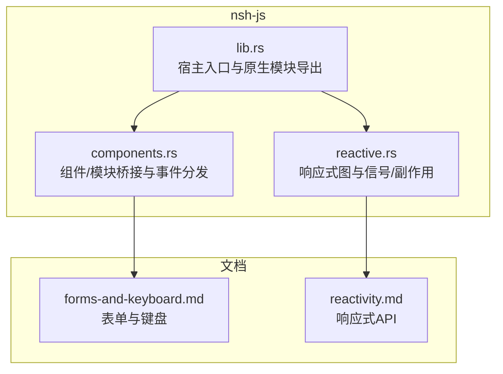
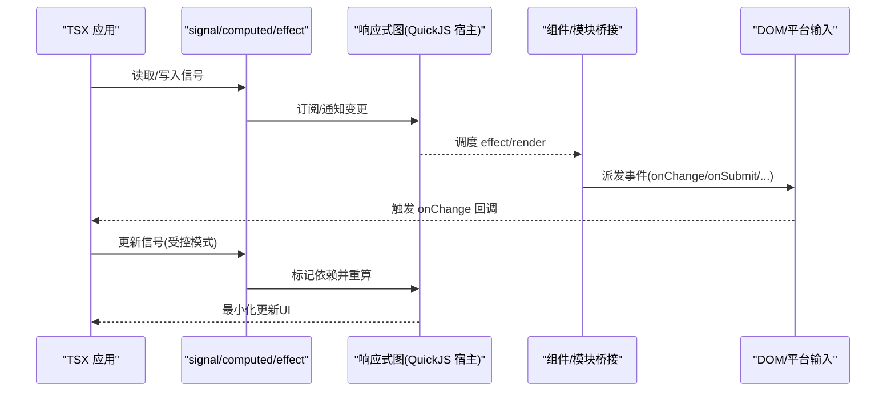
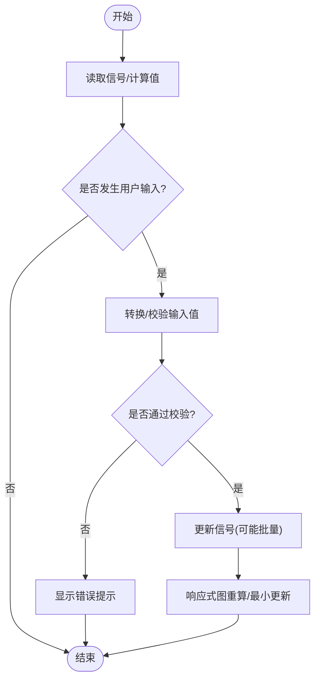
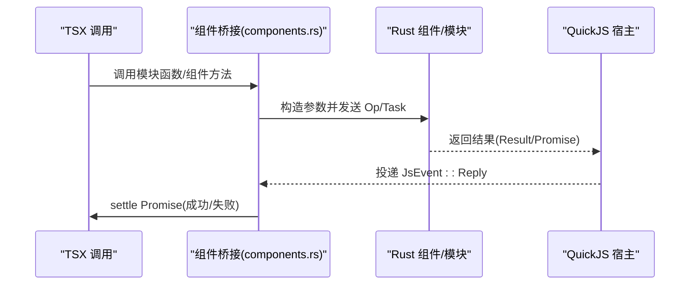
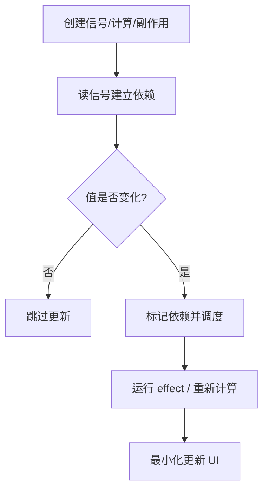
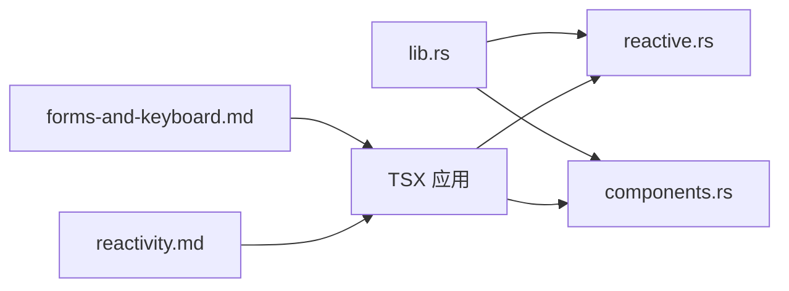

# 数据绑定API

<cite>
**本文引用的文件**   
- [reactive.rs](file://crates/nsh-js/src/reactive.rs)
- [components.rs](file://crates/nsh-js/src/components.rs)
- [lib.rs](file://crates/nsh-js/src/lib.rs)
- [forms-and-keyboard.md](file://website/docs/forms-and-keyboard.md)
- [reactivity.md](file://website/docs/reactivity.md)
</cite>

## 目录
1. [简介](#简介)
2. [项目结构](#项目结构)
3. [核心组件](#核心组件)
4. [架构总览](#架构总览)
5. [详细组件分析](#详细组件分析)
6. [依赖关系分析](#依赖关系分析)
7. [性能考量](#性能考量)
8. [故障排查指南](#故障排查指南)
9. [结论](#结论)
10. [附录：API参考与示例索引](#附录api参考与示例索引)

## 简介
本文件为 NSH 框架的数据绑定系统提供完整的 TypeScript API 文档，覆盖双向绑定、表单验证、数据转换与格式化接口；说明受控与非受控组件模式；给出复杂数据结构绑定、嵌套对象处理与数组操作的类型约定；并提供表单状态管理、实时验证与用户反馈的实现示例；最后解释与后端数据同步和缓存机制。

NSH 的响应式内核由 Rust 实现（QuickJS 宿主），TSX 通过信号、计算值、副作用和资源等原语进行数据绑定。输入控件支持受控/非受控两种模式，并具备丰富的键盘与输入法事件，便于构建复杂的表单体验。

## 项目结构
- nsh-js 模块负责 QuickJS 宿主、原生模块导出、DOM/组件桥接与响应式图的原生实现。
- website/docs 包含 TSX 侧的使用文档，包括“表单与键盘”“响应式”等主题。



图表来源
- [lib.rs:1-87](file://crates/nsh-js/src/lib.rs#L1-L87)
- [reactive.rs:1-120](file://crates/nsh-js/src/reactive.rs#L1-L120)
- [components.rs:1-40](file://crates/nsh-js/src/components.rs#L1-L40)
- [forms-and-keyboard.md:1-120](file://website/docs/forms-and-keyboard.md#L1-L120)
- [reactivity.md:1-120](file://website/docs/reactivity.md#L1-L120)

章节来源
- [lib.rs:1-87](file://crates/nsh-js/src/lib.rs#L1-L87)

## 核心组件
- 响应式图与信号（Rust 实现）
  - 提供 createSignal、createMemo、createEffect、batch、untrack、cleanup、context 等能力。
  - 在 TSX 中通过 signal、computed、effect、resource、batch、untracked、cleanup、context 暴露。
- 组件与模块桥接
  - 将 Rust 组件/模块函数映射到 JS 调用，处理 Promise 结果、事件派发、渲染回调等。
- 表单与键盘
  - Input 控件支持受控/非受控、输入法组合、粘贴、选择、光标定位、键盘高度与自动滚动等。

章节来源
- [reactivity.md:1-120](file://website/docs/reactivity.md#L1-L120)
- [forms-and-keyboard.md:1-120](file://website/docs/forms-and-keyboard.md#L1-L120)
- [components.rs:1-40](file://crates/nsh-js/src/components.rs#L1-L40)

## 架构总览
下图展示从 TSX 到 Rust 响应式图与组件系统的调用链，以及表单事件如何驱动状态更新与视图刷新。



图表来源
- [reactive.rs:439-493](file://crates/nsh-js/src/reactive.rs#L439-L493)
- [components.rs:378-469](file://crates/nsh-js/src/components.rs#L378-L469)
- [forms-and-keyboard.md:63-120](file://website/docs/forms-and-keyboard.md#L63-L120)
- [reactivity.md:23-105](file://website/docs/reactivity.md#L23-L105)

## 详细组件分析

### 响应式系统与数据绑定（signal/computed/effect/resource）
- 双向绑定
  - 在 TSX 中，Input 的 value 与 onChange 配合 signal 可实现双向绑定：onChange 中更新 signal，value 显示最新值。
- 数据转换与格式化
  - 在 onChange 中对 value 做转换（如大写、仅数字、日期格式化），再写回 signal，实现“输入即格式化”。
- 复杂数据结构与数组
  - 使用 signal<T>() 声明强类型；数组操作需返回新数组或 update 修改后通知；对象字段更新建议用 spread 生成新对象。
- 嵌套对象处理
  - 对深层字段更新时，优先使用不可变更新策略，避免原地突变导致 TSX 比较失效。
- 资源加载与缓存
  - resource(source, fetcher) 可封装异步请求，内置 loading/error/state/mutate/refetch 等状态；适合列表分页、详情获取等场景。



图表来源
- [reactivity.md:23-105](file://website/docs/reactivity.md#L23-L105)
- [reactivity.md:212-273](file://website/docs/reactivity.md#L212-L273)
- [forms-and-keyboard.md:63-120](file://website/docs/forms-and-keyboard.md#L63-L120)

章节来源
- [reactivity.md:23-105](file://website/docs/reactivity.md#L23-L105)
- [reactivity.md:212-273](file://website/docs/reactivity.md#L212-L273)

### 表单控件与键盘交互（Input）
- 受控组件模式
  - 通过 value + onChange 绑定 signal，所有编辑路径都经过 state 更新。
- 非受控组件模式
  - 不传 value，使用 defaultValue 初始化，仅在提交或需要时读取当前值。
- 输入法与组合文本
  - onCompositionChange 用于区分组合阶段与提交阶段，避免搜索/校验在组合过程中误触发。
- 粘贴与插入
  - onPaste 可拦截粘贴内容，使用 insertText 以“用户编辑”的方式插入，保持撤销历史。
- 选择与光标
  - onSelectionChange 与 selectedRange 控制选区；onCaretMove 获取光标位置以便弹出菜单。
- 键盘行为
  - keyboardType、returnKeyType、submitBehavior 控制键盘布局与回车行为；keyboard_height()/keyboardFrame() 用于避让软键盘。

```mermaid
classDiagram
class InputProps {
+string value
+string defaultValue
+boolean masked
+KeyboardType keyboardType
+ReturnKeyType returnKeyType
+SubmitBehavior submitBehavior
+number maxLength
+boolean multiline
+{start : number;end? : number} selectedRange
}
class InputEvents {
+onChange({value})
+onSubmit({text})
+onFocus()
+onBlur()
+onSelectionChange({start,end})
+onPaste({text,html,files,uris})
+onCaretMove({bounds,pageBounds})
+onKeyPress({key})
+onContentSizeChange({size})
+onCompositionChange({composing,text})
}
InputProps <.. InputEvents : "驱动状态更新"
```

图表来源
- [forms-and-keyboard.md:177-219](file://website/docs/forms-and-keyboard.md#L177-L219)
- [forms-and-keyboard.md:246-300](file://website/docs/forms-and-keyboard.md#L246-L300)
- [forms-and-keyboard.md:375-403](file://website/docs/forms-and-keyboard.md#L375-L403)
- [forms-and-keyboard.md:453-528](file://website/docs/forms-and-keyboard.md#L453-L528)
- [forms-and-keyboard.md:530-618](file://website/docs/forms-and-keyboard.md#L530-L618)

章节来源
- [forms-and-keyboard.md:63-120](file://website/docs/forms-and-keyboard.md#L63-L120)
- [forms-and-keyboard.md:177-219](file://website/docs/forms-and-keyboard.md#L177-L219)
- [forms-and-keyboard.md:246-300](file://website/docs/forms-and-keyboard.md#L246-L300)
- [forms-and-keyboard.md:375-403](file://website/docs/forms-and-keyboard.md#L375-L403)
- [forms-and-keyboard.md:453-528](file://website/docs/forms-and-keyboard.md#L453-L528)
- [forms-and-keyboard.md:530-618](file://website/docs/forms-and-keyboard.md#L530-L618)

### 组件与模块桥接（Promise、事件、渲染回调）
- 模块函数
  - 同步/异步/Op/Start 四种调用方式，统一通过 Promise 返回结果。
- 事件分发
  - 将 Rust 组件事件转换为 JS 事件，携带已转换的数据对象。
- 渲染回调
  - 支持 render function 的动态插槽渲染，按 key 维护 holder/root/signal。



图表来源
- [components.rs:218-300](file://crates/nsh-js/src/components.rs#L218-L300)
- [components.rs:378-469](file://crates/nsh-js/src/components.rs#L378-L469)
- [components.rs:676-772](file://crates/nsh-js/src/components.rs#L676-L772)

章节来源
- [components.rs:218-300](file://crates/nsh-js/src/components.rs#L218-L300)
- [components.rs:378-469](file://crates/nsh-js/src/components.rs#L378-L469)
- [components.rs:676-772](file://crates/nsh-js/src/components.rs#L676-L772)

### 响应式图与信号实现（QuickJS 宿主）
- 信号读写
  - 读信号会建立依赖；写信号会标记依赖并调度 effect。
- 自定义相等性
  - 支持 equals 选项，允许自定义比较逻辑（如对象浅比较）。
- 批处理与无跟踪
  - batch 合并多次写入；untrack 在不订阅的情况下读取值。
- 清理与上下文
  - cleanup 注册清理函数；context 提供跨层级共享值。



图表来源
- [reactive.rs:1-120](file://crates/nsh-js/src/reactive.rs#L1-L120)
- [reactive.rs:439-493](file://crates/nsh-js/src/reactive.rs#L439-L493)
- [reactive.rs:609-651](file://crates/nsh-js/src/reactive.rs#L609-L651)
- [reactive.rs:775-800](file://crates/nsh-js/src/reactive.rs#L775-L800)

章节来源
- [reactive.rs:1-120](file://crates/nsh-js/src/reactive.rs#L1-L120)
- [reactive.rs:439-493](file://crates/nsh-js/src/reactive.rs#L439-L493)
- [reactive.rs:609-651](file://crates/nsh-js/src/reactive.rs#L609-L651)
- [reactive.rs:775-800](file://crates/nsh-js/src/reactive.rs#L775-L800)

## 依赖关系分析
- nsh-js/lib.rs 作为宿主入口，安装全局 API 并导出原生模块。
- reactive.rs 实现响应式图与信号/副作用，供 TSX 层使用。
- components.rs 负责组件/模块桥接、事件分发与渲染回调。
- 文档 forms-and-keyboard.md 与 reactivity.md 描述 TSX 层的 API 用法与最佳实践。



图表来源
- [lib.rs:1-87](file://crates/nsh-js/src/lib.rs#L1-L87)
- [reactive.rs:1-120](file://crates/nsh-js/src/reactive.rs#L1-L120)
- [components.rs:1-40](file://crates/nsh-js/src/components.rs#L1-L40)
- [forms-and-keyboard.md:1-120](file://website/docs/forms-and-keyboard.md#L1-L120)
- [reactivity.md:1-120](file://website/docs/reactivity.md#L1-L120)

章节来源
- [lib.rs:1-87](file://crates/nsh-js/src/lib.rs#L1-L87)

## 性能考量
- 使用 computed 缓存昂贵派生值，避免重复计算。
- 使用 batch 合并多次信号写入，减少重渲染次数。
- 在 TSX 中避免原地突变数组/对象，确保 === 比较能正确识别变更。
- 合理使用 untracked 读取不触发依赖的值，降低不必要的重算。
- 使用 resource 管理异步数据，利用其内部状态与取消语义，避免内存泄漏。

[本节为通用指导，无需代码引用]

## 故障排查指南
- 无限循环
  - 在 effect 中直接写它读取的信号会导致自激循环；改用 computed 或拆分逻辑。
- 异步未追踪
  - effect 内 await 后的信号读取不会被追踪；先同步读取所需信号，再发起异步任务。
- 组件体读取信号不更新
  - 组件体只执行一次；需在绑定或 computed/effect 中读取信号。
- 输入丢失焦点或闪烁
  - 检查受控 value 是否与 signal 一致；避免在组合阶段覆盖 value。
- Promise 未解决
  - 检查模块函数返回值是否为 Promise；确认 Rust 端是否正确投递 JsEvent::Reply。

章节来源
- [reactivity.md:496-544](file://website/docs/reactivity.md#L496-L544)
- [components.rs:633-674](file://crates/nsh-js/src/components.rs#L633-L674)

## 结论
NSH 的数据绑定系统以 Rust 实现的响应式图为底座，TSX 通过 signal/computed/effect/resource 等原语完成声明式绑定。表单控件提供完善的受控/非受控模式与键盘/输入法事件，便于构建高可用的复杂表单。结合 resource 与 batch/untracked 等工具，可在保证用户体验的同时获得良好的性能表现。

[本节为总结，无需代码引用]

## 附录：API参考与示例索引
- 响应式 API
  - signal、computed、effect、resource、batch、untracked、cleanup、context
  - 参考：[reactivity.md:23-105](file://website/docs/reactivity.md#L23-L105)、[reactivity.md:212-273](file://website/docs/reactivity.md#L212-L273)
- 表单与键盘
  - Input props/events、输入法组合、粘贴、选择、光标、键盘高度
  - 参考：[forms-and-keyboard.md:177-219](file://website/docs/forms-and-keyboard.md#L177-L219)、[forms-and-keyboard.md:246-300](file://website/docs/forms-and-keyboard.md#L246-L300)、[forms-and-keyboard.md:375-403](file://website/docs/forms-and-keyboard.md#L375-L403)、[forms-and-keyboard.md:453-528](file://website/docs/forms-and-keyboard.md#L453-L528)、[forms-and-keyboard.md:530-618](file://website/docs/forms-and-keyboard.md#L530-L618)
- 组件与模块桥接
  - Promise 结果、事件分发、渲染回调
  - 参考：[components.rs:218-300](file://crates/nsh-js/src/components.rs#L218-L300)、[components.rs:378-469](file://crates/nsh-js/src/components.rs#L378-L469)、[components.rs:676-772](file://crates/nsh-js/src/components.rs#L676-L772)
- 响应式图实现
  - 信号读写、批处理、清理、上下文
  - 参考：[reactive.rs:439-493](file://crates/nsh-js/src/reactive.rs#L439-L493)、[reactive.rs:609-651](file://crates/nsh-js/src/reactive.rs#L609-L651)、[reactive.rs:775-800](file://crates/nsh-js/src/reactive.rs#L775-L800)