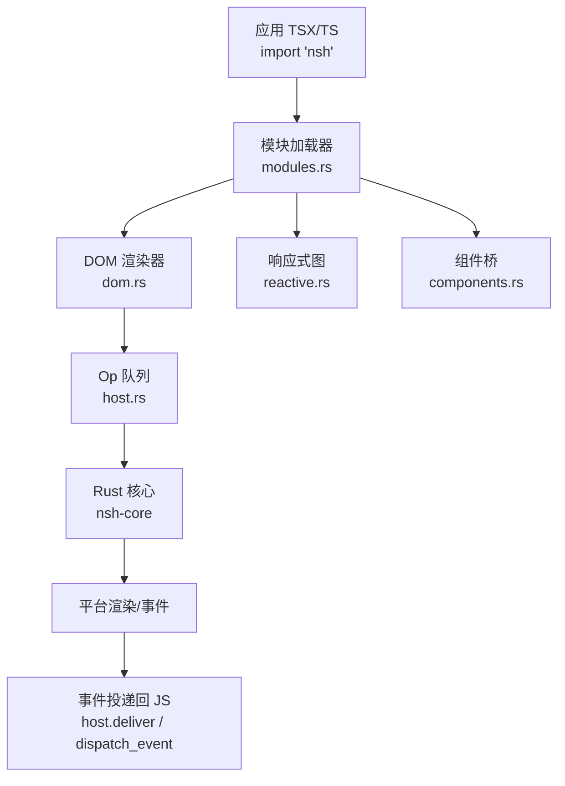
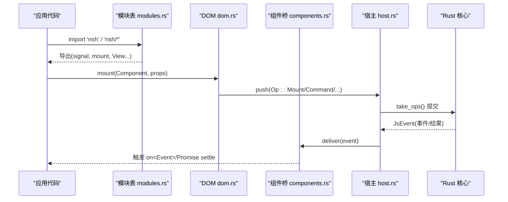
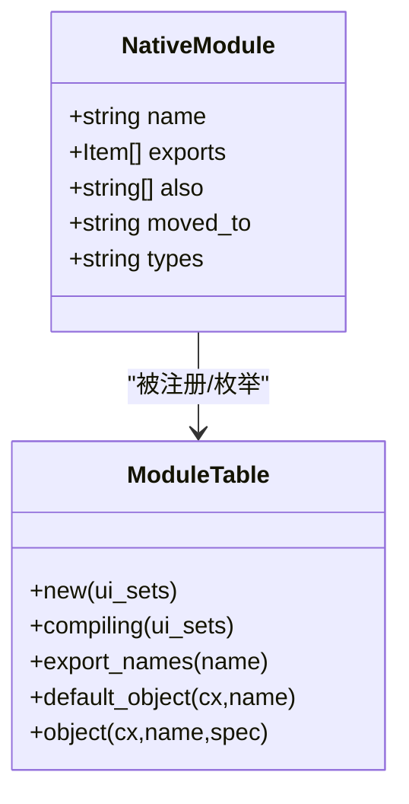
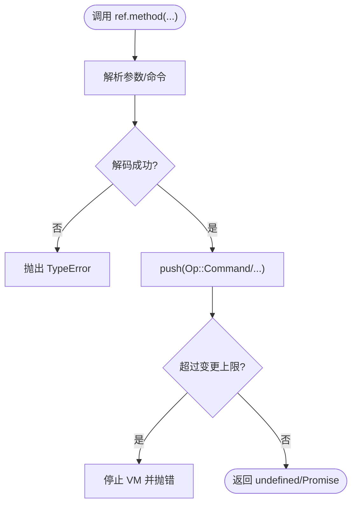
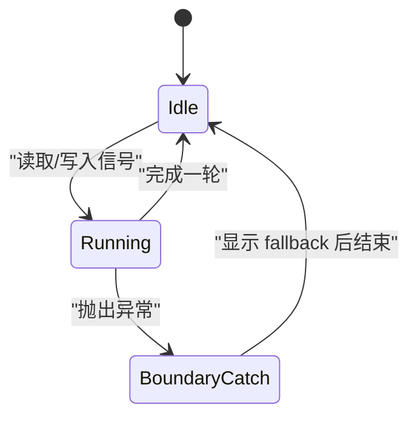
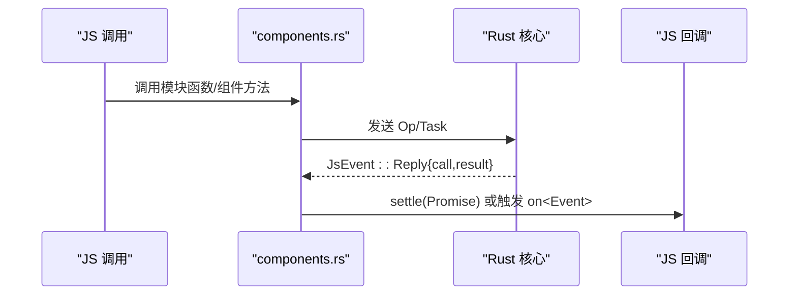
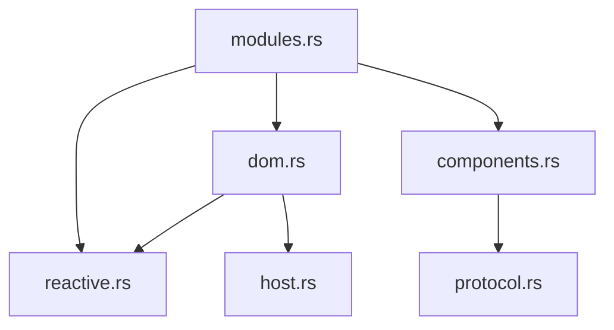

# 核心模块API

<cite>
**本文引用的文件**   
- [README.md](file://README.md)
- [lib.rs](file://crates/nsh-js/src/lib.rs)
- [modules.rs](file://crates/nsh-js/src/modules.rs)
- [declarations.rs](file://crates/nsh-js/src/declarations.rs)
- [components.rs](file://crates/nsh-js/src/components.rs)
- [reactive.rs](file://crates/nsh-js/src/reactive.rs)
- [dom.rs](file://crates/nsh-js/src/dom.rs)
- [host.rs](file://crates/nsh-js/src/host.rs)
</cite>

## 目录
1. [简介](#简介)
2. [项目结构](#项目结构)
3. [核心组件](#核心组件)
4. [架构总览](#架构总览)
5. [详细组件分析](#详细组件分析)
6. [依赖关系分析](#依赖关系分析)
7. [性能与资源限制](#性能与资源限制)
8. [故障排查指南](#故障排查指南)
9. [结论](#结论)
10. [附录：常用操作示例路径](#附录常用操作示例路径)

## 简介
本文件为 NSH 框架核心 TypeScript 模块的 API 文档，聚焦 nsh-js 运行时如何向 JS 暴露“nsh”主模块、全局类型定义与基础接口，并说明组件生命周期、状态管理（信号/计算/副作用）、事件系统、错误边界等关键机制。同时给出与 Rust 后端通信协议、数据序列化与宿主桥接要点，以及组件注册、模块导入与应用初始化的实践指引。

## 项目结构
nsh-js 是 QuickJS 宿主层，负责：
- 安装全局 API（console、定时器、网络等）
- 提供原生 ES 模块（nsh、nsh:rt、nsh/*）
- 将应用变更序列化为 Op 队列交给 Rust 核心
- 将 Rust 侧事件回投到 JS 回调
- 生成 .nsh/types 下的 TypeScript 声明

图表来源
- [lib.rs:1-10](file://crates/nsh-js/src/lib.rs#L1-L10)
- [modules.rs:1-16](file://crates/nsh-js/src/modules.rs#L1-L16)
- [dom.rs:1-23](file://crates/nsh-js/src/dom.rs#L1-L23)
- [reactive.rs:1-19](file://crates/nsh-js/src/reactive.rs#L1-L19)
- [components.rs:1-18](file://crates/nsh-js/src/components.rs#L1-L18)
- [host.rs:526-551](file://crates/nsh-js/src/host.rs#L526-L551)

章节来源
- [lib.rs:1-10](file://crates/nsh-js/src/lib.rs#L1-L10)
- [README.md:1-40](file://README.md#L1-L40)

## 核心组件
- nsh 主模块导出
  - 状态与副作用：signal、computed、effect、batch、untracked、cleanup
  - 异步资源：resource
  - 上下文：context
  - 挂载与拆分：mount、split
  - 错误边界：ErrorBoundary
  - 宿主元素：View、Text、Scroll、Overlay、Shader*、ScreenEffect/Transition
- 模块表与类型声明
  - modules.rs 维护 NativeModule 表与导出项
  - declarations.rs 生成 .nsh/types 下所有 d.ts 文件
- DOM 渲染器
  - 节点对象、方法（focus/blur/measure/scrollTo/evaluate 等）
  - 将变更推入 Op 队列
- 响应式图
  - Signal/Memo/Effect 在 QuickJS 中的实现
  - 错误边界捕获与传播
- 组件桥
  - 将 Rust 组件/模块函数映射到 JS
  - Promise 结果投递 settle
- Host 宿主
  - 运行环境、沙箱、配额、I/O、事件分发、模块加载

章节来源
- [modules.rs:116-292](file://crates/nsh-js/src/modules.rs#L116-L292)
- [modules.rs:422-563](file://crates/nsh-js/src/modules.rs#L422-L563)
- [declarations.rs:22-223](file://crates/nsh-js/src/declarations.rs#L22-L223)
- [dom.rs:420-606](file://crates/nsh-js/src/dom.rs#L420-L606)
- [reactive.rs:1-19](file://crates/nsh-js/src/reactive.rs#L1-L19)
- [components.rs:1-18](file://crates/nsh-js/src/components.rs#L1-L18)
- [host.rs:112-148](file://crates/nsh-js/src/host.rs#L112-L148)

## 架构总览
下图展示从 JS 调用到 Rust 核心再返回事件的完整链路。

图表来源
- [modules.rs:116-292](file://crates/nsh-js/src/modules.rs#L116-L292)
- [dom.rs:391-409](file://crates/nsh-js/src/dom.rs#L391-L409)
- [host.rs:526-551](file://crates/nsh-js/src/host.rs#L526-L551)
- [components.rs:372-469](file://crates/nsh-js/src/components.rs#L372-L469)

## 详细组件分析

### nsh 主模块与导出
- 状态与副作用
  - signal<T>(value?, options?): Signal<T>
  - computed<T>(fn, options?): Accessor<T>
  - effect(fn): void
  - batch(fn): T
  - untracked(fn): T
  - cleanup(fn): void
- 异步资源
  - resource(fetcher|source, fetcher|options, options?): Resource<T> | InitializedResource<T>
- 上下文
  - context<T>(defaultValue): Context<T>
- 挂载与拆分
  - mount
(app, props?): () => void
  - split<T, K>(props, keys): [Pick<T,K>, Omit<T,K>]
- 错误边界
  - ErrorBoundary({ fallback, children }): JSX.Element
- 宿主元素
  - View/Text/Scroll/Overlay/Shader*/ScreenEffect/ScreenTransition

类型与行为由 modules.rs 中 NSH 数组与 NSH_TYPES 字符串共同描述；declarations.rs 将其编译为 .nsh/types/nsh/index.d.ts 与 types.d.ts。

章节来源
- [modules.rs:116-292](file://crates/nsh-js/src/modules.rs#L116-L292)
- [modules.rs:294-400](file://crates/nsh-js/src/modules.rs#L294-L400)
- [declarations.rs:22-223](file://crates/nsh-js/src/declarations.rs#L22-L223)

### 模块系统与类型声明
- NativeModule 表
  - name、exports、also（代理导出）、moved_to（迁移目标）、types（内联 TS 类型）
- 模块加载
  - 首次导入时构建导出值；QuickJS 编译期仅记录导出名
- 类型生成
  - declarations.rs 根据 MODULES、Registry、SetDescription 与 core 表生成 .d.ts
  - 支持 reexport、native value names、UI set 声明合并

图表来源
- [modules.rs:99-113](file://crates/nsh-js/src/modules.rs#L99-L113)
- [modules.rs:607-623](file://crates/nsh-js/src/modules.rs#L607-L623)
- [modules.rs:649-790](file://crates/nsh-js/src/modules.rs#L649-L790)
- [declarations.rs:462-531](file://crates/nsh-js/src/declarations.rs#L462-L531)

章节来源
- [modules.rs:99-113](file://crates/nsh-js/src/modules.rs#L99-L113)
- [modules.rs:607-790](file://crates/nsh-js/src/modules.rs#L607-L790)
- [declarations.rs:462-531](file://crates/nsh-js/src/declarations.rs#L462-L531)

### DOM 渲染器与节点方法
- 节点对象
  - 每个 JS 节点对象持有 NodeId、父/子、事件处理器、触摸处理器、保留值等
- 节点方法
  - focus/blur/clearSelection/setSelection/insertText/command
  - scrollTo/zoomTo/scrollToOffset/scrollToIndex/scrollToEnd
  - measure/measureScrollPosition/animateLayout/reveal
  - WebView: reload/goBack/goForward/stopLoading/evaluate/injectJavaScript/postMessage/sendInput/load
  - Video: seek
- 变更队列
  - push(op) 将 Op 推入 Shared.ops，超限则停止 VM 并抛出 RangeError

图表来源
- [dom.rs:420-606](file://crates/nsh-js/src/dom.rs#L420-L606)
- [dom.rs:391-409](file://crates/nsh-js/src/dom.rs#L391-L409)

章节来源
- [dom.rs:420-606](file://crates/nsh-js/src/dom.rs#L420-L606)
- [dom.rs:391-409](file://crates/nsh-js/src/dom.rs#L391-L409)

### 响应式图（Signal/Memo/Effect）
- 概念
  - Signal：可读写访问器；Memo：惰性派生；Effect：副作用
  - 调度基于 Solid 风格，用户闭包仅在 JS 中执行
- 错误边界
  - 计算中抛出的异常会被 ErrorBoundary 捕获，并在无计算运行时显示 fallback
- 生命周期
  - 信号对象与节点绑定；memo/effect 归属 owner，随 owner 释放
  - GC finalizer 清理 graph 句柄

图表来源
- [reactive.rs:1-19](file://crates/nsh-js/src/reactive.rs#L1-L19)
- [reactive.rs:278-317](file://crates/nsh-js/src/reactive.rs#L278-L317)
- [reactive.rs:495-516](file://crates/nsh-js/src/reactive.rs#L495-L516)

章节来源
- [reactive.rs:1-19](file://crates/nsh-js/src/reactive.rs#L1-L19)
- [reactive.rs:278-317](file://crates/nsh-js/src/reactive.rs#L278-L317)
- [reactive.rs:495-516](file://crates/nsh-js/src/reactive.rs#L495-L516)

### 组件桥与事件投递
- Rust 组件/模块函数映射
  - module_function 根据 FunctionCall 类型创建同步/Op/Async/Start 闭包
  - send 统一处理参数转换、Promise 包装与结果投递
- 事件投递
  - deliver 分发 JsEvent：组件事件、children/render/unrender、rows、Reply
  - 对未消费的事件进行静默丢弃，避免无谓转换开销

图表来源
- [components.rs:676-772](file://crates/nsh-js/src/components.rs#L676-L772)
- [components.rs:372-469](file://crates/nsh-js/src/components.rs#L372-L469)

章节来源
- [components.rs:676-772](file://crates/nsh-js/src/components.rs#L676-L772)
- [components.rs:372-469](file://crates/nsh-js/src/components.rs#L372-L469)

### Host 宿主与通信协议
- 宿主职责
  - 初始化 QuickJS 运行时、安装标准库、沙箱、配额、计时器、网络队列
  - 提供 eval_source/eval_bytecode/eval_script 入口
  - 管理 chunk 分包加载与失败重试
  - 收集 Op 并提交给 Rust 核心，接收事件并投递
- 通信协议
  - JS -> Rust：通过 Op 队列（如 Command/Evaluate/Release/Animation 等）
  - Rust -> JS：JsEvent（事件、children/render、Reply）
- 宿主桥接
  - host_channel：host.call/host.on 与嵌入应用的双向通道
  - WebSocket/文件系统/更新器等能力通过 Host 注入

图表来源
- [host.rs:150-214](file://crates/nsh-js/src/host.rs#L150-L214)
- [host.rs:368-474](file://crates/nsh-js/src/host.rs#L368-L474)
- [host.rs:526-551](file://crates/nsh-js/src/host.rs#L526-L551)
- [host.rs:680-699](file://crates/nsh-js/src/host.rs#L680-L699)

章节来源
- [host.rs:150-214](file://crates/nsh-js/src/host.rs#L150-L214)
- [host.rs:368-474](file://crates/nsh-js/src/host.rs#L368-L474)
- [host.rs:526-551](file://crates/nsh-js/src/host.rs#L526-L551)
- [host.rs:680-699](file://crates/nsh-js/src/host.rs#L680-L699)

## 依赖关系分析
- 模块表依赖
  - modules.rs 依赖 reactive、canvas、desktop、dom、env、keymap、list、platform_modules、touch 等
- 类型声明依赖
  - declarations.rs 依赖 modules.rs 的导出表与 nsh_core::element 的 Registry/SetDescription
- DOM 依赖
  - dom.rs 依赖 host.Shared（ops/releases/limits）、reactive.owner_handle
- 组件桥依赖
  - components.rs 依赖 dom、reactive、protocol、classes/web.js

图表来源
- [modules.rs:31-35](file://crates/nsh-js/src/modules.rs#L31-L35)
- [dom.rs:35-39](file://crates/nsh-js/src/dom.rs#L35-L39)
- [components.rs:38-42](file://crates/nsh-js/src/components.rs#L38-L42)

章节来源
- [modules.rs:31-35](file://crates/nsh-js/src/modules.rs#L31-L35)
- [dom.rs:35-39](file://crates/nsh-js/src/dom.rs#L35-L39)
- [components.rs:38-42](file://crates/nsh-js/src/components.rs#L38-L42)

## 性能与资源限制
- 变更上限
  - dom.push 检查 max_op_values，超限即停止 VM 并抛错
- 内存与栈
  - HostOptions.limits.memory_bytes/stack_bytes 控制堆与栈
- 配额与中断
  - sandbox::Budget 与 interrupt_handler 防止长时间阻塞
- 数组长度保护
  - MAX_ARRAY_ITEMS 与 checked_len/take_len 防止超大数组导致卡顿

章节来源
- [dom.rs:391-409](file://crates/nsh-js/src/dom.rs#L391-L409)
- [dom.rs:209-240](file://crates/nsh-js/src/dom.rs#L209-L240)
- [host.rs:150-214](file://crates/nsh-js/src/host.rs#L150-L214)

## 故障排查指南
- 常见错误
  - “超出变更上限”：减少单次批量的变更数量，或使用 batch 合并
  - “脚本耗尽内存”：将大数据留在 Rust 侧，JS 只持有必要视图
  - “WebView.evaluate 超时/不可用”：检查 timeout 与平台能力
  - “Promise 未处理拒绝”：设置 Host.set_rejection_handler 捕获
- 调试建议
  - 使用 Host.set_error_handler 捕获未捕获异常
  - 查看 Host.fatal() 获取停止原因
  - 在开发模式关闭 harden 以启用更多诊断信息

章节来源
- [dom.rs:391-409](file://crates/nsh-js/src/dom.rs#L391-L409)
- [host.rs:216-237](file://crates/nsh-js/src/host.rs#L216-L237)
- [host.rs:320-366](file://crates/nsh-js/src/host.rs#L320-L366)

## 结论
nsh-js 通过模块表、DOM 渲染器、响应式图与组件桥，将 TS/TSX 应用与 Rust 核心紧密耦合：JS 侧声明与类型由 Rust 源自动生成，保证一致性；变更与事件通过 Op/JsEvent 双向传输；Host 统一管理运行时、配额与安全策略。理解这些核心模块的职责与边界，有助于编写高性能、可维护的 NSH 应用。

## 附录：常用操作示例路径
- 组件注册（Rust 组件暴露给 JS）
  - 参考：[components.rs:1-18](file://crates/nsh-js/src/components.rs#L1-L18)
- 模块导入（nsh、nsh/*）
  - 参考：[modules.rs:422-563](file://crates/nsh-js/src/modules.rs#L422-L563)
- 应用初始化（mount）
  - 参考：[modules.rs:192-199](file://crates/nsh-js/src/modules.rs#L192-L199)
- 状态管理（signal/computed/effect/batch/untracked/cleanup）
  - 参考：[modules.rs:120-170](file://crates/nsh-js/src/modules.rs#L120-L170)
- 异步资源（resource）
  - 参考：[modules.rs:171-183](file://crates/nsh-js/src/modules.rs#L171-L183)
- 错误边界（ErrorBoundary）
  - 参考：[modules.rs:210-219](file://crates/nsh-js/src/modules.rs#L210-L219)
- 与 Rust 后端通信（Op/JsEvent）
  - 参考：[dom.rs:391-409](file://crates/nsh-js/src/dom.rs#L391-L409)、[host.rs:526-551](file://crates/nsh-js/src/host.rs#L526-L551)
- 类型声明生成（.nsh/types）
  - 参考：[declarations.rs:462-531](file://crates/nsh-js/src/declarations.rs#L462-L531)