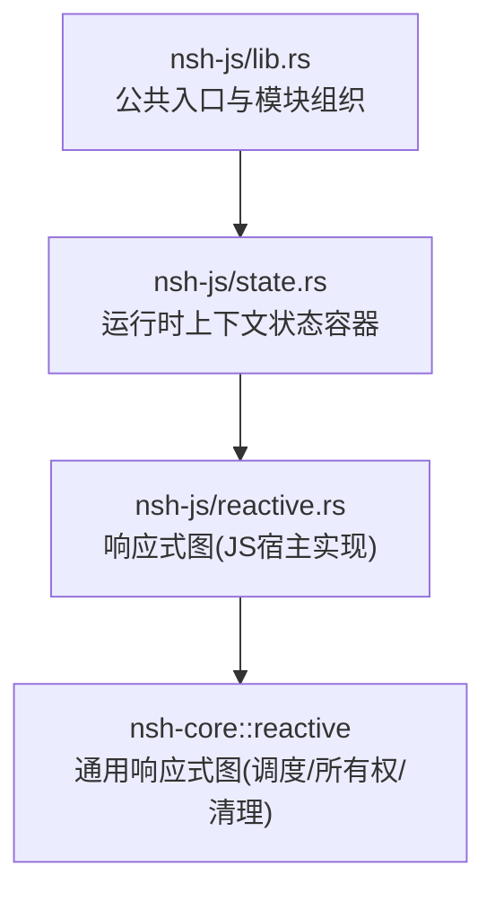
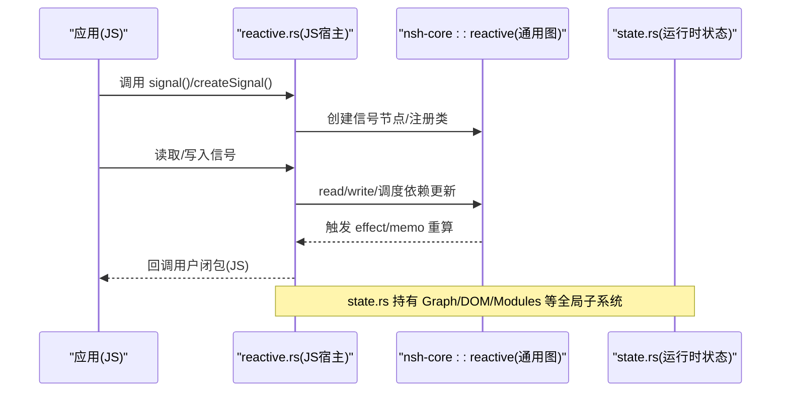
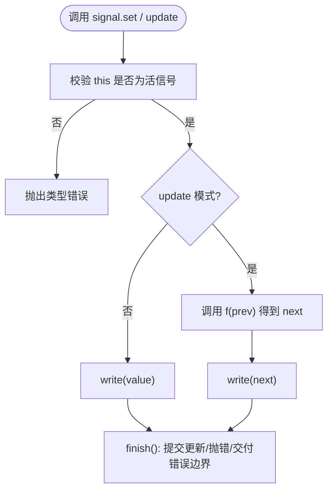

# 状态管理API

<cite>
**本文引用的文件**   
- [reactive.rs](file://crates/nsh-js/src/reactive.rs)
- [state.rs](file://crates/nsh-js/src/state.rs)
- [lib.rs](file://crates/nsh-js/src/lib.rs)
</cite>

## 目录
1. [简介](#简介)
2. [项目结构](#项目结构)
3. [核心组件](#核心组件)
4. [架构总览](#架构总览)
5. [详细组件分析](#详细组件分析)
6. [依赖关系分析](#依赖关系分析)
7. [性能考虑](#性能考虑)
8. [故障排查指南](#故障排查指南)
9. [结论](#结论)
10. [附录](#附录)

## 简介
本文件为 NSH 框架的状态管理系统提供完整的 TypeScript API 文档，聚焦响应式状态、信号、计算值与副作用的管理接口。内容涵盖：
- useState/useEffect 等 Hooks 的使用方式与类型定义（基于底层 reactive 原语）
- 状态持久化、异步数据流与状态同步的实现模式
- 复杂状态场景的最佳实践与性能优化技巧
- 与 Rust 后端状态的双向绑定机制说明

NSH 的响应式系统由 QuickJS 宿主层与 nsh-core 的通用响应式图实现组成。JS 侧暴露 createSignal/createMemo/createEffect 等原语，Rust 侧负责调度、清理、错误边界与资源生命周期管理。

## 项目结构
与状态管理直接相关的代码位于 nsh-js 子模块中：
- crates/nsh-js/src/reactive.rs：响应式图在 JS 宿主上的实现，包含信号、计算值、副作用、上下文、批处理、根作用域等原语
- crates/nsh-js/src/state.rs：运行时上下文状态容器，持有响应式图、DOM、模块表等全局子系统
- crates/nsh-js/src/lib.rs：nsh-js 对外导出的公共能力入口（如 Host、网络、字节码编译等），并声明模块组织

图表来源
- [lib.rs:1-87](file://crates/nsh-js/src/lib.rs#L1-L87)
- [state.rs:1-155](file://crates/nsh-js/src/state.rs#L1-L155)
- [reactive.rs:1-25](file://crates/nsh-js/src/reactive.rs#L1-L25)

章节来源
- [lib.rs:1-87](file://crates/nsh-js/src/lib.rs#L1-L87)
- [state.rs:1-155](file://crates/nsh-js/src/state.rs#L1-L155)
- [reactive.rs:1-25](file://crates/nsh-js/src/reactive.rs#L1-L25)

## 核心组件
- 信号 Signal：可读写响应式值，支持 set/update 方法、自定义相等性比较、批量更新
- 计算值 Memo：惰性派生值，仅在依赖变化时重新计算
- 副作用 Effect：渲染后执行的用户副作用，支持清理函数
- 渲染副作用 RenderEffect：用于驱动 UI 更新的副作用
- 批处理 batch：将多次写入合并为一次更新
- 无监听读取 untrack：在不建立依赖的情况下读取信号
- 上下文 Context：setContext/useContext 提供跨层级共享状态
- 根作用域 createRoot：创建独立的作用域，支持 dispose 释放资源
- 资源 Resource：异步数据流封装（见 resource 模块）

章节来源
- [reactive.rs:609-664](file://crates/nsh-js/src/reactive.rs#L609-L664)
- [reactive.rs:1054-1064](file://crates/nsh-js/src/reactive.rs#L1054-L1064)
- [reactive.rs:1221-1231](file://crates/nsh-js/src/reactive.rs#L1221-L1231)
- [reactive.rs:1233-1250](file://crates/nsh-js/src/reactive.rs#L1233-L1250)
- [reactive.rs:787-798](file://crates/nsh-js/src/reactive.rs#L787-L798)
- [reactive.rs:775-785](file://crates/nsh-js/src/reactive.rs#L775-L785)
- [reactive.rs:846-897](file://crates/nsh-js/src/reactive.rs#L846-L897)
- [reactive.rs:725-766](file://crates/nsh-js/src/reactive.rs#L725-L766)

## 架构总览
下图展示从 JS 调用到 Rust 响应式图的调用链路与职责划分。

图表来源
- [reactive.rs:900-967](file://crates/nsh-js/src/reactive.rs#L900-L967)
- [reactive.rs:609-664](file://crates/nsh-js/src/reactive.rs#L609-L664)
- [state.rs:68-108](file://crates/nsh-js/src/state.rs#L68-L108)

## 详细组件分析

### 信号 Signal
- 创建：signal(value, options) 或 createSignal(value)
- 读取：调用信号对象返回当前值
- 写入：signal.set(newValue) 或 signal.update(prev => next)
- 相等性：options.equals 支持默认严格相等、布尔真值比较、自定义比较函数
- 方法绑定：signal.set/signal.update 是绑定到具体信号实例的方法，即使作为回调传递也能正确写入

图表来源
- [reactive.rs:1174-1219](file://crates/nsh-js/src/reactive.rs#L1174-L1219)
- [reactive.rs:495-516](file://crates/nsh-js/src/reactive.rs#L495-L516)

章节来源
- [reactive.rs:1054-1064](file://crates/nsh-js/src/reactive.rs#L1054-L1064)
- [reactive.rs:1119-1135](file://crates/nsh-js/src/reactive.rs#L1119-L1135)
- [reactive.rs:1174-1219](file://crates/nsh-js/src/reactive.rs#L1174-L1219)
- [reactive.rs:609-614](file://crates/nsh-js/src/reactive.rs#L609-L614)

### 计算值 Memo
- 创建：computed(fn, options) 或 createMemo(fn, value?, options)
- 读取：调用 memo 对象返回派生值
- 惰性求值：仅在依赖变化时重新计算
- 相等性：支持默认、布尔真值、自定义比较

章节来源
- [reactive.rs:1221-1231](file://crates/nsh-js/src/reactive.rs#L1221-L1231)
- [reactive.rs:633-651](file://crates/nsh-js/src/reactive.rs#L633-L651)

### 副作用 Effect
- 渲染副作用：createRenderEffect(fn, value?) 用于驱动 UI
- 用户副作用：createEffect(fn, value?) 在渲染后运行，支持清理函数
- 清理：onCleanup(fn) 或 return fn（effect 内返回函数即清理）
- 生命周期：随所属 owner 再次运行前或销毁时执行清理

章节来源
- [reactive.rs:653-683](file://crates/nsh-js/src/reactive.rs#L653-L683)
- [reactive.rs:800-813](file://crates/nsh-js/src/reactive.rs#L800-L813)
- [reactive.rs:1252-1278](file://crates/nsh-js/src/reactive.rs#L1252-L1278)

### 批处理与无监听读取
- batch(fn)：将多次写入合并为一次更新，减少中间态重渲染
- untrack(fn)：在 fn 内读取信号不建立依赖，避免不必要的重算

章节来源
- [reactive.rs:775-798](file://crates/nsh-js/src/reactive.rs#L775-L798)

### 上下文 Context
- setContext(key, value)：在当前 owner 上下文中设置键值对
- useContext(key)：获取最近设置的值，未设置则返回 undefined
- 作用域：仅对当前 owner 及其后代可见

章节来源
- [reactive.rs:846-897](file://crates/nsh-js/src/reactive.rs#L846-L897)

### 根作用域与清理
- createRoot(fn, owner?)：创建独立作用域，可选传入父 owner；返回 dispose 函数用于释放
- getOwner/runWithOwner：获取/切换到指定 owner 执行
- dispose_owner：以无监听方式释放 root

章节来源
- [reactive.rs:725-766](file://crates/nsh-js/src/reactive.rs#L725-L766)
- [reactive.rs:815-844](file://crates/nsh-js/src/reactive.rs#L815-L844)
- [reactive.rs:1405-1408](file://crates/nsh-js/src/reactive.rs#L1405-L1408)

### 异步数据流与资源 Resource
- Resource 类由 reactive 注册并在 JS 侧暴露，用于封装异步数据流（如 fetch、轮询、流式数据）
- 典型用法：在组件中订阅资源，自动处理加载/成功/失败状态与缓存失效

章节来源
- [reactive.rs:941-956](file://crates/nsh-js/src/reactive.rs#L941-L956)

### 与 Rust 后端状态的双向绑定
- JS 侧通过 signal/memo/effect 等原语操作响应式图
- Rust 侧通过 nsh-core::reactive 进行调度、依赖追踪、清理与错误边界
- 双向绑定模式：
  - UI -> Rust：JS 调用 signal.set/update 触发 Rust 侧 write，进而调度 effect/memo
  - Rust -> UI：Rust 侧通过 render_effect/user_effect 注入 JS 回调，驱动 UI 更新
  - 状态同步：使用 batch 合并多次写，确保一致性；使用 equals 控制最小化更新

章节来源
- [reactive.rs:1-25](file://crates/nsh-js/src/reactive.rs#L1-L25)
- [reactive.rs:1280-1295](file://crates/nsh-js/src/reactive.rs#L1280-L1295)

## 依赖关系分析
- lib.rs 导出 Host、网络、字节码等能力，并声明模块组织
- state.rs 维护每个 JS 上下文的全局状态，包括响应式图、DOM、模块表等
- reactive.rs 实现 JS 宿主层的响应式图，依赖 nsh-core::reactive 完成通用逻辑

图表来源
- [lib.rs:1-87](file://crates/nsh-js/src/lib.rs#L1-L87)
- [state.rs:1-155](file://crates/nsh-js/src/state.rs#L1-L155)
- [reactive.rs:1-25](file://crates/nsh-js/src/reactive.rs#L1-L25)

章节来源
- [lib.rs:1-87](file://crates/nsh-js/src/lib.rs#L1-L87)
- [state.rs:1-155](file://crates/nsh-js/src/state.rs#L1-L155)
- [reactive.rs:1-25](file://crates/nsh-js/src/reactive.rs#L1-L25)

## 性能考虑
- 使用 equals 选项减少不必要重算：
  - 默认严格相等适合基本类型与不可变对象
  - 布尔真值比较适用于简单开关
  - 自定义比较用于复杂对象（如按 id 或时间戳判断）
- 使用 batch 合并多次写入，避免中间态闪烁与重复渲染
- 使用 untrack 避免无关依赖导致的重算
- 合理拆分 memo，避免大对象频繁重建；必要时使用浅比较或稳定引用
- 使用 createRoot 隔离副作用与清理，防止内存泄漏
- 在高频更新路径中优先使用 peek/untracked 读取，避免建立依赖

[本节为通用指导，不直接分析具体文件]

## 故障排查指南
- 无限循环检测：当 effect 持续改变其读取的信号时，会触发“潜在无限循环”错误
- 错误边界：在渲染或计算过程中抛出的异常会被收集，并在合适时机传递给最近的 ErrorBoundary
- 清理函数未执行：检查是否在正确的 owner 下注册 onCleanup，或是否提前 dispose
- 信号已失效：对已销毁的信号调用 set/update 会返回 undefined 或抛出类型错误

章节来源
- [reactive.rs:196-211](file://crates/nsh-js/src/reactive.rs#L196-L211)
- [reactive.rs:297-317](file://crates/nsh-js/src/reactive.rs#L297-L317)
- [reactive.rs:495-516](file://crates/nsh-js/src/reactive.rs#L495-L516)
- [reactive.rs:1164-1172](file://crates/nsh-js/src/reactive.rs#L1164-L1172)

## 结论
NSH 的状态管理系统以轻量高效的响应式图为核心，通过 JS 宿主层暴露简洁的原语，配合 Rust 侧的统一调度与生命周期管理，实现了高性能、可预测的状态更新模型。借助 signal/memo/effect/batch/untrack/context 等工具，开发者可以构建清晰、可维护且性能优异的前端状态流，并与 Rust 后端状态实现稳定的双向绑定。

[本节为总结性内容，不直接分析具体文件]

## 附录

### TypeScript API 参考（基于底层原语）
- useState<T>(initial: T, options?: { equals?: Equals }): [T, (v: T | ((prev: T) => T)) => void]
  - 对应底层 signal(value, options)，返回可读写的信号
- useEffect(effect: () => void | (() => void), deps?: any[]): void
  - 对应底层 createEffect，支持返回清理函数
- useMemo<T>(fn: () => T, options?: { equals?: Equals }): T
  - 对应底层 computed/createMemo，惰性派生值
- useResource<T>(fetcher: () => Promise<T>, options?): Resource<T>
  - 对应 Resource 类，封装异步数据流
- useBatch(fn: () => void): void
  - 对应 batch，批量合并更新
- useUntrack<T>(fn: () => T): T
  - 对应 untrack，无监听读取
- useProvideContext(key: symbol|string, value: any): void
  - 对应 setContext，提供上下文
- useContext<T>(key: symbol|string): T | undefined
  - 对应 useContext，消费上下文
- useRoot(fn: (dispose: () => void) => any): void
  - 对应 createRoot，创建独立作用域

[本节为概念性 API 映射，不直接分析具体文件]