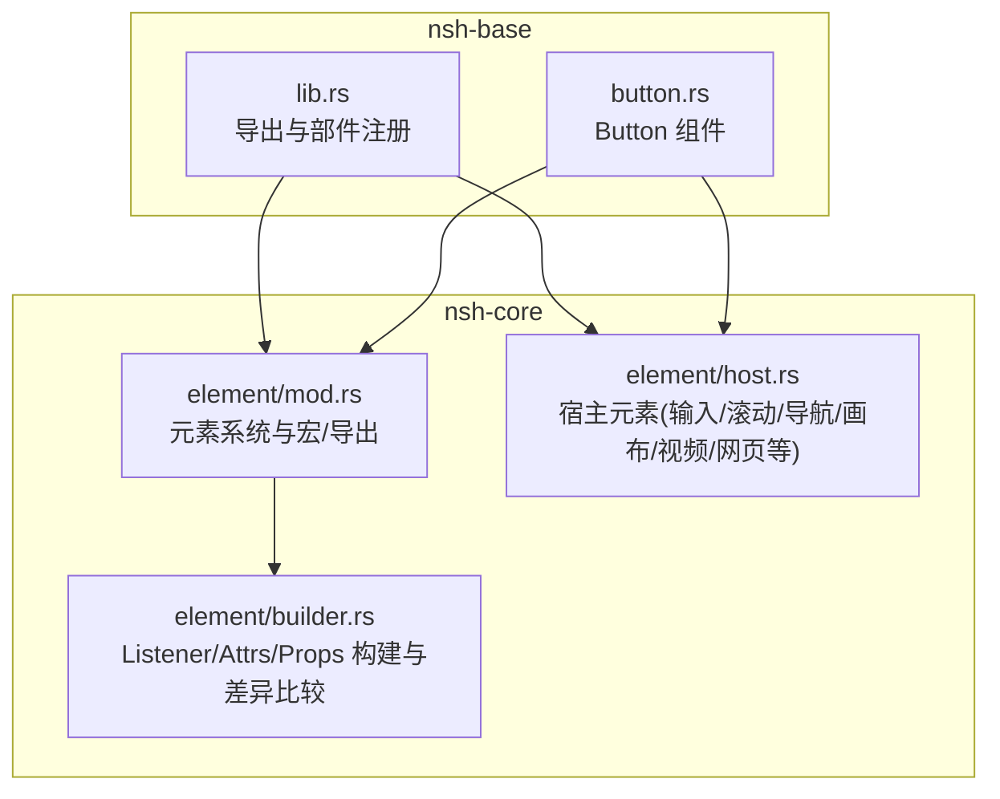
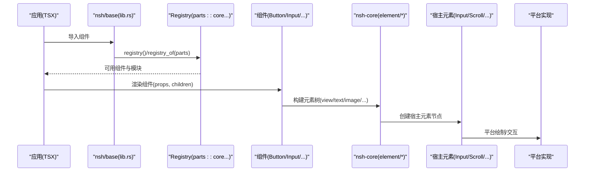
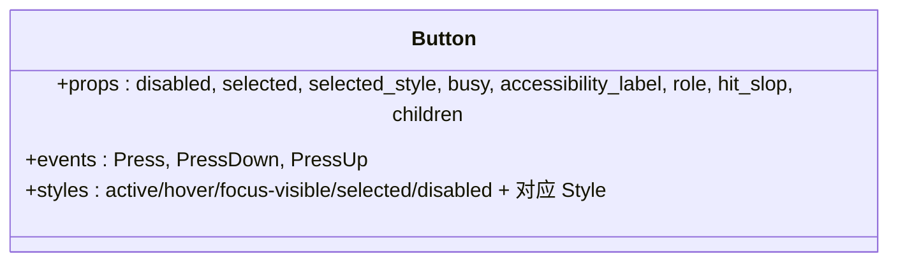
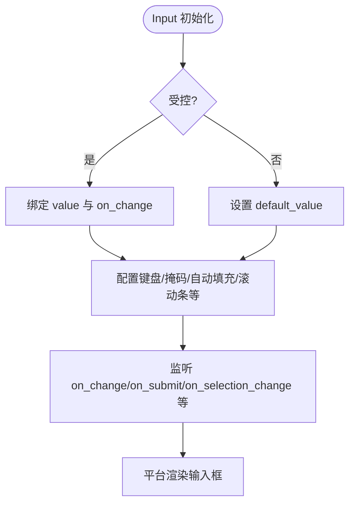
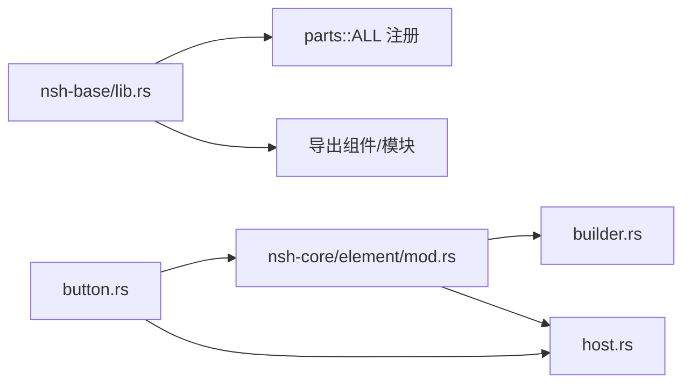
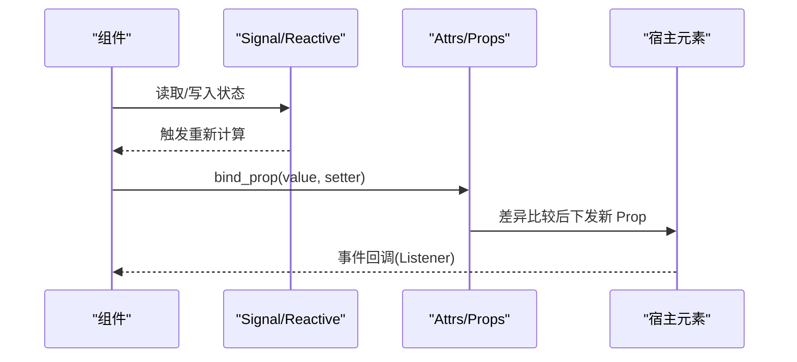

# 原生组件API

<cite>
**本文引用的文件**   
- [lib.rs](file://crates/nsh-base/src/lib.rs)
- [button.rs](file://crates/nsh-base/src/button.rs)
- [host.rs](file://crates/nsh-core/src/element/host.rs)
- [mod.rs](file://crates/nsh-core/src/element/mod.rs)
- [builder.rs](file://crates/nsh-core/src/element/builder.rs)
</cite>

## 目录
1. [简介](#简介)
2. [项目结构](#项目结构)
3. [核心组件](#核心组件)
4. [架构总览](#架构总览)
5. [详细组件分析](#详细组件分析)
6. [依赖关系分析](#依赖关系分析)
7. [性能与渲染优化](#性能与渲染优化)
8. [主题、样式与可访问性](#主题样式与可访问性)
9. [状态管理与数据绑定](#状态管理与数据绑定)
10. [组合模式与扩展点](#组合模式与扩展点)
11. [故障排查指南](#故障排查指南)
12. [结论](#结论)

## 简介
本文件为 NSH 框架的原生组件 API 参考文档，聚焦基础 UI 组件（Button、Input、View 等）的完整接口规范，涵盖 Props、Events、Styles、自定义扩展点、生命周期方法、渲染控制与性能优化选项。同时提供组件组合模式、主题定制与可访问性支持指南，并解释状态管理与数据绑定机制，辅以使用示例与最佳实践建议。

## 项目结构
NSH 的基础 UI 能力由 Rust 侧的 nsh-base 与 nsh-core 共同实现：
- nsh-base 暴露一组“无外观”的行为型组件（如 Button、Link、Checkbox、Tabs、Toolbar、Progress、Scrollbar、Select、Combobox、Command、Toast、ColorPicker、Carousel、Tree、DataTable、Table、DockArea、SplitView、Editor、DiffView、TextView、Terminal 等），并通过 parts 模块按功能域注册到 Registry。
- nsh-core 提供元素系统、宿主元素（Input、Scroll、Stack、Screen、Modal、CanvasView、Svg、ShaderView、WebView、Video、NativeView、Overlay）、事件与属性系统、响应式与信号、样式与主题、动画与着色器、平台抽象等基础设施。

图示来源
- [lib.rs:19-103](file://crates/nsh-base/src/lib.rs#L19-L103)
- [lib.rs:326-587](file://crates/nsh-base/src/lib.rs#L326-L587)
- [button.rs:1-83](file://crates/nsh-base/src/button.rs#L1-L83)
- [mod.rs:1-31](file://crates/nsh-core/src/element/mod.rs#L1-L31)
- [host.rs:1-33](file://crates/nsh-core/src/element/host.rs#L1-L33)
- [builder.rs:1-19](file://crates/nsh-core/src/element/builder.rs#L1-L19)

章节来源
- [lib.rs:1-18](file://crates/nsh-base/src/lib.rs#L1-L18)
- [lib.rs:19-103](file://crates/nsh-base/src/lib.rs#L19-L103)
- [lib.rs:326-587](file://crates/nsh-base/src/lib.rs#L326-L587)
- [mod.rs:1-31](file://crates/nsh-core/src/element/mod.rs#L1-L31)
- [host.rs:1-33](file://crates/nsh-core/src/element/host.rs#L1-L33)
- [builder.rs:1-19](file://crates/nsh-core/src/element/builder.rs#L1-L19)

## 核心组件
本节概述基础组件族及其职责边界：
- 交互控件：Button、Link、Checkbox、Radio、Switch、Toggle、Slider、Tabs、Toolbar、Pagination、Progress、Avatar、Menu/MenuItem/Submenu/ContextMenu、Tooltip、Popover/HoverCard/Sheet、AlertDialog、Select、Combobox、Command、Calendar/DatePicker/TimeField、ColorPicker 系列、OtpInput、NumberInput、Tree、DataTable、Table、DockArea/SplitView、ResizablePanelGroup/ResizablePanel、TextView、Editor/DiffView、Terminal、Toast/ToastStack。
- 宿主元素：Input、Scroll、Stack/Screen、Modal、CanvasView、Svg、ShaderView、WebView、Video、NativeView、Overlay、InputAccessoryView。
- 视图基元：view/text/image 等通过 builder 构建，配合 Style/Class/Tailwind 进行样式化。

章节来源
- [lib.rs:124-293](file://crates/nsh-base/src/lib.rs#L124-L293)
- [host.rs:172-254](file://crates/nsh-core/src/element/host.rs#L172-L254)

## 架构总览
下图展示从 JS/TS 调用到 Rust 组件执行与宿主元素渲染的关键路径：JS 导入 nsh/base 导出的组件；Rust 侧通过 Registry 注册组件与模块；组件函数返回元素树；宿主元素桥接到平台实现。

图示来源
- [lib.rs:295-318](file://crates/nsh-base/src/lib.rs#L295-L318)
- [lib.rs:392-422](file://crates/nsh-base/src/lib.rs#L392-L422)
- [host.rs:296-338](file://crates/nsh-core/src/element/host.rs#L296-L338)

## 详细组件分析

### Button 组件
- 角色与定位：一个无外观的按压目标，负责行为（禁用、选中、忙碌、可访问性、命中区域）与事件分发，外观完全交由应用通过 class/style 或 selectedStyle 控制。
- Props
  - disabled: 禁用态，屏幕阅读器会播报“已禁用”。
  - selected: 选中态（如切换触发器、当前标签页），由应用维护值与样式。
  - selected_style: 选中且非禁用时的样式，对应 selected: 类名。
  - busy: 忙碌态（如“保存中…”），屏幕阅读器会播报；应用可同时设置 disabled 以拒绝重复点击。
  - accessibility_label: 无障碍标签（当内容不足以表达时）。
  - role: 无障碍角色（默认 button，也可设为 link/tab/menuitem 等）。
  - hit_slop: 命中热区扩展（EdgeInsets），便于小图标更易点击。
  - children: 子节点内容。
- Events
  - Press: 按钮被按下。
  - PressDown: 按下开始（用于应用自定义按压反馈）。
  - PressUp: 按下结束（释放、移出或取消）。
- Styles
  - 通过根元素的 class/style 控制外观；状态类 active:/hover:/focus-visible:/selected:/disabled: 与对应的 activeStyle/hoverStyle/focusVisibleStyle/selectedStyle/disabledStyle。
- 可访问性与键盘
  - 在 Toolbar/ToggleGroup 中作为焦点停靠项；role/accessibility_state 影响读屏。
- 典型用法要点
  - 将 selected/busy/disabled 与业务状态同步；用 selected_style 区分选中态视觉；对纯图标按钮提供 accessibility_label。

图示来源
- [button.rs:7-41](file://crates/nsh-base/src/button.rs#L7-L41)
- [button.rs:43-52](file://crates/nsh-base/src/button.rs#L43-L52)
- [button.rs:54-82](file://crates/nsh-base/src/button.rs#L54-L82)

章节来源
- [button.rs:1-83](file://crates/nsh-base/src/button.rs#L1-L83)

### Input 宿主元素
- 角色与定位：原生文本输入框（单行/多行），样式来自其样式系统；提供丰富的输入控制与事件。
- 关键 Props（节选）
  - value/default_value: 受控/非受控文本。
  - placeholder/placeholder_color: 占位符与颜色。
  - selection_color/caret_color: 选择高亮与光标颜色。
  - masked/auto_capitalize/auto_correct/auto_fill: 密码掩码、自动大写、自动更正、自动填充类型。
  - keyboard_type/keyboard_appearance/return_key_type: 软键盘布局与外观、回车键类型。
  - multiline: 多行输入，随文本增长。
  - scrollbar: 内置滚动条主题或平台指示器。
  - max_length/readonly: 最大长度与只读。
  - submit_behavior/paste_behavior: 回车提交行为与粘贴行为。
  - auto_focus/select_text_on_focus/caret: 自动聚焦、聚焦全选、显示光标。
  - input_accessory: 关联 iOS 键盘附件栏 nativeID。
  - selected_range: 受控选择范围（UTF-16 单位）。
- 关键 Events（节选）
  - on_change: 文本变化。
  - on_submit: 回车提交。
  - on_selection_change/on_caret_move: 选择/光标移动。
  - on_key_press: 按键（字符、Backspace、Enter、Escape、方向键）。
  - on_composition_change: 输入法组合过程。
  - on_content_size_change: 内容尺寸变化（多行增长）。
  - on_paste: 粘贴事件（含文本/文件/截图）。
- 样式与主题
  - 通过 view 的 style/class 控制文字、占位符、光标、选择高亮等；scrollbar 可接入 ScrollbarTheme。
- 典型用法要点
  - 受控模式下监听 on_change 更新 value；非受控模式下使用 default_value；多行输入关注 on_content_size_change 调整容器高度；结合 pasteBehavior 与 on_paste 处理富粘贴。

图示来源
- [host.rs:693-916](file://crates/nsh-core/src/element/host.rs#L693-L916)

章节来源
- [host.rs:693-916](file://crates/nsh-core/src/element/host.rs#L693-L916)

### View / Text / Image 基元
- 角色与定位：通过 builder 构建的元素基元，承载布局、样式、事件与可访问性。
- 能力概览
  - 布局与样式：通过 Styled 链式 API 与 Tailwind 类名；支持自适应颜色、边框、阴影、变换等。
  - 事件：点击、拖拽、滚轮、触摸、手势等（具体事件类型见 events 模块）。
  - 可访问性：role/state/value/label/hint/description 等。
  - 子元素：ParentElement 提供 child/children 注入。
- 典型用法要点
  - 使用 view/text/image 组合复杂界面；通过 class/style 统一风格；对交互元素添加 role 与 accessible label。

章节来源
- [mod.rs:1-31](file://crates/nsh-core/src/element/mod.rs#L1-L31)
- [builder.rs:1-19](file://crates/nsh-core/src/element/builder.rs#L1-L19)

## 依赖关系分析
- nsh-base 的 lib.rs 集中导出所有组件类型与工厂函数，并通过 parts::ALL 顺序注册到 Registry，确保二进制按需裁剪。
- nsh-core 的 element 模块提供组件宏、Props/Event 派生、元素构建器、宿主元素与事件系统。
- Button 依赖 core 的 AccessibilityState/Style 与 roving 工具（用于 Toolbar 中的焦点管理）。
- Input 等宿主元素由 host.rs 定义，并在 builder.rs 中通过 Listener/Attrs 机制完成事件与属性的差异比较与下发。

图示来源
- [lib.rs:326-587](file://crates/nsh-base/src/lib.rs#L326-L587)
- [mod.rs:1-31](file://crates/nsh-core/src/element/mod.rs#L1-L31)
- [host.rs:172-254](file://crates/nsh-core/src/element/host.rs#L172-L254)
- [builder.rs:284-469](file://crates/nsh-core/src/element/builder.rs#L284-L469)

章节来源
- [lib.rs:326-587](file://crates/nsh-base/src/lib.rs#L326-L587)
- [builder.rs:284-469](file://crates/nsh-core/src/element/builder.rs#L284-L469)

## 性能与渲染优化
- 组件一次运行：组件函数仅运行一次，生成元素树；变更通过 Prop/Signal/Memo 驱动局部补丁，避免整树重绘。
- 差异比较：Attrs 针对 disabled/role/state/pointer_events/label/inline/class/props/rare 逐项比较，减少不必要的跨层更新。
- 宿主元素属性：Prop 列表去重与重置逻辑保证未设置的属性回退默认值，避免多余下发。
- 动画与着色器：Animated/Uniform/Shader 支持平台端逐帧写入，降低引擎线程压力。
- 资源加载：SVG/图片等资源采用共享加载器与缓存，按需加载与租约管理。

章节来源
- [mod.rs:1-31](file://crates/nsh-core/src/element/mod.rs#L1-L31)
- [builder.rs:284-469](file://crates/nsh-core/src/element/builder.rs#L284-L469)
- [host.rs:399-479](file://crates/nsh-core/src/element/host.rs#L399-L479)

## 主题、样式与可访问性
- 主题与 Token：nsh-base 提供 Theme/DEFAULT_THEME/tokens_of/theme_overrides 等，供应用覆盖设计令牌。
- 样式系统：Styled/StyleRefinement/AdaptiveColor 等，支持 Tailwind 类名与类型化样式混合；组件根节点的 class/style 分别追加类名与内联样式。
- 可访问性：AccessibilityRole/State/Value/Label/Hint/Description 贯穿元素与宿主元素；Button 通过 role/accessibility_state 暴露选中/忙碌状态；Input 支持 caret/selection 等辅助能力。

章节来源
- [lib.rs:253-254](file://crates/nsh-base/src/lib.rs#L253-L254)
- [mod.rs:197-210](file://crates/nsh-core/src/element/mod.rs#L197-L210)
- [button.rs:54-82](file://crates/nsh-base/src/button.rs#L54-L82)

## 状态管理与数据绑定
- 响应式与信号：Reactive/Signal/Memo/Owner 等构成细粒度订阅与更新；组件监听器在所属 Owner 作用域内执行，随组件销毁而清理。
- Props 绑定：bind_prop 将 Reactive 值与 Prop 字段绑定，静态值直接下发，动态值在变化时增量更新。
- 事件监听：Listener 封装闭包与 Owner，支持 map/wrap 转换事件类型；IntoListener 允许闭包或 Listener 传入。
- 宿主元素事件：Input/Scroll/Screen 等通过 EventKind 与 typed listener 解码事件数据。

图示来源
- [builder.rs:21-158](file://crates/nsh-core/src/element/builder.rs#L21-L158)
- [host.rs:95-113](file://crates/nsh-core/src/element/host.rs#L95-L113)

章节来源
- [builder.rs:21-158](file://crates/nsh-core/src/element/builder.rs#L21-L158)
- [host.rs:95-113](file://crates/nsh-core/src/element/host.rs#L95-L113)

## 组合模式与扩展点
- 组合模式
  - Button 作为通用按压目标，可与 text/image/icon 组合；在 Toolbar/ToggleGroup 中作为焦点停靠项。
  - Input 与 InputAccessoryView 组合，提供 iOS 键盘附件栏。
  - Stack/Screen 组合实现页面导航；Modal 作为弹窗容器。
- 扩展点
  - 自定义组件：通过 #[component] 与 Props/Event 派生，注册到 Registry。
  - 宿主元素：通过 host_element! 宏扩展新的宿主元素。
  - 主题与滚动条：通过 theme/theme_overrides 与 ScrollbarTheme 定制外观。
  - 模块导出：nsh/base 的子模块（如 plot）通过 submodule 注册。

章节来源
- [lib.rs:392-587](file://crates/nsh-base/src/lib.rs#L392-L587)
- [host.rs:115-170](file://crates/nsh-core/src/element/host.rs#L115-L170)

## 故障排查指南
- 组件未导出或未注册
  - 检查 parts::ALL 是否包含对应组件；确认 feature 开关（如 editor/plot/term）是否启用。
- 事件不触发
  - 确认 Listener 的 Owner 仍存活；检查 IntoListener 的类型推断是否正确。
- 属性未生效
  - 检查 bind_prop 的 setter 是否正确映射到 Prop；确认旧属性未被其他代码覆盖。
- 样式不生效
  - 确认 class/style 是否作用于根元素；注意 selectedStyle/activeStyle 等状态样式优先级。
- 可访问性问题
  - 为图标按钮设置 accessibility_label；为交互元素设置合适的 role。

章节来源
- [lib.rs:326-587](file://crates/nsh-base/src/lib.rs#L326-L587)
- [builder.rs:21-158](file://crates/nsh-core/src/element/builder.rs#L21-L158)
- [button.rs:54-82](file://crates/nsh-base/src/button.rs#L54-L82)

## 结论
NSH 的原生组件体系以“行为与外观分离”为核心：nsh-base 提供无外观的行为型组件，nsh-core 提供元素系统、宿主元素与响应式基础设施。通过 Props/Events/Styles 的统一模型、精确的差异比较与灵活的扩展点，开发者可以高效构建跨平台、可访问、高性能的 UI。建议遵循受控与非受控输入的最佳实践、合理使用状态与信号、利用主题与样式系统进行一致化设计，并通过组合模式复用与扩展组件能力。