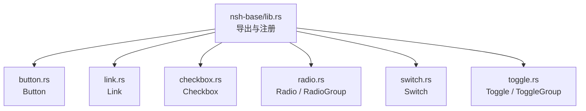
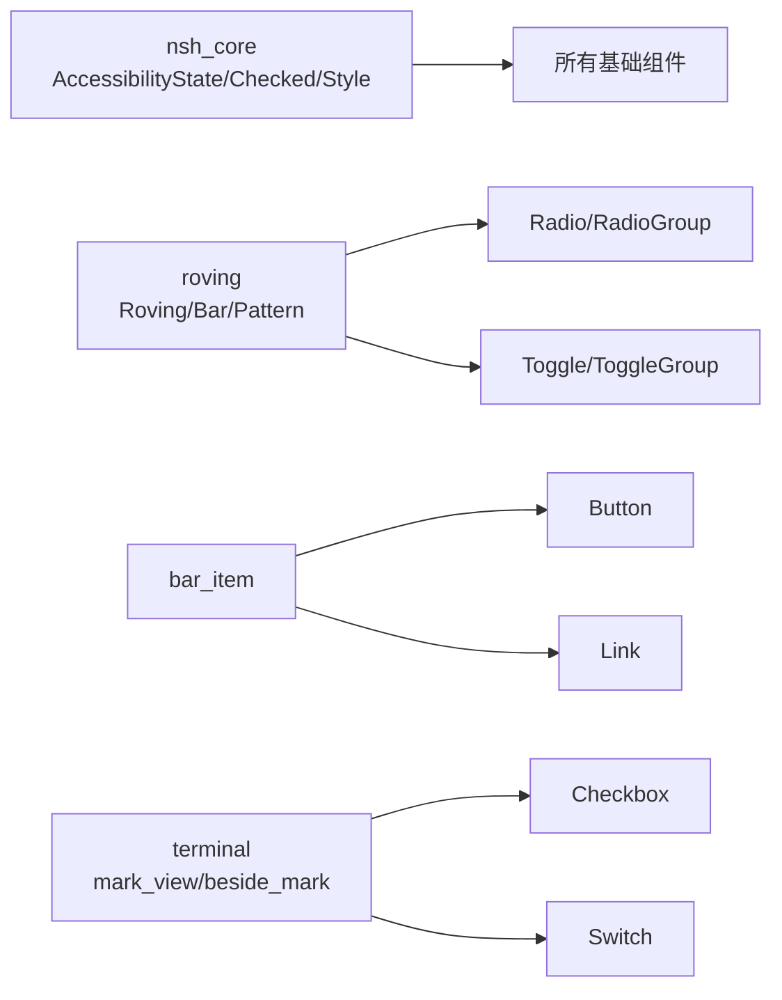

# 基础组件

<cite>
**本文引用的文件**   
- [button.rs](file://crates/nsh-base/src/button.rs)
- [link.rs](file://crates/nsh-base/src/link.rs)
- [checkbox.rs](file://crates/nsh-base/src/checkbox.rs)
- [radio.rs](file://crates/nsh-base/src/radio.rs)
- [switch.rs](file://crates/nsh-base/src/switch.rs)
- [toggle.rs](file://crates/nsh-base/src/toggle.rs)
- [lib.rs](file://crates/nsh-base/src/lib.rs)
</cite>

## 目录
1. [简介](#简介)
2. [项目结构](#项目结构)
3. [核心组件](#核心组件)
4. [架构总览](#架构总览)
5. [详细组件分析](#详细组件分析)
6. [依赖关系分析](#依赖关系分析)
7. [性能与可访问性](#性能与可访问性)
8. [故障排查指南](#故障排查指南)
9. [结论](#结论)

## 简介
本文件为 NSH 框架基础 UI 组件的 API 文档，覆盖 Button、Link、Checkbox、Radio、Switch、Toggle 等基础交互组件。内容包含：
- Props 属性规范（如 disabled、variant/size 的替代方案、状态样式等）
- Events 事件处理模型
- 样式定制选项（类名、内联样式、状态类）
- 可访问性支持（角色、语义状态、描述元素）
- 状态管理、用户交互行为与视觉反馈机制
- 使用示例与最佳实践（表单集成、键盘导航、组合模式）

这些组件遵循“行为与外观分离”的设计原则：组件负责交互、可访问性与状态，外观由应用通过 Tailwind 类或内联样式实现。

## 项目结构
NSH 的基础组件位于 crates/nsh-base/src 下，每个组件一个模块文件，统一在 lib.rs 中导出并注册到运行时。

图表来源
- [lib.rs:124-274](file://crates/nsh-base/src/lib.rs#L124-L274)
- [lib.rs:392-422](file://crates/nsh-base/src/lib.rs#L392-L422)

章节来源
- [lib.rs:1-103](file://crates/nsh-base/src/lib.rs#L1-L103)
- [lib.rs:124-274](file://crates/nsh-base/src/lib.rs#L124-L274)
- [lib.rs:392-422](file://crates/nsh-base/src/lib.rs#L392-L422)

## 核心组件
本节概述各组件的职责、Props、Events、样式与可访问性要点。

- Button
  - 职责：通用按压目标，无自带外观；提供 pressed/active/hover/focus-visible/selected/disabled/busy 等状态类。
  - 关键 Props：disabled、selected、selected_style、busy、accessibility_label、role、hit_slop、children。
  - 事件：Press、PressDown、PressUp。
  - 可访问性：默认 role=button；可选 accessibilityLabel；支持 selected/busy 语义状态。
  - 样式：通过 class/style 与 active:/hover:/focus-visible:/selected:/disabled: 类或对应 style 属性定制。

- Link
  - 职责：可跳转的链接，无自带外观；支持系统打开或交由应用处理。
  - 关键 Props：href、title、open_with、disabled、current、accessibility_label、hit_slop、children。
  - 事件：Open(href)、Press。
  - 可访问性：role=link；current 时标记当前页面；可选 accessibilityLabel。
  - 样式：hover:/active:/focus-visible:/disabled: 类或对应 style；启用时指针样式。

- Checkbox
  - 职责：三态选择（选中/未选中/不确定），无自带外观。
  - 关键 Props：checked、indeterminate、disabled、checked_style、indeterminate_style、accessibility_label、invalid、accessibility_described_by、role、hit_slop、indicator_class、indicator_style、indicator、children。
  - 事件：Change(checked)。
  - 可访问性：role=checkbox；checked/mixed/false；invalid；可关联描述元素。
  - 样式：checked:/indeterminate:/disabled: 类或对应 style；indicator 子树可自定义勾选标记。

- Radio / RadioGroup
  - 职责：单选组；Radio 为单项，RadioGroup 为容器并提供键盘导航。
  - Radio Props：checked、disabled、checked_style、accessibility_label、hit_slop、children。
  - Radio 事件：Change(true)。
  - RadioGroup Props：accessibility_label、children。
  - 可访问性：Radio role=radiogroup member；Radio checked/selected；RadioGroup role=radiogroup + label。
  - 样式：checked:/disabled: 类或对应 style；group-checked: 类用于指示器。

- Switch
  - 职责：开/关开关，即时生效，无自带外观。
  - 关键 Props：checked、disabled、checked_style、accessibility_label、hit_slop、track_class、track_style、thumb_class、thumb_style、children。
  - 事件：Change(!checked)。
  - 可访问性：role=switch；checked true/false。
  - 样式：track/thumb 分别支持 checked:/disabled:/active: 类；active: 表示按下过程。

- Toggle / ToggleGroup
  - 职责：可切换按钮（如加粗、收藏），可独立或成组；ToggleGroup 提供工具栏式键盘导航。
  - Toggle Props：pressed、disabled、pressed_style、accessibility_label、hit_slop、children。
  - Toggle 事件：Change(!pressed)、PressDown、PressUp。
  - ToggleGroup Props：disabled、children。
  - 可访问性：Toggle role=button，aria-pressed；ToggleGroup role=toolbar 或嵌套 group。
  - 样式：aria-pressed:/disabled: 类或对应 style；active: 表示按下过程。

章节来源
- [button.rs:7-82](file://crates/nsh-base/src/button.rs#L7-L82)
- [link.rs:24-151](file://crates/nsh-base/src/link.rs#L24-L151)
- [checkbox.rs:8-137](file://crates/nsh-base/src/checkbox.rs#L8-L137)
- [radio.rs:16-149](file://crates/nsh-base/src/radio.rs#L16-L149)
- [switch.rs:11-120](file://crates/nsh-base/src/switch.rs#L11-L120)
- [toggle.rs:11-141](file://crates/nsh-base/src/toggle.rs#L11-L141)

## 架构总览
所有基础组件均基于 nsh_core 的可访问性与元素能力构建，并通过 roving 与 bar_item 等工具提供一致的键盘焦点与工具栏集成。

```mermaid
classDiagram
class Button {
+props : disabled, selected, busy, accessibility_label, role, hit_slop, children
+events : Press, PressDown, PressUp
+accessibility : role=button, selected/busy state
+styles : active : /hover : /focus-visible : /selected : /disabled :
}
class Link {
+props : href, title, open_with, disabled, current, accessibility_label, hit_slop, children
+events : Open(href), Press
+accessibility : role=link, current page
+styles : hover : /active : /focus-visible : /disabled :
}
class Checkbox {
+props : checked, indeterminate, disabled, checked_style, indeterminate_style, indicator_class/style/children
+events : Change(checked)
+accessibility : role=checkbox, checked/mixed/false, invalid, describedBy
+styles : checked : /indeterminate : /disabled :
}
class Radio {
+props : checked, disabled, checked_style, accessibility_label, hit_slop, children
+events : Change(true)
+accessibility : role=radio, checked/selected
+styles : checked : /disabled : , group-checked :
}
class RadioGroup {
+props : accessibility_label, children
+accessibility : role=radiogroup
}
class Switch {
+props : checked, disabled, checked_style, track_class/style, thumb_class/style, accessibility_label, hit_slop, children
+events : Change(!checked)
+accessibility : role=switch, checked true/false
+styles : track/thumb checked : /disabled : /active :
}
class Toggle {
+props : pressed, disabled, pressed_style, accessibility_label, hit_slop, children
+events : Change(!pressed), PressDown, PressUp
+accessibility : role=button, aria-pressed
+styles : aria-pressed : /disabled : , active :
}
class ToggleGroup {
+props : disabled, children
+accessibility : role=toolbar or group
}
```

图表来源
- [button.rs:7-82](file://crates/nsh-base/src/button.rs#L7-L82)
- [link.rs:24-151](file://crates/nsh-base/src/link.rs#L24-L151)
- [checkbox.rs:8-137](file://crates/nsh-base/src/checkbox.rs#L8-L137)
- [radio.rs:16-149](file://crates/nsh-base/src/radio.rs#L16-L149)
- [switch.rs:11-120](file://crates/nsh-base/src/switch.rs#L11-L120)
- [toggle.rs:11-141](file://crates/nsh-base/src/toggle.rs#L11-L141)

## 详细组件分析

### Button
- Props
  - disabled: 禁用，不可点击，屏幕阅读器提示被禁用。
  - selected: 选中态（如激活标签页），由应用维护值并控制样式。
  - selected_style: selected 且非禁用时的样式。
  - busy: 忙碌态（如“保存中…”），仍可计数按压但通常配合 disabled 拒绝重复提交。
  - accessibility_label: 无障碍名称（当内容不足以表达用途时）。
  - role: 无障碍角色（默认 button）。
  - hit_slop: 扩大点击区域（不影响布局与外观）。
  - children: 内容。
- Events
  - Press：按钮被按下。
  - PressDown：按下开始（可用于自定义按压反馈）。
  - PressUp：按压结束（释放、移出或取消）。
- 样式
  - 通过 class/style 与 active:/hover:/focus-visible:/selected:/disabled: 类或对应 style 属性定制。
- 可访问性
  - role=button；可选 accessibilityLabel；selected/busy 语义状态。
- 交互与状态
  - 在 Toolbar/ToggleGroup 中作为焦点项之一；disabled 与父级一致。
- 使用示例
  - 普通按钮、图标按钮（设置 accessibility_label）、忙碌态按钮（busy=true 同时 disabled=true）。
  - 选中态按钮（selected=true，配合 selected_style）。

章节来源
- [button.rs:7-82](file://crates/nsh-base/src/button.rs#L7-L82)

### Link
- Props
  - href: 链接地址或应用路径；悬停提示显示标题与目的地。
  - title: 悬停提示标题（不等同于 tooltip）。
  - open_with: "system" 或 "app"；决定由系统还是应用 onOpen 处理。
  - disabled: 禁用。
  - current: 当前页面（ARIA aria-current="page"）。
  - accessibility_label: 无障碍名称。
  - hit_slop: 扩大点击区域。
  - children: 可见内容。
- Events
  - Open(href)：在打开前触发（无论 open_with 为何）。
  - Press：在打开后触发（或无 href 时）。
- 样式
  - 启用时指针样式；hover:/active:/focus-visible:/disabled: 类或对应 style。
- 可访问性
  - role=link；current 时标记当前页面；可选 accessibilityLabel。
- 交互与状态
  - 支持 Return/Space 激活；终端环境下文本可被平台直接链接。
- 使用示例
  - 外部链接（open_with="system"）、内部路由（open_with="app"）、当前页高亮（current=true）。

章节来源
- [link.rs:24-151](file://crates/nsh-base/src/link.rs#L24-L151)

### Checkbox
- Props
  - checked: 选中态（受控）。
  - indeterminate: 不确定态（优先于 checked）。
  - disabled: 禁用。
  - checked_style / indeterminate_style: 对应状态的样式。
  - accessibility_label: 无障碍名称。
  - invalid: 无效（必填未选等），屏幕阅读器会提示。
  - accessibility_described_by: 描述元素（错误信息或帮助文案）。
  - role: 无障碍角色（默认 checkbox）。
  - hit_slop: 扩大点击区域。
  - indicator_class / indicator_style / indicator: 指示器（勾选标记）的类、样式与内容。
  - children: 标签文本。
- Events
  - Change(checked)：从 unchecked/indeterminate -> true，从 checked -> false。
- 样式
  - checked:/indeterminate:/disabled: 类或对应 style；indicator 子树可自定义勾选标记。
- 可访问性
  - role=checkbox；checked/mixed/false；invalid；可关联描述元素。
- 交互与状态
  - 终端环境显示内置复选标记；非终端环境渲染自定义 indicator。
- 使用示例
  - 三态复选框（全选/部分选择）、带错误提示（invalid + describedBy）、自定义勾选标记。

章节来源
- [checkbox.rs:8-137](file://crates/nsh-base/src/checkbox.rs#L8-L137)

### Radio / RadioGroup
- Radio Props
  - checked: 是否选中（受控）。
  - disabled: 禁用。
  - checked_style: 选中态样式。
  - accessibility_label: 无障碍名称。
  - hit_slop: 扩大点击区域。
  - children: 指示器与标签。
- Radio 事件
  - Change(true)：仅当未选中时触发（已选中项不会再次触发）。
- RadioGroup Props
  - accessibility_label: 组的无障碍名称。
  - children: Radio 与其他布局元素。
- 可访问性
  - Radio role=radio，checked/selected；RadioGroup role=radiogroup + label。
- 样式
  - checked:/disabled: 类或对应 style；group-checked: 类用于指示器。
- 键盘导航
  - 组内 Tab 进入焦点，方向键移动焦点并自动选中目标项；Space 选中当前聚焦项。
- 使用示例
  - 单选项组（计划、排序方式）；终端环境显示内置单选标记。

章节来源
- [radio.rs:16-149](file://crates/nsh-base/src/radio.rs#L16-L149)

### Switch
- Props
  - checked: 开/关（受控）。
  - disabled: 禁用。
  - checked_style: 选中态样式。
  - accessibility_label: 无障碍名称。
  - hit_slop: 扩大点击区域。
  - track_class / track_style: 轨道的类与样式。
  - thumb_class / thumb_style: 滑块的类与样式。
  - children: 标签文本。
- Events
  - Change(!checked)：按下即翻转状态。
- 样式
  - track/thumb 支持 checked:/disabled:/active: 类；active: 表示按下过程。
- 可访问性
  - role=switch；checked true/false。
- 交互与状态
  - 终端环境显示内置开关标记；非终端环境渲染轨道与滑块。
- 使用示例
  - 设置开关（开启/关闭某功能）；自定义轨道与滑块动画。

章节来源
- [switch.rs:11-120](file://crates/nsh-base/src/switch.rs#L11-L120)

### Toggle / ToggleGroup
- Toggle Props
  - pressed: 按下态（受控）。
  - disabled: 禁用。
  - pressed_style: 按下态样式。
  - accessibility_label: 无障碍名称。
  - hit_slop: 扩大点击区域。
  - children: 图标或标签。
- Toggle 事件
  - Change(!pressed)：按下翻转。
  - PressDown / PressUp：按压起止（用于自定义反馈）。
- ToggleGroup Props
  - disabled: 禁用整组。
  - children: Toggle 与其他布局元素。
- 可访问性
  - Toggle role=button，aria-pressed；ToggleGroup role=toolbar 或嵌套 group。
- 样式
  - aria-pressed:/disabled: 类或对应 style；active: 表示按下过程。
- 键盘导航
  - 组内 Tab 进入焦点，方向键移动焦点但不触发；Space/Return 触发当前聚焦项。
- 使用示例
  - 工具栏中的加粗/斜体/下划线；对齐方式切换；收藏星标。

章节来源
- [toggle.rs:11-141](file://crates/nsh-base/src/toggle.rs#L11-L141)

## 依赖关系分析
- 公共依赖
  - nsh_core：提供 AccessibilityState、Checked、Style、ElementTarget 等基础类型与能力。
  - roving/bar_item：提供工具栏与分组内的键盘焦点与箭头键导航。
  - terminal：在终端环境下提供内置标记视图与布局适配。
- 组件耦合
  - Button、Link 通过 bar_item 与 Toolbar/ToggleGroup 协作。
  - Radio/RadioGroup 通过 Roving 与 Pattern::Radios 管理组内焦点与选中。
  - Toggle/ToggleGroup 通过 Bar/Roving 与 Pattern::Toggles 管理工具栏式导航。
  - Checkbox、Switch 通过 terminal 分支渲染内置标记或自定义轨道/滑块。

图表来源
- [button.rs:5-82](file://crates/nsh-base/src/button.rs#L5-L82)
- [link.rs:5-151](file://crates/nsh-base/src/link.rs#L5-L151)
- [checkbox.rs:4-137](file://crates/nsh-base/src/checkbox.rs#L4-L137)
- [radio.rs:7-149](file://crates/nsh-base/src/radio.rs#L7-L149)
- [switch.rs:4-120](file://crates/nsh-base/src/switch.rs#L4-L120)
- [toggle.rs:7-141](file://crates/nsh-base/src/toggle.rs#L7-L141)

章节来源
- [lib.rs:124-274](file://crates/nsh-base/src/lib.rs#L124-L274)
- [lib.rs:392-422](file://crates/nsh-base/src/lib.rs#L392-L422)

## 性能与可访问性
- 性能
  - 组件本身不绘制样式，减少运行时开销；样式由应用层 Tailwind 类或内联样式驱动。
  - 终端环境使用轻量内置标记视图，避免复杂渲染。
- 可访问性
  - 所有组件暴露合适的 role 与语义状态（checked/pressed/current/busy/invalid）。
  - 支持 accessibility_label 与 accessibility_described_by，便于屏幕阅读器朗读。
  - 键盘导航符合 WAI-ARIA 模式：Tab 进入组，方向键移动焦点，Space/Return 触发。

[本节为通用指导，无需具体文件引用]

## 故障排查指南
- 无法点击或无反馈
  - 检查 disabled 是否意外为真；确认 hit_slop 是否过小导致触摸困难。
  - 对于 Button/Toggle，确认 PressDown/PressUp 是否被上层拦截。
- 链接未打开
  - 确认 href 有效；open_with="system" 时需确保平台具备 openUrl 能力。
  - 终端环境下链接可能由平台直接处理，不受 open_with 影响。
- 复选框状态异常
  - 注意 indeterminate 优先级高于 checked；Change 回调需正确更新受控状态。
  - invalid 与 accessibility_described_by 应配对使用以传达错误信息。
- 单选组行为异常
  - 确保 Radio 处于 RadioGroup 内；checked 状态应由应用统一管理。
  - 方向键导航仅在组内生效；若未聚焦到组，方向键不会改变选中项。
- 开关/切换按钮样式不生效
  - 确认使用了正确的状态类（checked:/disabled:/active: 或 aria-pressed:）。
  - Switch 的 track/thumb 需分别设置类与样式；Toggle 的 pressed_style 对应按下态。

章节来源
- [button.rs:7-82](file://crates/nsh-base/src/button.rs#L7-L82)
- [link.rs:24-151](file://crates/nsh-base/src/link.rs#L24-L151)
- [checkbox.rs:8-137](file://crates/nsh-base/src/checkbox.rs#L8-L137)
- [radio.rs:16-149](file://crates/nsh-base/src/radio.rs#L16-L149)
- [switch.rs:11-120](file://crates/nsh-base/src/switch.rs#L11-L120)
- [toggle.rs:11-141](file://crates/nsh-base/src/toggle.rs#L11-L141)

## 结论
NSH 基础组件以“行为与外观分离”为核心，提供稳定、可访问、可组合的交互原语。开发者可通过 Tailwind 类与内联样式完全定制外观，并通过受控 Props 与事件完成状态管理与业务逻辑。结合 RadioGroup 与 ToggleGroup 的键盘导航，以及完善的可访问性支持，可在多端环境中构建一致的用户体验。

[本节为总结性内容，无需具体文件引用]