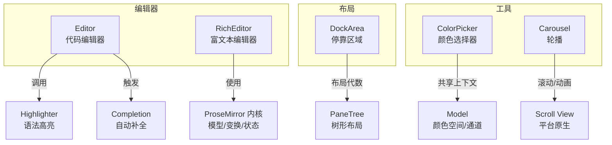
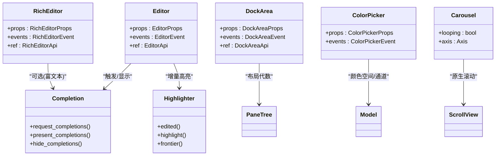
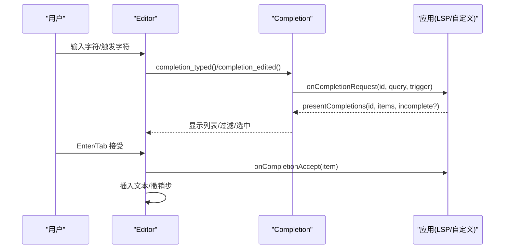
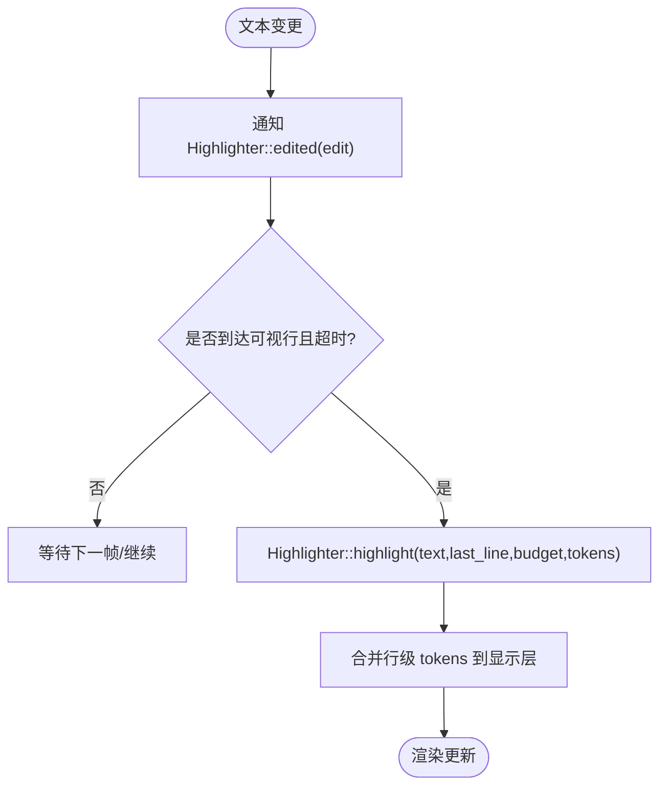
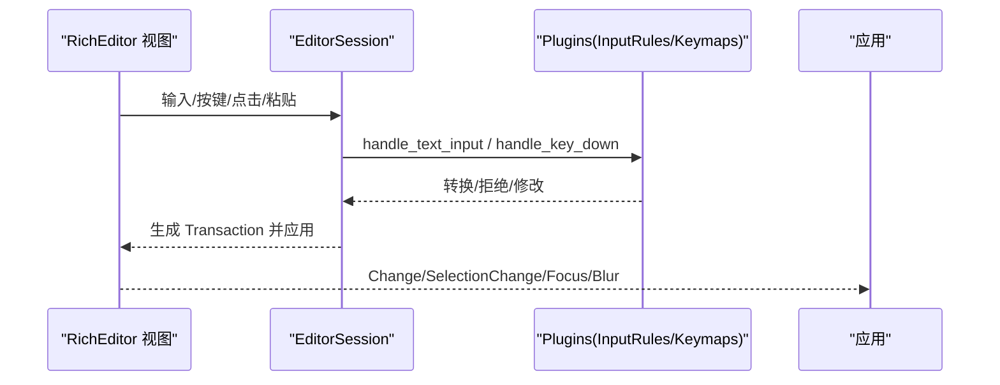
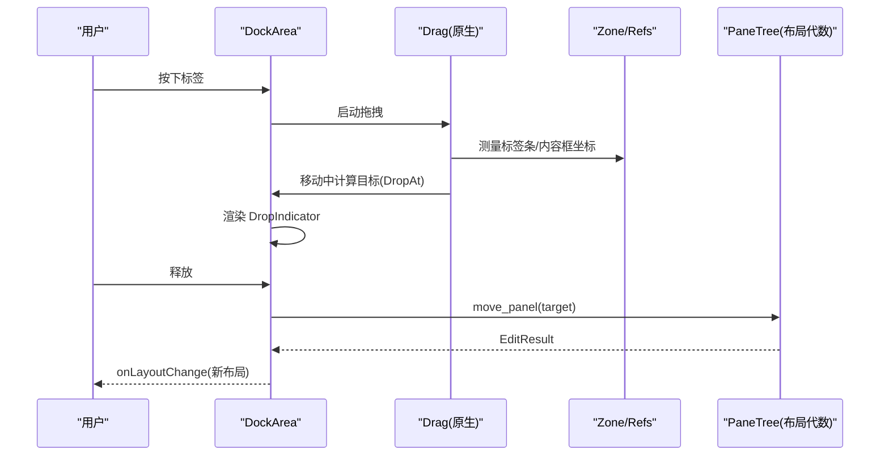
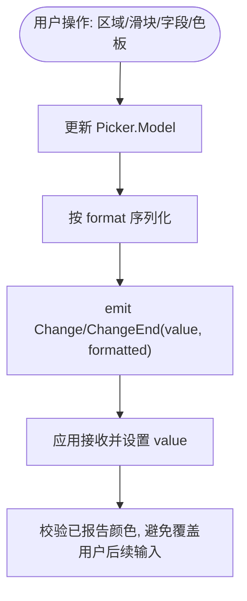
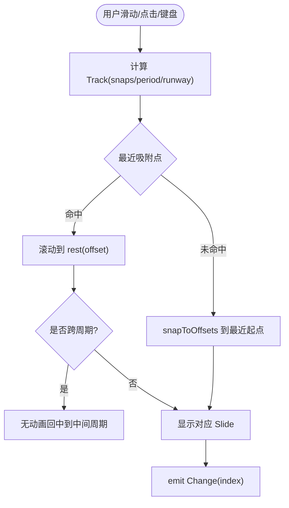
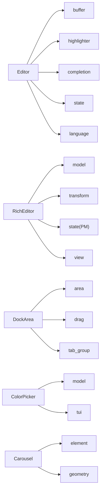

# 复杂组件

<cite>
**本文引用的文件**   
- [crates/nsh-base/src/editor/mod.rs](file://crates/nsh-base/src/editor/mod.rs)
- [crates/nsh-base/src/editor/completion.rs](file://crates/nsh-base/src/editor/completion.rs)
- [crates/nsh-base/src/editor/highlighter.rs](file://crates/nsh-base/src/editor/highlighter.rs)
- [crates/nsh-base/src/rich_editor/mod.rs](file://crates/nsh-base/src/rich_editor/mod.rs)
- [crates/nsh-base/src/rich_editor/view/mod.rs](file://crates/nsh-base/src/rich_editor/view/mod.rs)
- [crates/nsh-base/src/dock/mod.rs](file://crates/nsh-base/src/dock/mod.rs)
- [crates/nsh-base/src/dock/dock_area.rs](file://crates/nsh-base/src/dock/dock_area.rs)
- [crates/nsh-base/src/color_picker/mod.rs](file://crates/nsh-base/src/color_picker/mod.rs)
- [crates/nsh-base/src/carousel.rs](file://crates/nsh-base/src/carousel.rs)
</cite>

## 目录
1. [简介](#简介)
2. [项目结构](#项目结构)
3. [核心组件](#核心组件)
4. [架构总览](#架构总览)
5. [详细组件分析](#详细组件分析)
6. [依赖关系分析](#依赖关系分析)
7. [性能与内存优化](#性能与内存优化)
8. [故障排查指南](#故障排查指南)
9. [结论](#结论)
10. [附录：API 速查表](#附录api-速查表)

## 简介
本文件面向 NSH 框架的复杂功能组件，系统化梳理 Editor、RichEditor、DockArea、ColorPicker、Carousel 等高级组件的接口规范与实现要点。重点覆盖：
- 富文本编辑器的语法高亮、自动补全与代码格式化能力（基于 Editor 与 RichEditor）
- 停靠区域的拖拽布局、面板管理与工作区配置（DockArea）
- 颜色选择器的多格式支持、拾色器集成与主题适配（ColorPicker）
- 轮播组件的触摸手势、自动播放与响应式设计（Carousel）
- 复杂状态管理、性能优化与内存泄漏防护策略
- 插件扩展机制、自定义渲染器与第三方库集成的最佳实践

## 项目结构
NSH 的基础 UI 组件集中在 crates/nsh-base/src 下，本次文档涉及的模块如下：
- editor：代码编辑器（语法高亮、补全、折叠、搜索、诊断等）
- rich_editor：基于 ProseMirror 架构的富文本编辑器内核与原生视图
- dock：可停靠布局引擎与 DockArea 组件
- color_picker：颜色选择器及其子部件
- carousel：轮播组件

图表来源
- [crates/nsh-base/src/editor/mod.rs:66-205](file://crates/nsh-base/src/editor/mod.rs#L66-L205)
- [crates/nsh-base/src/editor/completion.rs:1-30](file://crates/nsh-base/src/editor/completion.rs#L1-L30)
- [crates/nsh-base/src/editor/highlighter.rs:1-33](file://crates/nsh-base/src/editor/highlighter.rs#L1-L33)
- [crates/nsh-base/src/rich_editor/mod.rs:1-24](file://crates/nsh-base/src/rich_editor/mod.rs#L1-L24)
- [crates/nsh-base/src/rich_editor/view/mod.rs:1-18](file://crates/nsh-base/src/rich_editor/view/mod.rs#L1-L18)
- [crates/nsh-base/src/dock/mod.rs:1-50](file://crates/nsh-base/src/dock/mod.rs#L1-L50)
- [crates/nsh-base/src/color_picker/mod.rs:1-18](file://crates/nsh-base/src/color_picker/mod.rs#L1-L18)
- [crates/nsh-base/src/carousel.rs:1-35](file://crates/nsh-base/src/carousel.rs#L1-L35)

章节来源
- [crates/nsh-base/src/editor/mod.rs:1-12](file://crates/nsh-base/src/editor/mod.rs#L1-L12)
- [crates/nsh-base/src/rich_editor/mod.rs:1-12](file://crates/nsh-base/src/rich_editor/mod.rs#L1-L12)
- [crates/nsh-base/src/dock/mod.rs:1-50](file://crates/nsh-base/src/dock/mod.rs#L1-L50)
- [crates/nsh-base/src/color_picker/mod.rs:1-18](file://crates/nsh-base/src/color_picker/mod.rs#L1-L18)
- [crates/nsh-base/src/carousel.rs:1-35](file://crates/nsh-base/src/carousel.rs#L1-L35)

## 核心组件
- Editor：代码编辑器，提供语法高亮、行号、多光标、折叠、软换行、查找替换、诊断与装饰、补全与定义跳转等能力；通过 props 控制行为，通过事件与 ref API 交互。
- RichEditor：基于 ProseMirror 的富文本编辑器内核与原生视图，支持 schema 定义文档结构、插件扩展、节点视图、表格、输入规则、键映射、历史等。
- DockArea：可停靠的工作区，支持中心区域与左右下停靠区的拆分、标签组、拖拽重排、缩放、紧凑模式与持久化。
- ColorPicker：无外观的颜色选择器，包含饱和度/亮度区域、通道滑块、文本字段、预设色板与屏幕取色器，支持多种颜色空间与格式。
- Carousel：原生滚动的轮播，支持循环无缝、触摸手势、键盘导航、分页指示与受控/非受控模式。

章节来源
- [crates/nsh-base/src/editor/mod.rs:66-205](file://crates/nsh-base/src/editor/mod.rs#L66-L205)
- [crates/nsh-base/src/rich_editor/view/mod.rs:47-136](file://crates/nsh-base/src/rich_editor/view/mod.rs#L47-L136)
- [crates/nsh-base/src/dock/dock_area.rs:542-562](file://crates/nsh-base/src/dock/dock_area.rs#L542-L562)
- [crates/nsh-base/src/color_picker/mod.rs:169-178](file://crates/nsh-base/src/color_picker/mod.rs#L169-L178)
- [crates/nsh-base/src/carousel.rs:1-35](file://crates/nsh-base/src/carousel.rs#L1-L35)

## 架构总览
以下图展示各组件在 NSH 中的职责边界与交互关系：

图表来源
- [crates/nsh-base/src/editor/mod.rs:66-205](file://crates/nsh-base/src/editor/mod.rs#L66-L205)
- [crates/nsh-base/src/editor/completion.rs:442-518](file://crates/nsh-base/src/editor/completion.rs#L442-L518)
- [crates/nsh-base/src/editor/highlighter.rs:35-79](file://crates/nsh-base/src/editor/highlighter.rs#L35-L79)
- [crates/nsh-base/src/rich_editor/view/mod.rs:47-136](file://crates/nsh-base/src/rich_editor/view/mod.rs#L47-L136)
- [crates/nsh-base/src/dock/mod.rs:1-50](file://crates/nsh-base/src/dock/mod.rs#L1-L50)
- [crates/nsh-base/src/color_picker/mod.rs:42-56](file://crates/nsh-base/src/color_picker/mod.rs#L42-L56)
- [crates/nsh-base/src/carousel.rs:190-268](file://crates/nsh-base/src/carousel.rs#L190-L268)

## 详细组件分析

### Editor（代码编辑器）
- 关键特性
  - 语法高亮：内置高亮管线与可扩展 EditorHighlighter，支持增量解析与时间预算。
  - 自动补全：会话式补全、触发字符、模糊匹配、内联补全、接受插入。
  - 代码格式化：通过命令与语言服务集成（如 LSP），结合 EditorCommand 执行。
  - 其他：行号、折叠、软换行、查找替换、诊断与装饰、多光标、快捷键。
- 主要 Props/Events/API
  - Props：value/default_value、language、soft_wrap、folding、completion、completion_trigger_characters、inline_completion_delay、diagnostics、decorations、rulers、min_rows/max_rows 等。
  - Events：Change、SelectionChange、ContextMenu、Hover、TextPress、FindWithSelection、FoldChange、CompletionRequest、InlineCompletionRequest、DefinitionRequest、CodeActionRequest 等。
  - Ref API：focus/blur、value/set_value、edit/insert、selections/set_selections、run(command)、replace/replace_all、fold/unfold、scroll_to_line、visible_range、reveal_position、show_completions/present_completions/hide_completions、present_inline_completion/hide_inline_completion、present_definition_link/hide_definition_link 等。
- 自动补全流程（序列图）

图表来源
- [crates/nsh-base/src/editor/completion.rs:618-700](file://crates/nsh-base/src/editor/completion.rs#L618-L700)
- [crates/nsh-base/src/editor/completion.rs:770-800](file://crates/nsh-base/src/editor/completion.rs#L770-L800)
- [crates/nsh-base/src/editor/mod.rs:729-778](file://crates/nsh-base/src/editor/mod.rs#L729-L778)

- 语法高亮管线（流程图）

图表来源
- [crates/nsh-base/src/editor/highlighter.rs:1-33](file://crates/nsh-base/src/editor/highlighter.rs#L1-L33)
- [crates/nsh-base/src/editor/highlighter.rs:35-79](file://crates/nsh-base/src/editor/highlighter.rs#L35-L79)

章节来源
- [crates/nsh-base/src/editor/mod.rs:66-205](file://crates/nsh-base/src/editor/mod.rs#L66-L205)
- [crates/nsh-base/src/editor/mod.rs:504-778](file://crates/nsh-base/src/editor/mod.rs#L504-L778)
- [crates/nsh-base/src/editor/completion.rs:1-30](file://crates/nsh-base/src/editor/completion.rs#L1-L30)
- [crates/nsh-base/src/editor/completion.rs:442-518](file://crates/nsh-base/src/editor/completion.rs#L442-L518)
- [crates/nsh-base/src/editor/highlighter.rs:1-33](file://crates/nsh-base/src/editor/highlighter.rs#L1-L33)
- [crates/nsh-base/src/editor/highlighter.rs:35-79](file://crates/nsh-base/src/editor/highlighter.rs#L35-L79)

### RichEditor（富文本编辑器）
- 关键特性
  - 基于 ProseMirror 的模型/变换/状态/命令体系，Rust 端口保证跨平台一致性。
  - 原生视图渲染：块级节点、文本跨度、节点视图(NodeView)、插件装饰。
  - 输入管道：文本输入经 input rules，按键经 keymaps，点击/粘贴走对应钩子。
  - 扩展生态：starter/history/baseKeymap/markdown 等插件，表格 tables。
- 主要 Props/Events/API
  - Props：editor/schema/content/plugins/editable/placeholder/focus_mode/auto_focus/classes/styles/accessibility_label/input_accessory/bubble_menu 等。
  - Events：ContentSizeChange、Change、SelectionChange、PasteFiles、Focus、Blur、CompositionChange。
  - Ref API：focus/blur、doc_json/state_json、selection、set_doc_json、insert_text、set_selection。
- 视图与事务流（序列图）

图表来源
- [crates/nsh-base/src/rich_editor/view/mod.rs:1-18](file://crates/nsh-base/src/rich_editor/view/mod.rs#L1-L18)
- [crates/nsh-base/src/rich_editor/view/mod.rs:204-234](file://crates/nsh-base/src/rich_editor/view/mod.rs#L204-L234)
- [crates/nsh-base/src/rich_editor/view/mod.rs:236-286](file://crates/nsh-base/src/rich_editor/view/mod.rs#L236-L286)

章节来源
- [crates/nsh-base/src/rich_editor/mod.rs:1-24](file://crates/nsh-base/src/rich_editor/mod.rs#L1-L24)
- [crates/nsh-base/src/rich_editor/view/mod.rs:47-136](file://crates/nsh-base/src/rich_editor/view/mod.rs#L47-L136)
- [crates/nsh-base/src/rich_editor/view/mod.rs:204-286](file://crates/nsh-base/src/rich_editor/view/mod.rs#L204-L286)

### DockArea（停靠区域）
- 关键特性
  - 布局即数据：PaneTree 作为纯数据结构，所有变更通过 insert/remove/move/split/set_active 等方法进行，返回 EditResult。
  - 稳定 ID：NodeId 与 PanelId 贯穿编辑与规范化，确保拖拽不重置未触碰容器状态。
  - 受控布局：DockAreaLayout 由应用持有，onLayoutChange 回传新布局，应用再传回以同步。
  - 拖拽与放置：原生拖拽，计算 DropPlaceholderBounds，释放时应用一次移动。
  - 紧凑模式：宽度小于阈值时，侧边停靠为抽屉，底部为 sheet，仅重排序标签。
- 主要 Props/Events/API
  - Props：layout/default_layout/locked/compact/panels/render_panel/render_tab/render_toolbar/render_drop_indicator/render_dock/render_empty/render_drag_preview 及各部分样式类/风格。
  - Events：LayoutChange、PanelActiveChange、PanelRemove、ZoomChange、DockOpenChange。
  - Ref API：add_panel/remove_panel/close_panel/move_panel/split_at/select_panel/select_tab/toggle_dock/set_dock_open/set_dock_size/toggle_zoom/zoomed_group/group_of。
- 拖拽布局流程（序列图）

图表来源
- [crates/nsh-base/src/dock/dock_area.rs:43-61](file://crates/nsh-base/src/dock/dock_area.rs#L43-L61)
- [crates/nsh-base/src/dock/mod.rs:1-50](file://crates/nsh-base/src/dock/mod.rs#L1-L50)

章节来源
- [crates/nsh-base/src/dock/mod.rs:1-163](file://crates/nsh-base/src/dock/mod.rs#L1-L163)
- [crates/nsh-base/src/dock/dock_area.rs:251-362](file://crates/nsh-base/src/dock/dock_area.rs#L251-L362)
- [crates/nsh-base/src/dock/dock_area.rs:364-540](file://crates/nsh-base/src/dock/dock_area.rs#L364-L540)
- [crates/nsh-base/src/dock/dock_area.rs:542-590](file://crates/nsh-base/src/dock/dock_area.rs#L542-L590)

### ColorPicker（颜色选择器）
- 关键特性
  - 多空间/多格式：RGB/HSL/HSB/OKLCH，Hex/Hsla 等格式输出。
  - 部件组合：ColorArea（饱和度/亮度）、ColorSlider（通道滑块）、ColorField（文本字段）、ColorSwatch（预设色板）、ColorEyeDropper（屏幕取色）。
  - RTL 支持：水平滑块与区域按阅读方向从右到左。
  - 无障碍：ARIA 值/动作、键盘步进（Shift 十倍步长）。
- 主要 Props/Events/API
  - Props：value/default_value/format/disabled/children。
  - Events：Change(value, formatted)、ChangeEnd(value, formatted)。
  - 子组件 Props：ColorAreaProps、ColorSliderProps 等（含 panel_class/track_class/thumb_class 等样式）。
- 颜色更新流程（流程图）

图表来源
- [crates/nsh-base/src/color_picker/mod.rs:89-127](file://crates/nsh-base/src/color_picker/mod.rs#L89-L127)
- [crates/nsh-base/src/color_picker/mod.rs:179-216](file://crates/nsh-base/src/color_picker/mod.rs#L179-L216)

章节来源
- [crates/nsh-base/src/color_picker/mod.rs:1-18](file://crates/nsh-base/src/color_picker/mod.rs#L1-L18)
- [crates/nsh-base/src/color_picker/mod.rs:129-178](file://crates/nsh-base/src/color_picker/mod.rs#L129-L178)
- [crates/nsh-base/src/color_picker/mod.rs:313-506](file://crates/nsh-base/src/color_picker/mod.rs#L313-L506)
- [crates/nsh-base/src/color_picker/mod.rs:508-800](file://crates/nsh-base/src/color_picker/mod.rs#L508-L800)

### Carousel（轮播）
- 关键特性
  - 原生滚动：基于平台的 ScrollView，手指/滚轮/触控板驱动，snapToOffsets 对齐滑片起点。
  - 循环无缝：跑道(period)复制一个周期，滑动跨越接缝时无缝衔接。
  - 受控/非受控：controlled index 或内部 own index，支持 after_answer 让出控制权。
  - 键盘与无障碍：方向键/Home/End 导航，焦点范围限定在轮播控件内。
- 主要 Props/Events/API
  - Props：axis(looping 相关)、index(controlled)/defaultIndex、after_answer、reducedMotion 等。
  - Events：Change(index)、DragStart/DragEnd。
  - Ref API：go/go_step/scroll_to_slide 等（内部方法，供组件内部使用）。
- 循环与吸附逻辑（流程图）

图表来源
- [crates/nsh-base/src/carousel.rs:121-175](file://crates/nsh-base/src/carousel.rs#L121-L175)
- [crates/nsh-base/src/carousel.rs:665-713](file://crates/nsh-base/src/carousel.rs#L665-L713)
- [crates/nsh-base/src/carousel.rs:787-800](file://crates/nsh-base/src/carousel.rs#L787-L800)

章节来源
- [crates/nsh-base/src/carousel.rs:1-35](file://crates/nsh-base/src/carousel.rs#L1-L35)
- [crates/nsh-base/src/carousel.rs:190-268](file://crates/nsh-base/src/carousel.rs#L190-L268)
- [crates/nsh-base/src/carousel.rs:411-453](file://crates/nsh-base/src/carousel.rs#L411-L453)
- [crates/nsh-base/src/carousel.rs:558-613](file://crates/nsh-base/src/carousel.rs#L558-L613)
- [crates/nsh-base/src/carousel.rs:665-713](file://crates/nsh-base/src/carousel.rs#L665-L713)

## 依赖关系分析
- Editor 依赖
  - buffer：文本存储（rope）
  - highlighter：语法高亮管线
  - completion：自动补全会话与列表
  - state/layout/display：显示与布局
  - language/languages：语言注册与词法
- RichEditor 依赖
  - model/transform/state：ProseMirror 内核
  - view/controller/session：原生视图与事务
  - extensions/commands/formats：扩展与格式适配器
- DockArea 依赖
  - area/pane_tree：布局代数与树结构
  - drag/tab_group：拖拽与标签组
  - resizable：分割条与最小尺寸
- ColorPicker 依赖
  - model：颜色空间/通道/格式解析
  - tui：终端渲染分支
- Carousel 依赖
  - element/geometry：元素与几何
  - keys：键盘绑定

图表来源
- [crates/nsh-base/src/editor/mod.rs:13-40](file://crates/nsh-base/src/editor/mod.rs#L13-L40)
- [crates/nsh-base/src/rich_editor/mod.rs:26-34](file://crates/nsh-base/src/rich_editor/mod.rs#L26-L34)
- [crates/nsh-base/src/dock/mod.rs:134-163](file://crates/nsh-base/src/dock/mod.rs#L134-L163)
- [crates/nsh-base/src/color_picker/mod.rs:20-32](file://crates/nsh-base/src/color_picker/mod.rs#L20-L32)
- [crates/nsh-base/src/carousel.rs:37-50](file://crates/nsh-base/src/carousel.rs#L37-L50)

章节来源
- [crates/nsh-base/src/editor/mod.rs:13-40](file://crates/nsh-base/src/editor/mod.rs#L13-L40)
- [crates/nsh-base/src/rich_editor/mod.rs:26-34](file://crates/nsh-base/src/rich_editor/mod.rs#L26-L34)
- [crates/nsh-base/src/dock/mod.rs:134-163](file://crates/nsh-base/src/dock/mod.rs#L134-L163)
- [crates/nsh-base/src/color_picker/mod.rs:20-32](file://crates/nsh-base/src/color_picker/mod.rs#L20-L32)
- [crates/nsh-base/src/carousel.rs:37-50](file://crates/nsh-base/src/carousel.rs#L37-L50)

## 性能与内存优化
- Editor
  - 增量高亮：按行缓存 tokens，仅在变更行重算；时间预算限制单次高亮耗时。
  - 补全会话：本地过滤与模糊匹配，减少远程请求；会话过期与版本检查避免陈旧结果。
  - 视图只渲染可见行：长文件滚动性能与短文件一致。
- RichEditor
  - 事务不可变状态：高效 diff 与撤销/重做；主线程不阻塞 JS。
  - 节点视图按需渲染：仅对需要自定义渲染的节点类型创建 NodeView。
- DockArea
  - 布局即数据：normalize 幂等，拖拽不重建未触碰容器；ID 稳定避免重复挂载。
  - 紧凑模式：窄屏下简化呈现，降低 DOM/视图数量。
- ColorPicker
  - 报告去抖：记录 MAX_REPORTED 个已报告颜色，避免应用回写覆盖用户后续输入。
  - 分段渐变：滑块轨道分段渲染，减少重绘。
- Carousel
  - 原生滚动与 snap：利用平台滚动优化；循环周期复用，避免重复节点。
  - 动画节流：减少 motion 场景下的重排。

[本节为通用指导，不直接分析具体文件]

## 故障排查指南
- Editor
  - 补全不出现：检查 completion 开关、trigger characters、query_start 与 session 是否有效；确认 onCompletionRequest 已处理并调用 present_completions。
  - 高亮闪烁：确认 highlighter 的 frontier 与 last_line 推进正常；检查时间预算与增量编辑范围。
  - 定位错误：使用 caret_bounds/range_bounds 调试位置；注意 UTF-16 offset 与 position 转换。
- RichEditor
  - 文档不一致：set_doc_json 前校验 schema；查看 state_json 对比期望结构。
  - 输入异常：检查 plugins 的 input rules/keymaps 是否拦截了预期输入。
- DockArea
  - 拖拽无效：确认未 locked；检查 renderDropIndicator 与 drop indicator 层级；验证 group/class/style 是否正确。
  - 面板状态丢失：确保 render_panel 使用稳定的 id 作为 key，避免重建。
- ColorPicker
  - 颜色不同步：检查 format 与 value 的往返解析；关注 reported 队列与 echo 逻辑。
  - RTL 错位：确认 layout_rtl 与 mirrored 逻辑生效。
- Carousel
  - 循环跳跃：检查 period/runway 计算与 recenter 时机；确认 reducedMotion 设置。
  - 键盘导航异常：确认 focus 范围与 bind_while_directed 绑定。

章节来源
- [crates/nsh-base/src/editor/completion.rs:618-700](file://crates/nsh-base/src/editor/completion.rs#L618-L700)
- [crates/nsh-base/src/editor/highlighter.rs:35-79](file://crates/nsh-base/src/editor/highlighter.rs#L35-L79)
- [crates/nsh-base/src/rich_editor/view/mod.rs:236-286](file://crates/nsh-base/src/rich_editor/view/mod.rs#L236-L286)
- [crates/nsh-base/src/dock/dock_area.rs:43-61](file://crates/nsh-base/src/dock/dock_area.rs#L43-L61)
- [crates/nsh-base/src/color_picker/mod.rs:89-127](file://crates/nsh-base/src/color_picker/mod.rs#L89-L127)
- [crates/nsh-base/src/carousel.rs:665-713](file://crates/nsh-base/src/carousel.rs#L665-L713)

## 结论
NSH 的复杂组件在设计上强调“数据驱动”和“原生性能”：Editor/RichEditor 将编辑语义与视图解耦，DockArea 将布局抽象为纯数据，ColorPicker 与 Carousel 则充分利用平台能力提供流畅体验。通过插件扩展、可控状态与稳定的 ID 体系，开发者可以在保持高性能的同时，灵活定制外观与行为，并安全地集成第三方库与服务。

[本节为总结性内容，不直接分析具体文件]

## 附录：API 速查表
- Editor
  - Props：value/default_value、language、soft_wrap、folding、completion、completion_trigger_characters、inline_completion_delay、diagnostics、decorations、rulers、min_rows/max_rows、cursor_surrounding_lines、fold_ranges 等。
  - Events：Change、SelectionChange、ContextMenu、Hover、TextPress、FindWithSelection、FoldChange、CompletionRequest、InlineCompletionRequest、DefinitionRequest、CodeActionRequest。
  - Ref：focus/blur、value/set_value、edit/insert、selections/set_selections、run(command)、replace/replace_all、fold/unfold、scroll_to_line、visible_range、reveal_position、show_completions/present_completions/hide_completions、present_inline_completion/hide_inline_completion、present_definition_link/hide_definition_link。
- RichEditor
  - Props：editor/schema/content/plugins/editable/placeholder/focus_mode/auto_focus/classes/styles/accessibility_label/input_accessory/bubble_menu/bubble_menu_placement/bubble_menu_offset/content_layer。
  - Events：ContentSizeChange、Change、SelectionChange、PasteFiles、Focus、Blur、CompositionChange。
  - Ref：focus/blur、doc_json/state_json、selection、set_doc_json、insert_text、set_selection。
- DockArea
  - Props：layout/default_layout/locked/compact/panels/render_panel/render_tab/render_toolbar/render_drop_indicator/render_dock/render_empty/render_drag_preview 及各部分样式类/风格。
  - Events：LayoutChange、PanelActiveChange、PanelRemove、ZoomChange、DockOpenChange。
  - Ref：add_panel/remove_panel/close_panel/move_panel/split_at/select_panel/select_tab/toggle_dock/set_dock_open/set_dock_size/toggle_zoom/zoomed_group/group_of。
- ColorPicker
  - Props：value/default_value/format/disabled/children；ColorAreaProps/ColorSliderProps 等。
  - Events：Change(value, formatted)、ChangeEnd(value, formatted)。
- Carousel
  - Props：axis、looping、index/defaultIndex、after_answer、reducedMotion 等。
  - Events：Change(index)、DragStart/DragEnd。

章节来源
- [crates/nsh-base/src/editor/mod.rs:66-205](file://crates/nsh-base/src/editor/mod.rs#L66-L205)
- [crates/nsh-base/src/editor/mod.rs:504-778](file://crates/nsh-base/src/editor/mod.rs#L504-L778)
- [crates/nsh-base/src/rich_editor/view/mod.rs:47-136](file://crates/nsh-base/src/rich_editor/view/mod.rs#L47-L136)
- [crates/nsh-base/src/rich_editor/view/mod.rs:204-286](file://crates/nsh-base/src/rich_editor/view/mod.rs#L204-L286)
- [crates/nsh-base/src/dock/dock_area.rs:251-362](file://crates/nsh-base/src/dock/dock_area.rs#L251-L362)
- [crates/nsh-base/src/dock/dock_area.rs:364-540](file://crates/nsh-base/src/dock/dock_area.rs#L364-L540)
- [crates/nsh-base/src/color_picker/mod.rs:129-178](file://crates/nsh-base/src/color_picker/mod.rs#L129-L178)
- [crates/nsh-base/src/carousel.rs:1-35](file://crates/nsh-base/src/carousel.rs#L1-L35)