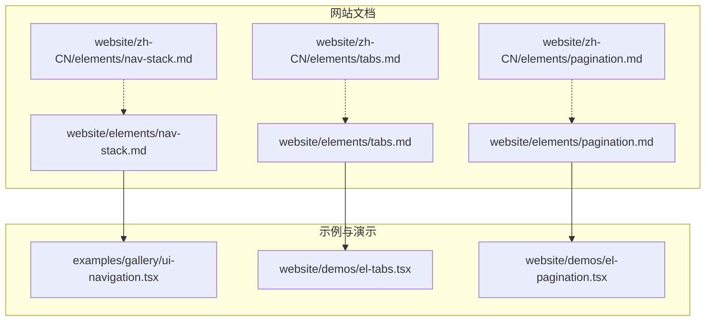
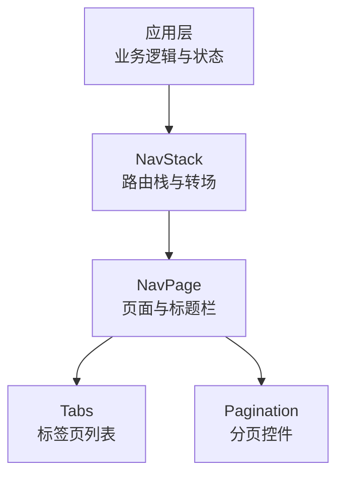
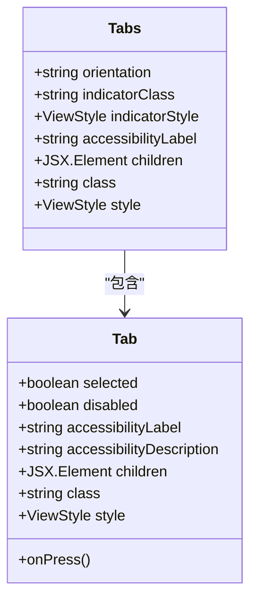
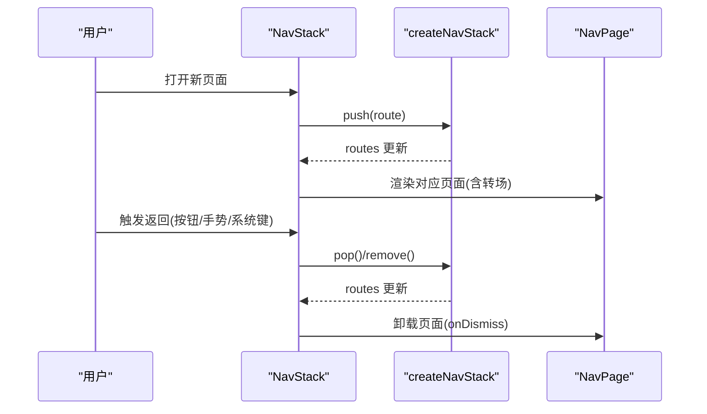
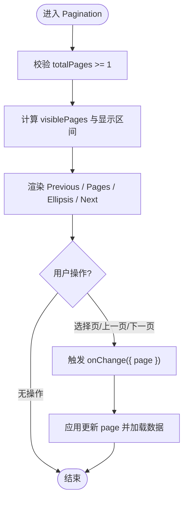
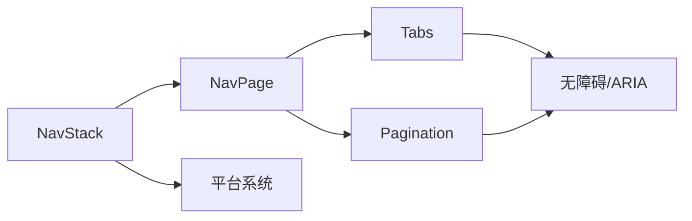

# 导航组件

<cite>
**本文引用的文件**   
- [website/elements/tabs.md](file://website/elements/tabs.md)
- [website/elements/nav-stack.md](file://website/elements/nav-stack.md)
- [website/elements/pagination.md](file://website/elements/pagination.md)
- [website/zh-CN/elements/tabs.md](file://website/zh-CN/elements/tabs.md)
- [website/zh-CN/elements/nav-stack.md](file://website/zh-CN/elements/nav-stack.md)
- [website/zh-CN/elements/pagination.md](file://website/zh-CN/elements/pagination.md)
</cite>

## 目录
1. [简介](#简介)
2. [项目结构](#项目结构)
3. [核心组件](#核心组件)
4. [架构总览](#架构总览)
5. [详细组件分析](#详细组件分析)
6. [依赖关系分析](#依赖关系分析)
7. [性能与优化](#性能与优化)
8. [故障排查](#故障排查)
9. [结论](#结论)
10. [附录](#附录)

## 简介
本文件为 NSH 框架中导航类组件的 API 文档，聚焦以下三类组件：
- Tabs（标签页）
- NavStack / NavPage（导航栈与页面）
- Pagination（分页）

文档覆盖接口规范、页面切换动画、路由管理与状态保持机制、标签页懒加载与缓存策略、移动端底部导航与侧边栏菜单模式、面包屑导航模式、深度链接与历史管理、浏览器兼容性处理、键盘导航与无障碍访问最佳实践，以及平台特定的手势与系统级集成。

## 项目结构
本仓库中与导航组件相关的官方文档位于 website 目录下，包含英文与中文两套文档；同时提供示例与演示入口。

图表来源
- [website/elements/tabs.md:1-253](file://website/elements/tabs.md#L1-L253)
- [website/elements/nav-stack.md:1-403](file://website/elements/nav-stack.md#L1-L403)
- [website/elements/pagination.md:1-180](file://website/elements/pagination.md#L1-L180)

章节来源
- [website/elements/tabs.md:1-253](file://website/elements/tabs.md#L1-L253)
- [website/elements/nav-stack.md:1-403](file://website/elements/nav-stack.md#L1-L403)
- [website/elements/pagination.md:1-180](file://website/elements/pagination.md#L1-L180)

## 核心组件
本节概述三个导航组件的职责与使用要点：
- Tabs：用于在同一位置切换多个分区或视图，提供指示器、键盘导航与无障碍支持。
- NavStack/NavPage：原生导航栈，负责页面推入/弹出、转场动画、返回手势与状态保持。
- Pagination：在数据集之间翻页，提供上一页/下一页、省略号、紧凑模式与无障碍支持。

章节来源
- [website/elements/tabs.md:10-113](file://website/elements/tabs.md#L10-L113)
- [website/elements/nav-stack.md:8-170](file://website/elements/nav-stack.md#L8-L170)
- [website/elements/pagination.md:8-64](file://website/elements/pagination.md#L8-L64)

## 架构总览
导航组件在 NSH 中的协作关系如下：
- NavStack 作为顶层容器，维护路由栈并渲染当前页面。
- NavPage 承载页面内容与标题栏插槽，控制返回行为与转场。
- Tabs 与 Pagination 通常作为页面内容的一部分，提供局部导航能力。
- 各组件通过响应式状态驱动 UI，并在不同平台适配系统行为。

图表来源
- [website/elements/nav-stack.md:152-170](file://website/elements/nav-stack.md#L152-L170)
- [website/elements/tabs.md:10-113](file://website/elements/tabs.md#L10-L113)
- [website/elements/pagination.md:8-64](file://website/elements/pagination.md#L8-L64)

## 详细组件分析

### Tabs（标签页）
- 职责：管理一组 Tab 的选中状态、键盘导航、无障碍角色与指示器定位。
- 关键属性（节选）：
  - Tab.selected/disabled/accessibilityLabel/accessibilityDescription/children/class/style
  - Tabs.orientation/indicatorClass/indicatorStyle/accessibilityLabel/children/class/style
- 事件：Tab.onPress
- 部件：列表、指示器、标签页、标签、内容区
- 指示器：由 indicatorClass/indicatorStyle 定义，跟随选中标签页移动，支持弹簧动画与减弱动效。
- 禁用：disabled 样式优先级高于 selected，屏幕阅读器报告不可用。
- 键盘：遵循 WAI-ARIA 标签页模式，方向键、Home/End、Space/Return 等。
- 平台：iOS/Android/Mac Catalyst 轻点；桌面/Web 点击与键盘；指示器为原生布局动画。

图表来源
- [website/elements/tabs.md:115-159](file://website/elements/tabs.md#L115-L159)
- [website/elements/tabs.md:163-189](file://website/elements/tabs.md#L163-L189)
- [website/elements/tabs.md:207-244](file://website/elements/tabs.md#L207-L244)

章节来源
- [website/elements/tabs.md:10-113](file://website/elements/tabs.md#L10-L113)
- [website/elements/tabs.md:115-159](file://website/elements/tabs.md#L115-L159)
- [website/elements/tabs.md:163-189](file://website/elements/tabs.md#L163-L189)
- [website/elements/tabs.md:191-221](file://website/elements/tabs.md#L191-L221)
- [website/elements/tabs.md:223-253](file://website/elements/tabs.md#L223-L253)

### NavStack / NavPage（导航栈与页面）
- 职责：一次显示一个页面，保留被覆盖页面的状态；提供转场、返回手势、系统标题栏与预测性返回。
- 工作方式：
  - 路由是应用自定义的值，从栈底到栈顶排列。
  - TSX 中 createNavStack 创建状态，NavStack 子函数渲染每个路由对应的页面。
  - Rust 中 nav_stack 的子元素即为页面，配合 each 渲染并保持状态。
  - 用户以原生方式离开时，页面移除；TSX 自动更新 routes，Rust 通过 on_dismiss 清理路由。
- createNavStack API（节选）：
  - routes/push/pop/popToRoot/replace/setRoutes/remove
- NavStack 属性（节选）：state/children/style/class/testID/onChange
- NavPage 属性（节选）：header/title/headerVisible/headerTransparent/headerShadowVisible/headerTitleAlign/headerBackgroundOnScroll/hidesBottomBarWhenPushed/headerLargeTitle/headerBackTitle/headerBackVisible/headerLeft/headerRight/headerTitle/headerStyle/headerClass/popOnBack/popOnSwipe/animation/transitionShader/statusBar/supportedOrientations/style/class/children/testID
- 事件：onBackPress/onDismiss
- 标题栏插槽：header/headerLeft/headerRight/headerTitle
- 离开页面：popOnBack=false 阻止返回，结合 onBackPress 做确认；注意主线程即时决策。
- 平台说明：iOS UINavigationController；Android 工具栏+预测性返回；桌面/Web 自定义 header 与浏览器后退。

图表来源
- [website/elements/nav-stack.md:152-170](file://website/elements/nav-stack.md#L152-L170)
- [website/elements/nav-stack.md:172-206](file://website/elements/nav-stack.md#L172-L206)
- [website/elements/nav-stack.md:254-260](file://website/elements/nav-stack.md#L254-L260)
- [website/elements/nav-stack.md:314-388](file://website/elements/nav-stack.md#L314-L388)

章节来源
- [website/elements/nav-stack.md:8-170](file://website/elements/nav-stack.md#L8-L170)
- [website/elements/nav-stack.md:172-206](file://website/elements/nav-stack.md#L172-L206)
- [website/elements/nav-stack.md:208-260](file://website/elements/nav-stack.md#L208-L260)
- [website/elements/nav-stack.md:261-313](file://website/elements/nav-stack.md#L261-L313)
- [website/elements/nav-stack.md:314-388](file://website/elements/nav-stack.md#L314-L388)
- [website/elements/nav-stack.md:390-403](file://website/elements/nav-stack.md#L390-L403)

### Pagination（分页）
- 职责：在数据集中翻页，展示上一页/下一页、当前页附近页码与省略号，提供紧凑模式与无障碍支持。
- 关键属性（节选）：page/totalPages/visiblePages/compact/disabled/accessibilityLabel/previousAccessibilityLabel/nextAccessibilityLabel/itemClass/itemStyle/renderItem/children/class/style
- 事件：onChange({ page })
- 显示规则：visiblePages 至少为 5；超过时显示首尾页、当前页两侧若干页与省略号。
- 项状态：selected/current/disabled/focus-visible；renderItem 接收 PaginationItemState（kind/page/start/end/current/disabled）。
- 紧凑模式：仅显示上一页、子元素与下一页。
- 动效：当前页高亮随 selected: 类过渡；换页不闪烁。
- 无障碍：导航地标、aria-current="page"、键盘可达。
- 平台：iOS/Android/Mac Catalyst 轻点；桌面/Web 点击与键盘。

图表来源
- [website/elements/pagination.md:66-123](file://website/elements/pagination.md#L66-L123)
- [website/elements/pagination.md:136-150](file://website/elements/pagination.md#L136-L150)
- [website/elements/pagination.md:152-163](file://website/elements/pagination.md#L152-L163)

章节来源
- [website/elements/pagination.md:8-64](file://website/elements/pagination.md#L8-L64)
- [website/elements/pagination.md:66-123](file://website/elements/pagination.md#L66-L123)
- [website/elements/pagination.md:124-135](file://website/elements/pagination.md#L124-L135)
- [website/elements/pagination.md:136-163](file://website/elements/pagination.md#L136-L163)
- [website/elements/pagination.md:164-180](file://website/elements/pagination.md#L164-L180)

## 依赖关系分析
- 组件耦合：
  - NavStack 与 NavPage 强耦合（栈管理与页面呈现）。
  - Tabs/Pagination 与 NavPage 弱耦合（作为页面内容）。
- 外部依赖：
  - 平台系统 UI（iOS UINavigationController、Android Toolbar、Web History API）。
  - 无障碍树（ARIA 角色与属性）。
- 可能的循环依赖：
  - 避免在 NavPage 中直接依赖 NavStack 的内部实现，应通过 createNavStack 暴露的状态进行导航。

图表来源
- [website/elements/nav-stack.md:152-170](file://website/elements/nav-stack.md#L152-L170)
- [website/elements/tabs.md:207-221](file://website/elements/tabs.md#L207-L221)
- [website/elements/pagination.md:164-173](file://website/elements/pagination.md#L164-L173)

章节来源
- [website/elements/nav-stack.md:152-170](file://website/elements/nav-stack.md#L152-L170)
- [website/elements/tabs.md:207-221](file://website/elements/tabs.md#L207-L221)
- [website/elements/pagination.md:164-173](file://website/elements/pagination.md#L164-L173)

## 性能与优化
- 标签页懒加载与缓存：
  - 使用 NavStack 的路由状态保持机制，未被覆盖的页面会保留其状态（信号、滚动位置、输入），天然具备“缓存”效果。
  - 对重型内容可结合条件渲染与按需初始化，仅在路由可见时加载。
- 指示器与动画：
  - Tabs 指示器采用原生布局动画，减少 JS 开销；开启减弱动态效果时立即就位。
  - NavPage 支持 animation 与 transitionShader，可在需要时使用着色器实现高性能转场。
- 分页渲染：
  - Pagination 固定显示数量（visiblePages），即使总页数很大也仅渲染少量项，避免重排与重绘。
- 建议：
  - 将重型页面放在 NavPage 中，利用栈的状态保持避免重复构建。
  - 合理使用 transitionShader 与 animation=none 控制复杂场景下的性能。
  - 在长列表中结合虚拟化与分页，避免一次性渲染大量节点。

章节来源
- [website/elements/nav-stack.md:152-170](file://website/elements/nav-stack.md#L152-L170)
- [website/elements/tabs.md:163-189](file://website/elements/tabs.md#L163-L189)
- [website/elements/pagination.md:66-85](file://website/elements/pagination.md#L66-L85)
- [website/elements/nav-stack.md:232-233](file://website/elements/nav-stack.md#L232-L233)

## 故障排查
- 返回拦截未生效：
  - 确保在用户可能丢失更改时尽早设置 popOnBack=false，因为系统在用户操作时刻于主线程即时决策。
- 页面状态丢失：
  - 检查是否通过 each 渲染 NavPage 并以路由为 key，保证栈内页面不被重建。
- 指示器错位：
  - 确认 indicatorClass/indicatorStyle 正确设置，且 Tabs 外层滚动容器包裹整个 Tabs。
- 分页项样式异常：
  - 检查 itemClass 与 renderItem 的使用，确保 selected/disabled/focus-visible 状态类生效。
- 无障碍播报缺失：
  - 为 Tabs 设置 accessibilityLabel，为 Pagination 设置 accessibilityLabel/previousAccessibilityLabel/nextAccessibilityLabel。

章节来源
- [website/elements/nav-stack.md:314-388](file://website/elements/nav-stack.md#L314-L388)
- [website/elements/tabs.md:163-189](file://website/elements/tabs.md#L163-L189)
- [website/elements/pagination.md:136-150](file://website/elements/pagination.md#L136-L150)
- [website/elements/tabs.md:207-221](file://website/elements/tabs.md#L207-L221)
- [website/elements/pagination.md:164-173](file://website/elements/pagination.md#L164-L173)

## 结论
NSH 的导航组件以声明式 API 与平台原生能力相结合，提供了跨平台的标签页、导航栈与分页体验。通过路由状态保持、原生转场与完善的无障碍支持，开发者可以在多端一致地构建高质量的用户界面。建议在复杂场景中结合懒加载、状态保持与性能优化策略，以获得流畅且可访问的导航体验。

## 附录

### 页面切换动画与转场
- NavPage.animation：default/slide/fade/none
- NavPage.transitionShader：使用 WGSL 着色器自定义转场，duration 默认 350ms
- Tabs.indicator：原生布局动画，受减弱动效影响

章节来源
- [website/elements/nav-stack.md:232-233](file://website/elements/nav-stack.md#L232-L233)
- [website/elements/tabs.md:163-189](file://website/elements/tabs.md#L163-L189)

### 路由管理与状态保持
- createNavStack.routes/push/pop/popToRoot/replace/setRoutes/remove
- NavStack.onChange 监听路由变化，可用于统计、持久化或同步 URL
- Rust 中通过信号更新路由，each 渲染并按路由 key 保持状态

章节来源
- [website/elements/nav-stack.md:172-206](file://website/elements/nav-stack.md#L172-L206)
- [website/elements/nav-stack.md:208-218](file://website/elements/nav-stack.md#L208-L218)

### 标签页懒加载与缓存策略
- 基于 NavStack 的路由状态保持，页面在被覆盖时保留状态
- 结合条件渲染与按需初始化，减少首次渲染成本

章节来源
- [website/elements/nav-stack.md:152-170](file://website/elements/nav-stack.md#L152-L170)

### 移动端底部导航与侧边栏菜单
- 底部导航：可使用 Tabs 作为底部标签栏，配合 NavStack 管理页面
- 侧边栏菜单：在 NavPage.headerLeft/headerRight 放置菜单入口，或使用 Menu/Popover 组合

章节来源
- [website/elements/tabs.md:115-159](file://website/elements/tabs.md#L115-L159)
- [website/elements/nav-stack.md:261-313](file://website/elements/nav-stack.md#L261-L313)

### 面包屑导航模式
- 使用 Pagination 的 ellipsis 与 renderItem 自定义为面包屑路径
- 或通过 NavPage.headerTitle 展示层级路径

章节来源
- [website/elements/pagination.md:96-123](file://website/elements/pagination.md#L96-L123)
- [website/elements/nav-stack.md:261-313](file://website/elements/nav-stack.md#L261-L313)

### 深度链接与历史管理
- NavStack.onChange 可用于同步 UrlScheme.setUrl，实现深度链接
- 浏览器后退与前进由 Web 历史 API 与 NavStack 协同处理

章节来源
- [website/elements/nav-stack.md:208-218](file://website/elements/nav-stack.md#L208-L218)

### 浏览器兼容性处理
- Web 上返回键与浏览器后退按钮统一由 NavStack 处理
- 无障碍属性（如 aria-orientation）在 Web 上由组件映射

章节来源
- [website/elements/nav-stack.md:390-403](file://website/elements/nav-stack.md#L390-L403)
- [website/elements/tabs.md:207-221](file://website/elements/tabs.md#L207-L221)

### 键盘导航与无障碍访问
- Tabs：WAI-ARIA 标签页模式，方向键、Home/End、Space/Return
- Pagination：导航地标、aria-current="page"、键盘可达
- NavPage：标题栏插槽与系统标题栏的无障碍描述

章节来源
- [website/elements/tabs.md:223-244](file://website/elements/tabs.md#L223-L244)
- [website/elements/pagination.md:164-173](file://website/elements/pagination.md#L164-L173)
- [website/elements/nav-stack.md:261-313](file://website/elements/nav-stack.md#L261-L313)

### 平台特定手势与系统级集成
- iOS：UINavigationController、大标题、侧滑返回
- Android：工具栏、预测性返回、BackHandler
- 桌面/Web：自定义 header、Escape/Alt+Left、鼠标后退键

章节来源
- [website/elements/nav-stack.md:390-403](file://website/elements/nav-stack.md#L390-L403)