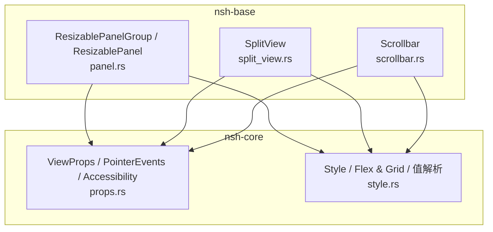
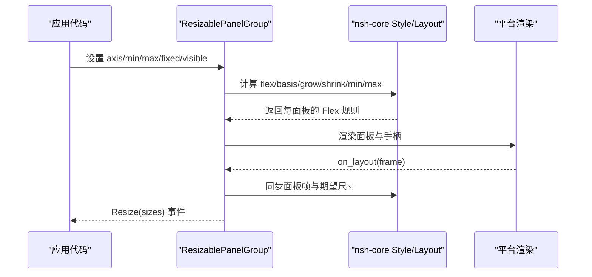
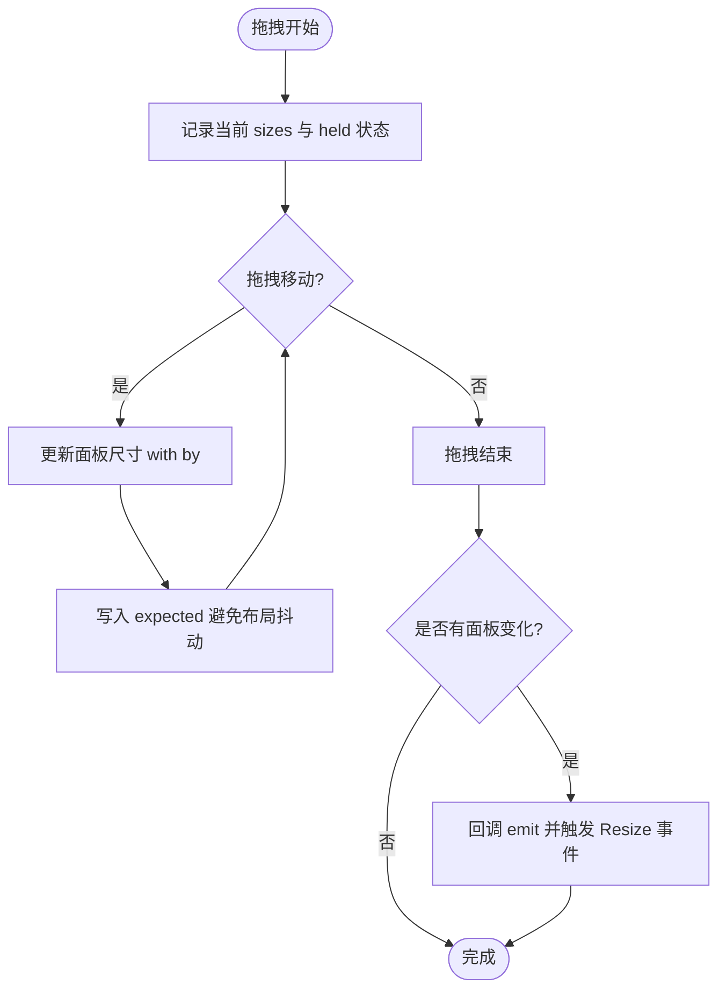
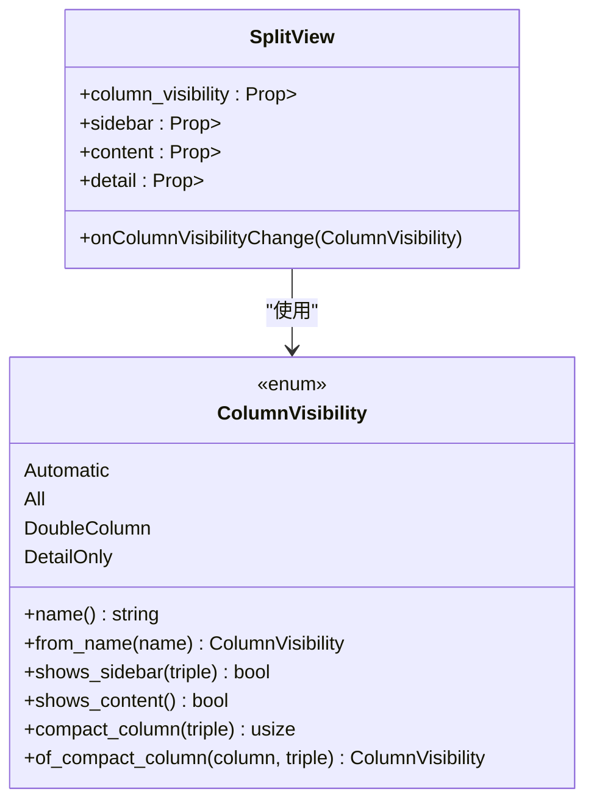
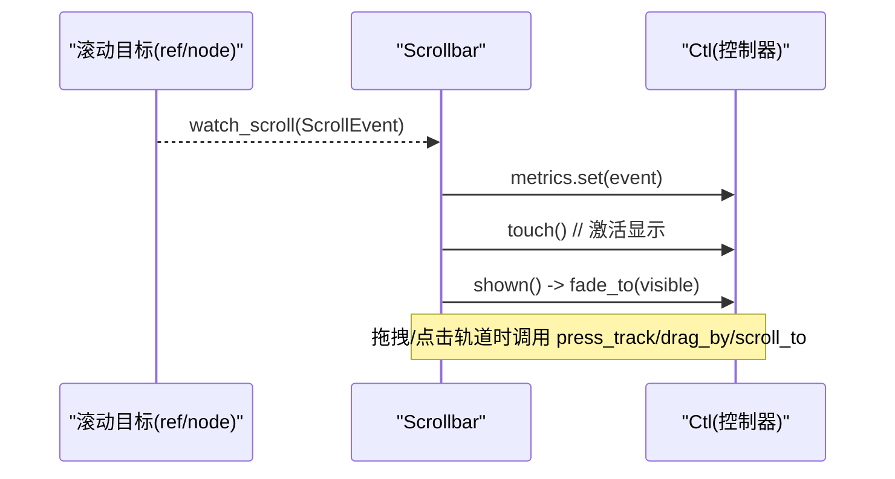
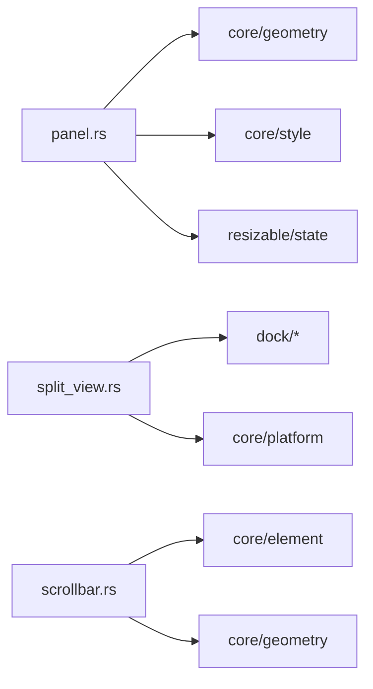

# 布局组件

<cite>
**本文引用的文件**   
- [panel.rs](file://crates/nsh-base/src/resizable/panel.rs)
- [split_view.rs](file://crates/nsh-base/src/split_view.rs)
- [scrollbar.rs](file://crates/nsh-base/src/scrollbar.rs)
- [props.rs](file://crates/nsh-core/src/props.rs)
- [style.rs](file://crates/nsh-core/src/style.rs)
</cite>

## 目录
1. [简介](#简介)
2. [项目结构](#项目结构)
3. [核心组件](#核心组件)
4. [架构总览](#架构总览)
5. [详细组件分析](#详细组件分析)
6. [依赖关系分析](#依赖关系分析)
7. [性能与优化](#性能与优化)
8. [故障排查指南](#故障排查指南)
9. [结论](#结论)
10. [附录](#附录)

## 简介
本文件为 NSH 框架的布局容器组件提供完整 API 文档，覆盖以下能力：
- 基础视图 View、可调整大小的面板组 ResizablePanelGroup、单个面板 ResizablePanel、三栏 SplitView、自定义滚动条 Scrollbar。
- Flexbox 与 Grid 布局系统的使用方式、响应式设计与自适应策略。
- 容器嵌套模式、空间分配算法与性能优化技巧。
- 滚动机制、视口管理与虚拟列表集成要点。
- 复杂布局场景的实现方案（动态面板调整、多列布局、移动端适配）。
- 布局调试工具与性能监控最佳实践。

## 项目结构
NSH 的布局相关代码主要分布在 nsh-base 与 nsh-core 两个 crate：
- nsh-base：面向业务的高层布局组件（ResizablePanelGroup/ResizablePanel、SplitView、Scrollbar）。
- nsh-core：底层样式、属性系统与布局引擎（Flex/Grid、ViewProps、Style）。

图表来源
- [panel.rs:1-120](file://crates/nsh-base/src/resizable/panel.rs#L1-L120)
- [split_view.rs:61-226](file://crates/nsh-base/src/split_view.rs#L61-L226)
- [scrollbar.rs:1-186](file://crates/nsh-base/src/scrollbar.rs#L1-L186)
- [props.rs:15-29](file://crates/nsh-core/src/props.rs#L15-L29)
- [style.rs:4500-5299](file://crates/nsh-core/src/style.rs#L4500-L5299)

章节来源
- [panel.rs:1-120](file://crates/nsh-base/src/resizable/panel.rs#L1-L120)
- [split_view.rs:61-226](file://crates/nsh-base/src/split_view.rs#L61-L226)
- [scrollbar.rs:1-186](file://crates/nsh-base/src/scrollbar.rs#L1-L186)
- [props.rs:15-29](file://crates/nsh-core/src/props.rs#L15-L29)
- [style.rs:4500-5299](file://crates/nsh-core/src/style.rs#L4500-L5299)

## 核心组件
- View（基础视图）
  - 作为所有 UI 元素的根容器，承载样式、事件、可访问性与布局行为。
  - 关键属性：PointerEvents、Accessibility、Focusable、WindowDrag/Resize、SelectionMenu 等。
- ResizablePanelGroup / ResizablePanel
  - 沿指定轴（水平/垂直）排列多个面板，用户通过拖拽手柄调整尺寸。
  - 支持固定面板、最小/最大尺寸、可见性控制；在容器过小时按比例收缩。
- SplitView
  - 两列或三列布局（侧边栏、内容、详情），在 iOS 使用原生 UISplitViewController，在其他平台基于 DockArea 实现。
  - 支持自动/手动列可见性切换，紧凑模式下单列导航。
- Scrollbar
  - 自定义外观的滚动条，监听目标滚动视图或列表，驱动拇指位置与长度，支持多种显示模式与入场动画。

章节来源
- [props.rs:455-552](file://crates/nsh-core/src/props.rs#L455-L552)
- [panel.rs:22-103](file://crates/nsh-base/src/resizable/panel.rs#L22-L103)
- [split_view.rs:165-226](file://crates/nsh-base/src/split_view.rs#L165-L226)
- [scrollbar.rs:154-186](file://crates/nsh-base/src/scrollbar.rs#L154-L186)

## 架构总览
布局系统的核心由“组件 + 样式/属性 + 布局引擎”构成：
- 组件层：ResizablePanelGroup/ResizablePanel、SplitView、Scrollbar 暴露 Props 与 Events。
- 样式/属性层：ViewProps 定义非样式属性（指针、可访问性、焦点等），Style 解析 Flex/Grid 与视觉样式。
- 布局引擎：基于 Taffy/Yoga 的 Flexbox 与 Grid 计算，结合 NSH 的布局树进行测量与排布。

图表来源
- [panel.rs:100-245](file://crates/nsh-base/src/resizable/panel.rs#L100-L245)
- [style.rs:4500-5299](file://crates/nsh-core/src/style.rs#L4500-L5299)

## 详细组件分析

### ResizablePanelGroup / ResizablePanel
- 功能概述
  - 沿 axis（Horizontal/Vertical）排列子面板，面板间插入可拖拽手柄。
  - 支持 disabled 锁定布局；handle_class/handle_style 定制手柄指示器；render_handle 自定义渲染。
  - 面板属性 size/min_size/max_size/fixed/visible；事件 Resize(size)。
- 布局与空间分配
  - 面板的 basis 为其 wanted 尺寸（用户拖拽或 app 传入 size），受 min_of/clamp 约束。
  - 当所有面板都有 size 时，剩余空间按 basis 比例增长；否则无 size 的面板均分剩余空间。
  - fixed 面板不参与 grow/shrink，保持其 size。
- 交互流程
  - 拖拽开始：记录当前 sizes 与 held dragged 状态，初始化 ResizableState。
  - 拖拽移动：根据 by 增量更新面板尺寸，维护 expected 以跳过一帧布局抖动。
  - 拖拽结束：计算 changed 面板并回调 emit，触发 Resize 事件。
- 可访问性
  - 手柄支持 increment/decrement 步进，报告 accessibility_value（min/max/now）。

图表来源
- [panel.rs:733-809](file://crates/nsh-base/src/resizable/panel.rs#L733-L809)

章节来源
- [panel.rs:22-103](file://crates/nsh-base/src/resizable/panel.rs#L22-L103)
- [panel.rs:247-342](file://crates/nsh-base/src/resizable/panel.rs#L247-L342)
- [panel.rs:469-675](file://crates/nsh-base/src/resizable/panel.rs#L469-L675)
- [panel.rs:733-809](file://crates/nsh-base/src/resizable/panel.rs#L733-L809)

### SplitView
- 功能概述
  - 两列或三列布局（sidebar/content/detail），iOS 使用原生 UISplitViewController，其他平台基于 DockArea。
  - columnVisibility 控制列显示：Automatic/All/DoubleColumn/DetailOnly。
  - 紧凑模式（horizontal_size_class == Compact）下单列展示，支持从 detail 回退到 content/sidebar。
- 平台差异
  - iOS：native_columns 包装每个 NavStack，将列宽/高通过 layout 事件回传。
  - 其他平台：dock_columns 使用 DockAreaLayout 构建 regular/compact 两套布局，并通过 visibility 控制 sidebar 打开与 center 列显示。
- 列可见性管理
  - Visibility 封装 controlled/own 值，Automatic 交由系统决定；controlled 模式下，用户改变后若 app 未接受则刷新 revision 以重新显示。

图表来源
- [split_view.rs:87-163](file://crates/nsh-base/src/split_view.rs#L87-L163)
- [split_view.rs:165-226](file://crates/nsh-base/src/split_view.rs#L165-L226)

章节来源
- [split_view.rs:61-226](file://crates/nsh-base/src/split_view.rs#L61-L226)
- [split_view.rs:228-415](file://crates/nsh-base/src/split_view.rs#L228-L415)
- [split_view.rs:417-478](file://crates/nsh-base/src/split_view.rs#L417-L478)

### Scrollbar
- 功能概述
  - 自定义外观滚动条，绑定目标滚动视图或列表（ref/node），跟踪 scroll 事件，驱动拇指长度与位置。
  - mode：Scrolling/Hover/Always；motion：idle/enter/exit/entrance/thumb_hover_entrance。
  - thumb_class/thumb_style 定制拇指外观；accessibility_label 无障碍标签。
- 滚动与视口管理
  - along() 获取 viewport/content/offset；range() 计算可滚动范围；thumb()/position() 计算拇指长度与位置。
  - scroll_to(offset) 命令式滚动，同时立即更新 metrics 以避免拖拽滞后。
- 显示逻辑
  - shown() 依据 mode、drag、over_track、active 决定是否显示；fade_to() 控制淡入/滑出动画。
  - hover_track/press_track/drag_by/release 处理鼠标与触摸交互。

图表来源
- [scrollbar.rs:244-500](file://crates/nsh-base/src/scrollbar.rs#L244-L500)
- [scrollbar.rs:518-671](file://crates/nsh-base/src/scrollbar.rs#L518-L671)

章节来源
- [scrollbar.rs:1-186](file://crates/nsh-base/src/scrollbar.rs#L1-L186)
- [scrollbar.rs:244-500](file://crates/nsh-base/src/scrollbar.rs#L244-L500)
- [scrollbar.rs:518-671](file://crates/nsh-base/src/scrollbar.rs#L518-L671)

### View（基础视图）与属性系统
- ViewProps
  - pointer_events：Auto/None/BoxNone/BoxOnly。
  - accessibility：role/state/value/actions/live_region 等。
  - focusable/key_capture/window_drag/resize、selection_menu、scroll_edge_element 等。
- 可访问性
  - AccessibilityRole 包含 Button/Link/List/Grid/Table/Tree 等丰富语义。
  - AccessibilityValue 用于范围控件（如滑块、滚动条）的 min/max/now。

章节来源
- [props.rs:15-29](file://crates/nsh-core/src/props.rs#L15-L29)
- [props.rs:31-173](file://crates/nsh-core/src/props.rs#L31-L173)
- [props.rs:235-325](file://crates/nsh-core/src/props.rs#L235-L325)
- [props.rs:455-552](file://crates/nsh-core/src/props.rs#L455-L552)

## 依赖关系分析
- ResizablePanelGroup/ResizablePanel 依赖：
  - nsh-core::geometry（Axis/Bounds/Points）、element::Style/StyleRefinement、prelude::*。
  - 内部 resize_handle 模块（拖拽带、手柄缩略图、终端适配）。
  - state::ResizableState（面板尺寸状态机）。
- SplitView 依赖：
  - nsh_core::platform::Os/SPLIT_VIEW_COMPONENT、element::NativeEvent/Renderer。
  - dock 模块（DockArea/DockLayout/DockNode）构建双/三列布局。
- Scrollbar 依赖：
  - nsh_core::element::{ElementRef, NodeRef, ScrollEvent, set_builtin_scrollbars}。
  - geometry::Along/Axis、time::Instant/now。

图表来源
- [panel.rs:1-20](file://crates/nsh-base/src/resizable/panel.rs#L1-L20)
- [split_view.rs:61-72](file://crates/nsh-base/src/split_view.rs#L61-L72)
- [scrollbar.rs:14-24](file://crates/nsh-base/src/scrollbar.rs#L14-L24)

章节来源
- [panel.rs:1-20](file://crates/nsh-base/src/resizable/panel.rs#L1-L20)
- [split_view.rs:61-72](file://crates/nsh-base/src/split_view.rs#L61-L72)
- [scrollbar.rs:14-24](file://crates/nsh-base/src/scrollbar.rs#L14-L24)

## 性能与优化
- Flexbox 与 Grid
  - 合理设置 flex_basis/grow/shrink，避免不必要的重排；对固定尺寸面板使用 fixed 减少计算。
  - Grid 模板行列尽量静态化，避免频繁变更 gridTemplateColumns/gridTemplateRows。
- 滚动性能
  - 使用 Scrollbar 的 motion.idle 控制隐藏延迟，减少频繁显隐；在长列表中配合虚拟列表（virtual_list）仅渲染可视区域。
  - 避免在滚动回调中执行昂贵计算，必要时节流或合并更新。
- 布局稳定性
  - ResizablePanelGroup 使用 expected 尺寸避免拖拽过程中的布局抖动；确保在 end_drag 后再持久化尺寸。
  - SplitView 在紧凑/常规布局间切换时复用 Layouts 实例，保持节点 ID 稳定，减少重建开销。

[本节为通用指导，不直接分析具体文件]

## 故障排查指南
- ResizablePanelGroup
  - 问题：拖拽无效或尺寸异常。
    - 检查 disabled 是否启用；确认至少一个面板未设置为 fixed。
    - 验证 min_size/max_size 是否冲突；查看 handle_class/handle_style 是否遮挡交互。
  - 参考路径：[panel.rs:733-809](file://crates/nsh-base/src/resizable/panel.rs#L733-L809)
- SplitView
  - 问题：iOS 上列不可见或导航异常。
    - 检查 native_columns 的 wrapper 是否设置了正确的 width/height；确认 SPLIT_VIEW_COMPONENT 的事件名称与数据格式。
    - 在紧凑模式下，确认 compact_column 与 of_compact_column 转换正确。
  - 参考路径：[split_view.rs:294-359](file://crates/nsh-base/src/split_view.rs#L294-L359)
- Scrollbar
  - 问题：滚动条不显示或位置错误。
    - 确认 scroll 目标已挂载且 ref/node 有效；检查 axis 是否与目标滚动方向一致。
    - 验证 mode 与 motion 配置；确保目标视图的 scrollbar={false} 关闭了平台默认滚动条。
  - 参考路径：[scrollbar.rs:518-671](file://crates/nsh-base/src/scrollbar.rs#L518-L671)

章节来源
- [panel.rs:733-809](file://crates/nsh-base/src/resizable/panel.rs#L733-L809)
- [split_view.rs:294-359](file://crates/nsh-base/src/split_view.rs#L294-L359)
- [scrollbar.rs:518-671](file://crates/nsh-base/src/scrollbar.rs#L518-L671)

## 结论
NSH 的布局组件体系以 ResizablePanelGroup/ResizablePanel 提供灵活的可调整面板布局，SplitView 提供跨平台的三列导航体验，Scrollbar 提供高度可定制的滚动交互。结合 nsh-core 的 Flexbox/Grid 与 ViewProps 属性系统，开发者可以构建复杂、响应式且高性能的界面。建议在生产环境中关注布局稳定性、滚动性能与可访问性，充分利用组件提供的 API 与事件模型。

[本节为总结性内容，不直接分析具体文件]

## 附录
- Flexbox 与 Grid 使用要点
  - Flex：flexDirection、justifyContent、alignItems、gap、flexGrow/Shrink/Basis。
  - Grid：gridTemplateColumns、gridTemplateRows、gridGap、gridItem 定位。
- 响应式与自适应
  - 使用 horizontal_size_class 判断紧凑模式；SplitView 在 iOS 与桌面端采用不同实现。
  - 通过 ColumnVisibility 控制列显示，结合 app 状态持久化用户选择。
- 虚拟列表集成
  - 将 Scrollbar 与 virtual_list 结合，仅渲染可视项；在列表增长时更新 metrics 以保持滚动条同步。
- 调试与监控
  - 使用 on_layout 打印 frame 与 bounds，验证布局结果。
  - 在 ResizablePanelGroup 的 Resize 事件中记录 sizes，便于回放与测试。

[本节为概念性内容，不直接分析具体文件]