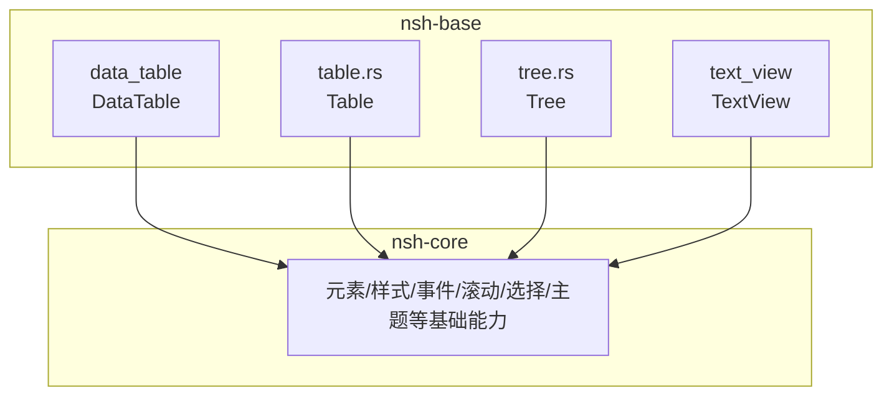
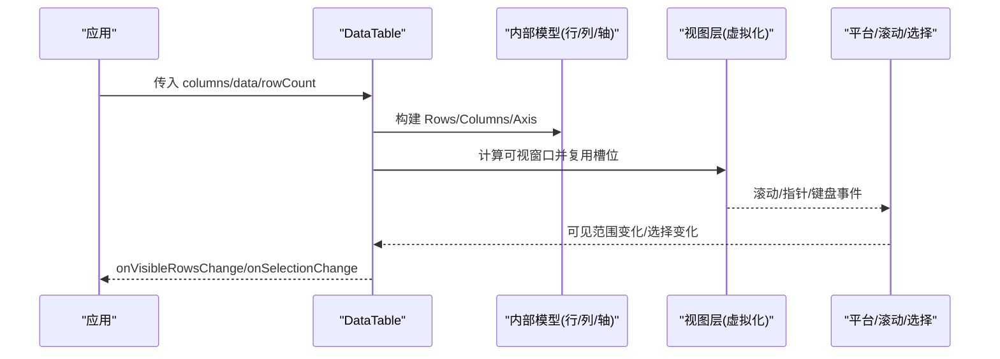
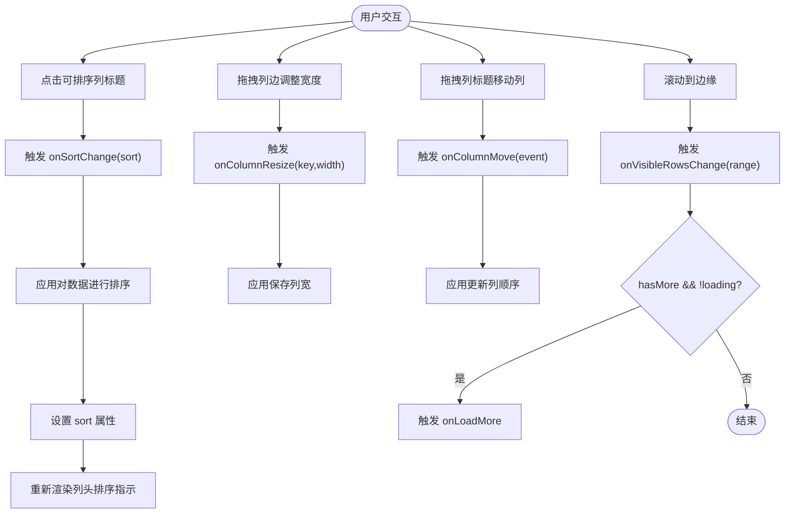
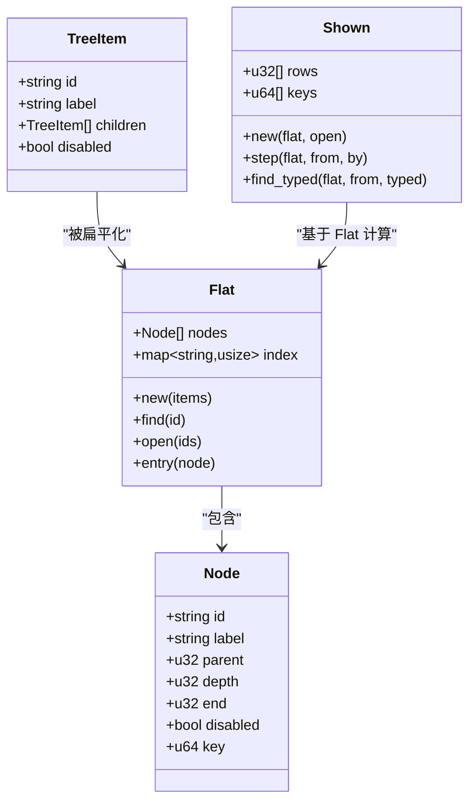
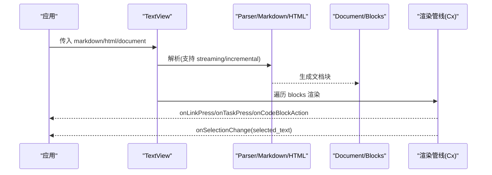
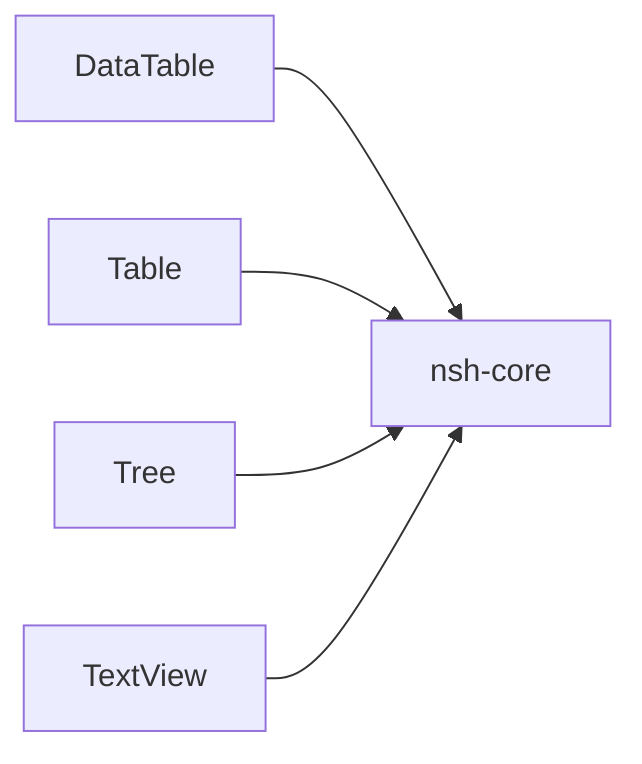

# 数据展示组件

<cite>
**本文引用的文件**   
- [data-table.md](file://docs/dev/data-table.md)
- [text-view.md](file://docs/dev/text-view.md)
- [mod.rs](file://crates/nsh-base/src/data_table/mod.rs)
- [table.rs](file://crates/nsh-base/src/table.rs)
- [tree.rs](file://crates/nsh-base/src/tree.rs)
- [view.rs](file://crates/nsh-base/src/text_view/view.rs)
</cite>

## 目录
1. [简介](#简介)
2. [项目结构](#项目结构)
3. [核心组件](#核心组件)
4. [架构总览](#架构总览)
5. [详细组件分析](#详细组件分析)
6. [依赖关系分析](#依赖关系分析)
7. [性能与大数据优化](#性能与大数据优化)
8. [可访问性与国际化](#可访问性与国际化)
9. [故障排查指南](#故障排查指南)
10. [结论](#结论)

## 简介
本文件为 NSH 框架的数据展示类组件 API 参考，覆盖以下组件：
- DataTable：双向滚动、虚拟化、列固定/排序/调整大小/移动、行/列/单元格选择、可见区域回调、加载更多。
- Table：语义化静态表格（无障碍角色），无自带外观，适合少量静态数据。
- Tree：树形结构，支持展开/收起、单选、键盘导航、类型搜索、虚拟列表渲染。
- TextView：Markdown/HTML/文档块渲染，支持流式增量解析、代码高亮、公式、链接点击、任务框、图片、自定义节点、文本选择与复制。

这些组件面向大数据集和复杂交互场景，提供虚拟化、增量更新、内存友好的数据结构以及完善的可访问性支持。

## 项目结构
NSH 的数据展示能力集中在 nsh-base 包中：
- data_table：DataTable 组件及其布局、轴、列、选择、控制器等模块。
- table.rs：轻量级语义表格部件。
- tree.rs：树形控件的模型、视图与交互逻辑。
- text_view：TextView 的组件入口、文档模型、扩展、Markdown/HTML 解析、数学公式、选择与样式系统。

图表来源
- [mod.rs:361-513](file://crates/nsh-base/src/data_table/mod.rs#L361-L513)
- [table.rs:10-93](file://crates/nsh-base/src/table.rs#L10-L93)
- [tree.rs:430-495](file://crates/nsh-base/src/tree.rs#L430-L495)
- [view.rs:27-111](file://crates/nsh-base/src/text_view/view.rs#L27-L111)

章节来源
- [data-table.md:1-10](file://docs/dev/data-table.md#L1-L10)
- [text-view.md:1-22](file://docs/dev/text-view.md#L1-L22)

## 核心组件
本节概述各组件的职责与关键接口。

- DataTable
  - 数据输入：columns、data、rowCount、dataStart、rowClasses、cellClasses。
  - 交互：selection、rowSelectable/columnSelectable/cellSelectable、selectOnModifierPress、loopSelection。
  - 列行为：sortable、fixed、resizable、movable、autoFit、fitPadding、grow、align。
  - 视图：renderCell、renderHeaderCell、empty、loadingView、classes/styles。
  - 事件：onSelectionChange、onRowPress、onColumnPress、onDoublePress、onRowActivate、onContextMenu、onSortChange、onColumnResize、onColumnMove、onVisibleRowsChange、onVisibleColumnsChange、onLoadMore。
  - API：scroll_to_row、scroll_to_column、selection、select、visible_rows、visible_columns、column_widths、set_column_width、fit_column、dump、copy、focus、blur、menu_target、clear_menu_target。

- Table
  - 语义部件：Table、TableHeader、TableBody、TableFooter、TableRow、TableHead、TableCell、TableCaption。
  - 用途：少量静态数据，由应用负责外观；提供无障碍角色。

- Tree
  - 数据：items（TreeItem）、expanded/default_expanded、selected/default_selected。
  - 交互：disabled、reveal（展开动画）、itemClass/itemStyle、renderItem、header、empty。
  - 事件：onExpandedChange、onSelectedChange、onExpand、onCollapse、onAction。
  - API：focus、reveal_item。

- TextView
  - 输入：markdown/html/document、options/extensions、classes/styles、selectable、links、code_block_scrollbar、table_scrollbar、streaming_caret。
  - 渲染扩展：render_custom、render_code_block、render_code_block_action、code_block_actions、render_table_actions、render_math、render_image。
  - 事件：onLinkPress、onImagePress、onTaskPress、onCodeBlockAction、onSelectionChange。
  - API：selected_text。

章节来源
- [mod.rs:95-169](file://crates/nsh-base/src/data_table/mod.rs#L95-L169)
- [mod.rs:378-513](file://crates/nsh-base/src/data_table/mod.rs#L378-L513)
- [mod.rs:515-675](file://crates/nsh-base/src/data_table/mod.rs#L515-L675)
- [table.rs:10-93](file://crates/nsh-base/src/table.rs#L10-L93)
- [tree.rs:77-147](file://crates/nsh-base/src/tree.rs#L77-L147)
- [tree.rs:430-495](file://crates/nsh-base/src/tree.rs#L430-L495)
- [tree.rs:497-551](file://crates/nsh-base/src/tree.rs#L497-L551)
- [view.rs:27-111](file://crates/nsh-base/src/text_view/view.rs#L27-L111)
- [view.rs:135-196](file://crates/nsh-base/src/text_view/view.rs#L135-L196)

## 架构总览
数据展示组件遵循“数据驱动 + 虚拟化 + 局部更新”的架构：
- 数据层：应用持有完整或分页数据，通过 props 暴露给组件。
- 模型层：组件内部将数据扁平化/切片（如 Tree 的 Flat/Shown，DataTable 的 Rows/Axis）。
- 视图层：仅渲染可视区域及少量缓冲项（virtual_list/slots），避免全量创建。
- 交互层：统一的事件与状态管理（选择、排序、展开、滚动定位）。
- 可访问性：通过 role/accessibility_state/label 暴露给屏幕阅读器。

图表来源
- [mod.rs:361-513](file://crates/nsh-base/src/data_table/mod.rs#L361-L513)
- [data-table.md:23-73](file://docs/dev/data-table.md#L23-L73)

## 详细组件分析

### DataTable：接口规范与实现要点
- 列定义
  - key/title/width/min_width/max_width/fit_padding/grow/auto_fit/resizable/movable/selectable/align/cell_class/header_class/positive_class/negative_class。
- 数据绑定
  - data：对象数组或按列索引的数组；numbers/booleans/strings 自动转文本。
  - rowCount：总行数；dataStart：起始行；rowClasses：每行样式；cellClasses：单格样式。
- 选择模式
  - rowSelectable/columnSelectable/cellSelectable；selectOnModifierPress；selection 受控；loopSelection。
- 排序
  - sortable 列标题触发 onSortChange；应用设置 sort 以显示当前排序方向。
- 列操作
  - resizable：拖拽调整宽度；movable：拖拽移动列顺序；fixed：左/右固定列。
- 可见区域与分页
  - onVisibleRowsChange/onVisibleColumnsChange 返回 DataTableRange；onLoadMore 在接近末尾时触发。
- 渲染钩子
  - renderCell/renderHeaderCell；empty/loadingView；classes/styles 按部分定制。
- 键盘与焦点
  - 表作为 Tab 停靠点；箭头/Home/End/PageUp/PageDown/Tab/Escape；Enter 激活行；终端下行为差异见设计文档。
- API 方法
  - scroll_to_row/scroll_to_column/selection/select/visible_rows/visible_columns/column_widths/set_column_width/fit_column/dump/copy/focus/blur/menu_target/clear_menu_target。

图表来源
- [mod.rs:515-570](file://crates/nsh-base/src/data_table/mod.rs#L515-L570)
- [data-table.md:85-104](file://docs/dev/data-table.md#L85-L104)

章节来源
- [mod.rs:95-169](file://crates/nsh-base/src/data_table/mod.rs#L95-L169)
- [mod.rs:378-513](file://crates/nsh-base/src/data_table/mod.rs#L378-L513)
- [mod.rs:515-675](file://crates/nsh-base/src/data_table/mod.rs#L515-L675)
- [data-table.md:23-104](file://docs/dev/data-table.md#L23-L104)

### Table：语义化静态表格
- 组件族：Table/TableHeader/TableBody/TableFooter/TableRow/TableHead/TableCell/TableCaption。
- 用途：少量静态数据，由应用负责外观；提供无障碍角色（Table/RowGroup/Row/ColumnHeader/Cell）。
- 建议：大量数据请使用 DataTable。

章节来源
- [table.rs:1-93](file://crates/nsh-base/src/table.rs#L1-L93)

### Tree：树形结构
- 数据模型
  - TreeItem：id/label/children/disabled；Flat 将树扁平化为深度优先序列，记录 parent/depth/end/key。
  - Open：已展开节点集合（有序）；Shown：根据 Open 计算的可见行序列。
- 交互
  - 展开/收起：onExpandedChange/onExpand/onCollapse；reveal 启用弹簧动画。
  - 选择：onSelectedChange；支持受控 selected 与默认 default_selected。
  - 键盘：上下左右/Home/End/Enter/Space；RTL 布局下左右键互换；类型搜索 find_typed。
  - 双击：onAction（叶子执行动作，文件夹切换展开）。
- 渲染
  - renderItem：自定义行渲染；itemClass/itemStyle 控制状态样式（selected/focus/disabled/aria-expanded）。
  - header/empty：占位内容。
- API
  - focus/reveal_item：聚焦并展开父节点后滚动至目标行。

图表来源
- [tree.rs:77-147](file://crates/nsh-base/src/tree.rs#L77-L147)
- [tree.rs:149-279](file://crates/nsh-base/src/tree.rs#L149-L279)
- [tree.rs:317-428](file://crates/nsh-base/src/tree.rs#L317-L428)

章节来源
- [tree.rs:77-147](file://crates/nsh-base/src/tree.rs#L77-L147)
- [tree.rs:149-279](file://crates/nsh-base/src/tree.rs#L149-L279)
- [tree.rs:317-428](file://crates/nsh-base/src/tree.rs#L317-L428)
- [tree.rs:430-495](file://crates/nsh-base/src/tree.rs#L430-L495)
- [tree.rs:497-551](file://crates/nsh-base/src/tree.rs#L497-L551)
- [tree.rs:703-1083](file://crates/nsh-base/src/tree.rs#L703-L1083)

### TextView：文本渲染与编辑支持
- 输入与选项
  - markdown/html/document；options/extensions；classes/styles；selectable；links；code_block_scrollbar；table_scrollbar；streaming_caret。
- 渲染扩展
  - render_custom/render_code_block/render_code_block_action/code_block_actions/render_table_actions/render_math/render_image。
- 事件
  - onLinkPress/onImagePress/onTaskPress/onCodeBlockAction/onSelectionChange。
- API
  - selected_text：获取选中文本（plain/markdown/html）。
- 流式与增量
  - streaming 模式下修复未闭合标记；Incremental 只解析尾部可变部分；长文本分段解析。
- 语法高亮
  - CodeHighlighter：Rust 侧提供范围样式；内置 syntect 高亮（可选 feature highlight）。
- 公式
  - 原生 RaTeX 排版；Web 端按需加载 math 侧模块与字体。
- 表格与链接
  - 表格网格布局与水平滚动；链接提示与点击处理（report/open）。

图表来源
- [view.rs:27-111](file://crates/nsh-base/src/text_view/view.rs#L27-L111)
- [view.rs:293-446](file://crates/nsh-base/src/text_view/view.rs#L293-L446)
- [text-view.md:23-101](file://docs/dev/text-view.md#L23-L101)

章节来源
- [view.rs:27-111](file://crates/nsh-base/src/text_view/view.rs#L27-L111)
- [view.rs:135-196](file://crates/nsh-base/src/text_view/view.rs#L135-L196)
- [view.rs:293-446](file://crates/nsh-base/src/text_view/view.rs#L293-L446)
- [text-view.md:23-101](file://docs/dev/text-view.md#L23-L101)
- [text-view.md:146-217](file://docs/dev/text-view.md#L146-L217)
- [text-view.md:219-317](file://docs/dev/text-view.md#L219-L317)

## 依赖关系分析
- DataTable
  - 依赖 nsh-core 的元素/样式/滚动/选择机制；内部使用 Axis/Columns/Selection/Dt 控制器。
- Table
  - 依赖 nsh-core 的无障碍角色与基础视图。
- Tree
  - 依赖 nsh-core 的滚动/选择/键盘/主题；内部使用 Flat/Open/Shown/Lit 等模型。
- TextView
  - 依赖 nsh-core 的文本/选择/滚动/主题；内部使用 Parser/Document/Cx 渲染上下文。

图表来源
- [mod.rs:14-23](file://crates/nsh-base/src/data_table/mod.rs#L14-L23)
- [table.rs:8-9](file://crates/nsh-base/src/table.rs#L8-L9)
- [tree.rs:45-60](file://crates/nsh-base/src/tree.rs#L45-L60)
- [view.rs:5-25](file://crates/nsh-base/src/text_view/view.rs#L5-L25)

章节来源
- [mod.rs:14-23](file://crates/nsh-base/src/data_table/mod.rs#L14-L23)
- [table.rs:8-9](file://crates/nsh-base/src/table.rs#L8-L9)
- [tree.rs:45-60](file://crates/nsh-base/src/tree.rs#L45-L60)
- [view.rs:5-25](file://crates/nsh-base/src/text_view/view.rs#L5-L25)

## 性能与大数据优化
- DataTable
  - 虚拟化：仅渲染可视区域及附近行/列；Slots 复用视图，滚动时无销毁重建。
  - 超大内容：当内容超过 MAX_EXTENT 时使用缩放映射，保持滚动条比例与 scrollToRow 准确性。
  - 列自适应：autoFit/fitColumn 测量最宽文本；bounces 控制回弹。
  - 性能指标：百万行/万列场景下滚动帧稳定，增量更新开销低。
- Tree
  - 虚拟列表：viewport: parent，仅渲染可见行；collapsed 子树不创建。
  - 信号拆分：Lit 将选择/光标状态分散到 LIT 个信号，减少重渲染。
  - 动画：reveal 使用 Collapsible 的弹簧动画，跨平台一致。
- TextView
  - 增量解析：Incremental 仅解析尾部可变部分；长文本分段 parse_long。
  - 共享块：Parsed/SharedBlock 使用 Rc 共享不变块，比较指针提升 diff 效率。
  - 高亮异步：Web 端 next_frame 异步高亮，首屏即时显示。
  - 公式按需加载：math 侧模块与 KaTeX 字体懒加载。

章节来源
- [data-table.md:23-136](file://docs/dev/data-table.md#L23-L136)
- [tree.rs:1-39](file://crates/nsh-base/src/tree.rs#L1-L39)
- [text-view.md:23-101](file://docs/dev/text-view.md#L23-L101)
- [text-view.md:188-217](file://docs/dev/text-view.md#L188-L217)
- [text-view.md:237-317](file://docs/dev/text-view.md#L237-L317)
- [text-view.md:358-386](file://docs/dev/text-view.md#L358-L386)

## 可访问性与国际化
- 可访问性
  - DataTable：role 与 accessibility_label；行/列/单元格选择与键盘导航；终端下行为差异。
  - Table：Table/TableHeader/TableBody/TableRow/TableHead/TableCell/TableCaption 对应无障碍角色。
  - Tree：role=Tree，TreeItem 带 level/expanded/selected/disabled；屏幕阅读器焦点跟随 cursor。
  - TextView：heading 为 header，link 为 link，task marker 为 checkbox，disclosure summary 为 button，image 为 image；selection 跨块统一。
- 国际化
  - 组件本身不提供翻译字符串；外观与文案由应用通过 classes/styles 与自定义渲染函数控制。
  - DataTable 的排序方向、空态/加载态、列标题等均由应用提供。
  - TextView 的链接提示、代码块动作、表格动作等可由应用自定义。

章节来源
- [data-table.md:137-175](file://docs/dev/data-table.md#L137-L175)
- [table.rs:10-93](file://crates/nsh-base/src/table.rs#L10-L93)
- [tree.rs:28-39](file://crates/nsh-base/src/tree.rs#L28-L39)
- [text-view.md:352-357](file://docs/dev/text-view.md#L352-L357)

## 故障排查指南
- DataTable
  - 列宽异常：检查 autoFit/fitPadding 与 grow 配置；确认列是否被用户拖动过导致“settled”。
  - 加载更多未触发：确认 hasMore 与 loading 状态；确保 visibleRowsChange 正确上报。
  - 选择丢失：检查 selectOnModifierPress 与 cellSelectable；必要时在 onRowPress/onColumnPress 中维护多选。
- Tree
  - 展开无效：确认 item.id 唯一且为 folder；检查 expanded 受控状态是否与 onExpandedChange 同步。
  - 滚动不到目标：调用 reveal_item 前确保父节点已展开；未知 id 会记录警告。
- TextView
  - 高亮未生效：Web 端需加载 nsh-syntaxes.bin；若无法加载则代码保持纯文本。
  - 公式不渲染：确认 math 侧模块与字体已加载；否则显示 TeX 源码。
  - 链接未打开：links="open" 仅对外部 URL 生效，锚点 #anchor 仅报告不跳转。

章节来源
- [data-table.md:85-104](file://docs/dev/data-table.md#L85-L104)
- [data-table.md:106-121](file://docs/dev/data-table.md#L106-L121)
- [tree.rs:978-1014](file://crates/nsh-base/src/tree.rs#L978-L1014)
- [text-view.md:188-217](file://docs/dev/text-view.md#L188-L217)
- [text-view.md:358-367](file://docs/dev/text-view.md#L358-L367)

## 结论
NSH 的数据展示组件围绕“高性能虚拟化 + 灵活可扩展 + 完善可访问性”构建：
- DataTable 提供企业级表格能力，适合海量数据的双向滚动、排序、筛选（应用侧）、分页与编辑（应用侧）。
- Table 提供语义化静态表格，适合少量数据的简单展示。
- Tree 提供高效树形浏览与交互，支持展开/收起、选择、键盘与类型搜索。
- TextView 提供强大的富文本渲染与流式更新，支持代码高亮、公式、链接、任务框与自定义节点。

在实际项目中，建议：
- 大数据集优先使用 DataTable/Tree 的虚拟化能力，并通过 onVisibleRowsChange/visible_rows 进行分页与增量加载。
- 将排序/筛选/分页逻辑置于应用层，通过 props 与事件与组件协同。
- 使用 classes/styles 与 render_* 钩子实现主题与业务内容的无缝集成。
- 关注可访问性：为表格/树/文本提供合适的 role/label/state，并确保键盘导航与屏幕阅读器友好。