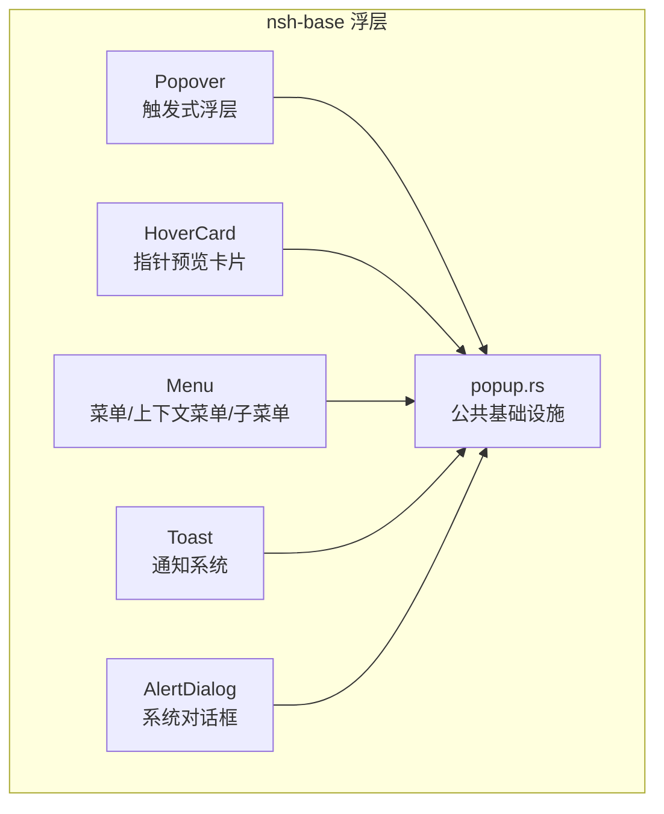
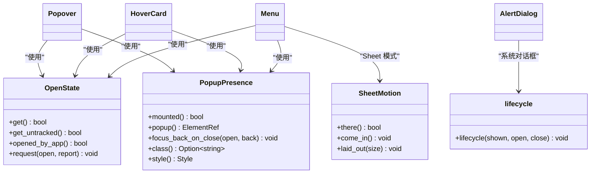
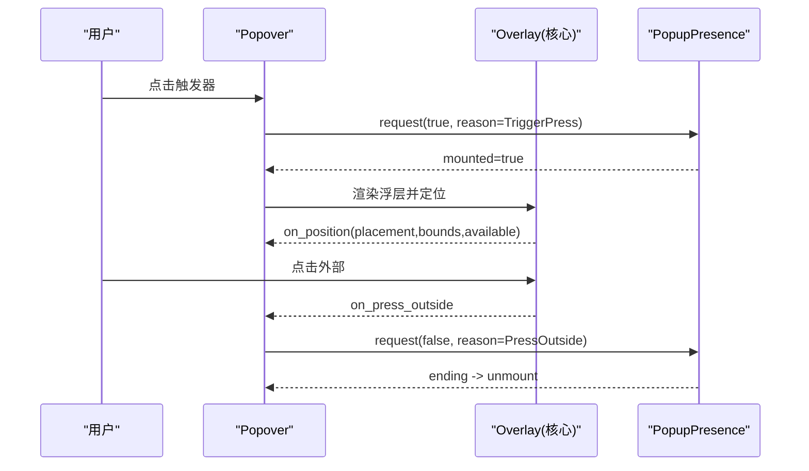
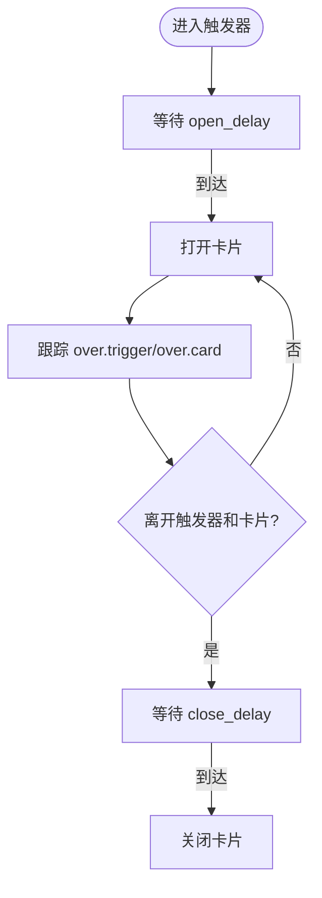
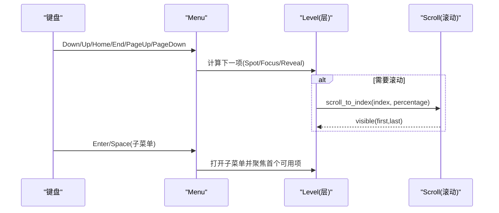
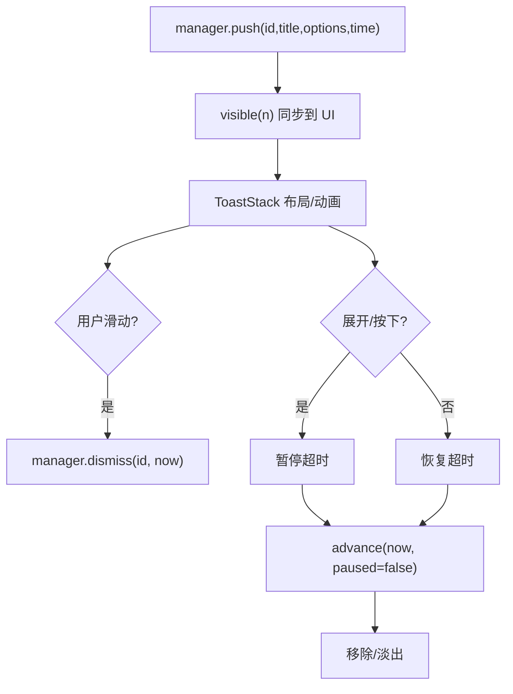
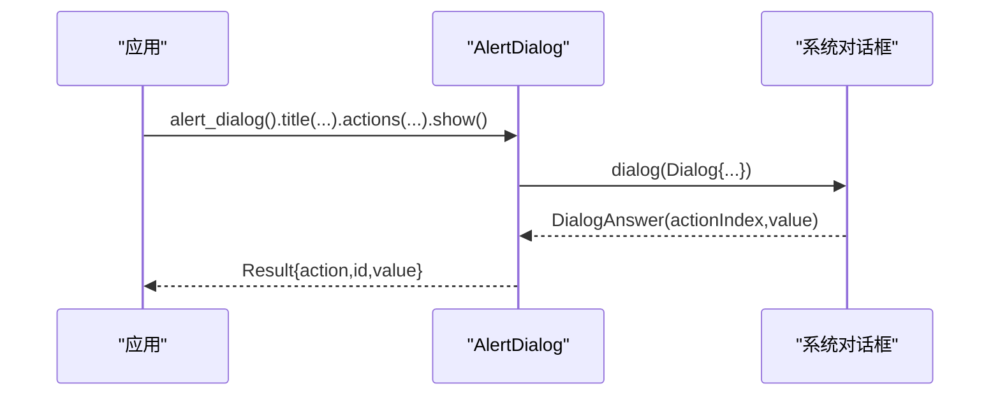
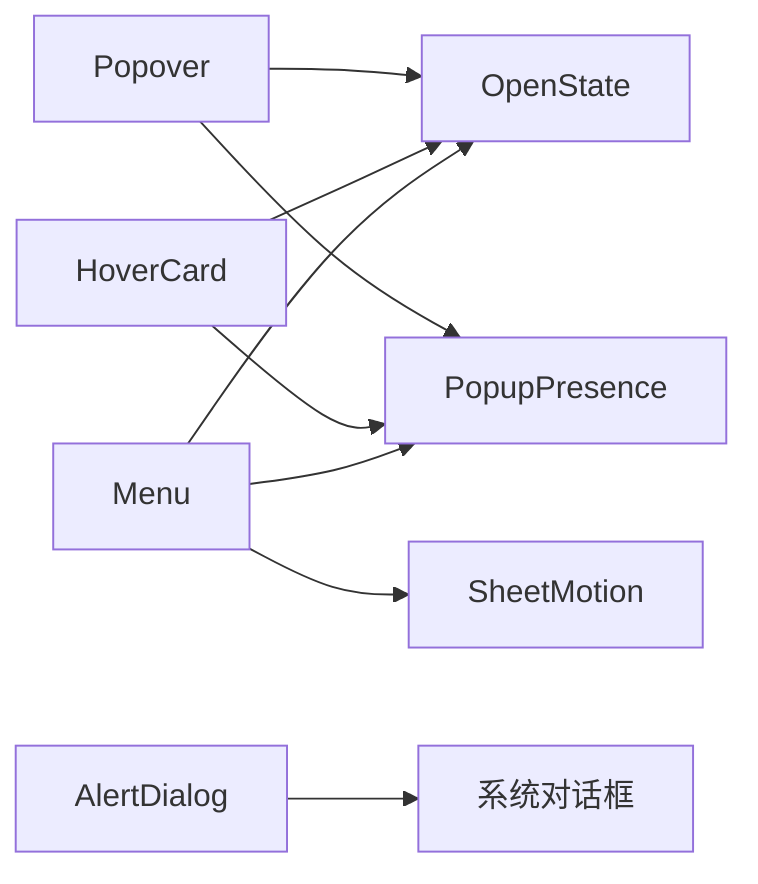

# 浮层组件

<cite>
**本文引用的文件**   
- [popover.rs](file://crates/nsh-base/src/popover.rs)
- [hover_card.rs](file://crates/nsh-base/src/hover_card.rs)
- [menu.rs](file://crates/nsh-base/src/menu.rs)
- [toast/mod.rs](file://crates/nsh-base/src/toast/mod.rs)
- [alert_dialog.rs](file://crates/nsh-base/src/alert_dialog.rs)
- [popup.rs](file://crates/nsh-base/src/popup.rs)
</cite>

## 目录
1. [简介](#简介)
2. [项目结构](#项目结构)
3. [核心组件](#核心组件)
4. [架构总览](#架构总览)
5. [详细组件分析](#详细组件分析)
6. [依赖关系分析](#依赖关系分析)
7. [性能与可访问性](#性能与可访问性)
8. [疑难解答](#疑难解答)
9. [结论](#结论)

## 简介
本文件为 NSH 框架的浮层与弹窗类组件提供完整的 API 参考与实现说明，覆盖 Popover、HoverCard、Menu、Toast、Dialog（AlertDialog）等组件。文档重点解释：
- 浮层的定位算法、层级管理与焦点陷阱机制
- 模态对话框、非模态提示和通知系统的实现模式
- 浮层的动画过渡、遮罩效果与背景交互处理
- 复杂交互场景：级联菜单、右键菜单、工具提示
- 键盘导航、屏幕阅读器支持与多窗口管理最佳实践
- 平台特定的弹窗行为与系统集成

## 项目结构
NSH 的浮层能力集中在 nsh-base 的若干模块中：
- popover.rs：触发式浮层，锚定到触发元素
- hover_card.rs：跟随指针预览卡片
- menu.rs：菜单体系（含上下文菜单、子菜单、列表项）
- toast/mod.rs：通知系统（Toast、ToastStack、ToastManager）
- alert_dialog.rs：系统级 Alert/ActionSheet 对话框
- popup.rs：浮层公共基础设施（OpenState、PopupPresence、SheetMotion、lifecycle 等）

图表来源
- [popover.rs:10-70](file://crates/nsh-base/src/popover.rs#L10-L70)
- [hover_card.rs:22-84](file://crates/nsh-base/src/hover_card.rs#L22-L84)
- [menu.rs:1-35](file://crates/nsh-base/src/menu.rs#L1-L35)
- [toast/mod.rs:1-36](file://crates/nsh-base/src/toast/mod.rs#L1-L36)
- [alert_dialog.rs:1-40](file://crates/nsh-base/src/alert_dialog.rs#L1-L40)
- [popup.rs:1-20](file://crates/nsh-base/src/popup.rs#L1-L20)

章节来源
- [popover.rs:1-239](file://crates/nsh-base/src/popover.rs#L1-L239)
- [hover_card.rs:1-293](file://crates/nsh-base/src/hover_card.rs#L1-L293)
- [menu.rs:1-800](file://crates/nsh-base/src/menu.rs#L1-L800)
- [toast/mod.rs:1-104](file://crates/nsh-base/src/toast/mod.rs#L1-L104)
- [alert_dialog.rs:1-431](file://crates/nsh-base/src/alert_dialog.rs#L1-L431)
- [popup.rs:1-800](file://crates/nsh-base/src/popup.rs#L1-L800)

## 核心组件
本节概述各组件的职责与对外接口要点。

- Popover
  - 用途：将内容锚定在触发器上，显示在所有内容之上；支持 placement/align/offset/margin 定位；支持关闭原因事件；桌面端返回焦点到触发器；移动端有透明遮罩拦截点击。
  - 关键属性：open/default_open/placement/align/offset/margin/close_on_escape/close_on_press_outside/popup_class/popup_style/popup_starting_class/popup_starting_style/popup_ending_class/popup_ending_style/trigger/children
  - 关键事件：OpenChange/Open/Close/Cancel/Position

- HoverCard
  - 用途：指针悬停预览卡片；桌面端按 open_delay/close_delay 控制开闭；移动端通过点击触发；不持有自身焦点；支持 placement/align/offset/margin 及首帧/结束帧样式。
  - 关键属性：open/default_open/open_delay/close_delay/placement/align/offset/margin/popup_* / trigger/children
  - 关键事件：OpenChange/Open/Close/Position

- Menu
  - 用途：统一菜单结构，桌面端弹出级联子菜单，平板/手机以底部 Sheet 呈现；支持 checked/radio 项、类型搜索、键盘导航、滚动定位、受控子菜单状态。
  - 关键概念：MenuContext、Controlled、Items、Walk、Rows、Typeahead、LevelScroll、Why/Asks 等内部结构；对外暴露菜单项、分隔符、子菜单等组合方式。
  - 特性：自动适配设备形态（as_sheet）、位置测量与滚动优化、键盘可达性与无障碍标签。

- Toast
  - 用途：非模态通知；支持堆叠展示、展开列表、滑动关闭、超时与暂停、无障碍朗读；终端环境仅显示最新一条。
  - 关键模块：Toast（语义根）、ToastStack（布局与动画）、ToastManager（生命周期与排序）、ToastMotion（动效令牌）。
  - 关键属性与方法：transition_status、accessibility_label、on_dismiss_request、placement、state、timeout、paused 等。

- AlertDialog
  - 用途：调用系统 Alert/ActionSheet；支持标题、描述、动作按钮、可选输入框；支持 close_on_escape/close_on_backdrop_press；返回选择结果与输入值。
  - 关键 API：alert_dialog().title/description/action/cancel/destructive/action_sheet/close_on_escape/close_on_backdrop_press/input/show()

章节来源
- [popover.rs:10-92](file://crates/nsh-base/src/popover.rs#L10-L92)
- [hover_card.rs:22-103](file://crates/nsh-base/src/hover_card.rs#L22-L103)
- [menu.rs:1-35](file://crates/nsh-base/src/menu.rs#L1-L35)
- [toast/mod.rs:1-36](file://crates/nsh-base/src/toast/mod.rs#L1-L36)
- [alert_dialog.rs:14-40](file://crates/nsh-base/src/alert_dialog.rs#L14-L40)

## 架构总览
浮层组件共享一套基础设施：
- OpenState：统一管理受控/非受控打开状态，并记录“为什么”改变
- PopupPresence：管理浮层挂载、起始/结束状态、过渡动画与退出保护
- SheetMotion：底部面板（Sheet）的入场/出场动画与拖拽
- lifecycle：统一的“已显示/已隐藏”生命周期钩子
- overlay：核心提供的覆盖层，负责定位、外部点击、Escape/返回键处理

图表来源
- [popup.rs:61-128](file://crates/nsh-base/src/popup.rs#L61-L128)
- [popup.rs:130-169](file://crates/nsh-base/src/popup.rs#L130-L169)
- [popup.rs:285-467](file://crates/nsh-base/src/popup.rs#L285-L467)
- [popup.rs:496-715](file://crates/nsh-base/src/popup.rs#L496-L715)

## 详细组件分析

### Popover（触发式浮层）
- 定位与对齐
  - 通过 placement/align/offset/margin 配置相对触发器的位置与间距，并在安全区域内避免溢出。
  - 通过 on_position 回调获取最终 placement、bounds 与可用空间 available。
- 打开与关闭
  - 支持受控 open 与非受控 default_open；通过 OpenChangeReason 报告触发原因（TriggerPress/PressOutside/Cancel 等）。
  - 支持 close_on_escape 与 close_on_press_outside。
- 焦点与无障碍
  - 桌面端记录焦点来源，关闭时将焦点返回触发器；对辅助技术设置 expanded/has_popup。
- 动画与遮罩
  - 使用 PopupPresence 管理 starting/ending 状态与过渡；移动端在非桌面端提供透明遮罩拦截外部点击。

图表来源
- [popover.rs:105-239](file://crates/nsh-base/src/popover.rs#L105-L239)
- [popup.rs:285-467](file://crates/nsh-base/src/popup.rs#L285-L467)

章节来源
- [popover.rs:10-92](file://crates/nsh-base/src/popover.rs#L10-L92)
- [popover.rs:105-239](file://crates/nsh-base/src/popover.rs#L105-L239)

### HoverCard（指针预览卡片）
- 打开策略
  - 桌面端：鼠标进入触发器后等待 open_delay 打开；离开触发或卡片时等待 close_delay 关闭；同时跟踪 over.trigger/over.card 决定延迟是否取消。
  - 移动端：无指针悬停，点击触发器切换开闭。
- 定位与样式
  - 同 Popover 的定位参数；支持 starting/ending 样式用于过渡。
- 事件
  - OpenChange(reason) 包含 Hover/TriggerPress/PressOutside/Cancel 等；Open/Close/Position 事件。

图表来源
- [hover_card.rs:105-195](file://crates/nsh-base/src/hover_card.rs#L105-L195)
- [hover_card.rs:212-293](file://crates/nsh-base/src/hover_card.rs#L212-L293)

章节来源
- [hover_card.rs:22-103](file://crates/nsh-base/src/hover_card.rs#L22-L103)
- [hover_card.rs:148-293](file://crates/nsh-base/src/hover_card.rs#L148-L293)

### Menu（菜单/上下文菜单/子菜单）
- 呈现模式
  - 桌面端：弹出式菜单，子菜单级联展开；平板/手机：底部 Sheet，子菜单替换当前项。
  - iPad 根据水平尺寸类自适应（as_sheet）。
- 数据与状态
  - MenuContext 维护每层状态、受控子菜单请求（Asks/Controlled）、焦点位置（focus_place）、滚动视图（scrolls）。
  - Items/Walk/Rows 管理项顺序、可见行、滚动与聚焦；Typeahead 支持类型搜索。
- 键盘与无障碍
  - 遵循 WAI-ARIA 菜单键位：上下移动、Home/End/PageUp/PageDown、回车/空格打开子菜单、左箭头返回父级。
  - 每个项支持 label 作为无障碍文本，供类型搜索与读屏使用。
- 定位与滚动
  - 每层项位于其弹出层的滚动视图中；根据 overlay 提供的 available 空间选择 placement；必要时滚动至目标项。

图表来源
- [menu.rs:302-347](file://crates/nsh-base/src/menu.rs#L302-L347)
- [menu.rs:416-437](file://crates/nsh-base/src/menu.rs#L416-L437)
- [menu.rs:654-670](file://crates/nsh-base/src/menu.rs#L654-L670)

章节来源
- [menu.rs:1-35](file://crates/nsh-base/src/menu.rs#L1-L35)
- [menu.rs:75-120](file://crates/nsh-base/src/menu.rs#L75-L120)
- [menu.rs:302-347](file://crates/nsh-base/src/menu.rs#L302-L347)
- [menu.rs:416-437](file://crates/nsh-base/src/menu.rs#L416-L437)
- [menu.rs:654-670](file://crates/nsh-base/src/menu.rs#L654-L670)

### Toast（通知系统）
- 组成
  - Toast：语义根，承载 transition_status/accessibility_label/on_dismiss_request。
  - ToastStack：测量与布局，支持重叠层或展开列表，弹簧动画移动。
  - ToastManager：有序存储与生命周期（enter/timeout/pause/exit），TS 侧为类。
  - ToastMotion：动效令牌（如 sonner）。
- 交互
  - 触摸：滑动手势关闭；长按/悬停展开列表；Esc/Android 返回键关闭栈。
  - 终端：仅显示最新一条，不堆叠/展开/动画。
- 集成
  - 应用通过 manager.push 添加通知，interval 驱动 advance(now(), state.is_expanded()) 推进生命周期。

图表来源
- [toast/mod.rs:1-36](file://crates/nsh-base/src/toast/mod.rs#L1-L36)
- [toast/mod.rs:50-103](file://crates/nsh-base/src/toast/mod.rs#L50-L103)

章节来源
- [toast/mod.rs:1-36](file://crates/nsh-base/src/toast/mod.rs#L1-L36)
- [toast/mod.rs:50-103](file://crates/nsh-base/src/toast/mod.rs#L50-L103)

### AlertDialog（系统对话框）
- 用法
  - 构建选项：title/description/actions/presentation/close_on_escape/close_on_backdrop_press/input。
  - show() 返回 Future，解析为 { action, value }；若无 actions 或在 ActionSheet 中使用 input 会报错。
- 行为
  - presentation="alert" 居中弹窗；"actionSheet" 底部动作表。
  - 支持可选输入框，Return 选择最后一个默认动作（ActionSheet 不支持 input）。
  - 可通过 closer() 主动关闭而不触发用户操作。

图表来源
- [alert_dialog.rs:151-159](file://crates/nsh-base/src/alert_dialog.rs#L151-L159)
- [alert_dialog.rs:252-296](file://crates/nsh-base/src/alert_dialog.rs#L252-L296)
- [alert_dialog.rs:321-343](file://crates/nsh-base/src/alert_dialog.rs#L321-L343)

章节来源
- [alert_dialog.rs:14-40](file://crates/nsh-base/src/alert_dialog.rs#L14-L40)
- [alert_dialog.rs:151-159](file://crates/nsh-base/src/alert_dialog.rs#L151-L159)
- [alert_dialog.rs:252-296](file://crates/nsh-base/src/alert_dialog.rs#L252-L296)
- [alert_dialog.rs:321-343](file://crates/nsh-base/src/alert_dialog.rs#L321-L343)

## 依赖关系分析
- 组件对基础设施的依赖
  - Popover/HoverCard/Menu 均依赖 OpenState 与 PopupPresence 管理打开状态与过渡。
  - Menu 在移动端/平板使用 SheetMotion 进行底部面板动画。
  - AlertDialog 通过系统对话框 API 与平台集成。
- 外部依赖
  - overlay（核心）：负责浮层定位、外部点击、Escape/返回键。
  - roving：工具栏/菜单项的漫游焦点。
  - listbox/typeahead：菜单的类型搜索与列表导航。

图表来源
- [popup.rs:61-128](file://crates/nsh-base/src/popup.rs#L61-L128)
- [popup.rs:285-467](file://crates/nsh-base/src/popup.rs#L285-L467)
- [popup.rs:496-715](file://crates/nsh-base/src/popup.rs#L496-L715)

章节来源
- [popup.rs:1-20](file://crates/nsh-base/src/popup.rs#L1-L20)
- [popup.rs:61-128](file://crates/nsh-base/src/popup.rs#L61-L128)
- [popup.rs:285-467](file://crates/nsh-base/src/popup.rs#L285-L467)
- [popup.rs:496-715](file://crates/nsh-base/src/popup.rs#L496-L715)

## 性能与可访问性
- 性能
  - PopupPresence 限制最长退出时间为 2 秒，避免长时间挂载；SheetMotion 使用原生动画值与计时器兜底，减少 JS 负担。
  - Menu 的滚动与可见区域缓存（visible first/last）降低频繁重排；类型搜索基于已渲染项集合。
- 可访问性
  - Popover/HoverCard 设置 expanded/has_popup；Toast 支持 accessibility_label 朗读；Menu 项支持 label 作为读屏文本。
  - 键盘导航遵循标准：上下/首页/末页/翻页、Enter/Space 打开、Left 返回。
- 多窗口与平台差异
  - 桌面端：外部点击穿透到底层；移动端：透明遮罩拦截点击。
  - iPad 根据水平尺寸类切换弹出/Sheet 模式。
  - 终端环境 Toast 仅显示最新一条，不进行堆叠与动画。

[本节为通用指导，不直接分析具体文件]

## 疑难解答
- 浮层未正确定位
  - 检查 placement/align/offset/margin 是否正确；监听 on_position 的 available 空间，必要时调整布局。
- 外部点击无法关闭
  - 确认 close_on_press_outside 与平台差异（桌面端需允许穿透，移动端由遮罩拦截）。
- 焦点丢失或回到错误位置
  - 桌面端确保 note_focus_origin 与 focus_back_on_close 被调用；移动端注意遮罩与触发器焦点回退逻辑。
- 菜单键盘导航异常
  - 检查每项 disabled 状态与 Rows 可见性；确保 scroll_to_index 与 visible 更新一致。
- Toast 未按时消失
  - 确认 interval 驱动了 manager.advance(now(), state.is_expanded())；展开状态下超时会被暂停。
- AlertDialog 报错
  - 没有 actions 或在 ActionSheet 中传入 input 会抛出错误；请校验 options。

章节来源
- [popover.rs:105-239](file://crates/nsh-base/src/popover.rs#L105-L239)
- [hover_card.rs:212-293](file://crates/nsh-base/src/hover_card.rs#L212-L293)
- [menu.rs:416-437](file://crates/nsh-base/src/menu.rs#L416-L437)
- [toast/mod.rs:50-103](file://crates/nsh-base/src/toast/mod.rs#L50-L103)
- [alert_dialog.rs:252-296](file://crates/nsh-base/src/alert_dialog.rs#L252-L296)

## 结论
NSH 的浮层与弹窗组件通过统一的 OpenState、PopupPresence、SheetMotion 与 lifecycle 基础设施，提供了跨平台一致的定位、动画与交互体验。Popover 与 HoverCard 分别满足触发式与指针预览场景；Menu 提供完整的菜单生态与键盘可达性；Toast 提供轻量通知；AlertDialog 对接系统对话框。开发者应结合 on_position、OpenChange 与键盘/无障碍规范，构建稳定、可访问且高性能的浮层交互。

[本节为总结性内容，不直接分析具体文件]