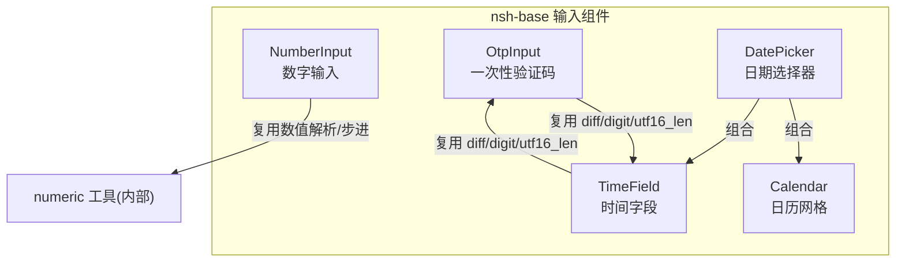
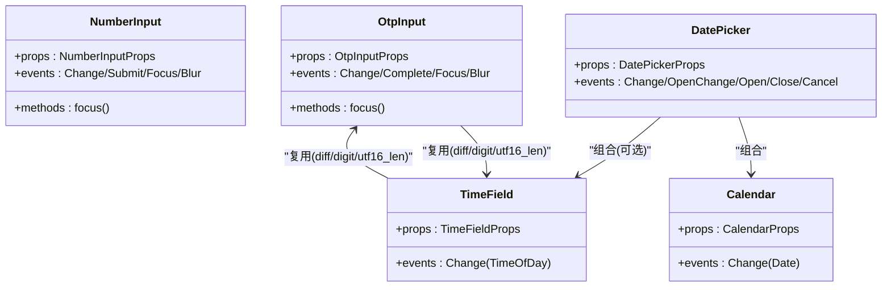
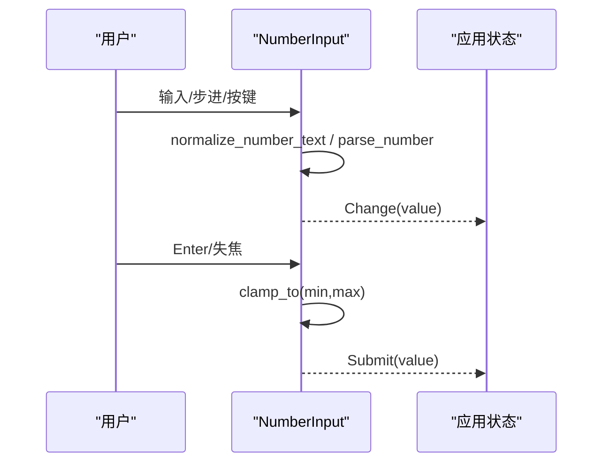
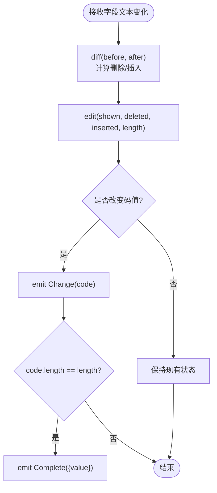
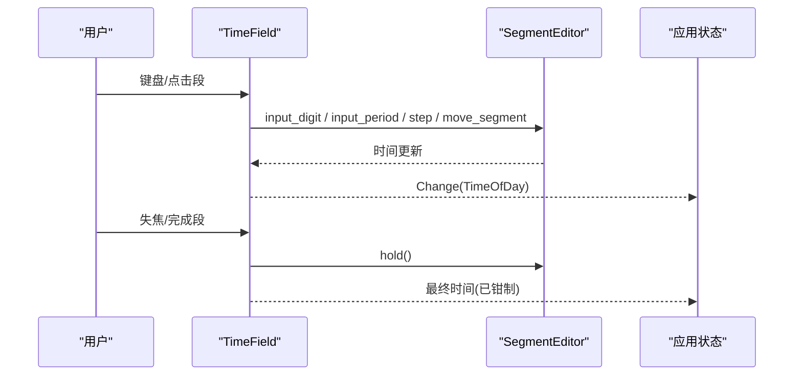
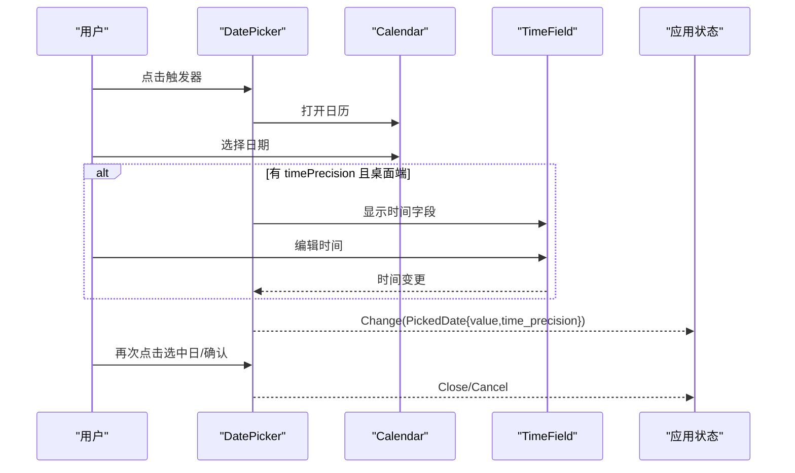
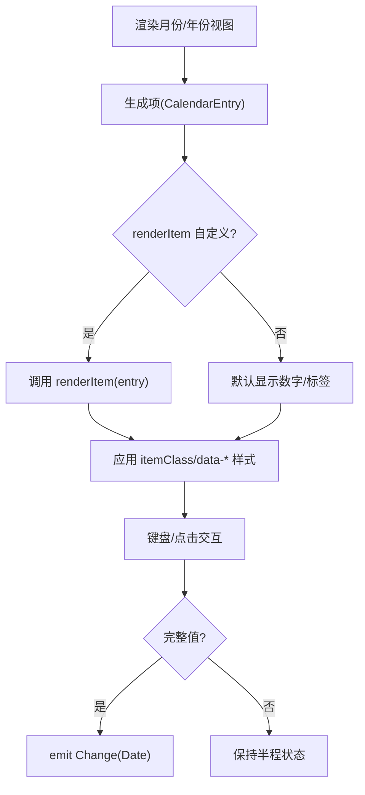
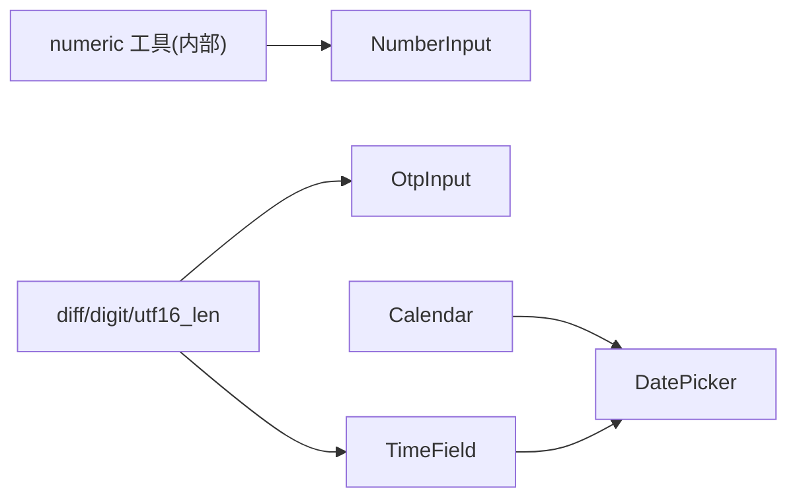

# 输入组件

<cite>
**本文引用的文件**   
- [number_input.rs](file://crates/nsh-base/src/number_input.rs)
- [otp_input.rs](file://crates/nsh-base/src/otp_input.rs)
- [time_field.rs](file://crates/nsh-base/src/time_field.rs)
- [date_picker.rs](file://crates/nsh-base/src/date_picker.rs)
- [calendar.rs](file://crates/nsh-base/src/calendar.rs)
</cite>

## 目录
1. [简介](#简介)
2. [项目结构](#项目结构)
3. [核心组件](#核心组件)
4. [架构总览](#架构总览)
5. [详细组件分析](#详细组件分析)
6. [依赖关系分析](#依赖关系分析)
7. [性能与可访问性](#性能与可访问性)
8. [故障排查指南](#故障排查指南)
9. [结论](#结论)
10. [附录：使用场景与最佳实践](#附录使用场景与最佳实践)

## 简介
本文件为 NSH 框架的输入类组件提供完整的 API 参考与实现说明，覆盖以下组件：
- NumberInput（数字输入）
- OtpInput（一次性验证码输入）
- TimeField（时间字段）
- DatePicker（日期选择器）
- Calendar（日历网格）

文档重点包括：
- 文本输入验证、格式化与国际化支持
- 数据绑定（受控/非受控）、状态同步与错误处理
- 用户反馈机制（焦点、提交、完成事件）
- 表单集成模式、自定义验证规则与键盘处理
- 移动端键盘适配、输入法支持与手势操作
- 常见使用场景与最佳实践

## 项目结构
这些输入组件位于 nsh-base 包中，采用“行为与外观分离”的设计：组件负责编辑逻辑、校验与可访问性，外观通过 Tailwind 类名与内联样式定制。

图表来源
- [number_input.rs:1-14](file://crates/nsh-base/src/number_input.rs#L1-L14)
- [otp_input.rs:1-37](file://crates/nsh-base/src/otp_input.rs#L1-L37)
- [time_field.rs:1-38](file://crates/nsh-base/src/time_field.rs#L1-L38)
- [date_picker.rs:1-42](file://crates/nsh-base/src/date_picker.rs#L1-L42)
- [calendar.rs:1-60](file://crates/nsh-base/src/calendar.rs#L1-L60)

章节来源
- [number_input.rs:1-14](file://crates/nsh-base/src/number_input.rs#L1-L14)
- [otp_input.rs:1-37](file://crates/nsh-base/src/otp_input.rs#L1-L37)
- [time_field.rs:1-38](file://crates/nsh-base/src/time_field.rs#L1-L38)
- [date_picker.rs:1-42](file://crates/nsh-base/src/date_picker.rs#L1-L42)
- [calendar.rs:1-60](file://crates/nsh-base/src/calendar.rs#L1-L60)

## 核心组件
本节概述各组件的职责、关键属性、事件与方法，以及平台行为差异。

- NumberInput
  - 用途：数值输入，支持步进按钮与键盘方向键；无自带外观。
  - 关键属性：value/defaultValue、min/max、step、disabled、readonly、placeholder、accessibility_label、controls_right、input_class/style、increment/decrement 按钮类名/样式/插槽、prefix/suffix。
  - 事件：Change(value)、Submit(value)、Focus、Blur。
  - 方法：focus()。
  - 平台行为：根据 min 是否非负自动切换移动端键盘类型（小数键盘或数字+标点）。

- OtpInput
  - 用途：固定长度的数字验证码输入，单元格布局，支持分组。
  - 关键属性：length、value/defaultValue、masked、disabled、groups、accessibility_label、cell_class/style、group_class/style、caret_class/style。
  - 事件：Change(code)、Complete({ value })、Focus、Blur。
  - 方法：focus()。
  - 平台行为：原生单文本字段承载输入法、粘贴、系统验证码自动填充；iOS/Android 自动填充可用。

- TimeField
  - 用途：按段编辑的时间（时、分、秒、AM/PM），支持 24 小时与 12 小时制。
  - 关键属性：value/defaultValue、min/max、precision、hour_cycle、disabled、accessibility_label、segment_class/style、separator_class/style、render_segment。
  - 事件：Change(TimeOfDay)。
  - 平台行为：透明原生字段承载键盘；Tab/Shift+Tab 在段间移动；Up/Down 步进并回绕；a/p 切换 AM/PM。

- DatePicker
  - 用途：从弹出层中的日历选择日期或范围，可选时间字段。
  - 关键属性：value(default_value)/range/open(default_open)/disabled/accessibility_label/date_format/time_precision/hour_cycle/default_time/cleanable/presets/number_of_months/first_day_of_week/disabled_matcher/year_range/placement/align/offset/margin 及大量子部件样式与渲染回调。
  - 事件：Change(PickedDate)、OpenChange(open, reason)、Open、Close、Cancel。
  - 平台行为：桌面端下拉弹出，移动端底部 Sheet；带 timePrecision 时在桌面端选日不关闭，移动端点击即关闭。

- Calendar
  - 用途：月份网格，支持单选/范围、禁用匹配器、年视图翻页等。
  - 关键属性：value(default_value)/range/number_of_months/first_day_of_week/disabled_matcher/year_range/accessibility labels/header/body/month/row/item 样式与 render_item。
  - 事件：Change(Date)。
  - 平台行为：键盘导航（箭头/Home/End/Page Up/Down/Return/Space），终端下以字符形式呈现。

章节来源
- [number_input.rs:15-113](file://crates/nsh-base/src/number_input.rs#L15-L113)
- [otp_input.rs:57-147](file://crates/nsh-base/src/otp_input.rs#L57-L147)
- [time_field.rs:39-145](file://crates/nsh-base/src/time_field.rs#L39-L145)
- [date_picker.rs:319-536](file://crates/nsh-base/src/date_picker.rs#L319-L536)
- [calendar.rs:574-653](file://crates/nsh-base/src/calendar.rs#L574-L653)

## 架构总览
输入组件统一遵循“受控/非受控值 + 事件驱动 + 可访问性”的架构。

图表来源
- [number_input.rs:374-412](file://crates/nsh-base/src/number_input.rs#L374-L412)
- [otp_input.rs:254-273](file://crates/nsh-base/src/otp_input.rs#L254-L273)
- [time_field.rs:398-451](file://crates/nsh-base/src/time_field.rs#L398-L451)
- [date_picker.rs:563-536](file://crates/nsh-base/src/date_picker.rs#L563-L536)
- [calendar.rs:574-653](file://crates/nsh-base/src/calendar.rs#L574-L653)

## 详细组件分析

### NumberInput（数字输入）
- 数据模型与校验
  - 值类型为 f64，支持 null 表示空。
  - min/max 边界约束；step 步进步长；非正数 step 回退为 1。
  - 文本归一化与解析：仅接受数字相关字符，非法输入回滚到上次有效文本。
- 交互与键盘
  - 方向键与 PageUp/PageDown 步进；按住重复。
  - 屏幕阅读器支持 Spinbutton 角色与 increment/decrement 动作。
- 受控与非受控
  - 传入 value 即为受控；否则使用 defaultValue 初始化并维护内部 held 值。
  - 变更通过 Change 上报；Enter/失焦时进行 commit 并触发 Submit。
- 移动端键盘
  - 当 min >= 0 时使用小数键盘，否则使用数字+标点键盘。
- 可访问性
  - accessibility_label、accessibility_value（含 now/min/max/text）。

图表来源
- [number_input.rs:248-329](file://crates/nsh-base/src/number_input.rs#L248-L329)
- [number_input.rs:417-459](file://crates/nsh-base/src/number_input.rs#L417-L459)

章节来源
- [number_input.rs:15-113](file://crates/nsh-base/src/number_input.rs#L15-L113)
- [number_input.rs:168-360](file://crates/nsh-base/src/number_input.rs#L168-L360)
- [number_input.rs:374-522](file://crates/nsh-base/src/number_input.rs#L374-L522)

### OtpInput（一次性验证码输入）
- 数据模型与校验
  - 固定长度数字字符串；全角数字映射为 ASCII；非数字丢弃。
  - 粘贴/自动填充：一次超过 length 的数字串替换前 length 位。
- 交互与键盘
  - 光标始终保持在末尾；Backspace 删除末位；支持系统验证码自动填充。
- 受控与非受控
  - 传入 value 即为受控；否则维护 own code。
  - 变更通过 Change 上报；填满 length 后触发 Complete。
- 视觉与可访问性
  - masked 模式下显示圆点；单元格 data-filled 标记；聚焦态闪烁光标。
  - 隐藏单元格，由原生字段向读屏器报告代码。

图表来源
- [otp_input.rs:307-358](file://crates/nsh-base/src/otp_input.rs#L307-L358)
- [otp_input.rs:597-628](file://crates/nsh-base/src/otp_input.rs#L597-L628)

章节来源
- [otp_input.rs:57-147](file://crates/nsh-base/src/otp_input.rs#L57-L147)
- [otp_input.rs:254-473](file://crates/nsh-base/src/otp_input.rs#L254-L473)
- [otp_input.rs:575-701](file://crates/nsh-base/src/otp_input.rs#L575-L701)

### TimeField（时间字段）
- 数据模型与校验
  - 值类型 TimeOfDay（底层 NaiveTime），支持 HH:MM 或 HH:MM:SS。
  - precision 控制精度；hour_cycle 控制 24/12 小时制。
  - min/max 边界约束；步进或输入完成后钳制到范围。
- 交互与键盘
  - 段级编辑：Up/Down 步进并回绕；Left/Right/Tab/Shift+Tab 在段间移动。
  - 两位缓冲输入：输入第二位后自动跳到下一段；a/p 切换 AM/PM。
  - Backspace/Delete 重置当前段。
- 受控与非受控
  - 传入 value 即为受控；否则维护内部时间。
  - 变更通过 Change 上报。
- 可访问性
  - optional_label 用于读屏；段落内容通过原生字段报告。

图表来源
- [time_field.rs:166-396](file://crates/nsh-base/src/time_field.rs#L166-L396)
- [time_field.rs:555-687](file://crates/nsh-base/src/time_field.rs#L555-L687)

章节来源
- [time_field.rs:39-145](file://crates/nsh-base/src/time_field.rs#L39-L145)
- [time_field.rs:398-451](file://crates/nsh-base/src/time_field.rs#L398-L451)
- [time_field.rs:486-719](file://crates/nsh-base/src/time_field.rs#L486-L719)

### DatePicker（日期选择器）
- 数据模型与校验
  - 值类型 DateTime：Single 或 Range；ISO 日期或 datetime-local 格式。
  - timePrecision 控制是否显示时间字段；default_time 为无时间的日期补默认时间。
- 交互与弹出层
  - 桌面端下拉弹出；移动端底部 Sheet。
  - 带 timePrecision 时，桌面端选中日期后保持打开以便编辑时间；移动端点击即关闭。
  - presets 快捷设置；cleanable 清除按钮；Delete/Backspace 清空。
- 组合能力
  - 组合 Calendar 与 TimeField；所有 Calendar/TimeField 样式与渲染回调透传。
- 可访问性
  - trigger 作为 combobox；date_format 控制读屏展示格式。

图表来源
- [date_picker.rs:563-800](file://crates/nsh-base/src/date_picker.rs#L563-L800)

章节来源
- [date_picker.rs:44-215](file://crates/nsh-base/src/date_picker.rs#L44-L215)
- [date_picker.rs:319-536](file://crates/nsh-base/src/date_picker.rs#L319-L536)
- [date_picker.rs:563-800](file://crates/nsh-base/src/date_picker.rs#L563-L800)

### Calendar（日历网格）
- 数据模型与校验
  - 值类型 Date：Single 或 Range；ISO 日期或数组。
  - disabled_matcher 支持星期、区间、范围或 JS 函数异步判定。
- 交互与键盘
  - Tab 停在选中日；箭头移动一天或一周；Home/End 移动到周首尾；PageUp/Down 翻页（Shift 年翻页）；Return/Space 选择。
  - 禁用日不可聚焦，移动时跳过。
- 渲染与样式
  - renderItem 自定义项；itemClass 暴露 selected/disabled/focus-visible 与 data-* 属性。
  - 终端模式以字符形式呈现。
- 可访问性
  - previous_accessibility_label/next_accessibility_label 控制读屏文案。

图表来源
- [calendar.rs:547-653](file://crates/nsh-base/src/calendar.rs#L547-L653)

章节来源
- [calendar.rs:99-252](file://crates/nsh-base/src/calendar.rs#L99-L252)
- [calendar.rs:291-469](file://crates/nsh-base/src/calendar.rs#L291-L469)
- [calendar.rs:574-653](file://crates/nsh-base/src/calendar.rs#L574-L653)

## 依赖关系分析
- NumberInput 依赖数值解析与步进工具（internal numeric），负责文本归一化、解析、步进与边界钳制。
- OtpInput 与 TimeField 共享 diff/digit/utf16_len 等工具函数，保证输入差异计算与 UTF-16 选择一致性。
- DatePicker 组合 Calendar 与 TimeField，并将两者的样式与渲染回调透传。
- Calendar 提供日期基础能力，被 DatePicker 复用。

图表来源
- [number_input.rs:1-14](file://crates/nsh-base/src/number_input.rs#L1-L14)
- [otp_input.rs:1-37](file://crates/nsh-base/src/otp_input.rs#L1-L37)
- [time_field.rs:1-38](file://crates/nsh-base/src/time_field.rs#L1-L38)
- [date_picker.rs:1-42](file://crates/nsh-base/src/date_picker.rs#L1-L42)

章节来源
- [number_input.rs:1-14](file://crates/nsh-base/src/number_input.rs#L1-L14)
- [otp_input.rs:1-37](file://crates/nsh-base/src/otp_input.rs#L1-L37)
- [time_field.rs:1-38](file://crates/nsh-base/src/time_field.rs#L1-L38)
- [date_picker.rs:1-42](file://crates/nsh-base/src/date_picker.rs#L1-L42)

## 性能与可访问性
- 性能
  - NumberInput/OtpInput/TimeField 均避免频繁重绘：仅在值变化或状态变化时更新视图；OtpInput 使用原生动画减少引擎开销。
  - Calendar 对每个项只绘制一次，状态变化不触发重新绘制。
- 可访问性
  - NumberInput：Spinbutton 角色、increment/decrement 动作、accessibility_value。
  - OtpInput：隐藏单元格，原生字段向读屏器报告代码；masked 模式屏蔽建议。
  - TimeField：optional_label 与原生字段报告时间。
  - DatePicker：trigger 作为 combobox，date_format 控制读屏展示。
  - Calendar：previous/next 读屏标签，data-* 属性辅助样式与语义。

章节来源
- [number_input.rs:417-459](file://crates/nsh-base/src/number_input.rs#L417-L459)
- [otp_input.rs:427-471](file://crates/nsh-base/src/otp_input.rs#L427-L471)
- [time_field.rs:659-687](file://crates/nsh-base/src/time_field.rs#L659-L687)
- [date_picker.rs:538-545](file://crates/nsh-base/src/date_picker.rs#L538-L545)
- [calendar.rs:600-643](file://crates/nsh-base/src/calendar.rs#L600-L643)

## 故障排查指南
- 数字输入异常
  - 现象：输入非数字字符后值未更新。
  - 原因：文本归一化失败，回滚到上次有效文本。
  - 处理：检查 min/max/step 配置；确保 value 与 onChange 一致。
  - 参考路径：[number_input.rs:248-329](file://crates/nsh-base/src/number_input.rs#L248-L329)
- 验证码输入错位
  - 现象：粘贴后光标位置异常。
  - 原因：UTF-16 选择长度不一致。
  - 处理：确保使用 utf16_len 设置 selection。
  - 参考路径：[otp_input.rs:630-633](file://crates/nsh-base/src/otp_input.rs#L630-L633)
- 时间字段步进越界
  - 现象：步进后时间未按预期回绕或钳制。
  - 原因：min/max 配置无效（max < min）或 precision 截断。
  - 处理：校验 min/max 顺序；确认 precision 设置。
  - 参考路径：[time_field.rs:194-211](file://crates/nsh-base/src/time_field.rs#L194-L211)
- 日期选择器弹出层不关闭
  - 现象：桌面端选中日期后弹出层未关闭。
  - 原因：启用 timePrecision 时桌面端需二次确认。
  - 处理：再次点击选中日或编辑时间后确认。
  - 参考路径：[date_picker.rs:754-773](file://crates/nsh-base/src/date_picker.rs#L754-L773)
- 日历禁用日期不生效
  - 现象：某些日期仍可点击。
  - 原因：JS 函数返回延迟或未缓存答案。
  - 处理：确保 Matcher.Js 纯函数且稳定引用。
  - 参考路径：[calendar.rs:338-352](file://crates/nsh-base/src/calendar.rs#L338-L352)

章节来源
- [number_input.rs:248-329](file://crates/nsh-base/src/number_input.rs#L248-L329)
- [otp_input.rs:630-633](file://crates/nsh-base/src/otp_input.rs#L630-L633)
- [time_field.rs:194-211](file://crates/nsh-base/src/time_field.rs#L194-L211)
- [date_picker.rs:754-773](file://crates/nsh-base/src/date_picker.rs#L754-L773)
- [calendar.rs:338-352](file://crates/nsh-base/src/calendar.rs#L338-L352)

## 结论
NSH 输入组件以统一的受控/非受控模式、事件驱动与可访问性为核心，结合平台特性（键盘、输入法、自动填充）提供一致的跨端体验。NumberInput 专注数值输入与步进，OtpInput 专注验证码输入与自动填充，TimeField 提供段级时间编辑，DatePicker 组合 Calendar 与 TimeField 形成完整日期时间选择方案，Calendar 则提供灵活的日期网格与禁用策略。通过 Tailwind 类名与内联样式，开发者可完全定制外观，同时保持稳定的行为与可访问性。

## 附录：使用场景与最佳实践
- 表单集成模式
  - 受控模式：将 value 与 onChange 绑定到表单状态，确保每次变更都更新外部状态。
  - 非受控模式：使用 defaultValue 初始化，组件内部维护状态，适合简单场景。
- 自定义验证规则
  - NumberInput：利用 min/max/step 限制范围与步长；在 onChange 中进行业务校验。
  - OtpInput：在 onComplete 中提交验证码；必要时在 onChange 中做长度与格式校验。
  - TimeField：使用 min/max 限制时间段；precision 控制精度。
  - DatePicker：使用 disabled_matcher 禁用特定日期；presets 提供快捷选项。
- 键盘处理
  - NumberInput：方向键与 PageUp/PageDown 步进；Enter 提交。
  - OtpInput：光标始终在末尾；Backspace 删除末位。
  - TimeField：Up/Down 步进；Left/Right/Tab/Shift+Tab 移动段；a/p 切换 AM/PM。
  - DatePicker：Enter 打开/关闭；Delete/Backspace 清空。
  - Calendar：箭头/Home/End/PageUp/Down/Return/Space 导航与选择。
- 移动端适配
  - NumberInput：根据 min 自动选择小数键盘或数字+标点键盘。
  - OtpInput：启用系统验证码自动填充；masked 模式屏蔽建议。
  - TimeField：数字键盘；段间移动与步进。
  - DatePicker：移动端底部 Sheet；点击日期即关闭。
- 可访问性
  - 为所有输入组件设置 accessibility_label。
  - NumberInput 使用 Spinbutton 角色与 increment/decrement 动作。
  - DatePicker 使用 date_format 控制读屏展示。
  - Calendar 提供 previous/next 读屏标签。

章节来源
- [number_input.rs:15-113](file://crates/nsh-base/src/number_input.rs#L15-L113)
- [otp_input.rs:57-147](file://crates/nsh-base/src/otp_input.rs#L57-L147)
- [time_field.rs:398-451](file://crates/nsh-base/src/time_field.rs#L398-L451)
- [date_picker.rs:319-536](file://crates/nsh-base/src/date_picker.rs#L319-L536)
- [calendar.rs:574-653](file://crates/nsh-base/src/calendar.rs#L574-L653)