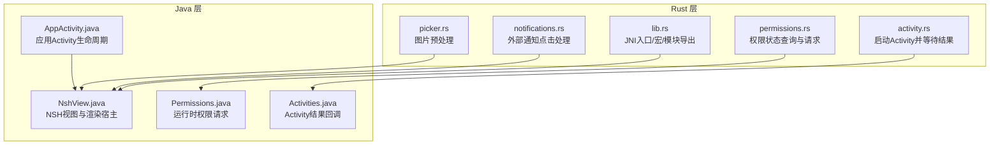
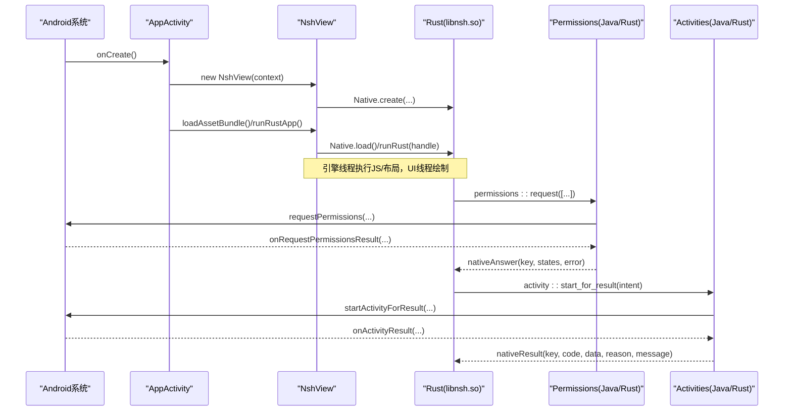
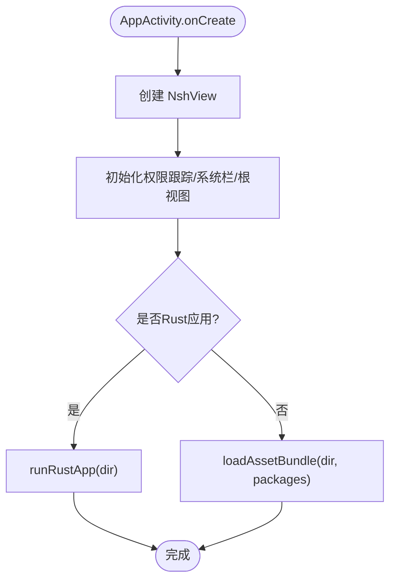
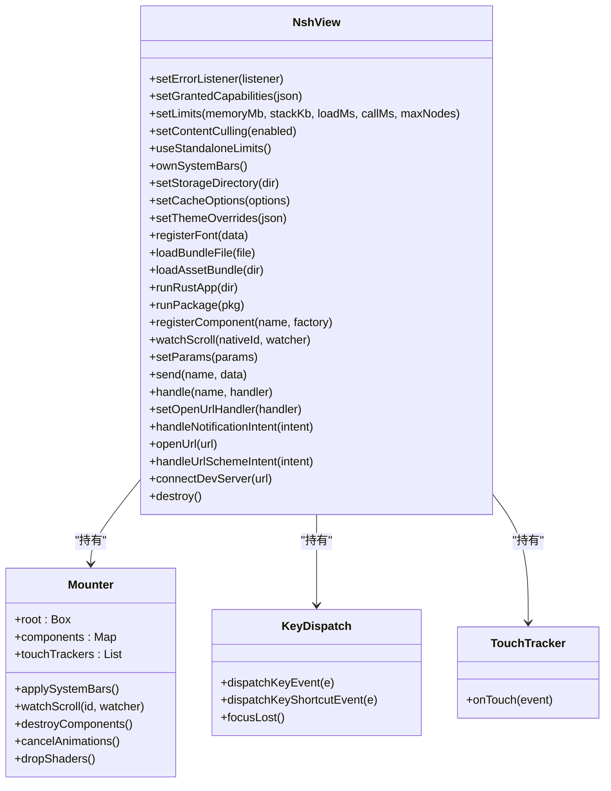
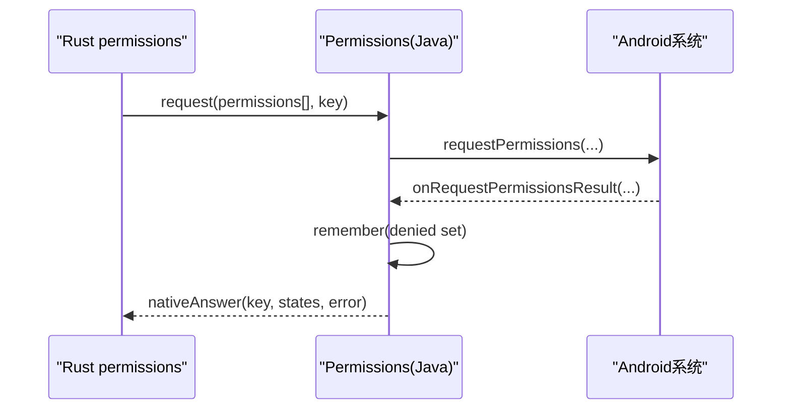
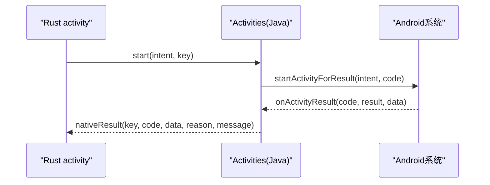
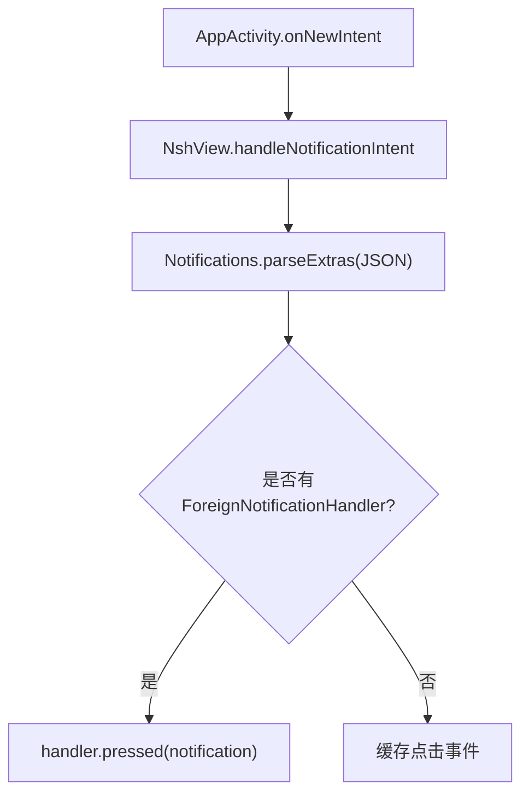
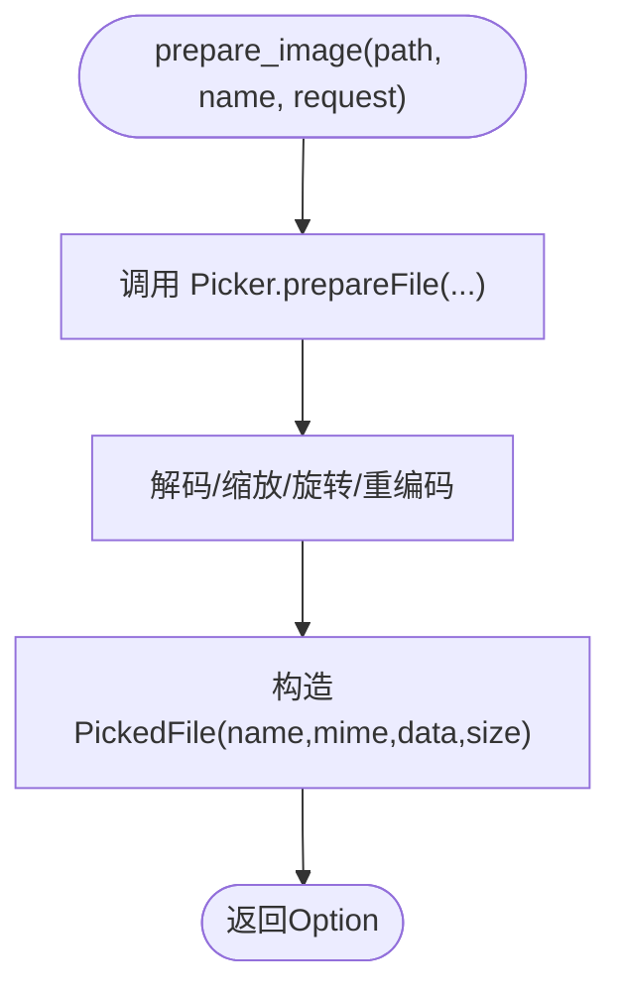
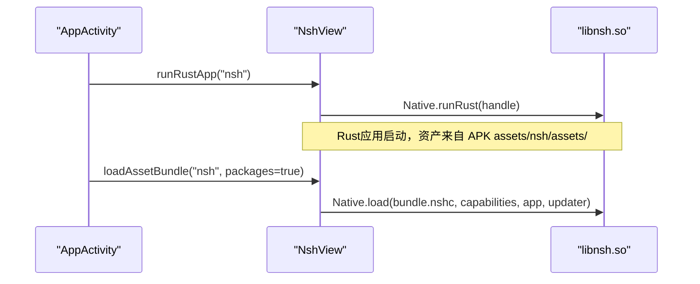
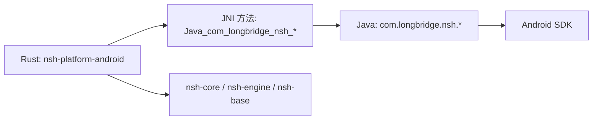

# Android平台API

<cite>
**本文引用的文件**   
- [lib.rs](file://crates/nsh-platform-android/src/lib.rs)
- [activity.rs](file://crates/nsh-platform-android/src/activity.rs)
- [permissions.rs](file://crates/nsh-platform-android/src/permissions.rs)
- [notifications.rs](file://crates/nsh-platform-android/src/notifications.rs)
- [picker.rs](file://crates/nsh-platform-android/src/picker.rs)
- [AppActivity.java](file://crates/nsh-platform-android/java/com/longbridge/nsh/AppActivity.java)
- [NshView.java](file://crates/nsh-platform-android/java/com/longbridge/nsh/NshView.java)
- [Permissions.java](file://crates/nsh-platform-android/java/com/longbridge/nsh/Permissions.java)
- [Activities.java](file://crates/nsh-platform-android/java/com/longbridge/nsh/Activities.java)
</cite>

## 目录
1. [简介](#简介)
2. [项目结构](#项目结构)
3. [核心组件](#核心组件)
4. [架构总览](#架构总览)
5. [详细组件分析](#详细组件分析)
6. [依赖关系分析](#依赖关系分析)
7. [性能与运行时特性](#性能与运行时特性)
8. [故障排查指南](#故障排查指南)
9. [结论](#结论)
10. [附录：构建、签名与发布](#附录构建签名与发布)

## 简介
本文件为 NSH 框架在 Android 平台的 API 参考文档，聚焦于基于 Android Views 的原生 UI 实现与系统能力桥接。内容涵盖 Activity 生命周期、View 系统集成、权限管理、文件存储、通知系统、图片选择器、以及应用启动与加载流程。同时给出 Rust 侧与 Java/Kotlin 侧的交互方式、生命周期对应关系，以及构建、签名与发布的配置说明。

## 项目结构
Android 平台后端由 Rust 与 Java 两部分组成：
- Rust 侧（nsh-platform-android）：提供 JNI 绑定、文本排版、动画驱动、权限与活动结果回调、通知处理、图片预处理等。
- Java 侧（com.longbridge.nsh）：承载 Activity、View 树、Mounter、权限请求、活动结果、通知分发、资源与网络访问等。

图表来源
- [lib.rs:1-187](file://crates/nsh-platform-android/src/lib.rs#L1-L187)
- [activity.rs:1-313](file://crates/nsh-platform-android/src/activity.rs#L1-L313)
- [permissions.rs:1-301](file://crates/nsh-platform-android/src/permissions.rs#L1-L301)
- [notifications.rs:1-264](file://crates/nsh-platform-android/src/notifications.rs#L1-L264)
- [picker.rs:1-68](file://crates/nsh-platform-android/src/picker.rs#L1-L68)
- [AppActivity.java:1-91](file://crates/nsh-platform-android/java/com/longbridge/nsh/AppActivity.java#L1-L91)
- [NshView.java:1-800](file://crates/nsh-platform-android/java/com/longbridge/nsh/NshView.java#L1-L800)
- [Permissions.java:1-277](file://crates/nsh-platform-android/java/com/longbridge/nsh/Permissions.java#L1-L277)
- [Activities.java:1-166](file://crates/nsh-platform-android/java/com/longbridge/nsh/Activities.java#L1-L166)

章节来源
- [lib.rs:1-187](file://crates/nsh-platform-android/src/lib.rs#L1-L187)

## 核心组件
- AppActivity：打包应用的入口 Activity，负责创建 NshView、处理分享与通知意图、回退键、销毁清理等。
- NshView：NSH 应用运行容器，负责 JS 引擎加载、布局与渲染、输入事件、字体与主题注入、URL Scheme 与 Host 调用桥接、缓存与存储路径设置等。
- Permissions（Rust + Java）：封装 Android 运行时权限的状态查询与用户授权请求，通过保留 Fragment 跨配置变更排队处理。
- Activities（Rust + Java）：从 Rust 发起需要返回结果的 Activity 调用，并通过保留 Fragment 接收结果回调。
- notifications（Rust）：处理非 NSH 自身展示的通知点击，将 Intent extras 转为 JSON 供 Rust 侧处理器消费。
- picker（Rust）：对相机输出或系统选择的图片进行缩放、格式转换、方向校正与质量重编码，返回 PickedFile。

章节来源
- [AppActivity.java:1-91](file://crates/nsh-platform-android/java/com/longbridge/nsh/AppActivity.java#L1-L91)
- [NshView.java:1-800](file://crates/nsh-platform-android/java/com/longbridge/nsh/NshView.java#L1-L800)
- [permissions.rs:1-301](file://crates/nsh-platform-android/src/permissions.rs#L1-L301)
- [Permissions.java:1-277](file://crates/nsh-platform-android/java/com/longbridge/nsh/Permissions.java#L1-L277)
- [activity.rs:1-313](file://crates/nsh-platform-android/src/activity.rs#L1-L313)
- [Activities.java:1-166](file://crates/nsh-platform-android/java/com/longbridge/nsh/Activities.java#L1-L166)
- [notifications.rs:1-264](file://crates/nsh-platform-android/src/notifications.rs#L1-L264)
- [picker.rs:1-68](file://crates/nsh-platform-android/src/picker.rs#L1-L68)

## 架构总览
NSH 在 Android 上的运行模型采用“引擎线程 + UI 线程”双线程协作：
- 引擎线程：执行 JS 与布局计算，使用 StaticLayout 进行文本排版，将每次提交编码为紧凑字节数组，通过单次 JNI 调用交给 UI 线程。
- UI 线程：Rust 原生动画驱动（Choreographer 回调）、Selection 模型、View 挂载与绘制、输入事件分发。

图表来源
- [AppActivity.java:17-37](file://crates/nsh-platform-android/java/com/longbridge/nsh/AppActivity.java#L17-L37)
- [NshView.java:182-244](file://crates/nsh-platform-android/java/com/longbridge/nsh/NshView.java#L182-L244)
- [NshView.java:443-514](file://crates/nsh-platform-android/java/com/longbridge/nsh/NshView.java#L443-L514)
- [permissions.rs:154-185](file://crates/nsh-platform-android/src/permissions.rs#L154-L185)
- [Permissions.java:154-183](file://crates/nsh-platform-android/java/com/longbridge/nsh/Permissions.java#L154-L183)
- [activity.rs:111-140](file://crates/nsh-platform-android/src/activity.rs#L111-L140)
- [Activities.java:29-47](file://crates/nsh-platform-android/java/com/longbridge/nsh/Activities.java#L29-L47)

## 详细组件分析

### Activity 生命周期与 NSH 集成
- AppActivity 在 onCreate 中创建 NshView，设置独立限制与系统栏所有权，根据是否 Rust 应用决定 runRustApp 或 loadAssetBundle。
- onNewIntent 处理通知点击、URL Scheme 与分享；onBackPressed 将回退交由 NshView 处理；onDestroy 释放资源。
- NshView 内部维护 Mounter、TouchTracker、KeyDispatch、动画与着色器帧，并在窗口尺寸变化时通知 Rust 端 resize。

图表来源
- [AppActivity.java:17-37](file://crates/nsh-platform-android/java/com/longbridge/nsh/AppActivity.java#L17-L37)
- [AppActivity.java:57-89](file://crates/nsh-platform-android/java/com/longbridge/nsh/AppActivity.java#L57-L89)
- [NshView.java:182-244](file://crates/nsh-platform-android/java/com/longbridge/nsh/NshView.java#L182-L244)
- [NshView.java:787-796](file://crates/nsh-platform-android/java/com/longbridge/nsh/NshView.java#L787-L796)

章节来源
- [AppActivity.java:1-91](file://crates/nsh-platform-android/java/com/longbridge/nsh/AppActivity.java#L1-L91)
- [NshView.java:182-244](file://crates/nsh-platform-android/java/com/longbridge/nsh/NshView.java#L182-L244)
- [NshView.java:787-796](file://crates/nsh-platform-android/java/com/longbridge/nsh/NshView.java#L787-L796)

### View 系统集成与渲染管线
- NshView 作为 FrameLayout 承载 Root Box，注册 Rust 原生组件，处理触摸、键盘、焦点、输入法动画、回退键等。
- 通过 Mounter 将 Rust 提交的布局与文本排版结果应用到 View 树；Choreographer 驱动原生动画；ShaderFrames 管理页面/对话框过渡。
- 支持 host.call/host.post、openUrl、URL Scheme、滚动监听、主题覆盖、字体注册、缓存与存储目录配置。

图表来源
- [NshView.java:182-244](file://crates/nsh-platform-android/java/com/longbridge/nsh/NshView.java#L182-L244)
- [NshView.java:318-374](file://crates/nsh-platform-android/java/com/longbridge/nsh/NshView.java#L318-L374)
- [NshView.java:443-514](file://crates/nsh-platform-android/java/com/longbridge/nsh/NshView.java#L443-L514)
- [NshView.java:544-684](file://crates/nsh-platform-android/java/com/longbridge/nsh/NshView.java#L544-L684)
- [NshView.java:718-746](file://crates/nsh-platform-android/java/com/longbridge/nsh/NshView.java#L718-L746)

章节来源
- [NshView.java:1-800](file://crates/nsh-platform-android/java/com/longbridge/nsh/NshView.java#L1-L800)

### 权限管理（Rust + Java）
- Rust 侧暴露 state/states/request 接口，用于查询权限状态与发起系统授权请求。
- Java 侧通过 Application.ActivityLifecycleCallbacks 追踪前台 Activity，并使用保留 Fragment Asker 串行化权限请求，避免配置变更丢失。
- 未声明的权限直接返回 undeclared；已拒绝且不再提示的权限标记为 denied；其余为 default。

图表来源
- [permissions.rs:154-185](file://crates/nsh-platform-android/src/permissions.rs#L154-L185)
- [Permissions.java:154-183](file://crates/nsh-platform-android/java/com/longbridge/nsh/Permissions.java#L154-L183)
- [Permissions.java:196-206](file://crates/nsh-platform-android/java/com/longbridge/nsh/Permissions.java#L196-L206)

章节来源
- [permissions.rs:1-301](file://crates/nsh-platform-android/src/permissions.rs#L1-L301)
- [Permissions.java:1-277](file://crates/nsh-platform-android/java/com/longbridge/nsh/Permissions.java#L1-L277)

### 启动其他 Activity 并获取结果（Rust + Java）
- Rust 侧 start_for_result 返回 Future，等待 Java 侧 Activities.Results.onActivityResult 回调。
- Java 侧通过保留 Fragment Results 管理多个待处理请求，按 key 映射到 Rust 侧通道。
- 支持 can_start 检测 Intent 是否可被安装的应用处理；output_file 生成临时输出文件与 content URI。

图表来源
- [activity.rs:111-140](file://crates/nsh-platform-android/src/activity.rs#L111-L140)
- [Activities.java:29-47](file://crates/nsh-platform-android/java/com/longbridge/nsh/Activities.java#L29-L47)
- [Activities.java:118-163](file://crates/nsh-platform-android/java/com/longbridge/nsh/Activities.java#L118-L163)

章节来源
- [activity.rs:1-313](file://crates/nsh-platform-android/src/activity.rs#L1-L313)
- [Activities.java:1-166](file://crates/nsh-platform-android/java/com/longbridge/nsh/Activities.java#L1-L166)

### 通知系统与外部 Intent 处理
- Rust 侧 set_foreign_handler 设置外部通知处理器，所有未由 NSH 展示的通知点击都会转发给该处理器。
- Java 侧 AppActivity.handleNotificationIntent 与 handleUrlSchemeIntent 将 Intent 分发给 NshView，再由 Notifications 解析 extras 为 JSON。
- 若处理器尚未设置，点击事件会被缓存，直到处理器就绪后回放。

图表来源
- [AppActivity.java:57-75](file://crates/nsh-platform-android/java/com/longbridge/nsh/AppActivity.java#L57-L75)
- [NshView.java:648-684](file://crates/nsh-platform-android/java/com/longbridge/nsh/NshView.java#L648-L684)
- [notifications.rs:95-122](file://crates/nsh-platform-android/src/notifications.rs#L95-L122)

章节来源
- [notifications.rs:1-264](file://crates/nsh-platform-android/src/notifications.rs#L1-L264)
- [AppActivity.java:57-75](file://crates/nsh-platform-android/java/com/longbridge/nsh/AppActivity.java#L57-L75)
- [NshView.java:648-684](file://crates/nsh-platform-android/java/com/longbridge/nsh/NshView.java#L648-L684)

### 图片选择与预处理（Picker）
- Rust 侧 prepare_image 将相机输出或系统选择的图片按 PickRequest 配置进行缩放、格式转换（HEIC→JPEG）、方向校正与质量重编码，返回 PickedFile（含名称、MIME、字节数据与尺寸）。
- Java 侧 Picker.prepareFile 完成实际解码与压缩，Rust 侧仅做参数传递与结果解析。

图表来源
- [picker.rs:26-66](file://crates/nsh-platform-android/src/picker.rs#L26-L66)

章节来源
- [picker.rs:1-68](file://crates/nsh-platform-android/src/picker.rs#L1-L68)

### 应用启动与加载流程
- Rust 侧 lib.rs 暴露 main! 宏，定义 Java_com_longbridge_nsh_Native_runRust，供 AppActivity 调用以运行 Rust 应用。
- NshView 支持多种加载方式：本地 bundle.js、APK assets 中的 bundle.nshc、Rust 应用、验证后的签名包、开发模式连接 dev server。

图表来源
- [lib.rs:175-186](file://crates/nsh-platform-android/src/lib.rs#L175-L186)
- [AppActivity.java:39-48](file://crates/nsh-platform-android/java/com/longbridge/nsh/AppActivity.java#L39-L48)
- [NshView.java:473-514](file://crates/nsh-platform-android/java/com/longbridge/nsh/NshView.java#L473-L514)

章节来源
- [lib.rs:175-186](file://crates/nsh-platform-android/src/lib.rs#L175-L186)
- [AppActivity.java:39-48](file://crates/nsh-platform-android/java/com/longbridge/nsh/AppActivity.java#L39-L48)
- [NshView.java:473-514](file://crates/nsh-platform-android/java/com/longbridge/nsh/NshView.java#L473-L514)

## 依赖关系分析
- Rust 侧依赖 jni、ndk-context、tokio(sync)、nsh-core、nsh-engine、nsh-base 等；按需启用 websocket、updater、svg 等特性。
- Java 侧依赖 Android SDK 各类系统服务（Activity、FragmentManager、PackageManager、Looper、Choreographer 等），并与 Rust 通过 JNI 方法名约定通信。

图表来源
- [Cargo.toml:64-83](file://crates/nsh-platform-android/Cargo.toml#L64-L83)
- [lib.rs:161-169](file://crates/nsh-platform-android/src/lib.rs#L161-L169)

章节来源
- [Cargo.toml:1-83](file://crates/nsh-platform-android/Cargo.toml#L1-L83)
- [lib.rs:161-169](file://crates/nsh-platform-android/src/lib.rs#L161-L169)

## 性能与运行时特性
- 渲染管线：引擎线程计算布局与文本排版，UI 线程一次性挂载批量更新，减少 JNI 往返。
- 动画驱动：Choreographer 回调驱动原生动画，改变值以紧凑数组形式回传。
- 输入与焦点：NshView 统一管理触摸、键盘、输入法动画与焦点迁移，避免系统默认行为干扰。
- 资源与缓存：支持自定义 storage 与 cache 目录，控制图片缓存大小；支持主题覆盖与字体注册，提升多语言与品牌适配效率。

[本节为通用指导，不直接分析具体文件]

## 故障排查指南
- 权限请求失败：检查是否在 NshView 创建之后发起；确认权限已在 manifest 声明；关注 denied 集合与 shouldShowRequestPermissionRationale 的行为。
- Activity 结果未返回：确保有前台 Activity；检查 Intent 是否能被安装应用处理；留意 Activities.Results 的生命周期与 isStateSaved 的限制。
- 通知点击无响应：确认 set_foreign_handler 已设置；检查 Extras 是否为合法 JSON 对象；核对 AppActivity 是否正确调用 handleNotificationIntent。
- 图片预处理失败：确认路径有效且可读；检查 PickRequest 的 max_dimension 与 quality 配置；注意 HEIC 转 JPEG 与方向校正。

章节来源
- [permissions.rs:118-185](file://crates/nsh-platform-android/src/permissions.rs#L118-L185)
- [Permissions.java:114-183](file://crates/nsh-platform-android/java/com/longbridge/nsh/Permissions.java#L114-L183)
- [activity.rs:142-162](file://crates/nsh-platform-android/src/activity.rs#L142-L162)
- [Activities.java:49-75](file://crates/nsh-platform-android/java/com/longbridge/nsh/Activities.java#L49-L75)
- [notifications.rs:129-145](file://crates/nsh-platform-android/src/notifications.rs#L129-L145)
- [picker.rs:26-66](file://crates/nsh-platform-android/src/picker.rs#L26-L66)

## 结论
NSH 在 Android 平台通过 Rust 与 Java 的双层架构，实现了高性能的 UI 渲染、稳定的系统能力桥接与完善的开发者体验。借助 NshView 与 AppActivity 的生命周期管理、Permissions 与 Activities 的可靠回调机制、以及通知与图片处理的完善支持，开发者可以高效地构建跨平台应用，并在 Android 上获得一致的用户体验。

[本节为总结性内容，不直接分析具体文件]

## 附录：构建、签名与发布
- 打包目标：
  - 使用 nsh package --target android 生成 Android 应用包，清单中会包含 com.longbridge.nsh.RUST 元数据以区分 Rust 应用与 JS 应用。
  - 对于 Rust 应用，AppActivity 会通过 runRustApp 启动；对于 JS 应用，通过 loadAssetBundle 加载 bundle.nshc。
- 签名与发布：
  - 使用 nsh sign 对产物进行签名；结合平台工具链完成上架前的校验与发布流程。
- 开发模式：
  - 使用 nsh run 或 connectDevServer 连接开发服务器，支持热重载与调试日志转发。

章节来源
- [AppActivity.java:39-48](file://crates/nsh-platform-android/java/com/longbridge/nsh/AppActivity.java#L39-L48)
- [NshView.java:473-514](file://crates/nsh-platform-android/java/com/longbridge/nsh/NshView.java#L473-L514)
- [lib.rs:175-186](file://crates/nsh-platform-android/src/lib.rs#L175-L186)