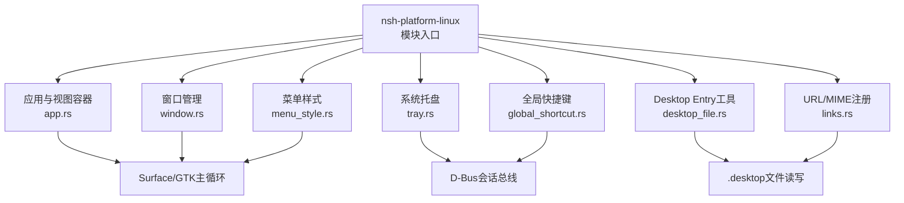
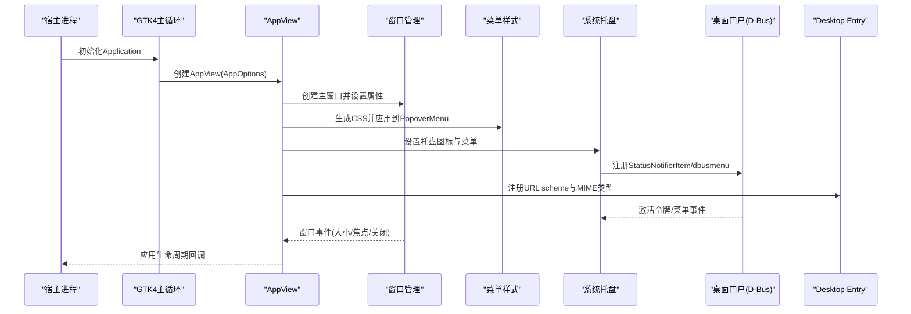
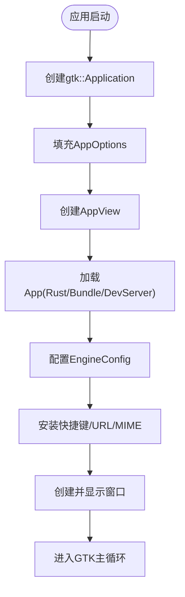
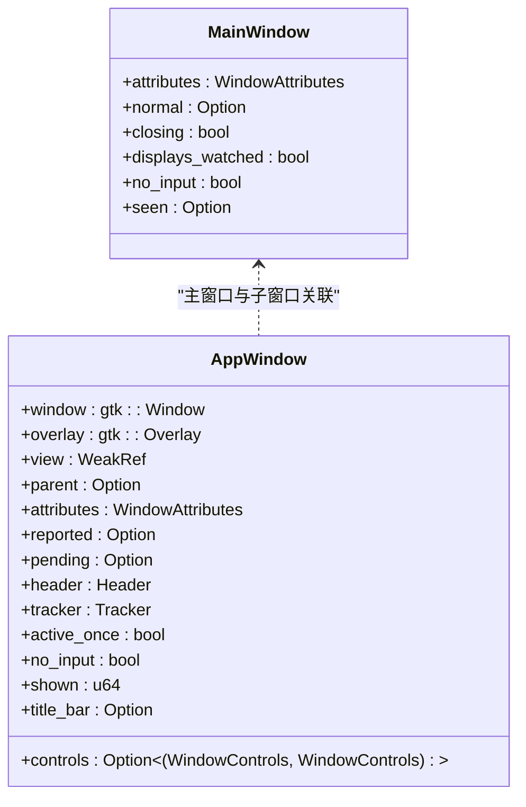
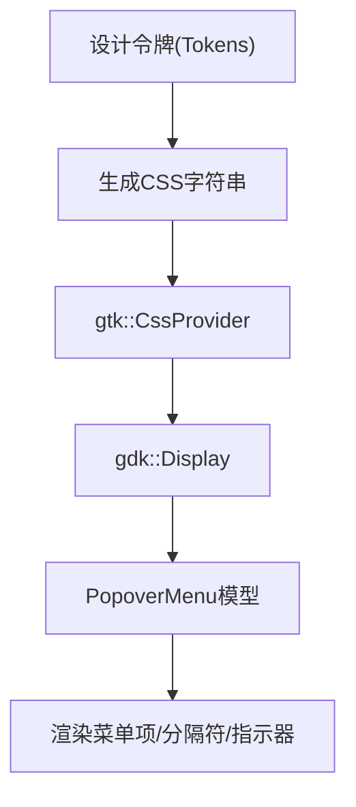
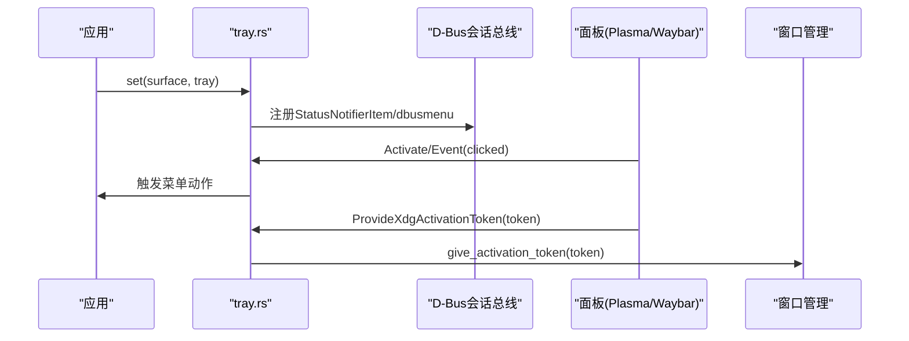
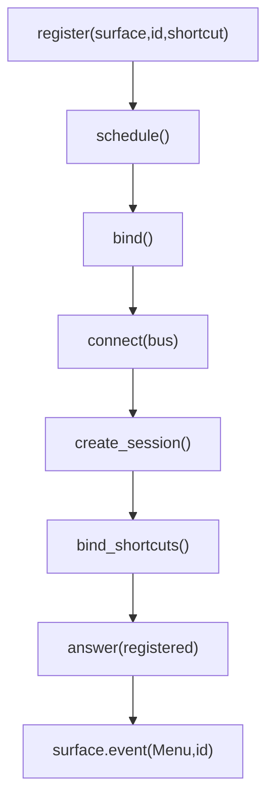
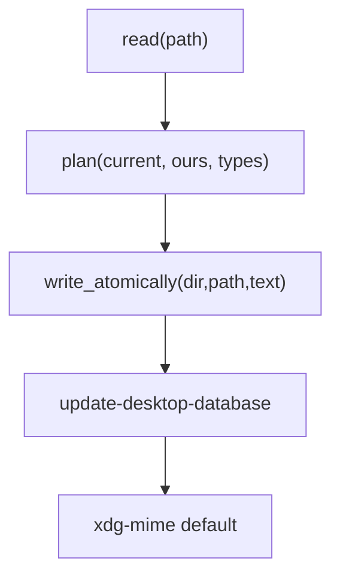
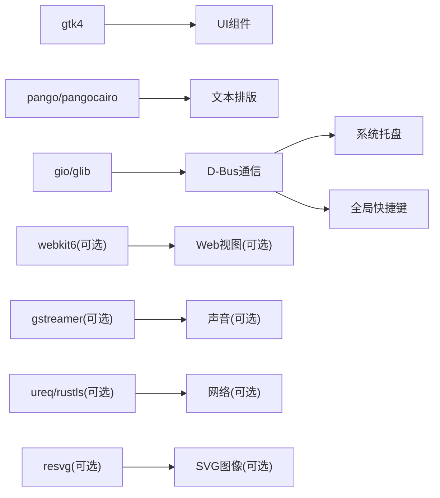

# Linux平台API

<cite>
**本文引用的文件**   
- [lib.rs](file://crates/nsh-platform-linux/src/lib.rs)
- [app.rs](file://crates/nsh-platform-linux/src/app.rs)
- [window.rs](file://crates/nsh-platform-linux/src/window.rs)
- [menu_style.rs](file://crates/nsh-platform-linux/src/menu_style.rs)
- [tray.rs](file://crates/nsh-platform-linux/src/tray.rs)
- [global_shortcut.rs](file://crates/nsh-platform-linux/src/global_shortcut.rs)
- [desktop_file.rs](file://crates/nsh-platform-linux/src/desktop_file.rs)
- [links.rs](file://crates/nsh-platform-linux/src/links.rs)
- [Cargo.toml](file://crates/nsh-platform-linux/Cargo.toml)
</cite>

## 目录
1. [简介](#简介)
2. [项目结构](#项目结构)
3. [核心组件](#核心组件)
4. [架构总览](#架构总览)
5. [详细组件分析](#详细组件分析)
6. [依赖关系分析](#依赖关系分析)
7. [性能与兼容性考虑](#性能与兼容性考虑)
8. [故障排查指南](#故障排查指南)
9. [构建、打包与分发](#构建打包与分发)
10. [结论](#结论)

## 简介
本文件面向NSH框架在Linux平台的特定API，聚焦基于GTK4的原生UI实现与桌面集成能力。内容覆盖：
- 应用启动、窗口管理、菜单系统、主题支持
- Linux特有功能：桌面环境集成、D-Bus通信、URL scheme与MIME类型注册、系统托盘、全局快捷键
- Rust侧的GTK API使用方式（以路径引用代替代码片段）
- 不同Linux桌面环境的差异性与兼容性建议
- 构建、打包与分发到主流发行版的配置说明

## 项目结构
Linux平台后端位于 `crates/nsh-platform-linux`，采用按职责划分的模块组织方式：
- 应用生命周期与视图容器：`app.rs`
- 窗口管理与主窗口状态：`window.rs`
- 菜单样式与主题映射：`menu_style.rs`
- 系统托盘与D-Bus接口：`tray.rs`
- 全局快捷键与桌面门户：`global_shortcut.rs`
- Desktop Entry解析与写入：`desktop_file.rs`
- URL scheme与MIME类型注册：`links.rs`
- 模块入口与导出：`lib.rs`
- 特性开关与依赖声明：`Cargo.toml`

图表来源
- [lib.rs:1-86](file://crates/nsh-platform-linux/src/lib.rs#L1-L86)
- [app.rs:1-120](file://crates/nsh-platform-linux/src/app.rs#L1-L120)
- [window.rs:1-60](file://crates/nsh-platform-linux/src/window.rs#L1-L60)
- [menu_style.rs:1-32](file://crates/nsh-platform-linux/src/menu_style.rs#L1-L32)
- [tray.rs:1-46](file://crates/nsh-platform-linux/src/tray.rs#L1-L46)
- [global_shortcut.rs:1-38](file://crates/nsh-platform-linux/src/global_shortcut.rs#L1-L38)
- [desktop_file.rs:1-29](file://crates/nsh-platform-linux/src/desktop_file.rs#L1-L29)
- [links.rs:1-24](file://crates/nsh-platform-linux/src/links.rs#L1-L24)

章节来源
- [lib.rs:1-86](file://crates/nsh-platform-linux/src/lib.rs#L1-L86)

## 核心组件
- AppView与应用选项：提供嵌入或独立运行的视图容器，负责引擎初始化、资源加载、环境设置、通知与登录项等。
- Window管理：封装GTK窗口生命周期、显示模式、焦点、关闭策略、激活令牌、后台运行等。
- 菜单样式：将NSH设计令牌映射为GTK PopoverMenu的CSS，保证跨主题一致的外观。
- 系统托盘：通过StatusNotifierItem与dbusmenu协议暴露托盘图标与菜单。
- 全局快捷键：通过桌面门户GlobalShortcuts接口绑定系统级快捷键。
- Desktop Entry与链接：读写`.desktop`文件，注册URL scheme与MIME类型，处理命令行参数。

章节来源
- [app.rs:111-198](file://crates/nsh-platform-linux/src/app.rs#L111-L198)
- [window.rs:302-362](file://crates/nsh-platform-linux/src/window.rs#L302-L362)
- [menu_style.rs:47-79](file://crates/nsh-platform-linux/src/menu_style.rs#L47-L79)
- [tray.rs:133-161](file://crates/nsh-platform-linux/src/tray.rs#L133-L161)
- [global_shortcut.rs:40-67](file://crates/nsh-platform-linux/src/global_shortcut.rs#L40-L67)
- [desktop_file.rs:1-29](file://crates/nsh-platform-linux/src/desktop_file.rs#L1-L29)
- [links.rs:47-118](file://crates/nsh-platform-linux/src/links.rs#L47-L118)

## 架构总览
下图展示Linux平台API的整体交互：应用启动后创建AppView并挂载到GTK窗口；窗口管理器协调显示、焦点与事件；菜单样式由主题令牌驱动；托盘与全局快捷键通过D-Bus与桌面门户协作；URL/MIME注册确保系统能正确打开应用。

图表来源
- [app.rs:564-794](file://crates/nsh-platform-linux/src/app.rs#L564-L794)
- [window.rs:476-574](file://crates/nsh-platform-linux/src/window.rs#L476-L574)
- [menu_style.rs:47-79](file://crates/nsh-platform-linux/src/menu_style.rs#L47-L79)
- [tray.rs:163-227](file://crates/nsh-platform-linux/src/tray.rs#L163-L227)
- [global_shortcut.rs:185-204](file://crates/nsh-platform-linux/src/global_shortcut.rs#L185-L204)
- [links.rs:51-118](file://crates/nsh-platform-linux/src/links.rs#L51-L118)

## 详细组件分析

### 应用启动与视图容器（AppView）
- 作用：作为GTK Widget承载NSH引擎实例，支持嵌入宿主或独立运行。
- 关键流程：
  - 构造时创建Surface并注入外观、FPS监控、环境监听。
  - 根据AppSource选择Rust根或JS Bundle，配置EngineConfig（网络、存储、缓存、限制）。
  - 安装快捷键、处理URL与文件打开、单实例与后台模式。
- Rust API使用要点（路径引用）：
  - 创建AppView与加载Bundle：[app.rs:226-256](file://crates/nsh-platform-linux/src/app.rs#L226-L256)
  - 设置资产基址、本地化、字体缩放、主题覆盖：[app.rs:412-462](file://crates/nsh-platform-linux/src/app.rs#L412-L462)
  - 独立应用run_app入口与GApplication连接：[app.rs:564-794](file://crates/nsh-platform-linux/src/app.rs#L564-L794)

图表来源
- [app.rs:564-794](file://crates/nsh-platform-linux/src/app.rs#L564-L794)

章节来源
- [app.rs:111-198](file://crates/nsh-platform-linux/src/app.rs#L111-L198)
- [app.rs:226-306](file://crates/nsh-platform-linux/src/app.rs#L226-L306)
- [app.rs:346-395](file://crates/nsh-platform-linux/src/app.rs#L346-L395)
- [app.rs:564-794](file://crates/nsh-platform-linux/src/app.rs#L564-L794)

### 窗口管理（Window）
- 作用：管理主窗口与子窗口，处理显示模式（普通/最大化/全屏）、位置恢复、焦点、关闭策略、激活令牌、后台运行。
- 关键行为：
  - 新窗口先隐藏，首帧渲染完成后显示，避免空白闪烁。
  - 跟踪窗口状态变化，延迟上报resize，避免抖动。
  - 支持Ctrl+W关闭、Escape关闭、closeOnBlur等策略。
  - 在X11/Wayland下差异化处理焦点与激活。
- Rust API使用要点（路径引用）：
  - 打开新窗口与属性设置：[window.rs:494-574](file://crates/nsh-platform-linux/src/window.rs#L494-L574)
  - 连接窗口事件与键盘控制器：[window.rs:576-694](file://crates/nsh-platform-linux/src/window.rs#L576-L694)
  - 关闭决策与快捷键：[window.rs:696-749](file://crates/nsh-platform-linux/src/window.rs#L696-L749)
  - 后台运行与焦点模拟：[window.rs:104-174](file://crates/nsh-platform-linux/src/window.rs#L104-L174)

图表来源
- [window.rs:302-362](file://crates/nsh-platform-linux/src/window.rs#L302-L362)
- [window.rs:333-362](file://crates/nsh-platform-linux/src/window.rs#L333-L362)

章节来源
- [window.rs:1-60](file://crates/nsh-platform-linux/src/window.rs#L1-L60)
- [window.rs:476-574](file://crates/nsh-platform-linux/src/window.rs#L476-L574)
- [window.rs:576-694](file://crates/nsh-platform-linux/src/window.rs#L576-L694)
- [window.rs:696-749](file://crates/nsh-platform-linux/src/window.rs#L696-L749)
- [window.rs:104-174](file://crates/nsh-platform-linux/src/window.rs#L104-L174)

### 菜单系统与主题支持（Menu Style）
- 作用：将NSH的设计令牌转换为GTK PopoverMenu的CSS，统一上下文菜单与菜单栏外观。
- 关键点：
  - 颜色来自Tokens，默认值回退到中性主题。
  - 指示器（勾选、单选、箭头）用CSS绘制，不依赖图标主题。
  - 滚动区域高度优化，避免单条目菜单被滚动条撑高。
- Rust API使用要点（路径引用）：
  - 生成CSS并应用：[menu_style.rs:47-79](file://crates/nsh-platform-linux/src/menu_style.rs#L47-L79)
  - 形状与指示器规则：[menu_style.rs:81-120](file://crates/nsh-platform-linux/src/menu_style.rs#L81-L120)

图表来源
- [menu_style.rs:47-79](file://crates/nsh-platform-linux/src/menu_style.rs#L47-L79)
- [menu_style.rs:81-120](file://crates/nsh-platform-linux/src/menu_style.rs#L81-L120)

章节来源
- [menu_style.rs:1-32](file://crates/nsh-platform-linux/src/menu_style.rs#L1-L32)
- [menu_style.rs:47-79](file://crates/nsh-platform-linux/src/menu_style.rs#L47-L79)
- [menu_style.rs:81-120](file://crates/nsh-platform-linux/src/menu_style.rs#L81-L120)

### 系统托盘（Tray）
- 作用：通过StatusNotifierItem与dbusmenu协议在面板中显示图标与菜单。
- 关键点：
  - 图标以像素格式发送，适配多尺寸，SVG模板根据系统明暗着色。
  - 点击事件映射为菜单项动作，或通过ItemIsMenu让面板打开菜单。
  - Wayland面板可传递XDG激活令牌，用于后续窗口激活。
- Rust API使用要点（路径引用）：
  - 设置托盘与发布对象：[tray.rs:163-227](file://crates/nsh-platform-linux/src/tray.rs#L163-L227)
  - 图标加载与像素转换：[tray.rs:364-436](file://crates/nsh-platform-linux/src/tray.rs#L364-L436)
  - dbusmenu布局与事件处理：[tray.rs:577-684](file://crates/nsh-platform-linux/src/tray.rs#L577-L684)

图表来源
- [tray.rs:163-227](file://crates/nsh-platform-linux/src/tray.rs#L163-L227)
- [tray.rs:364-436](file://crates/nsh-platform-linux/src/tray.rs#L364-L436)
- [tray.rs:577-684](file://crates/nsh-platform-linux/src/tray.rs#L577-L684)
- [window.rs:77-102](file://crates/nsh-platform-linux/src/window.rs#L77-L102)

章节来源
- [tray.rs:1-46](file://crates/nsh-platform-linux/src/tray.rs#L1-L46)
- [tray.rs:133-161](file://crates/nsh-platform-linux/src/tray.rs#L133-L161)
- [tray.rs:163-227](file://crates/nsh-platform-linux/src/tray.rs#L163-L227)
- [tray.rs:364-436](file://crates/nsh-platform-linux/src/tray.rs#L364-L436)
- [tray.rs:577-684](file://crates/nsh-platform-linux/src/tray.rs#L577-L684)

### 全局快捷键（Global Shortcut）
- 作用：通过桌面门户GlobalShortcuts接口注册系统级快捷键，Wayland下唯一可用方案。
- 关键点：
  - 会话绑定一组快捷键，变更时重建会话。
  - 快捷键ID为按键组合字符串，preferred_trigger供桌面显示。
  - 无门户或拒绝时返回未注册。
- Rust API使用要点（路径引用）：
  - 注册/注销与调度：[global_shortcut.rs:69-113](file://crates/nsh-platform-linux/src/global_shortcut.rs#L69-L113)
  - 会话创建与绑定：[global_shortcut.rs:261-367](file://crates/nsh-platform-linux/src/global_shortcut.rs#L261-L367)
  - 信号订阅与按下处理：[global_shortcut.rs:370-418](file://crates/nsh-platform-linux/src/global_shortcut.rs#L370-L418)

图表来源
- [global_shortcut.rs:69-113](file://crates/nsh-platform-linux/src/global_shortcut.rs#L69-L113)
- [global_shortcut.rs:185-204](file://crates/nsh-platform-linux/src/global_shortcut.rs#L185-L204)
- [global_shortcut.rs:261-367](file://crates/nsh-platform-linux/src/global_shortcut.rs#L261-L367)
- [global_shortcut.rs:370-418](file://crates/nsh-platform-linux/src/global_shortcut.rs#L370-L418)

章节来源
- [global_shortcut.rs:1-38](file://crates/nsh-platform-linux/src/global_shortcut.rs#L1-L38)
- [global_shortcut.rs:69-113](file://crates/nsh-platform-linux/src/global_shortcut.rs#L69-L113)
- [global_shortcut.rs:185-204](file://crates/nsh-platform-linux/src/global_shortcut.rs#L185-L204)
- [global_shortcut.rs:261-367](file://crates/nsh-platform-linux/src/global_shortcut.rs#L261-L367)
- [global_shortcut.rs:370-418](file://crates/nsh-platform-linux/src/global_shortcut.rs#L370-L418)

### Desktop Entry与链接（Desktop File & Links）
- 作用：读写`.desktop`文件，注册URL scheme与MIME类型，处理命令行参数。
- 关键点：
  - 原子写入避免部分更新。
  - 智能合并现有条目，保留用户自定义字段。
  - 自动调用xdg-mime设置默认处理器。
- Rust API使用要点（路径引用）：
  - 读取/写入与转义：[desktop_file.rs:1-29](file://crates/nsh-platform-linux/src/desktop_file.rs#L1-L29)
  - 注册逻辑与计划生成：[links.rs:51-118](file://crates/nsh-platform-linux/src/links.rs#L51-L118)
  - Exec字段码处理与合并：[links.rs:344-399](file://crates/nsh-platform-linux/src/links.rs#L344-L399)

图表来源
- [desktop_file.rs:1-29](file://crates/nsh-platform-linux/src/desktop_file.rs#L1-L29)
- [links.rs:51-118](file://crates/nsh-platform-linux/src/links.rs#L51-L118)
- [links.rs:344-399](file://crates/nsh-platform-linux/src/links.rs#L344-L399)

章节来源
- [desktop_file.rs:1-29](file://crates/nsh-platform-linux/src/desktop_file.rs#L1-L29)
- [links.rs:1-24](file://crates/nsh-platform-linux/src/links.rs#L1-L24)
- [links.rs:51-118](file://crates/nsh-platform-linux/src/links.rs#L51-L118)
- [links.rs:344-399](file://crates/nsh-platform-linux/src/links.rs#L344-L399)

## 依赖关系分析
- GTK4为核心UI库，Pango/PangoCairo用于文本排版。
- 可选特性：webview(WebKitGTK)、shader(wgpu)、sound(GStreamer)、net(ureq/rustls)、svg(resvg)。
- D-Bus通过GIO与桌面门户交互，托盘与全局快捷键均依赖会话总线。
- Desktop Entry操作依赖xdg-utils工具链。

图表来源
- [Cargo.toml:69-95](file://crates/nsh-platform-linux/Cargo.toml#L69-L95)

章节来源
- [Cargo.toml:15-67](file://crates/nsh-platform-linux/Cargo.toml#L15-L67)
- [Cargo.toml:69-95](file://crates/nsh-platform-linux/Cargo.toml#L69-L95)

## 性能与兼容性考虑
- 窗口首次显示延迟：等待首帧渲染完成再显示，避免空白闪烁。
- Resize去抖：窗口尺寸变化延迟上报，减少频繁重排。
- 背景运行：在无用户键盘的Xvfb环境下自动降级为前台模式。
- 主题一致性：菜单样式通过CSS覆盖GTK主题，确保跨主题一致。
- 托盘图标：多尺寸像素数据，SVG模板按系统明暗着色，避免主题依赖。
- 全局快捷键：门户拒绝时优雅降级，不影响应用其他功能。
- URL/MIME注册：增量合并现有条目，避免覆盖用户配置。

章节来源
- [window.rs:494-574](file://crates/nsh-platform-linux/src/window.rs#L494-L574)
- [window.rs:104-174](file://crates/nsh-platform-linux/src/window.rs#L104-L174)
- [menu_style.rs:1-32](file://crates/nsh-platform-linux/src/menu_style.rs#L1-L32)
- [tray.rs:364-436](file://crates/nsh-platform-linux/src/tray.rs#L364-L436)
- [global_shortcut.rs:185-204](file://crates/nsh-platform-linux/src/global_shortcut.rs#L185-L204)
- [links.rs:51-118](file://crates/nsh-platform-linux/src/links.rs#L51-L118)

## 故障排查指南
- 托盘图标不显示：检查会话总线是否可用，确认面板支持StatusNotifierItem。
- 全局快捷键无效：确认桌面门户版本与权限，检查是否被沙箱限制。
- URL scheme无法打开：验证`.desktop`文件是否正确生成，MIME类型是否已注册。
- 菜单样式异常：检查Tokens是否包含必要键，CSS是否成功加载。
- 窗口焦点问题：区分X11与Wayland行为，必要时使用激活令牌。

章节来源
- [tray.rs:206-227](file://crates/nsh-platform-linux/src/tray.rs#L206-L227)
- [global_shortcut.rs:209-259](file://crates/nsh-platform-linux/src/global_shortcut.rs#L209-L259)
- [links.rs:91-118](file://crates/nsh-platform-linux/src/links.rs#L91-L118)
- [menu_style.rs:128-161](file://crates/nsh-platform-linux/src/menu_style.rs#L128-L161)
- [window.rs:77-102](file://crates/nsh-platform-linux/src/window.rs#L77-L102)

## 构建、打包与分发
- 构建依赖：GTK4、Pango、PangoCairo；可选WebKitGTK、GStreamer、resvg、ureq。
- 特性开关：通过Cargo features启用webview、shader、sound、net、svg等。
- 桌面集成：自动生成`.desktop`文件，注册URL scheme与MIME类型。
- 发行版适配：
  - Debian/Ubuntu：安装libgtk-4-dev、libpango1.0-dev、libcairo2-dev；可选libwebkitgtk-6.0-dev、libgstreamer1.0-dev。
  - Fedora/RHEL：安装gtk4-devel、pango-devel、cairo-devel；可选webkitgtk6-devel、gstreamer1-devel。
  - Arch Linux：安装gtk4、pango、cairo；可选webkitgtk、gst-plugins-base。
- 打包建议：
  - 使用nsh package命令生成包，确保图标与.desktop文件随包分发。
  - 在包内包含必要的MIME类型定义，便于用户选择默认应用。
  - 对沙箱环境（Flatpak/Snap），确保门户权限与D-Bus访问正常。

章节来源
- [Cargo.toml:15-67](file://crates/nsh-platform-linux/Cargo.toml#L15-L67)
- [Cargo.toml:69-95](file://crates/nsh-platform-linux/Cargo.toml#L69-L95)
- [links.rs:91-118](file://crates/nsh-platform-linux/src/links.rs#L91-L118)

## 结论
NSH的Linux平台API以GTK4为基础，提供了完整的原生UI与桌面集成能力。通过模块化设计，应用可以灵活选择所需功能，并在不同桌面环境中保持一致的用户体验。对于开发者而言，理解各模块的职责与交互方式，有助于更好地利用平台特性，同时规避兼容性问题。