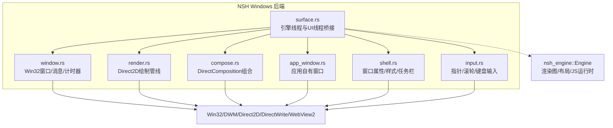
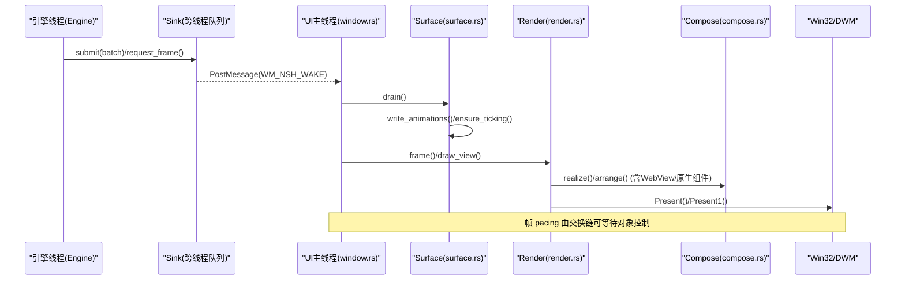
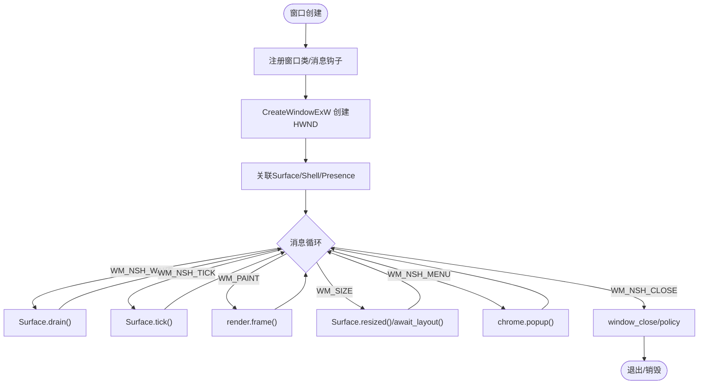
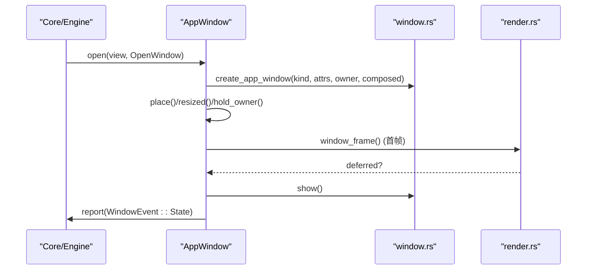
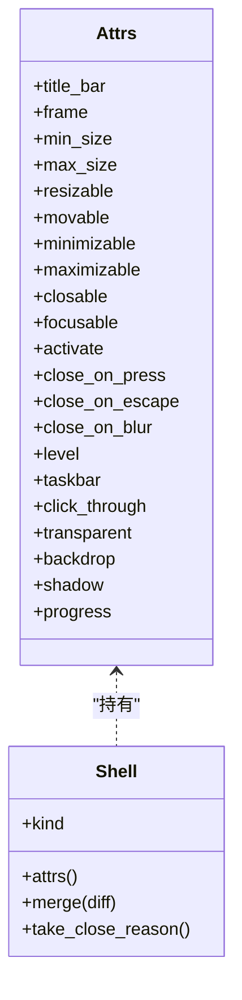
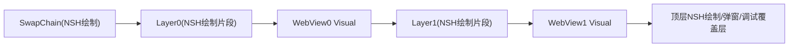
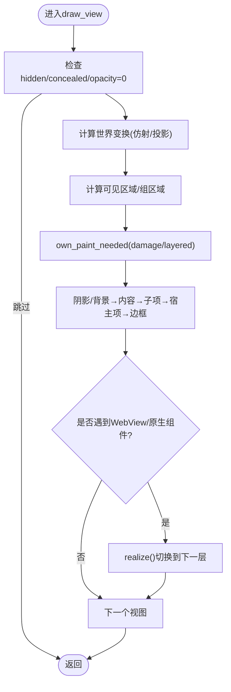
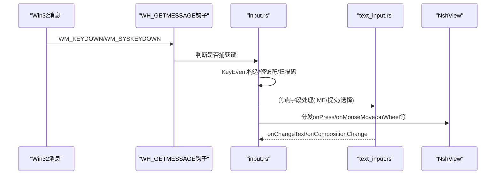
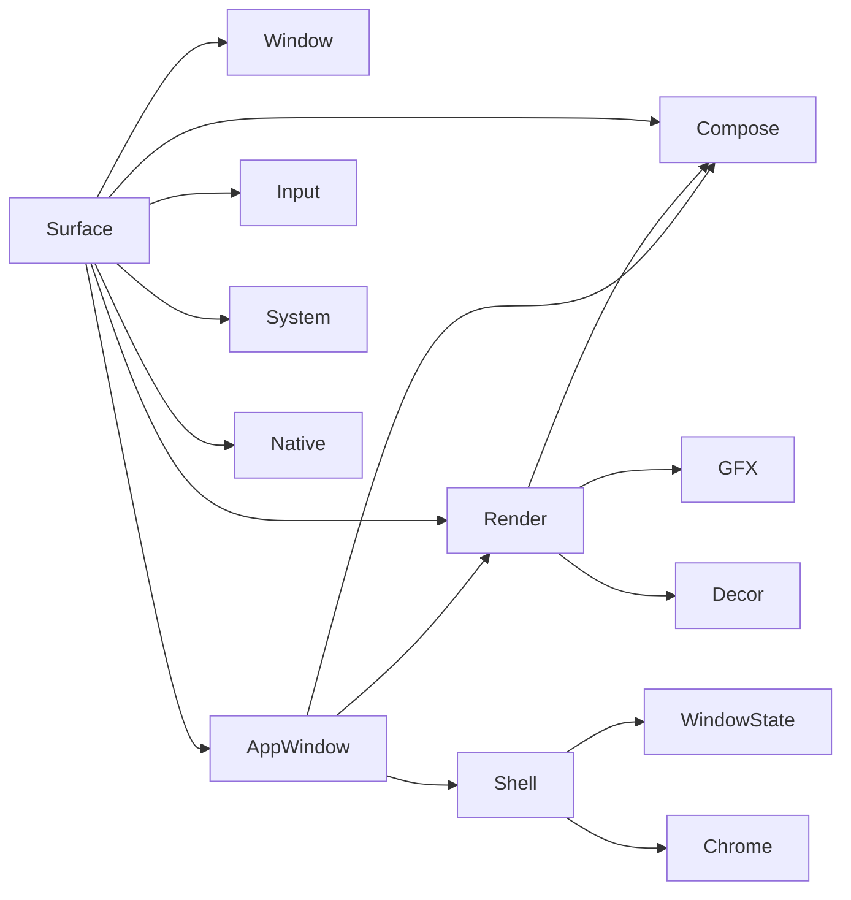

# Windows平台API

<cite>
**本文引用的文件**   
- [lib.rs](file://crates/nsh-platform-windows/src/lib.rs)
- [window.rs](file://crates/nsh-platform-windows/src/window.rs)
- [app_window.rs](file://crates/nsh-platform-windows/src/app_window.rs)
- [shell.rs](file://crates/nsh-platform-windows/src/shell.rs)
- [compose.rs](file://crates/nsh-platform-windows/src/compose.rs)
- [render.rs](file://crates/nsh-platform-windows/src/render.rs)
- [surface.rs](file://crates/nsh-platform-windows/src/surface.rs)
- [input.rs](file://crates/nsh-platform-windows/src/input.rs)
- [windows.md（开发文档）](file://docs/dev/windows.md)
- [windows.md（用户文档）](file://website/docs/windows.md)
</cite>

## 目录
1. [简介](#简介)
2. [项目结构](#项目结构)
3. [核心组件](#核心组件)
4. [架构总览](#架构总览)
5. [详细组件分析](#详细组件分析)
6. [依赖关系分析](#依赖关系分析)
7. [性能与帧调度](#性能与帧调度)
8. [Windows特有功能参考](#windows特有功能参考)
9. [构建、打包与部署](#构建打包与部署)
10. [故障排查指南](#故障排查指南)
11. [结论](#结论)

## 简介
本文件为 NSH 框架在 Windows 平台的 API 参考与实现说明，聚焦基于 Win32 的原生 UI 实现：窗口管理、消息循环、图形绘制、输入法支持、WebView 组合、系统主题与多显示器环境等。同时给出 Windows 应用构建、打包与部署的配置说明，并解释 Win32 消息机制与 NSH 事件系统的映射关系。

## 项目结构
Windows 后端位于 crates/nsh-platform-windows，采用“每节点一个保留视图、每表面一窗口”的架构，使用 Direct2D/DirectWrite 进行绘制与文本布局，并通过 DirectComposition 将 WebView 与原生组件视觉对象嵌入到 NSH 绘制层之间。

图表来源
- [lib.rs:1-21](file://crates/nsh-platform-windows/src/lib.rs#L1-L21)
- [surface.rs:1-14](file://crates/nsh-platform-windows/src/surface.rs#L1-L14)
- [window.rs:1-19](file://crates/nsh-platform-windows/src/window.rs#L1-L19)
- [render.rs:1-35](file://crates/nsh-platform-windows/src/render.rs#L1-L35)
- [compose.rs:1-45](file://crates/nsh-platform-windows/src/compose.rs#L1-L45)
- [app_window.rs:1-38](file://crates/nsh-platform-windows/src/app_window.rs#L1-L38)
- [shell.rs:1-21](file://crates/nsh-platform-windows/src/shell.rs#L1-L21)
- [input.rs:1-59](file://crates/nsh-platform-windows/src/input.rs#L1-L59)

章节来源
- [lib.rs:1-21](file://crates/nsh-platform-windows/src/lib.rs#L1-L21)
- [windows.md（开发文档）:1-12](file://docs/dev/windows.md#L1-L12)

## 核心组件
- Surface：封装引擎线程与UI线程之间的批处理、尺寸变更等待、动画帧驱动、损坏区域追踪、合成目标与交换链管理。
- Window：封装 Win32 窗口类注册、窗口创建/显示/全屏切换、消息分发、自定义私有消息（如 WM_NSH_WAKE/TICK/MENU/PAINT）。
- AppWindow：应用自有窗口（<Window>/Window.open），独立 HWND、独立 Composition/SwapChain、状态上报与关闭策略。
- Shell：窗口属性（标题栏、边框、层级、任务栏、透明度、毛玻璃）、样式计算与同步、点击测试与系统命令限制。
- Compose：DirectComposition 树，将 WebView 与原生组件视觉对象插入 NSH 绘制层之间，支持 backdrop 模糊与透明窗口。
- Render：Direct2D 绘制管线，按阴影/背景→内容→子项→宿主项→边框顺序绘制，支持部分帧更新与投影变换离屏绘制。
- Input：指针/滚轮/键盘输入的统一抽象，命中测试、手势、滚动路由、光标更新、IME/输入法集成。

章节来源
- [surface.rs:152-293](file://crates/nsh-platform-windows/src/surface.rs#L152-L293)
- [window.rs:110-154](file://crates/nsh-platform-windows/src/window.rs#L110-L154)
- [app_window.rs:74-117](file://crates/nsh-platform-windows/src/app_window.rs#L74-L117)
- [shell.rs:428-461](file://crates/nsh-platform-windows/src/shell.rs#L428-L461)
- [compose.rs:113-136](file://crates/nsh-platform-windows/src/compose.rs#L113-L136)
- [render.rs:121-185](file://crates/nsh-platform-windows/src/render.rs#L121-L185)
- [input.rs:285-347](file://crates/nsh-platform-windows/src/input.rs#L285-L347)

## 架构总览
NSH 在 Windows 上采用“引擎线程 + UI 主线程”的双线程模型：
- 引擎线程运行 nsh_engine::Engine，负责布局、JS 执行、数据流；通过 Sink 将批处理消息投递到 UI 线程。
- UI 主线程维护 Win32 消息循环，消费 WM_NSH_* 私有消息，应用批处理、驱动动画帧、触发绘制。
- 绘制阶段使用 Direct2D 交换链（flip model），必要时使用 DirectComposition 将 WebView 与原生组件视觉对象嵌入 NSH 绘制层之间。
- 输入由 Win32 消息转换为 NSH 事件（PointerEvent/WheelEvent/KeyEvent），经 input.rs 统一派发。

图表来源
- [surface.rs:39-115](file://crates/nsh-platform-windows/src/surface.rs#L39-L115)
- [window.rs:67-99](file://crates/nsh-platform-windows/src/window.rs#L67-L99)
- [render.rs:1-35](file://crates/nsh-platform-windows/src/render.rs#L1-L35)
- [compose.rs:1-45](file://crates/nsh-platform-windows/src/compose.rs#L1-L45)

## 详细组件分析

### 窗口管理与消息循环（window.rs）
- 窗口类注册与消息钩子：WH_GETMESSAGE 用于拦截按键以阻止 TranslateMessage 生成字符，配合 WM_NSH_KEYDOWN/SYSKEYDOWN 实现捕获键。
- 私有消息：WM_NSH_WAKE/TICK/MENU/PAINT/CLOSE/SHOW/BLUR 等，协调引擎唤醒、帧驱动、菜单弹出、绘制时机与窗口生命周期。
- 全屏切换：保存/恢复 WINDOWPLACEMENT 与窗口样式位，结合 chrome 隐藏标题栏与菜单栏。
- 后台模式：run_in_background 避免 SetForegroundWindow/SetFocus，保持用户当前应用的键盘焦点，但逻辑上仍认为某窗口“拥有键盘”。

图表来源
- [window.rs:173-232](file://crates/nsh-platform-windows/src/window.rs#L173-L232)
- [window.rs:234-331](file://crates/nsh-platform-windows/src/window.rs#L234-L331)
- [window.rs:541-635](file://crates/nsh-platform-windows/src/window.rs#L541-L635)
- [window.rs:637-746](file://crates/nsh-platform-windows/src/window.rs#L637-L746)

章节来源
- [window.rs:1-19](file://crates/nsh-platform-windows/src/window.rs#L1-L19)
- [window.rs:67-99](file://crates/nsh-platform-windows/src/window.rs#L67-L99)
- [window.rs:173-232](file://crates/nsh-platform-windows/src/window.rs#L173-L232)
- [window.rs:541-635](file://crates/nsh-platform-windows/src/window.rs#L541-L635)
- [window.rs:637-746](file://crates/nsh-platform-windows/src/window.rs#L637-L746)

### 应用自有窗口（app_window.rs）
- 打开流程：从根视图分离，创建独立 HWND，根据 kind 选择样式，必要时创建 Composition（透明/Backdrop/Click-through）。
- 首次显示：等待首帧绘制完成或超时定时器触发，再 show 并上报 State。
- 关闭策略：closeOnPress/closeOnEscape/closeOnBlur 等策略即时响应，随后报告 Closed 并释放子窗口。
- 状态上报：移动/调整大小后延迟合并上报，避免频繁抖动。

图表来源
- [app_window.rs:290-387](file://crates/nsh-platform-windows/src/app_window.rs#L290-L387)
- [app_window.rs:448-466](file://crates/nsh-platform-windows/src/app_window.rs#L448-L466)
- [app_window.rs:606-635](file://crates/nsh-platform-windows/src/app_window.rs#L606-L635)

章节来源
- [app_window.rs:1-38](file://crates/nsh-platform-windows/src/app_window.rs#L1-L38)
- [app_window.rs:290-387](file://crates/nsh-platform-windows/src/app_window.rs#L290-L387)
- [app_window.rs:448-466](file://crates/nsh-platform-windows/src/app_window.rs#L448-L466)
- [app_window.rs:606-635](file://crates/nsh-platform-windows/src/app_window.rs#L606-L635)

### 窗口属性与样式（shell.rs）
- Attrs：标题栏、边框、最小/最大尺寸、可调整大小/移动/最小化/最大化/关闭、层级、任务栏可见性、点击穿透、透明度、Backdrop、阴影、进度条。
- styles/restyled：根据 kind 与 attrs 计算 WS/WS_EX 位，处理工具窗口、任务栏按钮、点击穿透等。
- sync：增量应用属性变化，刷新标题栏区域、层级、任务栏、Backdrop、阴影、可关闭性等。
- hit test/control code：windowDrag/windowControl/windowResize 映射到 HTCAPTION/HT* 边缘，使系统移动/缩放行为生效。

图表来源
- [shell.rs:44-70](file://crates/nsh-platform-windows/src/shell.rs#L44-L70)
- [shell.rs:201-246](file://crates/nsh-platform-windows/src/shell.rs#L201-L246)
- [shell.rs:556-639](file://crates/nsh-platform-windows/src/shell.rs#L556-L639)
- [shell.rs:296-364](file://crates/nsh-platform-windows/src/shell.rs#L296-L364)

章节来源
- [shell.rs:1-21](file://crates/nsh-platform-windows/src/shell.rs#L1-L21)
- [shell.rs:44-70](file://crates/nsh-platform-windows/src/shell.rs#L44-L70)
- [shell.rs:201-246](file://crates/nsh-platform-windows/src/shell.rs#L201-L246)
- [shell.rs:556-639](file://crates/nsh-platform-windows/src/shell.rs#L556-L639)
- [shell.rs:296-364](file://crates/nsh-platform-windows/src/shell.rs#L296-L364)

### 组合与WebView（compose.rs）
- Composition：DirectComposition 目标，root 下自底向上排列 web view visual 与其后的 NSH 绘制层 Layer。
- Placement：矩阵/尺寸/裁剪/圆角/透明度，供 WebView2 与原生组件视觉对象使用。
- layer_target：按需创建/调整 swap chain 与 D2D 位图目标，设备丢失时重建。
- arrange/present：按帧提交 visuals 顺序与呈现各层 swap chain。
- backdrops_placed：当出现 backdrop 视图时将目标移到上层槽位，下层放置系统模糊。

图表来源
- [compose.rs:1-45](file://crates/nsh-platform-windows/src/compose.rs#L1-L45)
- [compose.rs:113-136](file://crates/nsh-platform-windows/src/compose.rs#L113-L136)
- [compose.rs:179-249](file://crates/nsh-platform-windows/src/compose.rs#L179-L249)
- [compose.rs:272-326](file://crates/nsh-platform-windows/src/compose.rs#L272-L326)
- [compose.rs:357-409](file://crates/nsh-platform-windows/src/compose.rs#L357-L409)

章节来源
- [compose.rs:1-45](file://crates/nsh-platform-windows/src/compose.rs#L1-L45)
- [compose.rs:113-136](file://crates/nsh-platform-windows/src/compose.rs#L113-L136)
- [compose.rs:179-249](file://crates/nsh-platform-windows/src/compose.rs#L179-L249)
- [compose.rs:272-326](file://crates/nsh-platform-windows/src/compose.rs#L272-L326)
- [compose.rs:357-409](file://crates/nsh-platform-windows/src/compose.rs#L357-L409)

### 绘制管线（render.rs）
- draw_view：阴影/背景→着色器→内容→子项→宿主项→边框，半透明时整体置于 opacity 层。
- 投影变换：透视变换走 offscreen bitmap + DrawBitmap 透视映射；仿射变换使用 3x2 world transform。
- 部分帧：记录旧/新绘制区域，合并 damage，仅重绘变化矩形；对 backdrop 读取者扩大绘制范围。
- 组合拆分：遇到 WebView/原生组件时记录 Placement，realize 切换到下一层继续绘制。

图表来源
- [render.rs:1-35](file://crates/nsh-platform-windows/src/render.rs#L1-L35)
- [render.rs:700-800](file://crates/nsh-platform-windows/src/render.rs#L700-L800)
- [render.rs:316-374](file://crates/nsh-platform-windows/src/render.rs#L316-L374)
- [render.rs:376-414](file://crates/nsh-platform-windows/src/render.rs#L376-L414)

章节来源
- [render.rs:1-35](file://crates/nsh-platform-windows/src/render.rs#L1-L35)
- [render.rs:700-800](file://crates/nsh-platform-windows/src/render.rs#L700-L800)
- [render.rs:316-374](file://crates/nsh-platform-windows/src/render.rs#L316-L374)
- [render.rs:376-414](file://crates/nsh-platform-windows/src/render.rs#L376-L414)

### 输入与IME（input.rs）
- 指针/滚轮/键盘：统一为 PointerEvent/WheelEvent/KeyEvent，经 input::key 分发给窗口快捷键、对话框、应用 keymap、焦点字段、可选文本、导航、滚动、Tab 遍历。
- IME：RichEdit 通过 TSF 提供输入法能力，composition 通知转为 onCompositionChange，回车提交受 submitBehavior 控制。
- 捕获键：WH_GETMESSAGE 钩子在 TranslateMessage 前判断是否抑制字符生成，将捕获键转为 WM_NSH_KEYDOWN/SYSKEYDOWN。
- 光标：批量更新 cursor，批次结束后根据鼠标位置刷新系统光标。

图表来源
- [input.rs:1-59](file://crates/nsh-platform-windows/src/input.rs#L1-L59)
- [input.rs:210-237](file://crates/nsh-platform-windows/src/input.rs#L210-L237)
- [input.rs:707-718](file://crates/nsh-platform-windows/src/input.rs#L707-L718)
- [windows.md（开发文档）:211-313](file://docs/dev/windows.md#L211-L313)

章节来源
- [input.rs:1-59](file://crates/nsh-platform-windows/src/input.rs#L1-L59)
- [input.rs:210-237](file://crates/nsh-platform-windows/src/input.rs#L210-L237)
- [input.rs:707-718](file://crates/nsh-platform-windows/src/input.rs#L707-L718)
- [windows.md（开发文档）:211-313](file://docs/dev/windows.md#L211-L313)

## 依赖关系分析
- Surface 依赖 window（消息/计时器）、render（绘制）、compose（组合）、app_window（自有窗口）、input（输入）、system（环境/主题）、native（视频/WebView/原生组件）。
- render 依赖 compose（Placement/Layer）、gfx（设备/交换链）、decor（装饰/阴影/渐变）。
- shell 依赖 window_state（尺寸/层级/任务栏）、chrome（标题栏/菜单）。
- app_window 依赖 shell（样式/属性）、compose（组合）、render（窗口帧绘制）。

图表来源
- [surface.rs:152-293](file://crates/nsh-platform-windows/src/surface.rs#L152-L293)
- [render.rs:66-72](file://crates/nsh-platform-windows/src/render.rs#L66-L72)
- [app_window.rs:58-63](file://crates/nsh-platform-windows/src/app_window.rs#L58-L63)
- [shell.rs:33-42](file://crates/nsh-platform-windows/src/shell.rs#L33-L42)

章节来源
- [surface.rs:152-293](file://crates/nsh-platform-windows/src/surface.rs#L152-L293)
- [render.rs:66-72](file://crates/nsh-platform-windows/src/render.rs#L66-L72)
- [app_window.rs:58-63](file://crates/nsh-platform-windows/src/app_window.rs#L58-L63)
- [shell.rs:33-42](file://crates/nsh-platform-windows/src/shell.rs#L33-L42)

## 性能与帧调度
- 交换链 pacing：每个交换链有可等待对象，Present 非阻塞，线程池等待可等待对象并在可用时投递 WM_NSH_PAINT，避免阻塞 UI 线程。
- 部分帧：记录脏区，合并 damage，只绘制变化区域；对 backdrop 读取者扩大绘制范围。
- 设备丢失：gfx::generation 递增，缓存资源重建；Composition 层 swap chain 重建。
- FPS 监控：nsh::fps 每秒输出帧率、CPU、内存、各阶段耗时。

章节来源
- [windows.md（开发文档）:436-458](file://docs/dev/windows.md#L436-L458)
- [windows.md（开发文档）:373-434](file://docs/dev/windows.md#L373-L434)
- [surface.rs:458-476](file://crates/nsh-platform-windows/src/surface.rs#L458-L476)

## Windows特有功能参考
- 窗口模型 v2：主窗口不可见，应用声明的 <Window> 才是可见窗口；defaultVisible/show() 不再适用。
- 透明窗口：AppOptions::transparent 创建无边框无重定向位图的窗口，仅显示 DirectComposition 内容。
- Backdrop 模糊：windows={{ backdrop }} 使用系统模糊（Mica/Acrylic），需要 Windows 11 特定版本。
- 任务栏：ITaskbarList AddTab/DeleteTab，支持进度条状态。
- 登录项：HKCU Run 键写入启动项，安装器卸载时清理。
- 剪贴板：CF_UNICODETEXT 同步读写。
- 多显示器：displays 列表随 WM_SETTINGCHANGE 更新，窗口 placement 跨 DPI 与显示器缩放。
- 主题与外观：DWM 沉浸式深色模式、菜单暗色主题（uxtheme 未公开消息/序数）。
- WebView2：静态链接 loader，Composition 控制器，baseUrl 本地资源请求。
- 媒体：Media Foundation 帧服务器模式，controls 控件条。

章节来源
- [windows.md（开发文档）:10-12](file://docs/dev/windows.md#L10-L12)
- [windows.md（开发文档）:559-568](file://docs/dev/windows.md#L559-L568)
- [windows.md（开发文档）:84-100](file://docs/dev/windows.md#L84-L100)
- [windows.md（开发文档）:206-209](file://docs/dev/windows.md#L206-L209)
- [windows.md（开发文档）:198-200](file://docs/dev/windows.md#L198-L200)
- [windows.md（开发文档）:204](file://docs/dev/windows.md#L204)

## 构建、打包与部署
- 运行：nsh run（默认 target windows），TSX/Rust 应用均可；开发主机 nsh-windows-host.exe。
- 打包：nsh package --target windows，输出目录包含 .exe、bundle.nshc、assets、app.json；可选 Inno Setup 安装包。
- 嵌入：在 Win32 应用中通过 AppView 嵌入 NSH 引擎，设置 UI sets、原生组件、主题覆盖、locale/font scale 等。

章节来源
- [windows.md（用户文档）:26-55](file://website/docs/windows.md#L26-L55)
- [windows.md（用户文档）:68-99](file://website/docs/windows.md#L68-L99)
- [windows.md（用户文档）:101-176](file://website/docs/windows.md#L101-L176)

## 故障排查指南
- 键盘捕获无效：确认 WH_GETMESSAGE 钩子安装成功，WM_NSH_KEYDOWN/SYSKEYDOWN 是否正确传递；检查 capture_keys 规则与 translated 标志。
- WebView 不显示：确认 WebView2 Runtime 已安装；检查是否在投影变换/滤镜/过渡中导致页面不可见；baseUrl 仅接受 http(s)。
- 透明窗口异常：确保 AppOptions::transparent 在窗口创建时设置；Backdrop 模糊失败会回退到普通背景。
- 任务栏按钮缺失：检查 taskbar 属性与 shown/button_created 调用；ITaskbarList 初始化需 COM OleInitialize。
- 帧率卡顿：启用 --fps 监控；检查 Present 是否被阻塞；确认交换链 pacing 与部分帧优化生效。

章节来源
- [window.rs:203-232](file://crates/nsh-platform-windows/src/window.rs#L203-L232)
- [windows.md（开发文档）:460-476](file://docs/dev/windows.md#L460-L476)
- [windows.md（开发文档）:559-568](file://docs/dev/windows.md#L559-L568)
- [shell.rs:743-768](file://crates/nsh-platform-windows/src/shell.rs#L743-L768)
- [windows.md（开发文档）:361-371](file://docs/dev/windows.md#L361-L371)

## 结论
NSH 的 Windows 后端以 Win32 为核心，结合 Direct2D/DirectWrite 与 DirectComposition，实现了高性能、可扩展的原生 UI 渲染与交互。通过 Surface/window/app_window/shell/compose/render/input 等模块的清晰分工，既保证了与跨平台核心的一致性，又充分利用了 Windows 平台特性（主题、任务栏、Backdrop、WebView2、IME 等）。在构建与部署方面，提供了完整的 CLI 支持与嵌入式集成方案，便于在不同场景下交付与扩展。