# iOS平台API

<cite>
**本文引用的文件**   
- [lib.rs](file://crates/nsh-platform-ios/src/lib.rs)
- [app.rs](file://crates/nsh-platform-ios/src/app.rs)
- [application.rs](file://crates/nsh-platform-ios/src/application.rs)
- [view.rs](file://crates/nsh-platform-ios/src/view.rs)
- [navigation.rs](file://crates/nsh-platform-ios/src/navigation.rs)
- [system.rs](file://crates/nsh-platform-ios/src/system.rs)
- [keyboard.rs](file://crates/nsh-platform-ios/src/keyboard.rs)
- [touch.rs](file://crates/nsh-platform-ios/src/touch.rs)
- [input.rs](file://crates/nsh-platform-ios/src/input.rs)
- [picker.rs](file://crates/nsh-platform-ios/src/picker.rs)
- [main.swift](file://examples/embed-ios/main.swift)
</cite>

## 目录
1. [简介](#简介)
2. [项目结构](#项目结构)
3. [核心组件](#核心组件)
4. [架构总览](#架构总览)
5. [详细组件分析](#详细组件分析)
6. [依赖关系分析](#依赖关系分析)
7. [性能与资源特性](#性能与资源特性)
8. [故障排查指南](#故障排查指南)
9. [结论](#结论)
10. [附录：构建、调试与部署配置](#附录构建调试与部署配置)

## 简介
本文件为 NSH 框架在 iOS 平台的 API 参考文档，聚焦基于 UIKit 的原生 UI 实现与系统集成。内容涵盖应用生命周期管理、视图控制器集成、导航栈与模态展示、手势识别与触摸处理、状态栏控制、键盘与输入、多任务支持（Scene）、URL Scheme/Universal Link/Handoff、系统对话框与剪贴板、图片与文件选择器等能力，并提供 Swift 嵌入示例的集成说明与 UIViewController 生命周期映射。

## 项目结构
iOS 平台后端位于 crates/nsh-platform-ios，提供 UIKit 宿主、Surface 引擎承载、事件分发、原生控件桥接等能力；Swift 侧通过 C ABI 暴露 embed 接口供 iOS 应用集成。关键入口包括：
- Rust 层：AppView/Surface/AppSource/run_app 等
- Swift 层：EmbedController/SceneDelegate/AppDelegate 示例

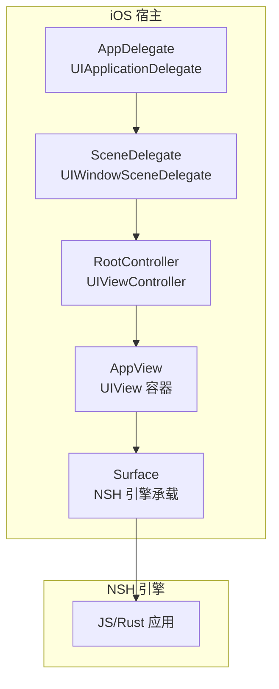

图表来源
- [app.rs:88-124](file://crates/nsh-platform-ios/src/app.rs#L88-L124)
- [app.rs:187-226](file://crates/nsh-platform-ios/src/app.rs#L187-L226)
- [view.rs:16-80](file://crates/nsh-platform-ios/src/view.rs#L16-L80)

章节来源
- [lib.rs:1-119](file://crates/nsh-platform-ios/src/lib.rs#L1-L119)
- [app.rs:1-124](file://crates/nsh-platform-ios/src/app.rs#L1-L124)
- [view.rs:1-80](file://crates/nsh-platform-ios/src/view.rs#L1-L80)

## 核心组件
- AppView：在任意 UIView 层级中运行一个 NSH 应用（Rust Root 或 JS Bundle），支持热重载、错误回调、字体注册、主题覆盖、HostChannel 通信等。
- SurfaceOptions/Surface：引擎承载与渲染管线，负责布局、绘制、事件分发、缓存、限制等。
- AppSource/AppOptions/run_app：独立应用的启动参数与生命周期入口。
- ApplicationEvent：UIApplicationDelegate 回调转发（远程通知、设备令牌、启动选项等）。
- Navigation/Modal：UINavigationController 栈与模态（含 Sheet Detent、手势关闭、方向适配）。
- System：状态栏、外观、旋转、对话框、剪贴板、URL 打开等系统级能力。
- Keyboard/Touch/Input：硬件键、触摸追踪、PanGate、文本输入（Field/Area）等交互。
- Picker：系统图片选择器与文档选择器，支持图片预处理与路径返回。

章节来源
- [view.rs:16-80](file://crates/nsh-platform-ios/src/view.rs#L16-L80)
- [app.rs:25-60](file://crates/nsh-platform-ios/src/app.rs#L25-L60)
- [application.rs:36-71](file://crates/nsh-platform-ios/src/application.rs#L36-L71)
- [navigation.rs:1-13](file://crates/nsh-platform-ios/src/navigation.rs#L1-L13)
- [system.rs:1-17](file://crates/nsh-platform-ios/src/system.rs#L1-L17)
- [keyboard.rs:1-82](file://crates/nsh-platform-ios/src/keyboard.rs#L1-L82)
- [touch.rs:1-22](file://crates/nsh-platform-ios/src/touch.rs#L1-L22)
- [input.rs:1-8](file://crates/nsh-platform-ios/src/input.rs#L1-L8)
- [picker.rs:1-14](file://crates/nsh-platform-ios/src/picker.rs#L1-L14)

## 架构总览
下图展示从 UIKit 到 NSH 引擎的关键调用链与职责边界。

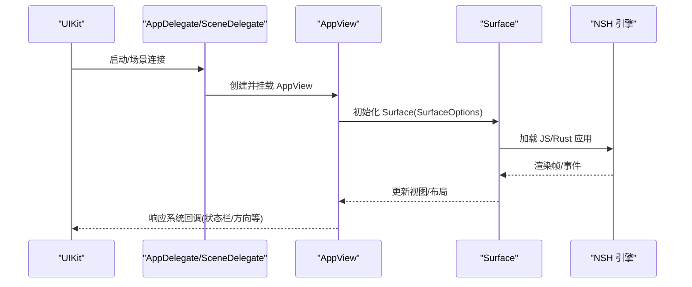

图表来源
- [app.rs:258-307](file://crates/nsh-platform-ios/src/app.rs#L258-L307)
- [view.rs:328-368](file://crates/nsh-platform-ios/src/view.rs#L328-L368)

## 详细组件分析

### 应用生命周期与宿主集成
- AppDelegate/SceneDelegate：负责安装通知、设置 SceneConfiguration、处理 URL Scheme/Universal Link/Handoff。
- run_app：在主线程调用，设置 UIApplication delegate 类（根据是否注册观察者动态选择），进入主循环。
- RootController：统一状态栏样式/隐藏/动画与页面方向策略。

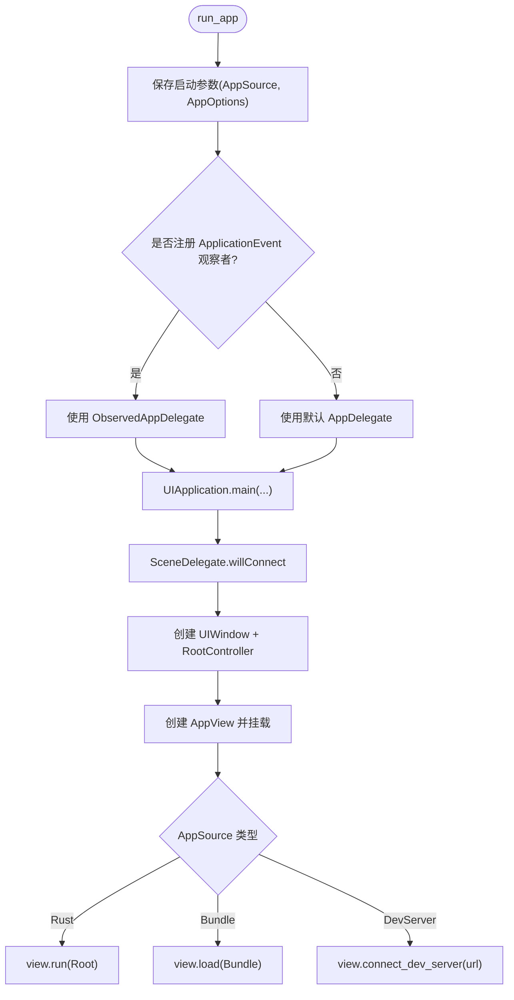

图表来源
- [app.rs:332-347](file://crates/nsh-platform-ios/src/app.rs#L332-L347)
- [app.rs:258-307](file://crates/nsh-platform-ios/src/app.rs#L258-L307)
- [application.rs:250-270](file://crates/nsh-platform-ios/src/application.rs#L250-L270)

章节来源
- [app.rs:88-124](file://crates/nsh-platform-ios/src/app.rs#L88-L124)
- [app.rs:187-226](file://crates/nsh-platform-ios/src/app.rs#L187-L226)
- [app.rs:258-307](file://crates/nsh-platform-ios/src/app.rs#L258-L307)
- [application.rs:250-270](file://crates/nsh-platform-ios/src/application.rs#L250-L270)

### 视图控制器集成与生命周期映射
- RootController 作为窗口根控制器，统一状态栏与方向策略。
- ScreenController 表示导航栈中的单个屏幕，负责安全区域、头部高度、跟随滚动等。
- ModalController 表示模态（含 Sheet），负责尺寸/内边距上报、手势关闭、Esc/VoiceOver 关闭、Detent 变化等。

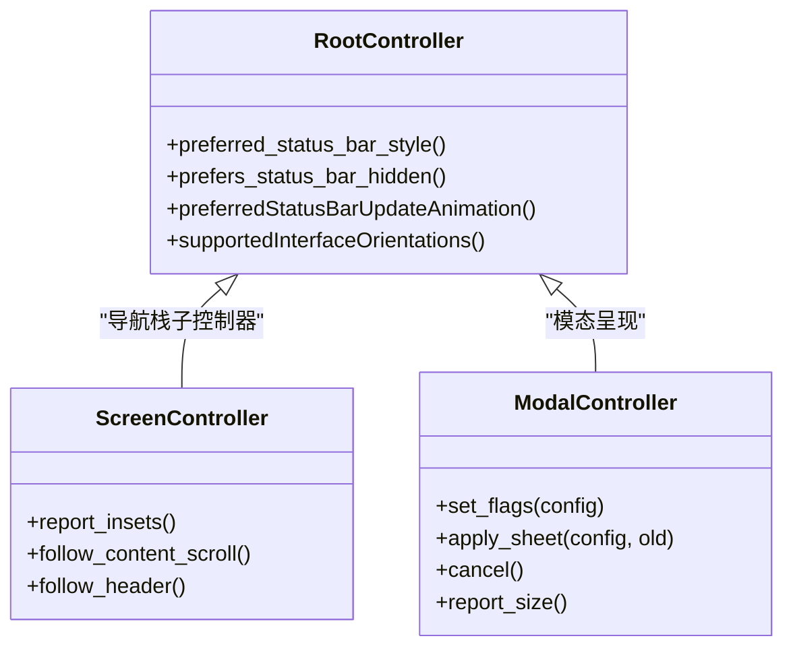

图表来源
- [app.rs:187-226](file://crates/nsh-platform-ios/src/app.rs#L187-L226)
- [navigation.rs:113-139](file://crates/nsh-platform-ios/src/navigation.rs#L113-L139)
- [navigation.rs:347-521](file://crates/nsh-platform-ios/src/navigation.rs#L347-L521)

章节来源
- [app.rs:187-226](file://crates/nsh-platform-ios/src/app.rs#L187-L226)
- [navigation.rs:113-139](file://crates/nsh-platform-ios/src/navigation.rs#L113-L139)
- [navigation.rs:347-521](file://crates/nsh-platform-ios/src/navigation.rs#L347-L521)

### 导航栈与模态
- 导航栈：ScreenController 管理头部可见性、跟随滚动、安全区域与头部高度上报。
- 模态：ModalController 支持 closeOnSwipe/closeOnEscape、Sheet Detent（Medium/Large/自定义高度/比例）、方向继承、显示/隐藏事件。

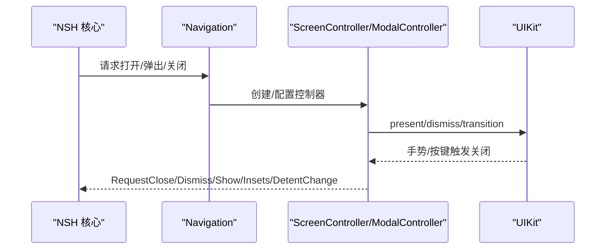

图表来源
- [navigation.rs:1-13](file://crates/nsh-platform-ios/src/navigation.rs#L1-L13)
- [navigation.rs:188-275](file://crates/nsh-platform-ios/src/navigation.rs#L188-L275)
- [navigation.rs:466-521](file://crates/nsh-platform-ios/src/navigation.rs#L466-L521)

章节来源
- [navigation.rs:188-275](file://crates/nsh-platform-ios/src/navigation.rs#L188-L275)
- [navigation.rs:466-521](file://crates/nsh-platform-ios/src/navigation.rs#L466-L521)

### 手势识别与触摸处理
- TouchTracker：跟踪所有触摸点，计算压力/倾斜（Apple Pencil），向 JS 响应者派发 onTouch。
- PanGate：对 panActivation 进行判定，协调 UIScrollView 的 pan 手势优先级，避免误吞。
- ActivatedPan：带激活条件的原生 pan 手势，仅在满足条件后开始移动。

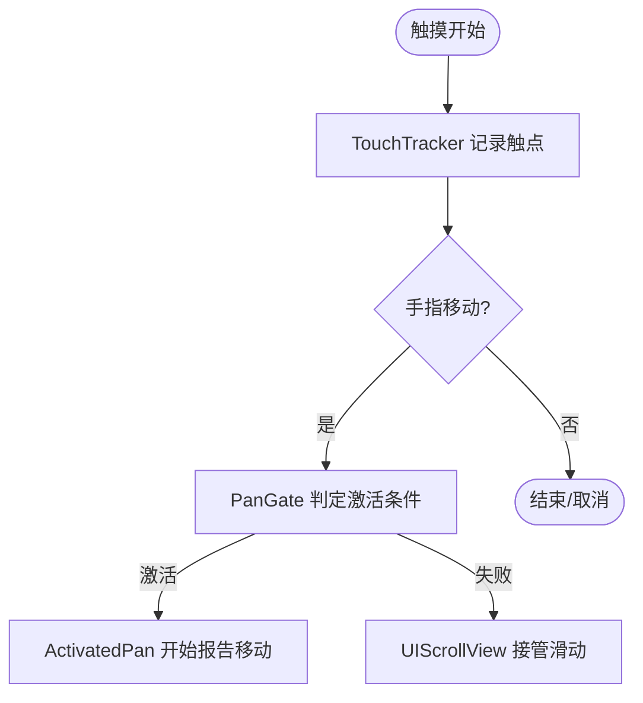

图表来源
- [touch.rs:65-146](file://crates/nsh-platform-ios/src/touch.rs#L65-L146)
- [touch.rs:292-393](file://crates/nsh-platform-ios/src/touch.rs#L292-L393)
- [touch.rs:518-597](file://crates/nsh-platform-ios/src/touch.rs#L518-L597)

章节来源
- [touch.rs:65-146](file://crates/nsh-platform-ios/src/touch.rs#L65-L146)
- [touch.rs:292-393](file://crates/nsh-platform-ios/src/touch.rs#L292-L393)
- [touch.rs:518-597](file://crates/nsh-platform-ios/src/touch.rs#L518-L597)

### 键盘与输入
- Keyboard：将 UIPress 转换为 KeyEvent（key/code/modifiers/repeat），维护修饰键状态，Tab 焦点遍历与捕获规则。
- Input：Field（单行）与 Area（多行）封装 UITextField/UITextView，支持粘贴、编辑菜单、提交行为、滚动上报、光标位置等。

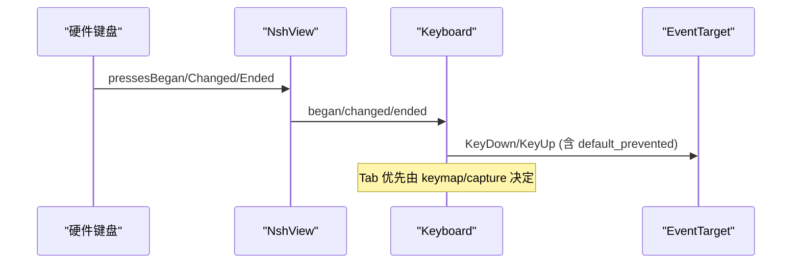

图表来源
- [keyboard.rs:238-300](file://crates/nsh-platform-ios/src/keyboard.rs#L238-L300)
- [keyboard.rs:309-381](file://crates/nsh-platform-ios/src/keyboard.rs#L309-L381)
- [input.rs:116-256](file://crates/nsh-platform-ios/src/input.rs#L116-L256)
- [input.rs:320-499](file://crates/nsh-platform-ios/src/input.rs#L320-L499)

章节来源
- [keyboard.rs:238-300](file://crates/nsh-platform-ios/src/keyboard.rs#L238-L300)
- [keyboard.rs:309-381](file://crates/nsh-platform-ios/src/keyboard.rs#L309-L381)
- [input.rs:116-256](file://crates/nsh-platform-ios/src/input.rs#L116-L256)
- [input.rs:320-499](file://crates/nsh-platform-ios/src/input.rs#L320-L499)

### 系统能力：状态栏、外观、方向、对话框、剪贴板、URL
- 状态栏：preferred_status_bar_style/prefers_status_bar_hidden/status_bar_animation 由 RootController/ModalController 委托给 system。
- 外观：set_appearance 影响 surface root 及外部弹窗/模态。
- 方向：set_orientations 结合 UIDevice 与 scene.requestGeometryUpdateWithPreferences_errorHandler 控制旋转。
- 对话框：show_dialog/close_dialog 基于 UIAlertController，支持输入框、Popover 锚定、按钮启用逻辑。
- 剪贴板：读写文本/HTML/图片，区分 hasOnly 以避免提示。
- URL：open_url/open_app_settings 通过 UIApplication.openURL_options_completionHandler。

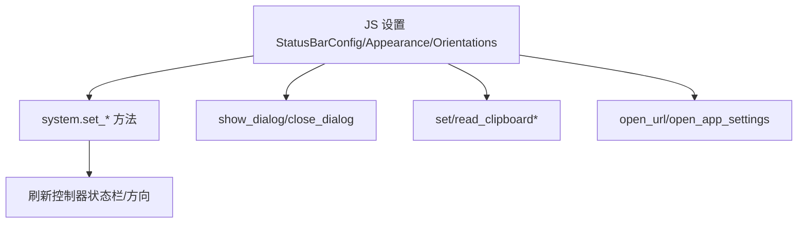

图表来源
- [system.rs:130-176](file://crates/nsh-platform-ios/src/system.rs#L130-L176)
- [system.rs:208-305](file://crates/nsh-platform-ios/src/system.rs#L208-L305)
- [system.rs:445-595](file://crates/nsh-platform-ios/src/system.rs#L445-L595)
- [system.rs:643-705](file://crates/nsh-platform-ios/src/system.rs#L643-L705)
- [system.rs:707-752](file://crates/nsh-platform-ios/src/system.rs#L707-L752)

章节来源
- [system.rs:130-176](file://crates/nsh-platform-ios/src/system.rs#L130-L176)
- [system.rs:208-305](file://crates/nsh-platform-ios/src/system.rs#L208-L305)
- [system.rs:445-595](file://crates/nsh-platform-ios/src/system.rs#L445-L595)
- [system.rs:643-705](file://crates/nsh-platform-ios/src/system.rs#L643-L705)
- [system.rs:707-752](file://crates/nsh-platform-ios/src/system.rs#L707-L752)

### 图片与文件选择器
- 图片选择器：PHPickerViewController（PhotosUI），支持多图、顺序选择、格式转换（HEIC→JPEG 兼容模式）、图片预处理（缩放/编码/方向）。
- 文档选择器：UIDocumentPickerViewController，支持多选、文件夹、扩展名过滤、返回路径或读取文件内容。

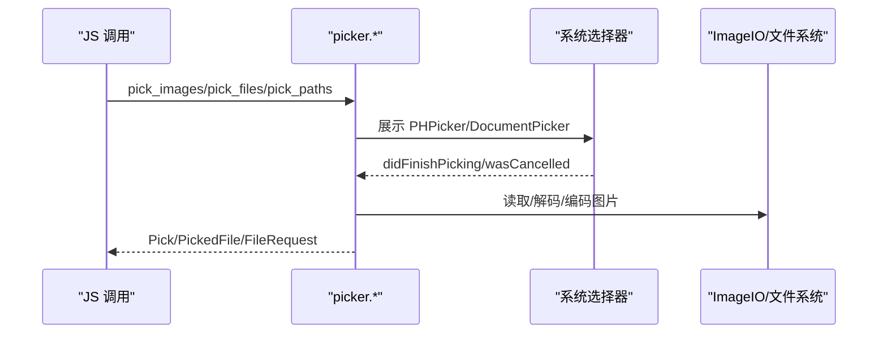

图表来源
- [picker.rs:108-167](file://crates/nsh-platform-ios/src/picker.rs#L108-L167)
- [picker.rs:268-391](file://crates/nsh-platform-ios/src/picker.rs#L268-L391)
- [picker.rs:400-522](file://crates/nsh-platform-ios/src/picker.rs#L400-L522)

章节来源
- [picker.rs:108-167](file://crates/nsh-platform-ios/src/picker.rs#L108-L167)
- [picker.rs:268-391](file://crates/nsh-platform-ios/src/picker.rs#L268-L391)
- [picker.rs:400-522](file://crates/nsh-platform-ios/src/picker.rs#L400-L522)

### Swift 嵌入示例与 UIViewController 生命周期映射
- EmbedController：作为 UIViewController 承载 NSH 滚动监听等。
- AppDelegate/SceneDelegate：示例应用的生命周期入口，创建 UIWindowScene 与 window。

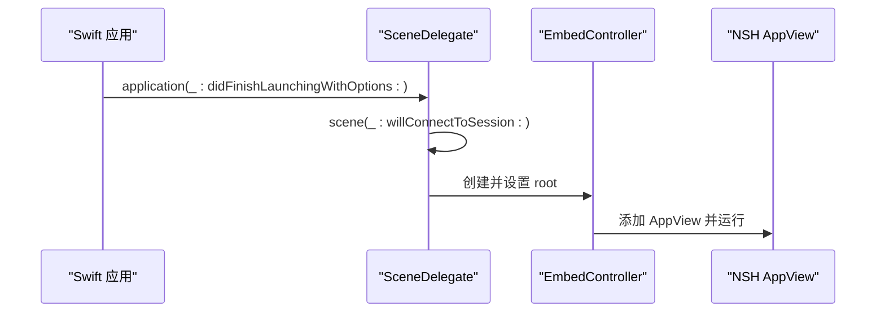

图表来源
- [main.swift:18-20](file://examples/embed-ios/main.swift#L18-L20)
- [main.swift:260-284](file://examples/embed-ios/main.swift#L260-L284)

章节来源
- [main.swift:18-20](file://examples/embed-ios/main.swift#L18-L20)
- [main.swift:260-284](file://examples/embed-ios/main.swift#L260-L284)

## 依赖关系分析
- nsh-core：定义跨平台核心类型与事件模型（如 EventKind、PayloadValue、Dialog、InputConfig 等）。
- nsh-engine：引擎运行时（Bundle/Root/HostChannel/Limits/Capabilities 等）。
- nsh-base：基础 UI 组件注册（nsh/base registry）。
- nsh-platform-apple：共享 Apple 平台能力（音频、通知、语音、Handoff 等）。
- objc2/*：Objective-C 互操作（UIKit/Foundation/CoreGraphics 等）。

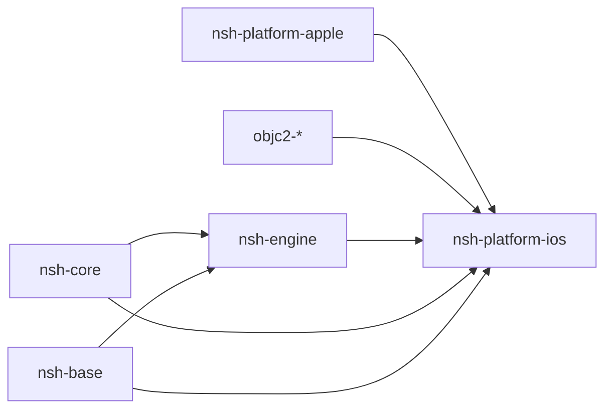

图表来源
- [lib.rs:121-123](file://crates/nsh-platform-ios/src/lib.rs#L121-L123)
- [lib.rs:210-222](file://crates/nsh-platform-ios/src/lib.rs#L210-L222)

章节来源
- [lib.rs:121-123](file://crates/nsh-platform-ios/src/lib.rs#L121-L123)
- [lib.rs:210-222](file://crates/nsh-platform-ios/src/lib.rs#L210-L222)

## 性能与资源特性
- 渲染与布局：Surface 在主队列一次 hop 应用 mount 批次；文本测量与渲染使用相同 attributed strings，保证布局与渲染一致。
- 输入与手势：TouchTracker 不阻塞其他手势；PanGate 与 UIScrollView 协作减少误判；键盘 repeat=false，需应用自行计时重复。
- 内存与缓存：SurfaceOptions.cache 控制下载图片缓存；content_culling 可关闭以一次性渲染整个滚动视图（例如截图）。
- 性能监控：AppOptions.fps 每秒输出性能监视器读数。

章节来源
- [lib.rs:1-11](file://crates/nsh-platform-ios/src/lib.rs#L1-L11)
- [view.rs:173-190](file://crates/nsh-platform-ios/src/view.rs#L173-L190)
- [app.rs:42-60](file://crates/nsh-platform-ios/src/app.rs#L42-L60)
- [touch.rs:1-22](file://crates/nsh-platform-ios/src/touch.rs#L1-L22)
- [keyboard.rs:49-52](file://crates/nsh-platform-ios/src/keyboard.rs#L49-L52)

## 故障排查指南
- 应用未收到远程通知回调：确认已注册 on_application_event 观察者；若无观察者，delegate 不会实现相关方法。
- 状态栏/外观异常：检查 set_appearance/set_status_bar 调用时机与 RootController/ModalController 的状态栏代理。
- 方向旋转不生效：确认 set_orientations 调用且 scene 支持；必要时检查 APP_ORIENTATION 与 TURNING 状态。
- 键盘事件丢失：检查 focusable 视图是否成为 first responder；Tab 被 keymap/capture 捕获时不会走系统遍历。
- 粘贴无效果：确认 pasteBehavior 与 maxLength；若监听 onPaste，需在 pasting_from 中决定是否插入。
- 图片/文件选择器无结果：检查 PhotosUI/UniformTypeIdentifiers 是否可用；确保 top_controller 存在并可 present。

章节来源
- [application.rs:356-377](file://crates/nsh-platform-ios/src/application.rs#L356-L377)
- [system.rs:78-107](file://crates/nsh-platform-ios/src/system.rs#L78-L107)
- [system.rs:208-305](file://crates/nsh-platform-ios/src/system.rs#L208-L305)
- [keyboard.rs:238-300](file://crates/nsh-platform-ios/src/keyboard.rs#L238-L300)
- [input.rs:501-521](file://crates/nsh-platform-ios/src/input.rs#L501-L521)
- [picker.rs:108-167](file://crates/nsh-platform-ios/src/picker.rs#L108-L167)

## 结论
NSH 的 iOS 平台后端通过 AppView/Surface 将 UIKit 与 NSH 引擎解耦，提供稳定的应用生命周期、导航与模态、触摸与键盘、系统能力与选择器等 API。开发者可在 Swift 应用中嵌入 NSH 视图，或通过 run_app 启动独立应用，并通过 ApplicationEvent、HostChannel 等机制与原生系统深度集成。

## 附录：构建、调试与部署配置
- 构建目标：iOS、iOS Simulator、Mac Catalyst（target_os = "ios"）。
- 功能开关：Cargo.toml features（js/shader/editor/rich-editor/plot/term/highlight/math/emoji-picker/zlib/crypto/websocket/updater/svg 等）。
- 开发模式：dev 功能启用 dev-server 客户端、日志转发、错误叠加；AppView.connect_dev_server 自动设置 asset_base。
- 嵌入 API：embed feature 暴露 C ABI（NativeShell Swift 模块），静态库由 cargo xtask dist 构建。
- 示例嵌入：examples/embed-ios 提供 Swift 端 AppDelegate/SceneDelegate/EmbedController 示例。

章节来源
- [lib.rs:1-11](file://crates/nsh-platform-ios/src/lib.rs#L1-L11)
- [lib.rs:210-222](file://crates/nsh-platform-ios/src/lib.rs#L210-L222)
- [view.rs:294-307](file://crates/nsh-platform-ios/src/view.rs#L294-L307)
- [main.swift:260-284](file://examples/embed-ios/main.swift#L260-L284)