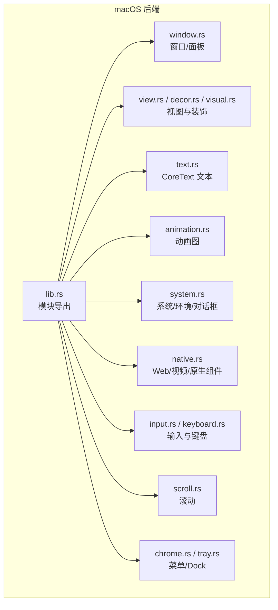
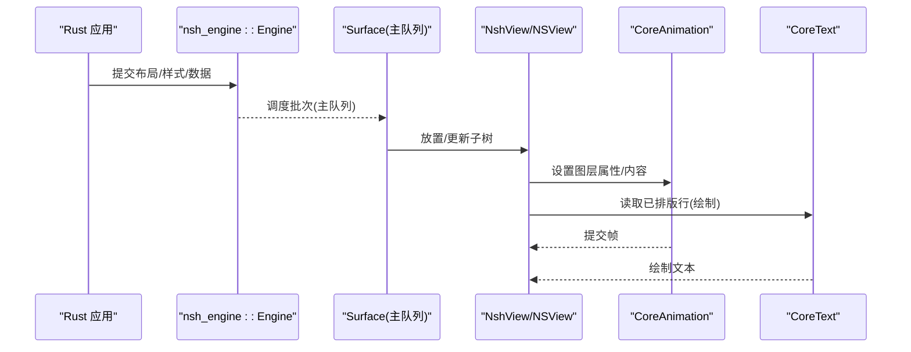
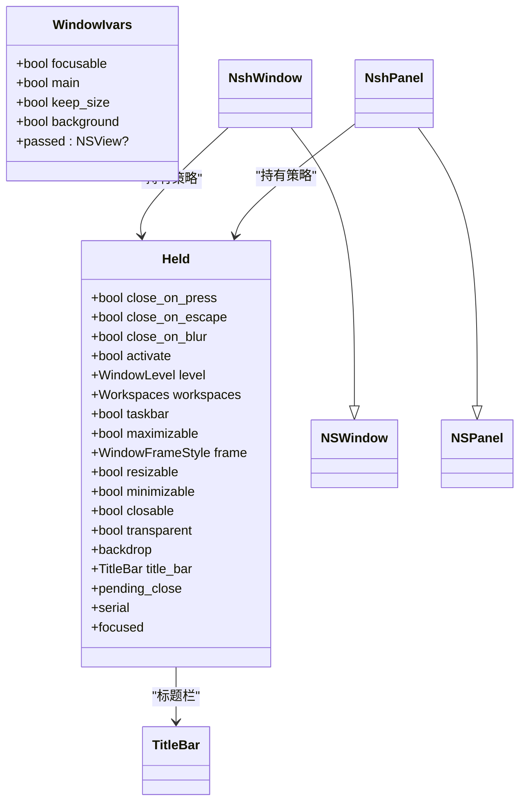
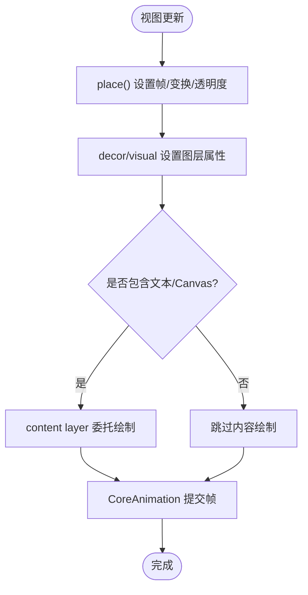
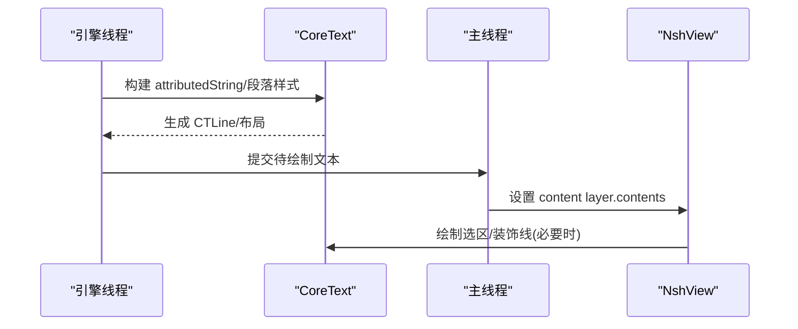
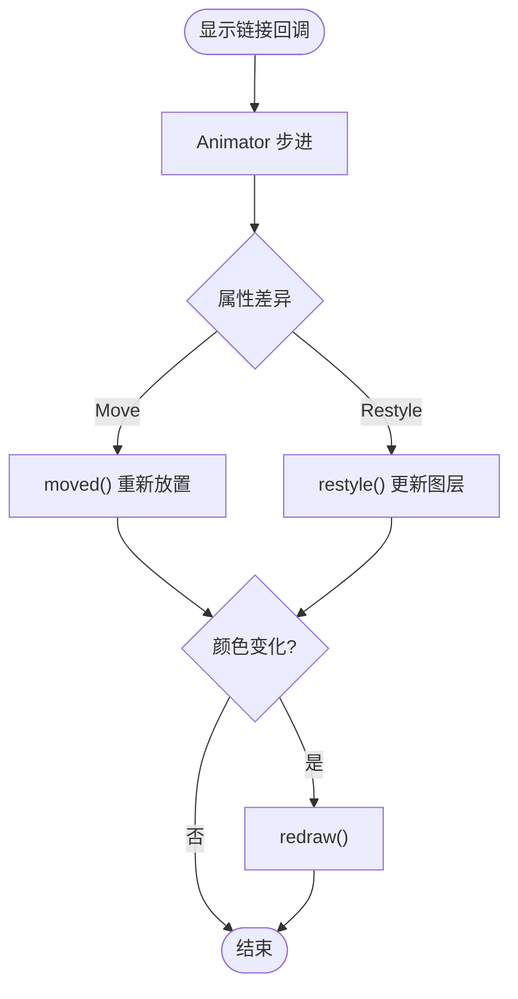
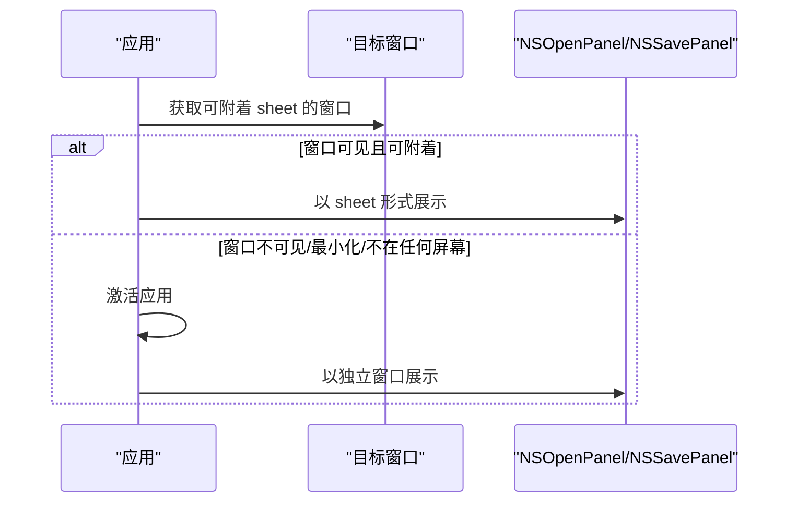
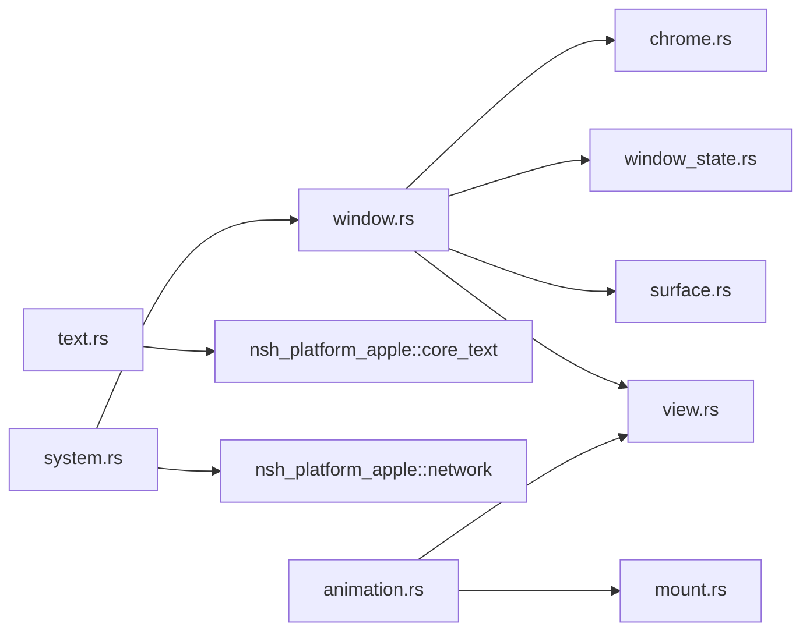

# macOS平台API

<cite>
**本文引用的文件**   
- [lib.rs](file://crates/nsh-platform-macos/src/lib.rs)
- [macos.md](file://docs/dev/macos.md)
- [window.rs](file://crates/nsh-platform-macos/src/window.rs)
- [text.rs](file://crates/nsh-platform-macos/src/text.rs)
- [animation.rs](file://crates/nsh-platform-macos/src/animation.rs)
- [system.rs](file://crates/nsh-platform-macos/src/system.rs)
</cite>

## 目录
1. [简介](#简介)
2. [项目结构](#项目结构)
3. [核心组件](#核心组件)
4. [架构总览](#架构总览)
5. [详细组件分析](#详细组件分析)
6. [依赖关系分析](#依赖关系分析)
7. [性能考量](#性能考量)
8. [故障排查指南](#故障排查指南)
9. [结论](#结论)
10. [附录](#附录)

## 简介
本文件为 NSH 框架在 macOS 平台的 API 参考与实现说明，聚焦基于 AppKit 的原生 UI 能力：窗口管理、视图系统、文本渲染（CoreText）、动画系统、文件系统访问、通知系统、菜单栏/Dock 集成等。文档同时给出 Rust 侧调用示例路径，并解释与 Swift/Objective-C 的互操作方式，以及打包、签名与分发的相关配置。

## 项目结构
macOS 后端位于 crates/nsh-platform-macos，采用“按功能模块划分”的组织方式：
- 入口与导出：lib.rs
- 窗口与层级：window.rs、window_state.rs
- 视图与绘制：view.rs、decor.rs、visual.rs、image.rs、canvas.rs、shader.rs
- 文本与排版：text.rs（CoreText）
- 输入与键盘：input.rs、keyboard.rs、keymap.rs、text_input.rs
- 滚动与布局：scroll.rs
- 导航与对话框：navigation.rs、system.rs
- 原生扩展：native.rs、tray.rs、chrome.rs、login_item.rs、share.rs、net.rs、fps.rs、gpu.rs
- 共享 Apple 能力：通过 nsh_platform_apple 提供 audio、notifications、speech 等

图示来源
- [lib.rs:1-91](file://crates/nsh-platform-macos/src/lib.rs#L1-L91)

章节来源
- [lib.rs:1-91](file://crates/nsh-platform-macos/src/lib.rs#L1-L91)

## 核心组件
- 窗口系统：封装 NSWindow/NSPanel，支持 normal/dialog/panel/popup/overlay 等类型，处理焦点、层级、全屏、缩放、Dock 进度等。
- 视图系统：每个节点对应一个 NSView，使用 Core Animation 层绘制背景、边框、阴影、图片；文本与 Canvas 绘制到独立内容层。
- 文本引擎：CoreText 在引擎线程排版，主线程仅绘制已完成的 CTLine，避免重复排版。
- 动画系统：Animator 在主线程驱动，将属性写入视图状态，触发重排/重绘。
- 系统与对话框：监听系统设置变化，统一分发 Environment；NSAlert 作为 sheet 或独立模态。
- 原生扩展：WKWebView/AVPlayerLayer 延迟初始化；Tray、Chrome 菜单、Login Item、Share、网络等。

章节来源
- [macos.md:105-329](file://docs/dev/macos.md#L105-L329)
- [lib.rs:1-91](file://crates/nsh-platform-macos/src/lib.rs#L1-L91)

## 架构总览
下图展示从 Rust 应用到 AppKit 的关键调用链：Rust 引擎提交变更 -> Surface 主队列应用 -> 视图树更新 -> CoreAnimation/CoreText 绘制。

图示来源
- [macos.md:117-256](file://docs/dev/macos.md#L117-L256)
- [text.rs:1-10](file://crates/nsh-platform-macos/src/text.rs#L1-L10)
- [animation.rs:1-20](file://crates/nsh-platform-macos/src/animation.rs#L1-L20)

## 详细组件分析

### 窗口管理（AppKit NSWindow/NSPanel）
- 窗口类型映射：normal/dialog -> NshWindow；panel/popup/overlay -> NshPanel。
- 关键行为：
  - 打开时等待首帧显示，避免空白闪烁。
  - 关闭策略：closeOnPress/closeOnEscape/closeOnBlur 由 Held 持有并在主线程响应。
  - 层级与集合行为：level、workspaces、taskbar 等映射到 NSWindowLevel/CollectionBehavior。
  - 标题栏与隐藏标题栏：通过 chrome/title bar 计算可用区域。
  - 屏幕与显示：跟随 NSScreen 变化，维护 displays 列表。
  - Dock 进度：最后一个设置了进度的窗口负责更新 Dock tile。

图示来源
- [window.rs:86-118](file://crates/nsh-platform-macos/src/window.rs#L86-L118)
- [window.rs:340-417](file://crates/nsh-platform-macos/src/window.rs#L340-L417)

章节来源
- [window.rs:1-800](file://crates/nsh-platform-macos/src/window.rs#L1-L800)

### 视图系统与绘制（AppKit + CoreAnimation）
- 每节点一视图：NshView 是翻转、layer-backed 的 NSView 子类，承载 ViewState。
- 绘制管线：
  - 背景/边框/阴影/渐变/图片由 Core Animation 层绘制。
  - 文本与 Canvas 绘制到独立 content layer，避免 drawRect: 带来的频繁重绘。
  - 离屏可见性检测：仅在可见时绘制文本/Canvas，减少无用开销。
- 宿主视图：NSTextField/NSTextView/WKWebView/AVPlayerLayer 作为子视图插入，命中测试遵循 AppKit 顺序。

图示来源
- [macos.md:117-190](file://docs/dev/macos.md#L117-L190)

章节来源
- [macos.md:117-190](file://docs/dev/macos.md#L117-L190)

### 文本渲染（CoreText）
- 线程模型：引擎线程进行 CoreText 排版，主线程仅绘制已完成的 CTLine。
- 字体与回退：根据 fontFamily 列表选择首选字体与回退字体，支持 OpenType features。
- 附件与行高：通过 CTRunDelegate 占位，精确控制附件位置与行高。
- 栅格化优化：raster 预渲染 IOSurface，主线程直接设置 contents，减少绘制时间。

图示来源
- [text.rs:1-10](file://crates/nsh-platform-macos/src/text.rs#L1-L10)
- [text.rs:303-391](file://crates/nsh-platform-macos/src/text.rs#L303-L391)

章节来源
- [text.rs:1-800](file://crates/nsh-platform-macos/src/text.rs#L1-L800)

### 动画系统（Animator + 显示链接）
- Animator 在主线程运行，驱动拖拽、滚动偏移等输入值。
- 属性写入视图状态，区分 Move/Restyle/Redraw，避免不必要的重绘。
- 与 Canvas/Shader 联动：当动画影响画布参数时，触发相应重绘。

图示来源
- [animation.rs:1-99](file://crates/nsh-platform-macos/src/animation.rs#L1-L99)

章节来源
- [animation.rs:1-190](file://crates/nsh-platform-macos/src/animation.rs#L1-L190)

### 文件系统访问与面板（Open/Save Panel）
- 使用 NSOpenPanel/NSSavePanel 作为 sheet 或独立窗口，依据目标窗口可见性决定呈现方式。
- 与 alert 一致：若目标窗口不可见，则激活应用并以独立窗口展示。

图示来源
- [macos.md:316-317](file://docs/dev/macos.md#L316-L317)

章节来源
- [macos.md:316-317](file://docs/dev/macos.md#L316-L317)

### 通知系统（Apple Notifications）
- 通过 nsh_platform_apple::notifications 暴露命令接口，system.rs 中统一路由 Command::Notification。
- 生命周期与权限：由系统通知框架管理，Rust 侧仅发送请求与接收结果。

章节来源
- [system.rs:730-732](file://crates/nsh-platform-macos/src/system.rs#L730-L732)

### 菜单栏、Dock 集成与 Handoff
- 菜单栏：标准菜单项（About/Hide/Quit/Edit 等）由 AppKit 提供，语言随 locale 变化重建。
- Dock：任务栏表现为 Window 菜单与 Cmd+,；进度条为 Dock tile；requestAttention 弹跳图标。
- Handoff：通过 Command::SetAppUrl/PushAppUrl 发布活动 URL，交由 surface.handoff 管理。

章节来源
- [macos.md:257-270](file://docs/dev/macos.md#L257-L270)
- [window.rs:31-32](file://crates/nsh-platform-macos/src/window.rs#L31-L32)
- [system.rs:669-673](file://crates/nsh-platform-macos/src/system.rs#L669-L673)

### Rust 与 Swift/Objective-C 互操作要点
- 使用 objc2/objc2-app-kit/objc2-foundation 调用 AppKit/Foundation API。
- 动态加载：首次使用 WebKit/AVFoundation/ServiceManagement 时通过 dlopen 按需加载，避免冷启动阻塞。
- 线程约束：UI 与显示链接在主线程；文本排版在引擎线程；IO/网络在后台线程。

章节来源
- [macos.md:344-380](file://docs/dev/macos.md#L344-L380)
- [lib.rs:72-91](file://crates/nsh-platform-macos/src/lib.rs#L72-L91)

## 依赖关系分析
- 模块耦合：
  - window.rs 依赖 chrome.rs、window_state.rs、surface.rs、view.rs。
  - text.rs 依赖 nsh_platform_apple::core_text 与 nsh_core::text 抽象。
  - system.rs 依赖 window.rs、chrome.rs、window_state.rs、nsh_platform_apple::network。
  - animation.rs 依赖 mount.rs 与 view.rs。
- 外部依赖：
  - AppKit/Foundation/CoreText/CoreAnimation 提供 UI 与绘制。
  - WebKit/AVFoundation/ServiceManagement 按需动态加载。
  - nsh_platform_apple 提供跨 Apple 平台能力（audio/notifications/speech/network）。

图示来源
- [window.rs:67-72](file://crates/nsh-platform-macos/src/window.rs#L67-L72)
- [text.rs:6-13](file://crates/nsh-platform-macos/src/text.rs#L6-L13)
- [system.rs:81-115](file://crates/nsh-platform-macos/src/system.rs#L81-L115)
- [animation.rs:1-14](file://crates/nsh-platform-macos/src/animation.rs#L1-L14)

章节来源
- [window.rs:67-72](file://crates/nsh-platform-macos/src/window.rs#L67-L72)
- [text.rs:6-13](file://crates/nsh-platform-macos/src/text.rs#L6-L13)
- [system.rs:81-115](file://crates/nsh-platform-macos/src/system.rs#L81-L115)
- [animation.rs:1-14](file://crates/nsh-platform-macos/src/animation.rs#L1-L14)

## 性能考量
- 文本与 Canvas 仅在可见时绘制，避免长页面全量重绘。
- 滚动事件与显示帧同步，轨迹板动量与减速曲线由系统驱动。
- 显示链接 per-surface，优先跟随可见窗口与屏幕刷新率。
- 首次原生视图（Web/Video/TextView）延迟初始化，分摊冷启动成本。
- 动画属性差异最小化，避免频繁重绘；颜色变化才触发重绘。

章节来源
- [macos.md:176-256](file://docs/dev/macos.md#L176-L256)
- [macos.md:344-380](file://docs/dev/macos.md#L344-L380)
- [animation.rs:113-129](file://crates/nsh-platform-macos/src/animation.rs#L113-L129)

## 故障排查指南
- 窗口未显示或空白：检查首帧等待逻辑与布局尺寸；确认窗口 kind 与 styleMask。
- 文本不显示：确认 CoreText 排版已完成且内容层可见；检查字体族与回退。
- 动画卡顿：查看 Animator 差异判断与 redraw 标志；避免每帧重绘 Canvas。
- 面板不出现：检查目标窗口可见性与激活状态；必要时以独立窗口展示。
- 通知无响应：确认 capability 与权限；检查 Command 路由是否正确。

章节来源
- [window.rs:74-84](file://crates/nsh-platform-macos/src/window.rs#L74-L84)
- [text.rs:303-391](file://crates/nsh-platform-macos/src/text.rs#L303-L391)
- [animation.rs:113-129](file://crates/nsh-platform-macos/src/animation.rs#L113-L129)
- [macos.md:316-317](file://docs/dev/macos.md#L316-L317)

## 结论
macOS 后端以 AppKit 为核心，结合 CoreAnimation 与 CoreText 提供高性能、符合原生体验的 UI 能力。通过严格的线程分工与延迟初始化策略，兼顾了启动性能与运行时流畅度。窗口、视图、文本、动画、系统与环境等模块职责清晰，便于扩展与维护。

## 附录

### Rust 代码示例（路径引用）
- 创建窗口与属性设置：[window.rs:267-320](file://crates/nsh-platform-macos/src/window.rs#L267-L320)
- 设置标题栏与隐藏标题栏区域：[window.rs:340-417](file://crates/nsh-platform-macos/src/window.rs#L340-L417)
- 文本排版与绘制流程：[text.rs:303-391](file://crates/nsh-platform-macos/src/text.rs#L303-L391)
- 动画属性写入与重绘触发：[animation.rs:64-99](file://crates/nsh-platform-macos/src/animation.rs#L64-L99)
- 对话框与剪贴板命令路由：[system.rs:654-769](file://crates/nsh-platform-macos/src/system.rs#L654-L769)

### 打包、签名与分发（macOS）
- 打包产物默认 ad hoc 签名；分发需使用 Developer ID 签名并进行公证。
- Info.plist 与 LSUIElement：nsh package 写入 Info.plist，nsh.json macos.activationPolicy 控制应用类型（Regular/Accessory/Prohibited）。
- 日志输出：统一日志子系统（Unified Logging），开发模式额外输出到 stderr。

章节来源
- [macos.md:650-651](file://docs/dev/macos.md#L650-L651)
- [macos.md:727-739](file://docs/dev/macos.md#L727-L739)
- [macos.md:761-778](file://docs/dev/macos.md#L761-L778)