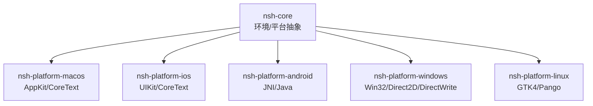
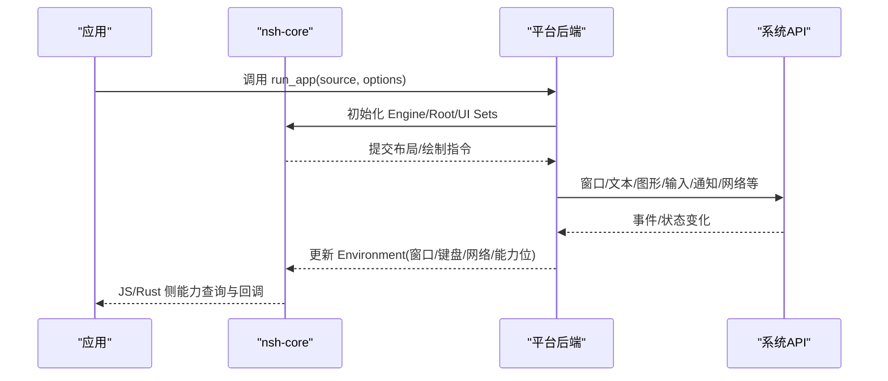
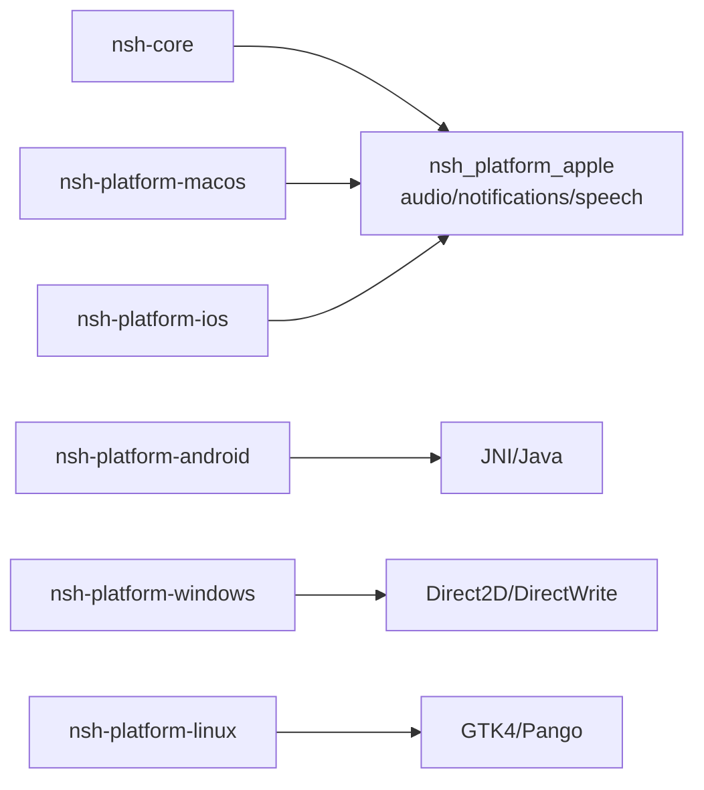

# 平台特定API

<cite>
**本文引用的文件**   
- [platform.rs](file://crates/nsh-core/src/platform.rs)
- [lib.rs（macOS）](file://crates/nsh-platform-macos/src/lib.rs)
- [lib.rs（iOS）](file://crates/nsh-platform-ios/src/lib.rs)
- [lib.rs（Android）](file://crates/nsh-platform-android/src/lib.rs)
- [lib.rs（Windows）](file://crates/nsh-platform-windows/src/lib.rs)
- [lib.rs（Linux）](file://crates/nsh-platform-linux/src/lib.rs)
</cite>

## 目录
1. [简介](#简介)
2. [项目结构](#项目结构)
3. [核心组件](#核心组件)
4. [架构总览](#架构总览)
5. [详细组件分析](#详细组件分析)
6. [依赖关系分析](#依赖关系分析)
7. [性能与兼容性考量](#性能与兼容性考量)
8. [故障排查指南](#故障排查指南)
9. [结论](#结论)
10. [附录：平台条件编译与检测技巧](#附录平台条件编译与检测技巧)

## 简介
本文件为 NSH 框架的“平台特定 API”参考文档，聚焦 macOS、iOS、Android、Windows、Linux 等平台的原生能力访问接口。内容涵盖窗口管理、文件系统访问、通知系统、硬件访问等平台专属功能，说明各平台差异与兼容性策略，并提供平台条件编译使用方法、平台检测技巧、集成示例与常见问题解决方案，以及平台特定的配置选项与部署要求。

NSH 通过统一的 core 层抽象（如 Environment、Os、Idiom、Network 等）屏蔽底层差异，各平台后端在各自 crate 中实现具体行为，并通过统一的入口函数（如 run_app、set_ui_sets、set_components）接入引擎。

## 项目结构
NSH 的平台相关代码主要分布在以下 crate：
- nsh-core：跨平台抽象与环境信息（Environment、Os、Idiom、LocaleSettings 等）
- nsh-platform-macos：macOS 后端（AppKit/CoreText/Animation）
- nsh-platform-ios：iOS 后端（UIKit/CoreText/Animation）
- nsh-platform-android：Android 后端（JNI + Java 宿主）
- nsh-platform-windows：Windows 后端（Win32/Direct2D/DirectWrite）
- nsh-platform-linux：Linux 后端（GTK4/Pango）

图表来源
- [platform.rs:417-620](file://crates/nsh-core/src/platform.rs#L417-L620)
- [lib.rs（macOS）:1-22](file://crates/nsh-platform-macos/src/lib.rs#L1-L22)
- [lib.rs（iOS）:1-37](file://crates/nsh-platform-ios/src/lib.rs#L1-L37)
- [lib.rs（Android）:1-18](file://crates/nsh-platform-android/src/lib.rs#L1-L18)
- [lib.rs（Windows）:1-22](file://crates/nsh-platform-windows/src/lib.rs#L1-L22)
- [lib.rs（Linux）:1-15](file://crates/nsh-platform-linux/src/lib.rs#L1-L15)

章节来源
- [platform.rs:417-620](file://crates/nsh-core/src/platform.rs#L417-L620)
- [lib.rs（macOS）:1-22](file://crates/nsh-platform-macos/src/lib.rs#L1-L22)
- [lib.rs（iOS）:1-37](file://crates/nsh-platform-ios/src/lib.rs#L1-L37)
- [lib.rs（Android）:1-18](file://crates/nsh-platform-android/src/lib.rs#L1-L18)
- [lib.rs（Windows）:1-22](file://crates/nsh-platform-windows/src/lib.rs#L1-L22)
- [lib.rs（Linux）:1-15](file://crates/nsh-platform-linux/src/lib.rs#L1-L15)

## 核心组件
本节梳理跨平台的核心类型与能力开关，帮助理解各平台如何暴露能力。

- 操作系统与设备形态
  - Os：ios/android/macos/windows/linux/web；提供 is_desktop()、is_catalyst() 等方法
  - Idiom：phone/pad/mac/tv/desktop/terminal；提供 desktop_on(os)、reported_on(os)
- 环境与能力
  - Environment：包含 window/safe_area/title_bar/window_state/keyboard_*、color_scheme/font_scale/rtl/reduce_motion/pixel_ratio/screen_reader、os/os_version/idiom/locale/locale_settings/lifecycle/wake_count/network、screen_color/clipboard_write_result/canvas_render/share/app_settings/auth_session/scheme_links/file_requests/speech/notifications/audio/tab_bar/clipboard_images/cell/web_input/web_evaluate/web_views/webview_requests/shaders 等字段
  - Network：kind/expensive/constrained/cellular_data/online()
  - CellularData：unknown/restricted/notRestricted
- 本地化与时区
  - Locale/Languages/TimeZone/HourCycle/Weekday/MeasurementSystem/TemperatureUnit/LocaleSettings

这些类型是平台后端填充和上层应用读取的统一契约。

章节来源
- [platform.rs:100-159](file://crates/nsh-core/src/platform.rs#L100-L159)
- [platform.rs:161-210](file://crates/nsh-core/src/platform.rs#L161-L210)
- [platform.rs:239-386](file://crates/nsh-core/src/platform.rs#L239-L386)
- [platform.rs:417-620](file://crates/nsh-core/src/platform.rs#L417-L620)
- [platform.rs:744-831](file://crates/nsh-core/src/platform.rs#L744-L831)
- [platform.rs:845-925](file://crates/nsh-core/src/platform.rs#L845-L925)
- [platform.rs:941-1036](file://crates/nsh-core/src/platform.rs#L941-L1036)
- [platform.rs:1163-1298](file://crates/nsh-core/src/platform.rs#L1163-L1298)
- [platform.rs:1388-1567](file://crates/nsh-core/src/platform.rs#L1388-L1567)

## 架构总览
下图展示 NSH 在平台层的总体调用链：应用通过统一入口启动，平台后端负责渲染、输入、系统能力桥接，并将 Environment 能力反馈给核心。

图表来源
- [lib.rs（macOS）:1-22](file://crates/nsh-platform-macos/src/lib.rs#L1-L22)
- [lib.rs（iOS）:1-37](file://crates/nsh-platform-ios/src/lib.rs#L1-L37)
- [lib.rs（Android）:1-18](file://crates/nsh-platform-android/src/lib.rs#L1-L18)
- [lib.rs（Windows）:1-22](file://crates/nsh-platform-windows/src/lib.rs#L1-L22)
- [lib.rs（Linux）:1-15](file://crates/nsh-platform-linux/src/lib.rs#L1-L15)
- [platform.rs:417-620](file://crates/nsh-core/src/platform.rs#L417-L620)

## 详细组件分析

### 窗口管理与桌面体验
- macOS：基于 AppKit 视图与 Core Animation，支持标题栏隐藏、窗口状态、菜单、托盘、全局快捷键、屏幕颜色拾取、登录项等。
- Windows：基于 Win32 窗口与 Direct2D/DirectWrite，支持合成 WebView、托盘、全局快捷键、音频、会话状态等。
- Linux：基于 GTK4/Pango，支持菜单样式、链接处理、托盘、全局快捷键、音频（可选 GStreamer）。
- iOS：无传统桌面窗口，使用 UIKit 视图层级；提供底部栏、导航、分割视图、系统控件（日期时间选择器、分段控件、开关、菜单按钮）、TabBar 等。
- Android：通过 Activity/View 体系承载 UI，提供通知、权限、包信息、选择器等。

关键差异与兼容点：
- 桌面行为由 Idiom.desktop_on(os) 判定，macOS/Windows/Linux 视为桌面；Web 在桌面 idiom 下也视为桌面。
- 标题栏区域、窗口状态、键盘高度、安全区域等通过 Environment 暴露。
- 某些能力（如 webview_requests、web_evaluate、canvas_render、share、app_settings、auth_session、scheme_links、file_requests、speech、audio、tab_bar、clipboard_images）以布尔或 Option<bool> 形式声明是否可用。

章节来源
- [platform.rs:131-147](file://crates/nsh-core/src/platform.rs#L131-L147)
- [platform.rs:183-210](file://crates/nsh-core/src/platform.rs#L183-L210)
- [platform.rs:417-620](file://crates/nsh-core/src/platform.rs#L417-L620)
- [lib.rs（macOS）:1-22](file://crates/nsh-platform-macos/src/lib.rs#L1-L22)
- [lib.rs（Windows）:1-22](file://crates/nsh-platform-windows/src/lib.rs#L1-L22)
- [lib.rs（Linux）:1-15](file://crates/nsh-platform-linux/src/lib.rs#L1-L15)
- [lib.rs（iOS）:1-37](file://crates/nsh-platform-ios/src/lib.rs#L1-L37)
- [lib.rs（Android）:1-18](file://crates/nsh-platform-android/src/lib.rs#L1-L18)

### 文件系统与文件请求
- 桌面端（macOS/Windows/Linux）通常实现完整的文件请求流程（打开/保存/拖放），并可通过 Environment.file_requests 判断可用性。
- 移动端（iOS/Android）仅开放部分对话框能力，不支持的操作会返回不可用错误。
- scheme_links 控制是否能接收应用声明的 URL Scheme 链接，影响签名认证等场景。

章节来源
- [platform.rs:542-556](file://crates/nsh-core/src/platform.rs#L542-L556)
- [platform.rs:655-660](file://crates/nsh-core/src/platform.rs#L655-L660)

### 通知系统与剪贴板
- 通知：Environment.notifications 指示平台是否支持系统通知；未实现时权限为 unavailable 且无法显示。
- 剪贴板：Environment.clipboard_write_result 表示写剪贴板是否可获知结果；Environment.clipboard_images 表示是否支持图片剪贴板（Android 默认仅文本）。

章节来源
- [platform.rs:557-584](file://crates/nsh-core/src/platform.rs#L557-L584)

### 硬件与媒体能力
- 音频：Environment.audio 指示是否可用；Windows 提供 audio.rs，Linux 提供 sound.rs（可选 feature），macOS/iOS 共享 nsh_platform_apple::audio。
- 语音识别：Environment.speech 指示是否可用；macOS/iOS 共享 nsh_platform_apple::speech。
- 画布离屏渲染：Environment.canvas_render 指示是否支持 OffscreenCanvas 渲染。
- 着色器：Environment.shaders 指示是否可用；终端界面不绘制着色器。
- 屏幕颜色拾取：Environment.screen_color 指示是否可用。

章节来源
- [platform.rs:557-619](file://crates/nsh-core/src/platform.rs#L557-L619)
- [lib.rs（macOS）:57-58](file://crates/nsh-platform-macos/src/lib.rs#L57-L58)
- [lib.rs（iOS）:96-99](file://crates/nsh-platform-ios/src/lib.rs#L96-L99)
- [lib.rs（Windows）:31-32](file://crates/nsh-platform-windows/src/lib.rs#L31-L32)
- [lib.rs（Linux）:52-55](file://crates/nsh-platform-linux/src/lib.rs#L52-L55)

### 网络与在线状态
- Environment.network 提供 kind/expensive/constrained/cellular_data/online()。
- CellularData 描述 iOS 上蜂窝数据限制状态；其他平台可能为 Unknown。
- Web 平台浏览器缓存模式受 HttpCache 影响；非 Web 平台忽略缓存策略。

章节来源
- [platform.rs:239-386](file://crates/nsh-core/src/platform.rs#L239-L386)
- [platform.rs:1569-1599](file://crates/nsh-core/src/platform.rs#L1569-L1599)

### 本地化、时间与区域设置
- Locale/Languages：BCP 47 语言标签解析与优先级处理。
- TimeZone：IANA 名称或偏移区域，支持 POSIX TZ 规则解析。
- LocaleSettings：hour_cycle/first_day_of_week/measurement_system/temperature_unit 等区域偏好。
- 平台差异：Apple/Android/Windows 分别报告各自的区域设置；Web 使用 Intl。

章节来源
- [platform.rs:744-831](file://crates/nsh-core/src/platform.rs#L744-L831)
- [platform.rs:845-925](file://crates/nsh-core/src/platform.rs#L845-L925)
- [platform.rs:941-1036](file://crates/nsh-core/src/platform.rs#L941-L1036)
- [platform.rs:1163-1298](file://crates/nsh-core/src/platform.rs#L1163-L1298)
- [platform.rs:1388-1567](file://crates/nsh-core/src/platform.rs#L1388-L1567)

### 平台入口与组件注册
- 所有平台后端均导出 set_ui_sets、run_app、set_components 等入口，用于注入 UI 集、运行应用、注册原生组件。
- Android 额外提供 ui_sets!/components!/root!/main! 宏，便于 JNI 绑定与 Rust-only 应用开发。

章节来源
- [lib.rs（macOS）:72-90](file://crates/nsh-platform-macos/src/lib.rs#L72-L90)
- [lib.rs（iOS）:121-222](file://crates/nsh-platform-ios/src/lib.rs#L121-L222)
- [lib.rs（Android）:44-186](file://crates/nsh-platform-android/src/lib.rs#L44-L186)
- [lib.rs（Windows）:78-101](file://crates/nsh-platform-windows/src/lib.rs#L78-L101)
- [lib.rs（Linux）:69-85](file://crates/nsh-platform-linux/src/lib.rs#L69-L85)

## 依赖关系分析
- nsh-core 定义跨平台抽象，被各平台后端引用。
- macOS/iOS 共享 nsh_platform_apple（音频/通知/语音）模块。
- Android 通过 JNI 与 Java 宿主交互，导出宏简化集成。
- Windows/Linux 各自依赖系统库（DirectX/GTK4）。

图表来源
- [lib.rs（macOS）:57-58](file://crates/nsh-platform-macos/src/lib.rs#L57-L58)
- [lib.rs（iOS）:96-99](file://crates/nsh-platform-ios/src/lib.rs#L96-L99)
- [lib.rs（Android）:146-186](file://crates/nsh-platform-android/src/lib.rs#L146-L186)
- [lib.rs（Windows）:1-22](file://crates/nsh-platform-windows/src/lib.rs#L1-L22)
- [lib.rs（Linux）:1-15](file://crates/nsh-platform-linux/src/lib.rs#L1-L15)

章节来源
- [lib.rs（macOS）:57-58](file://crates/nsh-platform-macos/src/lib.rs#L57-L58)
- [lib.rs（iOS）:96-99](file://crates/nsh-platform-ios/src/lib.rs#L96-L99)
- [lib.rs（Android）:146-186](file://crates/nsh-platform-android/src/lib.rs#L146-L186)
- [lib.rs（Windows）:1-22](file://crates/nsh-platform-windows/src/lib.rs#L1-L22)
- [lib.rs（Linux）:1-15](file://crates/nsh-platform-linux/src/lib.rs#L1-L15)

## 性能与兼容性考量
- 渲染线程分离：各平台后端将引擎运行于独立线程，主线程负责绘制与动画，减少阻塞。
- 文本排版：macOS/iOS 使用 CoreText，Windows 使用 DirectWrite，Linux 使用 Pango，均在引擎线程完成字形布局，主线程仅绘制。
- 能力探测：Environment 中的布尔/Option<bool> 字段允许运行时探测能力，避免在不支持的平台上调用不可用 API。
- 网络与缓存：Web 平台遵循 Fetch 标准缓存模式；非 Web 平台忽略缓存策略，直接走网络。
- 终端模式：Terminal idiom 下使用 Cell 网格布局，禁用着色器，适配 TUI 场景。

章节来源
- [lib.rs（macOS）:1-22](file://crates/nsh-platform-macos/src/lib.rs#L1-L22)
- [lib.rs（iOS）:1-37](file://crates/nsh-platform-ios/src/lib.rs#L1-L37)
- [lib.rs（Windows）:1-22](file://crates/nsh-platform-windows/src/lib.rs#L1-L22)
- [lib.rs（Linux）:1-15](file://crates/nsh-platform-linux/src/lib.rs#L1-L15)
- [platform.rs:585-591](file://crates/nsh-core/src/platform.rs#L585-L591)
- [platform.rs:1569-1599](file://crates/nsh-core/src/platform.rs#L1569-L1599)

## 故障排查指南
- 能力不可用
  - 现象：调用某平台能力立即返回“不可用”错误（如 ERR_FEATURE_UNAVAILABLE_ON_PLATFORM）。
  - 排查：检查 Environment 对应布尔字段（如 canvas_render、share、app_settings、auth_session、file_requests、speech、audio、tab_bar、clipboard_images）是否为 false 或 None。
- 剪贴板写入无结果
  - 现象：writeImage/hasImage 等行为异常。
  - 排查：确认 Environment.clipboard_write_result 与 clipboard_images；Android 默认仅文本。
- 通知权限不可用
  - 现象：权限为 unavailable，无法显示通知。
  - 排查：确认 Environment.notifications 是否为 true。
- 网络离线误判
  - 现象：network().online 返回 false。
  - 排查：检查 Environment.network.kind 是否为 none；Unknown 视为在线。
- WebView 下载失败
  - 现象：WebView 请求失败。
  - 排查：确认 Environment.webview_requests 是否为 true（桌面端通常实现）。
- 着色器不可用
  - 现象：Shader 报错或不可用。
  - 排查：确认 Environment.shaders 是否为 true；终端模式不绘制着色器。

章节来源
- [platform.rs:510-619](file://crates/nsh-core/src/platform.rs#L510-L619)
- [platform.rs:293-299](file://crates/nsh-core/src/platform.rs#L293-L299)

## 结论
NSH 通过 nsh-core 的统一抽象与各平台后端的差异化实现，提供了跨平台的窗口、文件、通知、硬件、网络、本地化等能力。开发者应优先使用 Environment 提供的能力探测字段进行兼容性处理，并在平台特定场景中按需启用相应特性。各平台后端在入口函数与组件注册方面保持一致，便于统一集成与维护。

## 附录：平台条件编译与检测技巧
- 条件编译
  - 使用 #[cfg(target_os = "macos")]、#[cfg(target_os = "ios")]、#[cfg(target_os = "android")]、#[cfg(windows)]、#[cfg(target_os = "linux")] 对平台特定代码进行编译期隔离。
  - macOS/iOS 共享 nsh_platform_apple 模块，可在两个平台复用音频/通知/语音逻辑。
- 运行时检测
  - 使用 Os.name()/is_desktop()/is_catalyst() 与 Idiom.reported_on(os)/desktop_on(os) 进行运行时分支。
  - 通过 Environment.platform_name() 获取 TS 侧 platform.name；通过 Environment.os 与 Environment.idiom 组合判断桌面/移动/终端。
- 集成示例
  - 在应用启动前调用 set_ui_sets 注入 UI 集，调用 set_components 注册原生组件，最后调用 run_app 启动。
  - Android 可使用 ui_sets!/components!/root!/main! 宏快速生成 JNI 绑定与 Rust-only 应用入口。

章节来源
- [lib.rs（macOS）:23-23](file://crates/nsh-platform-macos/src/lib.rs#L23-L23)
- [lib.rs（iOS）:57-57](file://crates/nsh-platform-ios/src/lib.rs#L57-L57)
- [lib.rs（Android）:18-18](file://crates/nsh-platform-android/src/lib.rs#L18-L18)
- [lib.rs（Windows）:23-23](file://crates/nsh-platform-windows/src/lib.rs#L23-L23)
- [lib.rs（Linux）:16-16](file://crates/nsh-platform-linux/src/lib.rs#L16-L16)
- [platform.rs:118-147](file://crates/nsh-core/src/platform.rs#L118-L147)
- [platform.rs:183-210](file://crates/nsh-core/src/platform.rs#L183-L210)
- [platform.rs:635-640](file://crates/nsh-core/src/platform.rs#L635-L640)
- [lib.rs（Android）:93-186](file://crates/nsh-platform-android/src/lib.rs#L93-L186)