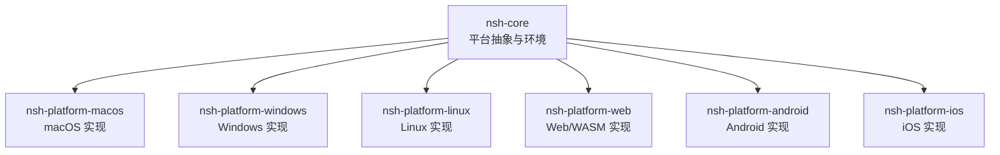
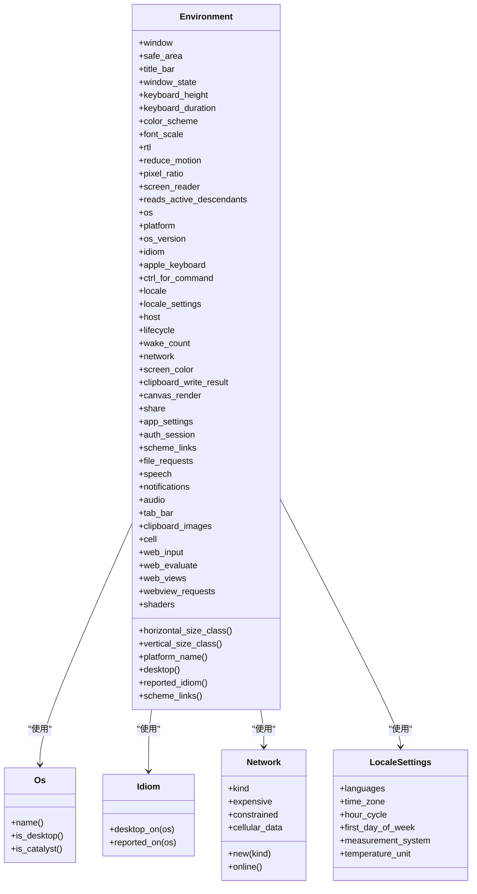
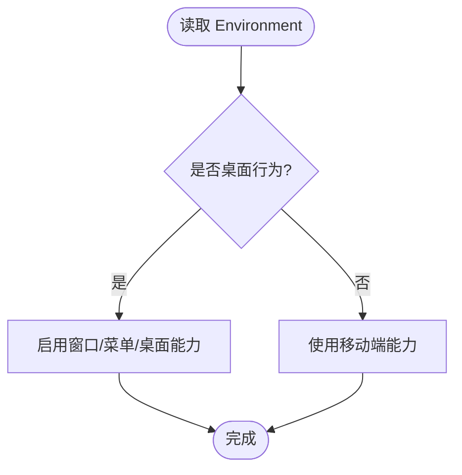
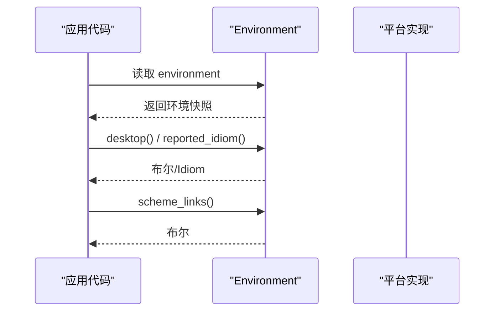
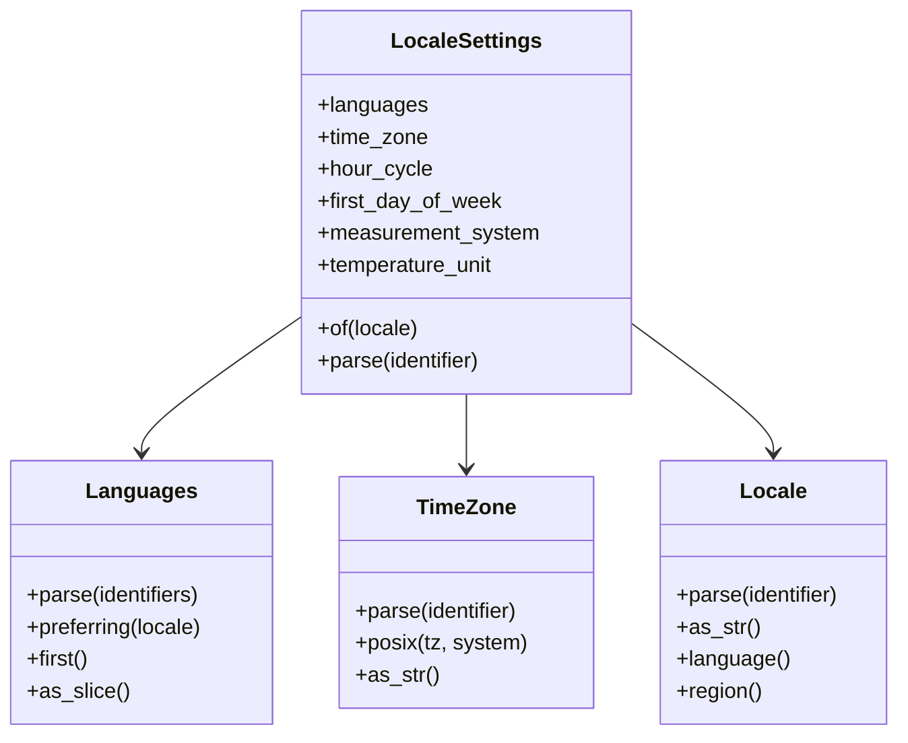
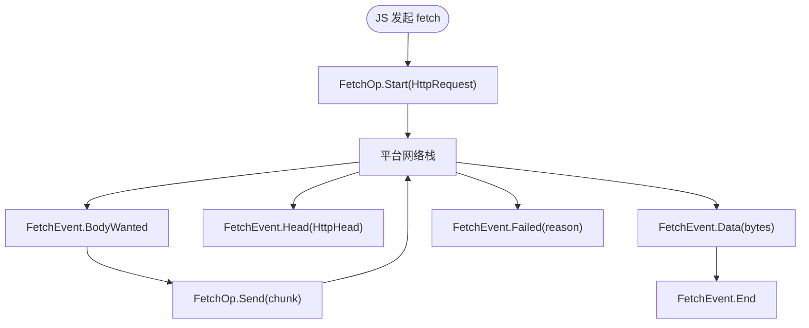
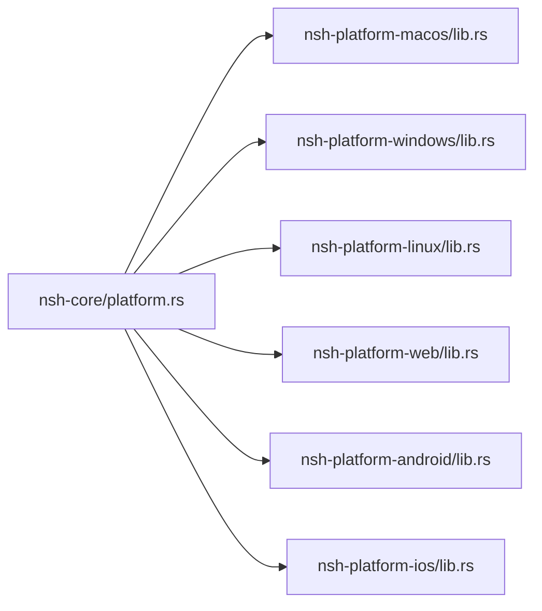

# 平台抽象层

<cite>
**本文引用的文件**   
- [platform.rs](file://crates/nsh-core/src/platform.rs)
- [lib.rs（macOS）](file://crates/nsh-platform-macos/src/lib.rs)
- [lib.rs（Windows）](file://crates/nsh-platform-windows/src/lib.rs)
- [lib.rs（Linux）](file://crates/nsh-platform-linux/src/lib.rs)
- [lib.rs（Web）](file://crates/nsh-platform-web/src/lib.rs)
- [lib.rs（Android）](file://crates/nsh-platform-android/src/lib.rs)
- [lib.rs（iOS）](file://crates/nsh-platform-ios/src/lib.rs)
</cite>

## 目录
1. [简介](#简介)
2. [项目结构](#项目结构)
3. [核心组件](#核心组件)
4. [架构总览](#架构总览)
5. [详细组件分析](#详细组件分析)
6. [依赖关系分析](#依赖关系分析)
7. [性能考量](#性能考量)
8. [故障排查指南](#故障排查指南)
9. [结论](#结论)
10. [附录：新平台接入与优化实践](#附录新平台接入与优化实践)

## 简介
本文件为 NSH 框架“平台抽象层”的 API 文档，聚焦跨平台环境检测、系统能力查询与平台特定功能访问接口。重点说明 Environment、Platform 等核心抽象类型的使用方法，解释不同平台的特性差异、兼容性处理与适配层实现原理，并提供新平台支持添加指南与平台特定优化方法，以及最佳实践与常见问题解决方案。

## 项目结构
NSH 的平台抽象位于 nsh-core 的 platform 模块，提供统一的运行时环境与能力描述；各具体平台（macOS、Windows、Linux、Web、Android、iOS）在各自 crate 中实现这些抽象，并通过构建配置选择目标平台。

**图示来源**
- [platform.rs:419-714](file://crates/nsh-core/src/platform.rs#L419-L714)
- [lib.rs（macOS）](file://crates/nsh-platform-macos/src/lib.rs)
- [lib.rs（Windows）](file://crates/nsh-platform-windows/src/lib.rs)
- [lib.rs（Linux）](file://crates/nsh-platform-linux/src/lib.rs)
- [lib.rs（Web）](file://crates/nsh-platform-web/src/lib.rs)
- [lib.rs（Android）](file://crates/nsh-platform-android/src/lib.rs)
- [lib.rs（iOS）](file://crates/nsh-platform-ios/src/lib.rs)

**章节来源**
- [platform.rs:1-10](file://crates/nsh-core/src/platform.rs#L1-L10)

## 核心组件
本节概述平台抽象层的核心类型与职责：
- Os/Idiom/Lifecycle：操作系统、设备形态与生命周期状态
- Network/NetworkKind/CellularData：网络连通性与限制
- Environment：平台对当前表面的综合环境信息
- HostEnvironment：宿主应用覆盖的环境设置
- Locale/Languages/TimeZone/LocaleSettings：国际化与区域设置
- AppInfo/PerfStats：应用信息与性能统计
- HttpRequest/HttpBody/HttpHead/FetchEvent/FetchOp：HTTP 请求与流式传输模型

**章节来源**
- [platform.rs:100-159](file://crates/nsh-core/src/platform.rs#L100-L159)
- [platform.rs:239-386](file://crates/nsh-core/src/platform.rs#L239-L386)
- [platform.rs:419-714](file://crates/nsh-core/src/platform.rs#L419-L714)
- [platform.rs:716-742](file://crates/nsh-core/src/platform.rs#L716-L742)
- [platform.rs:744-1064](file://crates/nsh-core/src/platform.rs#L744-L1064)
- [platform.rs:1078-1161](file://crates/nsh-core/src/platform.rs#L1078-L1161)
- [platform.rs:1163-1567](file://crates/nsh-core/src/platform.rs#L1163-L1567)
- [platform.rs:1569-1894](file://crates/nsh-core/src/platform.rs#L1569-L1894)

## 架构总览
平台抽象层通过 Environment 暴露统一的环境视图，由具体平台填充字段并上报能力开关。上层 UI 与业务逻辑仅依赖 Environment 的能力标志进行条件渲染或降级策略。

**图示来源**
- [platform.rs:419-714](file://crates/nsh-core/src/platform.rs#L419-L714)
- [platform.rs:100-159](file://crates/nsh-core/src/platform.rs#L100-L159)
- [platform.rs:239-386](file://crates/nsh-core/src/platform.rs#L239-L386)
- [platform.rs:1163-1567](file://crates/nsh-core/src/platform.rs#L1163-L1567)

## 详细组件分析

### 环境与能力枚举
- Os：操作系统枚举，提供 name/is_desktop/is_catalyst 等方法，用于判断桌面行为与 Catalyst 运行模式。
- Idiom：设备形态枚举，提供 desktop_on/reported_on 以决定“桌面行为”与对外报告的 idiom。
- Lifecycle：应用生命周期 Active/Inactive/Background。
- Network/NetworkKind/CellularData：网络连通性、昂贵连接、受限模式与蜂窝数据权限。

**图示来源**
- [platform.rs:131-147](file://crates/nsh-core/src/platform.rs#L131-L147)
- [platform.rs:183-209](file://crates/nsh-core/src/platform.rs#L183-L209)
- [platform.rs:642-653](file://crates/nsh-core/src/platform.rs#L642-L653)

**章节来源**
- [platform.rs:100-159](file://crates/nsh-core/src/platform.rs#L100-L159)
- [platform.rs:161-210](file://crates/nsh-core/src/platform.rs#L161-L210)
- [platform.rs:212-237](file://crates/nsh-core/src/platform.rs#L212-L237)
- [platform.rs:239-386](file://crates/nsh-core/src/platform.rs#L239-L386)

### Environment 详解
Environment 聚合了表面尺寸、安全区域、键盘高度、外观、字体缩放、RTL、减少动画、像素比、读屏器、语言区域、宿主注入、生命周期、唤醒计数、网络、剪贴板、Canvas、分享、应用设置、认证会话、URL Scheme、文件请求、语音、通知、音频、TabBar、WebView、着色器等能力开关。

关键方法与默认值：
- horizontal_size_class()/vertical_size_class()：基于原生 SizeClass 或窗口尺寸回退到 600pt 断点。
- platform_name()：外部平台可自定义名称，否则返回 OS 名。
- desktop()：依据 Idiom.desktop_on(Os)。
- reported_idiom()：对外报告的 idiom，终端场景特殊处理。
- scheme_links()：非 Web 平台默认开启 URL Scheme 链接。

**图示来源**
- [platform.rs:622-661](file://crates/nsh-core/src/platform.rs#L622-L661)

**章节来源**
- [platform.rs:419-714](file://crates/nsh-core/src/platform.rs#L419-L714)

### 国际化与区域设置
- Locale：BCP 47 语言标签解析与片段提取。
- Languages：用户首选语言列表，最多 8 项，去重且保留顺序。
- TimeZone：IANA 时区与偏移格式解析，支持 POSIX TZ 规则回退。
- LocaleSettings：小时制、首周、度量单位、温度单位等区域偏好。

**图示来源**
- [platform.rs:744-1064](file://crates/nsh-core/src/platform.rs#L744-L1064)
- [platform.rs:1163-1567](file://crates/nsh-core/src/platform.rs#L1163-L1567)

**章节来源**
- [platform.rs:744-1064](file://crates/nsh-core/src/platform.rs#L744-L1064)
- [platform.rs:1163-1567](file://crates/nsh-core/src/platform.rs#L1163-L1567)

### HTTP 请求与流式传输
- HttpRequest/HttpBody/HttpHead：请求体、响应头与缓存模式。
- FetchEvent/FetchOp：引擎与平台网络栈之间的流式事件与操作。

**图示来源**
- [platform.rs:1569-1894](file://crates/nsh-core/src/platform.rs#L1569-L1894)

**章节来源**
- [platform.rs:1569-1894](file://crates/nsh-core/src/platform.rs#L1569-L1894)

## 依赖关系分析
- nsh-core/platform.rs 定义抽象与数据结构，被所有平台 crate 依赖。
- 各平台 lib.rs 负责将系统能力映射到 Environment 字段，并实现命令通道（如剪贴板、通知、WebView 等）。
- 构建期通过 target_os/target_abi 等条件编译控制默认行为（例如 iOS 作为默认移动 OS，Catalyst 的特殊判定）。

**图示来源**
- [platform.rs:1-10](file://crates/nsh-core/src/platform.rs#L1-L10)
- [lib.rs（macOS）](file://crates/nsh-platform-macos/src/lib.rs)
- [lib.rs（Windows）](file://crates/nsh-platform-windows/src/lib.rs)
- [lib.rs（Linux）](file://crates/nsh-platform-linux/src/lib.rs)
- [lib.rs（Web）](file://crates/nsh-platform-web/src/lib.rs)
- [lib.rs（Android）](file://crates/nsh-platform-android/src/lib.rs)
- [lib.rs（iOS）](file://crates/nsh-platform-ios/src/lib.rs)

**章节来源**
- [platform.rs:100-159](file://crates/nsh-core/src/platform.rs#L100-L159)

## 性能考量
- PerfStats：每秒帧率、刷新率与丢帧比例，供上层监控与自适应。
- Environment.shaders/web_views/cell 等能力开关影响渲染路径与布局算法（如终端 Cell 布局禁用着色器）。
- Network.expensive/constrained 可用于节流网络请求与媒体加载。

[本节为通用指导，不直接分析具体文件]

## 故障排查指南
- 能力不可用错误：当某能力未实现（如 canvas_render=false），调用相关命令会立即返回“平台不可用”错误。检查 Environment 对应字段与平台实现是否启用。
- URL Scheme 链接：Web 平台默认不接收外部 Scheme 链接，需显式设置 scheme_links=true。
- 剪贴板图片：Android 后端默认仅文本，若需要图片需显式设置 clipboard_images。
- WebView 可用性：若 web_views=false，WebView 将报错；若仅启动失败，则由 WebView 自身上报错误。

**章节来源**
- [platform.rs:520-619](file://crates/nsh-core/src/platform.rs#L520-L619)
- [platform.rs:655-661](file://crates/nsh-core/src/platform.rs#L655-L661)

## 结论
NSH 平台抽象层通过 Environment 提供一致的环境与能力视图，屏蔽底层平台差异。开发者应优先使用 Environment 提供的能力标志进行条件分支与降级，避免直接依赖平台细节。新增平台时，仅需实现 Environment 字段的填充与能力开关，即可无缝接入上层生态。

[本节为总结性内容，不直接分析具体文件]

## 附录：新平台接入与优化实践

### 新平台接入步骤
- 创建平台 crate（如 nsh-platform-xxx），并在其 lib.rs 中初始化 Environment 字段。
- 根据系统 API 填充以下关键字段：
  - os/idiom/os_version/locale/locale_settings/network/lifecycle/wake_count
  - 能力开关：screen_color/clipboard_write_result/canvas_render/share/app_settings/auth_session/scheme_links/file_requests/speech/notifications/audio/tab_bar/clipboard_images/web_input/web_evaluate/web_views/webview_requests/shaders
- 实现命令通道回调（如剪贴板、通知、WebView 请求等），确保与 Engine 的事件协议一致。
- 在构建配置中注册平台，使 Engine 能选择该实现。

**章节来源**
- [platform.rs:419-714](file://crates/nsh-core/src/platform.rs#L419-L714)

### 平台特性差异与兼容性处理
- 桌面行为：Os.is_desktop() 与 Idiom.desktop_on() 共同决定桌面能力可用范围。
- Catalyst：Os.is_catalyst() 用于区分 iOS 后端在 Mac Catalyst 上的行为。
- 终端模式：Idiom::Terminal 始终视为桌面行为，但对外报告为 Terminal。
- URL Scheme：Web 平台默认关闭，其他平台默认开启，可通过 scheme_links 覆盖。

**章节来源**
- [platform.rs:131-147](file://crates/nsh-core/src/platform.rs#L131-L147)
- [platform.rs:183-209](file://crates/nsh-core/src/platform.rs#L183-L209)
- [platform.rs:655-661](file://crates/nsh-core/src/platform.rs#L655-L661)

### 平台特定优化建议
- 高性能渲染：在 shaders=false 时禁用着色器路径，改用 CPU 渲染或降级方案。
- 网络节流：在网络 expensive/constrained 时降低请求频率与资源体积。
- 输入体验：根据 apple_keyboard/ctrl_for_command 调整快捷键显示与行为。
- 无障碍：reads_active_descendants 开启后，列表等组件应配合读屏器优化播报。

**章节来源**
- [platform.rs:476-485](file://crates/nsh-core/src/platform.rs#L476-L485)
- [platform.rs:454-462](file://crates/nsh-core/src/platform.rs#L454-L462)
- [platform.rs:239-386](file://crates/nsh-core/src/platform.rs#L239-L386)