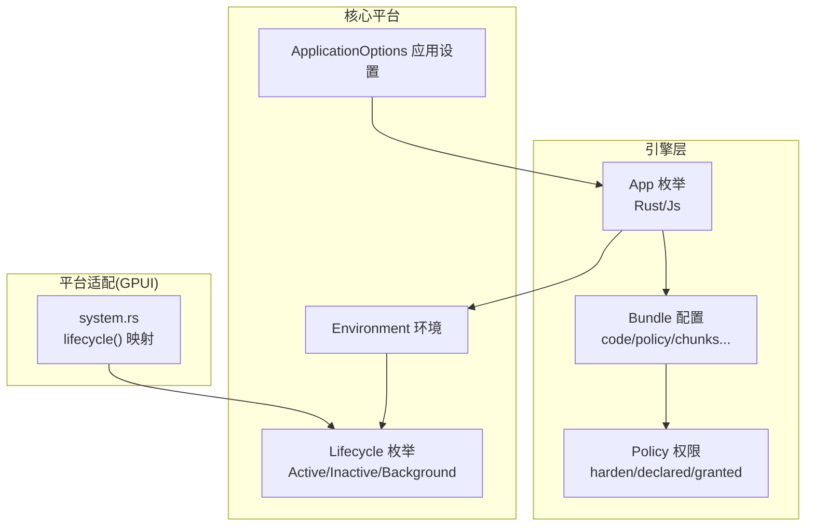
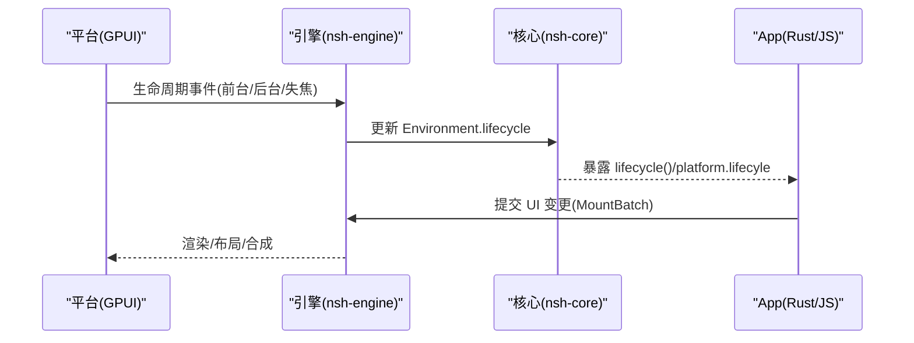
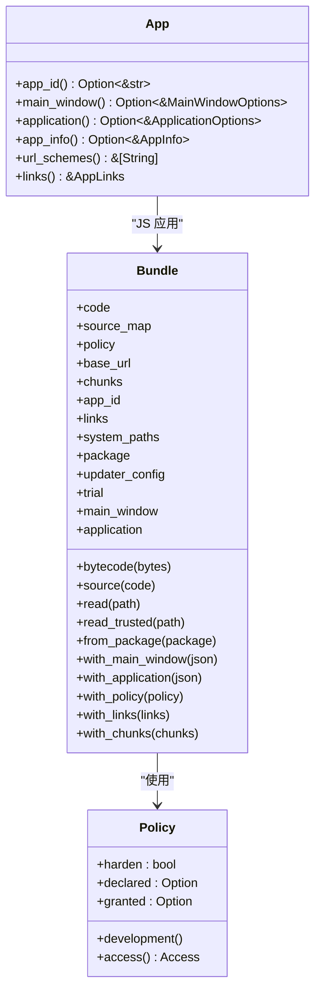
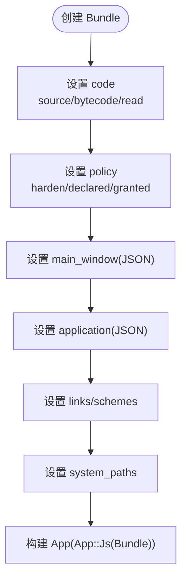
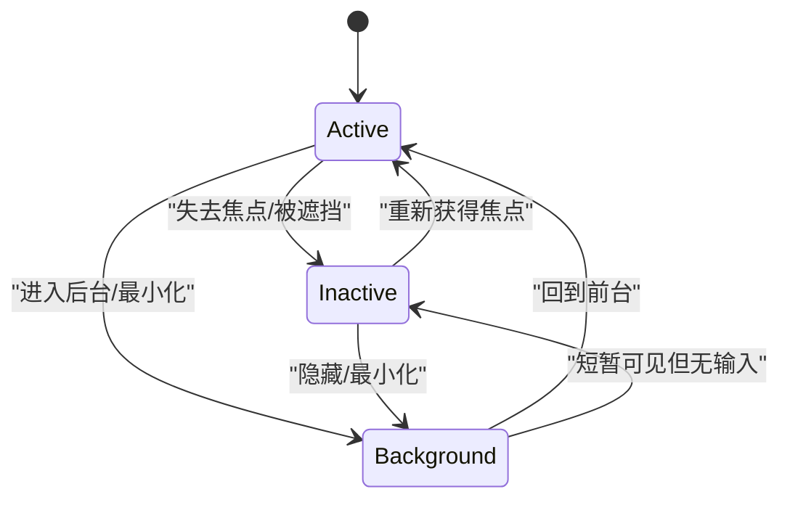
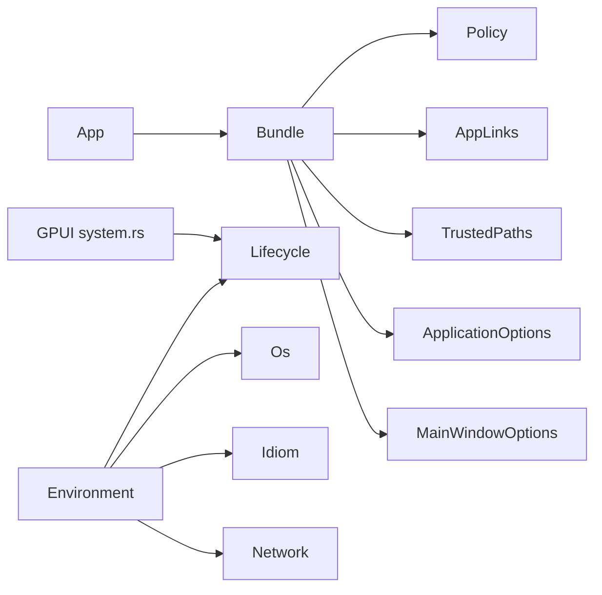

# 应用生命周期管理

<cite>
**本文引用的文件**   
- [nsh-engine/src/lib.rs](file://crates/nsh-engine/src/lib.rs)
- [nsh-core/src/platform.rs](file://crates/nsh-core/src/platform.rs)
- [nsh-core/src/desktop.rs](file://crates/nsh-core/src/desktop.rs)
- [gpui/nsh-platform-gpui/src/system.rs](file://crates/gpui/nsh-platform-gpui/src/system.rs)
</cite>

## 目录
1. [简介](#简介)
2. [项目结构](#项目结构)
3. [核心组件](#核心组件)
4. [架构总览](#架构总览)
5. [详细组件分析](#详细组件分析)
6. [依赖关系分析](#依赖关系分析)
7. [性能考虑](#性能考虑)
8. [故障排查指南](#故障排查指南)
9. [结论](#结论)
10. [附录](#附录)

## 简介
本文面向 NSH 框架的应用生命周期管理，系统性说明应用的启动、运行、暂停、恢复与销毁等阶段对应的 API 与行为；解释 App 枚举类型在 Rust 应用与 JS 应用中的初始化流程；梳理 Bundle 配置选项、Policy 权限控制与应用设置的管理机制；给出应用状态监控、错误处理与资源清理的最佳实践；并提供生命周期钩子的实现示例与平台特定行为的说明。

## 项目结构
围绕应用生命周期，关键代码分布在以下模块：
- nsh-engine: 引擎线程、App/Bundle/Policy 定义、挂载与错误上报、JS 包加载与策略解析
- nsh-core: 平台抽象、Lifecycle 枚举、Environment 环境信息、桌面端 ApplicationOptions 应用设置
- gpui/nsh-platform-gpui: 平台侧生命周期事件到 Lifecycle 的映射

图表来源
- [nsh-engine/src/lib.rs:125-198](file://crates/nsh-engine/src/lib.rs#L125-L198)
- [nsh-engine/src/lib.rs:206-360](file://crates/nsh-engine/src/lib.rs#L206-L360)
- [nsh-core/src/platform.rs:212-237](file://crates/nsh-core/src/platform.rs#L212-L237)
- [gpui/nsh-platform-gpui/src/system.rs:224-235](file://crates/gpui/nsh-platform-gpui/src/system.rs#L224-L235)

章节来源
- [nsh-engine/src/lib.rs:125-198](file://crates/nsh-engine/src/lib.rs#L125-L198)
- [nsh-engine/src/lib.rs:206-360](file://crates/nsh-engine/src/lib.rs#L206-L360)
- [nsh-core/src/platform.rs:212-237](file://crates/nsh-core/src/platform.rs#L212-L237)
- [gpui/nsh-platform-gpui/src/system.rs:224-235](file://crates/gpui/nsh-platform-gpui/src/system.rs#L224-L235)

## 核心组件
- App 枚举
  - Rust 应用：以 Root 作为根组件挂载到表面
  - JS 应用：以 Bundle（包含代码、策略、窗口与生命周期选项）驱动 QuickJS VM
  - 提供 app_id、main_window、application、app_info、url_schemes、links 等访问器，用于统一读取 Rust/JS 两类应用的信息

- Bundle 配置
  - code: 字节码或源码
  - policy: 权限策略（harden、declared、granted）
  - base_url、chunks、app_id、links、system_paths、package、updater_config、trial、main_window、application
  - 支持从文件/包中读取并解析 window/application/capabilities/app.json 等配置

- Policy 权限
  - harden: 是否禁用 eval 等危险能力（开发模式可关闭）
  - declared: 应用声明的能力集
  - granted: 宿主授予的最大能力集
  - access(): 计算最终 Access 对象

- Lifecycle 生命周期
  - Active: 前台且接收输入
  - Inactive: 可见但未接收输入
  - Background: 不可见，可能被挂起

- Environment 环境
  - 包含 lifecycle、os、idiom、locale、network、window 等运行时环境信息
  - 通过 HostEnvironment 允许宿主覆盖 locale/font_scale

- ApplicationOptions 应用设置
  - 由 nsh.json 的 application 字段或打包产物 app.json 提供
  - 引擎在应用代码运行前设置退出策略等

章节来源
- [nsh-engine/src/lib.rs:125-198](file://crates/nsh-engine/src/lib.rs#L125-L198)
- [nsh-engine/src/lib.rs:206-360](file://crates/nsh-engine/src/lib.rs#L206-L360)
- [nsh-core/src/platform.rs:212-237](file://crates/nsh-core/src/platform.rs#L212-L237)
- [nsh-core/src/platform.rs:417-620](file://crates/nsh-core/src/platform.rs#L417-L620)
- [nsh-core/src/desktop.rs:82-120](file://crates/nsh-core/src/desktop.rs#L82-L120)

## 架构总览
NSH 引擎在独立线程上运行一个 App（Rust 根组件或 JS 包），每次唤醒（输入、定时器、尺寸变化）执行应用代码并提交 UI 变更给平台。平台侧将系统生命周期事件转换为 Lifecycle 枚举，供应用与环境读取。

图表来源
- [gpui/nsh-platform-gpui/src/system.rs:224-235](file://crates/gpui/nsh-platform-gpui/src/system.rs#L224-L235)
- [nsh-core/src/platform.rs:417-620](file://crates/nsh-core/src/platform.rs#L417-L620)
- [nsh-engine/src/lib.rs:1-10](file://crates/nsh-engine/src/lib.rs#L1-L10)

## 详细组件分析

### App 枚举与初始化流程
- Rust 应用
  - 通过 Root 构建根组件，构造 App::Rust(root)
  - 可从 root 读取 app_id、main_window、application、app_info、links 等
- JS 应用
  - 通过 Bundle 构造 App::Js(bundle)
  - Bundle 支持 source/bytecode/read/read_trusted/from_package 等多种创建方式
  - 支持 with_main_window/with_application/with_policy/with_links/with_chunks 等链式配置

图表来源
- [nsh-engine/src/lib.rs:125-198](file://crates/nsh-engine/src/lib.rs#L125-L198)
- [nsh-engine/src/lib.rs:206-360](file://crates/nsh-engine/src/lib.rs#L206-L360)
- [nsh-engine/src/lib.rs:377-591](file://crates/nsh-engine/src/lib.rs#L377-L591)
- [nsh-engine/src/lib.rs:594-631](file://crates/nsh-engine/src/lib.rs#L594-L631)

章节来源
- [nsh-engine/src/lib.rs:125-198](file://crates/nsh-engine/src/lib.rs#L125-L198)
- [nsh-engine/src/lib.rs:206-360](file://crates/nsh-engine/src/lib.rs#L206-L360)
- [nsh-engine/src/lib.rs:377-591](file://crates/nsh-engine/src/lib.rs#L377-L591)
- [nsh-engine/src/lib.rs:594-631](file://crates/nsh-engine/src/lib.rs#L594-L631)

### Bundle 配置与 Policy 权限控制
- Bundle 配置要点
  - code: 字节码或源码
  - policy: 默认开启 harden；开发模式可通过 Policy::development() 关闭
  - main_window/application: 从 JSON 解析，错误时记录日志并忽略
  - links/schemes: 声明 URL schemes 与链接
  - system_paths: 可信文件系统锚点，限制相对路径与占位符授权
  - package/updater_config/trial: 签名包、更新配置、试用健康度回调
- Policy 权限要点
  - declared: 应用声明的能力集（capabilities.json）
  - granted: 宿主授予的最大能力集（可为 None，表示不限制）
  - access(): 合并 declared/granted 得到最终 Access

图表来源
- [nsh-engine/src/lib.rs:377-591](file://crates/nsh-engine/src/lib.rs#L377-L591)
- [nsh-engine/src/lib.rs:317-360](file://crates/nsh-engine/src/lib.rs#L317-L360)

章节来源
- [nsh-engine/src/lib.rs:317-360](file://crates/nsh-engine/src/lib.rs#L317-L360)
- [nsh-engine/src/lib.rs:377-591](file://crates/nsh-engine/src/lib.rs#L377-L591)

### 应用设置(ApplicationOptions)与窗口选项(MainWindowOptions)
- ApplicationOptions
  - 来自 nsh.json 的 application 字段或 app.json
  - 引擎在应用代码运行前设置 quit 策略等
- MainWindowOptions
  - 来自 nsh.json 的 window 字段或 app.json
  - 启动主窗口时使用，引擎将属性发送到首个窗口

章节来源
- [nsh-engine/src/lib.rs:445-468](file://crates/nsh-engine/src/lib.rs#L445-L468)
- [nsh-core/src/desktop.rs:82-120](file://crates/nsh-core/src/desktop.rs#L82-L120)

### 生命周期状态与平台映射
- Lifecycle 枚举
  - Active: 前台且接收输入
  - Inactive: 可见但未接收输入
  - Background: 不可见，可能被挂起
- GPUI 平台映射
  - system.rs 中将平台当前状态映射为 Lifecycle::Background/Active/Inactive

图表来源
- [nsh-core/src/platform.rs:212-237](file://crates/nsh-core/src/platform.rs#L212-L237)
- [gpui/nsh-platform-gpui/src/system.rs:224-235](file://crates/gpui/nsh-platform-gpui/src/system.rs#L224-L235)

章节来源
- [nsh-core/src/platform.rs:212-237](file://crates/nsh-core/src/platform.rs#L212-L237)
- [gpui/nsh-platform-gpui/src/system.rs:224-235](file://crates/gpui/nsh-platform-gpui/src/system.rs#L224-L235)

### 应用生命周期钩子与最佳实践
- 生命周期钩子
  - 通过 Environment.lifecycle 监听 Active/Inactive/Background 变化
  - 在 Inactive/Background 时暂停非必要的定时任务、网络请求与动画
  - 在 Active 时恢复任务、刷新数据、重连网络
- 错误处理
  - 使用 MountSink::report_error/report 捕获 JS 异常、VM 停止等错误
  - 对致命错误进行降级或重启应用
- 资源清理
  - 在 Background 时释放 GPU 资源、取消未完成的 I/O
  - 在销毁时关闭文件句柄、断开 WebSocket、清理缓存

章节来源
- [nsh-core/src/platform.rs:417-620](file://crates/nsh-core/src/platform.rs#L417-L620)
- [nsh-engine/src/lib.rs:753-800](file://crates/nsh-engine/src/lib.rs#L753-L800)

## 依赖关系分析
- App 依赖 Bundle（JS 应用）或 Root（Rust 应用）
- Bundle 依赖 Policy、AppLinks、TrustedPaths、ApplicationOptions、MainWindowOptions
- Environment 依赖 Lifecycle、Os、Idiom、Network 等平台信息
- GPUI 平台将系统事件映射为 Lifecycle

图表来源
- [nsh-engine/src/lib.rs:125-198](file://crates/nsh-engine/src/lib.rs#L125-L198)
- [nsh-engine/src/lib.rs:206-360](file://crates/nsh-engine/src/lib.rs#L206-L360)
- [nsh-core/src/platform.rs:417-620](file://crates/nsh-core/src/platform.rs#L417-L620)
- [gpui/nsh-platform-gpui/src/system.rs:224-235](file://crates/gpui/nsh-platform-gpui/src/system.rs#L224-L235)

章节来源
- [nsh-engine/src/lib.rs:125-198](file://crates/nsh-engine/src/lib.rs#L125-L198)
- [nsh-engine/src/lib.rs:206-360](file://crates/nsh-engine/src/lib.rs#L206-L360)
- [nsh-core/src/platform.rs:417-620](file://crates/nsh-core/src/platform.rs#L417-L620)
- [gpui/nsh-platform-gpui/src/system.rs:224-235](file://crates/gpui/nsh-platform-gpui/src/system.rs#L224-L235)

## 性能考虑
- 引擎线程与平台线程分离，避免阻塞渲染
- 空闲周期垃圾回收（QuickJS）间隔控制，减少卡顿
- 鼠标移动节流，降低高频事件压力
- 按需加载分片（chunks），减少初始加载体积

[本节为通用指导，无需具体文件引用]

## 故障排查指南
- 常见错误来源
  - JS 异常、VM 停止、能力不足（capabilities）、文件/网络权限拒绝
- 定位方法
  - 使用 MountSink::report_error/report 获取错误文本与堆栈
  - 检查 Policy.declared/granted 与实际调用是否匹配
  - 校验 bundle.js.map 是否正确加载以还原源码位置
- 恢复策略
  - 对非致命错误进行降级处理（如回退到离线模式）
  - 对致命错误提示用户并安全退出或重启

章节来源
- [nsh-engine/src/lib.rs:753-800](file://crates/nsh-engine/src/lib.rs#L753-L800)
- [nsh-engine/src/lib.rs:317-360](file://crates/nsh-engine/src/lib.rs#L317-L360)

## 结论
NSH 的应用生命周期管理通过 App/Bundle/Policy 与 Lifecycle/Environment 的组合，提供了跨平台的统一抽象。开发者可在 Active/Inactive/Background 状态下合理调度任务、管理资源与处理错误；同时借助 Bundle 的配置与 Policy 的权限控制，确保应用在安全与可控的环境中运行。

[本节为总结性内容，无需具体文件引用]

## 附录
- 快速参考
  - 启动：构造 App::Rust(root) 或 App::Js(Bundle)
  - 运行：引擎循环执行应用代码并提交 UI 变更
  - 暂停：Environment.lifecycle == Inactive/Background 时暂停非必要任务
  - 恢复：Environment.lifecycle == Active 时恢复任务
  - 销毁：清理资源、断开连接、释放 GPU 与文件句柄

[本节为补充说明，无需具体文件引用]