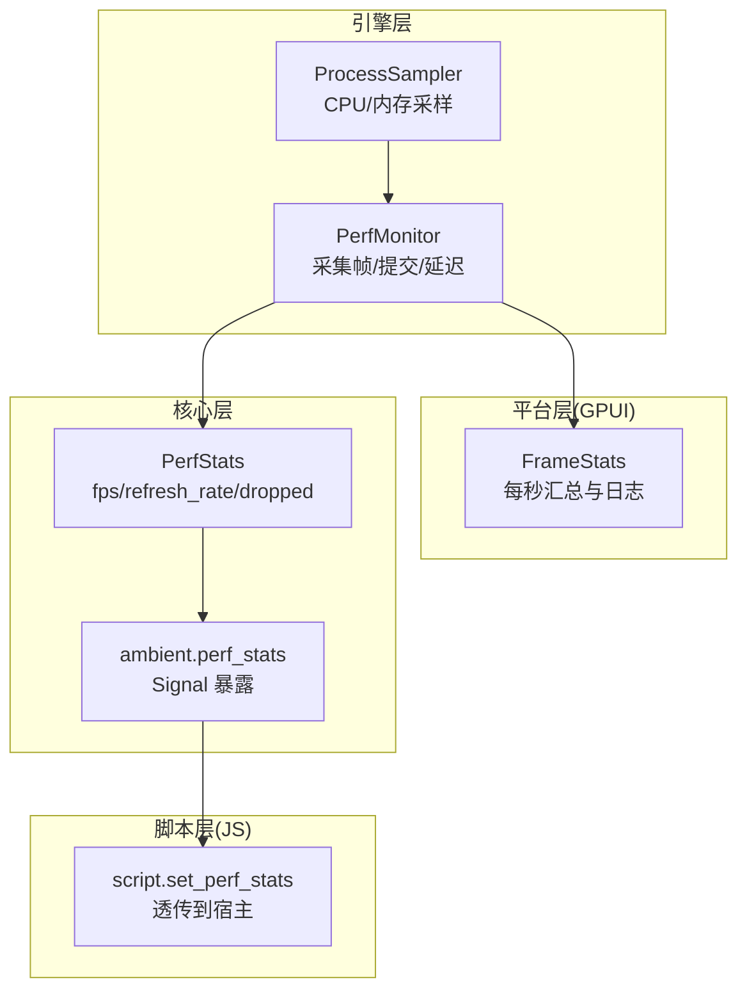
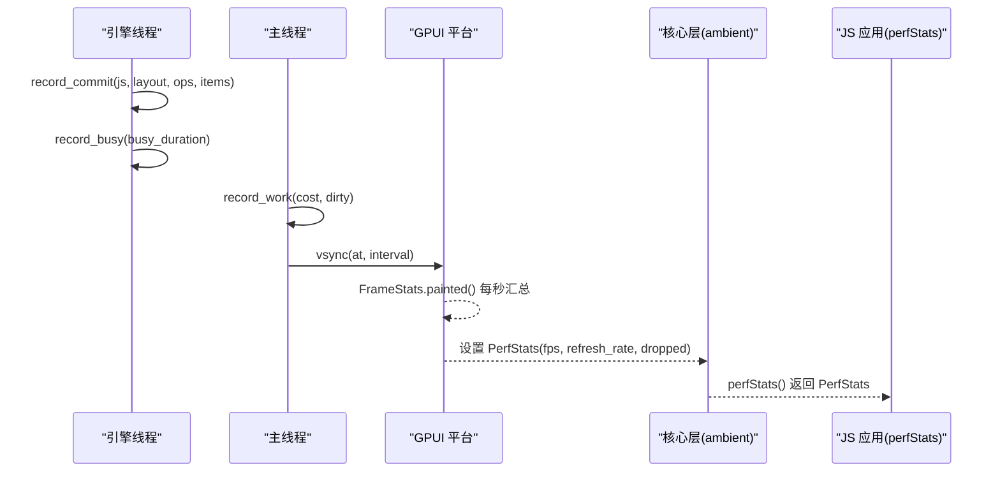
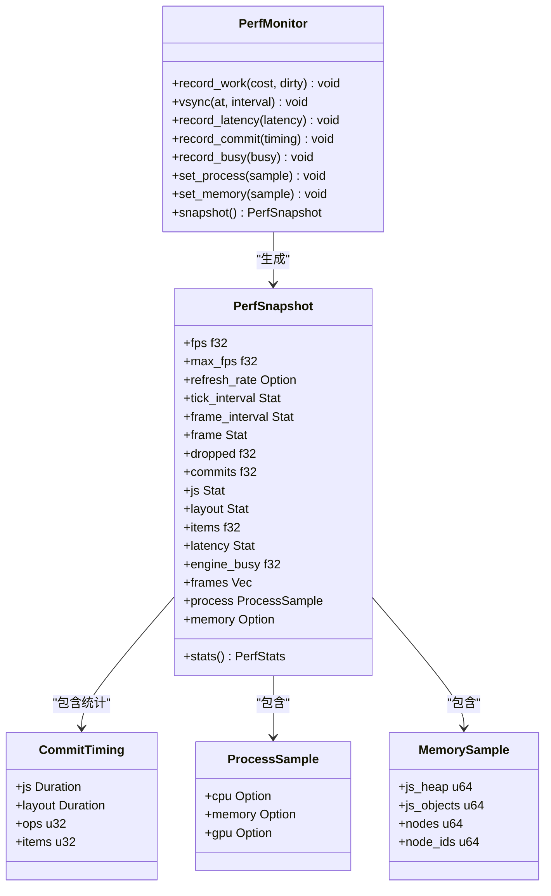
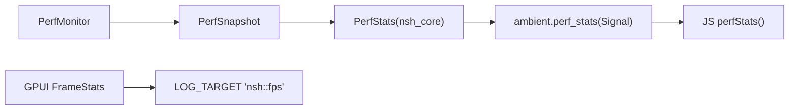

# 性能监控与分析

<cite>
**本文引用的文件**   
- [perf.rs](file://crates/nsh-engine/src/perf.rs)
- [stats.rs](file://crates/gpui/nsh-platform-gpui/src/stats.rs)
- [platform.rs](file://crates/nsh-core/src/platform.rs)
- [ambient.rs](file://crates/nsh-core/src/element/ambient.rs)
- [components.rs](file://crates/nsh-core/src/core/components.rs)
- [script.rs](file://crates/nsh-engine/src/script.rs)
- [performance.md](file://docs/dev/performance.md)
</cite>

## 目录
1. [简介](#简介)
2. [项目结构](#项目结构)
3. [核心组件](#核心组件)
4. [架构总览](#架构总览)
5. [详细组件分析](#详细组件分析)
6. [依赖关系分析](#依赖关系分析)
7. [性能注意事项](#性能注意事项)
8. [故障排查指南](#故障排查指南)
9. [结论](#结论)
10. [附录](#附录)

## 简介
本文件面向 NSH 框架的性能监控与分析能力，聚焦以下目标：
- 性能指标收集与 FPS 监控的接口说明
- 资源使用统计（CPU、内存、GPU）与进程采样
- perfStats() 的使用方式与平台配置选项
- 性能瓶颈识别、内存泄漏检测与渲染优化手段
- 性能基准测试、实时监控与报告生成方法
- 最佳实践与常见问题诊断

NSH 的性能监控由引擎层 PerfMonitor 负责采集帧与提交（commit）时序，GPUI 平台侧每秒汇总并输出日志；应用通过 nsh_core::element::perf_stats 暴露给 JS 层的 perfStats()。

## 项目结构
与性能监控直接相关的代码分布在以下模块：
- 引擎层性能采集与快照：crates/nsh-engine/src/perf.rs
- GPUI 平台每秒帧统计与日志输出：crates/gpui/nsh-platform-gpui/src/stats.rs
- 对外暴露的性能数据结构与访问入口：crates/nsh-core/src/platform.rs、crates/nsh-core/src/element/ambient.rs
- 引擎到宿主/脚本的传递通道：crates/nsh-engine/src/script.rs、crates/nsh-core/src/core/components.rs
- 性能基线与案例文档：docs/dev/performance.md

图表来源
- [perf.rs:1-800](file://crates/nsh-engine/src/perf.rs#L1-L800)
- [stats.rs:1-136](file://crates/gpui/nsh-platform-gpui/src/stats.rs#L1-L136)
- [platform.rs:1078-1106](file://crates/nsh-core/src/platform.rs#L1078-L1106)
- [ambient.rs:2212-2222](file://crates/nsh-core/src/element/ambient.rs#L2212-L2222)
- [script.rs:333-334](file://crates/nsh-engine/src/script.rs#L333-L334)

章节来源
- [perf.rs:1-800](file://crates/nsh-engine/src/perf.rs#L1-L800)
- [stats.rs:1-136](file://crates/gpui/nsh-platform-gpui/src/stats.rs#L1-L136)
- [platform.rs:1078-1106](file://crates/nsh-core/src/platform.rs#L1078-L1106)
- [ambient.rs:2212-2222](file://crates/nsh-core/src/element/ambient.rs#L2212-L2222)
- [script.rs:333-334](file://crates/nsh-engine/src/script.rs#L333-L334)

## 核心组件
- PerfMonitor：跨线程（引擎线程与主线程）采集帧间隔、提交耗时、JS/布局阶段耗时、批次延迟、引擎忙碌比例等，并提供 snapshot() 生成统一快照。
- ProcessSampler：按窗口计算 CPU 占用百分比，读取进程物理内存足迹或驻留集大小。
- FrameStats（GPUI）：每秒汇总一次绘制统计，输出“fps active gap tick paint canvas paths raf notifies”一行日志。
- PerfStats（nsh_core）：向应用暴露 fps、refresh_rate、dropped 三个字段，供 JS 的 perfStats() 读取。
- ambient.perf_stats：在核心层以 Signal 形式将 PerfStats 暴露给元素树，供 JS 调用 perfStats()。

章节来源
- [perf.rs:1-800](file://crates/nsh-engine/src/perf.rs#L1-L800)
- [stats.rs:1-136](file://crates/gpui/nsh-platform-gpui/src/stats.rs#L1-L136)
- [platform.rs:1078-1106](file://crates/nsh-core/src/platform.rs#L1078-L1106)
- [ambient.rs:2212-2222](file://crates/nsh-core/src/element/ambient.rs#L2212-L2222)

## 架构总览
下图展示从引擎采集到平台日志与应用读取的完整链路。

图表来源
- [perf.rs:314-483](file://crates/nsh-engine/src/perf.rs#L314-L483)
- [stats.rs:34-88](file://crates/gpui/nsh-platform-gpui/src/stats.rs#L34-L88)
- [platform.rs:1078-1106](file://crates/nsh-core/src/platform.rs#L1078-L1106)
- [ambient.rs:2212-2222](file://crates/nsh-core/src/element/ambient.rs#L2212-L2222)

## 详细组件分析

### PerfMonitor 与 PerfSnapshot
- 职责
  - 引擎线程：记录每次产生提交的 js/layout/ops/items，以及忙时占比。
  - 主线程：累计每帧工作时长，标记是否脏更新；在 vsync 关闭一帧；记录批次延迟。
  - 提供 snapshot() 聚合 FPS、刷新率、丢帧比例、提交速率、JS/布局统计、延迟分布、引擎忙碌比例、进程资源与内存样本。
- 关键数据
  - CommitTiming：js、layout、ops、items
  - Stat：mean/p50/p95/max
  - ProcessSample：cpu/memory/gpu
  - MemorySample：js_heap/js_objects/nodes/node_ids
- 行为要点
  - 冷启动前若干帧/提交不计入统计（WARMUP）。
  - FPS 基于显示刷新中“有变化”的帧计数，max_fps 受限于平均帧成本与刷新率。
  - dropped 为超过一帧预算的帧占比。

图表来源
- [perf.rs:110-233](file://crates/nsh-engine/src/perf.rs#L110-L233)
- [perf.rs:245-483](file://crates/nsh-engine/src/perf.rs#L245-L483)

章节来源
- [perf.rs:1-800](file://crates/nsh-engine/src/perf.rs#L1-L800)

### ProcessSampler（进程资源采样）
- 职责：周期性采样进程 CPU 时间（用户+系统）与内存，计算窗口内 CPU 占用百分比。
- 平台差异：Unix 使用 getrusage，Windows 使用 GetProcessTimes；Apple 使用 task_info 物理足迹，Linux/Android 使用 /proc/self/statm，Windows 使用 WorkingSetSize。
- 注意：首个样本后需至少 CPU_MIN_SPAN 才给出有效比率，避免单帧抖动。

章节来源
- [perf.rs:486-674](file://crates/nsh-engine/src/perf.rs#L486-L674)

### GPUI 平台帧统计（FrameStats）
- 职责：每秒汇总一次帧统计，输出固定格式日志行，便于外部工具解析。
- 关键字段：active（活跃窗口数）、gap/tick/paint/canvas 均值/分位数、paths 数量、raf 请求次数、notifies 通知次数。
- 输出目标：nsh_engine::perf::LOG_TARGET（“nsh::fps”），可通过 -v 查看。

章节来源
- [stats.rs:1-136](file://crates/gpui/nsh-platform-gpui/src/stats.rs#L1-L136)

### 应用侧 API：perfStats()
- 暴露点：nsh_core::element::perf_stats 通过 ambient Signal 暴露 PerfStats。
- JS 侧：perfStats() 读取 PerfStats，包含 fps、refresh_rate、dropped。
- 构造路径：PerfMonitor.snapshot().stats() -> nsh_core::platform::PerfStats -> ambient -> JS。

章节来源
- [platform.rs:1078-1106](file://crates/nsh-core/src/platform.rs#L1078-L1106)
- [ambient.rs:2212-2222](file://crates/nsh-core/src/element/ambient.rs#L2212-L2222)
- [perf.rs:235-243](file://crates/nsh-engine/src/perf.rs#L235-L243)

### 引擎到脚本的传递
- script.set_perf_stats 将 PerfStats 透传到宿主/运行时，供 JS 读取。
- components.set_perf_stats 将 PerfStats 注入组件运行时。

章节来源
- [script.rs:333-334](file://crates/nsh-engine/src/script.rs#L333-L334)
- [components.rs:1392-1393](file://crates/nsh-core/src/core/components.rs#L1392-L1393)

## 依赖关系分析
- PerfMonitor 依赖 nsh_core::time::Instant 与 nsh_core::geometry::Percentage（用于 dropped）。
- GPUI FrameStats 依赖 nsh_engine::perf::LOG_TARGET 进行日志输出。
- 应用读取链路：PerfMonitor -> PerfSnapshot.stats() -> PerfStats -> ambient.perf_stats -> JS perfStats()。

图表来源
- [perf.rs:235-243](file://crates/nsh-engine/src/perf.rs#L235-L243)
- [stats.rs:72-83](file://crates/gpui/nsh-platform-gpui/src/stats.rs#L72-L83)
- [ambient.rs:2212-2222](file://crates/nsh-core/src/element/ambient.rs#L2212-L2222)

章节来源
- [perf.rs:235-243](file://crates/nsh-engine/src/perf.rs#L235-L243)
- [stats.rs:72-83](file://crates/gpui/nsh-platform-gpui/src/stats.rs#L72-L83)
- [ambient.rs:2212-2222](file://crates/nsh-core/src/element/ambient.rs#L2212-L2222)

## 性能注意事项
- 启用方式
  - 环境变量：NSH_FPS=1 或在启动参数中使用 --fps。
  - 运行期：AppView.set_fps_monitor(true)。
- 指标解读
  - fps：显示刷新中有变化的帧率；空闲时较低不代表卡顿。
  - max_fps：受限于平均帧成本与刷新率的上限。
  - dropped：超过一帧预算的帧占比，>0 表示存在掉帧风险。
  - js/layout：提交中 JS 与核心布局阶段的耗时分布。
  - latency：批次从引擎交接到主线程应用的等待时间。
  - engine_busy：引擎线程忙时占比。
  - process.memory/cpu：进程内存与 CPU 占用（百分比）。
- 冷启动与预热
  - 前 WARMUP 帧/提交不计入统计，避免冷缓存影响。
- 渲染优化建议
  - 减少每帧变更范围，降低 dirty 标志传播。
  - 控制每提交产生的 mount items 数量。
  - 关注 canvas 栅格化时间与 path 批次数（GPUI 日志）。
  - 合理拆分长列表与滚动区域，避免整屏重排。
- 内存与泄漏检测
  - 关注 MemorySample.js_objects、nodes、node_ids 增长趋势。
  - 结合进程内存曲线与对象计数判断是否存在泄漏。

章节来源
- [perf.rs:33-55](file://crates/nsh-engine/src/perf.rs#L33-L55)
- [perf.rs:105-108](file://crates/nsh-engine/src/perf.rs#L105-L108)
- [perf.rs:190-233](file://crates/nsh-engine/src/perf.rs#L190-L233)
- [stats.rs:1-16](file://crates/gpui/nsh-platform-gpui/src/stats.rs#L1-L16)

## 故障排查指南
- 现象：FPS 低但 dropped 接近 0
  - 可能原因：应用长时间空闲导致 fps 低；检查 frame_interval 与 tick_interval 是否异常。
  - 处理：确认是否有持续动画或频繁更新。
- 现象：dropped 升高
  - 可能原因：单帧耗时超过一帧预算；检查 js/layout 分布与 canvas 栅格化时间。
  - 处理：定位热点 JS 逻辑与重型布局，减少每帧变更。
- 现象：latency 高
  - 可能原因：主线程繁忙导致批次应用延迟。
  - 处理：减少主线程阻塞任务，拆分昂贵操作。
- 现象：内存持续增长
  - 可能原因：JS 对象或节点未释放。
  - 处理：对比 MemorySample.js_objects/nodes 随时间变化，定位泄漏点。
- 现象：无性能面板或日志
  - 可能原因：未启用 NSH_FPS 或未设置 set_fps_monitor。
  - 处理：启用环境变量或调用 set_fps_monitor(true)，并通过 -v 查看“nsh::fps”日志。

章节来源
- [perf.rs:314-483](file://crates/nsh-engine/src/perf.rs#L314-L483)
- [stats.rs:72-83](file://crates/gpui/nsh-platform-gpui/src/stats.rs#L72-L83)

## 结论
NSH 的性能监控体系以 PerfMonitor 为核心，结合 GPUI 平台的每秒统计与核心层 PerfStats 暴露，形成从采集、聚合到应用读取的闭环。通过 FPS、丢帧比例、JS/布局耗时、批次延迟与进程资源指标，开发者可快速定位性能瓶颈并进行针对性优化。配合 docs/dev/performance.md 中的基准与案例，可建立稳定的性能回归与优化验证流程。

## 附录
- 常用命令与环境变量
  - NSH_FPS=1：启动即开启性能监控
  - --fps：命令行启用 FPS 监控
  - -v：查看“nsh::fps”日志
- 参考文档
  - 性能基线与优化案例见 docs/dev/performance.md

章节来源
- [performance.md:1-800](file://docs/dev/performance.md#L1-L800)