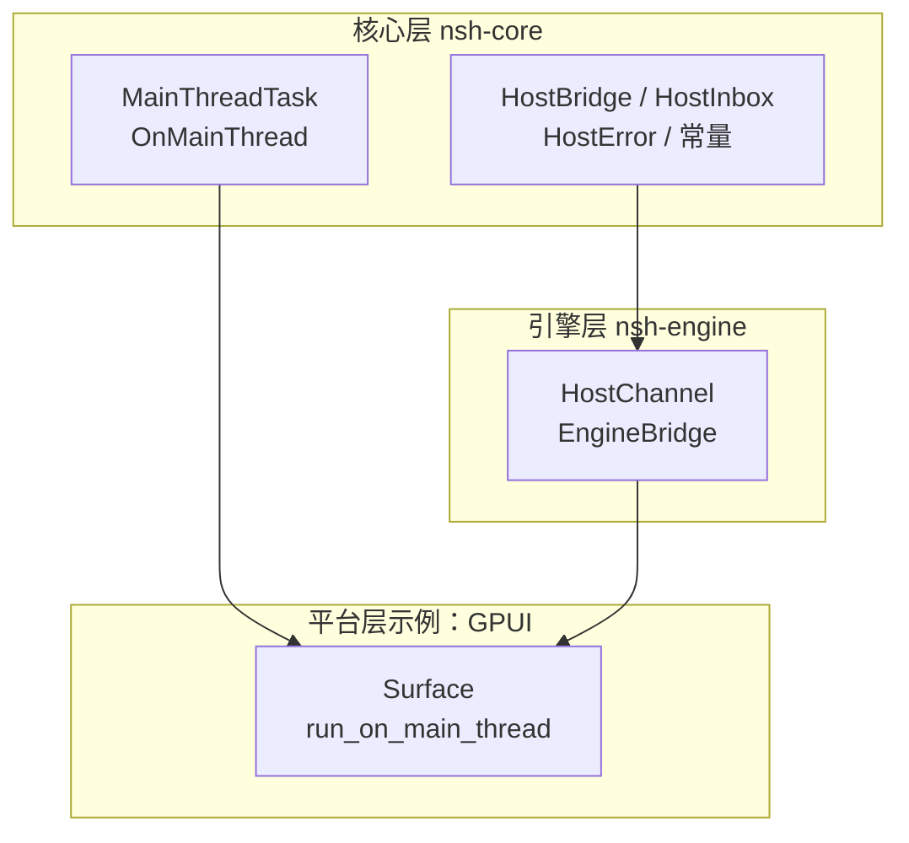
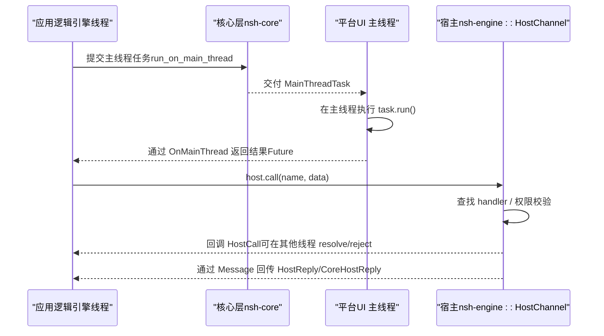
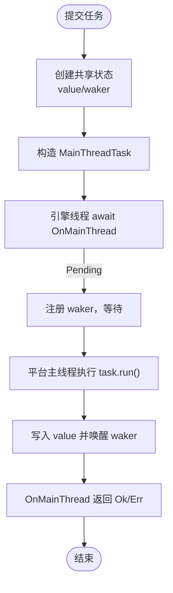
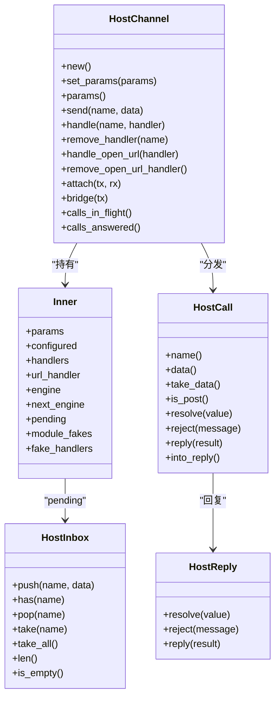
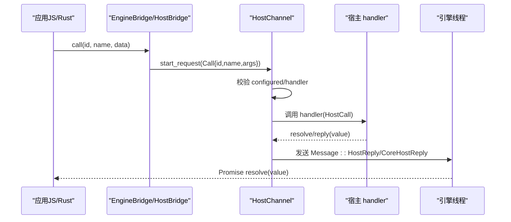
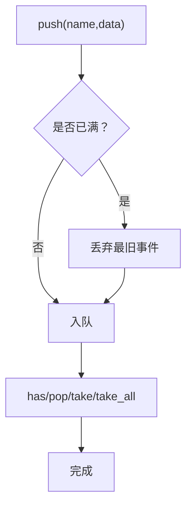
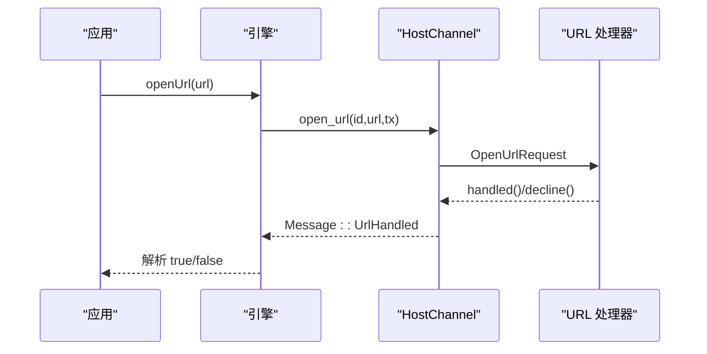
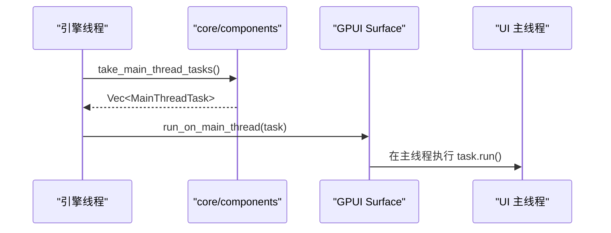
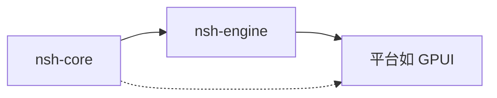

# 线程同步与通信

<cite>
**本文引用的文件**   
- [main_thread.rs](file://crates/nsh-core/src/main_thread.rs)
- [host_channel.rs（核心）](file://crates/nsh-core/src/host_channel.rs)
- [host_channel.rs（引擎）](file://crates/nsh-engine/src/host_channel.rs)
- [ambient.rs](file://crates/nsh-core/src/element/ambient.rs)
- [components.rs](file://crates/nsh-core/src/core/components.rs)
- [surface.rs（GPUI 平台）](file://crates/gpui/nsh-platform-gpui/src/surface.rs)
</cite>

## 目录
1. [引言](#引言)
2. [项目结构](#项目结构)
3. [核心组件](#核心组件)
4. [架构总览](#架构总览)
5. [详细组件分析](#详细组件分析)
6. [依赖关系分析](#依赖关系分析)
7. [性能考量](#性能考量)
8. [故障排查指南](#故障排查指南)
9. [结论](#结论)
10. [附录：API 速查](#附录api-速查)

## 引言
本文面向 NSH 框架的多线程与跨线程通信机制，聚焦以下目标：
- 主线程任务调度：如何在 UI 主线程安全执行一次性任务。
- 跨线程通信与消息传递：引擎线程与宿主（嵌入应用）之间的调用、事件与 URL 路由。
- 核心原语：MainThreadTask、HostChannel、HostBridge、HostInbox 等的使用方法。
- 引擎线程与 UI 线程的数据同步与事件分发。
- 异步操作处理、任务队列管理与线程安全的编程模式。
- 多线程开发指南与常见陷阱规避。

## 项目结构
NSH 的线程与通信能力由“核心层”和“引擎层”共同实现：
- 核心层（nsh-core）提供通用抽象：主线程任务封装、错误类型、消息名称校验、事件缓冲、调用选项等。
- 引擎层（nsh-engine）实现宿主侧通道 HostChannel，负责事件投递、调用分发、URL 路由、挂起/恢复等。
- 平台侧（如 GPUI）将 MainThreadTask 提交到 UI 主线程执行。

图表来源
- [main_thread.rs:14-35](file://crates/nsh-core/src/main_thread.rs#L14-L35)
- [host_channel.rs（核心）:250-296](file://crates/nsh-core/src/host_channel.rs#L250-L296)
- [host_channel.rs（引擎）:87-148](file://crates/nsh-engine/src/host_channel.rs#L87-L148)
- [surface.rs（GPUI 平台）:105-110](file://crates/gpui/nsh-platform-gpui/src/surface.rs#L105-L110)

章节来源
- [main_thread.rs:1-168](file://crates/nsh-core/src/main_thread.rs#L1-L168)
- [host_channel.rs（核心）:1-434](file://crates/nsh-core/src/host_channel.rs#L1-L434)
- [host_channel.rs（引擎）:1-939](file://crates/nsh-engine/src/host_channel.rs#L1-L939)
- [surface.rs（GPUI 平台）:31-110](file://crates/gpui/nsh-platform-gpui/src/surface.rs#L31-L110)

## 核心组件
本节概述关键 API 的职责与使用要点（不直接粘贴代码）。

- MainThreadTask：封装一个在平台主线程仅运行一次的闭包；平台侧通过 run 执行，异常被捕获并记录，不会穿透平台运行循环。
- OnMainThread<R>：与 MainThreadTask 配对的 Future，在引擎线程上等待结果；若任务未执行即被丢弃，会返回“已丢弃”错误。
- HostBridge：应用侧看到的宿主桥接接口，暴露参数、调用、发布、模块替身等能力；引擎侧通过 EngineBridge 实现。
- HostChannel：宿主侧的消息通道，负责事件发送、调用分发、URL 路由、挂起/恢复、模块替身注册等；可跨线程克隆。
- HostInbox：按名称缓存事件的有界队列，容量受 MAX_QUEUED_EVENTS 限制，溢出时丢弃最旧事件。
- HostCall / HostReply：一次调用的上下文与回复句柄；支持从任意线程完成 resolve/reject。
- OpenUrlRequest：URL 打开请求，宿主可选择 handled 或 decline。

章节来源
- [main_thread.rs:14-136](file://crates/nsh-core/src/main_thread.rs#L14-L136)
- [host_channel.rs（核心）:250-373](file://crates/nsh-core/src/host_channel.rs#L250-L373)
- [host_channel.rs（引擎）:40-148](file://crates/nsh-engine/src/host_channel.rs#L40-L148)
- [host_channel.rs（引擎）:563-772](file://crates/nsh-engine/src/host_channel.rs#L563-L772)

## 架构总览
下图展示引擎线程与 UI 主线程之间的主线程任务调度流程，以及引擎线程与宿主之间的消息通道。

图表来源
- [main_thread.rs:121-136](file://crates/nsh-core/src/main_thread.rs#L121-L136)
- [ambient.rs:1596-1600](file://crates/nsh-core/src/element/ambient.rs#L1596-L1600)
- [host_channel.rs（引擎）:289-348](file://crates/nsh-engine/src/host_channel.rs#L289-L348)
- [host_channel.rs（引擎）:700-772](file://crates/nsh-engine/src/host_channel.rs#L700-L772)

## 详细组件分析

### 主线程任务调度：MainThreadTask 与 OnMainThread
- 设计要点
  - MainThreadTask 包装 FnOnce + Send，确保可跨线程传递，但仅在平台主线程执行一次。
  - run 内部捕获 panic，避免破坏平台运行循环；失败信息通过日志输出。
  - OnMainThread 是 Future，基于共享状态与 Waker 实现非阻塞等待；若任务未执行即被丢弃，返回 Dropped 错误。
- 典型用法
  - 在引擎线程中通过 run_on_main_thread 提交任务，得到 (MainThreadTask, OnMainThread)。
  - 平台侧持有 MainThreadTask 并在 UI 主线程调用 run。
  - 引擎线程 await OnMainThread 获取结果或错误。

图表来源
- [main_thread.rs:64-136](file://crates/nsh-core/src/main_thread.rs#L64-L136)

章节来源
- [main_thread.rs:14-136](file://crates/nsh-core/src/main_thread.rs#L14-L136)

### 跨线程通信：HostChannel（宿主侧）
- 职责
  - 管理宿主侧的参数、事件、调用处理器、URL 处理器、模块替身。
  - 提供 send（事件）、handle/remove_handler（处理器）、handle_open_url（URL 路由）、attach（绑定引擎）、bridge（为 JS 暴露桥接）等方法。
  - start_request 将应用的 call/post 分发给对应 handler，并通过 Message 回传 HostReply/CoreHostReply。
- 并发模型
  - HostChannel 内部以 Arc<Mutex<Inner>> 保护可变状态，Clone 后共享同一通道。
  - Handler 运行在引擎线程，必须快速返回；耗时逻辑应转移到其他线程，再使用 HostCall.into_reply 或 HostReply 从任意线程回复。
  - 调用计数 in_flight/answered 使用原子变量，便于测试驱动等待所有调用完成。
- 事件缓冲
  - 当无应用运行时，事件进入 pending（HostInbox），新引擎 attach 时优先派发。
  - HostInbox 按名称维护有序队列，容量上限 MAX_QUEUED_EVENTS，溢出丢弃最旧事件。

图表来源
- [host_channel.rs（引擎）:87-148](file://crates/nsh-engine/src/host_channel.rs#L87-L148)
- [host_channel.rs（引擎）:178-236](file://crates/nsh-engine/src/host_channel.rs#L178-L236)
- [host_channel.rs（引擎）:289-348](file://crates/nsh-engine/src/host_channel.rs#L289-L348)
- [host_channel.rs（引擎）:563-772](file://crates/nsh-engine/src/host_channel.rs#L563-L772)
- [host_channel.rs（核心）:314-373](file://crates/nsh-core/src/host_channel.rs#L314-L373)

章节来源
- [host_channel.rs（引擎）:1-939](file://crates/nsh-engine/src/host_channel.rs#L1-L939)
- [host_channel.rs（核心）:18-434](file://crates/nsh-core/src/host_channel.rs#L18-L434)

### 调用与回复序列：host.call 的生命周期

图表来源
- [host_channel.rs（引擎）:489-507](file://crates/nsh-engine/src/host_channel.rs#L489-L507)
- [host_channel.rs（引擎）:289-348](file://crates/nsh-engine/src/host_channel.rs#L289-L348)
- [host_channel.rs（引擎）:700-772](file://crates/nsh-engine/src/host_channel.rs#L700-L772)

章节来源
- [host_channel.rs（引擎）:489-507](file://crates/nsh-engine/src/host_channel.rs#L489-L507)
- [host_channel.rs（引擎）:289-348](file://crates/nsh-engine/src/host_channel.rs#L289-L348)
- [host_channel.rs（引擎）:700-772](file://crates/nsh-engine/src/host_channel.rs#L700-L772)

### 事件分发与缓冲：HostInbox
- 行为
  - push：入队，超过容量时返回被丢弃的最旧事件。
  - has/pop/take/take_all：按名称查询、取出单个或批量事件。
  - len/is_empty：统计与判空。
- 使用场景
  - 宿主在应用启动前发送的事件，会在应用 attach 时优先派发。
  - 应用停止时，未消费的事件保留在 pending，供下一个应用继承。

图表来源
- [host_channel.rs（核心）:314-373](file://crates/nsh-core/src/host_channel.rs#L314-L373)

章节来源
- [host_channel.rs（核心）:314-373](file://crates/nsh-core/src/host_channel.rs#L314-L373)

### URL 路由：OpenUrlRequest
- 宿主可通过 handle_open_url 设置 URL 处理器；应用打开 URL 时先经此处理器。
- 处理器可从任意线程回答 handled 或 decline；未回答则默认 decline（系统打开）。

图表来源
- [host_channel.rs（引擎）:377-404](file://crates/nsh-engine/src/host_channel.rs#L377-L404)
- [host_channel.rs（引擎）:630-698](file://crates/nsh-engine/src/host_channel.rs#L630-L698)

章节来源
- [host_channel.rs（引擎）:377-404](file://crates/nsh-engine/src/host_channel.rs#L377-L404)
- [host_channel.rs（引擎）:630-698](file://crates/nsh-engine/src/host_channel.rs#L630-L698)

### 引擎线程与 UI 线程的协作点
- 引擎线程通过 run_on_main_thread 提交 MainThreadTask，平台侧在 UI 主线程执行。
- GPUI 平台 surface 将 MainThreadTask 作为渲染批次的一部分提交到 UI 主线程。

图表来源
- [components.rs:1241-1244](file://crates/nsh-core/src/core/components.rs#L1241-L1244)
- [surface.rs（GPUI 平台）:105-110](file://crates/gpui/nsh-platform-gpui/src/surface.rs#L105-L110)

章节来源
- [components.rs:1241-1244](file://crates/nsh-core/src/core/components.rs#L1241-L1244)
- [surface.rs（GPUI 平台）:105-110](file://crates/gpui/nsh-platform-gpui/src/surface.rs#L105-L110)

## 依赖关系分析
- 耦合与内聚
  - 核心层（nsh-core）定义通用类型与约束（名称长度、错误码、事件缓冲），与平台解耦。
  - 引擎层（nsh-engine）实现具体通道 HostChannel，依赖核心层的 HostBridge/HostInbox/HostError。
  - 平台层（如 GPUI）只依赖 MainThreadTask 与 MountSink 接口，保持低耦合。
- 外部依赖
  - crossbeam_channel 用于引擎与宿主之间的消息队列。
  - serde_json 用于 JSON 数据交换。
- 潜在循环依赖
  - 核心层不依赖引擎层；引擎层依赖核心层；平台层依赖两者但不反向依赖，整体呈单向依赖。

图表来源
- [host_channel.rs（核心）:1-434](file://crates/nsh-core/src/host_channel.rs#L1-L434)
- [host_channel.rs（引擎）:1-939](file://crates/nsh-engine/src/host_channel.rs#L1-L939)
- [surface.rs（GPUI 平台）:31-110](file://crates/gpui/nsh-platform-gpui/src/surface.rs#L31-L110)

章节来源
- [host_channel.rs（核心）:1-434](file://crates/nsh-core/src/host_channel.rs#L1-L434)
- [host_channel.rs（引擎）:1-939](file://crates/nsh-engine/src/host_channel.rs#L1-L939)
- [surface.rs（GPUI 平台）:31-110](file://crates/gpui/nsh-platform-gpui/src/surface.rs#L31-L110)

## 性能考量
- 主线程任务
  - MainThreadTask 仅执行一次，避免重复开销；panic 捕获保证 UI 稳定性。
- 事件缓冲
  - HostInbox 有界队列，避免内存无限增长；溢出策略丢弃最旧事件，适合高频事件流。
- 调用计数
  - in_flight/answered 使用原子变量，避免锁竞争；测试驱动可据此判断空闲。
- 处理器执行
  - 要求 handler 快速返回，避免阻塞引擎线程；耗时逻辑移至后台线程，再通过 HostReply 异步回复。
- URL 路由
  - 处理器同样需快速返回，避免阻塞引擎线程。

[本节为通用指导，不直接分析具体文件]

## 故障排查指南
- 主线程任务未执行
  - 现象：OnMainThread 返回 Dropped。
  - 原因：平台未执行 MainThreadTask 或在执行前被丢弃。
  - 排查：确认平台侧 run_on_main_thread 已调用 task.run()。
- 调用超时
  - 现象：HostError::TimedOut。
  - 原因：宿主未在 DEFAULT_CALL_TIMEOUT 内回复。
  - 排查：检查宿主 handler 是否及时 resolve/reject；必要时增大 timeout。
- 权限拒绝
  - 现象：HostError::Denied。
  - 原因：capabilities.host 未授予该名称。
  - 排查：在 nsh.json 中添加 capabilities.host 授权。
- 无效名称
  - 现象：HostError::InvalidName。
  - 原因：名称不符合规则或超出 MAX_NAME_LEN。
  - 排查：使用 check_name 校验名称。
- 调用过多
  - 现象：HostError::TooManyCalls。
  - 原因：同时等待答案的调用数超过 MAX_PENDING_CALLS。
  - 排查：优化调用频率或增加批处理。
- 宿主未配置
  - 现象：HostRefusal::Unconfigured。
  - 原因：channel 未被 set_params/handle 配置，走平台 host。
  - 排查：确保宿主侧已配置 channel。

章节来源
- [host_channel.rs（核心）:30-100](file://crates/nsh-core/src/host_channel.rs#L30-L100)
- [host_channel.rs（核心）:106-173](file://crates/nsh-core/src/host_channel.rs#L106-L173)
- [host_channel.rs（引擎）:289-348](file://crates/nsh-engine/src/host_channel.rs#L289-L348)

## 结论
NSH 的线程同步与通信机制通过清晰的分层与明确的边界，实现了：
- 主线程任务的可靠调度与异常隔离。
- 引擎线程与宿主之间的高效、线程安全的消息通道。
- 事件缓冲与调用计数的可控性与可观测性。
- URL 路由的可插拔扩展。
遵循本文档的编程模式与最佳实践，可在多线程环境下稳定构建 NSH 应用。

[本节为总结，不直接分析具体文件]

## 附录：API 速查
- MainThreadTask
  - new(f)：构造主线程任务。
  - run()：在主线程执行，捕获 panic。
- OnMainThread<R>
  - Future：在引擎线程等待结果，可能返回 Panicked/Dropped。
- HostBridge
  - available()：是否已配置宿主通道。
  - params()：启动参数。
  - call(id, name, data)：发起调用。
  - post(name, data)：发送事件。
  - module_fakes(specifier)：模块替身。
  - call_module_fake(id, name, data)：替身调用。
- HostChannel
  - new()：创建通道。
  - set_params(params)/params()：设置/读取参数。
  - send(name, data)：发送事件。
  - handle(name, handler)/remove_handler(name)：注册/移除处理器。
  - handle_open_url(handler)/remove_open_url_handler()：URL 路由。
  - attach(tx, rx)：绑定引擎。
  - bridge(tx)：为 JS 暴露桥接。
  - calls_in_flight()/calls_answered()：调用计数。
- HostInbox
  - push/pop/take/take_all/has/len/is_empty：事件缓冲操作。
- HostCall/HostReply
  - name/data/take_data/is_post：访问调用信息。
  - resolve/reply/reject：回复调用。
  - into_reply：取出发送端以便跨线程回复。
- OpenUrlRequest
  - url/handled/decline/answer：URL 路由应答。

章节来源
- [main_thread.rs:14-136](file://crates/nsh-core/src/main_thread.rs#L14-L136)
- [host_channel.rs（核心）:250-373](file://crates/nsh-core/src/host_channel.rs#L250-L373)
- [host_channel.rs（引擎）:178-236](file://crates/nsh-engine/src/host_channel.rs#L178-L236)
- [host_channel.rs（引擎）:563-772](file://crates/nsh-engine/src/host_channel.rs#L563-L772)
- [host_channel.rs（引擎）:630-698](file://crates/nsh-engine/src/host_channel.rs#L630-L698)