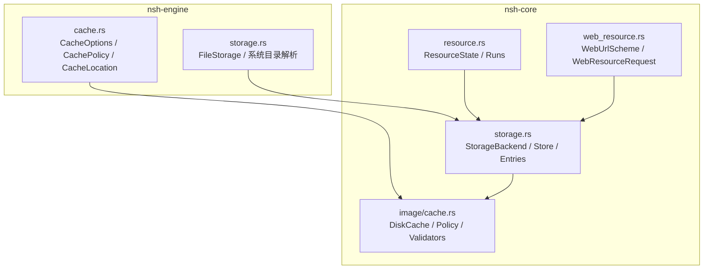
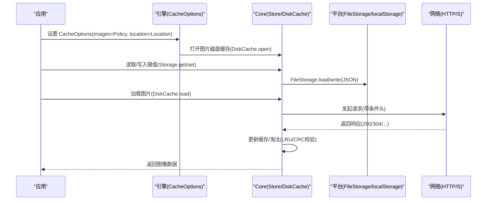
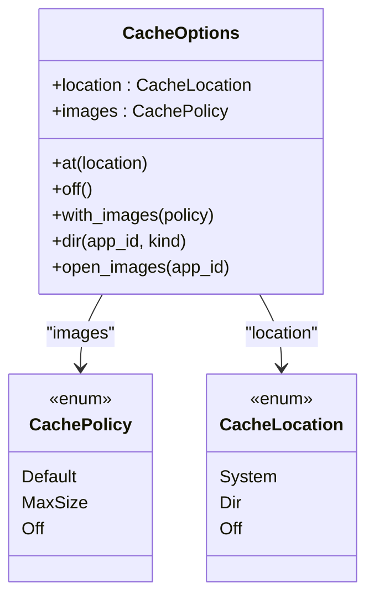
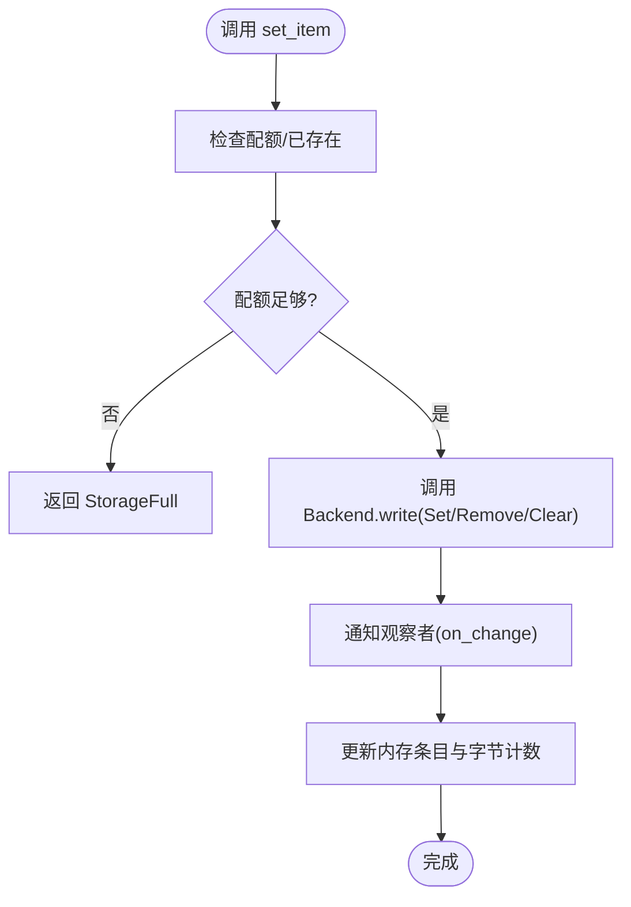
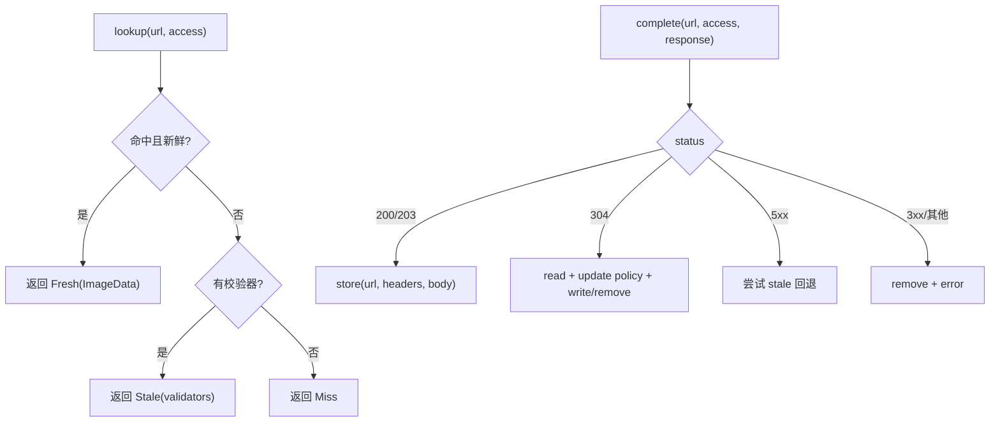
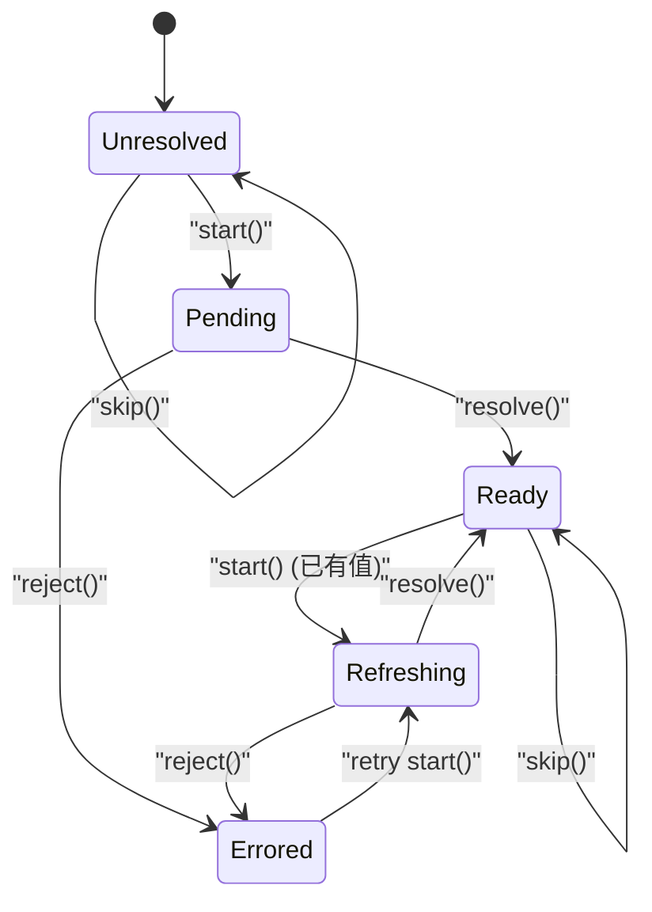
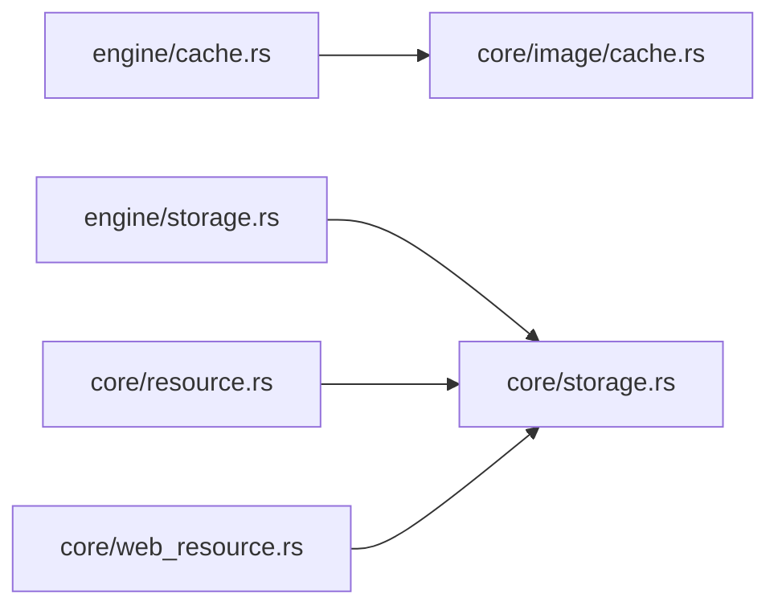

# 资源管理

<cite>
**本文引用的文件**   
- [crates/nsh-engine/src/cache.rs](file://crates/nsh-engine/src/cache.rs)
- [crates/nsh-core/src/storage.rs](file://crates/nsh-core/src/storage.rs)
- [crates/nsh-engine/src/storage.rs](file://crates/nsh-engine/src/storage.rs)
- [crates/nsh-core/src/image/cache.rs](file://crates/nsh-core/src/image/cache.rs)
- [crates/nsh-core/src/resource.rs](file://crates/nsh-core/src/resource.rs)
- [crates/nsh-core/src/web_resource.rs](file://crates/nsh-core/src/web_resource.rs)
</cite>

## 目录
1. [简介](#简介)
2. [项目结构](#项目结构)
3. [核心组件](#核心组件)
4. [架构总览](#架构总览)
5. [详细组件分析](#详细组件分析)
6. [依赖关系分析](#依赖关系分析)
7. [性能与内存优化](#性能与内存优化)
8. [故障排查指南](#故障排查指南)
9. [结论](#结论)
10. [附录：API 参考与用法](#附录api-参考与用法)

## 简介
本文件为 NSH 框架“资源管理系统”的 API 文档，聚焦以下能力：
- 缓存策略与配置：CacheOptions、CachePolicy、CacheLocation 的使用方式与默认行为。
- 存储后端：键值存储 StorageBackend 抽象、FileStorage 实现、浏览器 localStorage 适配（通过平台层）。
- 图片磁盘缓存：DiskCache 的 HTTP 缓存语义、LRU 淘汰、校验与完整性保护。
- 资源生命周期：异步资源的加载状态机 Runs/ResourceState。
- Web 资源：WebView 自定义 URL Scheme 的资源提供机制。
- 生命周期管理与内存优化实践：配额控制、并发安全、线程模型与 I/O 隔离。

## 项目结构
围绕资源管理的代码主要分布在以下模块：
- nsh-engine: 引擎级缓存配置与系统目录解析（CacheOptions、CachePolicy、CacheLocation、storage 工具函数）。
- nsh-core: 通用存储抽象 StorageBackend、键值存储运行时、图片磁盘缓存 DiskCache、资源状态机、Web 资源协议。
- 平台层（如 web/native）：将 StorageBackend 映射到具体持久化（文件系统或 localStorage），并桥接 WebView 的 URL Scheme。



图表来源
- [crates/nsh-engine/src/cache.rs:15-98](file://crates/nsh-engine/src/cache.rs#L15-L98)
- [crates/nsh-engine/src/storage.rs:21-29](file://crates/nsh-engine/src/storage.rs#L21-L29)
- [crates/nsh-core/src/storage.rs:48-81](file://crates/nsh-core/src/storage.rs#L48-L81)
- [crates/nsh-core/src/image/cache.rs:303-422](file://crates/nsh-core/src/image/cache.rs#L303-L422)
- [crates/nsh-core/src/resource.rs:13-71](file://crates/nsh-core/src/resource.rs#L13-L71)
- [crates/nsh-core/src/web_resource.rs:40-77](file://crates/nsh-core/src/web_resource.rs#L40-L77)

章节来源
- [crates/nsh-engine/src/cache.rs:1-98](file://crates/nsh-engine/src/cache.rs#L1-L98)
- [crates/nsh-engine/src/storage.rs:1-29](file://crates/nsh-engine/src/storage.rs#L1-L29)
- [crates/nsh-core/src/storage.rs:1-81](file://crates/nsh-core/src/storage.rs#L1-L81)
- [crates/nsh-core/src/image/cache.rs:1-61](file://crates/nsh-core/src/image/cache.rs#L1-L61)
- [crates/nsh-core/src/resource.rs:1-27](file://crates/nsh-core/src/resource.rs#L1-L27)
- [crates/nsh-core/src/web_resource.rs:1-24](file://crates/nsh-core/src/web_resource.rs#L1-L24)

## 核心组件
- 缓存配置（Engine 层）
  - CacheOptions：指定缓存根目录 location 与图片缓存策略 images。
  - CachePolicy：Default/MaxSize/Off，控制是否启用及上限。
  - CacheLocation：System/Dir/Off，决定缓存落盘位置。
- 键值存储（Core 层）
  - StorageBackend：统一抽象，load/write 由平台实现。
  - Store/Entries：内存态 + 配额 QUOTA + 变更通知 on_change。
  - FileStorage（Engine 层实现）：JSON 文件持久化，后台写入线程。
- 图片磁盘缓存（Core 层）
  - DiskCache：按 URL 索引，HTTP 语义缓存（RFC 9111 简化版），LRU 淘汰，CRC 校验。
- 资源生命周期（Core 层）
  - ResourceState/Runs：Pending/Ready/Refreshing/Errored 等状态机，保证最新 load 生效。
- Web 资源（Core 层）
  - WebUrlScheme/WebResourceRequest：WebView 自定义 scheme 的资源提供与取消语义。

章节来源
- [crates/nsh-engine/src/cache.rs:15-98](file://crates/nsh-engine/src/cache.rs#L15-L98)
- [crates/nsh-core/src/storage.rs:48-136](file://crates/nsh-core/src/storage.rs#L48-L136)
- [crates/nsh-engine/src/storage.rs:21-29](file://crates/nsh-engine/src/storage.rs#L21-L29)
- [crates/nsh-core/src/image/cache.rs:303-422](file://crates/nsh-core/src/image/cache.rs#L303-L422)
- [crates/nsh-core/src/resource.rs:13-71](file://crates/nsh-core/src/resource.rs#L13-L71)
- [crates/nsh-core/src/web_resource.rs:40-77](file://crates/nsh-core/src/web_resource.rs#L40-L77)

## 架构总览
下图展示从应用侧到各后端的资源访问路径：引擎配置缓存策略，Core 层负责运行时与持久化，平台层对接具体存储与网络。



图表来源
- [crates/nsh-engine/src/cache.rs:75-98](file://crates/nsh-engine/src/cache.rs#L75-L98)
- [crates/nsh-core/src/image/cache.rs:395-406](file://crates/nsh-core/src/image/cache.rs#L395-L406)
- [crates/nsh-engine/src/storage.rs:225-271](file://crates/nsh-engine/src/storage.rs#L225-L271)
- [crates/nsh-core/src/storage.rs:83-136](file://crates/nsh-core/src/storage.rs#L83-L136)

## 详细组件分析

### 缓存配置：CacheOptions / CachePolicy / CacheLocation
- CacheOptions
  - location：缓存根目录（System/Dir/Off）。
  - images：图片缓存策略（Default/MaxSize/Off）。
  - with_images(location)：链式设置图片策略。
  - open_images(app_id)：根据 app_id 与 images 策略打开 DiskCache；若 Off 或大小为 0 则返回 None。
- CachePolicy
  - Default：使用默认大小（图片默认 256 MiB）。
  - MaxSize(size)：限制最大字节数，超过时按 LRU 淘汰。
  - Off：关闭磁盘缓存。
- CacheLocation
  - System：系统缓存目录（Apple Caches、Windows %LOCALAPPDATA%、Linux $XDG_CACHE_HOME）。
  - Dir(path)：自定义目录。
  - Off：不写盘。



图表来源
- [crates/nsh-engine/src/cache.rs:15-98](file://crates/nsh-engine/src/cache.rs#L15-L98)

章节来源
- [crates/nsh-engine/src/cache.rs:15-98](file://crates/nsh-engine/src/cache.rs#L15-L98)

### 键值存储：StorageBackend 与 FileStorage
- StorageBackend（Core 抽象）
  - load()：首次使用时加载键值对。
  - write(change)：异步持久化变更（Set/Remove/Clear）。
- Store/Entries（Core 运行时）
  - 内存中维护 BTreeMap，QUOTA 配额（UTF-8 字节计数）。
  - 并发安全：共享同一 backend 的多个 core 串行化写入，避免竞态。
  - 变更通知：on_change 订阅跨窗口/标签页的变更。
- FileStorage（Engine 实现）
  - 以 JSON 文件持久化，原子写入（临时文件+rename）。
  - 后台写入线程，批处理写入，崩溃恢复策略（损坏文件旁置 .corrupt）。
  - 支持 support_dir/cache_dir 的系统目录解析。



图表来源
- [crates/nsh-core/src/storage.rs:452-477](file://crates/nsh-core/src/storage.rs#L452-L477)
- [crates/nsh-engine/src/storage.rs:199-223](file://crates/nsh-engine/src/storage.rs#L199-L223)

章节来源
- [crates/nsh-core/src/storage.rs:48-136](file://crates/nsh-core/src/storage.rs#L48-L136)
- [crates/nsh-engine/src/storage.rs:21-29](file://crates/nsh-engine/src/storage.rs#L21-L29)
- [crates/nsh-engine/src/storage.rs:154-223](file://crates/nsh-engine/src/storage.rs#L154-L223)
- [crates/nsh-engine/src/storage.rs:225-286](file://crates/nsh-engine/src/storage.rs#L225-L286)

### 图片磁盘缓存：DiskCache 与 HTTP 缓存语义
- 关键类型
  - Fetched：HTTP 响应封装（status/headers/body/refusal/redirects）。
  - Lookup：Fresh/Stale/Miss，决定是否直接返回或发起条件请求。
  - Validators：ETag/Last-Modified，用于 If-None-Match/If-Modified-Since。
  - Policy：基于 Cache-Control/Expires/Date/Age/Last-Modified/Vary/Pragma 计算可存储性、新鲜度与严格模式。
- 行为要点
  - 仅 200/203 可存储，且受 no-store/Vary:*/大小限制（不超过缓存 1/8）。
  - 新鲜期优先 max-age，其次 Expires-Date，否则启发式 Last-Modified 的十分之一（上限 7 天）。
  - Stale 时发送条件请求，304 更新策略并复用 body；4xx 丢弃条目；5xx 在允许时回退 stale。
  - 每个 URL 一个文件，含元数据与 CRC 校验；写入采用临时文件+rename 原子操作。
  - LRU 淘汰：超过上限时扫描目录，按修改时间删除至目标的 3/4。
  - 重定向安全检查：若当前 Access 不允许某跳转目标，则丢弃该条目。



图表来源
- [crates/nsh-core/src/image/cache.rs:373-406](file://crates/nsh-core/src/image/cache.rs#L373-L406)
- [crates/nsh-core/src/image/cache.rs:461-528](file://crates/nsh-core/src/image/cache.rs#L461-L528)
- [crates/nsh-core/src/image/cache.rs:557-687](file://crates/nsh-core/src/image/cache.rs#L557-L687)
- [crates/nsh-core/src/image/cache.rs:751-823](file://crates/nsh-core/src/image/cache.rs#L751-L823)

章节来源
- [crates/nsh-core/src/image/cache.rs:1-61](file://crates/nsh-core/src/image/cache.rs#L1-L61)
- [crates/nsh-core/src/image/cache.rs:200-301](file://crates/nsh-core/src/image/cache.rs#L200-L301)
- [crates/nsh-core/src/image/cache.rs:303-422](file://crates/nsh-core/src/image/cache.rs#L303-L422)
- [crates/nsh-core/src/image/cache.rs:461-528](file://crates/nsh-core/src/image/cache.rs#L461-L528)
- [crates/nsh-core/src/image/cache.rs:557-687](file://crates/nsh-core/src/image/cache.rs#L557-L687)
- [crates/nsh-core/src/image/cache.rs:751-823](file://crates/nsh-core/src/image/cache.rs#L751-L823)

### 资源生命周期：ResourceState 与 Runs
- ResourceState：Unresolved/Pending/Ready/Refreshing/Errored，提供 loading() 判断是否在加载中。
- Runs：跟踪当前 run 编号、running 标志、has_value 与 state；start/cancel/resolve/reject/mutate/skip 等方法保证“只有最新的 load 生效”。



图表来源
- [crates/nsh-core/src/resource.rs:13-45](file://crates/nsh-core/src/resource.rs#L13-L45)
- [crates/nsh-core/src/resource.rs:63-154](file://crates/nsh-core/src/resource.rs#L63-L154)

章节来源
- [crates/nsh-core/src/resource.rs:13-154](file://crates/nsh-core/src/resource.rs#L13-L154)

### Web 资源：WebView 自定义 URL Scheme
- WebUrlScheme：注册 scheme 与 handler，scheme 命名需合法且不冲突系统保留 scheme。
- WebResourceRequest：承载 url/method，支持 respond/fail/is_cancelled，确保页面不再需要时及时释放。
- WebResource：携带 bytes 与 mime_type，空 mime_type 时默认为 application/octet-stream。

```mermaid
sequenceDiagram
participant Page as "网页"
participant WebView as "WebView"
participant Scheme as "WebUrlScheme"
participant Handler as "应用处理器"
participant Req as "WebResourceRequest"
Page->>WebView : 加载 app-image : xxx
WebView->>Scheme : handle(request)
Scheme->>Handler : 调用用户 handler
Handler->>Req : respond(WebResource) 或 fail()
Note over Handler,Req : 可在任意线程调用; 被取消则忽略结果
```

图表来源
- [crates/nsh-core/src/web_resource.rs:40-77](file://crates/nsh-core/src/web_resource.rs#L40-L77)
- [crates/nsh-core/src/web_resource.rs:123-188](file://crates/nsh-core/src/web_resource.rs#L123-L188)

章节来源
- [crates/nsh-core/src/web_resource.rs:40-121](file://crates/nsh-core/src/web_resource.rs#L40-L121)
- [crates/nsh-core/src/web_resource.rs:123-188](file://crates/nsh-core/src/web_resource.rs#L123-L188)

## 依赖关系分析
- 引擎层 cache.rs 依赖 Core 层的 image/cache.rs 来打开图片磁盘缓存。
- 引擎层 storage.rs 提供 FileStorage 实现 Core 层的 StorageBackend。
- Core 层 storage.rs 定义统一的键值存储接口与运行时，供上层 UI 与 JS 调用。
- Core 层 resource.rs 提供通用的异步资源状态机，供元素层使用。
- Core 层 web_resource.rs 提供 WebView 自定义 scheme 的能力，与平台层协作。



图表来源
- [crates/nsh-engine/src/cache.rs:75-98](file://crates/nsh-engine/src/cache.rs#L75-L98)
- [crates/nsh-engine/src/storage.rs:225-271](file://crates/nsh-engine/src/storage.rs#L225-L271)
- [crates/nsh-core/src/storage.rs:48-136](file://crates/nsh-core/src/storage.rs#L48-L136)
- [crates/nsh-core/src/resource.rs:63-154](file://crates/nsh-core/src/resource.rs#L63-L154)
- [crates/nsh-core/src/web_resource.rs:40-77](file://crates/nsh-core/src/web_resource.rs#L40-L77)

章节来源
- [crates/nsh-engine/src/cache.rs:75-98](file://crates/nsh-engine/src/cache.rs#L75-L98)
- [crates/nsh-engine/src/storage.rs:225-271](file://crates/nsh-engine/src/storage.rs#L225-L271)
- [crates/nsh-core/src/storage.rs:48-136](file://crates/nsh-core/src/storage.rs#L48-L136)
- [crates/nsh-core/src/resource.rs:63-154](file://crates/nsh-core/src/resource.rs#L63-L154)
- [crates/nsh-core/src/web_resource.rs:40-77](file://crates/nsh-core/src/web_resource.rs#L40-L77)

## 性能与内存优化
- 图片缓存
  - 合理设置 CachePolicy.MaxSize：建议不低于业务峰值图片集大小，避免频繁淘汰。
  - 利用 HTTP 头：正确设置 Cache-Control/ETag/Last-Modified，减少重复下载与带宽消耗。
  - 大体积响应体：单条记录不超过缓存上限的 1/8，避免单次写入触发大规模清理。
- 键值存储
  - 控制 QUOTA：避免接近 5MB 上限，必要时主动清理旧键。
  - 批量写入：合并多次 set/remove，减少 JSON 重写次数。
  - 使用 on_change：仅在必要处监听变更，避免不必要的渲染。
- 资源生命周期
  - 使用 Runs 的状态语义：避免持有过期 load 的结果，及时 cancel 或 skip。
- 线程与 I/O
  - 图片缓存与文件存储均涉及阻塞 IO，应在非主线程执行。
  - FileStorage 使用独立写入线程，注意进程退出时的优雅关闭。

[本节为通用指导，不直接分析具体文件]

## 故障排查指南
- 图片缓存未命中
  - 检查服务器是否正确返回 Cache-Control/ETag/Last-Modified。
  - 确认 Vary 未包含 *，否则不会被缓存。
  - 查看是否因重定向被拒绝导致条目被删除。
- 键值存储写入失败
  - 检查是否超出 QUOTA 或设备拒绝写入（浏览器 quota/权限）。
  - 观察 StorageFull.bytes 信息，定位具体占用。
- 文件存储损坏
  - 检查 storage.json.corrupt 是否存在，确认原文件被旁置。
  - 确认目录权限与可用空间。
- Web 资源无响应
  - 确认 WebUrlScheme 的 scheme 合法且未被系统保留。
  - 检查 WebResourceRequest 是否被提前取消（is_cancelled）。

章节来源
- [crates/nsh-core/src/image/cache.rs:461-528](file://crates/nsh-core/src/image/cache.rs#L461-L528)
- [crates/nsh-core/src/storage.rs:158-185](file://crates/nsh-core/src/storage.rs#L158-L185)
- [crates/nsh-engine/src/storage.rs:162-184](file://crates/nsh-engine/src/storage.rs#L162-L184)
- [crates/nsh-core/src/web_resource.rs:154-188](file://crates/nsh-core/src/web_resource.rs#L154-L188)

## 结论
NSH 的资源管理体系通过引擎层配置与 Core 层运行时解耦了不同平台的差异，提供了：
- 可配置的磁盘缓存策略（CacheOptions/CachePolicy/CacheLocation）。
- 健壮的键值存储抽象与文件实现（StorageBackend/FileStorage）。
- 符合 HTTP 语义的图片磁盘缓存（DiskCache），具备 LRU、校验与回退策略。
- 清晰的资源生命周期状态机（ResourceState/Runs）。
- 灵活的 WebView 自定义资源协议（WebUrlScheme/WebResourceRequest）。
结合本文的性能与排错建议，可在多端环境下稳定高效地管理资源。

[本节为总结，不直接分析具体文件]

## 附录：API 参考与用法
- 缓存配置
  - CacheOptions::at(location)：在指定 location 下初始化缓存。
  - CacheOptions::off()：关闭所有磁盘缓存。
  - CacheOptions::with_images(policy)：设置图片缓存策略。
  - CacheOptions::open_images(app_id)：打开图片磁盘缓存（可能返回 None）。
- 键值存储
  - Storage::get_item(key)/set_item(key,value)/remove_item(key)/keys()/clear()。
  - Storage::on_change(f)：订阅来自其他窗口/标签页的变更。
  - StorageBackend：实现 load/write 以接入平台存储。
- 图片缓存
  - DiskCache::open(dir, max_size)：打开缓存目录与上限。
  - DiskCache::load(url, access, fetch)：自动 lookup+complete。
  - DiskCache::lookup/completeremove/clear：细粒度控制。
- 资源状态机
  - ResourceState：unresolved/pending/ready/refreshing/errored。
  - Runs：start/cancel/resolve/reject/mutate/skip。
- Web 资源
  - WebUrlScheme::new(scheme, handler)：注册 scheme。
  - WebResourceRequest::respond/fail/is_cancelled：回答或取消请求。

章节来源
- [crates/nsh-engine/src/cache.rs:23-43](file://crates/nsh-engine/src/cache.rs#L23-L43)
- [crates/nsh-engine/src/cache.rs:75-98](file://crates/nsh-engine/src/cache.rs#L75-L98)
- [crates/nsh-core/src/storage.rs:83-136](file://crates/nsh-core/src/storage.rs#L83-L136)
- [crates/nsh-core/src/image/cache.rs:326-422](file://crates/nsh-core/src/image/cache.rs#L326-L422)
- [crates/nsh-core/src/resource.rs:63-154](file://crates/nsh-core/src/resource.rs#L63-L154)
- [crates/nsh-core/src/web_resource.rs:56-77](file://crates/nsh-core/src/web_resource.rs#L56-L77)
- [crates/nsh-core/src/web_resource.rs:123-188](file://crates/nsh-core/src/web_resource.rs#L123-L188)