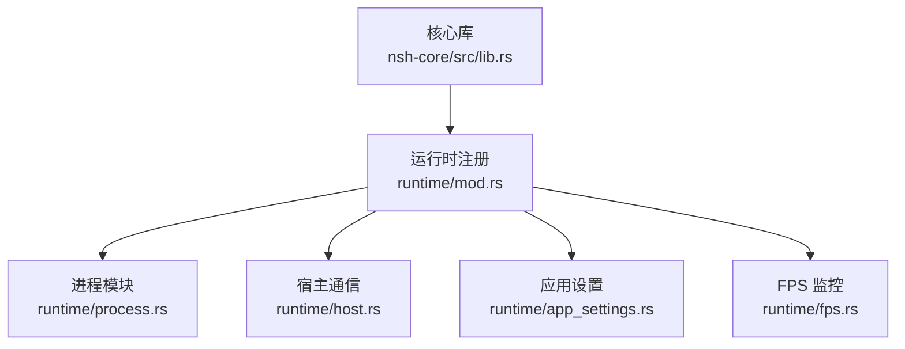
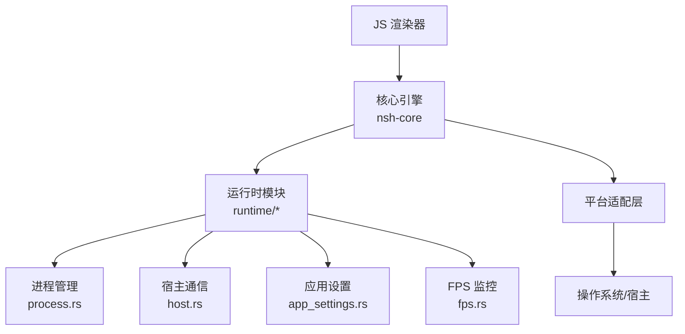
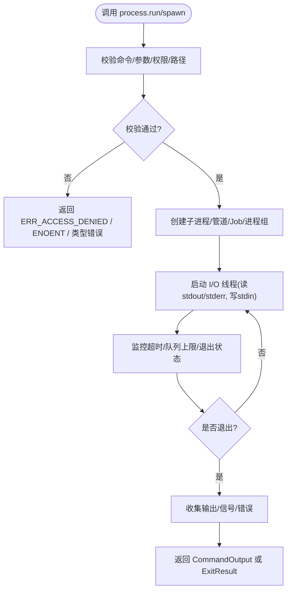
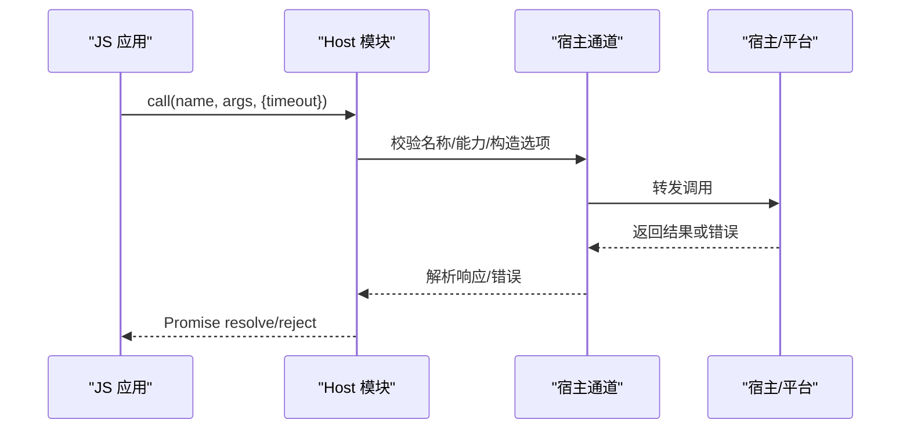
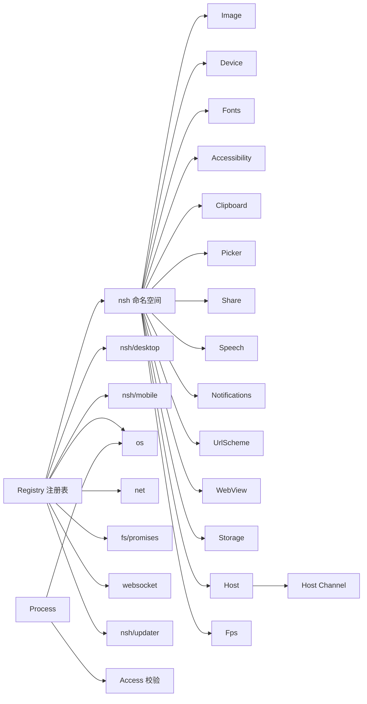

# 运行时API

<cite>
**本文引用的文件**   
- [lib.rs](file://crates/nsh-core/src/lib.rs)
- [mod.rs](file://crates/nsh-core/src/runtime/mod.rs)
- [process.rs](file://crates/nsh-core/src/runtime/process.rs)
- [host.rs](file://crates/nsh-core/src/runtime/host.rs)
- [app_settings.rs](file://crates/nsh-core/src/runtime/app_settings.rs)
- [fps.rs](file://crates/nsh-core/src/runtime/fps.rs)
</cite>

## 目录
1. [简介](#简介)
2. [项目结构](#项目结构)
3. [核心组件](#核心组件)
4. [架构总览](#架构总览)
5. [详细组件分析](#详细组件分析)
6. [依赖关系分析](#依赖关系分析)
7. [性能与监控](#性能与监控)
8. [配置与权限](#配置与权限)
9. [故障排除指南](#故障排除指南)
10. [结论](#结论)

## 简介
本文件为 NSH 框架的“运行时 API”参考文档，聚焦以下运行时能力：
- 应用生命周期管理（进程元数据、退出请求）
- 资源调度（子进程、配额限制、I/O 限流）
- 内存与缓冲控制（输出队列、行缓冲上限）
- 进程间通信（宿主调用/事件）
- 任务调度（异步回调、清理钩子）
- 错误处理（统一错误码、平台不可用、访问拒绝）
- 运行时配置（FPS 监控、能力开关）
- 跨平台抽象（desktop/mobile/web 差异、平台适配层）
- 扩展点与插件规范（模块注册、能力校验）

## 项目结构
NSH 的核心运行时位于 `nsh-core` 的 `runtime` 模块中，按功能拆分为多个 Rust 模块，并通过统一的 `Registry` 机制向 JS 暴露 API。关键入口包括：
- 顶层核心导出与模块组织：`nsh-core/src/lib.rs`
- 运行时模块注册与命名空间：`nsh-core/src/runtime/mod.rs`
- 进程与子进程管理：`nsh-core/src/runtime/process.rs`
- 宿主通信接口：`nsh-core/src/runtime/host.rs`
- 移动端设置页打开：`nsh-core/src/runtime/app_settings.rs`
- FPS 性能监控开关与模式：`nsh-core/src/runtime/fps.rs`

图表来源
- [lib.rs:1-175](file://crates/nsh-core/src/lib.rs#L1-L175)
- [mod.rs:1-130](file://crates/nsh-core/src/runtime/mod.rs#L1-L130)

章节来源
- [lib.rs:1-175](file://crates/nsh-core/src/lib.rs#L1-L175)
- [mod.rs:1-130](file://crates/nsh-core/src/runtime/mod.rs#L1-L130)

## 核心组件
本节概述运行时对外暴露的关键能力与职责边界：
- 进程与子进程：提供运行命令、启动子进程、监听输出、写入 stdin、终止进程树等能力；包含严格的权限校验、路径白名单、环境变量过滤、配额与超时控制。
- 宿主通信：提供 `call` 与 `post` 两种 IPC 方式，支持超时、错误映射、能力校验与平台不可用提示。
- 应用设置：在 iOS/Android 上打开系统设置的应用权限页面，用于用户重新授权。
- FPS 监控：开启/关闭性能监控面板或日志，支持展开/折叠/隐藏模式。

章节来源
- [process.rs:1-170](file://crates/nsh-core/src/runtime/process.rs#L1-L170)
- [host.rs:1-93](file://crates/nsh-core/src/runtime/host.rs#L1-L93)
- [app_settings.rs:1-48](file://crates/nsh-core/src/runtime/app_settings.rs#L1-L48)
- [fps.rs:1-34](file://crates/nsh-core/src/runtime/fps.rs#L1-L34)

## 架构总览
下图展示运行时各模块与核心引擎、JS 渲染器、宿主环境之间的交互关系。

图表来源
- [lib.rs:1-175](file://crates/nsh-core/src/lib.rs#L1-L175)
- [mod.rs:1-130](file://crates/nsh-core/src/runtime/mod.rs#L1-L130)
- [process.rs:1-170](file://crates/nsh-core/src/runtime/process.rs#L1-L170)
- [host.rs:1-93](file://crates/nsh-core/src/runtime/host.rs#L1-L93)
- [app_settings.rs:1-48](file://crates/nsh-core/src/runtime/app_settings.rs#L1-L48)
- [fps.rs:1-34](file://crates/nsh-core/src/runtime/fps.rs#L1-L34)

## 详细组件分析

### 进程与子进程（process）
- 能力与权限
  - 执行命令需 `capabilities.process.execute` 授权；未授权返回访问拒绝错误。
  - 环境变量仅暴露允许列表中的名称（PATH、HOME、USERPROFILE、SYSTEMROOT、TEMP、TMP、TMPDIR、LANG、LC_*），以及 manifest 声明并授予的名称。
  - cwd 必须在 `capabilities.fs.write` 根目录下，否则拒绝。
- 生命周期
  - `run`：捕获 stdout/stderr，默认 30 秒超时；单流最大 8 MiB，超限终止并报错。
  - `spawn`：事件驱动，支持 `lines` 模式按行交付；stdin 可 pipe；支持 `write`/`end`/`kill`。
  - 子进程树管理：Unix 使用进程组信号（SIGTERM/SIGKILL），Windows 使用 Job Object 统一管理。
- 资源与配额
  - 每 VM 最多同时运行 32 个子进程；每个子进程事件监听器上限 64。
  - stdin 队列上限 1 MiB；输出队列全局上限 8 MiB。
- 错误与状态
  - 常见错误码：ERR_ACCESS_DENIED、ERR_FEATURE_UNAVAILABLE_ON_PLATFORM、ENOENT、ETIMEDOUT、ERR_CHILD_PROCESS_STDIO_MAXBUFFER、QUOTA_EXCEEDED。
  - 退出结果包含 code/signal/error/error_code，便于上层诊断。

图表来源
- [process.rs:41-170](file://crates/nsh-core/src/runtime/process.rs#L41-L170)
- [process.rs:548-626](file://crates/nsh-core/src/runtime/process.rs#L548-L626)
- [process.rs:713-810](file://crates/nsh-core/src/runtime/process.rs#L713-L810)
- [process.rs:813-890](file://crates/nsh-core/src/runtime/process.rs#L813-L890)
- [process.rs:892-969](file://crates/nsh-core/src/runtime/process.rs#L892-L969)
- [process.rs:1521-1600](file://crates/nsh-core/src/runtime/process.rs#L1521-L1600)

章节来源
- [process.rs:1-170](file://crates/nsh-core/src/runtime/process.rs#L1-L170)
- [process.rs:548-626](file://crates/nsh-core/src/runtime/process.rs#L548-L626)
- [process.rs:713-810](file://crates/nsh-core/src/runtime/process.rs#L713-L810)
- [process.rs:813-890](file://crates/nsh-core/src/runtime/process.rs#L813-L890)
- [process.rs:892-969](file://crates/nsh-core/src/runtime/process.rs#L892-L969)
- [process.rs:1521-1600](file://crates/nsh-core/src/runtime/process.rs#L1521-L1600)

### 宿主通信（host）
- 能力与校验
  - 调用前校验 host 名称合法性与 `capabilities.host` 授权。
  - 无宿主时返回“平台不可用”。
- 调用模型
  - `call(name, args, options)`：异步调用，支持超时（默认 30s），返回 JSON 或错误。
  - `post(name, args)`：单向事件投递，无返回值。
- 错误映射
  - 宿主侧错误映射为 `ERR_NSH_HOST_ERROR`；超时为 `ETIMEDOUT`；非法名称为 `TypeError`；未授权为 `ERR_ACCESS_DENIED`。

图表来源
- [host.rs:1-93](file://crates/nsh-core/src/runtime/host.rs#L1-L93)

章节来源
- [host.rs:1-93](file://crates/nsh-core/src/runtime/host.rs#L1-L93)

### 应用设置（app_settings）
- 能力与平台
  - 需要 `application` 能力（当应用声明 capabilities）。
  - iOS/Android 可用；其他平台立即返回“平台不可用”。
- 功能
  - `available()`：检测是否可打开系统设置的应用权限页。
  - `open()`：打开系统设置的应用权限页，返回 `{ opened }`。

章节来源
- [app_settings.rs:1-48](file://crates/nsh-core/src/runtime/app_settings.rs#L1-L48)

### FPS 性能监控（fps）
- 功能
  - `set_fps_enabled(enabled)`：开启/关闭性能监控（macOS 面板、其他平台日志/状态栏）。
  - `set_fps_mode(mode)`：设置显示模式（expanded/collapsed/hidden）。
- 行为
  - 平台不支持时忽略设置；`fpsEnabled()` 由 JS 侧 accessor 同步当前状态。

章节来源
- [fps.rs:1-34](file://crates/nsh-core/src/runtime/fps.rs#L1-L34)

## 依赖关系分析
运行时模块通过统一的注册表向 JS 暴露 API，并与核心引擎、平台适配层协作。

图表来源
- [mod.rs:55-113](file://crates/nsh-core/src/runtime/mod.rs#L55-L113)
- [process.rs:1-170](file://crates/nsh-core/src/runtime/process.rs#L1-L170)
- [host.rs:1-93](file://crates/nsh-core/src/runtime/host.rs#L1-L93)

章节来源
- [mod.rs:55-113](file://crates/nsh-core/src/runtime/mod.rs#L55-L113)

## 性能与监控
- FPS 监控
  - 通过 `set_fps_enabled` 与 `set_fps_mode` 控制监控面板或日志输出。
  - 建议在开发阶段启用 expanded 模式以观察帧率与预算；生产环境建议 collapsed 或 hidden。
- 子进程 I/O 限流
  - 输出队列上限 8 MiB，避免内存膨胀；超长行（lines 模式）同样受 8 MiB 限制。
  - stdin 队列上限 1 MiB，防止阻塞上游写入。
- 超时与优雅退出
  - `run` 默认 30 秒超时；spawn 可自定义超时。
  - 先 SIGTERM，等待 250ms 后 SIGKILL；Windows 使用 Job 对象一次性结束整个进程树。

章节来源
- [fps.rs:1-34](file://crates/nsh-core/src/runtime/fps.rs#L1-L34)
- [process.rs:813-890](file://crates/nsh-core/src/runtime/process.rs#L813-L890)
- [process.rs:892-969](file://crates/nsh-core/src/runtime/process.rs#L892-L969)
- [process.rs:1521-1600](file://crates/nsh-core/src/runtime/process.rs#L1521-L1600)

## 配置与权限
- 能力清单（capabilities）
  - `process.execute`：允许执行指定命令；未授权则拒绝。
  - `process.env`：允许暴露的环境变量名；未授权则过滤。
  - `fs.write`：cwd 必须位于已授权的写路径下。
  - `host`：允许调用宿主函数；未授权则拒绝。
  - `application`：允许打开系统设置的应用权限页（移动端）。
- 运行时选项
  - `process.run`：`timeout_ms`、`cwd`。
  - `process.spawn`：`timeout_ms`、`cwd`、`stdin`、`lines`。
  - `host.call`：`timeout`（毫秒）。
- 平台差异
  - 桌面端支持完整进程能力；WASM/Web 环境进程不可用。
  - 移动端设置页仅在 iOS/Android 可用。

章节来源
- [process.rs:41-170](file://crates/nsh-core/src/runtime/process.rs#L41-L170)
- [host.rs:1-93](file://crates/nsh-core/src/runtime/host.rs#L1-L93)
- [app_settings.rs:1-48](file://crates/nsh-core/src/runtime/app_settings.rs#L1-L48)

## 故障排除指南
- 进程相关
  - 现象：命令找不到或权限不足
    - 排查：检查 `capabilities.process.execute` 与 PATH；确认可执行文件存在且具备执行权限。
    - 错误码：ENOENT、EACCES、ERR_ACCESS_DENIED。
  - 现象：输出过大导致崩溃或卡顿
    - 排查：启用 lines 模式并按行消费；关注 8 MiB 上限；必要时限制子进程输出量。
    - 错误码：ERR_CHILD_PROCESS_STDIO_MAXBUFFER。
  - 现象：子进程无法终止
    - 排查：检查 Unix 进程组/Windows Job 状态；确认未被其他用户接管。
    - 错误码：超时、放弃终止（可能以其他用户运行）。
- 宿主通信
  - 现象：调用超时
    - 排查：增大 `timeout` 或优化宿主处理逻辑；检查宿主通道是否配置。
    - 错误码：ETIMEDOUT。
  - 现象：名称无效或未授权
    - 排查：校验 host 名称合法性与 `capabilities.host`。
    - 错误码：TypeError、ERR_ACCESS_DENIED。
- 应用设置
  - 现象：无法打开系统设置
    - 排查：确认平台为 iOS/Android；检查 `application` 能力。
    - 错误码：ERR_FEATURE_UNAVAILABLE_ON_PLATFORM、ERR_ACCESS_DENIED。

章节来源
- [process.rs:548-626](file://crates/nsh-core/src/runtime/process.rs#L548-L626)
- [process.rs:813-890](file://crates/nsh-core/src/runtime/process.rs#L813-L890)
- [process.rs:892-969](file://crates/nsh-core/src/runtime/process.rs#L892-L969)
- [host.rs:1-93](file://crates/nsh-core/src/runtime/host.rs#L1-L93)
- [app_settings.rs:1-48](file://crates/nsh-core/src/runtime/app_settings.rs#L1-L48)

## 结论
NSH 运行时通过清晰的模块划分与严格的权限/配额控制，提供了稳定可靠的进程管理、宿主通信与性能监控能力。开发者应遵循能力清单与路径白名单，合理配置超时与缓冲上限，并在不同平台上采用相应的最佳实践以获得一致体验。