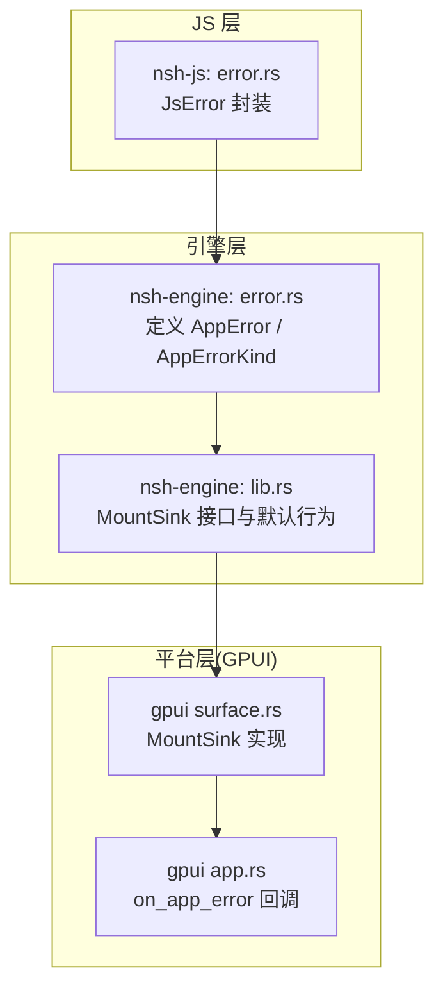
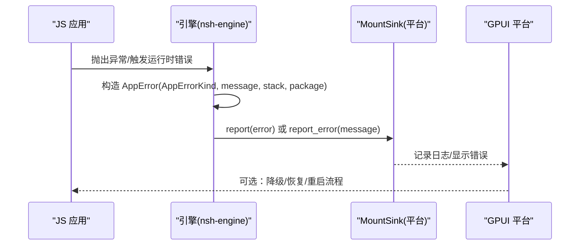
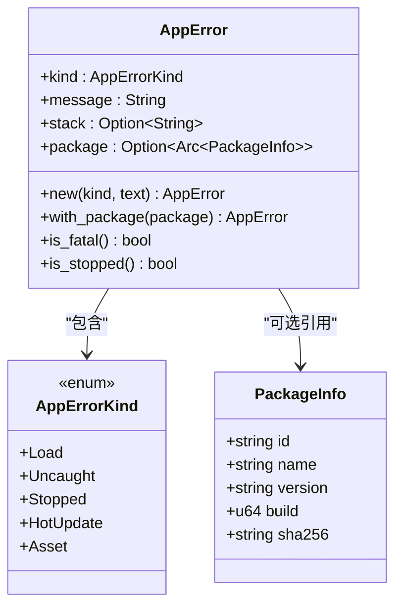
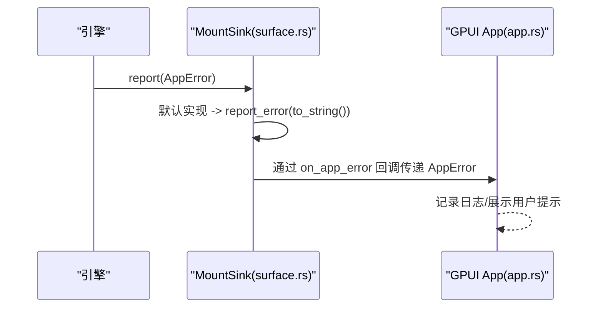
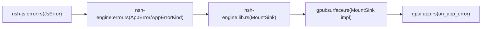
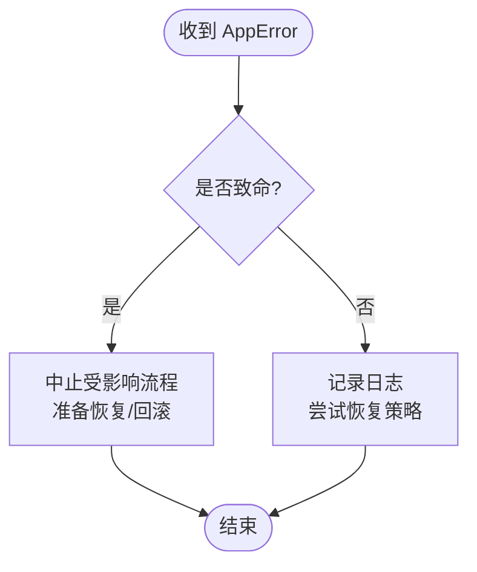

# 错误处理机制

<cite>
**本文引用的文件**   
- [error.rs](file://crates/nsh-engine/src/error.rs)
- [lib.rs](file://crates/nsh-engine/src/lib.rs)
- [surface.rs](file://crates/gpui/nsh-platform-gpui/src/surface.rs)
- [app.rs](file://crates/gpui/nsh-platform-gpui/src/app.rs)
- [error.rs](file://crates/nsh-js/src/error.rs)
</cite>

## 目录
1. [简介](#简介)
2. [项目结构](#项目结构)
3. [核心组件](#核心组件)
4. [架构总览](#架构总览)
5. [详细组件分析](#详细组件分析)
6. [依赖关系分析](#依赖关系分析)
7. [性能与稳定性考量](#性能与稳定性考量)
8. [故障排查指南](#故障排查指南)
9. [结论](#结论)
10. [附录：最佳实践与示例](#附录最佳实践与示例)

## 简介
本文件面向 NSH 框架的错误处理机制，聚焦于引擎侧对外暴露的错误模型、错误传播路径、严重性判定与恢复策略，并给出调试信息收集、日志记录与用户友好提示的实现建议。重点覆盖以下主题：
- AppError、AppErrorKind 等错误类型的定义与使用
- 错误从 JS/引擎到平台的传播与捕获
- 运行时错误的分类、严重性与恢复策略
- 调试信息（消息、堆栈、包信息）的采集与展示
- 自定义错误处理器与错误恢复机制的实践

## 项目结构
NSH 的错误处理相关代码主要分布在以下模块：
- nsh-engine：引擎核心，定义 AppError/AppErrorKind，并通过 MountSink 将错误上报给平台
- nsh-js：JS 层异常封装为 JsError，用于统一渲染为带堆栈的消息
- gpui 平台实现：提供 on_app_error 回调与 MountSink::report/report_error 的具体实现，用于在 UI 或控制台呈现错误

图示来源
- [error.rs:6-25](file://crates/nsh-engine/src/error.rs#L6-L25)
- [error.rs:43-58](file://crates/nsh-engine/src/error.rs#L43-L58)
- [lib.rs:753-827](file://crates/nsh-engine/src/lib.rs#L753-L827)
- [error.rs:1-41](file://crates/nsh-js/src/error.rs#L1-L41)
- [surface.rs:84-95](file://crates/gpui/nsh-platform-gpui/src/surface.rs#L84-L95)
- [app.rs:635-648](file://crates/gpui/nsh-platform-gpui/src/app.rs#L635-L648)

章节来源
- [error.rs:6-25](file://crates/nsh-engine/src/error.rs#L6-L25)
- [error.rs:43-58](file://crates/nsh-engine/src/error.rs#L43-L58)
- [lib.rs:753-827](file://crates/nsh-engine/src/lib.rs#L753-L827)
- [error.rs:1-41](file://crates/nsh-js/src/error.rs#L1-L41)
- [surface.rs:84-95](file://crates/gpui/nsh-platform-gpui/src/surface.rs#L84-L95)
- [app.rs:635-648](file://crates/gpui/nsh-platform-gpui/src/app.rs#L635-L648)

## 核心组件
- AppErrorKind：错误种类枚举，描述“发生了什么”
- AppError：具体错误对象，包含 kind、message、stack、package
- PackageInfo：签名包信息，便于问题定位与版本追踪
- MountSink：引擎与平台之间的错误上报通道（report_error/report）
- JsError：JS 侧异常的统一封装

章节来源
- [error.rs:6-25](file://crates/nsh-engine/src/error.rs#L6-L25)
- [error.rs:43-58](file://crates/nsh-engine/src/error.rs#L43-L58)
- [error.rs:27-41](file://crates/nsh-engine/src/error.rs#L27-L41)
- [lib.rs:753-827](file://crates/nsh-engine/src/lib.rs#L753-L827)
- [error.rs:1-41](file://crates/nsh-js/src/error.rs#L1-L41)

## 架构总览
错误从 JS 引擎产生，经引擎内部转换为 AppError，再通过 MountSink 上报到平台层进行记录与展示。平台侧可注册 on_app_error 回调以接收结构化错误。

图示来源
- [error.rs:43-58](file://crates/nsh-engine/src/error.rs#L43-L58)
- [lib.rs:753-827](file://crates/nsh-engine/src/lib.rs#L753-L827)
- [surface.rs:84-95](file://crates/gpui/nsh-platform-gpui/src/surface.rs#L84-L95)
- [app.rs:635-648](file://crates/gpui/nsh-platform-gpui/src/app.rs#L635-L648)

## 详细组件分析

### AppErrorKind 与 AppError
- AppErrorKind 定义了五类错误：
  - Load：应用未启动（VM 创建失败或顶层执行抛错）
  - Uncaught：回调中异常逃逸（事件处理、定时器、Promise），应用继续运行
  - Stopped：VM 被停止（内存耗尽、配额超限、无效 op），不再运行 JS，视图保持现状
  - HotUpdate：开发热更新评估失败，保留已运行模块
  - Asset：必需资源（如字体）加载失败
- AppError 包含：
  - kind：错误种类
  - message：不含堆栈的消息文本
  - stack：映射到源码位置的 JS 堆栈（若存在 source map）
  - package：来自签名包的信息（用于报告与溯源）
- 辅助方法：
  - new(kind, text)：从文本解析出 message 与 stack
  - with_package(package)：附加包信息
  - is_fatal()：Load/Stopped 视为致命错误
  - is_stopped()：仅 Stopped 返回 true

图示来源
- [error.rs:6-25](file://crates/nsh-engine/src/error.rs#L6-L25)
- [error.rs:27-41](file://crates/nsh-engine/src/error.rs#L27-L41)
- [error.rs:43-58](file://crates/nsh-engine/src/error.rs#L43-L58)
- [error.rs:60-90](file://crates/nsh-engine/src/error.rs#L60-L90)

章节来源
- [error.rs:6-25](file://crates/nsh-engine/src/error.rs#L6-L25)
- [error.rs:43-58](file://crates/nsh-engine/src/error.rs#L43-L58)
- [error.rs:60-90](file://crates/nsh-engine/src/error.rs#L60-L90)

### 错误传播与捕获：MountSink 与平台回调
- MountSink 是引擎与平台之间的错误上报通道：
  - report_error(message)：接收纯文本错误（消息+堆栈）
  - report(error)：接收结构化 AppError；默认实现调用 report_error
- GPUI 平台：
  - surface.rs 实现了 MountSink，将错误转发到上层
  - app.rs 提供 on_app_error(callback)，允许宿主订阅 AppError

图示来源
- [lib.rs:753-827](file://crates/nsh-engine/src/lib.rs#L753-L827)
- [surface.rs:84-95](file://crates/gpui/nsh-platform-gpui/src/surface.rs#L84-L95)
- [app.rs:635-648](file://crates/gpui/nsh-platform-gpui/src/app.rs#L635-L648)

章节来源
- [lib.rs:753-827](file://crates/nsh-engine/src/lib.rs#L753-L827)
- [surface.rs:84-95](file://crates/gpui/nsh-platform-gpui/src/surface.rs#L84-L95)
- [app.rs:635-648](file://crates/gpui/nsh-platform-gpui/src/app.rs#L635-L648)

### JS 侧异常封装：JsError
- JsError 将 QuickJS 捕获的异常统一包装为带 message 的结构体，支持 null 值异常的特殊标记
- 提供 from_engine 与 From<rquickjs::Error> 转换，便于在引擎侧统一处理

章节来源
- [error.rs:1-41](file://crates/nsh-js/src/error.rs#L1-L41)

## 依赖关系分析
- nsh-engine 对外暴露 AppError、AppErrorKind、PackageInfo，并通过 MountSink 与平台解耦
- nsh-js 提供 JsError，作为引擎侧对 JS 异常的抽象
- GPUI 平台通过 surface.rs 实现 MountSink，并在 app.rs 暴露 on_app_error 供上层订阅

图示来源
- [error.rs:1-41](file://crates/nsh-js/src/error.rs#L1-L41)
- [error.rs:6-25](file://crates/nsh-engine/src/error.rs#L6-L25)
- [lib.rs:753-827](file://crates/nsh-engine/src/lib.rs#L753-L827)
- [surface.rs:84-95](file://crates/gpui/nsh-platform-gpui/src/surface.rs#L84-L95)
- [app.rs:635-648](file://crates/gpui/nsh-platform-gpui/src/app.rs#L635-L648)

章节来源
- [error.rs:6-25](file://crates/nsh-engine/src/error.rs#L6-L25)
- [lib.rs:753-827](file://crates/nsh-engine/src/lib.rs#L753-L827)
- [error.rs:1-41](file://crates/nsh-js/src/error.rs#L1-L41)
- [surface.rs:84-95](file://crates/gpui/nsh-platform-gpui/src/surface.rs#L84-L95)
- [app.rs:635-648](file://crates/gpui/nsh-platform-gpui/src/app.rs#L635-L648)

## 性能与稳定性考量
- 致命错误（Load/Stopped）应尽快终止受影响上下文，避免状态不一致
- Uncaught 错误不应中断应用主循环，但需记录并尽量隔离影响范围
- 堆栈字符串拼接与日志输出应避免在高频路径上造成阻塞；必要时异步落盘
- 对于 Stopped 场景，保持视图不变，等待宿主决定恢复策略（如回滚到上一稳定版本）

[本节为通用指导，不直接分析具体文件]

## 故障排查指南
- 收集信息
  - 优先获取 AppError.kind 判断是否致命
  - 提取 message 与 stack，结合 source map 还原源码位置
  - 若存在 package，记录 id/version/build/sha256 以便复现
- 日志记录
  - 所有错误均应记录；开发环境可在屏幕内展示
  - 对致命错误追加上下文（当前窗口、操作序列、最近一次成功提交）
- 用户提示
  - 非致命错误：提供可操作的提示（重试、切换网络、检查权限）
  - 致命错误：引导用户重启应用或回退版本，并提供错误 ID

章节来源
- [error.rs:43-58](file://crates/nsh-engine/src/error.rs#L43-L58)
- [lib.rs:753-827](file://crates/nsh-engine/src/lib.rs#L753-L827)
- [app.rs:635-648](file://crates/gpui/nsh-platform-gpui/src/app.rs#L635-L648)

## 结论
NSH 的错误处理以 AppError/AppErrorKind 为核心，通过 MountSink 将错误从引擎透明地传递给平台层。平台侧可通过 on_app_error 订阅结构化错误，实现统一的日志、监控与用户提示。依据错误种类采取差异化恢复策略，既能保证用户体验，也能提升系统稳定性。

[本节为总结性内容，不直接分析具体文件]

## 附录：最佳实践与示例

### 错误分类与严重性评估
- Load/Stopped：致命，应立即中止受影响流程，考虑回滚或退出
- Uncaught/HotUpdate/Asset：非致命，记录并尝试恢复（重试、降级、提示）

图示来源
- [error.rs:6-25](file://crates/nsh-engine/src/error.rs#L6-L25)
- [error.rs:79-90](file://crates/nsh-engine/src/error.rs#L79-L90)

章节来源
- [error.rs:6-25](file://crates/nsh-engine/src/error.rs#L6-L25)
- [error.rs:79-90](file://crates/nsh-engine/src/error.rs#L79-L90)

### 调试信息收集与用户友好提示
- 收集字段：kind、message、stack、package
- 展示策略：
  - 开发者面板：完整堆栈与包信息
  - 普通用户：简洁提示与可操作指引（重试、反馈、回退）

章节来源
- [error.rs:43-58](file://crates/nsh-engine/src/error.rs#L43-L58)
- [error.rs:27-41](file://crates/nsh-engine/src/error.rs#L27-L41)

### 自定义错误处理器与恢复机制（示例思路）
- 在平台层实现 MountSink：
  - 重写 report(error) 以记录结构化错误
  - 根据 is_fatal()/is_stopped() 决定是否触发恢复流程
- 在 GPUI 平台注册 on_app_error：
  - 将 AppError 转为用户可见提示
  - 对致命错误触发应用级回滚或重启

章节来源
- [lib.rs:753-827](file://crates/nsh-engine/src/lib.rs#L753-L827)
- [surface.rs:84-95](file://crates/gpui/nsh-platform-gpui/src/surface.rs#L84-L95)
- [app.rs:635-648](file://crates/gpui/nsh-platform-gpui/src/app.rs#L635-L648)