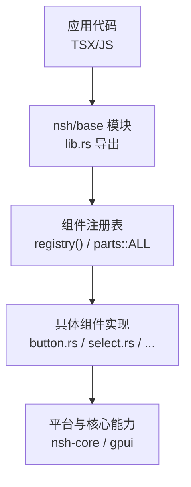
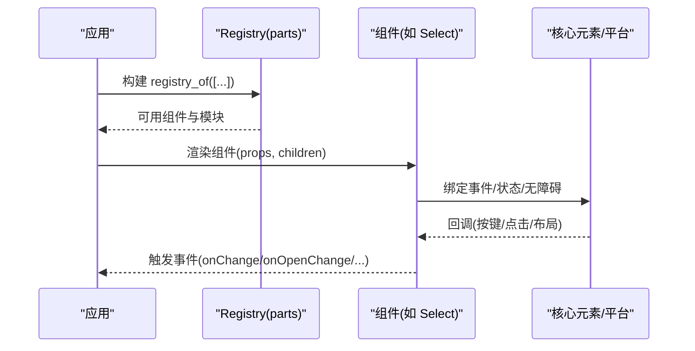
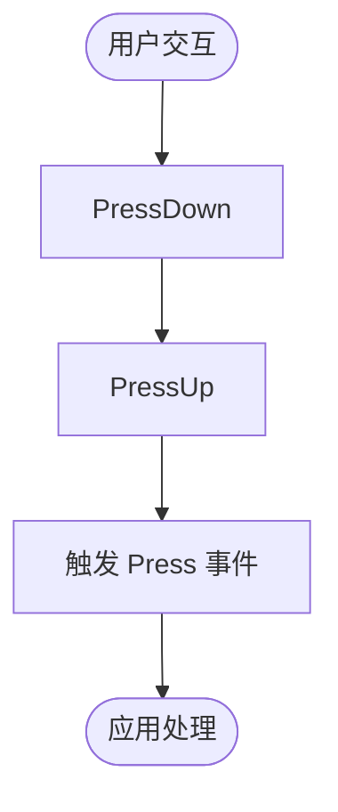
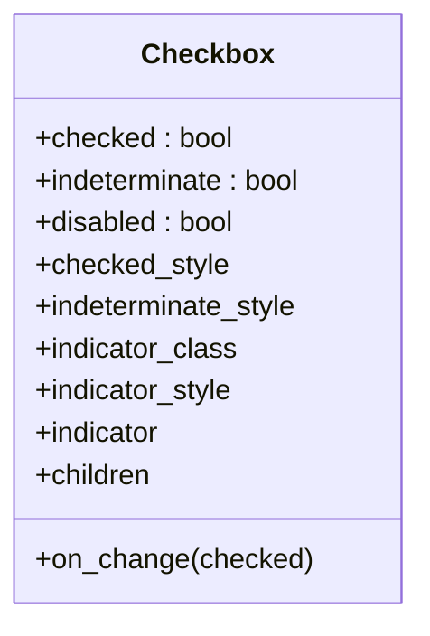
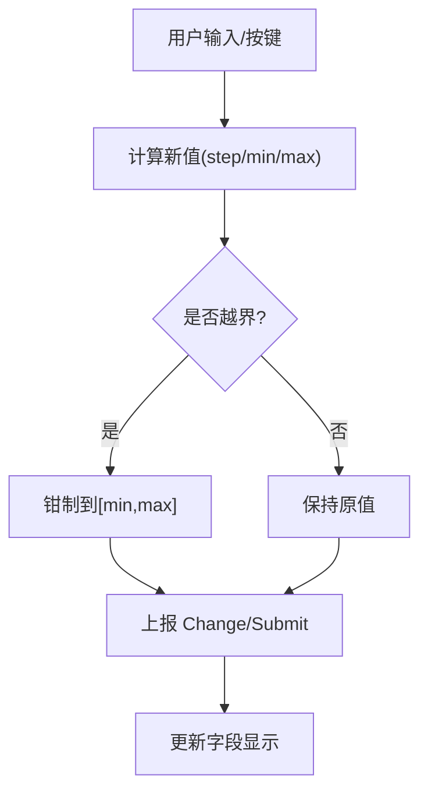
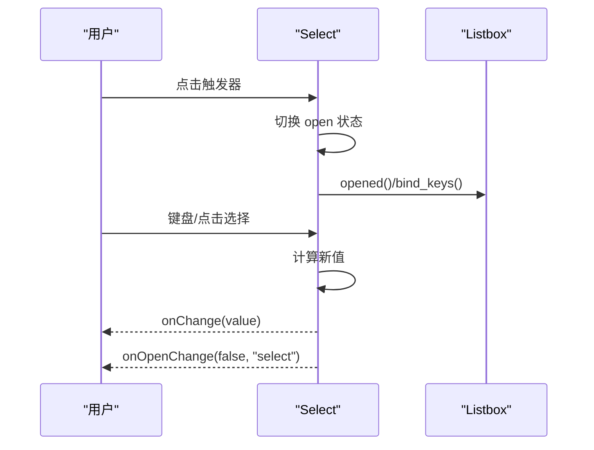
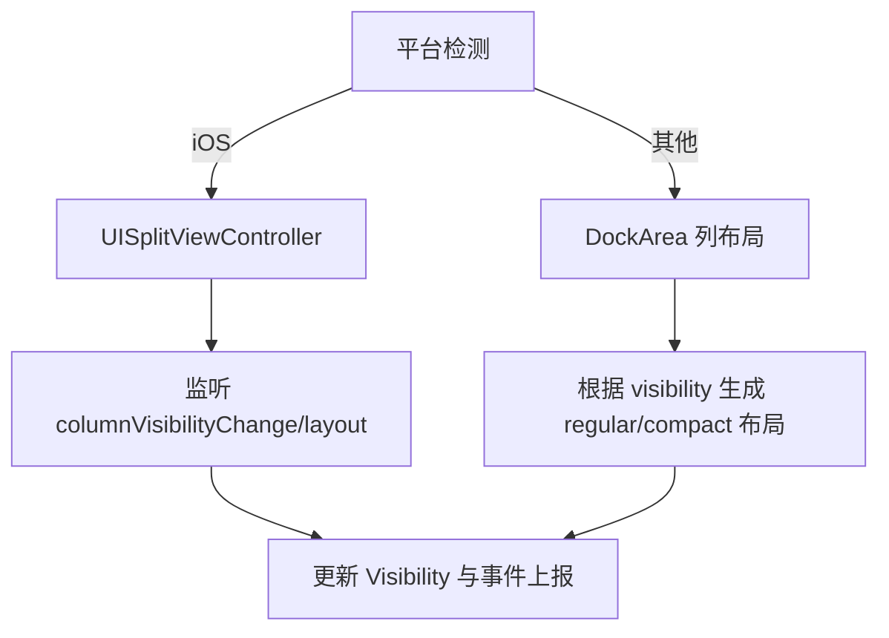
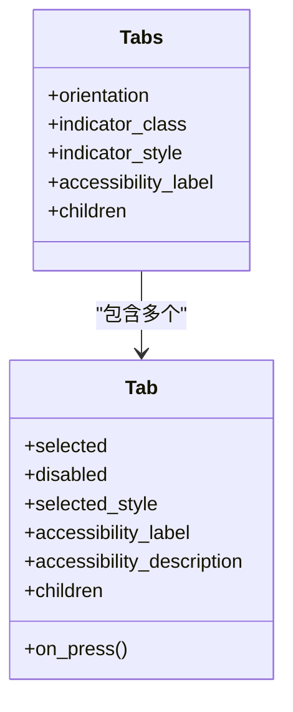
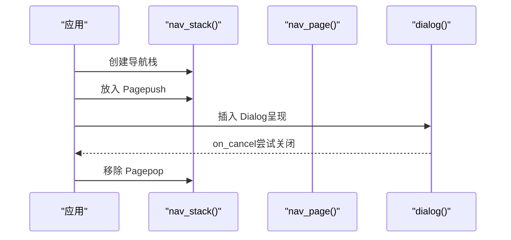
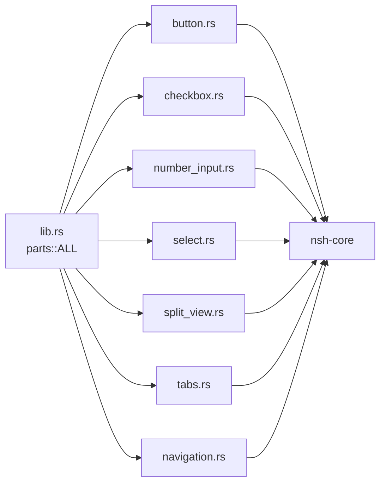

# UI组件参考

<cite>
**本文引用的文件**   
- [lib.rs](file://crates/nsh-base/src/lib.rs)
- [button.rs](file://crates/nsh-base/src/button.rs)
- [checkbox.rs](file://crates/nsh-base/src/checkbox.rs)
- [number_input.rs](file://crates/nsh-base/src/number_input.rs)
- [select.rs](file://crates/nsh-base/src/select.rs)
- [split_view.rs](file://crates/nsh-base/src/split_view.rs)
- [tabs.rs](file://crates/nsh-base/src/tabs.rs)
- [navigation.rs](file://crates/nsh-base/src/navigation.rs)
</cite>

## 目录
1. [简介](#简介)
2. [项目结构](#项目结构)
3. [核心组件](#核心组件)
4. [架构总览](#架构总览)
5. [详细组件分析](#详细组件分析)
6. [依赖关系分析](#依赖关系分析)
7. [性能与可访问性](#性能与可访问性)
8. [主题化与样式定制](#主题化与样式定制)
9. [故障排查指南](#故障排查指南)
10. [结论](#结论)

## 简介
本文件为 NSH 基础 UI 组件库的 API 参考文档，聚焦 nsh-base 提供的内置组件。内容涵盖：
- 基础控件（Button、Checkbox 等）
- 表单控件（Input、NumberInput、Select 等）
- 布局与导航控件（SplitView、Tabs、Navigation 等）
- 复合控件（DataTable、Editor、RichEditor 等，见导出清单）

每个组件均提供属性表、事件说明、样式类参考与使用要点，并给出组合模式、响应式设计与可访问性建议，以及主题化与自定义指导。

## 项目结构
nsh-base 以 Rust 实现行为与基础设施，外观由应用通过 Tailwind 类与样式控制；JS 侧接口由组件 props 与事件自动生成。组件按“部分（parts）”注册到运行时 Registry，便于按需裁剪二进制体积。

图表来源
- [lib.rs:299-318](file://crates/nsh-base/src/lib.rs#L299-L318)
- [lib.rs:326-384](file://crates/nsh-base/src/lib.rs#L326-L384)

章节来源
- [lib.rs:1-18](file://crates/nsh-base/src/lib.rs#L1-L18)
- [lib.rs:299-318](file://crates/nsh-base/src/lib.rs#L299-L318)
- [lib.rs:326-384](file://crates/nsh-base/src/lib.rs#L326-L384)

## 核心组件
本节概览常用组件的职责与交互边界，后续章节对关键组件进行深度解析。

- Button：无外观的点击目标，负责按下、禁用、选中、忙态与无障碍语义。
- Checkbox：三态选择（选中/未选中/不确定），支持无障碍描述与指示器定制。
- NumberInput：数字输入框，支持步进、范围校验、只读与无障碍操作。
- Select：下拉选择，支持搜索、分组、受控/非受控值、键盘与类型ahead。
- SplitView：双列/三列布局，iOS 原生 SplitViewController，其他平台基于 DockArea。
- Tabs/Tabs：标签页列表与指示器跟随动画，遵循 ARIA Tablist 模式。
- Navigation：栈式导航与对话框的原生封装（NavStack/NavPage/Dialog）。

章节来源
- [lib.rs:124-274](file://crates/nsh-base/src/lib.rs#L124-L274)

## 架构总览
组件通过 parts 模块化注册，Registry 暴露给引擎服务 JS 层。所有组件统一通过 Props/Event 机制与宿主通信，样式完全交由应用控制。

图表来源
- [lib.rs:299-318](file://crates/nsh-base/src/lib.rs#L299-L318)
- [lib.rs:326-384](file://crates/nsh-base/src/lib.rs#L326-L384)

## 详细组件分析

### Button
- 职责：提供统一的按下行为、禁用/选中/忙态、无障碍角色与命中区域扩展。
- 属性
  - disabled: 禁用按钮（屏幕阅读器提示不可用）
  - selected: 选中态（用于切换触发器或当前标签）
  - selected_style: 选中态样式
  - busy: 忙碌态（仍可计数按下，通常同时设置 disabled）
  - accessibility_label: 无障碍标签
  - role: 无障碍角色（默认 button）
  - hit_slop: 命中区域扩展
  - children: 内容
- 事件
  - Press：按下
  - PressDown：按下开始
  - PressUp：按下结束
- 样式类
  - 根级 class/style 控制外观
  - 状态类：active:、hover:、focus-visible:、selected:、disabled:
  - 也可通过 selectedStyle/disabledStyle 等内联样式覆盖
- 使用要点
  - 在 Toolbar/ToggleGroup 中作为焦点停靠点
  - 小图标按钮建议使用 hit_slop 扩大触控区

图表来源
- [button.rs:43-82](file://crates/nsh-base/src/button.rs#L43-L82)

章节来源
- [button.rs:7-41](file://crates/nsh-base/src/button.rs#L7-L41)
- [button.rs:43-82](file://crates/nsh-base/src/button.rs#L43-L82)

### Checkbox
- 职责：三态选择控件，管理选中/不确定/禁用与无障碍语义。
- 属性
  - checked: 是否选中（受控）
  - indeterminate: 不确定态（优先于 checked）
  - disabled: 禁用
  - checked_style / indeterminate_style: 对应状态样式
  - accessibility_label: 无障碍标签
  - invalid: 无效态（配合验证）
  - accessibility_described_by: 关联描述元素
  - role: 无障碍角色（默认 checkbox）
  - hit_slop: 命中区域扩展
  - indicator_class / indicator_style: 指示器样式
  - indicator: 自定义指示器内容
  - children: 标签文本
- 事件
  - Change(checked): 请求切换值
- 样式类
  - 根级 class/style
  - 状态类：checked:、indeterminate:、disabled:
- 终端适配
  - 终端下显示字符标记与空格占位

图表来源
- [checkbox.rs:8-64](file://crates/nsh-base/src/checkbox.rs#L8-L64)
- [checkbox.rs:91-137](file://crates/nsh-base/src/checkbox.rs#L91-L137)

章节来源
- [checkbox.rs:8-64](file://crates/nsh-base/src/checkbox.rs#L8-L64)
- [checkbox.rs:66-74](file://crates/nsh-base/src/checkbox.rs#L66-L74)
- [checkbox.rs:91-137](file://crates/nsh-base/src/checkbox.rs#L91-L137)

### NumberInput
- 职责：数字输入框，支持步进、范围限制、只读、无障碍操作与键盘快捷键。
- 属性
  - value / default_value: 数值（受控/初始值）
  - min / max: 取值范围
  - step: 步进大小（默认 1）
  - disabled / readonly: 禁用/只读
  - placeholder: 占位符
  - accessibility_label: 无障碍标签
  - controls_right: 增减按钮在右侧
  - input_class / input_style: 输入框样式
  - decrement/increment_button_*: 增减按钮样式与内容
  - controls_class / controls_style: 按钮列样式
  - prefix / suffix: 前后缀内容
- 事件
  - Change(value): 数值变化
  - Submit(value): 回车提交
  - Focus / Blur: 焦点事件
- 方法（API）
  - focus(): 将焦点移入输入框
- 键盘与无障碍
  - 支持 WAI-ARIA Spinbutton 键位（上/下/PageUp/PageDown）
  - 提供 increment/decrement 无障碍动作
- 样式类
  - 根级 class/style
  - 各 part 的 class/style（input、decrement/increment buttons、controls）

图表来源
- [number_input.rs:15-93](file://crates/nsh-base/src/number_input.rs#L15-L93)
- [number_input.rs:191-346](file://crates/nsh-base/src/number_input.rs#L191-L346)
- [number_input.rs:374-522](file://crates/nsh-base/src/number_input.rs#L374-L522)

章节来源
- [number_input.rs:15-93](file://crates/nsh-base/src/number_input.rs#L15-L93)
- [number_input.rs:95-131](file://crates/nsh-base/src/number_input.rs#L95-L131)
- [number_input.rs:154-166](file://crates/nsh-base/src/number_input.rs#L154-L166)
- [number_input.rs:191-346](file://crates/nsh-base/src/number_input.rs#L191-L346)
- [number_input.rs:374-522](file://crates/nsh-base/src/number_input.rs#L374-L522)

### Select
- 职责：从列表中选择一个值，支持搜索、分组、受控/非受控、键盘导航与类型ahead。
- 数据结构
  - SelectItem：value/title/disabled/group
  - SelectEntry：渲染项（value/title/index/group）
  - SelectGroup：分组标题
  - SelectValue：Uncontrolled/Controlled(Option<String>)
- 属性（节选）
  - items: 选项列表
  - value/default_value: 受控值或初始值
  - open/default_open: 打开状态
  - searchable/search_placeholder/search_accessibility_label/search_test_id: 搜索相关
  - cleanable/clear_button_*: 清空按钮
  - disabled/accessibility_label: 禁用与无障碍
  - placement/align/offset/margin: 弹出位置与对齐
  - cover: 是否覆盖触发器
  - popup/list/group/item/search/clear_button_*: 各类样式类与内联样式
  - trigger/empty/render_item/render_group: 自定义触发器、空态、行与分组渲染
- 事件
  - Change(value?): 选择变更（可为 null）
  - OpenChange(open, reason): 打开/关闭及原因
  - Open/Close: 生命周期
  - Cancel: 取消关闭
- 交互与无障碍
  - 触发器作为 Combobox，维护 expanded/hasPopup/value
  - 键盘：上下移动高亮、回车/空格选择、Esc/Back 关闭、Tab 移出关闭
  - 类型ahead：字母与数字快速定位
  - 终端适配：单行触发器与列表行展示

图表来源
- [select.rs:62-147](file://crates/nsh-base/src/select.rs#L62-L147)
- [select.rs:149-207](file://crates/nsh-base/src/select.rs#L149-L207)
- [select.rs:209-362](file://crates/nsh-base/src/select.rs#L209-L362)
- [select.rs:364-385](file://crates/nsh-base/src/select.rs#L364-L385)
- [select.rs:472-800](file://crates/nsh-base/src/select.rs#L472-L800)

章节来源
- [select.rs:1-42](file://crates/nsh-base/src/select.rs#L1-L42)
- [select.rs:62-147](file://crates/nsh-base/src/select.rs#L62-L147)
- [select.rs:149-207](file://crates/nsh-base/src/select.rs#L149-L207)
- [select.rs:209-362](file://crates/nsh-base/src/select.rs#L209-L362)
- [select.rs:364-385](file://crates/nsh-base/src/select.rs#L364-L385)
- [select.rs:472-800](file://crates/nsh-base/src/select.rs#L472-L800)

### SplitView
- 职责：两列/三列布局（侧边栏、可选内容列、详情列），每列为一个 NavStack。
- 平台差异
  - iOS/Mac Catalyst：使用 UISplitViewController，系统手势与头部管理
  - 其他平台：基于 DockArea 的可调整宽度列
- 属性
  - column_visibility: 可见列（Automatic/All/DoubleColumn/DetailOnly）
  - sidebar/content/detail: 三个槽位（均为 NavStack）
- 事件
  - ColumnVisibilityChange(column_visibility): 可见列变化
- 内部逻辑
  - Visibility 管理受控/自有状态与 revision 重显
  - iOS 路径：native_columns 包装列尺寸与原生事件
  - 其他平台：dock_columns 使用 DockArea 布局与紧凑模式

图表来源
- [split_view.rs:1-60](file://crates/nsh-base/src/split_view.rs#L1-L60)
- [split_view.rs:87-163](file://crates/nsh-base/src/split_view.rs#L87-L163)
- [split_view.rs:165-226](file://crates/nsh-base/src/split_view.rs#L165-L226)
- [split_view.rs:228-288](file://crates/nsh-base/src/split_view.rs#L228-L288)
- [split_view.rs:290-415](file://crates/nsh-base/src/split_view.rs#L290-L415)
- [split_view.rs:417-478](file://crates/nsh-base/src/split_view.rs#L417-L478)

章节来源
- [split_view.rs:1-60](file://crates/nsh-base/src/split_view.rs#L1-L60)
- [split_view.rs:87-163](file://crates/nsh-base/src/split_view.rs#L87-L163)
- [split_view.rs:165-226](file://crates/nsh-base/src/split_view.rs#L165-L226)
- [split_view.rs:228-288](file://crates/nsh-base/src/split_view.rs#L228-L288)
- [split_view.rs:290-415](file://crates/nsh-base/src/split_view.rs#L290-L415)
- [split_view.rs:417-478](file://crates/nsh-base/src/split_view.rs#L417-L478)

### Tabs 与 Tab
- 职责：标签页列表与单个标签，遵循 ARIA Tablist 模式，支持箭头键导航与指示器跟随动画。
- Tab 属性
  - selected/disabled: 选中/禁用
  - selected_style: 选中态样式
  - accessibility_label/description: 无障碍标签与描述
  - children: 标签内容
- Tab 事件
  - Press：按下（包括键盘激活）
- Tabs 属性
  - orientation: 方向（horizontal/vertical）
  - indicator_class/indicator_style: 指示器样式
  - accessibility_label: 列表名称
  - children: 标签与其他内容
- 行为
  - Roving 焦点模式，Home/End 跳转首尾
  - 指示器跟随选中标签，带弹簧过渡（减少动效时即时移动）
  - 终端下无指示器，仅加间距

图表来源
- [tabs.rs:26-51](file://crates/nsh-base/src/tabs.rs#L26-L51)
- [tabs.rs:53-62](file://crates/nsh-base/src/tabs.rs#L53-L62)
- [tabs.rs:96-123](file://crates/nsh-base/src/tabs.rs#L96-L123)
- [tabs.rs:125-185](file://crates/nsh-base/src/tabs.rs#L125-L185)
- [tabs.rs:187-201](file://crates/nsh-base/src/tabs.rs#L187-L201)

章节来源
- [tabs.rs:1-20](file://crates/nsh-base/src/tabs.rs#L1-L20)
- [tabs.rs:26-62](file://crates/nsh-base/src/tabs.rs#L26-L62)
- [tabs.rs:96-185](file://crates/nsh-base/src/tabs.rs#L96-L185)
- [tabs.rs:187-201](file://crates/nsh-base/src/tabs.rs#L187-L201)

### Navigation（NavStack/NavPage/Dialog）
- 职责：提供栈式导航与对话框的原生封装，两端（Rust/TSX）共享同一层。
- 组件
  - nav_stack(): 返回 Stack，子节点自底向上排列
  - nav_page(): 返回 Screen，承载页面内容与系统头配置
  - dialog(): 返回 Modal，顶层模态呈现，支持取消回调
- 行为
  - iOS：UINavigationController（滑动返回、系统头）
  - Android：带工具栏与预测返回的栈
  - 桌面/Web：应用 header
  - Dialog：无障碍角色 Dialog/AlertDialog，label 作为标题

图表来源
- [navigation.rs:1-41](file://crates/nsh-base/src/navigation.rs#L1-L41)

章节来源
- [navigation.rs:1-41](file://crates/nsh-base/src/navigation.rs#L1-L41)

## 依赖关系分析
- 组件注册
  - lib.rs 通过 parts::ALL 顺序注册各组件与模块，确保导出稳定且无重复。
- 外部依赖
  - 组件依赖 nsh-core 的元素、几何、平台能力与无障碍模型。
  - 部分组件（Editor/Diff/RichEditor/Plot/Terminal）通过 feature 开关启用。
- 耦合与内聚
  - 组件间低耦合，通过 props/events 通信；布局与外观完全解耦。
  - 公共行为（如 roving 焦点、popup 框架）被多组件复用。

图表来源
- [lib.rs:326-384](file://crates/nsh-base/src/lib.rs#L326-L384)

章节来源
- [lib.rs:326-384](file://crates/nsh-base/src/lib.rs#L326-L384)

## 性能与可访问性
- 性能
  - Select 的行渲染通过 renderItem 一次性绘制，避免频繁重建。
  - Tabs 指示器跟随使用原生 follow 与 spring 过渡，减少 JS 与布局事件。
  - SplitView 在 iOS 使用原生 SplitViewController，其他平台使用 DockArea 布局，避免多余重绘。
- 可访问性
  - Button/Checkbox/NumberInput/Select/Tabs 均设置正确的 AccessibilityRole 与状态。
  - Select 的触发器作为 Combobox，维护 expanded/hasPopup/value。
  - NumberInput 暴露 increment/decrement 无障碍动作与最小/最大值。
  - Tabs 遵循 ARIA Tablist 模式，支持键盘导航与 Home/End。
  - Navigation 的 Dialog 支持 AlertDialog 角色与 label 标题。

章节来源
- [button.rs:54-82](file://crates/nsh-base/src/button.rs#L54-L82)
- [checkbox.rs:76-137](file://crates/nsh-base/src/checkbox.rs#L76-L137)
- [number_input.rs:362-522](file://crates/nsh-base/src/number_input.rs#L362-L522)
- [select.rs:472-800](file://crates/nsh-base/src/select.rs#L472-L800)
- [tabs.rs:125-185](file://crates/nsh-base/src/tabs.rs#L125-L185)
- [navigation.rs:27-41](file://crates/nsh-base/src/navigation.rs#L27-L41)

## 主题化与样式定制
- 通用策略
  - 所有组件“无外观”，由应用的 class/style 决定视觉表现。
  - 多数组件提供 state 类（如 active:/hover:/focus-visible:/selected:/disabled:）与部分组件提供 selectedStyle/disabledStyle 等内联样式。
- 组件级样式
  - Button：根级 class/style；状态类；selectedStyle。
  - Checkbox：indicator_class/indicator_style；checked_style/indeterminate_style。
  - NumberInput：input_class/input_style；decrement/increment_button_*；controls_class/controls_style；prefix/suffix。
  - Select：popup/list/group/item/search/clear_button_* 的 class/style；trigger 自定义。
  - Tabs：indicator_class/indicator_style；orientation 影响键盘与布局。
  - SplitView：外观由 DockArea/SplitViewController 决定，列宽与可见性通过 props 控制。
  - Navigation：Dialog/NavStack/NavPage 外观由应用与平台共同决定。
- 主题与 Token
  - 主题 token 通过 theme::read_tokens 注入 Registry，应用可覆盖默认主题。
  - 颜色、字体、间距与动画可通过 Tailwind 与组件样式类统一治理。

章节来源
- [lib.rs:299-318](file://crates/nsh-base/src/lib.rs#L299-L318)
- [button.rs:54-82](file://crates/nsh-base/src/button.rs#L54-L82)
- [checkbox.rs:52-64](file://crates/nsh-base/src/checkbox.rs#L52-L64)
- [number_input.rs:57-93](file://crates/nsh-base/src/number_input.rs#L57-L93)
- [select.rs:278-362](file://crates/nsh-base/src/select.rs#L278-L362)
- [tabs.rs:107-123](file://crates/nsh-base/src/tabs.rs#L107-L123)

## 故障排查指南
- Select 无法打开或选择后不关闭
  - 检查 open 受控状态与 onOpenChange 是否正确同步。
  - 确认 disabled 未在意外阻止交互。
  - 若使用 searchable，确认 search 字段 testID 与 placeholder 正确。
- NumberInput 数值异常
  - 校验 min/max/step 是否为有限正数。
  - 关注 readonly/disabled 是否阻止编辑。
  - 提交时值会被钳制到范围，注意 Change/Submit 的差异。
- SplitView 列显示不符合预期
  - 检查 column_visibility 与 platform 差异（iOS 原生 vs DockArea）。
  - 紧凑模式下仅显示一列，需处理 back 导航事件。
- Tabs 指示器错位
  - 确保 Tabs 在滚动容器外，指示器跟随基于布局后的位置。
  - 检查 indicator_class/indicator_style 是否与布局匹配。
- Navigation Dialog 无法关闭
  - 确认 on_cancel 已处理，并在合适时机移除 Dialog。

章节来源
- [select.rs:472-800](file://crates/nsh-base/src/select.rs#L472-L800)
- [number_input.rs:191-346](file://crates/nsh-base/src/number_input.rs#L191-L346)
- [split_view.rs:228-415](file://crates/nsh-base/src/split_view.rs#L228-L415)
- [tabs.rs:187-201](file://crates/nsh-base/src/tabs.rs#L187-L201)
- [navigation.rs:27-41](file://crates/nsh-base/src/navigation.rs#L27-L41)

## 结论
NSH 基础 UI 组件库以“行为与外观分离”为核心设计，组件提供稳定的 props/events 与完善的无障碍支持，外观完全交由应用通过 Tailwind 与样式类定制。通过 parts 模块化注册与平台差异化实现，既保证跨端一致性，又兼顾性能与可维护性。在实际项目中，建议：
- 使用受控模式管理状态，确保 UI 与数据一致。
- 充分利用 state 类与部分样式类进行主题化。
- 结合 SplitView/Tabs/Select 等组件构建响应式与可访问的用户界面。
- 在复杂场景中优先使用 renderItem/renderGroup 等钩子优化渲染性能。