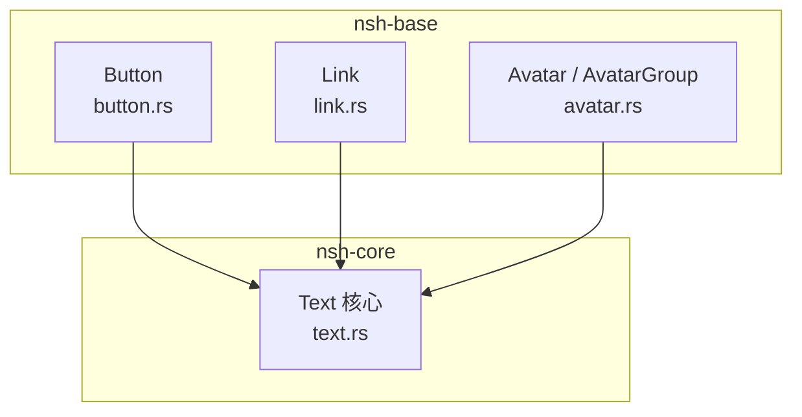
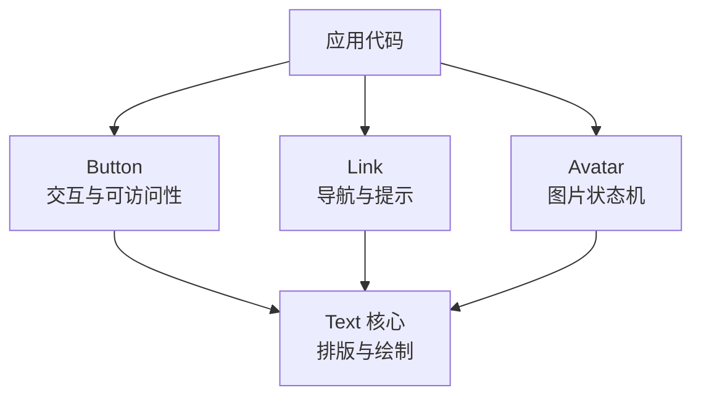
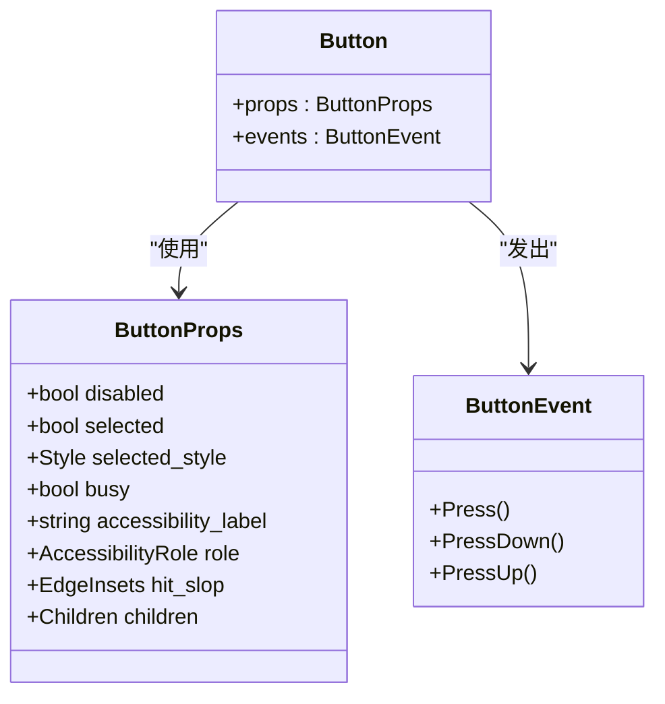
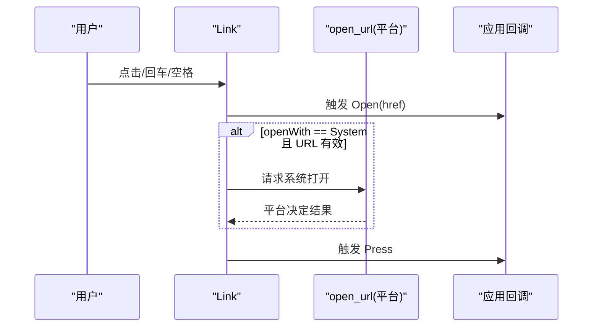
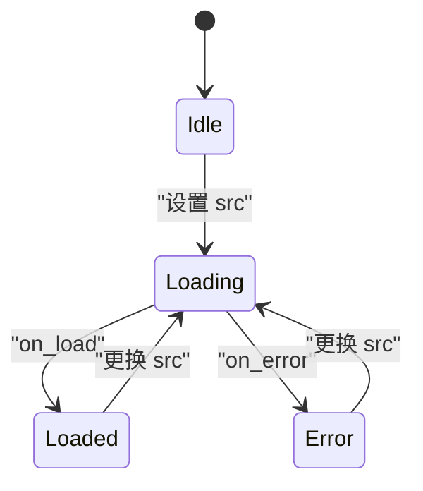
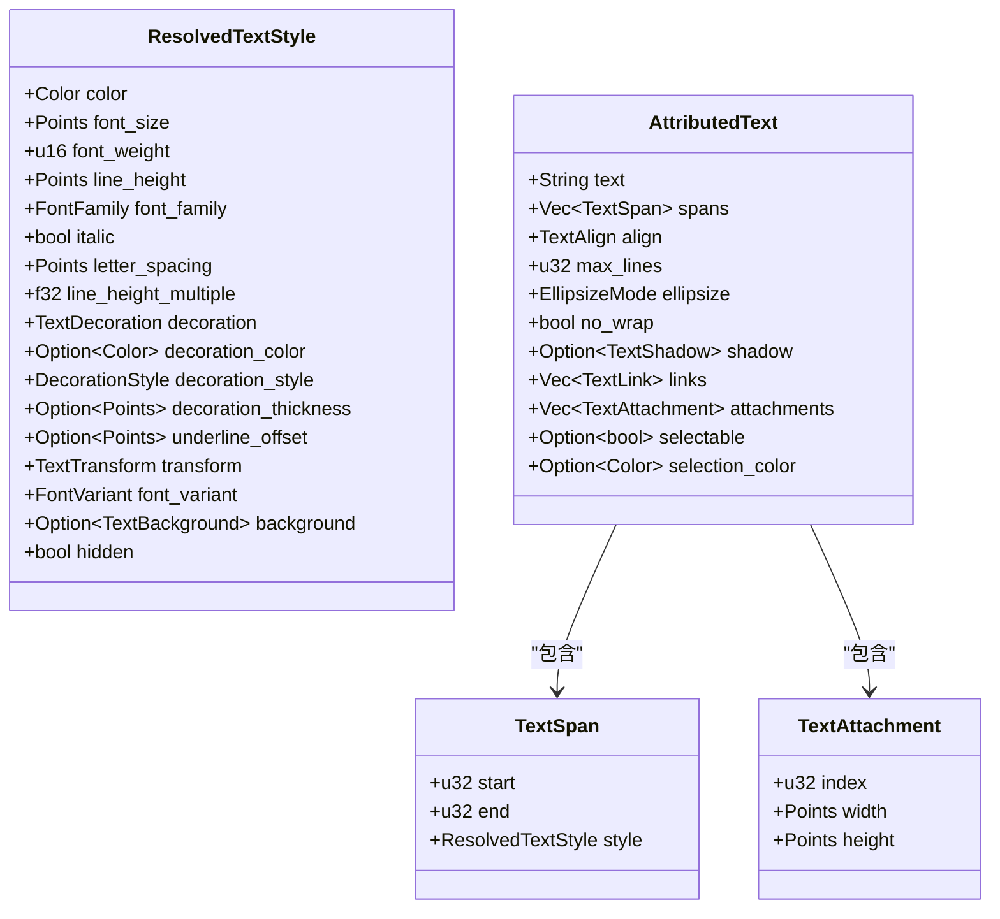
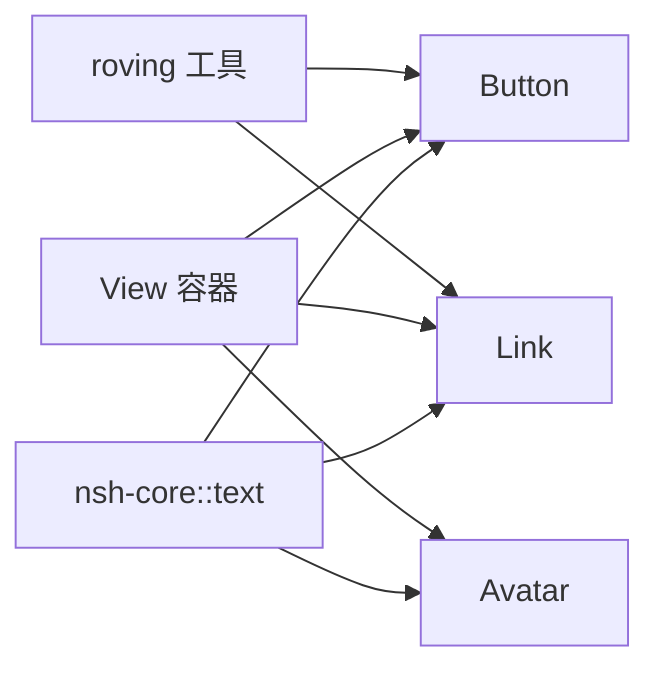

# 基础控件

<cite>
**本文引用的文件**   
- [button.rs](file://crates/nsh-base/src/button.rs)
- [link.rs](file://crates/nsh-base/src/link.rs)
- [avatar.rs](file://crates/nsh-base/src/avatar.rs)
- [text.rs](file://crates/nsh-core/src/text.rs)
</cite>

## 目录
1. [简介](#简介)
2. [项目结构](#项目结构)
3. [核心组件](#核心组件)
4. [架构总览](#架构总览)
5. [详细组件分析](#详细组件分析)
6. [依赖关系分析](#依赖关系分析)
7. [性能考虑](#性能考虑)
8. [故障排查指南](#故障排查指南)
9. [结论](#结论)
10. [附录](#附录)

## 简介
本章节面向 NSH 的基础 UI 控件，提供 Button（按钮）、Text（文本）、View（视图容器）、Link（链接）、Avatar（头像）等核心控件的完整 API 参考与使用指南。文档涵盖属性、事件处理、样式定制、可访问性、主题化配置、生命周期与状态管理、响应式行为、组合模式与最佳实践，并给出性能优化建议。

## 项目结构
NSH 的基础控件实现位于 crates/nsh-base/src 下，其中：
- Button、Link、Avatar 等基础控件在 nsh-base 中定义
- Text 的核心渲染与排版能力由 nsh-core 提供

**图示来源**
- [button.rs:1-83](file://crates/nsh-base/src/button.rs#L1-L83)
- [link.rs:1-152](file://crates/nsh-base/src/link.rs#L1-L152)
- [avatar.rs:1-336](file://crates/nsh-base/src/avatar.rs#L1-L336)
- [text.rs:1-800](file://crates/nsh-core/src/text.rs#L1-L800)

**章节来源**
- [button.rs:1-83](file://crates/nsh-base/src/button.rs#L1-L83)
- [link.rs:1-152](file://crates/nsh-base/src/link.rs#L1-L152)
- [avatar.rs:1-336](file://crates/nsh-base/src/avatar.rs#L1-L336)
- [text.rs:1-800](file://crates/nsh-core/src/text.rs#L1-L800)

## 核心组件
本节概述各基础控件的职责与边界：
- Button：无外观的按压目标，负责交互状态与可访问性语义，外观交由应用层通过 class/style 控制
- Link：可导航的按压目标，支持系统或应用内打开方式，具备悬停提示与可访问性语义
- Avatar：人物头像，包含图片加载状态机与回退显示（首字母/自定义占位），并提供 AvatarGroup 分组展示
- Text：富文本与行内元素（含链接、附件、背景高亮等）的排版与渲染核心
- View：通用视图容器（概念性说明见后文“概念总览”）

**章节来源**
- [button.rs:1-83](file://crates/nsh-base/src/button.rs#L1-L83)
- [link.rs:1-152](file://crates/nsh-base/src/link.rs#L1-L152)
- [avatar.rs:1-336](file://crates/nsh-base/src/avatar.rs#L1-L336)
- [text.rs:1-800](file://crates/nsh-core/src/text.rs#L1-L800)

## 架构总览
下图展示了基础控件与核心文本引擎之间的协作关系：Button/Link 作为交互入口，Avatar 管理图片资源与状态，Text 提供文本与行内元素的布局与绘制能力。

**图示来源**
- [button.rs:1-83](file://crates/nsh-base/src/button.rs#L1-L83)
- [link.rs:1-152](file://crates/nsh-base/src/link.rs#L1-L152)
- [avatar.rs:1-336](file://crates/nsh-base/src/avatar.rs#L1-L336)
- [text.rs:1-800](file://crates/nsh-core/src/text.rs#L1-L800)

## 详细组件分析

### Button（按钮）
- 职责
  - 提供按压交互（按下、抬起、取消）与焦点/键盘可达性
  - 暴露 disabled、selected、busy 等状态，供应用层驱动样式
  - 为屏幕阅读器提供角色与辅助标签
- 关键属性
  - disabled：禁用态；不可按压，呈现禁用样式，读屏器会播报“已禁用”
  - selected：选中态；用于切换触发器或当前标签页
  - selected_style：选中态样式（通过 selected: 类名）
  - busy：忙碌态；表示动作进行中，读屏器会播报
  - accessibility_label：当内容不足以表达用途时，为读屏器提供描述
  - role：可访问性角色（默认 button）
  - hit_slop：扩大点击区域（不改变布局与外观）
  - children：按钮内容
- 事件
  - Press：按钮被按下
  - PressDown：按下开始
  - PressUp：按下结束（释放、移出或取消）
- 样式与主题
  - 通过 class/style 设置外观；状态类包括 active:、hover:、focus-visible:、selected:、disabled:
  - 也可通过 activeStyle/hoverStyle/focusVisibleStyle/selectedStyle/disabledStyle 进行样式注入
- 可访问性
  - 自动设置 AccessibilityRole::Button
  - 可选 accessibility_label
  - 通过 accessibility_state 暴露 selected/busy 状态
- 使用示例路径
  - 参见测试用例：[tests/base/button.rs](file://crates/nsh-base/tests/base/button.rs)

**图示来源**
- [button.rs:7-41](file://crates/nsh-base/src/button.rs#L7-L41)
- [button.rs:43-52](file://crates/nsh-base/src/button.rs#L43-L52)
- [button.rs:65-82](file://crates/nsh-base/src/button.rs#L65-L82)

**章节来源**
- [button.rs:7-82](file://crates/nsh-base/src/button.rs#L7-L82)

### Link（链接）
- 职责
  - 提供可导航的按压目标，支持系统或应用内打开
  - 悬停时显示链接提示（title 与 href）
  - 为屏幕阅读器提供 Link 角色与当前页面语义
- 关键属性
  - href：链接地址或应用内路径
  - title：悬停提示标题（非内容、非可访问名称）
  - open_with：打开方式（System/App）
  - disabled：禁用态
  - current：当前页面标记（ARIA current="page"）
  - accessibility_label：读屏器描述
  - hit_slop：扩大点击区域
  - children：可见内容
- 事件
  - Open(href)：链接尝试打开（先于 Press）
  - Press：链接被按下（无论是否成功打开）
- 样式与主题
  - 通过 class/style 设置外观；状态类包括 hover:、active:、focus-visible:、disabled:
  - 启用时指针样式为 Pointer
- 可访问性
  - 自动设置 AccessibilityRole::Link
  - 可选 accessibility_label
  - 通过 accessibility_state 暴露 current 状态
- 使用示例路径
  - 参见测试用例：[tests/base/link.rs](file://crates/nsh-base/tests/base/link.rs)

**图示来源**
- [link.rs:100-151](file://crates/nsh-base/src/link.rs#L100-L151)

**章节来源**
- [link.rs:10-77](file://crates/nsh-base/src/link.rs#L10-L77)
- [link.rs:100-151](file://crates/nsh-base/src/link.rs#L100-L151)

### Avatar（头像）与 AvatarGroup（头像组）
- 职责
  - Avatar：展示人物头像，处理图片加载状态与回退显示（首字母或自定义占位）
  - AvatarGroup：按限制数量展示前 N 个头像，并显示溢出部分（如“+N”）
- 关键属性（Avatar）
  - src：图片源（URL/asset/data/imported image）
  - name：人物姓名（用于读屏与默认首字母）
  - accessibility_label：覆盖 name 的可访问性标签
  - fallback_delay：回退延迟（毫秒），避免闪烁
  - image_class/image_style：图片层样式
  - fallback_class/fallback_style：回退层样式
  - fallback：自定义回退内容
  - children：叠加在图片上的内容（如在线状态点）
- 关键属性（AvatarGroup）
  - limit：最多显示数量（默认 3）
  - total：总人数（未传则按子节点数）
  - accessibility_label：组的读屏描述
  - overflow_class/overflow_style：溢出部分样式
  - overflow_accessibility_label：溢出部分的读屏描述
  - overflow：溢出内容（如“+5”）
  - children：头像列表
- 事件（Avatar）
  - StatusChange(status)：图片状态变化（Idle/Loading/Loaded/Error）
- 状态机
  - Idle → Loading → Loaded
  - Idle → Error
  - 新 src 重置为 Loading
- 可访问性
  - 整体作为 Image 角色，name/accessibility_label 作为标签
  - 空 label 时视为装饰性元素，隐藏内部子元素
- 使用示例路径
  - 参见测试用例：[tests/base/avatar.rs](file://crates/nsh-base/tests/base/avatar.rs)

**图示来源**
- [avatar.rs:13-25](file://crates/nsh-base/src/avatar.rs#L13-L25)
- [avatar.rs:101-200](file://crates/nsh-base/src/avatar.rs#L101-L200)

**章节来源**
- [avatar.rs:13-85](file://crates/nsh-base/src/avatar.rs#L13-L85)
- [avatar.rs:101-200](file://crates/nsh-base/src/avatar.rs#L101-L200)
- [avatar.rs:236-313](file://crates/nsh-base/src/avatar.rs#L236-L313)

### Text（文本）
- 职责
  - 提供富文本排版、行内样式、链接、附件、背景高亮、选择与复制等能力
  - 为行内元素（如 Link）提供布局与事件路由
- 关键数据结构
  - ResolvedTextStyle：解析后的字符级样式（颜色、字号、字重、行高、字体族、斜体、字间距、装饰线、阴影、变换、OpenType 特性、背景、隐藏等）
  - AttributedText：合并后的富文本块（文本、spans、对齐、最大行数、省略策略、换行、阴影、links、attachments、selectable、selection_color 等）
  - TextSpan：一段具有统一样式的字符区间
  - TextAttachment：行内嵌入的对象（图片/视图）及其尺寸
  - TextLink：行内可点击区间（带事件掩码与焦点停止）
- 关键能力
  - 继承与合并样式（inherit）
  - 近似行高估算（approx_line_height）
  - 可见文本提取（visible_text）
  - 复制文本生成（copied_text）
  - 背景高亮框计算（BackgroundBox.join/radius）
- 使用示例路径
  - 参见网站演示：[website/demos/el-text.tsx](file://website/demos/el-text.tsx)

**图示来源**
- [text.rs:20-62](file://crates/nsh-core/src/text.rs#L20-L62)
- [text.rs:358-404](file://crates/nsh-core/src/text.rs#L358-L404)
- [text.rs:342-354](file://crates/nsh-core/src/text.rs#L342-L354)
- [text.rs:415-423](file://crates/nsh-core/src/text.rs#L415-L423)

**章节来源**
- [text.rs:20-62](file://crates/nsh-core/src/text.rs#L20-L62)
- [text.rs:358-404](file://crates/nsh-core/src/text.rs#L358-L404)
- [text.rs:692-800](file://crates/nsh-core/src/text.rs#L692-L800)

### View（视图容器）
- 职责
  - 作为通用容器，承载布局、样式、事件与可访问性
  - 为 Button/Link/Avatar 等提供基础构建块（如 size_full、absolute、inset_0、opacity 等）
- 典型用法
  - 组合多个子元素形成复杂界面
  - 通过 class/style 控制外观与布局
  - 通过 accessible/accessibility_elements_hidden/role/optional_label 控制可访问性
- 使用示例路径
  - 参见网站演示：[website/demos/el-view.tsx](file://website/demos/el-view.tsx)

**章节来源**
- [avatar.rs:157-200](file://crates/nsh-base/src/avatar.rs#L157-L200)
- [website/demos/el-view.tsx](file://website/demos/el-view.tsx)

## 依赖关系分析
- Button/Link 依赖 roving 工具以参与工具栏/切换组的焦点遍历
- Button/Link/Avatar 均基于 View 构建，复用布局与样式能力
- Text 核心在 nsh-core 中提供，被上层控件消费以实现富文本与行内元素

**图示来源**
- [button.rs:5-6](file://crates/nsh-base/src/button.rs#L5-L6)
- [link.rs:5-8](file://crates/nsh-base/src/link.rs#L5-L8)
- [avatar.rs:8-11](file://crates/nsh-base/src/avatar.rs#L8-L11)
- [text.rs:1-18](file://crates/nsh-core/src/text.rs#L1-L18)

**章节来源**
- [button.rs:1-83](file://crates/nsh-base/src/button.rs#L1-L83)
- [link.rs:1-152](file://crates/nsh-base/src/link.rs#L1-L152)
- [avatar.rs:1-336](file://crates/nsh-base/src/avatar.rs#L1-L336)
- [text.rs:1-800](file://crates/nsh-core/src/text.rs#L1-L800)

## 性能考虑
- Avatar
  - 使用 fallback_delay 避免图片快速加载时的回退闪烁
  - 每个 src 使用独立 key，避免复用节点导致旧事件污染
  - 图片透明过渡（opacity）减少重绘抖动
- Link
  - 仅在非终端环境下附加悬停提示，降低不必要的 DOM/视图开销
- Button
  - 通过 hit_slop 增大点击区域，减少误触导致的重复渲染
- Text
  - 合理设置 selectable 与 selection_color，避免不必要的选择与高亮计算
  - 使用 BackgroundBox.join 合并相邻背景框，减少绘制批次

**章节来源**
- [avatar.rs:101-200](file://crates/nsh-base/src/avatar.rs#L101-L200)
- [link.rs:137-149](file://crates/nsh-base/src/link.rs#L137-L149)
- [text.rs:118-176](file://crates/nsh-core/src/text.rs#L118-L176)

## 故障排查指南
- Button
  - 现象：按钮不可点击
    - 检查 disabled 是否为 true
    - 确认父级 Toolbar/ToggleGroup 是否处于禁用态
    - 验证 hit_slop 是否过小导致点击命中失败
- Link
  - 现象：点击无反应
    - 检查 href 是否为 None
    - 若 openWith=System，确认 URL 格式合法且平台允许打开
    - 检查 disabled 状态
- Avatar
  - 现象：始终显示回退内容
    - 检查 src 是否为空字符串或无效
    - 观察 StatusChange 事件，定位 on_load/on_error 回调
    - 调整 fallback_delay，避免快速加载场景的回退闪烁
- Text
  - 现象：文本不可选或复制异常
    - 检查 selectable 与 selection_color
    - 确认 attachments/copy_texts 是否正确设置

**章节来源**
- [button.rs:10-41](file://crates/nsh-base/src/button.rs#L10-L41)
- [link.rs:24-65](file://crates/nsh-base/src/link.rs#L24-L65)
- [avatar.rs:27-76](file://crates/nsh-base/src/avatar.rs#L27-L76)
- [text.rs:391-404](file://crates/nsh-core/src/text.rs#L391-L404)

## 结论
Button、Link、Avatar 与 Text 共同构成了 NSH 的基础 UI 能力：Button 与 Link 提供一致的交互与可访问性语义，Avatar 管理图片资源与状态，Text 提供强大的富文本与行内元素支撑。通过统一的 class/style 机制与可访问性 API，开发者可以灵活地定制外观与体验，同时保证跨平台的可用性与一致性。

## 附录
- 组合模式与最佳实践
  - 将 Button/Link 作为纯交互壳，外观完全由 class/style 控制，便于主题化
  - 使用 AvatarGroup 控制展示数量，结合 overflow 自定义溢出内容
  - 在 Text 中使用行内 Link 实现富文本中的可点击片段
- 主题化配置
  - 通过 Tailwind 类名与 inline style 组合，集中管理主题变量
  - 利用 selected/hover/active/focus-visible/disabled 等状态类统一风格
- 可访问性
  - 为所有交互控件提供合适的 role 与 label
  - 对装饰性元素（如 Avatar 的子元素）使用 accessibility_elements_hidden 隐藏