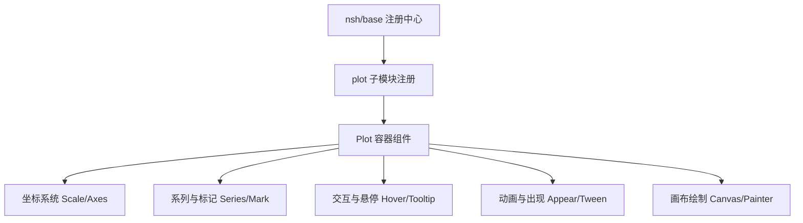
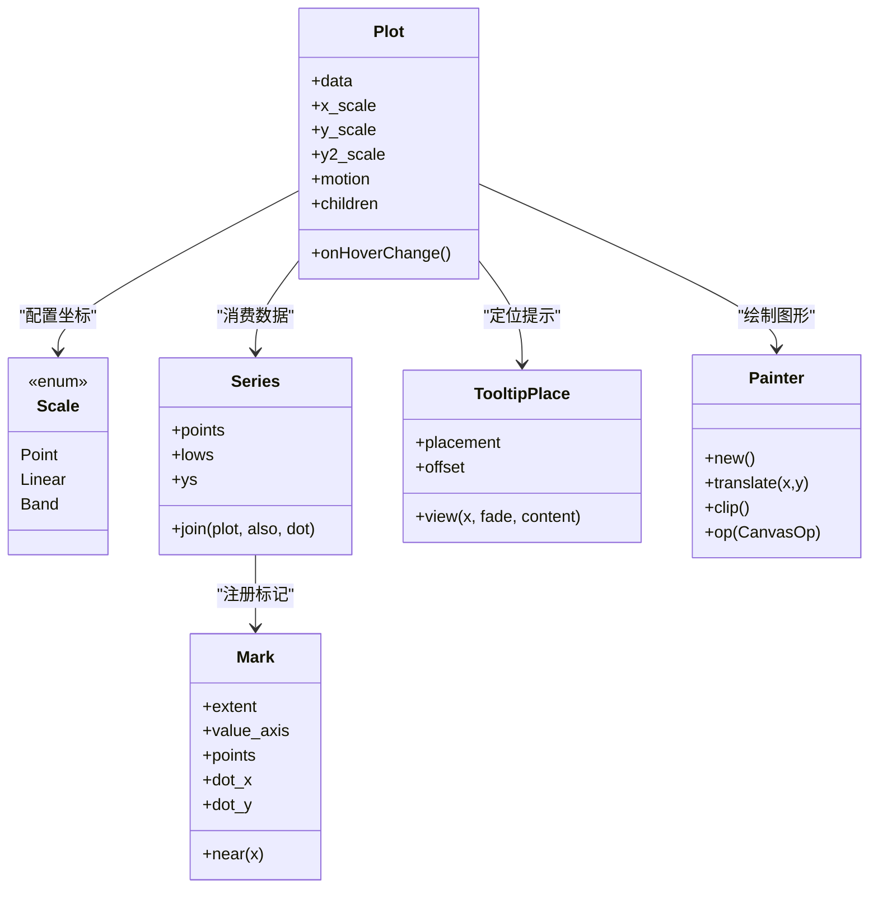
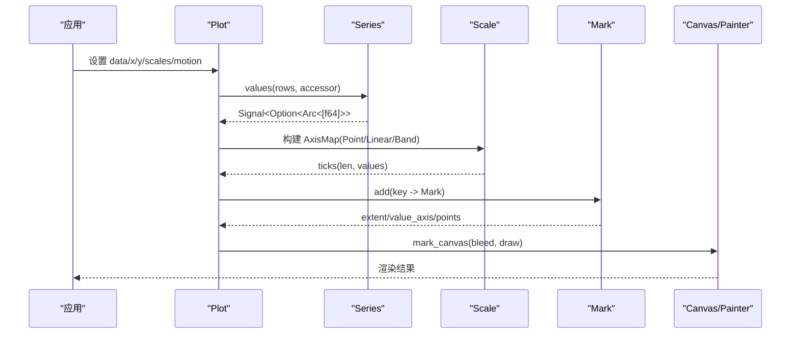
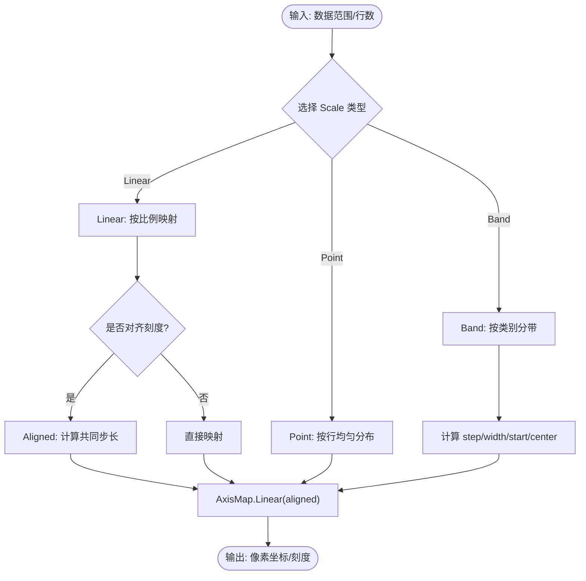
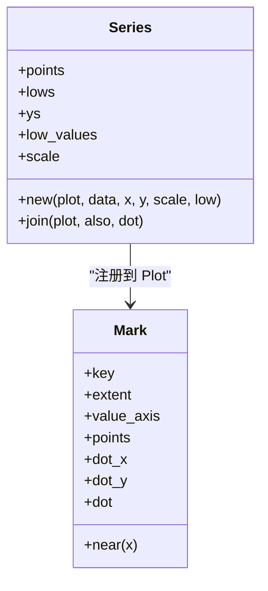
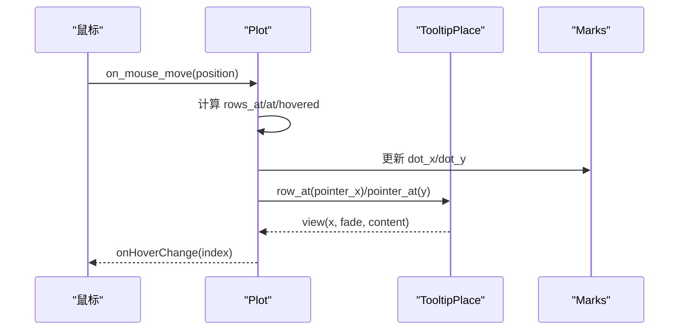
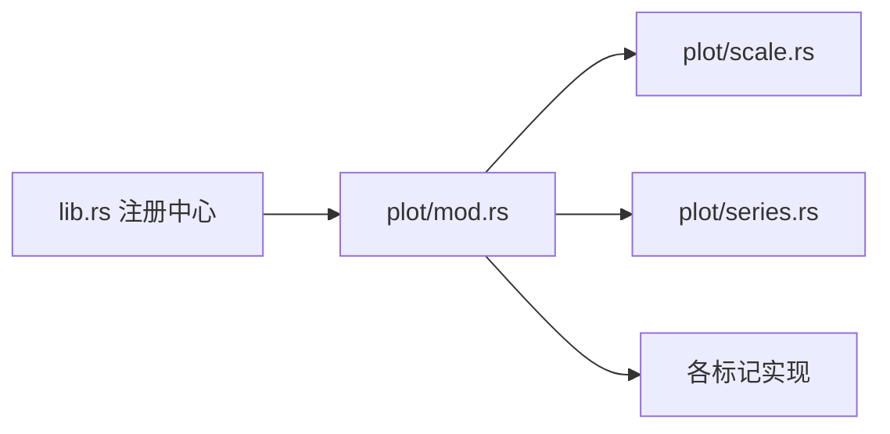

# 图表框架概览

<cite>
**本文引用的文件**   
- [crates/nsh-base/src/lib.rs](file://crates/nsh-base/src/lib.rs)
- [crates/nsh-base/src/plot/mod.rs](file://crates/nsh-base/src/plot/mod.rs)
- [crates/nsh-base/src/plot/scale.rs](file://crates/nsh-base/src/plot/scale.rs)
- [crates/nsh-base/src/plot/series.rs](file://crates/nsh-base/src/plot/series.rs)
</cite>

## 目录
1. [引言](#引言)
2. [项目结构](#项目结构)
3. [核心组件](#核心组件)
4. [架构总览](#架构总览)
5. [详细组件分析](#详细组件分析)
6. [依赖关系分析](#依赖关系分析)
7. [性能与内存管理](#性能与内存管理)
8. [使用模式与最佳实践](#使用模式与最佳实践)
9. [故障排查指南](#故障排查指南)
10. [结论](#结论)

## 引言
本文件为 NSH 图表框架的概览文档，聚焦 Plot 组件的整体架构设计。内容涵盖渲染管线、数据流处理、坐标系统、主题与颜色系统、生命周期管理、性能优化策略、内存管理机制，以及图表组合模式与自定义扩展点的设计原理。文档同时提供架构图表与代码示例路径，帮助读者快速理解并正确使用该框架。

## 项目结构
NSH 的基础 UI 库位于 crates/nsh-base，其中图表子系统以独立模块的形式组织在 plot 目录下。Plot 作为容器组件，聚合多种图形标记（Line、Area、Bar、Rule、Dot、Cell、Grid、Pie、Arc、RadialLine、RadialGrid、Sankey、Treemap），并通过统一的坐标系统与动画机制完成渲染。

**图示来源**
- [crates/nsh-base/src/lib.rs:582-586](file://crates/nsh-base/src/lib.rs#L582-L586)
- [crates/nsh-base/src/plot/mod.rs:107-128](file://crates/nsh-base/src/plot/mod.rs#L107-L128)

**章节来源**
- [crates/nsh-base/src/lib.rs:582-586](file://crates/nsh-base/src/lib.rs#L582-L586)
- [crates/nsh-base/src/plot/mod.rs:1-47](file://crates/nsh-base/src/plot/mod.rs#L1-L47)

## 核心组件
- Plot：图表容器，负责数据读取、坐标映射、交互、动画、悬停与提示框定位，以及子标记的统一绘制上下文。
- Scale：坐标缩放器，支持 point、linear、band 三种类型，并提供对齐刻度、有序类别颜色等能力。
- Series/Mark：数据序列与标记抽象，负责计算点的集合、值域范围、悬停点位置，并向 Plot 注册自身以便参与统一渲染与交互。

**章节来源**
- [crates/nsh-base/src/plot/mod.rs:779-800](file://crates/nsh-base/src/plot/mod.rs#L779-L800)
- [crates/nsh-base/src/plot/scale.rs:13-46](file://crates/nsh-base/src/plot/scale.rs#L13-L46)
- [crates/nsh-base/src/plot/series.rs:16-29](file://crates/nsh-base/src/plot/series.rs#L16-L29)

## 架构总览
下图展示 Plot 组件及其关键子系统的协作关系：数据通过 series 解析为数值与文本；scale 将数据映射到像素坐标；mark 收集点集并贡献值域；hover/tooltip 基于坐标与尺寸进行定位；appear/tween 驱动动画；最终由 canvas/painter 完成绘制。

**图示来源**
- [crates/nsh-base/src/plot/mod.rs:204-342](file://crates/nsh-base/src/plot/mod.rs#L204-L342)
- [crates/nsh-base/src/plot/scale.rs:13-46](file://crates/nsh-base/src/plot/scale.rs#L13-L46)
- [crates/nsh-base/src/plot/series.rs:16-29](file://crates/nsh-base/src/plot/series.rs#L16-L29)
- [crates/nsh-base/src/plot/mod.rs:1467-1655](file://crates/nsh-base/src/plot/mod.rs#L1467-L1655)

## 详细组件分析

### Plot 组件：渲染管线与数据流
- 数据读取：PlotProps.data 提供 Rows，Plot 通过 series::values 读取 x/y 字段或函数，异步 JS 访问器会在下一个事件循环中返回结果，避免阻塞绘制。
- 坐标映射：根据 x_scale、y_scale、y2_scale 构建 AxisMap（Point/Linear/Band），计算每行的像素位置 xs 与 y 轴刻度。
- 值域与对齐：marks 暴露 extent，用于自动计算 y/y2 的值域；当 align_ticks=true 且双轴均为自动时，计算对齐刻度，使两轴共享相同步长。
- 动画与过渡：Appear 控制“出现”动画；Tween 驱动线性轴的 domain 变化，保持网格线、刻度、标签与悬停部件同步移动。
- 交互与悬停：鼠标移动与键盘导航更新 hovered 行索引；cross 线与 hover dots 跟随 cross 坐标；tooltip 由 TooltipPlace 计算并在画布内裁剪。
- 绘制：每个 mark 通过 mark_canvas 创建 CanvasView，Painter 在带 bleed 的区域绘制，确保描边与曲线不被裁切。

**图示来源**
- [crates/nsh-base/src/plot/mod.rs:814-949](file://crates/nsh-base/src/plot/mod.rs#L814-L949)
- [crates/nsh-base/src/plot/series.rs:70-98](file://crates/nsh-base/src/plot/series.rs#L70-L98)
- [crates/nsh-base/src/plot/mod.rs:1727-1770](file://crates/nsh-base/src/plot/mod.rs#L1727-L1770)

**章节来源**
- [crates/nsh-base/src/plot/mod.rs:800-1200](file://crates/nsh-base/src/plot/mod.rs#L800-L1200)
- [crates/nsh-base/src/plot/mod.rs:1200-1800](file://crates/nsh-base/src/plot/mod.rs#L1200-L1800)

### 坐标系统：Scale 与 AxisMap
- Scale 类型：point（按行均匀分布）、linear（按比例映射）、band（按类别分带）。
- LinearScale：独立的线性缩放器，常用于 y2 轴。
- Aligned：对齐刻度算法，保证两个线性轴拥有相同的步数与步长，零值对齐。
- Band：计算 band 宽度、间距、分组与反转方向，支持 max_band_width 限制。
- AxisMap：封装 tick/ticks/band/backward 等方法，供 Plot 与标记使用。

**图示来源**
- [crates/nsh-base/src/plot/scale.rs:13-46](file://crates/nsh-base/src/plot/scale.rs#L13-L46)
- [crates/nsh-base/src/plot/scale.rs:327-400](file://crates/nsh-base/src/plot/scale.rs#L327-L400)
- [crates/nsh-base/src/plot/scale.rs:437-580](file://crates/nsh-base/src/plot/scale.rs#L437-L580)
- [crates/nsh-base/src/plot/scale.rs:582-636](file://crates/nsh-base/src/plot/scale.rs#L582-L636)

**章节来源**
- [crates/nsh-base/src/plot/scale.rs:13-46](file://crates/nsh-base/src/plot/scale.rs#L13-L46)
- [crates/nsh-base/src/plot/scale.rs:224-262](file://crates/nsh-base/src/plot/scale.rs#L224-L262)
- [crates/nsh-base/src/plot/scale.rs:264-333](file://crates/nsh-base/src/plot/scale.rs#L264-L333)
- [crates/nsh-base/src/plot/scale.rs:335-435](file://crates/nsh-base/src/plot/scale.rs#L335-L435)
- [crates/nsh-base/src/plot/scale.rs:437-580](file://crates/nsh-base/src/plot/scale.rs#L437-L580)
- [crates/nsh-base/src/plot/scale.rs:582-636](file://crates/nsh-base/src/plot/scale.rs#L582-L636)

### 系列与标记：Series 与 Mark
- Series：封装一组行的 y 值与可选 low 值，计算 top/bottom 边缘点集，并加入 Plot 的 marks 列表。
- Mark：记录值的 extent、所在 value_axis、点集 points 与悬停点位置 dot_x/dot_y，提供 near(x) 查找最近点。
- colors/texts/values：从 Rows 中读取类别、文本与数值，支持同步与异步访问器，避免绘制期间调用 JS。

**图示来源**
- [crates/nsh-base/src/plot/series.rs:16-29](file://crates/nsh-base/src/plot/series.rs#L16-L29)
- [crates/nsh-base/src/plot/series.rs:162-172](file://crates/nsh-base/src/plot/series.rs#L162-L172)
- [crates/nsh-base/src/plot/series.rs:181-279](file://crates/nsh-base/src/plot/series.rs#L181-L279)

**章节来源**
- [crates/nsh-base/src/plot/series.rs:1-280](file://crates/nsh-base/src/plot/series.rs#L1-L280)

### 主题与颜色系统
- ColorScale：包含 OrdinalScale（类别到颜色）与顺序/发散色阶（数值到颜色）。
- PlotContext.colors/shades：根据类别或数值生成颜色数组，支持未知类别的处理与隐式域扩展。
- paint_of：将颜色应用到 SVGPaint，优先使用 color，否则回退到 initial（如 currentColor）。

**章节来源**
- [crates/nsh-base/src/plot/scale.rs:672-794](file://crates/nsh-base/src/plot/scale.rs#L672-L794)
- [crates/nsh-base/src/plot/mod.rs:711-744](file://crates/nsh-base/src/plot/mod.rs#L711-L744)
- [crates/nsh-base/src/plot/series.rs:131-156](file://crates/nsh-base/src/plot/series.rs#L131-L156)

### 交互与悬停：Hover、Cross Line、Tooltip
- 鼠标移动与离开：更新 pointer_over、cross 坐标与 hovered 行索引，触发 onHoverChange。
- 键盘导航：Left/Right/Home/End/Escape 与屏幕阅读器 increment/decrement 行为一致。
- Cross Line：根据 band 宽度与坐标轴方向显示垂直或水平线。
- TooltipPlace：根据 placement（top/pointer）与 offset 计算位置，并在画布范围内裁剪，避免溢出。

**图示来源**
- [crates/nsh-base/src/plot/mod.rs:1318-1360](file://crates/nsh-base/src/plot/mod.rs#L1318-L1360)
- [crates/nsh-base/src/plot/mod.rs:1467-1655](file://crates/nsh-base/src/plot/mod.rs#L1467-L1655)

**章节来源**
- [crates/nsh-base/src/plot/mod.rs:1071-1152](file://crates/nsh-base/src/plot/mod.rs#L1071-L1152)
- [crates/nsh-base/src/plot/mod.rs:1254-1261](file://crates/nsh-base/src/plot/mod.rs#L1254-L1261)
- [crates/nsh-base/src/plot/mod.rs:1362-1464](file://crates/nsh-base/src/plot/mod.rs#L1362-L1464)

### 动画与出现：Appear 与 Tween
- Appear：控制整体“出现”进度，支持 staggered 让多个标记依次出现。
- Tween：跟踪线性轴的 domain 变化，驱动 x/y/y2 轴的平滑过渡，保持网格、刻度、标签与悬停部件同步。
- motion：包含 pointer/enter/exit/appear/update 等时间参数，支持减少动效模式。

**章节来源**
- [crates/nsh-base/src/plot/mod.rs:130-167](file://crates/nsh-base/src/plot/mod.rs#L130-L167)
- [crates/nsh-base/src/plot/mod.rs:393-433](file://crates/nsh-base/src/plot/mod.rs#L393-L433)
- [crates/nsh-base/src/plot/mod.rs:960-1014](file://crates/nsh-base/src/plot/mod.rs#L960-L1014)

### 绘制与画布：Canvas 与 Painter
- mark_canvas：为每个 mark 创建 CanvasView，带 bleed 区域以避免描边与曲线被裁切。
- Painter：提供 translate/clip/op 等操作，支持变换与裁剪。
- reach：估算曲线超出上下边的距离，确保画布足够大。

**章节来源**
- [crates/nsh-base/src/plot/mod.rs:1694-1770](file://crates/nsh-base/src/plot/mod.rs#L1694-L1770)
- [crates/nsh-base/src/plot/mod.rs:1700-1720](file://crates/nsh-base/src/plot/mod.rs#L1700-L1720)

## 依赖关系分析
- nsh/base 注册中心将 plot 子模块作为子注册表注入，导出 Plot 及相关组件。
- Plot 依赖 scale 模块进行坐标映射，依赖 series 模块解析数据与注册标记。
- 所有标记（Line/Area/Bar/Dot/Cell/Grid/Pie/Arc/RadialLine/RadialGrid/Sankey/Treemap）均通过 PlotContext 获取统一上下文。

**图示来源**
- [crates/nsh-base/src/lib.rs:582-586](file://crates/nsh-base/src/lib.rs#L582-L586)
- [crates/nsh-base/src/plot/mod.rs:107-128](file://crates/nsh-base/src/plot/mod.rs#L107-L128)

**章节来源**
- [crates/nsh-base/src/lib.rs:582-586](file://crates/nsh-base/src/lib.rs#L582-L586)
- [crates/nsh-base/src/plot/mod.rs:107-128](file://crates/nsh-base/src/plot/mod.rs#L107-L128)

## 性能与内存管理
- 数据访问优化：series::values/texts 支持同步与异步访问器，JS 函数在下一事件循环执行，避免绘制帧阻塞。
- 计算缓存：PlotContext 使用 Memo/Signal 缓存 xs、y_map、y2_map、cells、insets 等，减少重复计算。
- 动画优化：Appear/Tween 使用平台动画器，指针驱动的 hover 在同一帧内跟随，避免滞后。
- 绘制优化：mark_canvas 仅在 Plot 已布局后绘制，并使用 bleed 避免额外重绘；终端环境下关闭 bleed 以减少抖动。
- 内存管理：cleanup 在标记销毁时从 marks/insets/hits 列表中移除条目，防止泄漏。

**章节来源**
- [crates/nsh-base/src/plot/series.rs:70-98](file://crates/nsh-base/src/plot/series.rs#L70-L98)
- [crates/nsh-base/src/plot/mod.rs:584-651](file://crates/nsh-base/src/plot/mod.rs#L584-L651)
- [crates/nsh-base/src/plot/mod.rs:1743-1770](file://crates/nsh-base/src/plot/mod.rs#L1743-L1770)

## 使用模式与最佳实践
- 基础用法：在 Plot 中传入 data、x/y 字段或访问器，配置 x_scale/y_scale/y2_scale，添加需要的标记（Line/Area/Bar 等）。
- 双轴图表：为不同系列的值设置 y2_scale，并使用 <PlotAxis placement="right" scale="y2"> 标注右侧轴。
- 对齐刻度：启用 align_ticks=true，使双轴共享相同步长，便于共用 Grid。
- 颜色映射：使用 color_scale 的 ordinal 类型映射类别颜色，或使用 sequential/diverging 映射数值色阶。
- 交互与可访问性：设置 interactive=true 以启用键盘与屏幕阅读器支持；提供 accessibility_label/accessibility_value 提升可访问性。
- 动画配置：通过 motion.appear/update/enter/exit/pointer 控制出现、更新与悬停动画；在减少动效模式下自动禁用。

示例路径（不展示具体代码）：
- 基础 Plot 与标记组合：[crates/nsh-base/src/plot/mod.rs:800-1200](file://crates/nsh-base/src/plot/mod.rs#L800-L1200)
- 双轴与刻度对齐：[crates/nsh-base/src/plot/mod.rs:882-949](file://crates/nsh-base/src/plot/mod.rs#L882-L949)
- 颜色系统使用：[crates/nsh-base/src/plot/scale.rs:672-794](file://crates/nsh-base/src/plot/scale.rs#L672-L794)

**章节来源**
- [crates/nsh-base/src/plot/mod.rs:204-342](file://crates/nsh-base/src/plot/mod.rs#L204-L342)
- [crates/nsh-base/src/plot/mod.rs:882-949](file://crates/nsh-base/src/plot/mod.rs#L882-L949)
- [crates/nsh-base/src/plot/scale.rs:672-794](file://crates/nsh-base/src/plot/scale.rs#L672-L794)

## 故障排查指南
- 无数据显示：检查 data 是否为空，x/y 访问器是否正确返回有限数值；确认 Plot 已布局（size.width.height > 0）。
- 坐标异常：核对 x_scale/y_scale/y2_scale 的类型与 domain；注意 reverse 方向对 Bars 增长方向的影响。
- 刻度不对齐：确认 align_ticks=true 且双轴均为自动域；若一方指定 domain，则不会对齐。
- 悬停错位：检查 hover_axis（band y 轴时为 Across），确认 TooltipPlacement 与 offset 设置合理。
- 动画卡顿：减少复杂曲线与自然曲线的使用；在减少动效模式下禁用动画。

**章节来源**
- [crates/nsh-base/src/plot/mod.rs:814-949](file://crates/nsh-base/src/plot/mod.rs#L814-L949)
- [crates/nsh-base/src/plot/mod.rs:1318-1360](file://crates/nsh-base/src/plot/mod.rs#L1318-L1360)
- [crates/nsh-base/src/plot/mod.rs:1467-1655](file://crates/nsh-base/src/plot/mod.rs#L1467-L1655)

## 结论
NSH 图表框架以 Plot 为核心，通过统一的坐标系统、系列与标记抽象、动画与交互机制，提供了高性能、可扩展的图表渲染能力。其模块化设计与清晰的职责划分，使得开发者可以灵活组合多种标记，定制颜色与主题，并借助丰富的 API 实现复杂的可视化需求。遵循本文档的最佳实践与故障排查建议，可以在实际项目中高效地使用 NSH 图表框架。