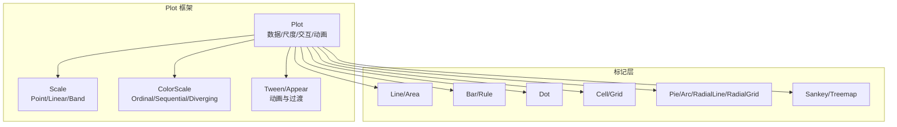
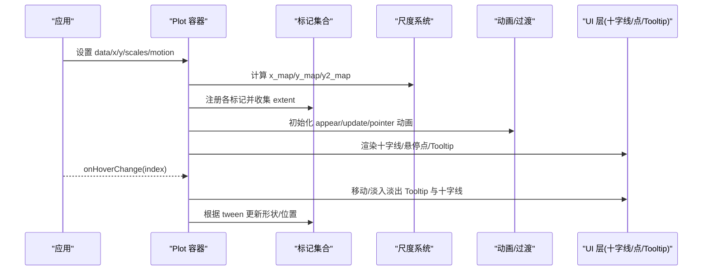
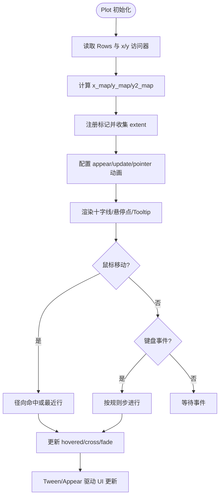
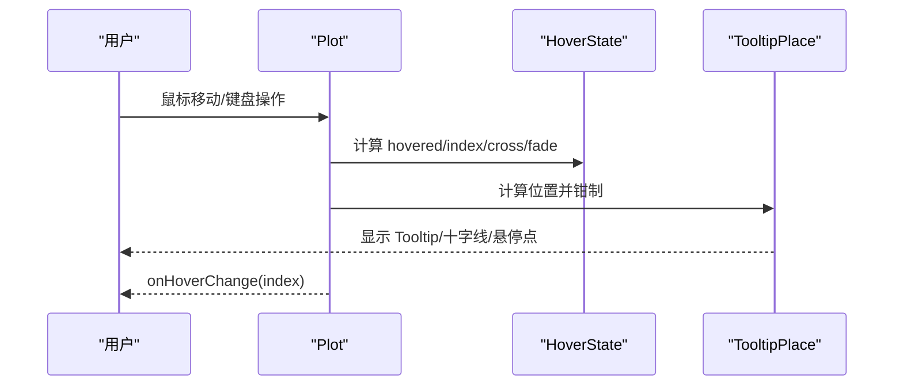
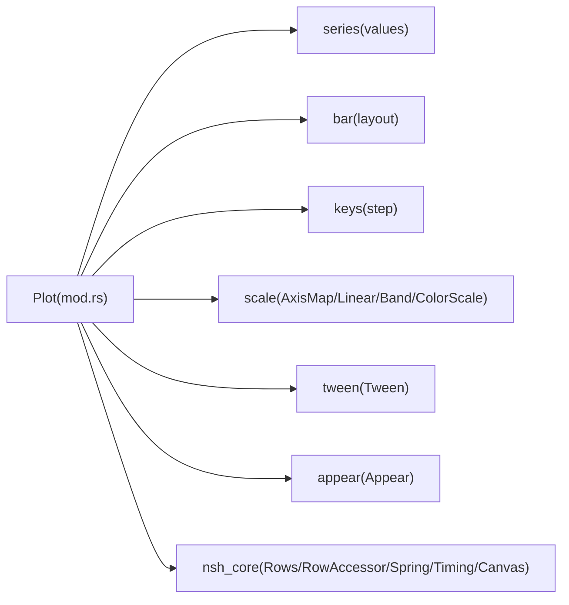

# 图表组件 (Plot)

<cite>
**本文引用的文件**   
- [mod.rs](file://crates/nsh-base/src/plot/mod.rs)
- [scale.rs](file://crates/nsh-base/src/plot/scale.rs)
- [class.rs](file://crates/nsh-base/src/plot/class.rs)
- [plot.md](file://website/elements/plot.md)
</cite>

## 目录
1. [简介](#简介)
2. [项目结构](#项目结构)
3. [核心组件](#核心组件)
4. [架构总览](#架构总览)
5. [详细组件分析](#详细组件分析)
6. [依赖关系分析](#依赖关系分析)
7. [性能与优化](#性能与优化)
8. [故障排查](#故障排查)
9. [结论](#结论)
10. [附录：示例与最佳实践](#附录示例与最佳实践)

## 简介
本章节面向 NSH 的 Plot 图表子系统，系统性说明其基础架构、数据绑定、坐标轴与刻度、图例与颜色映射、交互（悬停提示、键盘导航）、动画与过渡、响应式布局与主题定制，以及扩展自定义图表类型的方法。同时给出性能优化策略（采样、增量更新、GPU 加速）和典型应用场景（数据分析、监控面板）。

## 项目结构
Plot 模块位于 nsh-base 的 plot 子模块中，采用“框架 + 标记”的分层组织：
- 框架层：Plot 容器负责数据、尺度、交互、动画、可访问性与工具提示等通用能力。
- 标记层：Line、Area、Bar、Rule、Dot、Cell、Grid、Pie、Arc、RadialLine、RadialGrid、Sankey、Treemap 等具体图表元素。
- 工具层：Scale（点/线性/区间尺度）、ColorScale（分类/顺序/发散色阶）、RowClass（按行样式）、Tween（数值插值）、Appear（入场动画）等。



图示来源
- [mod.rs:1-128](file://crates/nsh-base/src/plot/mod.rs#L1-L128)
- [scale.rs:1-46](file://crates/nsh-base/src/plot/scale.rs#L1-L46)

章节来源
- [mod.rs:1-128](file://crates/nsh-base/src/plot/mod.rs#L1-L128)

## 核心组件
- Plot 容器
  - 职责：持有 Rows 数据、x/y/y2 尺度、指针与键盘交互、动画（appear/update/enter/exit/pointer）、工具提示定位、可访问性标签与值、十字线与悬停点样式。
  - 关键属性：data、x、y、x_scale、y_scale、y2_scale、align_ticks、interactive、motion、appear_generation、accessibility_label/value、cross_line_class/style、dot_class/style、tooltip_content/placement/offset、color_scale、children。
  - 事件：onHoverChange(index)。
- 尺度 Scale
  - Point：按行序均匀分布；Linear：数值比例映射，支持 domain/reverse；Band：为每行或类别分配条带，支持 paddingInner/Outer、maxBandWidth、bandCount、groupPadding、reverse。
  - LinearScale：独立的线性尺度，用于 y2Scale。
- 颜色映射 ColorScale
  - Ordinal：分类到颜色；Sequential/Diverging：数值到渐变色阶，OKLab 混合，支持 pivot 与 unknown。
- RowClass
  - 按行计算类名（字符串或函数），支持 JS 回调与 Rust 闭包，异步批量计算并缓存结果。

章节来源
- [mod.rs:204-342](file://crates/nsh-base/src/plot/mod.rs#L204-L342)
- [mod.rs:344-391](file://crates/nsh-base/src/plot/mod.rs#L344-L391)
- [scale.rs:13-46](file://crates/nsh-base/src/plot/scale.rs#L13-L46)
- [scale.rs:224-262](file://crates/nsh-base/src/plot/scale.rs#L224-L262)
- [scale.rs:672-794](file://crates/nsh-base/src/plot/scale.rs#L672-L794)
- [scale.rs:800-1096](file://crates/nsh-base/src/plot/scale.rs#L800-L1096)
- [class.rs:1-144](file://crates/nsh-base/src/plot/class.rs#L1-L144)

## 架构总览
Plot 作为容器，将数据读取一次后在 Rust 侧完成缩放、记录与绘制，JS 不逐点执行。交互（悬停、键盘）与动画（平台 animator）也在 Rust 侧驱动，仅向应用暴露高层事件与样式钩子。



图示来源
- [mod.rs:800-1200](file://crates/nsh-base/src/plot/mod.rs#L800-L1200)
- [mod.rs:1200-1800](file://crates/nsh-base/src/plot/mod.rs#L1200-L1800)

## 详细组件分析

### Plot 容器与上下文
- 数据与尺度
  - x_values：从 Rows 中读取 x 字段或索引。
  - x_map/y_map/y2_map：AxisMap 封装 Point/Linear/Band 三种映射，提供 tick/ticks/band/backward 等方法。
  - alignTicks：当 y/y2 均为自动域且均有标记时，对齐刻度步长，使网格共用。
- 动画与过渡
  - Appear：控制入场动画，支持 staggered 错开。
  - Tween：对线性尺度的 domain 进行插值，带动画更新。
- 交互
  - 鼠标移动：径向标记优先命中，否则沿 hover_axis 查找最近行。
  - 键盘：Left/Right/Home/End/Escape 与无障碍 increment/decrement，支持网格步进（Cell）。
  - TooltipPlace：按 placement 与 offset 计算 Tooltip 位置并钳制在 Plot 边界内。
- 可访问性
  - role=image，可选 label 与 value（min/max/now/text），支持键盘操作。



图示来源
- [mod.rs:800-1200](file://crates/nsh-base/src/plot/mod.rs#L800-L1200)
- [mod.rs:1200-1800](file://crates/nsh-base/src/plot/mod.rs#L1200-L1800)

章节来源
- [mod.rs:800-1200](file://crates/nsh-base/src/plot/mod.rs#L800-L1200)
- [mod.rs:1200-1800](file://crates/nsh-base/src/plot/mod.rs#L1200-L1800)

### 尺度与颜色映射
- Scale
  - Point/Linear/Band：统一接口 AxisMap，支持反向 reverse。
  - BandScale：支持 paddingInner/Outer、maxBandWidth、bandCount、groupPadding。
  - aligned：双 Y 轴对齐刻度算法，保证网格共用。
- ColorScale
  - Ordinal：分类到颜色，支持 unknown 与隐式域。
  - Sequential/Diverging：OKLab 渐变色阶，Diverging 支持 pivot。

```mermaid
classDiagram
class Scale {
<<enum>>
+Point{reverse}
+Linear{domain, reverse}
+Band(BandScale)
}
class BandScale {
+domain
+paddingInner
+paddingOuter
+maxBandWidth
+bandCount
+groupPadding
+reverse
}
class AxisMap {
+tick(value)
+ticks(len, values)
+band()
+backward()
}
class ColorScale {
<<enum>>
+Ordinal(OrdinalScale)
+Sequential(SequentialScale)
+Diverging(DivergingScale)
}
class OrdinalScale {
+domain
+range
+unknown
+color(met, category)
}
class SequentialScale {
+domain
+range
+unknown
}
class DivergingScale {
+domain
+pivot
+range
+unknown
}
Scale --> AxisMap : "映射"
BandScale --> Scale : "Band"
ColorScale --> OrdinalScale
ColorScale --> SequentialScale
ColorScale --> DivergingScale
```

图示来源
- [scale.rs:13-46](file://crates/nsh-base/src/plot/scale.rs#L13-L46)
- [scale.rs:68-100](file://crates/nsh-base/src/plot/scale.rs#L68-L100)
- [scale.rs:582-636](file://crates/nsh-base/src/plot/scale.rs#L582-L636)
- [scale.rs:672-794](file://crates/nsh-base/src/plot/scale.rs#L672-L794)
- [scale.rs:800-1096](file://crates/nsh-base/src/plot/scale.rs#L800-L1096)

章节来源
- [scale.rs:13-46](file://crates/nsh-base/src/plot/scale.rs#L13-L46)
- [scale.rs:68-100](file://crates/nsh-base/src/plot/scale.rs#L68-L100)
- [scale.rs:582-636](file://crates/nsh-base/src/plot/scale.rs#L582-L636)
- [scale.rs:672-794](file://crates/nsh-base/src/plot/scale.rs#L672-L794)
- [scale.rs:800-1096](file://crates/nsh-base/src/plot/scale.rs#L800-L1096)

### 标记概览与数据绑定
- Line/Area
  - 通过 y/y1/y0 读取数值，支持 curve（natural/linear/stepAfter）。
  - 背景渐变使用 Area.backgroundClass/backgroundStyle。
  - 颜色来自 colorScale 或 mark.color。
- Bar/Rule
  - Bar：value/base/stack/scale/cornerRadii/stagger/inactiveOpacity/label/background/color。
  - Rule：value/base/scale/stagger/inactiveOpacity/color。
- Dot
  - value/r/rScale/stagger/inactiveOpacity/color/hitRadius/scale/hoverDotClass/style。
- Cell/Grid
  - Cell：x/y/value/color/cornerRadii/stagger/inactiveOpacity/label/labelClass/hoverCellClass。
  - Grid：x/y/ticks/scale。
- Pie/Arc/RadialLine/RadialGrid
  - Pie：value/startAngle/endAngle/padAngle/innerRadius/outerRadius/cornerRadius/sliceClass/sliceStyle/hoverLift/hoverDim/color/label/labelClass/labelGap/labelLineClass。
  - Arc：startAngle/endAngle/innerRadius/outerRadius/cornerRadius。
  - RadialLine：radius/closed/innerRadius/outerRadius。
  - RadialGrid：rings/spokes/outerRadius。

数据绑定要点
- 字段名或函数：在设置 Rows 时读取一次，避免绘制期调用 JS。
- 缺失值跳过：无值的行不参与绘制。
- 颜色映射：分类用 Ordinal，数值用 Sequential/Diverging。

章节来源
- [plot.md:187-232](file://website/elements/plot.md#L187-L232)
- [plot.md:234-303](file://website/elements/plot.md#L234-L303)
- [plot.md:332-365](file://website/elements/plot.md#L332-L365)
- [plot.md:367-460](file://website/elements/plot.md#L367-L460)
- [plot.md:462-550](file://website/elements/plot.md#L462-L550)
- [plot.md:552-674](file://website/elements/plot.md#L552-L674)
- [plot.md:687-751](file://website/elements/plot.md#L687-L751)

### 交互与可访问性
- 悬停与十字线
  - crossLineClass/crossLineStyle 控制十字线样式与宽度（Band 尺度下占满条带）。
  - dotClass/dotStyle 控制系列悬停点样式，支持 mark 级覆盖。
- 工具提示
  - tooltipContent/tooltipPlacement/tooltipOffset：顶部或跟随指针，自动钳制在 Plot 边界内。
- 键盘与无障碍
  - interactive=true 时成为焦点目标，支持 Left/Right/Home/End/Escape 与 increment/decrement。
  - accessibilityLabel/accessibilityValue 提供屏幕阅读器语义。



图示来源
- [mod.rs:1071-1152](file://crates/nsh-base/src/plot/mod.rs#L1071-L1152)
- [mod.rs:1467-1655](file://crates/nsh-base/src/plot/mod.rs#L1467-L1655)

章节来源
- [mod.rs:1071-1152](file://crates/nsh-base/src/plot/mod.rs#L1071-L1152)
- [mod.rs:1467-1655](file://crates/nsh-base/src/plot/mod.rs#L1467-L1655)

### 动画与过渡
- appear：首次展示或 appearGeneration 变化时触发，支持 staggered 错开。
- update：线性尺度 domain 变化时的平滑过渡，带动网格/轴/悬停部件同步移动。
- pointer：键盘步进或屏幕阅读器步进时，十字线/点/Tooltip 以弹簧动画滑动。
- enter/exit：悬停进入/离开的淡入淡出。

章节来源
- [mod.rs:130-167](file://crates/nsh-base/src/plot/mod.rs#L130-L167)
- [mod.rs:960-1014](file://crates/nsh-base/src/plot/mod.rs#L960-L1014)

### 响应式布局与主题定制
- 尺寸自适应：Plot 监听 on_layout 更新 size，尺度 range 随之变化。
- 主题：所有标记使用 SVG paint 属性（stroke-*、fill-*、strokeWidth、strokeDasharray），currentColor 默认回退到 colorScale 的分类色。
- 背景与渐变：Area/Bar 支持 backgroundClass/backgroundStyle，使用 CSS 背景在形状内部显示。

章节来源
- [mod.rs:1318-1321](file://crates/nsh-base/src/plot/mod.rs#L1318-L1321)
- [plot.md:205-213](file://website/elements/plot.md#L205-L213)
- [plot.md:229-232](file://website/elements/plot.md#L229-L232)

## 依赖关系分析
- Plot 依赖
  - series/values：从 Rows 中抽取 x 值序列。
  - bar/layout：条形布局与分组。
  - keys：键盘步进逻辑。
  - scale：AxisMap/Linear/Band/Ordinal/Sequential/Diverging。
  - tween/appear：动画与过渡。
- 外部依赖
  - nsh_core：Rows、RowAccessor、Spring、Timing、CanvasOp、Painter 等。



图示来源
- [mod.rs:28-47](file://crates/nsh-base/src/plot/mod.rs#L28-L47)
- [mod.rs:49-56](file://crates/nsh-base/src/plot/mod.rs#L49-L56)

章节来源
- [mod.rs:28-56](file://crates/nsh-base/src/plot/mod.rs#L28-L56)

## 性能与优化
- 数据读取一次化
  - 在设置 Rows 时一次性读取字段或函数结果，绘制与交互期间不调用 JS，避免逐点开销。
- 增量更新
  - 使用 memo/signal 机制，仅在相关数据变化时重算尺度与布局。
  - motion.update 对线性尺度 domain 做插值，避免整图重绘。
- 采样与裁剪
  - 对于超大数据集，可在应用层进行降采样（如时间窗口聚合）后再传入 Plot。
  - 曲线超出边界的溢出计算（reach）确保 Canvas 正确裁剪，减少无效绘制。
- GPU 加速
  - 底层使用 Painter/CanvasOp 进行原生绘制，路径变换由平台合成器处理；复杂场景建议减少重叠与透明叠加，提升合成效率。
- 内存与对象复用
  - Arc<[f32]> 等共享数组减少拷贝；RowClass 异步批量计算并缓存结果。

章节来源
- [mod.rs:435-514](file://crates/nsh-base/src/plot/mod.rs#L435-L514)
- [mod.rs:1727-1770](file://crates/nsh-base/src/plot/mod.rs#L1727-L1770)
- [class.rs:108-144](file://crates/nsh-base/src/plot/class.rs#L108-L144)

## 故障排查
- 刻度未对齐
  - 检查 alignTicks 是否为 true，并确保 y/y2 均为自动域且都有标记。
- 条带宽度异常
  - 检查 BandScale 的 paddingInner/Outer、maxBandWidth、bandCount、groupPadding 是否合理。
- 颜色未生效
  - 确认 colorScale 已配置，且 mark.color 返回有效分类；若为数值着色，需使用 Sequential/Diverging。
- Tooltip 被遮挡或越界
  - 调整 tooltipPlacement/tooltipOffset，或使用 pointer 模式使其跟随指针并在 Plot 内钳制。
- 动画卡顿
  - 减少复杂背景与透明叠加；必要时关闭不必要的动画（reduce_motion 会自动禁用）。

章节来源
- [mod.rs:882-901](file://crates/nsh-base/src/plot/mod.rs#L882-L901)
- [scale.rs:327-400](file://crates/nsh-base/src/plot/scale.rs#L327-L400)
- [mod.rs:1467-1655](file://crates/nsh-base/src/plot/mod.rs#L1467-L1655)

## 结论
NSH 的 Plot 提供了高性能、可扩展的图表框架：以 Rust 为核心的数据读取与绘制、统一的尺度与颜色映射、丰富的标记类型、完善的交互与可访问性、灵活的动画与主题定制。通过合理的尺度配置、颜色映射与性能优化策略，可构建从简单折线图到复杂热力图、雷达图、桑基图、树形图的多样化可视化方案。

## 附录：示例与最佳实践
- 数据分析
  - 使用 Line/Area 展示趋势，配合 Grid 与 PlotAxis 标注关键阈值；使用 colorScale 区分不同指标。
- 监控面板
  - 使用 Bar/Rule 展示阈值告警；Dot 展示异常点；Cell 展示多维矩阵（如相关性矩阵）。
- 饼图与环形图
  - Pie 展示占比，Arc 展示仪表盘进度；结合 hoverLift/hoverDim 增强交互体验。
- 雷达图
  - RadialLine 多系列对比，RadialGrid 提供网格参考。
- 自定义图表类型
  - 实现新的 Mark：继承 PlotContext，注册到 Plot，定义 points/near 等接口，按需实现 draw 与 hover 行为。
  - 数据转换器：在应用层预处理 Rows，或将函数作为 RowAccessor 传入，避免在绘制期执行 JS。

章节来源
- [plot.md:187-751](file://website/elements/plot.md#L187-L751)
- [mod.rs:1-128](file://crates/nsh-base/src/plot/mod.rs#L1-L128)