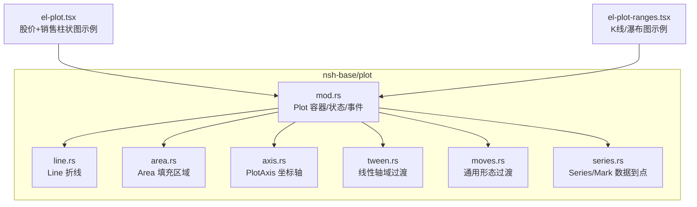
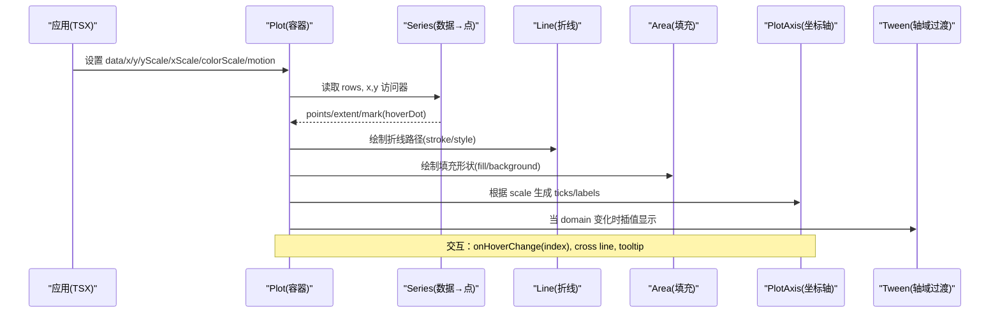
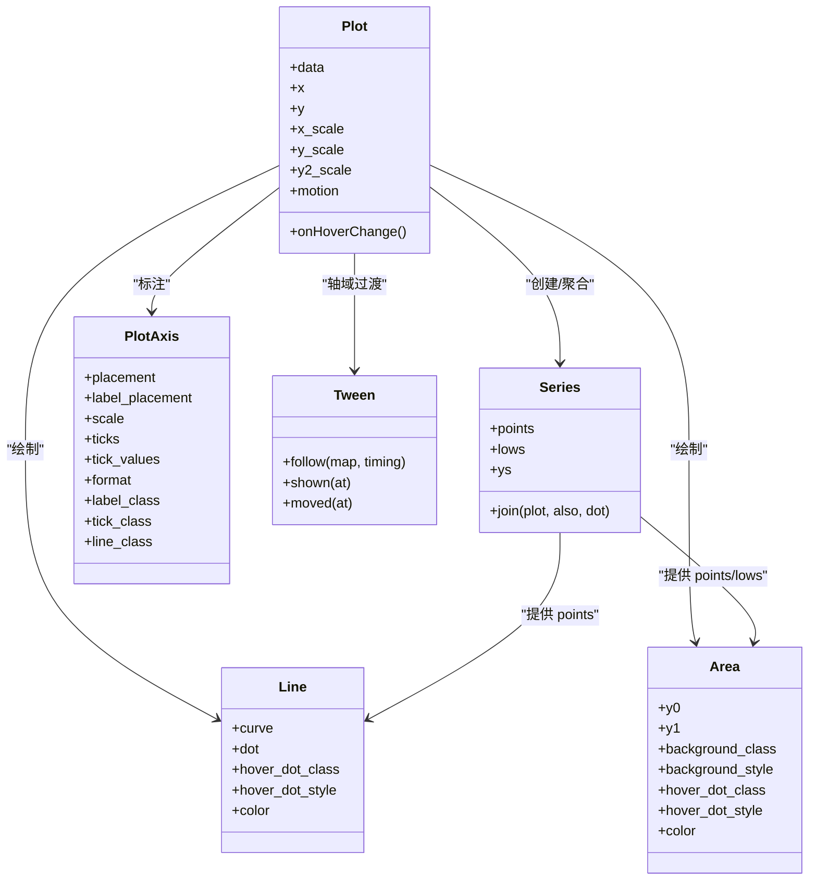

# 折线图（Line Chart）

<cite>
**本文引用的文件**   
- [plot/mod.rs](file://crates/nsh-base/src/plot/mod.rs)
- [plot/line.rs](file://crates/nsh-base/src/plot/line.rs)
- [plot/area.rs](file://crates/nsh-base/src/plot/area.rs)
- [plot/axis.rs](file://crates/nsh-base/src/plot/axis.rs)
- [plot/tween.rs](file://crates/nsh-base/src/plot/tween.rs)
- [plot/moves.rs](file://crates/nsh-base/src/plot/moves.rs)
- [plot/series.rs](file://crates/nsh-base/src/plot/series.rs)
- [website/demos/el-plot.tsx](file://website/demos/el-plot.tsx)
- [website/demos/el-plot-ranges.tsx](file://website/demos/el-plot-ranges.tsx)
</cite>

## 目录
1. [简介](#简介)
2. [项目结构](#项目结构)
3. [核心组件](#核心组件)
4. [架构总览](#架构总览)
5. [详细组件分析](#详细组件分析)
6. [依赖关系分析](#依赖关系分析)
7. [性能与动画](#性能与动画)
8. [故障排查](#故障排查)
9. [结论](#结论)
10. [附录：示例与用法](#附录示例与用法)

## 简介
本文件为 NSH 折线图组件的权威文档，覆盖数据绑定、线条样式（颜色、粗细、虚线）、数据点标记、填充区域、多系列支持、坐标轴配置、时间轴处理、数值范围自动调整、交互（悬停、区域选择、动态更新）、动画过渡与平滑曲线算法，并提供股票走势、传感器监控等场景的实际代码示例路径。

## 项目结构
NSH 图表能力位于 nsh-base 的 plot 模块中，以“可组合部件”的方式构建图表：Plot 持有数据与比例尺，Line/Area/Bar/Rule/Dot/Grid/Axis 等作为子部件绘制。演示位于 website/demos 下的 el-plot*.tsx。

图示来源
- [plot/mod.rs:1-128](file://crates/nsh-base/src/plot/mod.rs#L1-L128)
- [plot/line.rs:1-270](file://crates/nsh-base/src/plot/line.rs#L1-L270)
- [plot/area.rs:1-320](file://crates/nsh-base/src/plot/area.rs#L1-L320)
- [plot/axis.rs:1-226](file://crates/nsh-base/src/plot/axis.rs#L1-L226)
- [plot/tween.rs:1-171](file://crates/nsh-base/src/plot/tween.rs#L1-L171)
- [plot/moves.rs:1-144](file://crates/nsh-base/src/plot/moves.rs#L1-L144)
- [plot/series.rs:1-280](file://crates/nsh-base/src/plot/series.rs#L1-L280)
- [website/demos/el-plot.tsx:1-326](file://website/demos/el-plot.tsx#L1-L326)
- [website/demos/el-plot-ranges.tsx:1-193](file://website/demos/el-plot-ranges.tsx#L1-L193)

章节来源
- [plot/mod.rs:1-128](file://crates/nsh-base/src/plot/mod.rs#L1-L128)

## 核心组件
- Plot：图表容器，管理数据行、x/y/y2 比例尺、指针位置、动画与交互；输出 HoverChange 事件；提供 tooltip、cross line、dot 等可定制部分。
- Line：折线序列，支持 curve（自然/直线/阶梯）、dot/hoverDot、color 系列着色、stroke/strokeWidth/strokeDasharray 样式。
- Area：面积填充，支持 y0 常量或逐行值（形成带状/区间），backgroundClass/backgroundStyle 实现渐变背景，fill/stroke 控制轮廓。
- PlotAxis：坐标轴，支持 placement/label_placement/scale/ticks/tickValues/format/label_class/tick_class/line_class 等。
- Tween/Moves：线性轴域与通用形态的过渡动画。
- Series/Mark：将数据映射为点集，计算 extent、points、hover dot 等。

章节来源
- [plot/mod.rs:204-342](file://crates/nsh-base/src/plot/mod.rs#L204-L342)
- [plot/line.rs:93-146](file://crates/nsh-base/src/plot/line.rs#L93-L146)
- [plot/area.rs:92-154](file://crates/nsh-base/src/plot/area.rs#L92-L154)
- [plot/axis.rs:147-210](file://crates/nsh-base/src/plot/axis.rs#L147-L210)
- [plot/tween.rs:24-49](file://crates/nsh-base/src/plot/tween.rs#L24-L49)
- [plot/moves.rs:26-30](file://crates/nsh-base/src/plot/moves.rs#L26-L30)
- [plot/series.rs:16-30](file://crates/nsh-base/src/plot/series.rs#L16-L30)

## 架构总览
下图展示从应用层到渲染层的调用链与数据流：应用通过 TSX 声明 Plot 及其子部件，Plot 解析数据与比例尺，Series 计算点集，Line/Area 生成路径并绘制，PlotAxis 标注刻度与标签，Tween/Moves 驱动动画。

图示来源
- [plot/mod.rs:779-800](file://crates/nsh-base/src/plot/mod.rs#L779-L800)
- [plot/series.rs:181-247](file://crates/nsh-base/src/plot/series.rs#L181-L247)
- [plot/line.rs:159-216](file://crates/nsh-base/src/plot/line.rs#L159-L216)
- [plot/area.rs:174-319](file://crates/nsh-base/src/plot/area.rs#L174-L319)
- [plot/axis.rs:227-460](file://crates/nsh-base/src/plot/axis.rs#L227-L460)
- [plot/tween.rs:107-151](file://crates/nsh-base/src/plot/tween.rs#L107-L151)

## 详细组件分析

### 数据绑定与多系列
- 数据源：Plot.data 接收 Rows；Line/Area 可拥有独立 data，否则复用 Plot.rows。
- 字段映射：x/y/y1/y0 支持字段名或函数；y2Scale 支持双 Y 轴（scale="y2"）。
- 类别与颜色：color 字段经 colorScale 映射为系列颜色；Line/Area 取首个有类别的行作为系列色。
- 多系列：在同一 Plot 内叠加多个 Line/Area，各自使用 color 区分；也可用 Bar/Rule/Dot 组合复杂系列。

章节来源
- [plot/mod.rs:208-249](file://crates/nsh-base/src/plot/mod.rs#L208-L249)
- [plot/line.rs:97-145](file://crates/nsh-base/src/plot/line.rs#L97-L145)
- [plot/area.rs:96-153](file://crates/nsh-base/src/plot/area.rs#L96-L153)
- [plot/series.rs:131-156](file://crates/nsh-base/src/plot/series.rs#L131-L156)

### 线条样式（颜色、粗细、虚线）
- 颜色：Line.stroke 由 color 或 currentColor 决定；Area.fill 由 color 或 fill-* 决定。
- 粗细：strokeWidth 控制线宽。
- 虚线：strokeDasharray 控制虚线模式。
- 点标记：Line.dot 在每个数据点绘制圆点；hoverDotClass/hoverDotStyle 控制悬停点样式。

章节来源
- [plot/line.rs:115-136](file://crates/nsh-base/src/plot/line.rs#L115-L136)
- [plot/line.rs:195-216](file://crates/nsh-base/src/plot/line.rs#L195-L216)
- [plot/area.rs:122-153](file://crates/nsh-base/src/plot/area.rs#L122-L153)

### 数据点标记与悬停
- 每点标记：Line.dot 开启后，每个数据点渲染一个视图，可通过 dotClass/dotStyle 定制。
- 悬停点：Plot.dotClass/dotStyle 提供全局悬停点样式；Line/Area 的 hoverDotClass/hoverDotStyle 可覆盖。
- 悬停行为：Plot.onHoverChange 返回最近行的 index；cross line 与 tooltip 跟随指针。

章节来源
- [plot/mod.rs:288-324](file://crates/nsh-base/src/plot/mod.rs#L288-L324)
- [plot/line.rs:115-136](file://crates/nsh-base/src/plot/line.rs#L115-L136)
- [plot/area.rs:136-153](file://crates/nsh-base/src/plot/area.rs#L136-L153)

### 填充区域与背景渐变
- 顶部边：Area.y1 对应折线顶边。
- 底部边：Area.y0 可为常量基线或逐行值（形成带状/区间）。
- 背景渐变：backgroundClass/backgroundStyle 在形状内部显示渐变背景；fill 默认 none（当存在 background 时）。
- 描边：Area 同时可描边其顶边，用于强调边界。

章节来源
- [plot/area.rs:20-33](file://crates/nsh-base/src/plot/area.rs#L20-L33)
- [plot/area.rs:122-153](file://crates/nsh-base/src/plot/area.rs#L122-L153)
- [plot/area.rs:248-319](file://crates/nsh-base/src/plot/area.rs#L248-L319)

### 坐标轴与时间轴
- 坐标轴：PlotAxis 支持 placement（top/bottom/left/right）、label_placement（outside/inside）、scale（y/y2）、ticks/tickValues/format/label_class/tick_class/line_class。
- 时间轴：xScale 可使用 linear（domain 为时间戳）或 band（分类时间如星期/月份）；format 可将 tick 值转为可读文本（如日期格式化）。
- 对齐刻度：alignTicks 使 y/y2 共享相同步长，便于双轴网格对齐。

章节来源
- [plot/axis.rs:147-210](file://crates/nsh-base/src/plot/axis.rs#L147-L210)
- [plot/mod.rs:221-249](file://crates/nsh-base/src/plot/mod.rs#L221-L249)

### 数值范围自动调整
- 自动域：未显式设置 yScale.domain 时，按参与绘制的 mark 的值范围自动计算。
- 对齐步长：alignTicks=true 时，y/y2 自动扩展为友好步长（1/2/5×10^n），保持零点对齐与相近刻度数。
- 动态更新：当数据变化导致 extent 变化，Plot 会重新计算域并通过 Tween 平滑过渡到新域。

章节来源
- [plot/mod.rs:229-259](file://crates/nsh-base/src/plot/mod.rs#L229-L259)
- [plot/series.rs:249-278](file://crates/nsh-base/src/plot/series.rs#L249-L278)
- [plot/tween.rs:107-151](file://crates/nsh-base/src/plot/tween.rs#L107-L151)

### 交互功能（悬停、区域选择、动态更新）
- 悬停：Plot.interactive=true 时报告 onHoverChange(index)，并显示 cross line、hover dots、tooltip。
- 区域选择：结合 Grid/Rule/Bar 等部件，可在同一 Plot 上叠加参考线与高亮带，实现视觉上的“区域选择”。
- 动态更新：data/x/y 等 prop 变化触发重算；motion.update 启用时，新域与新形态通过动画过渡。

章节来源
- [plot/mod.rs:261-287](file://crates/nsh-base/src/plot/mod.rs#L261-L287)
- [plot/moves.rs:16-30](file://crates/nsh-base/src/plot/moves.rs#L16-L30)

### 动画与平滑曲线
- 出现动画：appearGeneration 控制首次出现与切换时的 draw-in；motion.appear 控制时长与缓动。
- 形态过渡：motion.update 控制轴域与形态（如 Pie/Arc/Radar）的过渡；Tween 对线性轴域做仿射插值。
- 平滑曲线：Curve.Natural 使用三次贝塞尔连接相邻点的切线，Curve.Linear 为直线段，Curve.StepAfter 为阶梯。

章节来源
- [plot/mod.rs:130-167](file://crates/nsh-base/src/plot/mod.rs#L130-L167)
- [plot/tween.rs:1-16](file://crates/nsh-base/src/plot/tween.rs#L1-L16)
- [plot/line.rs:14-27](file://crates/nsh-base/src/plot/line.rs#L14-L27)
- [plot/line.rs:31-58](file://crates/nsh-base/src/plot/line.rs#L31-L58)

## 依赖关系分析

图示来源
- [plot/mod.rs:204-342](file://crates/nsh-base/src/plot/mod.rs#L204-L342)
- [plot/series.rs:16-30](file://crates/nsh-base/src/plot/series.rs#L16-L30)
- [plot/line.rs:93-146](file://crates/nsh-base/src/plot/line.rs#L93-L146)
- [plot/area.rs:92-154](file://crates/nsh-base/src/plot/area.rs#L92-L154)
- [plot/axis.rs:147-210](file://crates/nsh-base/src/plot/axis.rs#L147-L210)
- [plot/tween.rs:24-49](file://crates/nsh-base/src/plot/tween.rs#L24-L49)

## 性能与动画
- 渲染路径：数据解析与点集计算在 Rust 侧完成，避免 JS 每点运行；Canvas/SVG 路径记录一次，动画期间仅变换节点。
- 过渡优化：Tween 使用仿射变换（scale+offset）驱动轴域移动，避免逐帧重算路径；Moves 合并同帧变更，减少多余动画。
- 建议：
  - 大数据量时使用 band/point 尺度并按需采样。
  - 合理设置 motion.update/appear 时长，避免频繁重绘。
  - 使用 alignTicks 减少重复刻度计算。

章节来源
- [plot/tween.rs:1-16](file://crates/nsh-base/src/plot/tween.rs#L1-L16)
- [plot/moves.rs:16-30](file://crates/nsh-base/src/plot/moves.rs#L16-L30)

## 故障排查
- 无数据显示：检查 data 是否为空、y/y1 是否返回有效值；确认 xScale 类型与数据匹配（linear/band/point）。
- 线条不可见：确认 stroke 非 none、strokeWidth 非 0；若设置了 background，Area 的 fill 可能为 none。
- 坐标轴不显示：确保 label_class/tick_class/line_class 至少设置其一；format 函数应纯且稳定。
- 动画异常：检查 motion.update/appear 的 duration 与 reduceMotion；确认 domain 变化前后均为线性尺度。
- 悬停无响应：确认 interactive=true；检查 onHoverChange 回调是否正确挂载。

章节来源
- [plot/mod.rs:261-287](file://crates/nsh-base/src/plot/mod.rs#L261-L287)
- [plot/axis.rs:185-210](file://crates/nsh-base/src/plot/axis.rs#L185-L210)
- [plot/area.rs:122-153](file://crates/nsh-base/src/plot/area.rs#L122-L153)

## 结论
NSH 折线图以 Plot 为核心，配合 Line/Area/Axis/Tween 等部件，提供高性能、可组合、可动画的数据可视化能力。通过灵活的数据绑定、样式系统与交互模型，可快速构建股票走势、传感器监控等丰富场景。

## 附录：示例与用法

### 股票走势（价格折线+面积洗水+参考线）
- 要点：
  - 使用 Plot.data 传入时间序列；yScale.domain 固定或自动。
  - Area 使用 backgroundStyle 实现渐变洗水；Line 使用 strokeWidth 与 hoverDotStyle 突出悬停点。
  - Grid 添加参考线（开盘价）与基准线；PlotAxis 右侧显示数值，底部显示时间。
- 示例路径
  - [website/demos/el-plot.tsx:260-316](file://website/demos/el-plot.tsx#L260-L316)

### 传感器数据监控（实时折线/面积）
- 要点：
  - 使用 appearGeneration 控制每次数据窗口切换的出现动画。
  - 使用 motion.pointer 控制悬停滑动效果；tooltipContent 显示当前值。
  - 通过 onHoverChange 联动外部 UI（如头部数值）。
- 示例路径
  - [website/demos/el-plot.tsx:267-286](file://website/demos/el-plot.tsx#L267-L286)

### K线与瀑布图（Range 类用例）
- 要点：
  - Rule 表示高低差（K线影线），Bar 表示开收盘（K线实体）。
  - Bar.base/value 支持逐行起止值，形成瀑布图。
  - colorScale 按方向（涨/跌）着色。
- 示例路径
  - [website/demos/el-plot-ranges.tsx:156-184](file://website/demos/el-plot-ranges.tsx#L156-L184)
  - [website/demos/el-plot-ranges.tsx:112-143](file://website/demos/el-plot-ranges.tsx#L112-L143)