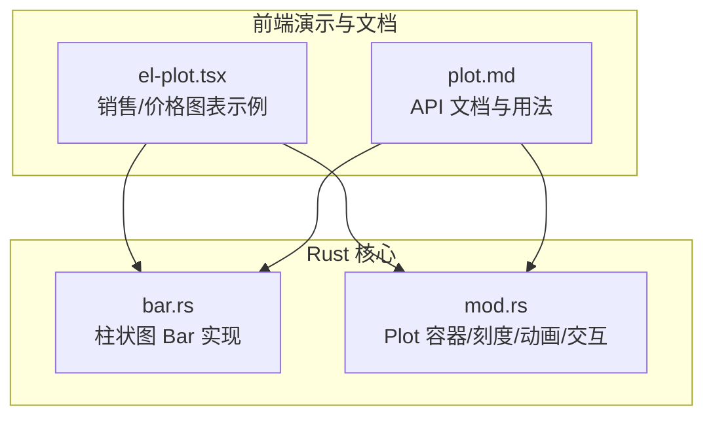
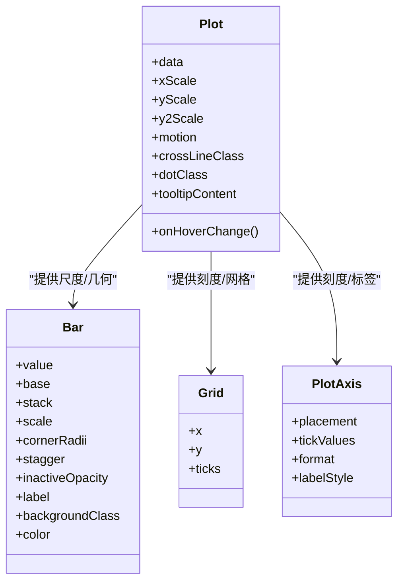
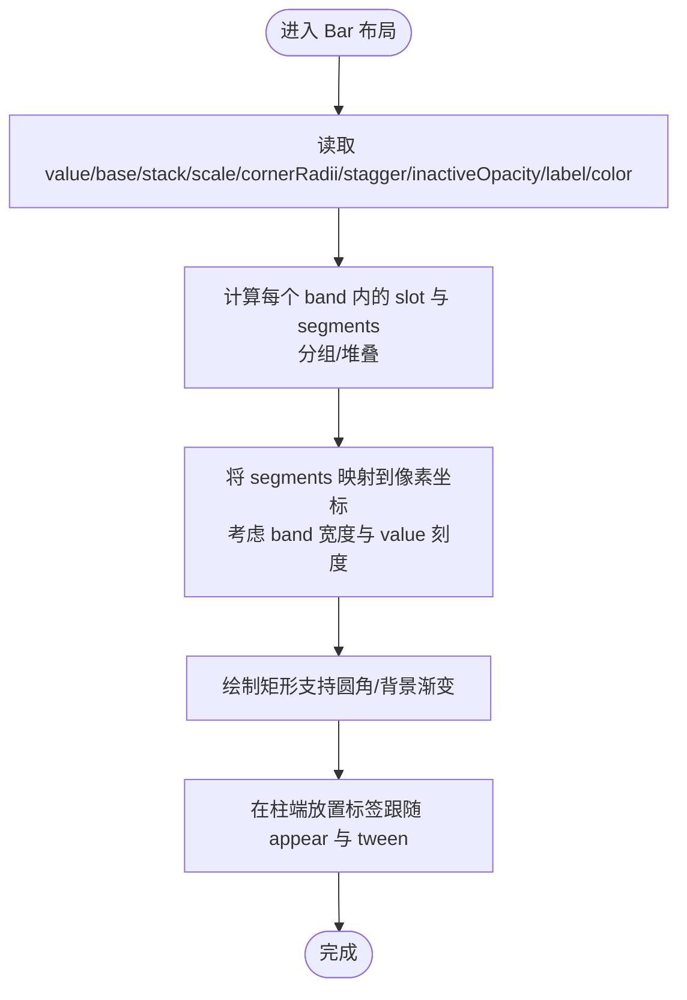
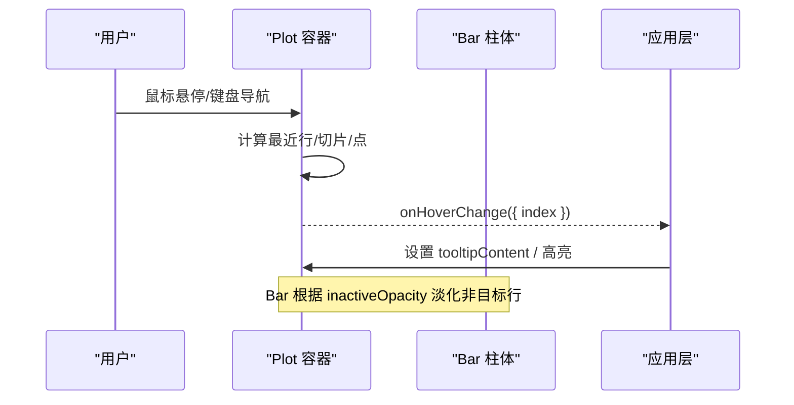
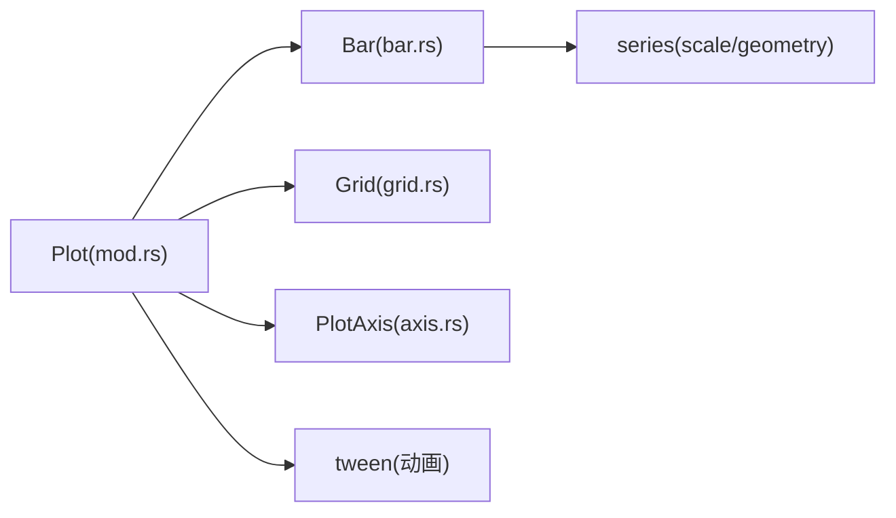

# 柱状图 (Bar Chart)

<cite>
**本文引用的文件**   
- [bar.rs](file://crates/nsh-base/src/plot/bar.rs)
- [mod.rs](file://crates/nsh-base/src/plot/mod.rs)
- [el-plot.tsx](file://website/demos/el-plot.tsx)
- [plot.md](file://website/elements/plot.md)
</cite>

## 目录
1. [简介](#简介)
2. [项目结构](#项目结构)
3. [核心组件](#核心组件)
4. [架构总览](#架构总览)
5. [详细组件分析](#详细组件分析)
6. [依赖关系分析](#依赖关系分析)
7. [性能与大数据优化](#性能与大数据优化)
8. [故障排查](#故障排查)
9. [结论](#结论)
10. [附录：配置速查与示例路径](#附录配置速查与示例路径)

## 简介
本章节面向 NSH 的柱状图（Bar）组件，系统性说明其数据绑定、样式、分组与堆叠、坐标轴与网格、交互（悬停提示、点击事件、缩放与平移）、动画与响应式布局，并给出销售数据、统计报表等实际应用场景的实现思路与参考路径。NSH 的绘图能力位于 `nsh/base/plot`，由 Rust 实现高性能绘制，JS/TS 侧通过声明式属性驱动渲染与交互。

## 项目结构
- Rust 核心实现位于 `crates/nsh-base/src/plot`，其中柱状图逻辑集中在 `bar.rs`，Plot 容器、刻度、动画、交互等公共能力在 `mod.rs`。
- 演示与文档位于 `website/demos/el-plot.tsx` 与 `website/elements/plot.md`，提供 TSX 用法、样式与交互示例。

**图示来源**
- [bar.rs:1-20](file://crates/nsh-base/src/plot/bar.rs#L1-L20)
- [mod.rs:1-26](file://crates/nsh-base/src/plot/mod.rs#L1-L26)
- [el-plot.tsx:1-25](file://website/demos/el-plot.tsx#L1-L25)
- [plot.md:1-21](file://website/elements/plot.md#L1-L21)

**章节来源**
- [bar.rs:1-20](file://crates/nsh-base/src/plot/bar.rs#L1-L20)
- [mod.rs:1-26](file://crates/nsh-base/src/plot/mod.rs#L1-L26)
- [el-plot.tsx:1-25](file://website/demos/el-plot.tsx#L1-L25)
- [plot.md:1-21](file://website/elements/plot.md#L1-L21)

## 核心组件
- Plot 容器：承载数据、坐标轴刻度、指针交互、动画与可访问性。
- Bar 柱体：按行在 band 刻度上绘制垂直或水平柱体，支持分组、堆叠、圆角、标签、背景渐变、颜色映射与悬停淡化。
- Grid 网格线：横纵网格，支持自定义位置与默认 tick 对齐。
- PlotAxis 坐标轴：标注刻度值与分类标签，支持左右两侧与格式化。
- 其他 mark（Line/Area/Dot/Cell/Pie/Arc/RadialLine/RadialGrid/Sankey/Treemap）：与 Bar 共享 Plot 上下文与动画系统。

**章节来源**
- [mod.rs:58-93](file://crates/nsh-base/src/plot/mod.rs#L58-L93)
- [plot.md:8-21](file://website/elements/plot.md#L8-L21)

## 架构总览
Plot 作为容器管理数据与尺度，Bar 作为 mark 读取 Plot 提供的尺度与几何信息，完成绘制；交互（悬停、键盘导航、tooltip）由 Plot 统一处理，Bar 仅负责自身视觉与标签。

**图示来源**
- [mod.rs:204-342](file://crates/nsh-base/src/plot/mod.rs#L204-L342)
- [bar.rs:241-319](file://crates/nsh-base/src/plot/bar.rs#L241-L319)
- [plot.md:95-118](file://website/elements/plot.md#L95-L118)

## 详细组件分析

### 数据绑定与坐标轴
- 数据绑定：Plot.data 接收行数组；Bar.value 指定数值字段或函数；Bar.base 可为常量或每行基线，用于区间柱（瀑布图、K线实体）。
- 坐标轴：xScale/yScale 支持 point/linear/band；band 用于分类与分组；y2Scale 支持双 Y 轴；alignTicks 自动对齐两轴刻度步长。
- 网格与轴标签：Grid 指定 x/y 网格线位置或跟随 PlotAxis 的 ticks；PlotAxis 支持 placement、tickValues、format、labelStyle。

参考路径
- [plot.md:95-118](file://website/elements/plot.md#L95-L118)
- [plot.md:187-203](file://website/elements/plot.md#L187-L203)
- [plot.md:234-302](file://website/elements/plot.md#L234-L302)

**章节来源**
- [plot.md:95-118](file://website/elements/plot.md#L95-L118)
- [plot.md:187-203](file://website/elements/plot.md#L187-L203)
- [plot.md:234-302](file://website/elements/plot.md#L234-L302)

### 柱体样式与分组/堆叠
- 分组：未设置 stack 的 Bar 在同一 band 内并列显示，组间距由 band scale 的 groupPadding 控制。
- 堆叠：相同 stack 名称的 Bar 自下而上堆叠，每行的起始值为前一个 Bar 的结束值；不同 y 轴的堆叠各自独立。
- 样式：cornerRadii 控制圆角；backgroundClass/backgroundStyle 支持渐变背景；color 支持类别色映射；inactiveOpacity 悬停时非目标行淡化。
- 标签：label 支持字段名或函数返回文本；labelClass/labelStyle 控制文本样式与位置。

**图示来源**
- [bar.rs:410-507](file://crates/nsh-base/src/plot/bar.rs#L410-L507)
- [bar.rs:611-705](file://crates/nsh-base/src/plot/bar.rs#L611-L705)
- [bar.rs:772-810](file://crates/nsh-base/src/plot/bar.rs#L772-L810)

**章节来源**
- [bar.rs:241-319](file://crates/nsh-base/src/plot/bar.rs#L241-L319)
- [bar.rs:410-507](file://crates/nsh-base/src/plot/bar.rs#L410-L507)
- [bar.rs:611-705](file://crates/nsh-base/src/plot/bar.rs#L611-L705)
- [bar.rs:772-810](file://crates/nsh-base/src/plot/bar.rs#L772-L810)
- [plot.md:234-302](file://website/elements/plot.md#L234-L302)

### 交互功能（悬停提示、点击事件、缩放与平移）
- 悬停提示：Plot 提供 crossLineClass/dotClass/tooltipContent/tooltipPlacement/tooltipOffset；Bar 不显示 hover dot，但参与 row 级淡化（inactiveOpacity）。
- 点击事件：Plot 暴露 onHoverChange 回调，返回当前行索引；点击行为通常由上层业务封装（如选中、跳转详情）。
- 缩放与平移：Plot 支持 motion.update 对线性刻度的 domain 进行插值过渡；结合外部控件（时间范围选择器）可实现“缩放”；平移可通过更新 x 域或 band 的 bandCount/padding 实现。

**图示来源**
- [mod.rs:204-342](file://crates/nsh-base/src/plot/mod.rs#L204-L342)
- [plot.md:95-123](file://website/elements/plot.md#L95-L123)
- [bar.rs:813-848](file://crates/nsh-base/src/plot/bar.rs#L813-L848)

**章节来源**
- [mod.rs:204-342](file://crates/nsh-base/src/plot/mod.rs#L204-L342)
- [plot.md:95-123](file://website/elements/plot.md#L95-L123)
- [bar.rs:813-848](file://crates/nsh-base/src/plot/bar.rs#L813-L848)

### 动画效果与响应式布局
- 动画：appear/appearGeneration 控制首次出现与再次出现；motion.pointer/enter/exit/update 控制悬停滑动、淡入淡出、domain 变化过渡；Bar.stagger 让柱体逐行生长。
- 响应式：Plot 尺寸变化会触发重绘；band scale 的 maxBandWidth/groupPadding 适配不同屏幕宽度；移动端建议减小字号与标签密度。

参考路径
- [plot.md:133-156](file://website/elements/plot.md#L133-L156)
- [plot.md:234-302](file://website/elements/plot.md#L234-L302)
- [el-plot.tsx:112-160](file://website/demos/el-plot.tsx#L112-L160)

**章节来源**
- [plot.md:133-156](file://website/elements/plot.md#L133-L156)
- [plot.md:234-302](file://website/elements/plot.md#L234-L302)
- [el-plot.tsx:112-160](file://website/demos/el-plot.tsx#L112-L160)

### 实际代码示例与应用场景
- 销售数据（分组/堆叠）：使用 band x 刻度，两个 Bar 分别表示线上与门店销售额；切换 mode 可在分组与堆叠间切换；右侧 PlotAxis 显示 Y 轴刻度，底部 PlotAxis 显示月份。
- 统计报表（区间柱/瀑布图）：Bar.base 为字段名，value 为终点，形成从起点到终点的区间柱；可用于利润桥接、任务跨度等。

参考路径
- [el-plot.tsx:51-66](file://website/demos/el-plot.tsx#L51-L66)
- [el-plot.tsx:89-163](file://website/demos/el-plot.tsx#L89-L163)
- [plot.md:304-331](file://website/elements/plot.md#L304-L331)

**章节来源**
- [el-plot.tsx:51-66](file://website/demos/el-plot.tsx#L51-L66)
- [el-plot.tsx:89-163](file://website/demos/el-plot.tsx#L89-L163)
- [plot.md:304-331](file://website/elements/plot.md#L304-L331)

## 依赖关系分析
- Bar 依赖 PlotContext 提供的尺度（x/y/y2）、动画（appear/tween）、交互状态（hovered/fade）与布局（band groups）。
- Plot 聚合所有 mark（包括 Bar），统一管理刻度、动画、可访问性与事件分发。
- Grid/PlotAxis 与 Bar 共享刻度与尺寸，确保网格线与标签对齐。

**图示来源**
- [mod.rs:435-514](file://crates/nsh-base/src/plot/mod.rs#L435-L514)
- [bar.rs:547-607](file://crates/nsh-base/src/plot/bar.rs#L547-L607)

**章节来源**
- [mod.rs:435-514](file://crates/nsh-base/src/plot/mod.rs#L435-L514)
- [bar.rs:547-607](file://crates/nsh-base/src/plot/bar.rs#L547-L607)

## 性能与大数据优化
- 原生绘制：Plot 与 Bar 在 Rust 中读取数据、计算尺度与绘制，避免 JS 逐点开销，适合千级点以上数据集。
- 增量更新：使用 appearGeneration 与 motion.update 平滑过渡新域与形状，减少全量重绘。
- 合理分片与降采样：对于超大数据集，建议在应用层对数据进行分片展示或降采样（例如按月聚合），再传入 Plot。
- 禁用不必要的交互：当仅需静态展示时，设置 interactive=false 以减少指针跟踪与焦点处理。
- 控制动画复杂度：大数据场景关闭 stagger 或缩短 duration，降低动画帧压力。
- 使用 band 刻度与 maxBandWidth：避免过多分类导致过窄 band，影响可读性与渲染。

参考路径
- [plot.md:8-21](file://website/elements/plot.md#L8-L21)
- [plot.md:133-156](file://website/elements/plot.md#L133-L156)
- [plot.md:234-302](file://website/elements/plot.md#L234-L302)

**章节来源**
- [plot.md:8-21](file://website/elements/plot.md#L8-L21)
- [plot.md:133-156](file://website/elements/plot.md#L133-L156)
- [plot.md:234-302](file://website/elements/plot.md#L234-L302)

## 故障排查
- 未在 band 刻度上使用 Bar：若 xScale 不是 band 且 yScale 也不是 band，Bar 不会绘制并输出警告。请确保至少一个轴为 band。
- 缺失数值或基线：Bar 的行若无 value 或 base，则该行无柱体；堆叠中缺失值会跳过该段。
- 标签不可见：label 文本可能因空间不足被裁剪；调整 labelClass/labelStyle 或增大 Plot 高度。
- 悬停无反馈：确认 interactive=true，并检查 crossLineClass/dotClass/tooltipContent 是否被正确设置。
- 双轴刻度错位：启用 alignTicks 可自动对齐两轴刻度；如需完全自定义，请显式设置 y/y2 的 domain。

参考路径
- [bar.rs:611-626](file://crates/nsh-base/src/plot/bar.rs#L611-L626)
- [plot.md:158-186](file://website/elements/plot.md#L158-L186)

**章节来源**
- [bar.rs:611-626](file://crates/nsh-base/src/plot/bar.rs#L611-L626)
- [plot.md:158-186](file://website/elements/plot.md#L158-L186)

## 结论
NSH 的柱状图组件以 Rust 为核心，提供高性能、可扩展的可视化能力。通过 Plot 容器与 Bar mark 的组合，开发者可以灵活地构建分组/堆叠柱状图、区间柱、瀑布图等常见图表，并结合 Grid/PlotAxis 完善坐标轴与网格。交互方面，悬停提示、键盘导航与 tooltip 开箱即用；动画系统支持 appear、update 与 pointer 平滑过渡。针对大数据场景，建议采用分片/降采样、禁用不必要交互与简化动画策略，以获得更优的性能体验。

## 附录：配置速查与示例路径
- 数据与尺度
  - Plot.data/x/y/xScale/yScale/y2Scale/alignTicks
  - 参考：[plot.md:95-118](file://website/elements/plot.md#L95-L118)
- 柱体 Bar
  - value/base/stack/scale/cornerRadii/stagger/inactiveOpacity/label/backgroundClass/color
  - 参考：[plot.md:234-302](file://website/elements/plot.md#L234-L302)
- 网格与坐标轴
  - Grid.x/y/ticks；PlotAxis.placement/tickValues/format/labelStyle
  - 参考：[plot.md:187-203](file://website/elements/plot.md#L187-L203)
- 交互与动画
  - onHoverChange/crossLineClass/dotClass/tooltipContent/tooltipPlacement/tooltipOffset/motion/appearGeneration
  - 参考：[plot.md:95-123](file://website/elements/plot.md#L95-L123)
- 示例
  - 销售分组/堆叠：[el-plot.tsx:89-163](file://website/demos/el-plot.tsx#L89-L163)
  - 区间柱/瀑布图：[plot.md:304-331](file://website/elements/plot.md#L304-L331)